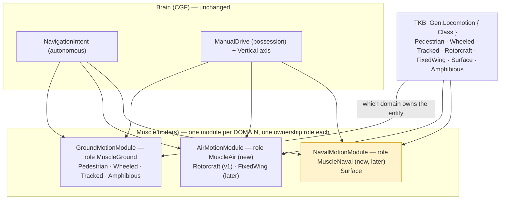
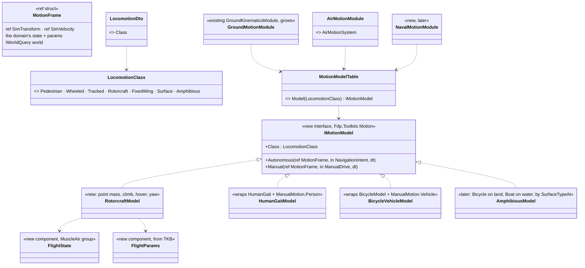
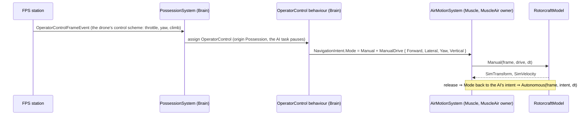

<!--STATUS
state: LIVE
updated: 2026-10-14
build-state: DESIGN — leans MD-A…MD-H not yet approved
current-answer: §3 (the proposal) and §4 (decisions with leans) — §1 measured ground, §2 the requirement.
stale-below: nothing.
known-rot: none.
known-conflict: docs/designs/navig-2/Navigation_Design_v2_0.md §7.1 routes Naval / Flying as extra KinematicsMode values INSIDE CarKinematics ("impl TBD", never built); this proposal gives each domain its own module instead (MD-B) — reconcile on approval.
related-designs:
  - docs/designs/navig-2/Navigation_Design_v2_0.md — OWNS NavigationIntent, the bridge, the path providers (ground navmesh, volumetric) and layer selection; this file decides which MOTION MODEL consumes the intent
  - docs/DESIGN_Entity_Control.md — OWNS possession and manual drive (R-270, R-271 (backend): ManualDrive, KinematicsMode.Manual, FPS = possession by one station); this file makes manual drive per locomotion class (MD-D)
  - docs/DESIGN_Body_Geometry_And_Ground_Contact.md — OWNS body geometry, resting pose and the future "flight / parked motion model" (§3.1, §5); MD-G uses it
  - docs/DESIGN_Ownership_Groups_And_Grants.md — OWNS ownership groups per ROLE (R-172) and the kinematic group (R-170); MD-B adds one group per motion domain
  - docs/DESIGN_World_Query_Seam.md — OWNS "every engine capability behind an interface" (R-250, R-252; §4a: controllers "are motion models — exactly what the production engine will supply"); the motion-model interface is that seam for motion
  - docs/designs/vehicle-tactics/DESIGN_FPV_Drone.md — the first consumer: a rotorcraft on the Air domain, AI-flown and possessable
  - docs/designs/vehicle-tactics/DESIGN_Vehicle_Exposure_Cycle.md — V5 (AI reverse) is a fix inside the ground domain's wheeled / tracked models
-->

# Motion domains — one extendable architecture for people, vehicles, aircraft, boats and amphibians

## 2. The requirement

🔒 User, `2026-10-14`: *"We will need aircraft and boats and amphibious vehicles so we should design for that early, no ad hoc exceptions,
rather initially limited but extendable architecture. Motion needs to stay on muscle node."* · *"Drone will need to be controllable also
from FPS possess mode as any possessable movable entity."* · *"We can ignore stride completely."*

🔒 User, earlier (`.dev/_DONE/modularizing/design-talk.md:171`): *"I want to have different nodes playing the Sim's role, each taking care
of different kind of entities (like aircraft flight model Sim, ground vehicle Sim, human motion Sim etc.) Actually, i want these to be
separated on a ModuleHost's Module level."* — only `GroundKinematicsModule` and `NodeRole.MuscleGround` were ever built.

## 1. What exists — measured `2026-10-14`

| fact | where |
|---|---|
| routing to motion is by COMPONENT, no motion-model seam: `VehicleState + VehicleParams + NavState` ⇒ `CarKinematicsSystem`; `CrowdAgent` ⇒ crowd; else `SimTransform + SimVelocity` ⇒ `LinearKinematicsSystem` (today: projectiles) | `CarKinematicsSystem.cs:80-90`, `LinearKinematicsSystem.cs:91-111` |
| inside CarKinematics the model is an `if`: `Pedestrian ? HumanGait : BicycleModel`, and the same `if` picks `ManualMotion.Person / .Vehicle`; 2.5-D (yaw only, no vertical control) | `CarKinematicsSystem.cs:165-195,339-389,434-436` |
| `TerrainMobility { Tracked, Wheeled, Infantry, Air, Naval }` collapses to `VehicleClass` — **Air and Naval become PersonalCar** | `SimVehicleDef.cs:3-10`, `BdcTkbBuilder.cs:431-439` |
| `KinematicsMode.Crowd / Naval / Flying`, `NavAgentProfile.MobilityProfile`, `NavLayerMask.Naval / Air`: declared, never read or written in production; SimHost composes no volumetric provider | `NavigationEnums.cs:13-27`, `PathfindingSolverSystem.cs:185-192`, `SimHostNodeBootstrapper.cs:319` |
| commands Brain → Muscle: `NavigationIntent` (autonomous, Vector3 destination) and `ManualDrive { Forward, Lateral, Steer, Yaw, Gait, Seq }` (manual) — both Brain group, replicated | `NavigationComponents.cs:230-333`, `ManualDrive.cs`, `HrotOwnershipGroups.cs:45,70` |
| possession: station → `OperatorControlFrameEvent` → `PossessionSystem` (Brain) → `OperatorControl` behaviour → `NavigationIntent.Mode = Manual` + `ManualDrive` → the Muscle's Manual branch; the station knows only person vs vehicle (`FpsCameraDriver.IsVehicle`); "possessable" is no marker — any addressable, live unit | `Possession.cs:117-234`, `OperatorControlBehavior.cs:53-82`, `PossessionStation.cs:194` |
| ownership: one motion role, `MuscleGround` (kinematic group: `SimTransform, SimVelocity, VehicleState, VehicleParams, NavState, NavigationStatus, …`), granted when the template has `VehicleParametersDto` | `HrotOwnershipGroups.cs:78-123`, `NodeRole.cs:89` |
| no naval / boat / amphibious / flight code anywhere | graph + grep |

### INVENTORY — the queries run

| query | total | the set |
|---|---|---|
| `search_graph .*Kinematic.*` (Class) + grep `SimTransform` writers | 6 movers | CarKinematics (+HumanGait, BicycleModel, ManualMotion), CrowdAgentUpdate, LinearKinematics, Ballistics (gravity), EmbarkedState (passengers), DeadReckoningSync (ghosts) |
| `search_graph .*Naval.*\|.*Boat.*\|.*Ship.*\|.*Amphib.*\|.*Flight.*` (Class) | 0 | — |

## 3. The proposal

*What the picture shows that prose hid: the Brain side does not change at all — one autonomous command and one manual command for every
kind of mover; the domains differ only on the Muscle, each in its own module with its own ownership role, so one SimHost can hold all
three (the default) or three nodes can each hold one — the earlier requirement.*

*What the picture shows: one interface, one table from class to model; a module per domain only SCHEDULES its classes' models. A new mover
is a new model + a table row, never a branch in someone else's system. Ground's existing `if Pedestrian` becomes two table rows.*

*Possession of a drone is the existing chain; only the axes and the model differ — the same holds for a boat later.*

## 4. Decisions — each with a lean

| id | question | lean | blast radius / what would change it |
|---|---|---|---|
| **MD-A** | how a type says how it moves | a TKB `Gen.Locomotion { Class }` with the 7 classes; `VehicleClass` stays as the ground preset key; the lossy `Air/Naval → PersonalCar` mapping ends | TKB data + one translator; every existing type maps 1:1 (Infantry→Pedestrian, Wheeled, Tracked) |
| **MD-B** | where each domain runs | **one module per domain** (Ground = the existing module, Air new, Naval later) and **one ownership role per domain** (`MuscleGround`, `MuscleAir`, `MuscleNaval`) with its own kinematic group (R-172); one SimHost holds all by default, a split deployment holds one each | the earlier requirement; ownership groups + node plans; ⚠ supersedes Navigation v2 §7.1's "modes inside CarKinematics" |
| **MD-C** | the seam | `IMotionModel { Autonomous, Manual }` + a class → model table; new domains use it from day one; ground's two branches become `HumanGaitModel` / `BicycleVehicleModel` in its own slice (behaviour-identical, its rails unchanged) | R-250 (engine capability behind an interface); ground refactor is a slice of its own, not a prerequisite for Air |
| **MD-D** | commands and possession | the SAME two commands for every domain: `NavigationIntent` (autonomous, already 3-D) and `ManualDrive` + a `Vertical` axis (climb / dive); the FPS station picks a control scheme by locomotion class instead of `IsVehicle`; any unit with a motion model is possessable — no marker | one wire field; R-270 unchanged |
| **MD-E** | navigation per domain | ground: the navmesh layers (as today); air: the volumetric provider (v1 straight legs between waypoints, obstacles later); naval: the `Naval` navmesh layer (already in the bake parameters); layer selection by locomotion class | Navigation v2 owns the providers |
| **MD-F** | amphibious | ONE model in the Ground domain composing the wheeled and boat integrators, regime chosen each frame by the surface below (`SurfaceTypeAt`); the entity never changes domain on entering water (no ownership move) | needs the boat integrator (Naval) first |
| **MD-G** | grounding (R-249) | each model owns its Z: ground classes clamp to the surface, air never (it lands by `BodyGeometry.RestingPose`), surface rides the water level | ⚠ measured: `GroundClampingConfig` is registered only on IG, so SimHost clamps everything today (assumed, not run) |
| **MD-H** | v1 scope ("initially limited but extendable") | the interface + table, `Gen.Locomotion`, the Air module and role, `RotorcraftModel` (the drone: point mass, hover, climb, yaw, autonomous + manual), the station's air scheme; FixedWing / Surface / Amphibious are enum values and table rows that fail loudly until built | the drone needs exactly this; nothing ground changes in v1 |

⛔ **Rejected:**
- *More `KinematicsMode` values inside CarKinematics* (Navigation v2 §7.1) — every new mover becomes a branch in a ground system, and a
  per-domain node split becomes impossible.
- *The drone's own `PointMassFlightSystem`* (FPV design, first draft) — a one-off mover beside the architecture; it becomes
  `RotorcraftModel` in the Air module.
- *Flyers on `LinearKinematicsSystem`* — that is a projectile integrator with no control, manual or autonomous.
