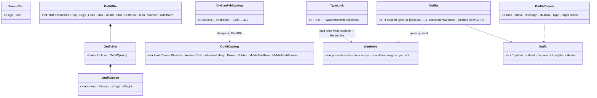
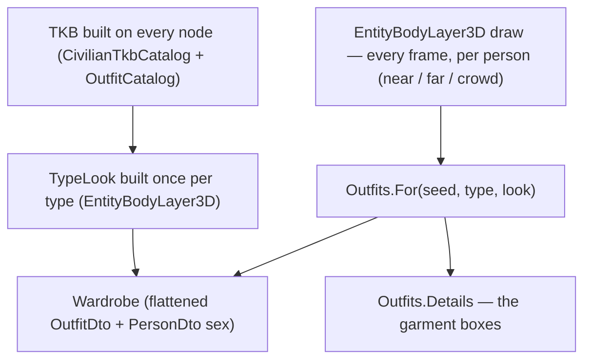
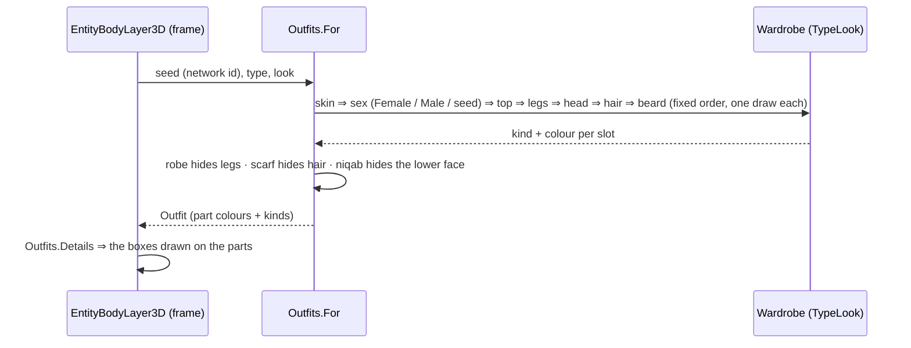

<!--STATUS
state: LIVE
updated: 2026-11-17
build-state: READY-TO-BUILD — OF-1…OF-12 ✅ APPROVED `2026-11-17` (R-4288; the Insurgent 2003 takes the fighter look); handoff HANDOFF_Coordinator_To_Ui_Person_Outfits.md; the direction is ruled (R-4287): the TKB says what a person wears, the seed varies only within the type's lists
current-answer: §0 the ask · §1 inventory · §2 the claim table · §3 decisions · §4 UML · §5 the catalogue content · §6 acceptance · §7 ids · §8 slices
stale-below: none
known-rot: none
known-conflict: DESIGN_Map_3D_Mode.md §6q O-1…O-5 (clothes drawn in CODE from everyday palettes, the woman drawn by chance) — OF-2 / OF-3 replace that; §6q is updated when this is built
related-designs:
  - ../../DESIGN_Map_3D_Mode.md — OWNS the block figure, its parts and details (§6q outfits CE-1099, §6r faces CE-1101, O-4a side camouflage R-1020) that this design moves into the TKB
  - ../../DESIGN_Civilians_And_Crowd_Control.md — OWNS the civilian types and `PersonDto` (§7.6 F-4: age and sex "read by the outfits") that OF-2 finally makes true
  - ../../DESIGN_Add_Entity_Picker.md — OWNS the entity thumbnails (§2j) the new types need
-->

# DESIGN — what a person wears comes from the TKB (CE-4648)

🔒 **User, `2026-11-17`:** *"Do we have any Arabian civilian models, meaning the typical clothes for ordinary guys? Both men, women and children."* ·
*"I do not want it to be automatic. I think the TKB should say what 3D model properties are, including the clothes. Isn't it done like that
already?"* · *"seeded variety within the lists, write the design"* (R-4287).

## 0. The ask

| # | part |
|---|---|
| A | the TKB type states what its people wear — garments, headwear, hair, colours; ⛔ no automatic choice by region or scenario |
| B | variety inside a type is SEEDED from the type's own lists (a crowd is not identical, never outside what was authored) |
| C | Middle-East civilians: men, women and children in their everyday dress |
| D | Middle-East COMBATANTS — armed, in local dress (🔒 user, `2026-11-17`: *"I would like to have also Arabian combatants, meaning that they can have weapons"*) |

## 1. INVENTORY *(measured `2026-11-17`)*

Queries: `search_graph name_pattern=".*(Civilian|Clothing|Outfit|Garment|Appearance|Wardrobe|Costume|CharacterLook|Skin|BodyKit|Humanoid).*" label=Class`
⇒ `Outfit`, `Outfits`, `EntityAppearance`, `ItemAppearance(Dto)`, the civilian behaviour / fear / state classes, `CivilianTkbCatalog` — **no clothing
descriptor**; `search_code "(?i)thobe|dishdasha|keffiyeh|kufiya|shemagh|abaya|hijab|burqa|niqab|arab|middle.?east|headscarf|robe"` ⇒ **0**; grep the same.
⚠ Index coverage cannot be checked through the CLI.

| exists | what it does | file |
|---|---|---|
| `PersonDto` (TKB) | a person type's `Age` (Adult / Child / Elderly) and `Sex` (Unspecified / Male / Female) — *"read by the 3-D outfits"* | `Fdp.Toolkits/Tkb/Domain/PersonDto.cs:22-33` |
| `CivilianTkbCatalog` | 1101 adult male · 1102 adult female · 1103 child · 1104 elderly · 1201–1203 security; one `Civilian(...)` helper stamps `PersonDto` | `Hrot.Core/Tkb/CivilianTkbCatalog.cs:28-35, 60-70` |
| `VisualDefinitionDto.ColorHex` · `EntityAppearance` | ONE colour per type, overridable per entity | `EntityBodyLayer3D.cs:2177`, `Fdp.Core/Components/EntityAppearance.cs` |
| `TypeLook` | what the 3-D map knows of a type: family, size, colour, soldier, child (by HEIGHT), kit, elderly (from `PersonDto.Age`) — ⛔ **not the sex** | `EntityBodyLayer3D.cs:56, 2177-2186` |
| `Outfits.For(seed, type, …)` | ⛔ **the wardrobe is CODE**: hard-coded palettes (skin, hair, tops, child tops, bottoms, suits, ties, muted, grey hair); `woman = r.Chance(0.5f)`; legwear Trousers / Shorts / Skirt; hair Short / Long / None; suit 8–15 %; police and soldier branches | `Map3D/Outfits.cs:44-178` |
| `Outfit` | the per-man result: part colours + legwear, hair, suit, tie, camo, child, soldier, face, police, riot | `Outfits.cs:21-23` |
| `Outfits.Details` | the boxes drawn on parts (skirt, long hair, tie, police cap, vest…) — "turned" details follow the face | `Outfits.cs:199` |
| call sites | per person, per FRAME, in the near and far draws and the crowd paths (struct result, no cache) | `EntityBodyLayer3D.cs:230, 516, 606, 635` |
| `Insurgent` (TKB **2003**) | the armed irregular: rifle + RPG, no helmet or vest (`BodyZonesDto` override), insurgent temperament, the soldier SOP and brain — ⚠ DIS `3.1.*.1` ⇒ class `Infantry` ⇒ `PersonKit.Soldier` ⇒ **drawn in a uniform with the hostile desert camouflage** | `UrbanCombatTkbCatalog.cs:352-382`, `VisualFamilies.PersonKitOf` |
| the armed-people path | a civilian who picks up a weapon becomes a combatant (R-2028) and keeps his own type's look | Civilians / armed people AW-21…AW-23 |
| `MapVisualDef.ModelPath` | a model path field — ⛔ read by nothing in the presentation | `MapVisualDef.cs:16` |

## 2. The claim table

| the design rests on | code — how it IS | design — how it was MEANT |
|---|---|---|
| the clothes are not in the TKB | ✅ `Outfits.cs:44-178` palettes + chances in code | ⛔ searched `docs/` + `.dev/`: no design puts garments in the TKB; §6q O-1 *"his type's colour when it has one, else everyday colours"* |
| ⛔ a FEMALE type is drawn as a man half the time | ✅ `Outfits.cs:155` `woman = r.Chance(0.5f)`; `TypeLook` carries no sex; `CivilianAdultFemale` stamps `Sex = Female` (`CivilianTkbCatalog.cs:65`) and nothing reads it | ✅ Civilians §7.6 F-4: *"Read by the 3-D outfits … so an elderly or female civilian looks it"* ⇒ **a defect** — only `Age` was wired |
| a robe and headwear fit the block figure | ✅ the skirt and long hair are already "turned" detail boxes on parts (`Outfits.Details`) | ✅ §6q |
| one place builds a type's look | ✅ `TypeLook` is built from the TKB once per type (`EntityBodyLayer3D.cs:2160-2186`) | ✅ "one implementation per concept" |
| the proven solution | engines dress crowds from **authored wardrobes**: per character type, a set of slots (top, legs, head, hair) each with weighted options and colour palettes, picked by a seed (Unreal / Unity crowd systems, VBS's "random appearance" lists on a character class) | adopted: it is exactly the user's rule; we take the slot + weighted-option shape, ⛔ not mesh swapping (we draw block figures) |

## 3. Decisions — ✅ approved `2026-11-17` (R-4288)

| # | decision — ⭐ lean | why | rejected — one line |
|---|---|---|---|
| **OF-1** | **ONE TKB descriptor `OutfitDto`** on a person type: slots `Top`, `Legs`, `Head`, `Hair`, `Beard`, `Skin`, each a list of **weighted options** `{ kind, colours[], weight }`; the seed picks an option, then a colour from it | the user's rule; one shape for every slot | a field per garment (grows with every new garment) · a scenario / region switch (automatic — refused by the user) |
| **OF-2** | **the sex and age come from `PersonDto`** — `Female` ⇒ always a woman, `Male` ⇒ always a man, `Unspecified` ⇒ the seed picks (today's behaviour); `Child` from the age band, not the height. An `OutfitDto` may also give per-sex slot lists (`Men` / `Women`) for an `Unspecified` type | fixes the defect (§2 row 2); a type says who it is | keep the 50 % draw (the "adult female" type is a man half the time) |
| **OF-3** | **today's looks become catalogue data**: the everyday civilian, the child, the elderly, the police and the soldier wardrobes move from `Outfits.cs` palettes into `OutfitDto`s (`OutfitCatalog.Western…` constants used by the existing types); a type WITHOUT an `OutfitDto` gets the everyday set. ⭐ The soldier's side camouflage and cloth (R-1020, O-4a) stay a RULE (`Camo = BySide`), not data per side | ONE path in the code; nothing hard-coded left; the existing frames do not change | two paths (code palettes + TKB) — a second implementation |
| **OF-4** | **garment kinds** (the block figure's drawable set): Top — `Shirt`, `TShirt`, `Suit`, `Robe` (to the ankles, long sleeves; legs drawn in its colour), `Abaya` (a robe, wider, to the ground), `Uniform`; Legs — `Trousers`, `Shorts`, `Skirt`, `LongSkirt`, `Hidden` (under a robe); Over — `None`, `ChestRig`; Head — `None`, `Cap`, `PoliceCap`, `RiotHelmet`, `Helmet`, `Shemagh` (a head cloth to the shoulders + the black agal ring), `Skullcap`, `Hijab` (covers hair and neck, face open), `Niqab` (a hijab + a face veil, the eyes open), `ShemaghFaceWrap` (the shemagh drawn across nose and mouth) | the dress the user asked for, drawable as boxes on today's parts | real meshes (no human model pipeline exists — the Stride mannequin is the only one) |
| **OF-5** | **headwear hides hair** (`Hijab`, `Niqab`, `Shemagh`) and a `Niqab` hides the face paint below the eyes; a `Robe` / `Abaya` hides legwear | what the eye sees | drawing hair through a scarf |
| **OF-6** | **seeded, deterministic**: the same `Draw(seed, type)` stream, slots drawn in a FIXED order (skin, sex, top, legs, head, hair, beard), one draw per slot even when a slot has one option — adding an option to one type changes only that type's people | the same person on every node and every frame (§6q O-5) | an order that depends on the options (one new option reshuffles every slot) |
| **OF-7** | ⛔ **no allocation per frame**: the `OutfitDto`'s options are flattened ONCE per type into the `TypeLook` (arrays of colours and cumulative weights); `Outfits.For` reads them by index | the hot-path rule (R-2084) | reading the DTO's lists in the draw |
| **OF-8** | **new catalogue types** (same body, behaviour and `PersonDto` as today's civilians — the one `Civilian(...)` helper): **1105** Middle-East man · **1106** Middle-East woman · **1107** Middle-East boy · **1108** Middle-East girl · **1109** Middle-East elderly man · **1110** Middle-East elderly woman — content §5; each with an entity-picker thumbnail | the user's ask; a scenario places them like any civilian | one "Middle-East civilian" type with `Unspecified` sex (then the author cannot place "a woman") |
| **OF-9** | **who builds**: ui (outfit code, garment drawing, the catalogue rows, thumbnails) — ⛔ **mockups first** (R-4143) of every new garment on the figure | ui owns `Outfits` / the block figure | — |
| **OF-10** | **a combatant is a TYPE too**: the `Insurgent` template (rifle + RPG, no armour, insurgent temperament, soldier brain) with a Middle-East FIGHTER wardrobe — **2010** Middle-East fighter (rifle) · **2011** Middle-East fighter (RPG + rifle) · **2012** Middle-East machine gunner (when a machine-gun mount for a man exists; else held). One helper builds all three from the insurgent template — ⛔ no copy of its descriptors | weapons, behaviour and looks each come from the TKB, the same rule as the civilians | arming a civilian type (it would get a civilian brain) · a scenario switch "armed" (automatic) |
| **OF-11** | **the wardrobe wins over the class**: a type WITH an `OutfitDto` wears it whatever its class; the side camouflage (R-1020) applies only to a `Uniform` top whose `Camo` is `BySide`; the rifle in the hands still follows the class / weapons (`IsSoldier`) | today an `Infantry` class forces a uniform and camouflage (`PersonKitOf`) — that is why the insurgent looks like a soldier | a new person kit per look |
| **OF-12** | **the existing `Insurgent` (2003) gets the fighter wardrobe too** — ⚠ a VISUAL change in the scenarios that place him (5 scenario files; behaviour unchanged, goldens hash components not pixels) | an insurgent in a desert-camo uniform reads as a soldier of the hostile side | leave 2003 as a uniformed man |

## 4. UML

### 4a. Classes

*What the picture shows that prose hid: the TKB holds the whole wardrobe, the presentation flattens it ONCE per type, and the per-frame
`Outfits.For` only indexes it — the hard-coded palettes disappear rather than living beside the data.*

### 4b. Who calls it each frame

### 4c. Dressing one person

## 5. The catalogue content *(weights in %, colours as named; ui tunes the exact RGB against the mockup)*

| type | top | legs | head | hair · beard |
|---|---|---|---|---|
| 1105 man | Robe 70 (white 50 · cream 20 · light grey 15 · light blue 10 · brown 5) · Shirt 30 (everyday) | Hidden under a robe · else Trousers | Shemagh 40 (red-and-white 60 · white 40) · Skullcap 25 (white) · None 35 | short / none · beard 50, moustache 25 |
| 1106 woman | Abaya 85 (black 75 · dark brown 10 · navy 10 · dark green 5) · LongSkirt + long-sleeved top 15 | Hidden / LongSkirt | Hijab 70 (black, dark blue, brown, grey) · Niqab 30 (black) | hidden |
| 1107 boy | Robe 40 (white, light colours) · TShirt 60 (child colours) | Hidden / Trousers 70 · Shorts 30 | Skullcap 20 · None 80 | short |
| 1108 girl | dress = TShirt / long-sleeved top 100 (child colours) | LongSkirt 70 · Trousers 30 | Hijab 35 (light colours) · None 65 | long |
| 1109 elderly man | Robe 85 (white, grey, brown) · Shirt 15 | Hidden / Trousers | Shemagh 60 · Skullcap 25 · None 15 | grey · beard 80 |
| 1110 elderly woman | Abaya 95 (black, dark) | Hidden | Hijab 75 · Niqab 25 | hidden |

| **2010–2012 fighter** (+ 2003) | Shirt + Trousers 40 (drab: khaki, olive, grey, black) · military Jacket + Trousers 30 (olive, khaki, woodland) · Robe 30 (white, grey, brown) — **+ ChestRig 60** (an ammunition vest over the top) | Trousers / Hidden | Shemagh 40 · **ShemaghFaceWrap 25** (the cloth over nose and mouth) · Cap 15 · None 20 | short · beard 85 |

Skin tones for all nine: the four middle tones of today's five (light olive to brown), ⛔ not the palest.

## 6. Acceptance *(R-4277; a visual feature is proved by frames and a scenario)*

| proof | what |
|---|---|
| ⭐ the existing frames UNCHANGED | the everyday, child, elderly, police and soldier figures render pixel-identical before and after OF-3 (the frame rails that already cover them) — the move to data changes nothing |
| OF-11 rail | a type with an `OutfitDto` and class `Infantry` wears its wardrobe, no camouflage; a `Uniform` + `BySide` type keeps R-1020's side cloth |
| OF-2 rail | 200 seeds of type 1102 ⇒ 200 women; 1101 ⇒ 200 men; an `Unspecified` type ⇒ both |
| OF-6 rail | the same seed ⇒ the same outfit on two `TypeLook`s built separately; adding an option to 1105 leaves 1101's people unchanged |
| OF-7 rail | `GC.GetAllocatedBytesForCurrentThread()` over a steady frame of 500 dressed people == 0 |
| ⭐ frames vs mockups (R-4146) | each new garment (robe, abaya, shemagh, skullcap, hijab, niqab) and the six types, rendered next to their mockup |
| scenario `civ-middle-east-market` | 40 people of 1105–1110 in a market street, near and far; checks: the cast present (`field` rows on the type), no errors; its preview image |

## 7. Ids

| what | id |
|---|---|
| TKB types (fighters) | **2010–2012** (the urban-combat range; 2000–2009 in use — measured in `Hrot.Core` Tkb / MapDefinitions on every lane; the builder re-checks the whole tree) |
| TKB types | **1105–1110** (free on every lane branch, measured `2026-11-17`; 1101–1104 civilians, 1201–1203 security) |
| `OutfitDto` | a TKB descriptor — no component id, no wire (the TKB is built the same on every node) |
| tracker / ruling | `CE-4648` (programme row) · decisions to be recorded on approval |

## 8. Slices

| slice | items | done when |
|---|---|---|
| **S1 the data path** | OF-1, OF-2 (the sex defect), OF-3 (today's wardrobes to data), OF-6, OF-7 | every existing person frame identical; the OF-2 / OF-6 / OF-7 rails |
| **S2 the garments** | mockups first; OF-4, OF-5 — the new boxes in `Outfits.Details` | frames vs mockups |
| **S3 the types** | OF-8 + §5 content, thumbnails (`scripts/thumbnails.py --pack`), `civ-middle-east-market` | the scenario passes; frames vs mockups |
| **S4 the fighters** | OF-10, OF-11, OF-12 — the chest rig and face wrap boxes; thumbnails; scenario `me-fighters-ambush`: a fighter group ambushes a patrol in a Middle-East street with civilians around | it passes (the fighters fire rifles and an RPG; the civilians flee — the existing reactions); the five scenarios placing 2003 still pass |
