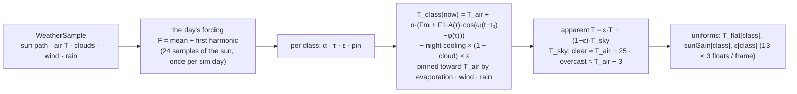
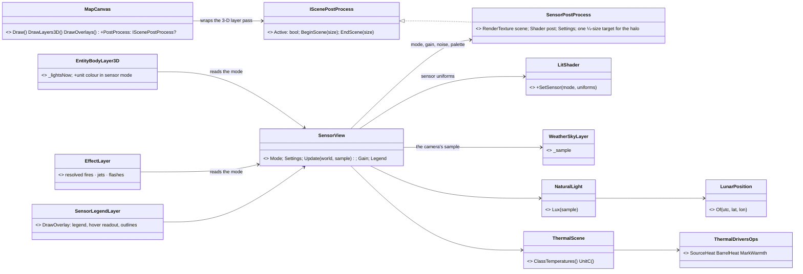
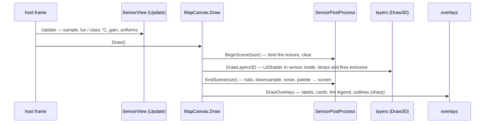
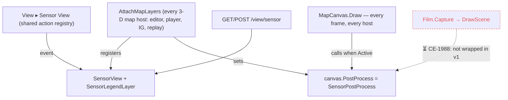
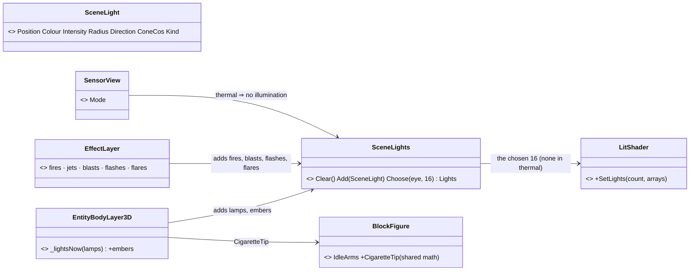
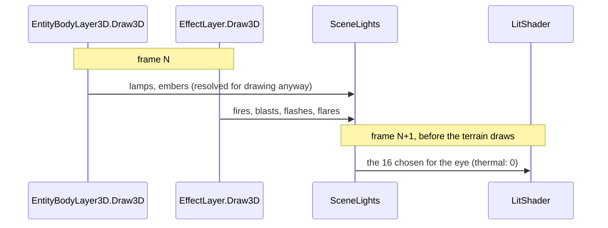

<!--STATUS
state: LIVE
updated: 2026-11-19
build-state: READY-TO-BUILD
current-answer: §3 the decisions · §4 night vision · §5 thermal · §6 UML · §8 slices · §9 light sources (seen + cheap lighting) · §10 the F4 cycle
stale-below: nothing yet
known-rot: D-4's "they light nothing" is SUPERSEDED by R-1057 (§9): sources may light their surroundings, cheaply, except in thermal
known-conflict: none
related-designs:
  - ../thermal/DESIGN_Thermal_Drivers.md — owns the HEAT DRIVERS and the calculator (`ThermalDriversOps`): this view only READS them; TD-14's "instructor's thermal-marks layer" is built HERE (§5d)
  - ../../DESIGN_Thermal_And_Acoustic_Sensing.md — owns the AI's thermal SENSOR (signature 0..1, `MinSignature`): the view outlines what it sees; its move to °C contrast is CE-1987, not this design
  - ../weather/DESIGN_Weather_And_Time.md — owns `WeatherSample` (sun, irradiance, clouds, the diurnal ground temperature): the view reads it; the MOON is added to it here (§4a)
  - ../../DESIGN_Map_3D_Mode.md — owns the 3-D map, `LitShader` (M5) and the material code in the terrain's alpha (CE-1333): the view adds one mode switch to the shader and one wrap of the canvas' 3-D pass
  - ../vehicle-appearance/DESIGN_Vehicle_Appearance_State.md — owns `VehicleLights` (CE-4670) and the lit-lamp list the body layer collects: the view shows those lamps
  - ../weapons/DESIGN_Flame_Weapons.md — §8 the flame look (`EffectLayer.ResolveStateInto`): the view shows the same fires, jets and burning men
  - ../../DESIGN_Film_Director.md — owns the film capture's render target (`Film.cs`), the precedent for drawing the scene into a texture; a film frame through a sensor view is CE-1988 (later)
-->
# DESIGN — SENSOR VIEWS on the 3-D map: NIGHT VISION and THERMAL *(CE-1984, CE-1985; ui; R-1056)*

> 🔒 **User, `2026-11-19`, verbatim:** *"Please, let's discuss like how on the 3D map in some simplified way to show something similar for of thermal view,
> which utilizes the information about the thermal related components our entities are having, and also the burned parts and all related to it, some
> debugging view for thermal view, some approximation which is cheap and doable."* · *"Maybe some kind of shader-based post process or something."* ·
> *"Still respecting the time of day, so it works at night differently than at daylight when the sun is shining and warming up the ground. I know I said it
> should be cheap to do, but you know, whatever is cheap but not completely out of reality."* · *"What about the night vision, the light amplifier? Can we do
> it as well, cheaply?"* · *"Well, vehicles have lights and we have flames and explosions and stuff like that. So these should be shown at least in some
> cheap way. It doesn't mean that they should illuminate the surrounding. Just be shown, just be visible themselves. And yes, your suggestion is fine. Some
> simple moon, shared post process, okay."*
> · *"And if the explosions and lights can illuminate the surrounding and be cheap at the same time, it's no problem for me. Please first write a
> design. And we will need some hotkey for switching the mode of the 3D map for normal view, thermal and night vision. Also guys with a cigarette
> burning and the muzzle flashes, they are also important light sources in both"* (R-1057)

📄 **Mockup (the acceptance spec, R-4138):** [`docs/UX/sensor-view.svg`](../../UX/sensor-view.svg) — `python3 scripts/gen-sensor-view-mockup.py`.

## 1. INVENTORY *(measured `2026-11-19`)*

Queries: `search_graph name_pattern=".*(Thermal|Heat|Infrared|Temperature|Burn|Scorch|IrSignature|Signature).*" label=Class` ·
`search_graph ".*(Thermal|HeatMark|NightVision|Nvg|ViewMode|RenderMode|Tint|Palette|Grayscale|PostProcess).*" Class` ·
`search_code "[Hh]eadlight|[Hh]eadlamp|LightsOn|TailLight|BrakeLight|VehicleLight"` (regex, 80 hits) · grep `LoadRenderTexture|BeginTextureMode|BeginShaderMode`,
`Moon`, `struct .*(Thermal|Heat|Burn)`. ⚠ Index coverage cannot be checked through the CLI.

| exists | where | what the view takes from it |
|---|---|---|
| `ThermalState`, `HeatSource`, `FireState`, `ThermalDefaults` | `Perception/Signatures/*.cs` | each unit's heat drivers, replicated to every node |
| `ThermalDriversOps.Signature / SourceHeat / BarrelHeat / MarkWarmth` | same, `:28`, `:44`, `:84`; `MarkWarmth.cs:25` | the heat of a unit, a barrel, a ground mark — closed form, any node, any time |
| `GroundHeatMarks` (`VehicleStand`, `BurnedArea`) | `Terrain/GroundHeatMarks.cs:66` | the warm patches; ⛔ hidden in the normal views (`EntityBodyLayer3D.cs:2173`) |
| `TerrainThermalClass` (13 classes) + `surfaceThermalClasses` | `Terrain/TerrainMaterials.cs:47` | the class per material / surface |
| `WeatherSample`: sun elevation / azimuth, irradiance (cloud-cut), `RelativeLight`, `GroundTemperatureC`, `DiurnalPhase`, clouds, wind, rain | `Weather/WeatherField.cs:45-86, :344-386` | time of day, sun, air temperature, the cooling drivers |
| `WeatherSkyLayer` samples it at the camera each frame | `Map3D/WeatherSky.cs:141` | the view's one sample |
| `LitShader` — ONE program for every lit 3-D draw; terrain alpha = material code | `Vis3D/LitShader.cs:247-253`, `TerrainLayer3D.cs:186` | the one switch for the scene pass |
| `MapCanvas.Draw` → `DrawLayers3D` → `DrawOverlays` | `Vis2D/MapCanvas.cs:122-200` | the wrap point: scene into a texture, overlays after |
| render-target precedent | `Film.cs:382-401` (`_canvas.DrawScene(size)` into a `RenderTexture`) | the pattern, already headless-proven |
| `VehicleLights` + `VehicleLook.Lights` (brake lights derived) → `_lightsNow` | `Behavior/Components/VehicleLights.cs`, `Look/Vehicles/VehicleLook.cs:136`, `EntityBodyLayer3D.Fittings.cs:112-147` | the lit lamps, drawn as unlit spheres today |
| `EffectLayer.ResolveStateInto` (fires on every `FireState` holder, jets, burning men, scorch) + shots / blasts | `Effects/EffectLayer.cs:198-290` | the flames and flashes |
| `PerceptionWeather.BaseContrast` (the sensor's crossover) | `Perception/Sensors/PerceptionWeather.cs:61` | ⚠ the AI's simpler model — §3 D-9 |
| ⛔ **a moon** | grep `Moon` in `Weather/`, `WeatherSky.cs` ⇒ **0** | every night is starlight-only ⇒ §4a |
| ⛔ **a view mode / post-process** | the second query ⇒ none; `MapViewModeLayer` is the 2-D / 3-D switch only | ⇒ new, one seam |

## 2. The proven solution, and what we take

| proven practice | we take | because |
|---|---|---|
| a sensor view = the scene rendered with the sensor's own "material response", then a sensor post-process (gain, noise, blur, palette) — how training simulators and games do NVG / FLIR | ✅ adopt | one scene pass (no second render) and one cheap full-screen pass |
| FLIR: a per-material temperature solved from sun, air, sky and thermal inertia (simulators solve a 1-D heat equation per material per hour) | ⚠ adapt: the steady daily cycle in closed form (§5a), no history, no solver | every node and a replay draw the same at any time, free per frame; a sudden weather change is not followed |
| NVG: illuminance from sun / moon / stars → tube gain (ABC) → shot noise ∝ 1/√photons, blooming on point sources, P43 phosphor | ✅ adopt | each is one uniform or one line |
| real light from lamps (a lit cone on the road) | ⛔ reject | 🔒 user: *"It doesn't mean that they should illuminate the surrounding"* |
| shadows (cool ground under a tree, a thermal "ghost") | ⛔ reject | the 3-D map draws no shadows; a shadow map is a separate cost |

## 3. Decisions *(R-1056 — the user's approval `2026-11-19` of the leans in chat)*

| # | decision | why · rejected |
|---|---|---|
| **D-1** | ⭐ ONE `SensorView` with two modes (Night Vision, Thermal) on ONE post-process; Off = the normal view, untouched | shared, not duplicated (CLAUDE.md) · ⛔ two separate views |
| **D-2** | the scene pass writes the SENSOR's quantity (NV: light; thermal: °C), never "the normal image recoloured" | ⛔ a post-process alone on the colour image — paint brightness ≠ heat (a white car would be "hot") |
| **D-3** | the canvas' 3-D layer pass is drawn into a `RenderTexture` while a sensor mode is on; the post pass draws it to the screen; then `DrawOverlays` (labels, cards, HUD, legend) — sharp | the film precedent; 3-D gizmos are part of the scene and take the sensor's look (accepted) |
| **D-4** | lamps, flames, flashes, blasts are **seen** — emissive, they bloom in the post pass. ⛔ *"never lighting"* SUPERSEDED by R-1057: they may light their surroundings, cheaply (§9) | 🔒 user |
| **D-5** | a simple MOON (position + lit fraction) in the shared `WeatherSample`, beside `SolarPosition` | night vision without a moon is always starlight · ⛔ a view-only moon (the sky and later the AI need the same one) |
| **D-6** | thermal surfaces: three numbers per thermal class (α absorption, τ inertia, ε emissivity) + an evaporation pin; the steady daily cycle in closed form; sky reflection by ε; wind and rain couple to the air | 🔒 user: *"cheap but not completely out of reality"* · ⛔ a heat solver with history |
| **D-7** | units in °C = their surface (the same model, metal / body) + their own heat from `ThermalDriversOps` (engine at the hot end, barrel, fire, a corpse cooling) | ONE calculator for the AI and the view's units |
| **D-8** | the gain is set on the CPU from what it already knows (the light level; the class and unit temperatures in view) — no GPU read-back | cheap, deterministic |
| **D-9** | the °C model lives in `Fdp.Toolkits` beside `ThermalDriversOps`; the AI sensor keeps its 0..1 signature for now — moving it to °C contrast is **CE-1987** (behaviour change ⇒ scenarios) | one model when CE-1987 lands; the interim duplicate is named, not hidden |
| **D-10** | a debugging view, on every host with a 3-D map: `View ▸ Sensor View ▸ Off / Night Vision / Thermal`, `GET/POST /view/sensor`; hover readout; units above the SELECTED observer's thermal threshold outlined | the user's "debugging view"; ⛔ tied to a unit's own sight (that is G-10, later — it reuses this) |
| **D-11** | the post-process toggles: palette (NV: green P43 / white P45; thermal: white-hot / black-hot / ironbow), auto / manual gain, halo, sensor resolution, noise — all default ON | realistic by default, clean on demand |

## 4. Night vision *(slice SV-1, CE-1984)*

### 4a. The light — sun, moon, stars

| source | illuminance (lux, horizontal) | from |
|---|---|---|
| sun | `IrradianceWm2 × 110` above the horizon; twilight by `LightOf`'s bands | ✅ `WeatherSample` |
| moon ⭐ new | `0.25 × MoonIllumination × sin(MoonElevation)⁺ × cloudCut` (full moon high ≈ 0.25) | `LunarPosition.Of(utc, lat, lon)` — a low-precision ephemeris (~1° and ~1 h, enough to light a scene); `WeatherSample` gains `MoonElevationDeg`, `MoonAzimuthDeg`, `MoonIllumination` |
| stars + airglow | `0.002 × (1 − 0.85 × overcast)` | constant |

⭐ `NaturalLight.Lux(in WeatherSample)` — ONE pure function. ⛔ `RelativeLight` is NOT changed (the AI's sight reads it — a moonlit night seeing further is **CE-1986**, behaviour, for the perception lane).

### 4b. The picture

| step | where | rule |
|---|---|---|
| scene light | `LitShader`, NV mode | the sun's or the MOON's direction (whichever is up and brighter), ambient from the sky; albedo → luminance × an NIR factor (green-dominant albedo ×1.6: leaves reflect near-infrared) — ⭐ no class table needed; exposure scaled so the scene peaks ≈ 0.75 |
| emissives | lamps (`_lightsNow`), effects (fires, jets, flashes, blasts) | drawn white at full brightness ⇒ above the scene's 0.75 ⇒ they bloom |
| gain (ABC) | CPU | `gain = target / lux`, clamped (a tube's range); a bright source on screen pulls the scene's exposure down (×0.5 for a flash, by its screen size) |
| post | the post shader | downsample to ~640 lines · halo of > 0.8 (2 blurs at ¼ size) · noise σ ∝ 1/√(lux / 0.25), seeded per frame · P43 green or P45 white · round tube vignette |

## 4c. As built — SV-1 *(CE-1984, ui, `2026-11-19`)*

| piece | as built |
|---|---|
| the moon | `Weather/LunarPosition.cs` (+ `NaturalLight`); `WeatherSample.MoonElevationDeg / MoonAzimuthDeg / MoonIllumination`; rails `WeatherFieldTests.CE1984_*` |
| the seam | `IScenePostProcess`, `SceneSensor`, `RenderContext.Sensor`, `SceneSensors.Emissive` (`Vis2D/Abstractions/CoreInterfaces.cs`); `MapCanvas.PostProcess` wraps `DrawLayers3D` in `Draw()` only |
| the post-process | `Vis3D/SensorPostProcess.cs`: bright pass (¼ size, luminance in alpha) → two blurs → mipmaps (the mean = the automatic gain, on the GPU) → final pass; the scene's depth blitted onto the frame's (`rlBlitFramebuffer` declared with its real nine arguments — Raylib-cs 7.0.2 binds it with none); `HiddenWindow.Resume` / `CurrentFramebuffer` for the hidden-window mode |
| the view | `Map3D/SensorView.cs` (an `IMapLayer`): mode, options, `Apply` (the light from sun / moon / stars, the gain and noise from the lux), the legend strip; wired in `AttachMapLayers` (every host); `WeatherSkyLayer.Sensor` calls `Apply` with its sample |
| self-luminous | `ctx.Emissive(…)` at the lamps (`EntityBodyLayer3D.DrawLightPoints`), the explosion core, the muzzle flash, tracers, a flare's star, and a fire's / jet's HOT puffs (`EffectLayer.Glow`: red ≥ 200 — the soot is not) |
| the controls | `View ▸ Sensor View` (`SensorViewMenu`, action ids 1984–1992, `SensorViewMenuEvent` 8067), `GET/POST /view/sensor` |

| ⛔ deviation from the mockup / §3 — and why | |
|---|---|
| the legend strip carries NO controls (the mockup's combo boxes and check boxes) — they are the View ▸ Sensor View submenu | a map layer draws with Raylib; ImGui windows are drawn per host — putting the controls in the shared View menu reaches every host by construction (the shared-and-unified rule) instead of N hosts each wiring a window. The strip shows the mode, the light (lux), the moon and the palette |
| a film frame while night vision is on is drawn NORMAL-coloured but lit by the night-vision light | the atmosphere is the scene's; the post-process is not around the film's pass (CE-1988) |

## 5. Thermal *(slice SV-2, CE-1985)*

### 5a. The surface model — three numbers per class

*What the picture shows that prose hid:* the per-frame cost is 13 classes on the CPU and three small uniform arrays — every pixel only looks its class up and
adds the sun-facing term; the expensive part (the sun's daily path) runs once per sim day. `A(τ) = 1/√(1+(ωτ)²)`, `φ(τ) = atan(ωτ)`: a first-order lag.

| class | α | τ (h) | ε | pin | you see |
|---|---|---|---|---|---|
| asphalt | 0.9 | 3 | 0.95 | — | hottest at noon, still warm at night |
| concrete / brick | 0.7 | 4 | 0.92 | — | walls warm after dark |
| metal | 0.8 | 0.2 | **0.3** | — | sun-hot at noon; at night reflects the cold sky — **colder** than the ground |
| glass | 0.3 | 0.5 | **0.2** | — | mirrors the sky |
| wood | 0.6 | 1 | 0.9 | — | |
| soil-dry / sand | 0.75 / 0.65 | 1.5 | 0.92 | — | |
| soil-wet | 0.8 | 2 | 0.95 | 0.5 | |
| grass / dense-vegetation | 0.5 | 0.5 | 0.98 | 0.8 / 0.9 | ≈ air, cold on a clear night |
| water | 0.9 | **48** | 0.98 | 0.3 | ≈ the daily mean: cool at noon, warm at night |
| snow | 0.2 | 2 | 0.98 | — | ≤ 0 °C |

⚠ Starter values (literature ranges, rounded); tuned on the frame rails' expectations (§7), never on taste.

### 5b. Per pixel, per unit

| what | °C |
|---|---|
| ground, walls, roofs | `T_flat[class] + sunGain[class] × (facing − flat)`, facing = N·sun (sunlit slopes, east walls in the morning) |
| a vehicle hull | `metal` surface + the engine heat at its hot end: `SourceHeat × 60 K` (front / rear by `HotEnd`); a dead one cools by `Dead`'s rate |
| a person | clothing ≈ 28 °C + `SourceHeat × 6 K` (a man who ran); dead: toward air at `CorpseCoolPerSecond` |
| a barrel | `BarrelHeat × 120 K` above the hull |
| fire, jets, burning men | 600 °C (saturates) |
| ground heat mark | the ground + `MarkWarmth × 15 K` (VehicleStand, hot end brighter); BurnedArea + `MarkWarmth × 30 K` ⇒ ⭐ TD-14's instructor layer, built here |

⭐ `ThermalScene` (`Fdp.Toolkits/Perception/Signatures/ThermalScene.cs`): `ClassTemperatures(in WeatherSample, double now, Span<float> flat, Span<float> gain)`,
`UnitC(in ThermalState, in HeatSource, …)` — pure, allocation-free, unit-tested; the shader and the body layer only read it.

### 5c. The heat image

°C → 16 bits over −40…+100 °C in R (high) and G (low) — opaque draws only (fires drawn opaque, saturated) ⇒ no blending corrupts the code. ⚠ The material
code in the terrain alpha covers the 11 PATTERN codes (240–250, `LitShader.cs:221`); the rest of the ground needs its thermal class per vertex in thermal mode
— measured in SV-2 step 1 (`TerrainLayer3D.MaterialCode`), the class index carried in the same alpha while thermal is on.

## 6. UML

*What the picture shows that prose hid:* FDP owns only the generic seam (`IScenePostProcess`, the post shader) and the shader switch; everything that knows
about weather, units, lamps and fires is on the Hrot side, reading data that already exists — the only new state is the view's mode and settings.

*What the picture shows that prose hid:* the per-frame caller is `MapCanvas.Draw`, which every 3-D host already runs — so no host can lack the view; the one
path that does NOT pass through it is the film capture (red, dashed): a film frame is drawn normal in v1 (Raylib cannot nest texture targets — CE-1988).

## 7. How it is judged — the machine checks *(R-4277)*

⭐ A view changes no simulation ⇒ its judge is the **frame rails** (`xvfb-run -a`, region brightness read back from a rendered frame) over one scene,
`scenarios/demos/sensing-and-weather/sv-night-and-heat` (the mockup's scene: road, field, pond, house, trees, an idling tank, a parked cold tank, a car with its
lamps on, a man, a burning wreck, a ground heat mark), whose `checks.json` pins the SIM half (the tank idles, the car's lamps on at night, the wreck burns).

| rail | asserts (relative, never exact colours) |
|---|---|
| NV-1 grain | pixel variance of a flat region at starlight > 3 × at full moon |
| NV-2 lamps | a lit lamp's pixels ≥ 0.95; the scene around ≤ 0.8; a lamp OFF ⇒ no bloom |
| NV-3 gain | the scene's mean drops with a flash in view |
| TH-1 noon | road > field > pond; the parked tank > field |
| TH-2 3 am clear | pond > field; road > field; the parked tank < field; glass < wall |
| TH-3 3 am overcast | road − field < half of TH-2's |
| TH-4 units | the idling tank's rear > its front > the field; the man > the field at night; a fire saturates |
| TH-5 marks | a fresh VehicleStand mark > the field around it; gone after its cooling time |
| ALLOC | `GC.GetAllocatedBytesForCurrentThread()` over a steady sensor frame == 0 |
| COST | frame time with the view on vs off on the same scene, reported (budget: +2 ms at 1080p on the cloud VM's software GL) |
| MOON | `LunarPosition` against two known dates (full moon 2024-01-25 17:54 UTC, new moon 2024-01-11 11:57 UTC): lit fraction > 0.98 / < 0.02; elevation within 2° of a reference |

## 8. Slices

| slice | id | builds | done when |
|---|---|---|---|
| **SV-1** | **CE-1984** | `IScenePostProcess` + `SensorPostProcess`; `SensorView`, legend layer, menu, `/view/sensor`; `LunarPosition`, `NaturalLight`, the moon in `WeatherSample`; NV mode in `LitShader`; lamps and effects emissive | NV-1…3, MOON, ALLOC, COST green; the frames match the mockup's A row |
| **SV-2** | **CE-1985** | `ThermalScene`; thermal mode in `LitShader` (class uniforms, the heat encoding); units / marks / fires in °C; hover readout and observer outlines | TH-1…5, ALLOC, COST green; the frames match the mockup's B row |
| later | **CE-1986** | the AI's night sight reads the moon (`NaturalLight`) — perception lane | its own scenarios |
| later | **CE-1987** | the AI's thermal sensor on °C contrast from `ThermalScene` (retires `BaseContrast`'s crossover) — perception lane | `th-idling-tank` and its siblings |
| **SV-1b** | **CE-1989** | the F4 cycle (§10) | KEY green |
| **SV-3** | **CE-1990** | `SceneLights` + the forward lights in `LitShader` (§9 L-1, L-3, L-4, L-7) | LS-1, LS-2, LS-4 green |
| **SV-3b** | **CE-1991** | the cigarette ember (L-5) and every source's look in thermal (L-2, L-6; needs CE-1985) | LS-3 green |
| later | **CE-1988** | a film frame through the sensor view (a texture target inside the film's) | a film clip in NV |

## 9. Light sources — seen in every view, and lighting their surroundings cheaply *(R-1057; CE-1990, CE-1991)*

### 9a. INVENTORY *(measured `2026-11-19`)*

Queries: `search_code "[Cc]igarette|[Ss]moking|[Ss]moker"` (regex, 40) · grep `enum LightKind`, `_lightsNow`, `EffectKind.MuzzleFlash`, `FragmentMain`.

| source | exists as | where | today |
|---|---|---|---|
| vehicle lamps (head, tail, brake, interior, convoy, searchlight, nav, anti-collision, landing) | `VehicleLights.OnMask` per type group (`LightKind`), brake lights derived | `Tkb/Domain/VehicleLightsDto.cs:8`, `VehicleLook.Lights`, `EntityBodyLayer3D.Fittings.cs:112` (`_lightsNow`: point + colour) | small unlit spheres + a halo; ⛔ no direction kept (a headlamp's beam is the hull's forward) |
| fires (vehicle, building, cell), flame jets, burning men | `FireState`, `FlameJets`, `EffectState.BurningUntil` | `EffectLayer.ResolveStateInto` | flames + smoke; emissive under NV (SV-1) |
| explosions, muzzle flashes, tracers, flares | effects (`EffectKind.Explosion / MuzzleFlash / Tracer / Flare`) with an age and a phase | `EffectLayer.Draw3D` | additive spheres; emissive under NV (SV-1) |
| ⭐ a burning CIGARETTE | `GestureKind.IdleSmoking` in the replicated `Demeanour` (CE-4628); the hand at his lips on his own gesture clock (`BlockFigure.SmokeLift`, cycle 9 s, 2.5 s at the lips) | `Combat/Gestures.cs:26`, `Map3D/ShapeKit.cs` (`IdleArms`, `Lips`) | the cigarette is drawn in his fingers; ⛔ no ember, no glow |
| the lit shader | ONE fragment source for the per-draw AND the instanced program | `LitShader.FragmentSource` | one sun + ambient + fog; ⛔ no local lights |

### 9b. The decisions *(leans — the user decides)*

| # | decision | why · rejected |
|---|---|---|
| **L-1** | ⭐ ONE per-frame list `SceneLights` (position, colour, intensity, radius, optional spot direction + cone), filled by the layers that already know the sources (the body layer: lamps, embers; the effect layer: fires, jets, blasts, flashes, flares); a preallocated buffer, 0 B per frame | one owner; ⛔ each layer lighting on its own |
| **L-2** | every source is SEEN in every view: normal — its own emissive draw; night vision — near-white, blooming (SV-1); thermal — hot: a blast, a flash, a fire and an ember saturate, a lamp's lens is warm (+30 K), a barrel stays hot after (TD's `BarrelHeat`) | 🔒 user: *"important light sources in both"* |
| **L-3** | ⭐ cheap ILLUMINATION: forward lights in `LitShader` — at most **16 per frame**, chosen on the CPU by `intensity × radius² / distance-to-camera²`; per fragment a smooth falloff `(1 − (d/r)²)²` × two-sided N·L, × a cone for a spot (headlamps, searchlight, landing light). Added to the normal view and to night vision (amplified by the gain); ⛔ NOT to thermal (light is not heat) | one loop over ≤ 16 uniforms; the instanced program shares the fragment source ⇒ bodies are lit too. ⛔ shadow maps (the expensive part); ⛔ deferred lighting (a second geometry pass) |
| **L-4** | ⚠ no shadows ⇒ a light passes through walls — kept small where it matters: headlamp a 25 m spot (30° half-angle), tail / brake 2 m, interior 1.5 m, a blast 15–40 m by its charge for its first 0.3 s, a muzzle flash 6 m for 60 ms, a fire 3× its radius (flickering on its seed), a flare 120 m for its burn, an ember 0.4 m | accepted; the radius table is the tuning surface |
| **L-5** | ⭐ the cigarette EMBER: a point at the cigarette's tip — computed by ONE function shared with the arm pose (`BlockFigure.CigaretteTip`, the same math as `IdleArms`, never a copy), glowing 0.4 resting and 1.0 while at his lips (the drag) on his own gesture clock; a tiny emissive sphere in every view and a 0.4 m light | 🔒 user; ⛔ a new component (the gesture and its clock are already replicated) |
| **L-6** | the muzzle flash: the existing effect — a 6 m light for its 60 ms; saturated in thermal | 🔒 user |
| **L-7** | `View ▸ Scene Lights` (checked, default ON) switches the illumination off for a slow machine; the sources stay SEEN | the cost is the user's call per machine |

### 9c. UML

*What the picture shows that prose hid:* the lights are COLLECTED where the sources are already resolved for drawing — no second resolve of lamps or
effects — and handed to the ONE shader every lit draw uses; the only new state is a per-frame buffer.

*What the picture shows that prose hid:* the terrain draws BEFORE the bodies and effects, so this frame's sources light the NEXT frame — one frame
late (16 ms), invisible for lamps and fires, and a muzzle flash still lights three or four frames of its 60 ms. ⛔ Rejected: resolving the sources
twice to light the same frame.

## 10. The F4 cycle *(R-1057; CE-1989)*

| | |
|---|---|
| the key | ⭐ **F4** cycles **normal → night vision → thermal → normal** (thermal skipped until CE-1985) — 📐 measured free in every scope (the F-keys in use: F2 rename, F3 the performance overlay, F6–F10 audio; `N` is the first person's message log) |
| where | a keymap row (`docs/UX/DESIGN_Input_And_Commands.md` K4): Global scope, read by the map's `SensorView` through a `KeymapReader` like `DebugKeys` — so it works on the map AND in first person, is listed in the Keyboard shortcuts window and can be rebound |
| shown | the View ▸ Sensor View items show `F4`; the legend strip ends *"F4: next view"* |

## 11. How §9–§10 are judged

| rail | asserts |
|---|---|
| LS-1 | a lit headlamp brightens the road AHEAD of the car (a region in its cone) and not behind it, in the normal view and in night vision; ⛔ not in thermal |
| LS-2 | a blast brightens the wall beside it for its first 0.3 s, then the wall is back to its baseline |
| LS-3 | an IdleSmoking man shows an ember at his lips that is brighter during the drag than when his hand is down (his own clock) — in all three views |
| LS-4 | more than 16 sources in view ⇒ the 16 nearest-strongest light the scene, 0 B per frame; COST with Scene Lights on vs off, reported |
| KEY | F4 three times returns to normal; with thermal not offered it goes normal → night vision → normal |
