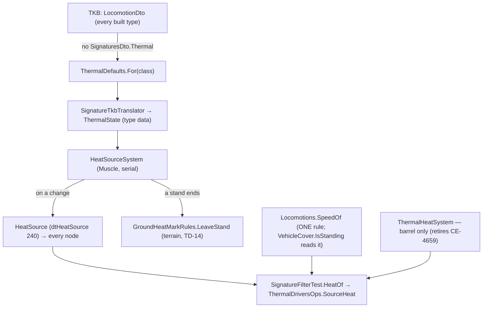
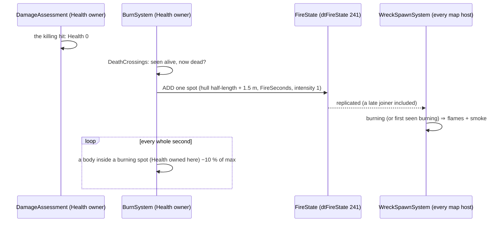
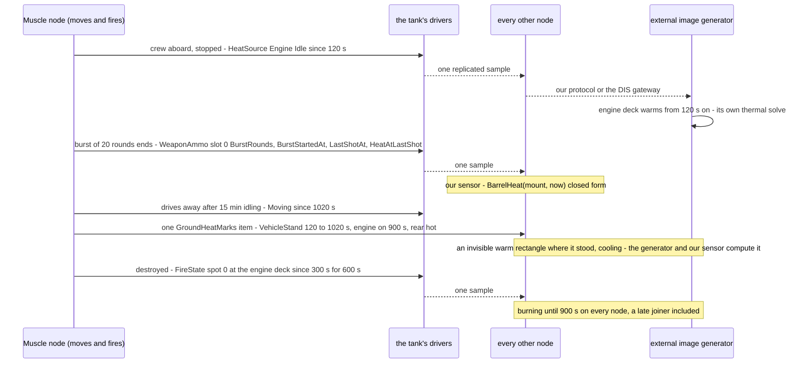
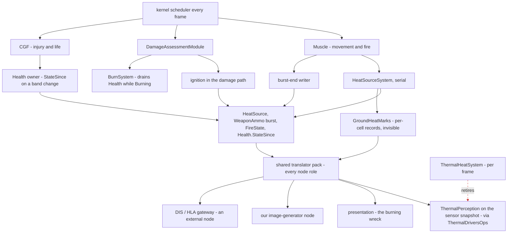

<!--STATUS
state: LIVE
updated: 2026-11-18
build-state: READY-TO-BUILD — ✅ APPROVED by the user `2026-11-18` ("approved", R-4293): TD-1…TD-16 as revised by §3a–§3e; `HeatSource` trimmed to what cannot be derived (§3e, user: "yes, trim it and fold it in"); ids fixed at dispatch
current-answer: §1 inventory · §2 the proven solution · §3 decisions · §3a the 2026-11-18 review · §3b fire and damage · §3c fire spots and bursts · §3d the burst in WeaponAmmo · §3e HeatSource trimmed · §4 the components · §4b ground heat marks · §4c the environment half + ground heat marks as built (CE-4662, CE-4664) · §4d the components, wire and calculator as built (CE-4657) · §4e the writer, defaults and sensor as built (CE-4658) · §4f the weapons' last burst as built (CE-4659) · §4g fire as built (CE-4660) · §5 UML · §6 a late joiner · §7 slices
stale-below: nothing
known-rot: none
known-conflict: none
related-designs:
  - ../vehicle-appearance/DESIGN_Vehicle_Appearance_State.md — the renderer-facing vehicle state (lights, openings, the kill kind, one reader `VehicleLook`) that READS `HeatSource` and `FireState` for rotors, engines and burning parts
  - ../IG/DRAFT_Unreal_Image_Generator.md — the Unreal image generator connects the same way (DDS, an outside IG node; a draft, CE-4651)
  - ../../DESIGN_Thermal_And_Acoustic_Sensing.md — OWNS the AI's thermal sensor (CE-3061, R-205): its per-frame 0..1 heat is RE-BASED on this design's drivers (TD-10)
  - ../weather/DESIGN_Weather_And_Time.md — OWNS the weather (`WeatherConditions`, replicated) and the sun (`SolarPosition`): the environment half an image generator already receives
  - ../../DESIGN_Weapon_Layers.md — OWNS the barrel heat rule (§5k, CE-1358, `WeaponState.Heat`) the weapon drivers carry
  - ../../DESIGN_Visual_Effects.md — OWNS "a destroyed vehicle burns" (W3, VE-P), today a PRESENTATION decision; it reads the FIRE driver instead (TD-6)
  - ../../reference/NED_DDS_Protocol.md — OWNS the wire as an outsider sees it; its gateway table notes DIS appearance bits are NOT carried (§ "What DIS needs") — TD-11 fills that
  - ../../DESIGN_Ground_Patches_And_Road_Blockage.md — OWNS the crater record (`GroundDamage`, CE-4591) the ground heat marks follow (TD-14)
  - ../hit-location/DESIGN_Body_Parts_And_Hit_Location.md — OWNS vehicle part damage (an `Engine` part exists for aircraft): a dead engine is a power-plant driver
-->

# DESIGN — THERMAL DRIVERS: what every node needs to compute an entity's heat (CE-4646)

🔒 User, `2026-11-16`, verbatim: *"I'm not interested in showing it, rendering in 3D, but I would like to have all the data on the entities that support
rendering a real 3D image using some external image generator who is capable of rendering thermal image on physical basis. What are we missing here?"* ·
*"I fully agree with you … We shouldn't transfer the current state, but only something from everyone else can compute the current state. Can we do a
more detailed design for it?"*

## 1. INVENTORY *(measured `2026-11-16`; graph: `search_graph name_pattern=".*(Thermal|Heat|PowerPlant|Engine|Burn|Fire(State|Effect)|Smoke|Obscur|Appearance|Death|Died|Clothing|Weather|Solar|Sun|Material).*" label=Class` ⇒ 35 production classes, the thermal ones below; grep for `ThermalState`, `WeaponState.Heat`, `DestroyedAt|DiedAt|TimeOfDeath`, the effect burn; ⚠ index coverage cannot be checked through the CLI)*

| piece | where | what it is | for an image generator |
|---|---|---|---|
| `ThermalState` | `Perception/Signatures/ThermalState.cs` | ONE 0..1 heat + the hottest barrel, stamped from the TKB `ThermalSignatureDto` | ⛔ abstract, one scalar, **not replicated** (no translator in `Hrot.Network`), not saved |
| `ThermalHeatSystem` | `Perception/Signatures/ThermalHeatSystem.cs` | integrates heat EVERY FRAME from speed and shots on the moving node | ⛔ per-frame state, private to one node; "running" = moving (an idling tank is cold) |
| `ThermalPerception` | `Perception/Sensors/ThermalPerception.cs:59` | the AI's thermal sensor keeps a target whose `Signature` reaches its minimum | the one reader today |
| `WeaponState.Heat` | `Combat/Components/CombatComponents.cs:61-73` | the barrel's 0..1 heat, `HeatPerRound`, `HeatCoolPerSecond` (BarrelHeat rule) | ⚠ on the wire only as a SAMPLED percentage for the station HUD (`WeaponAmmo.cs:79`) — a current-state transfer |
| the burning wreck | `Hrot.Presentation/Effects/EffectSystems.cs:419-439` (W3) | each PRESENTATION decides a vehicle burns when it sees its health cross zero | ⛔ not simulation state: "a wreck loaded already dead does not burn"; a late joiner never sees the fire |
| `EntityEffectState` (wire) | `Hrot.Network.NED` | a person's stun / irritation / knock-down as UNTIL times | ✅ **the precedent: an end time, every reader computes** |
| expendables' age | `EffectSystems.cs:316-318` | a decoy is born at `FiredAt` and lives its `LifeSeconds`: "a late viewer draws it at its true age" | ✅ the same precedent |
| `WeatherConditions` + `EntityWeather` (wire) | `Weather/WeatherConditions.cs:66-109` | ground temperature, lapse rate, pressure, humidity, wind layers, clouds, visibility, fog, precipitation | ✅ the environment, replicated |
| `SolarPosition` | `Weather/SolarPosition.cs` | the sun from UTC + latitude / longitude (NOAA) | ✅ (no moon) |
| `TerrainMaterial` | `Terrain/TerrainMaterials.cs:14-19` | sight transmittance, resistance, sound attenuation, blocks movement | ⛔ no thermal class |
| a time of death / destruction | — | grep `DestroyedAt\|DiedAt\|TimeOfDeath\|KilledAt` ⇒ nothing in the toolkits or the engine | ⛔ |
| a power-plant (engine) state | — | none; `EngineFallbacks` is TKB parameter defaults, not a state | ⛔ |
| DIS appearance | `NED_DDS_Protocol.md:585, :600` | "appearance bits" listed as NOT carried; the DIS damage thresholds "not defined by HROT" | ⛔ |

## 2. The proven solution, and what we take

| practice | what it is | ⭐ we |
|---|---|---|
| **DIS Entity State appearance / RPR-FOM `PhysicalEntity`** | interop sends STATES — power plant on, flaming, smoking, damage state, a lifeform's health — never temperatures | ⭐ ADOPT: the drivers are states |
| **physics-based infrared image generators** | compute surface temperatures themselves from the model's materials, the weather and sun history, and the internal heat sources the states switch on | ⭐ ADOPT: no temperatures on our wire; the generator owns the thermal solve |
| **our own "until / since" precedent** | `EntityEffectState`'s end times, a decoy's `FiredAt` + life | ⭐ ADOPT, and it is the user's rule: every field is a STATE with the TIME it began (or a count with the last time) — any node computes "now" from it; a message only when a state CHANGES |
| sending the whole history | — | ⛔ REJECT: unbounded; a late joiner instead starts the environment soaked to the current weather (§6) |
| per-frame heat on the wire | — | ⛔ REJECT: bandwidth, and it is the current-state transfer the user ruled out |

## 3. Decisions — leans for the user

| # | question | ⭐ lean | why |
|---|---|---|---|
| **TD-1** | what crosses the wire | ⭐ **DRIVERS, never temperatures**: each field is a state + the sim time it began, or a count + the last time; written only when it changes | the user's rule; every node and an external generator compute the present the same way |
| **TD-2** | where they live | ⭐ *(revised `2026-11-18`, §3a, §4)* a small FAMILY of unmanaged components, each on the entity it describes and written by ONE node: **`HeatSource`** (an engine or a living body: a vehicle, an aircraft, a generator, a person, an animal — its state, load and motion), the weapons' last burst in the EXISTING **`WeaponAmmo`** (per unit, ≤ 4 mounts — TD-5), **`FireState`** (anything that burns), **`Health.StateSince`** (a field, not a component — the time the derived injury band last changed), + the terrain record **`GroundHeatMarks`** (§4b) — each recorded, replicated owner → every node through its own descriptor in the shared translator pack; runtime only (`NoScenario`) except `HeatSource`'s authored start state | a rifle has no fire and a wreck no metabolism: each entity carries only what it has; each changes at its own events, so a sample is small; one replicated component = one owner (all written on the node that moves the entity or owns its Health — SimHost today, `SimHostCoreLogicPack.cs:116` — and stay separable if a writer moves) |
| **TD-3** | the heat source (an engine, or a living body) | ⭐ *(revised `2026-11-18`, §3e — trimmed to what cannot be derived)* `HeatSource` = `State` (an engine: Off · Idle · Running · Dead; a body: Standing · Moving) · `Since` · `MotionSince`; written by the node that moves the entity, by ONE rule with hysteresis: RUNNING when moving or ordered to move, IDLE when stopped and crewed (or ordered "engine on"), OFF when parked and empty or ordered off (silent watch), DEAD when destroyed or the engine part dead; a possessed vehicle by the player's ignition; the scenario may author the start state. ⛔ NOT sent: the kind (engine or body — TKB `HasPowerPlant`) and the load / exertion step (walk · run · sprint, engine load) — the calculator derives both from the speed every node already has | an idling tank is the classic warm target; a man who just ran is warm (R-205); only the DECISION, its TIMES and an intent motion cannot show go on the wire |
| **TD-4** | motion | NOT a separate component: `HeatSource.MotionSince` — when it last started / stopped moving (the moving / standing state is `State` for a body, implied by Running for an engine) | a late joiner knows how long it has moved or stood; friction and exertion are derived from the replicated speed |
| **TD-5** | the weapons | ⭐ *(revised `2026-11-18`, §3c, §3d)* NO new component: the EXISTING per-unit weapon status **`WeaponAmmo`** (≤ 4 mount slots, replicated on change as `EntityWeaponAmmo`) gains per mount `BurstRounds`, `BurstStartedAt`, `LastShotAt`, `HeatAtLastShot` (the BarrelHeat index after the burst), written at a BURST'S END; its sampled `Heat0..3` RETIRES — the HUD, our sensor and a generator compute the barrel now from the last shot with `BarrelHeat`'s closed form | one weapon status per unit (ruling 9); a physics generator heats the barrel from the last burst with its OWN weapon model; ⛔ no cumulative shot count (statistics come from the recorded shot events); ⛔ not on each mount entity (mounts 1+ are local children with no network id, `CombatComponents.cs:76-79`) |
| **TD-6** | fire and smoke | ⭐ *(revised `2026-11-18`, §3c)* `FireState` = a few FIRE SPOTS, each `{X, Y, Z, Radius, Since, Seconds, Intensity}` in the HOLDER's coordinates (each goes out by itself); ONE component on three holders: a vehicle / wagon (later a ship — its sections), a building's damage-record entity, a terrain cell's record entity (napalm, a burning field or wood); spreading = the fire's owner ADDS a spot (one write each); written by the Health owner when damage ignites (TD-16) | burning becomes SIMULATION state, the same on every node, a late joiner sees it; ⭐ the presentation's W3 burn READS it (one truth, ruling 9); a house burning in one room is not a house burning everywhere |
| **TD-7** | people | ⭐ *(revised `2026-11-18`)* `Health` gains `StateSince` — the time its DERIVED injury band (ok / wounded / incapacitated / dead, `Injury.StateOf`) last changed, stamped by the Health owner; a body cools from it; the clothing class is TYPE data (the TKB), not sent | ⛔ no stored life state: it is derived from the replicated `Health` by design (CE-2155, "no stored state, no topic") — only the TIME is new; `EntityManDowned` is an event, so a late joiner never sees it |
| **TD-8** | the environment | nothing new on the wire: weather (replicated), the clock (replicated), the sun (computed); ⏳ the moon later; ⭐ add `Since` to a weather change so a late joiner knows how long it has rained | the half that is already there |
| **TD-9** | materials | a **thermal class** per terrain material and surface (`materials.json` gains `thermalClass` from a fixed list: asphalt, concrete, brick, metal, glass, wood, soil-dry, soil-wet, sand, grass, dense-vegetation, water, snow), exported with the terrain; an entity's own materials are the generator's model's (found by its DIS type) | the generator's material map for the ground; our models never pretend to be its models |
| **TD-10** | our own AI thermal sensor | ⭐ re-based on the drivers: ONE calculator `ThermalDriversOps.Signature(drivers, now, weather)` (closed form, 0 B); `ThermalHeatSystem`'s per-frame integration RETIRES; `ThermalState`'s TKB fields stay as the calculator's parameters | one thermal truth, not two (ruling 9); no per-frame writes |
| **TD-11** | the interfaces | our image-generator role and any node read the component directly (our protocol); the DIS / HLA gateway maps it: HeatSource (Engine, Idle/Running) → Power Plant On, Fire → Flaming / Smoking, Health + StateSince → a lifeform's health, damage → the 4 DIS damage states (thresholds fixed here: < 25 % lost none, < 50 % slight, < 100 % moderate, destroyed) — a row in the protocol reference for the gateway's repository; ⛔ CIGI not built here | the gateway is an outside product; it needs the mapping written down |
| **TD-12** | smoke that blocks infrared | a per-munition flag in the TKB (visual-only vs IR-blocking smoke) the area cloud carries by its type | the generator renders the cloud; it must know whether infrared passes |
| **TD-13** | how much traffic | messages only on events (engine change, burst end, fire start, death, motion start / stop): a moving company ≈ a few messages a minute | the bandwidth argument for TD-1 |
| **TD-14** | ⭐ **a vehicle that stood with its engine running leaves a WARM SPOT on the ground when it drives away** (🔒 user: *"It is very important for observation to see such places … mark them as separate terrain features, something like craters, but invisible normally"*) | ⭐ **ground heat marks**: a terrain feature in the CRATER record family (`GroundDamage`'s shape — a per-cell record, one per (cell, deciding node), recorded, replicated, unioned by the view; CE-4627's shared writer core), one item per mark: where, the footprint (the hull's length × width and heading, the engine / exhaust end), the KIND, the STAND (when it stopped and when it left), the ENGINE-ON seconds during the stand and the source's power class (TKB) — DRIVERS again: every reader computes how warm it is now; ⛔ NEVER DRAWN in the normal 2-D / 3-D views (an instructor's thermal-marks layer only); kinds: `VehicleStand` now, `BurnedArea` with fire (TD-6) and napalm, `BodyImprint` later | the observer's classic cue (*"something stood here"*) is a PLACE, not an entity — it outlives the vehicle that left; craters already prove the record shape, the replication and the replay |
| **TD-15** | ✅ a generator that joins late and the sun before it | ✅ **ruled by the user**: it takes the time of day and ESTIMATES the earlier sunshine from the time of year, the time of day and the current clouds — no history is sent (§6) | 🔒 user: *"so no issue here"* |
| **TD-16** | ⭐ *(`2026-11-18`, §3b)* how fire relates to damage | ⭐ **SEPARATE components, coupled by TWO rules, both on the Health owner**: ① damage IGNITES (in the damage path: a fuelled type destroyed — TKB `FireSeconds` > 0; an incendiary hit — flamethrower CE-4635, napalm CE-4637; later an engine / fuel part destroyed) ⇒ `FireState` written; ② fire DAMAGES — a `BurnSystem` drains Health in whole steps while Burning, the `BleedOutSystem` pattern (same capability, same authority gate, one sample per step). A burning GROUND AREA has no Health: it belongs to the area effect, and cooled it becomes a `BurnedArea` ground mark (§4b) — `FireState` is for entities only | each exists without the other (a rifle kill does not burn; a roof alight has lost nothing yet); fire has its own life; today burning is a per-display decision on Health crossing 0 (W3) that a late joiner never sees |

## 3a. The `2026-11-18` review — what changed and why

| change | ⭐ measured reason |
|---|---|
| `PowerPlant` + motion ⇒ ONE `HeatSource` (Kind Engine · Body) | 🔒 user: *"even lifeforms keep & produce some heat, it seems to me pretty related"* — a split bought nothing: one writer (the moving node), one reader (the calculator), each event one ~32 B sample; a person's metabolism IS its power plant (R-205: hot when running) |
| `ShotHistory` per mount entity ⇒ on the OWNER, ≤ 4 slots (⇒ then folded into the existing `WeaponAmmo`, §3d) | mounts 1+ are local children with no network id (`CombatComponents.cs:76-79`; `DESIGN_Sensors_And_Doctrine.md:2057` V2) — they cannot be replicated; `EntityWeaponAmmo` is the per-owner precedent |
| `LifeChange` ⇒ `Health.StateSince` | the injury state is DERIVED from the replicated `Health` (OVERVIEW_Behaviour_Building_Blocks §8a, CE-2155: "no stored state, no topic"); `Health` replicates as `EntityDamage` (`NedOwnershipGroupBinding.cs:91`) — a stored state would be a second truth |
| `StandEngineOnSeconds` off the wire | only the writer needs it, and only when a stand ends — it reaches the wire inside the ground mark (§4b) |

## 3b. Fire and damage *(TD-16, `2026-11-18`)*

| the lean rests on | code — how it is | design — how it was meant |
|---|---|---|
| burning is a per-display decision, vehicles only | ✅ `EffectSystems.cs` `WreckSpawnSystem` (only a crossing to 0 burns) | ✅ `DESIGN_Visual_Effects.md` W3 / VE-P |
| damage over time has a proven pattern | ✅ `BleedOutSystem.cs` (the Health owner, whole steps) | ✅ `DESIGN_Injury_States.md` §4 |
| incendiary weapons set people, roofs, vehicles alight | ⛔ not built | ✅ CE-4635 / CE-4637 |
| one node owns Health and applies damage | ✅ `DamageAssessmentModule`, `HealthApplicationSystem` | ✅ CE-2155 |

| rejected | the one fact |
|---|---|
| fire inside `Health` | a roof burns before it loses anything; every hit sample would carry fire fields it does not change |
| fire in `EntityEffectState` (the person effects' until-times) | person-only; fire is on vehicles, wrecks and buildings |
| fire stays a display decision | it cannot damage, the AI cannot avoid it, a late joiner never sees it |

## 3c. Fire as spots, and the weapon's last burst *(`2026-11-18`)*

🔒 User: *"is one fire state ok per whole entity? imagine large entities - houses, ships, terrain areas with fire"* · *"fire with few spots is ok as most scenario start with healthy or already cold burnt entities so adding fire component is happening scarcely in runtime"* · on the shot count: *"what is 'shots fired' usable for?"*

| holder of `FireState` | the spots' coordinates | ⭐ why that holder (measured) |
|---|---|---|
| a vehicle, a wagon, later a ship | the entity's own — they move with it | one spot for a car, a few for a ship's sections |
| a building's damage-record entity | the building's (a storey / facade area) | it already exists: one per building, keyed by `TerrainObjectKey`, with a transform, holding breaches, opening a second entity when full (`BuildingDamage.cs:33-51`, CE-4391) |
| a terrain cell's record entity | the cell's | the generic cell record (`ICellRecord<T>`, `CellRecordSystem.cs:16`) of craters and felled trees; a spot that has gone out leaves a `BurnedArea` ground mark (§4b) |

| ⭐ rule | |
|---|---|
| capacity | 8 spots per entity; past it the owner opens a second holder entity (the building precedent) |
| added at runtime, rarely | the component is ADDED when something first ignites — a scenario starts healthy or with a cold, burnt-out wreck (Health 0, no fire) — so the structural change is rare and off the hot path |
| damage (TD-16) | per spot: a man inside a spot's radius burns; a spot on a vehicle burns the vehicle |
| ⛔ not here | HOW fire spreads (wind, materials) — the flamethrower / napalm designs (CE-4635, CE-4637); this design fixes only how fire is STORED and SENT |

| rejected | the one fact |
|---|---|
| one fire state per entity | a house burning in one room reads as burning everywhere |
| a component per holder kind | three copies of one concept (ruling 9) |
| each fire its own entity | thousands for a wood fire, and nothing ties a fire to the house or vehicle it is on |
| a cumulative shot count | a barrel solve needs the LAST burst; statistics come from the recorded shot events |

## 3d. The weapons' last burst lives in the EXISTING weapon status *(`2026-11-18`)*

🔒 User: *"isnt that shot history parts of general weapon status then?"* — yes: `WeaponAmmo` is already the per-unit, 4-mount weapon status, replicated on change.

| the lean rests on | code — how it is | design — how it was meant |
|---|---|---|
| a per-unit 4-slot weapon status exists, sent on change | ✅ `EntityWeaponAmmoTranslators.cs:16-19, :52` | ✅ `DESIGN_Entity_Control.md` §8d (CE-3174) |
| it already carries per-mount barrel heat as a CURRENT value | ✅ `EntityWeaponAmmo` `Hot`, `Heat0..3`; translator `:69-71` | ✅ `DESIGN_Weapon_Layers.md` §5k (CE-1358), AQ107 I |
| the last-shot form reproduces today's heat | ✅ `BarrelHeat`: a fixed cool rate per mount (`WeaponState.HeatCoolPerSecond`) | ✅ TD-5 |
| cooling sends a sample per percent step today | ⛔ assumed (on change + a percent value), not measured | — |

| rejected | the one fact |
|---|---|
| a separate `ShotHistory` | a second per-unit weapon status for the same mounts (ruling 9) |
| keep the sampled heat beside the burst fields | two versions of one barrel heat |

⚠ To confirm when built: the brain-node mirror sees the burst's end in time (it mirrors `WeaponState`, written where shots resolve); the station HUD (ui) reads the computed heat instead of `Heat0..3`.

## 3e. `HeatSource` holds only what cannot be derived *(`2026-11-18`)*

🔒 User: *"who updates the heat sources? isnt it derivable from other entity actions, what justifies it being a special component, can't be blended into existing ones?"* · *"yes, trim it and fold it in"*

| field (first draft) | derivable on every node? | ⭐ verdict |
|---|---|---|
| `Kind` (engine · body) | ✅ type data (TKB `HasPowerPlant`) | ⛔ dropped |
| `Load` / exertion step + `LoadSince` | ✅ from the replicated speed — and it changes at every walk ↔ run | ⛔ dropped: the calculator derives it |
| `Moving` | ✅ from speed | folded into `State` for a body |
| engine `State` | ⚠ moving ⇒ Running, Health 0 ⇒ Dead; ⛔ Idle vs Off is invisible in motion (a crew on silent watch) | ✅ kept |
| `Since`, `MotionSince` | ⛔ history — a late joiner or the external generator cannot know it | ✅ kept |

| why a component at all | |
|---|---|
| ONE decision every node agrees on | remote nodes see dead-reckoned motion — a crawl or a short halt would be judged "stopped" at different moments; the ground marks need one node to decide a stand |
| history | idling 15 min vs 30 s is a large heat difference; only a stored time carries it to a late joiner |
| intent motion does not show | engine off while crewed (silent watch, ambush), on while empty |

| rejected | the one fact |
|---|---|
| derive everything, send nothing | nodes disagree at the edges, late joiners lose the idle time, silent watch cannot be said |
| keep `Kind` and `Load` on the wire | both derivable; `Load` would be the noisiest field |
| blend into an existing record | none spans vehicles, people and animals at event rate: the transform is high-rate and dead-reckoned, `EntityPassengers` vehicles only, `EntityAnimalState` animals only, `EntityRadarEmission` radar only (its `Mode` + `OnSince` is this shape's precedent, R-4258) |

## 4. The components *(revised `2026-11-18`: §3a, §3c, §3d, §3e)*

| component | on | fields (unmanaged; times are `SimInstant`) | size | written by (node · system · when) | replicated / recorded / saved |
|---|---|---|---|---|---|
| **`HeatSource`** | a vehicle, an aircraft, a generator, a person, an animal | `State` (engine: Off · Idle · Running · Dead; body: Standing · Moving) · `Since` · `MotionSince` | ≈ 20 B | the node that moves the entity · `HeatSourceSystem` (serial, the rule with hysteresis) · on a change of state or motion (the engine-on seconds of the current stand are the writer's PRIVATE state, reaching the wire only in a ground mark, §4b) | a descriptor, owner → every node · recorded · ⭐ the authored start `State` SAVED (a convoy already running), the times reset at load |
| **`WeaponAmmo`** *(EXISTING, per unit — §3d)* | the unit owning the weapons | gains per mount (≤ 4): `BurstRounds` · `BurstStartedAt` · `LastShotAt` · `HeatAtLastShot`; ⛔ the sampled `Heat0..3` retire | + ≈ 52 B | the brain node (`WeaponAmmoMirrorSystem`, mirroring `WeaponState`) · at a burst's END | the existing `EntityWeaponAmmo` descriptor (on change) · recorded |
| **`FireState`** | a vehicle / wagon (later a ship), a building's damage-record entity, a terrain cell's record entity (§3c) | `Count` + up to 8 spots `{X, Y, Z, Radius, Since, Seconds, Intensity}` in the holder's coordinates; ADDED at the first ignition (rare) | ≤ 228 B | the Health owner · the damage path when it ignites (TD-16 ①: a fuelled type destroyed, an incendiary hit, later an engine / fuel part) · `BurnSystem` drains Health while Burning (TD-16 ②) | a descriptor · recorded · not saved |
| **`Health.StateSince`** *(a field on the existing `Health`, replicated as `EntityDamage`)* | a person, an animal, anything with Health | `StateSince` — when the derived injury band last changed | + 8 B | the Health owner · `HealthApplicationSystem` / `BleedOutSystem` · when the band changes | rides the existing `EntityDamage` descriptor |
| **`GroundHeatMarks`** | a per-cell TERRAIN record entity (§4b) | `Count` + up to N items `{Kind, X, Y, Heading, Length, Width, HotEnd, StandSince, LeftAt, EngineOnSeconds, PowerClass}` | ≤ 1024 B | SimHost · `HeatSourceSystem` when a stand ends | a descriptor · recorded · not saved |

| ⭐ changed, not new | |
|---|---|
| `ThermalState` | keeps only its TKB PARAMETERS (base signature, heat rates, reference speed); ⛔ `Heat`, `BarrelHeat`, `LastX/Y/Z`, `HasLast` retire |
| `ThermalHeatSystem` | ⛔ retires (the per-frame integration) |
| `WeatherConditions` | gains `Since` (when the current weather began, TD-8) — ✅ built, §4c |
| `TerrainMaterial` (`materials.json`) | gains `thermalClass` (TD-9) — ✅ built, + a per-surface map (§4c) |

| ⭐ type data (TKB), never sent at runtime | |
|---|---|
| `ThermalSignatureDto` gains | `HasPowerPlant` · `PowerClass` (a car · a truck · a tank · an aircraft) · `HotEnd` (front / rear) · idle and running heat for OUR sensor's calculator (and a body's heat per exertion step) · `FireSeconds` (how long a wreck of this type burns) · for a person `ClothingClass` |
| a munition gains | `SmokeBlocksInfrared` (TD-12) — ✅ built; the cloud carries it as `AreaEffectCloud.BlocksInfrared` (§4c) |

| ⭐ code that is not a component | |
|---|---|
| `ThermalDriversOps` | the ONE calculator, static and pure: `Signature(entity drivers, now, weather)`, `BarrelHeat(shotHistory, now)`, `MarkWarmth(mark, now, weather)` — 0 B, called by our sensor on its snapshot |
| the translators | one egress / ingress pair per descriptor in the SHARED pack (every node role, the image-generator node included) |
| ids | ⭐ fixed at dispatch `2026-11-18`: components 487 `HeatSource` · 488 `FireState` · 493 `GroundHeatMarks`; descriptors 240 · 241 · 242 (`HANDOFF_Coordinator_To_Backend_Thermal_Drivers.md`); `Health` / `EntityDamage` and `WeaponAmmo` / `EntityWeaponAmmo` gain fields (APPENDED, R-169) from the building lane's block, fixed at dispatch |

## 4b. Ground heat marks — `GroundHeatMarks` *(TD-14; the crater record's shape; unmanaged, ≤ 1024 B, recorded, replicated, `NoScenario` — a mark cools within hours)*

| per mark | type | meaning |
|---|---|---|
| `Kind` | byte | `VehicleStand` · `BurnedArea` · `BodyImprint` (later) |
| `X`, `Y`, `Heading`, `Length`, `Width` | floats, Half | the footprint on the ground — the hull's, at the place it stood |
| `HotEnd` | byte | which end carries the engine and exhaust (front / rear / none) — the hottest part of the mark |
| `StandSince`, `LeftAt` | SimInstant | when it stopped there, when it drove away |
| `EngineOnSeconds` | Half | how long the engine ran during the stand (idle or running) — a parked, cold vehicle leaves no mark |
| `PowerClass` | byte | the source's power class from its TKB (a car, a truck, a tank) |

| ⭐ the rule | |
|---|---|
| written by | the node that moves the vehicle (`HeatSourceSystem`, TD-3) when it LEAVES a stand of ≥ ~60 s with `EngineOnSeconds` > 0 — one event, one item |
| kept | until it is COLD (about two hours of sim time, by `PowerClass`), then dropped by the next write to that cell; a capacity of items per cell like the craters, another entity past it |
| read by | the external image generator (it solves the ground's temperature from the stand, the engine time, the soil's thermal class TD-9 and the weather) · our AI thermal sensor through `ThermalDriversOps.MarkWarmth(mark, now, weather)` (an observer may later report *"a recent vehicle position"* into the per-side place knowledge, `PlaceKnowledge`) · an instructor's thermal-marks map layer |
| ⛔ never | drawn in the normal views; saved into a scenario |

## 4c. As built — the environment half and the ground heat marks *(CE-4662, CE-4664, terrain, `2026-11-18`)*

| driver | as built | where |
|---|---|---|
| **TD-9** materials | `thermalClass` on every shared material (`Terrain/Data/materials.json`), checked against the fixed list `TerrainThermalClass.All` — an unknown name FAILS the load; `TerrainMaterial.ThermalClass` carries it | `TerrainMaterials.cs` |
| **TD-9** surfaces ⭐ *(added, R-5065)* | a `surfaceThermalClasses` map in the same file, keyed by the `TerrainSurfaceType` name + `ground`: ground soil-dry · open grass · forest dense-vegetation · water water · scrub grass; `TerrainMaterialLibrary.SurfaceThermalClass(name)`; a terrain folder's `materials.json` may override both | `TerrainMaterials.cs` |
| **TD-9** export | `scripts/terrain-to-unreal.py` writes `thermal_class` on every GeoJSON feature (a wall / prism by its material, a surface by its type, a tree `wood`, a road `asphalt`) and `frame.json` `info.thermal` (the list + the ground's class) | the image generator's material map |
| **TD-12** smoke | `WarheadDto.SmokeBlocksInfrared` (starter: the 60 / 81 / 120 mm mortar smoke bombs — phosphorus screens — true; the hand smoke grenade, a signal smoke, false); the cloud carries it as **`AreaEffectCloud.BlocksInfrared`** (byte, APPENDED, on `dtAreaEffectCloud`), set once by `AreaEffectSystem` when the burst asks for the cloud; tear gas never | `WarheadDto.cs`, `AreaEffectClouds.cs`, `EntityAreaEffectCloudTranslators.cs` |
| **TD-8** weather | **`WeatherConditions.Since`** (SimInstant, APPENDED; `EntityWeather.Since`, seconds) — the ONE rule `Restamp(previous, now)`: a value that differs in any other field began now, an identical one keeps its start. Called by the owner's whole-value writes: `WeatherEdit.Set` and `UpdateEntityDescriptorRequestSystem` (a remote edit applied by the owner) | `WeatherConditions.cs` |

| **TD-14** ground heat marks *(CE-4664)* | **`GroundHeatMarks`** (component 493, `dtGroundHeatMarks` 242, TKB 7209) — the crater record's cell (64 m) and writer: `GroundHeatMarkSystem : CellRecordSystem` in SimHost's `DamageAssessmentModule`; ≤ 16 marks / entity (≈ 700 B), another entity past it; a mark COLD at `ColdAfterSeconds(PowerClass)` (car 1 h · truck 1.5 h · tank / aircraft 2 h, starter) is dropped by the next write to its cell. ⭐ The WRITER ENTRY POINT backend's `HeatSourceSystem` calls: `GroundHeatMarkRules.LeaveStand(repo, in HeatMark)` (ignores a stand < 60 s or engine-off). `ThermalDriversOps.MarkWarmth(mark, now, weather)`: warmed by `1 − e^(−on/600 s)`, cooling to ~0.05 at the cold time, faster in wind (+10 % per m/s) and rain (× 2) | `GroundHeatMarks.cs`, `ThermalDriversOps.MarkWarmth.cs`, `EntityGroundHeatMarksTranslators.cs` · NOTE_Terrain_To_Backend_Ground_Heat_Marks.md |

| ⛔ deviation from §3 / §4 — and why | |
|---|---|
| TD-12 said the cloud carries the flag *"by its type"* | ⛔ every cloud is the ONE bare TKB type 7202 (`AreaEffectCloudTkb`), so a type cannot tell two smokes apart ⇒ a FIELD on the cloud, copied from the munition at creation (R-5066) |
| TD-9 named only materials | ⭐ the ground the image generator paints is mostly SURFACES (fields, forest, water), which have no material ⇒ the surface map (R-5065) |
| §4b typed the footprint as Half | floats: the record still fits (≈ 700 B of 1024) and the wire carries floats like the craters — no Half conversion on either side |
| `PowerClass` / `HotEnd` had no type | terrain declares `ThermalPowerClass` and `HeatMarkEnd` (the mark needs them first); backend's `ThermalSignatureDto` is asked to use them (one enum, ruling 9) |
| `ThermalDriversOps` was one class | a `static partial class`: terrain's `MarkWarmth` and backend's `Signature` / `BarrelHeat` in separate files of the one calculator |
| ⚠ the per-attribute weather patch (`FormAttributeInstaller`, one field at a time) does NOT restamp | its patch context has no clock; the editor and HTTP send the whole value (CE-4346), which does. A reader takes `max(0, now − Since)`; a saved scenario keeps the time it was saved with |

## 4d. As built — the components, the wire and the calculator *(CE-4657, TD-S1, backend, `2026-11-18`)*

| piece | as built | where |
|---|---|---|
| **`HeatSource`** (487) | `{State : HeatSourceState, Since, MotionSince}` (`None` · `Off` · `Idle` · `Running` · `Dead` · `Standing` · `Moving`), `DataPolicy.Default` (the authored start state saved) | `Perception/Signatures/HeatSource.cs` |
| **`FireState`** (488) | `Count` + 8 fixed-buffer spots `{X, Y, Z, Radius, Since (double), Seconds, Intensity}`; `Get` / `Set` / `TryAdd(spot, now)` (reuses a slot whose spot went out; false when all 8 burn) / `IsBurning(now)` / `Intensity01(now)`; `NoScenario` | same file |
| wire | `dtHeatSource` 240 = `EntityHeatSource {EntityId, State, Since, MotionSince}` · `dtFireState` 241 = `EntityFireState {EntityId, List<DdsFireSpot>}`; both Reliable + TransientLocal + KeepLast 1; egress on change (`HeatSource` compared whole, `FireState` compared BEFORE converting — a steady tick builds nothing); ingress makes a GHOST for an unknown id (the heat-marks shape — the driver may arrive before the entity's master) and never overwrites the recorded owner | `EntityThermalDriverTranslators.cs`, the shared pack |
| groups | `HeatSource` → Muscle (the node that moves it), `FireState` → Brain (the Health owner) | `HrotOwnershipGroups.cs`, `NedOwnershipGroupBinding.cs` |
| type data | `ThermalSignatureDto` += `HasPowerPlant` · `PowerClass` · `HotEnd` (terrain's enums) · `IdleHeat` (0.35) · `RunningHeat` (0.8) · `FireSeconds` · `ClothingClass`; `ThermalState` += `IdleHeat` · `RunningHeat` · `HasPowerPlant` (stamped by `SignatureTkbTranslator`) | `SignaturesDto.cs`, `ThermalState.cs` |
| **`ThermalDriversOps.Signature(type, source, speed, now, barrel, fire)`** | `Base + max(source, barrel, fire) × (1 − Base)` in CLOSED form; warm-up `1 − e^(−t·RunningHeatPerSecond)`, cooling `e^(−t·CooldownPerSecond)` (the TKB's existing rates read as time constants). Engine: Off / Dead cool from idle heat since `Since`; Idle warms to idle heat and keeps the last drive's residue cooling since `MotionSince` (when it stopped); Running warms to idle → running by speed / reference speed. Body: Standing = rest heat, or the last run's residue cooling since `MotionSince`; Moving warms by exertion since `MotionSince` (when it started). ⭐ a time of −∞ means **never** (an engine that never ran, a body that never moved) ⇒ nothing | `ThermalDriversOps.Signature.cs` |
| **`ThermalDriversOps.BarrelHeat(heatAtLastShot, lastShotAt, coolPerSecond, now)`** | the existing per-frame barrel rule (`Combat.BarrelHeat.Tick`, linear) in closed form | same file |
| rails | `EntityThermalDriverTranslatorTests` (ids 240 / 241 / 487 / 488; both drivers byte-for-byte to a late joiner, owner-guard, `Matches`, slot reuse) · `ThermalDriversOpsTests` (idle / off / running / body / hottest source / barrel / 0 B) | SimHost.Tests, Toolkits.Tests |

| ⛔ deviation from §7 TD-S1 — and why | |
|---|---|
| TD-S1 listed *"the sensor re-based, `ThermalHeatSystem` retired"* | ⭐ moved into **CE-4658 (TD-S2)**: until `HeatSourceSystem` WRITES `HeatSource`, a sensor re-based on it would read every entity as cold — the thermal scenarios would go blind for a slice. Re-basing with its writer keeps the sensor working at every commit. `ThermalState.Heat` / `BarrelHeat` / `LastX..` stay until then |
| `MotionSince` read as *"when the last motion STARTED (moving) / STOPPED (standing, idling)"* | the same field TD-4 names; the calculator needs the run's start while moving and the stop while at rest — one time each way, nothing more on the wire |
| ⚠ ids 487 / 488 — the handoff's "move the test fixtures first" | ✅ Fdp.ModuleHost.Tests `RPos` / `RVel` MOVED to 500 / 501 (R-44's test-only range, unused there). ⚠ Fdp.Core.Tests `Tiny2` / `Tiny3` KEPT: the test-only range 500–511 is full in that project, and their siblings `Tiny4…6` already sit on production 489–491 — the suite never registers the toolkit's types (terrain's `TwClock`-on-493 precedent). Both suites re-run green |

## 4e. As built — the writer, the defaults, the sensor *(CE-4658, TD-S2, backend, `2026-11-18`)*

📐 **Measured first** (`search_graph` `.*(Ignition|Engine(On|Off|State)|PowerPlant|SilentWatch|Crewed).*` Class ⇒ **0**; `search_code` `SignaturesDto` / grep `ThermalRange`):
**no engine-on concept existed, NO shipped type set `SignaturesDto.Thermal` and NO shipped type carries a thermal sight** (the M1 / Bradley carriage was withdrawn, CE-2349,
DESIGN_Thermal_And_Acoustic_Sensing §8.7) ⇒ thermal sensing was dormant in all shipped content, and this slice also had to give every body its type data.

*What the picture shows that prose hid:* the type data comes from the BODY, not from a per-type list — every built type has a `LocomotionDto`, so a new type is warm
by construction; and the speed the sensor's load reads is the same rule cover uses (CE-2313), not a third copy.

| piece | as built |
|---|---|
| **`ThermalDefaults.For(LocomotionClass)`** | person / rope / parachute: base 0.5, rest 0.2, run 0.7 (ref 3 m/s) · animal: 0.45 / 0.15 / 0.6 · wheeled: base 0.2, idle 0.35, run 0.75, Car, hot end front · tracked / amphibious: 0.2 / 0.4 / 0.85, Tank, rear · boat: Truck · aircraft: 0.25 / 0.5 / 0.9, Aircraft · engines warm in ~100 s (`RunningHeatPerSecond` 0.01) and cool over ~8 min (0.002); bodies ~20 s / ~50 s. A type that authors its own keeps it |
| **`HeatSourceSystem`** (`EqsSolverStartup.PopulateSystems`, every perception host) | EDGE-triggered (an authored state holds): first sight keeps an authored state, else Dead / Idle (crewed) / Off or Standing — times −∞ ("always so": a convoy authored running reads warm, a parked one cold). Moving above 0.5 m/s ⇒ Running / Moving at once; below 0.2 m/s for 3 s (a body 1 s) ⇒ Idle / Off / Standing **stamped when it stopped**; a crew change held 2 s ⇒ Idle / Off; destroyed ⇒ Dead. Speed MEASURED from the position step. Writes only on a change; 0 B steady |
| **crewed** | `BehaviorState` (an AI unit is ONE entity with its own brain) or `PossessedBy` |
| ground heat mark | leaving a stand it idled at ⇒ `LeaveStand` with the stand's place, heading, hull (`VehicleParams` L × W, else the collider's diameter), the engine seconds there, hot end and power class (`ThermalState.PowerClass` / `HotEnd`, appended) |
| **the sensor** | `SignatureFilterTest`: `Base × contrast + HeatOf × (1 − Base)`; `HeatOf` = max(`SourceHeat(HeatSource, SpeedOf, now)`, `BarrelHeat`, `FireState.Intensity01`). A target the state says moves but whose speed this node cannot read counts at full load |
| `ThermalHeatSystem` | TRIMMED to the barrel (CE-1358) — the per-frame body heat and the per-shot heat retired; it retires whole with CE-4659 |
| a thermal sight to test it with | `Infantry_ThermalObserver` (TKB **215**): a rifleman with a hand-held sight, 1 500 m, `ThermalMinSignature` 0.3 (`SimCombatDef` → `ThermalSensorDto.MinSignature`). ⛔ The M1 / Bradley stay without one (CE-2349) |
| scenario | `scenarios/demos/sensing-and-weather/th-idling-tank` — ONE thermal observer, two T-72s ~500 m out at night (basic-desert is 600 m square): the idling crewed one is his contact (0.52), the one authored Off never a second (0.2). ⚠ Three drafts put a tank OFF the map (basic-desert's height grid is 600 m square; the perception grid [0..1000]²): 4 km away, then at y = −150, then at x = 700 — "never seen" passed even with it idling, and once the idling tank was not seen either. The red-proof caught every one |

| ⛔ deviation from §3 / §7 — and why | |
|---|---|
| TD-3 *"ordered to move / ordered engine on / silent watch"* | ⏳ no such order exists yet: the authored state stands in for silent watch (edge-triggered, it holds), and an order starts the engine when the move starts. Follow-up when an order needs it |
| TD-3 *"the possessed vehicle by the player's ignition"* | ⏳ possession counts as crewed (Idle when stopped); an ignition KEY is a UI input (ui lane) — not built here |
| TD-S2's *"a man who just ran reads warmer"* | proved by the rail (`ThermalHeatSystemTests.CE4658_ABody_*`), not by the scenario: a standing person is always above the observer's 0.3, so the scenario cannot tell the two apart by sight |
| a body has no Dead state | its death time is TD-7's `Health.StateSince` (CE-4661) |

## 4f. As built — the weapons' last burst *(CE-4659, TD-S3, backend, `2026-11-18`)*

| piece | as built |
|---|---|
| **`WeaponAmmo`** (appended, R-169) | per mount: `BurstRounds` · `BurstStartedAt` · `LastShotAt` (s, −∞ = never) · `HeatAtLastShot` (0..1) · ⚠ **`CoolPerSecond`** — beyond §3d's four: the closed form needs the rate, and a reader on another node has no `WeaponState`. `HeatAt(m, now)`, `HeatPercentAt`, `HottestBarrelAt(now)` |
| the writer | `WeaponAmmoMirrorSystem` (the brain node, unchanged home): a mount whose round count FELL since the last record took a shot ⇒ last shot = now, heat = `WeaponState.Heat` just after it; shots under `BurstGapSeconds` (1 s) apart are one burst, a longer pause opens a new one. ⭐ On a shot only — the round count already makes a shot a sample, so the burst adds none |
| ⛔ retired | `WeaponAmmo.Heat0..3` (the sampled percent, re-sent for every percent a barrel cooled) — never written; on the wire `EntityWeaponAmmo.Heat0..3` go as 0 (kept for the layout). `HeatPercentOf` removed; the station HUD reads `HeatPercentAt(m, now)` (ui's file — NOTE_Backend_To_Ui_Barrel_Heat_Computed.md) |
| ONE barrel rule | `Combat.BarrelHeat.At(heatAtLastShot, lastShotAt, cool, now)` — `Tick`'s linear cooling in closed form; `ThermalDriversOps.BarrelHeat` forwards to it |
| the sensor | `HeatOf` = max(`WeaponAmmo.HottestBarrelAt(now)`, a station weapon's `ThermalState.BarrelHeat`, the source, a fire) — the unit's own barrels now right on EVERY node (`WeaponAmmo` replicates; `ThermalState.BarrelHeat` never did) |
| `ThermalHeatSystem` | TRIMMED to a STATION weapon carried in a vehicle (a door gun: `IsEmbarkedTag`), which has no `WeaponAmmo` of its own. ⏳ It retires when a station weapon carries its own burst record |
| rails | `WeaponAmmoMirrorSystemTests.CE4659_*` (one burst of 4, no sample while cooling, computed = the barrel, a new burst after a pause) · `BodyPartReplicationTests.CE4659_*` (field for field across the wire, the same heat at any time) · `ThermalHeatSystemTests.CE1358_AHotStationWeapon_*` |

| ⛔ deviation from the handoff — and why | |
|---|---|
| *"a burst sends ONE sample"* | the record changes on every SHOT (the HUD shows the heat climbing while firing) — but a shot was already a sample (its round count), so the burst adds none; what is saved is the per-percent samples while a barrel cools |
| *"retire Heat0..3"* | retired in the ECS; the wire keeps the fields as 0 (append-only) |

## 4g. As built — fire *(CE-4660, TD-S4, backend, `2026-11-18`)*

*What the picture shows that prose hid:* the fire is decided ONCE, on one node, and every host only READS it — the flames are no longer each host's
own guess from a Health crossing it may never have seen.

| piece | as built |
|---|---|
| **`BurnSystem`** (`HealthApplication` capability, after the wreck obstacle) | ① ignites at the DEATH CROSSING (`DeathCrossings` — the rule `WreckObstacleSystem` used, now shared): a type with `FireSeconds` > 0 gets ONE spot (0, 0, 1 m, radius = hull half-length + `ReachM` 1.5, its `FireSeconds`, intensity 1), ADDED with its final value. A wreck loaded dead is never lit. ② every whole `StepSeconds` (1 s) of sim time a BODY (Pedestrian / Quadruped) inside a burning spot — and a holder still alive — loses `BurnPerSecond` (10 %) × intensity of its max, only where its Health is owned (one sample per step); 0 ⇒ `CombatLife.ApplyHitCapabilities` |
| **`ThermalDefaults.Of(template)`** — ONE rule for the stamp and the fire | its own `SignaturesDto.Thermal`, else the body's default from `LocomotionDto`, else from `VehicleParametersDto.VehicleClass`, else — a hull that MOVES (`MaxSpeedFwd` > 0) and states no class — `PersonalCar`, the kinematics' own default (`VehicleKinematicsTkbTranslator`); a zero-speed prop stays cold. 📐 Measured: the urban catalogue's hand-built types (the civilian car, the APC) carry no `LocomotionDto` — CE-4658's stamp had left them cold, and the wreck rail caught the car never burning |
| the W3 flames (ui's file — NOTE_Backend_To_Ui_Wreck_Reads_Fire.md) | `WreckSpawnSystem` READS `FireState`: flames when it starts burning or is first seen burning; `Burns(type)` retired |
| rails | `BurnSystemTests` (once at the crossing, never a loaded wreck; whole 10 % steps inside, nothing outside, nothing for a body owned elsewhere) · `WreckObstacleTests` (through `DeathCrossings`) · ui's W3 rails through `BurningWrecks` |
| scenario | `scenarios/demos/weapons-and-fires/th-burning-wreck` |

| ⛔ deviation from §7 TD-S4 — and why | |
|---|---|
| *"an incendiary hit"* ignites | ⏳ no incendiary weapon exists yet (flamethrower CE-4635, napalm CE-4637) — they call the same ignition |
| *"a late-joining node sees the wreck burning"* | proved by the CE-4657 replication rail (`FireState` byte for byte to a late joiner) and the W3 rule above; the editor's verify runs one node |
| the three holders | the vehicle is built; a building's damage record / a terrain cell record hold `FireState` the same way when their igniters exist |

## 5. UML

```mermaid
classDiagram
  class HeatSource {
    <<new, engine or body, replicated, only what cannot be derived>>
    State Since MotionSince
  }
  class WeaponAmmo {
    <<existing per-unit weapon status, 4 mounts, gains the last burst>>
    BurstRounds BurstStartedAt LastShotAt HeatAtLastShot
  }
  class FireState {
    <<new, replicated, up to 8 spots>>
    Count Spots X Y Z Radius Since Seconds Intensity
  }
  class BuildingDamage {
    <<existing record entity per building, a FireState holder>>
  }
  class GroundFireCell {
    <<cell record entity, ICellRecord, a FireState holder>>
  }
  class Health {
    <<existing, replicated as EntityDamage, gains StateSince>>
    Current Max StateSince
  }
  class ThermalDriversOps {
    <<new, the ONE calculator, closed form, 0 B>>
    Signature(drivers, now, weather)
    BarrelHeat(mount, now)
  }
  class HeatSourceSystem {
    <<new, serial, on the node that moves the entity>>
  }
  class BurnSystem {
    <<new, on the Health owner, the BleedOut pattern>>
  }
  class DamagePath {
    <<existing - DamageAssessment, HealthApplication>>
  }
  class ThermalDriverWriters {
    <<new, at events: burst end, ignition, death>>
  }
  class ThermalState {
    <<existing, TKB parameters only after TD-10>>
  }
  class ThermalHeatSystem {
    <<existing, RETIRES - per-frame integration>>
  }
  class ThermalPerception {
    <<existing, reads the calculator>>
  }
  class WeaponState {
    <<existing, Heat and the BarrelHeat rule>>
  }
  class BurningWreckEffect {
    <<existing W3, reads Fire instead of deciding>>
  }
  class WeatherConditions {
    <<existing, replicated, gains Since>>
  }
  class SolarPosition {
    <<existing>>
  }
  class TerrainMaterial {
    <<existing, gains thermalClass>>
  }
  class GroundHeatMarks {
    <<new, per-cell record, the crater shape, invisible>>
    Kind X Y Heading Length Width HotEnd
    StandSince LeftAt EngineOnSeconds PowerClass
  }
  class GroundDamage {
    <<existing - craters, the same record family>>
  }
  class DisGateway {
    <<external product, maps the drivers to DIS appearance>>
  }
  HeatSourceSystem --> HeatSource : state, motion
  ThermalDriverWriters --> WeaponAmmo : burst end
  DamagePath --> FireState : ignites - fuelled destroyed, incendiary hit
  BurnSystem ..> FireState : per burning spot
  BuildingDamage o-- FireState : holds
  GroundFireCell o-- FireState : holds
  BurnSystem --> Health : drains in whole steps
  ThermalDriverWriters --> Health : band changes - StateSince
  ThermalDriverWriters ..> WeaponState : burst end
  ThermalDriversOps ..> HeatSource
  ThermalDriversOps ..> WeaponAmmo
  ThermalDriversOps ..> FireState
  ThermalDriversOps ..> Health
  ThermalDriversOps ..> ThermalState : parameters
  ThermalDriversOps ..> WeatherConditions
  ThermalPerception ..> ThermalDriversOps
  BurningWreckEffect ..> FireState
  DisGateway ..> HeatSource
  DisGateway ..> FireState
  DisGateway ..> Health
  DisGateway ..> WeatherConditions
  ThermalHeatSystem .. ThermalDriversOps : replaced by
  HeatSourceSystem --> GroundHeatMarks : a stand ends
  GroundHeatMarks .. GroundDamage : same shape
  ThermalDriversOps ..> GroundHeatMarks : MarkWarmth
```

*What it shows that prose hid: the drivers have WRITERS only at events and ONE calculator that every reader shares — our AI sensor, the burning
effect and the external generator all start from the same record, so there is no second thermal truth and nothing integrates per frame. The warm
spot a vehicle leaves is a TERRAIN record beside the craters, not a field of the vehicle — it outlives the vehicle that drove away.*

*What it shows: one sample per EVENT, and between events every reader computes the present itself — the user's rule made concrete.*

*What it shows: who writes each driver and where it runs, and that every consumer — our sensor, our effects, an outside generator — reads the same
replicated record; the red edge is the per-frame integrator this design retires.*

## 6. A late joiner and replay

A node or generator that joins late receives the current drivers — `HeatSource`, `WeaponAmmo` (the last burst), `FireState`, `Health` (with `StateSince`) (TransientLocal, as every replicated record) and the weather: it knows
"idling since 120 s", "burning since 300 s for 600 s", "dead since 40 s", "rained since 06:10". ✅ It does not need the hours of sun before it joined — 🔒 the user (TD-15): *"The generator who joins late simply takes the time of day and
estimates what the sunshine was from the time of year, time of day, and the clouds that are current, so no issue here."* It also receives every
ground heat mark still warm (§4b), so a place a vehicle left before it joined is there. Replay and a seek restore the record by bytes (unmanaged, recorded).

## 7. Slices *(lean; ids and lanes at dispatch)*

| slice | builds | done when (R-4277: a feature scenario each) |
|---|---|---|
| TD-S1 | the components (§4), their descriptors + translators, `ThermalDriversOps`, the sensor re-based, `ThermalHeatSystem` retired | the sensor's verdicts unchanged on the thermal scenarios; 0 B per steady frame |
| TD-S2 | `HeatSource` (TD-3, TD-4): engines + bodies, motion, the possessed ignition | `th-idling-tank`: an idling, crewed tank is seen by a thermal sensor at night, a parked empty one is not; a man who just ran reads warmer than one who stood |
| TD-S3 | the weapons per mount (TD-5): the last burst | a burst updates once; the barrel computed from the record matches `BarrelHeat` |
| TD-S4 | fire (TD-6, TD-16): ignition in the damage path, `BurnSystem`, the W3 burn re-based | `th-burning-wreck`: a late-joining node sees the wreck burning until it goes out; a man set alight loses health in steps on every node; a house burning in ONE room shows one spot, not the whole house |
| TD-S5 | `Health.StateSince` (TD-7) | a body's `StateSince` is the time of death on every node, a late joiner included |
| TD-S6 | material thermal classes (TD-9) + the terrain export; IR-blocking smoke (TD-12); weather `Since` (TD-8) | the exported terrain carries a class per surface |
| TD-S7 | the DIS mapping (TD-11) written into the protocol reference for the gateway | the table, with the damage thresholds |
| TD-S8 | ground heat marks (TD-14): the record, the writer at a stand's end, `MarkWarmth`, the instructor's layer | `th-vehicle-left-warm-spot`: a tank idles 15 min and drives off — a mark of its footprint, hot end at the rear, is on every node (a late joiner included) and our sensor sees it warm for its cooling time; a parked cold truck leaves none |
