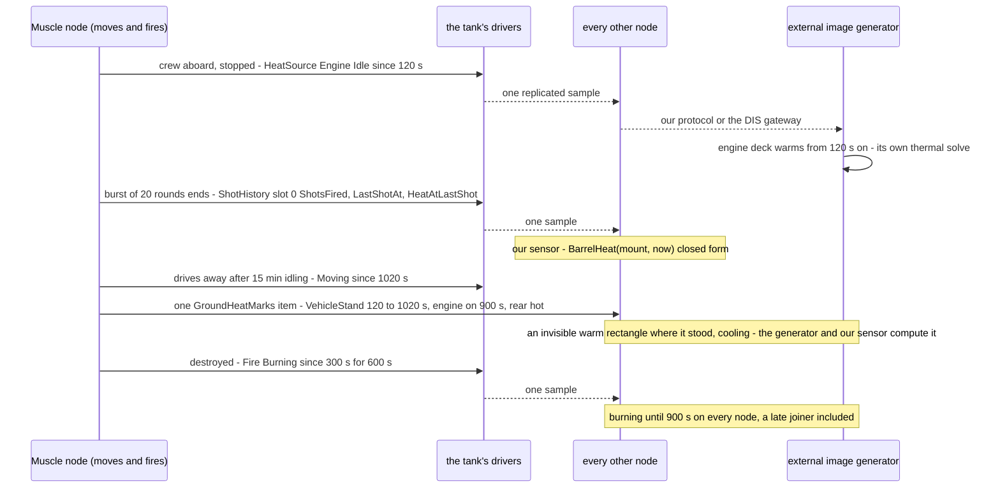
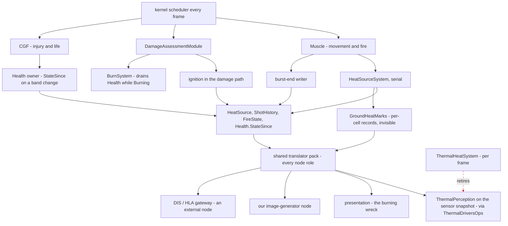

<!--STATUS
state: LIVE
updated: 2026-11-18
build-state: DESIGN — STORED FOR LATER (user, 2026-11-16: "Looks right. Please record to the design, but do not mark as approved. Just store for later.") — TD-1…TD-14 NOT approved (TD-15 ruled); ids fixed at dispatch. ⭐ REVISED `2026-11-18` after a review against code (user: "fold it into the design"): engine and body merged into ONE `HeatSource` (motion included); `ShotHistory` on the OWNER with ≤ 4 mount slots (mount children are never replicated); `LifeChange` dropped — `Health.StateSince` instead (the injury state stays derived, CE-2155). Still NOT approved
current-answer: §1 inventory · §2 the proven solution · §3 decisions · §3a the 2026-11-18 review · §3b fire and damage · §4 the components · §4b ground heat marks · §5 UML · §6 a late joiner · §7 slices
stale-below: nothing
known-rot: none
known-conflict: none
related-designs:
  - ../IG/DRAFT_Unreal_Image_Generator.md — the Unreal image generator connects the same way (DDS, an outside IG node; a draft, CE-4651)
  - ../../DESIGN_Thermal_And_Acoustic_Sensing.md — OWNS the AI's thermal sensor (CE-3061, R-205): its per-frame 0..1 heat is RE-BASED on this design's drivers (TD-10)
  - ../weather/DESIGN_Weather_And_Time.md — OWNS the weather (`WeatherConditions`, replicated) and the sun (`SolarPosition`): the environment half an image generator already receives
  - ../../DESIGN_Weapon_Layers.md — OWNS the barrel heat rule (§5k, CE-1358, `WeaponState.Heat`) the weapon drivers carry
  - ../../DESIGN_Visual_Effects.md — OWNS "a destroyed vehicle burns" (W3, VE-P), today a PRESENTATION decision; it reads the FIRE driver instead (TD-6)
  - ../../reference/NED_DDS_Protocol.md — OWNS the wire as an outsider sees it; its gateway table notes DIS appearance bits are NOT carried (§ "What DIS needs") — TD-11 fills that
  - ../../DESIGN_Ground_Patches_And_Road_Blockage.md — OWNS the crater record (`GroundDamage`, CE-4591) the ground heat marks follow (TD-14)
  - ../hit-location/DESIGN_Body_Parts_And_Hit_Location.md — OWNS vehicle part damage (an `Engine` part exists for aircraft): a dead engine is a power-plant driver
-->

# DESIGN — THERMAL DRIVERS: what every node needs to compute an entity's heat (CE-4646)

🔒 User, `2026-11-16`, verbatim: *"I'm not interested in showing it, rendering in 3D, but I would like to have all the data on the entities that support
rendering a real 3D image using some external image generator who is capable of rendering thermal image on physical basis. What are we missing here?"* ·
*"I fully agree with you … We shouldn't transfer the current state, but only something from everyone else can compute the current state. Can we do a
more detailed design for it?"*

## 1. INVENTORY *(measured `2026-11-16`; graph: `search_graph name_pattern=".*(Thermal|Heat|PowerPlant|Engine|Burn|Fire(State|Effect)|Smoke|Obscur|Appearance|Death|Died|Clothing|Weather|Solar|Sun|Material).*" label=Class` ⇒ 35 production classes, the thermal ones below; grep for `ThermalState`, `WeaponState.Heat`, `DestroyedAt|DiedAt|TimeOfDeath`, the effect burn; ⚠ index coverage cannot be checked through the CLI)*

| piece | where | what it is | for an image generator |
|---|---|---|---|
| `ThermalState` | `Perception/Signatures/ThermalState.cs` | ONE 0..1 heat + the hottest barrel, stamped from the TKB `ThermalSignatureDto` | ⛔ abstract, one scalar, **not replicated** (no translator in `Hrot.Network`), not saved |
| `ThermalHeatSystem` | `Perception/Signatures/ThermalHeatSystem.cs` | integrates heat EVERY FRAME from speed and shots on the moving node | ⛔ per-frame state, private to one node; "running" = moving (an idling tank is cold) |
| `ThermalPerception` | `Perception/Sensors/ThermalPerception.cs:59` | the AI's thermal sensor keeps a target whose `Signature` reaches its minimum | the one reader today |
| `WeaponState.Heat` | `Combat/Components/CombatComponents.cs:61-73` | the barrel's 0..1 heat, `HeatPerRound`, `HeatCoolPerSecond` (BarrelHeat rule) | ⚠ on the wire only as a SAMPLED percentage for the station HUD (`WeaponAmmo.cs:79`) — a current-state transfer |
| the burning wreck | `Hrot.Presentation/Effects/EffectSystems.cs:419-439` (W3) | each PRESENTATION decides a vehicle burns when it sees its health cross zero | ⛔ not simulation state: "a wreck loaded already dead does not burn"; a late joiner never sees the fire |
| `EntityEffectState` (wire) | `Hrot.Network.NED` | a person's stun / irritation / knock-down as UNTIL times | ✅ **the precedent: an end time, every reader computes** |
| expendables' age | `EffectSystems.cs:316-318` | a decoy is born at `FiredAt` and lives its `LifeSeconds`: "a late viewer draws it at its true age" | ✅ the same precedent |
| `WeatherConditions` + `EntityWeather` (wire) | `Weather/WeatherConditions.cs:66-109` | ground temperature, lapse rate, pressure, humidity, wind layers, clouds, visibility, fog, precipitation | ✅ the environment, replicated |
| `SolarPosition` | `Weather/SolarPosition.cs` | the sun from UTC + latitude / longitude (NOAA) | ✅ (no moon) |
| `TerrainMaterial` | `Terrain/TerrainMaterials.cs:14-19` | sight transmittance, resistance, sound attenuation, blocks movement | ⛔ no thermal class |
| a time of death / destruction | — | grep `DestroyedAt\|DiedAt\|TimeOfDeath\|KilledAt` ⇒ nothing in the toolkits or the engine | ⛔ |
| a power-plant (engine) state | — | none; `EngineFallbacks` is TKB parameter defaults, not a state | ⛔ |
| DIS appearance | `NED_DDS_Protocol.md:585, :600` | "appearance bits" listed as NOT carried; the DIS damage thresholds "not defined by HROT" | ⛔ |

## 2. The proven solution, and what we take

| practice | what it is | ⭐ we |
|---|---|---|
| **DIS Entity State appearance / RPR-FOM `PhysicalEntity`** | interop sends STATES — power plant on, flaming, smoking, damage state, a lifeform's health — never temperatures | ⭐ ADOPT: the drivers are states |
| **physics-based infrared image generators** | compute surface temperatures themselves from the model's materials, the weather and sun history, and the internal heat sources the states switch on | ⭐ ADOPT: no temperatures on our wire; the generator owns the thermal solve |
| **our own "until / since" precedent** | `EntityEffectState`'s end times, a decoy's `FiredAt` + life | ⭐ ADOPT, and it is the user's rule: every field is a STATE with the TIME it began (or a count with the last time) — any node computes "now" from it; a message only when a state CHANGES |
| sending the whole history | — | ⛔ REJECT: unbounded; a late joiner instead starts the environment soaked to the current weather (§6) |
| per-frame heat on the wire | — | ⛔ REJECT: bandwidth, and it is the current-state transfer the user ruled out |

## 3. Decisions — leans for the user

| # | question | ⭐ lean | why |
|---|---|---|---|
| **TD-1** | what crosses the wire | ⭐ **DRIVERS, never temperatures**: each field is a state + the sim time it began, or a count + the last time; written only when it changes | the user's rule; every node and an external generator compute the present the same way |
| **TD-2** | where they live | ⭐ *(revised `2026-11-18`, §3a, §4)* a small FAMILY of unmanaged components, each on the entity it describes and written by ONE node: **`HeatSource`** (an engine or a living body: a vehicle, an aircraft, a generator, a person, an animal — its state, load and motion), **`ShotHistory`** (on the weapons' OWNER, ≤ 4 mount slots), **`FireState`** (anything that burns), **`Health.StateSince`** (a field, not a component — the time the derived injury band last changed), + the terrain record **`GroundHeatMarks`** (§4b) — each recorded, replicated owner → every node through its own descriptor in the shared translator pack; runtime only (`NoScenario`) except `HeatSource`'s authored start state | a rifle has no fire and a wreck no metabolism: each entity carries only what it has; each changes at its own events, so a sample is small; one replicated component = one owner (all written on the node that moves the entity or owns its Health — SimHost today, `SimHostCoreLogicPack.cs:116` — and stay separable if a writer moves) |
| **TD-3** | the heat source (an engine, or a living body) | ⭐ *(revised `2026-11-18`)* `HeatSource` = `Kind` (Engine · Body) · `State` + `Since` (an engine: Off / Idle / Running / Dead; a body: Resting / Active — dead is NOT stored, it is `Health.StateSince`) · `Load` + `LoadSince` (an engine: the load step 0–3; a body: the exertion step 0–3 = rest / walk / run / sprint, from the speed bands the node already uses); the owning node's engine rule: RUNNING when moving or ordered to move, IDLE when stopped with crew aboard or ordered "engine on", OFF when parked and empty, ordered off, destroyed or the engine part dead; a possessed vehicle by the player's ignition; the scenario may author the start state (a convoy already on the move) | an idling tank is the classic warm target the speed-only model misses; a man who just ran is warm too (R-205) — one record answers "how much heat does it make, since when" for both |
| **TD-4** | the running gear and motion | NOT a separate component *(the `2026-11-18` review weighed one and rejected it: same writer, same reader, a few spare bytes on a body)*: `HeatSource.Moving` + `MotionSince` (when it last started / stopped) so a late joiner knows how long it has been moving or standing | the generator integrates friction from the motion it receives |
| **TD-5** | the weapons | `ShotHistory` on the weapons' OWNER (the vehicle or the soldier), `Count` + per mount (≤ 4): `ShotsFired` (cumulative), `LastShotAt`, `HeatAtLastShot` (the BarrelHeat index after the burst) — written at a BURST'S END, never per round | ⛔ NOT on each mount entity: mounts 1+ are LOCAL children with no network id (`CombatComponents.cs:76-79`, Sensors V2) and mount 0 lives on the owner — the per-owner 4-slot shape is the wire's own precedent (`EntityWeaponAmmo`, `SimDescriptors.cs:786`); the index lets OUR sensor compute the barrel with the same closed-form decay as `BarrelHeat` |
| **TD-6** | fire and smoke | `Fire` = None / Smouldering / Burning, `FireSince`, `FireSeconds` (its expected life — it ends by itself); written by the node that decides the destruction (a vehicle with fuel), later by the flamethrower / napalm (CE-4635, CE-4637) | burning becomes SIMULATION state: the same on every node, a late joiner sees it; ⭐ the presentation's W3 burn READS it (one truth, ruling 9) |
| **TD-7** | people | ⭐ *(revised `2026-11-18`)* `Health` gains `StateSince` — the time its DERIVED injury band (ok / wounded / incapacitated / dead, `Injury.StateOf`) last changed, stamped by the Health owner; a body cools from it; the clothing class is TYPE data (the TKB), not sent | ⛔ no stored life state: it is derived from the replicated `Health` by design (CE-2155, "no stored state, no topic") — only the TIME is new; `EntityManDowned` is an event, so a late joiner never sees it |
| **TD-8** | the environment | nothing new on the wire: weather (replicated), the clock (replicated), the sun (computed); ⏳ the moon later; ⭐ add `Since` to a weather change so a late joiner knows how long it has rained | the half that is already there |
| **TD-9** | materials | a **thermal class** per terrain material and surface (`materials.json` gains `thermalClass` from a fixed list: asphalt, concrete, brick, metal, glass, wood, soil-dry, soil-wet, sand, grass, dense-vegetation, water, snow), exported with the terrain; an entity's own materials are the generator's model's (found by its DIS type) | the generator's material map for the ground; our models never pretend to be its models |
| **TD-10** | our own AI thermal sensor | ⭐ re-based on the drivers: ONE calculator `ThermalDriversOps.Signature(drivers, now, weather)` (closed form, 0 B); `ThermalHeatSystem`'s per-frame integration RETIRES; `ThermalState`'s TKB fields stay as the calculator's parameters | one thermal truth, not two (ruling 9); no per-frame writes |
| **TD-11** | the interfaces | our image-generator role and any node read the component directly (our protocol); the DIS / HLA gateway maps it: HeatSource (Engine, Idle/Running) → Power Plant On, Fire → Flaming / Smoking, Health + StateSince → a lifeform's health, damage → the 4 DIS damage states (thresholds fixed here: < 25 % lost none, < 50 % slight, < 100 % moderate, destroyed) — a row in the protocol reference for the gateway's repository; ⛔ CIGI not built here | the gateway is an outside product; it needs the mapping written down |
| **TD-12** | smoke that blocks infrared | a per-munition flag in the TKB (visual-only vs IR-blocking smoke) the area cloud carries by its type | the generator renders the cloud; it must know whether infrared passes |
| **TD-13** | how much traffic | messages only on events (engine change, burst end, fire start, death, motion start / stop): a moving company ≈ a few messages a minute | the bandwidth argument for TD-1 |
| **TD-14** | ⭐ **a vehicle that stood with its engine running leaves a WARM SPOT on the ground when it drives away** (🔒 user: *"It is very important for observation to see such places … mark them as separate terrain features, something like craters, but invisible normally"*) | ⭐ **ground heat marks**: a terrain feature in the CRATER record family (`GroundDamage`'s shape — a per-cell record, one per (cell, deciding node), recorded, replicated, unioned by the view; CE-4627's shared writer core), one item per mark: where, the footprint (the hull's length × width and heading, the engine / exhaust end), the KIND, the STAND (when it stopped and when it left), the ENGINE-ON seconds during the stand and the source's power class (TKB) — DRIVERS again: every reader computes how warm it is now; ⛔ NEVER DRAWN in the normal 2-D / 3-D views (an instructor's thermal-marks layer only); kinds: `VehicleStand` now, `BurnedArea` with fire (TD-6) and napalm, `BodyImprint` later | the observer's classic cue (*"something stood here"*) is a PLACE, not an entity — it outlives the vehicle that left; craters already prove the record shape, the replication and the replay |
| **TD-15** | ✅ a generator that joins late and the sun before it | ✅ **ruled by the user**: it takes the time of day and ESTIMATES the earlier sunshine from the time of year, the time of day and the current clouds — no history is sent (§6) | 🔒 user: *"so no issue here"* |
| **TD-16** | ⭐ *(`2026-11-18`, §3b)* how fire relates to damage | ⭐ **SEPARATE components, coupled by TWO rules, both on the Health owner**: ① damage IGNITES (in the damage path: a fuelled type destroyed — TKB `FireSeconds` > 0; an incendiary hit — flamethrower CE-4635, napalm CE-4637; later an engine / fuel part destroyed) ⇒ `FireState` written; ② fire DAMAGES — a `BurnSystem` drains Health in whole steps while Burning, the `BleedOutSystem` pattern (same capability, same authority gate, one sample per step). A burning GROUND AREA has no Health: it belongs to the area effect, and cooled it becomes a `BurnedArea` ground mark (§4b) — `FireState` is for entities only | each exists without the other (a rifle kill does not burn; a roof alight has lost nothing yet); fire has its own life; today burning is a per-display decision on Health crossing 0 (W3) that a late joiner never sees |

## 3a. The `2026-11-18` review — what changed and why

| change | ⭐ measured reason |
|---|---|
| `PowerPlant` + motion ⇒ ONE `HeatSource` (Kind Engine · Body) | 🔒 user: *"even lifeforms keep & produce some heat, it seems to me pretty related"* — a split bought nothing: one writer (the moving node), one reader (the calculator), each event one ~32 B sample; a person's metabolism IS its power plant (R-205: hot when running) |
| `ShotHistory` per mount entity ⇒ on the OWNER, ≤ 4 slots | mounts 1+ are local children with no network id (`CombatComponents.cs:76-79`; `DESIGN_Sensors_And_Doctrine.md:2057` V2) — they cannot be replicated; `EntityWeaponAmmo` is the per-owner precedent |
| `LifeChange` ⇒ `Health.StateSince` | the injury state is DERIVED from the replicated `Health` (OVERVIEW_Behaviour_Building_Blocks §8a, CE-2155: "no stored state, no topic"); `Health` replicates as `EntityDamage` (`NedOwnershipGroupBinding.cs:91`) — a stored state would be a second truth |
| `StandEngineOnSeconds` off the wire | only the writer needs it, and only when a stand ends — it reaches the wire inside the ground mark (§4b) |

## 3b. Fire and damage *(TD-16, `2026-11-18`)*

| the lean rests on | code — how it is | design — how it was meant |
|---|---|---|
| burning is a per-display decision, vehicles only | ✅ `EffectSystems.cs` `WreckSpawnSystem` (only a crossing to 0 burns) | ✅ `DESIGN_Visual_Effects.md` W3 / VE-P |
| damage over time has a proven pattern | ✅ `BleedOutSystem.cs` (the Health owner, whole steps) | ✅ `DESIGN_Injury_States.md` §4 |
| incendiary weapons set people, roofs, vehicles alight | ⛔ not built | ✅ CE-4635 / CE-4637 |
| one node owns Health and applies damage | ✅ `DamageAssessmentModule`, `HealthApplicationSystem` | ✅ CE-2155 |

| rejected | the one fact |
|---|---|
| fire inside `Health` | a roof burns before it loses anything; every hit sample would carry fire fields it does not change |
| fire in `EntityEffectState` (the person effects' until-times) | person-only; fire is on vehicles, wrecks and buildings |
| fire stays a display decision | it cannot damage, the AI cannot avoid it, a late joiner never sees it |

## 4. The components *(revised `2026-11-18`: §3a)*

| component | on | fields (unmanaged; times are `SimInstant`) | size | written by (node · system · when) | replicated / recorded / saved |
|---|---|---|---|---|---|
| **`HeatSource`** | a vehicle, an aircraft, a generator, a person, an animal | `Kind` (Engine · Body) · `State` · `Since` · `Load` (0–3) · `LoadSince` · `Moving` · `MotionSince` | ≈ 32 B | the node that moves the entity · `HeatSourceSystem` (serial) · on a change of state, load step or motion (the engine-on seconds of the current stand are the writer's PRIVATE state, reaching the wire only in a ground mark, §4b) | a descriptor, owner → every node · recorded · ⭐ the authored start `State` SAVED (a convoy already running), the times reset at load |
| **`ShotHistory`** | the weapons' OWNER (a vehicle, a soldier) — beside its `WeaponState` | `Count` + per mount (≤ 4): `ShotsFired` · `LastShotAt` · `HeatAtLastShot` | ≈ 52 B | SimHost · the fire path · at a burst's END | a descriptor · recorded · not saved |
| **`FireState`** | a vehicle, a wreck (later a building's terrain-object entity) | `Fire` (None · Smouldering · Burning) · `Since` · `Seconds` (its expected life — it goes out by itself) · `Intensity` | ≈ 16 B | the Health owner · the damage path when it ignites (TD-16 ①: a fuelled type destroyed, an incendiary hit, later an engine / fuel part) · `BurnSystem` drains Health while Burning (TD-16 ②) | a descriptor · recorded · not saved |
| **`Health.StateSince`** *(a field on the existing `Health`, replicated as `EntityDamage`)* | a person, an animal, anything with Health | `StateSince` — when the derived injury band last changed | + 8 B | the Health owner · `HealthApplicationSystem` / `BleedOutSystem` · when the band changes | rides the existing `EntityDamage` descriptor |
| **`GroundHeatMarks`** | a per-cell TERRAIN record entity (§4b) | `Count` + up to N items `{Kind, X, Y, Heading, Length, Width, HotEnd, StandSince, LeftAt, EngineOnSeconds, PowerClass}` | ≤ 1024 B | SimHost · `HeatSourceSystem` when a stand ends | a descriptor · recorded · not saved |

| ⭐ changed, not new | |
|---|---|
| `ThermalState` | keeps only its TKB PARAMETERS (base signature, heat rates, reference speed); ⛔ `Heat`, `BarrelHeat`, `LastX/Y/Z`, `HasLast` retire |
| `ThermalHeatSystem` | ⛔ retires (the per-frame integration) |
| `WeatherConditions` | gains `Since` (when the current weather began, TD-8) |
| `TerrainMaterial` (`materials.json`) | gains `thermalClass` (TD-9) |

| ⭐ type data (TKB), never sent at runtime | |
|---|---|
| `ThermalSignatureDto` gains | `HasPowerPlant` · `PowerClass` (a car · a truck · a tank · an aircraft) · `HotEnd` (front / rear) · idle and running heat for OUR sensor's calculator (and a body's heat per exertion step) · `FireSeconds` (how long a wreck of this type burns) · for a person `ClothingClass` |
| a munition gains | `SmokeBlocksInfrared` (TD-12) |

| ⭐ code that is not a component | |
|---|---|
| `ThermalDriversOps` | the ONE calculator, static and pure: `Signature(entity drivers, now, weather)`, `BarrelHeat(shotHistory, now)`, `MarkWarmth(mark, now, weather)` — 0 B, called by our sensor on its snapshot |
| the translators | one egress / ingress pair per descriptor in the SHARED pack (every node role, the image-generator node included) |
| ids | 4 component ids + 4 descriptor ordinals (`Health` / `EntityDamage` gain a field) from the building lane's block, fixed at dispatch |

## 4b. Ground heat marks — `GroundHeatMarks` *(TD-14; the crater record's shape; unmanaged, ≤ 1024 B, recorded, replicated, `NoScenario` — a mark cools within hours)*

| per mark | type | meaning |
|---|---|---|
| `Kind` | byte | `VehicleStand` · `BurnedArea` · `BodyImprint` (later) |
| `X`, `Y`, `Heading`, `Length`, `Width` | floats, Half | the footprint on the ground — the hull's, at the place it stood |
| `HotEnd` | byte | which end carries the engine and exhaust (front / rear / none) — the hottest part of the mark |
| `StandSince`, `LeftAt` | SimInstant | when it stopped there, when it drove away |
| `EngineOnSeconds` | Half | how long the engine ran during the stand (idle or running) — a parked, cold vehicle leaves no mark |
| `PowerClass` | byte | the source's power class from its TKB (a car, a truck, a tank) |

| ⭐ the rule | |
|---|---|
| written by | the node that moves the vehicle (`HeatSourceSystem`, TD-3) when it LEAVES a stand of ≥ ~60 s with `EngineOnSeconds` > 0 — one event, one item |
| kept | until it is COLD (about two hours of sim time, by `PowerClass`), then dropped by the next write to that cell; a capacity of items per cell like the craters, another entity past it |
| read by | the external image generator (it solves the ground's temperature from the stand, the engine time, the soil's thermal class TD-9 and the weather) · our AI thermal sensor through `ThermalDriversOps.MarkWarmth(mark, now, weather)` (an observer may later report *"a recent vehicle position"* into the per-side place knowledge, `PlaceKnowledge`) · an instructor's thermal-marks map layer |
| ⛔ never | drawn in the normal views; saved into a scenario |

## 5. UML

```mermaid
classDiagram
  class HeatSource {
    <<new, engine or body, replicated>>
    Kind State Since Load LoadSince
    Moving MotionSince
  }
  class ShotHistory {
    <<new, on the weapons OWNER, 4 slots, replicated>>
    ShotsFired LastShotAt HeatAtLastShot
  }
  class FireState {
    <<new, replicated>>
    Fire Since Seconds Intensity
  }
  class Health {
    <<existing, replicated as EntityDamage, gains StateSince>>
    Current Max StateSince
  }
  class ThermalDriversOps {
    <<new, the ONE calculator, closed form, 0 B>>
    Signature(drivers, now, weather)
    BarrelHeat(mount, now)
  }
  class HeatSourceSystem {
    <<new, serial, on the node that moves the entity>>
  }
  class BurnSystem {
    <<new, on the Health owner, the BleedOut pattern>>
  }
  class DamagePath {
    <<existing - DamageAssessment, HealthApplication>>
  }
  class ThermalDriverWriters {
    <<new, at events: burst end, ignition, death>>
  }
  class ThermalState {
    <<existing, TKB parameters only after TD-10>>
  }
  class ThermalHeatSystem {
    <<existing, RETIRES - per-frame integration>>
  }
  class ThermalPerception {
    <<existing, reads the calculator>>
  }
  class WeaponState {
    <<existing, Heat and the BarrelHeat rule>>
  }
  class BurningWreckEffect {
    <<existing W3, reads Fire instead of deciding>>
  }
  class WeatherConditions {
    <<existing, replicated, gains Since>>
  }
  class SolarPosition {
    <<existing>>
  }
  class TerrainMaterial {
    <<existing, gains thermalClass>>
  }
  class GroundHeatMarks {
    <<new, per-cell record, the crater shape, invisible>>
    Kind X Y Heading Length Width HotEnd
    StandSince LeftAt EngineOnSeconds PowerClass
  }
  class GroundDamage {
    <<existing - craters, the same record family>>
  }
  class DisGateway {
    <<external product, maps the drivers to DIS appearance>>
  }
  HeatSourceSystem --> HeatSource : state, load, motion
  ThermalDriverWriters --> ShotHistory : burst end
  DamagePath --> FireState : ignites - fuelled destroyed, incendiary hit
  BurnSystem ..> FireState : while Burning
  BurnSystem --> Health : drains in whole steps
  ThermalDriverWriters --> Health : band changes - StateSince
  ThermalDriverWriters ..> WeaponState : burst end
  ThermalDriversOps ..> HeatSource
  ThermalDriversOps ..> ShotHistory
  ThermalDriversOps ..> FireState
  ThermalDriversOps ..> Health
  ThermalDriversOps ..> ThermalState : parameters
  ThermalDriversOps ..> WeatherConditions
  ThermalPerception ..> ThermalDriversOps
  BurningWreckEffect ..> FireState
  DisGateway ..> HeatSource
  DisGateway ..> FireState
  DisGateway ..> Health
  DisGateway ..> WeatherConditions
  ThermalHeatSystem .. ThermalDriversOps : replaced by
  HeatSourceSystem --> GroundHeatMarks : a stand ends
  GroundHeatMarks .. GroundDamage : same shape
  ThermalDriversOps ..> GroundHeatMarks : MarkWarmth
```

*What it shows that prose hid: the drivers have WRITERS only at events and ONE calculator that every reader shares — our AI sensor, the burning
effect and the external generator all start from the same record, so there is no second thermal truth and nothing integrates per frame. The warm
spot a vehicle leaves is a TERRAIN record beside the craters, not a field of the vehicle — it outlives the vehicle that drove away.*

*What it shows: one sample per EVENT, and between events every reader computes the present itself — the user's rule made concrete.*

*What it shows: who writes each driver and where it runs, and that every consumer — our sensor, our effects, an outside generator — reads the same
replicated record; the red edge is the per-frame integrator this design retires.*

## 6. A late joiner and replay

A node or generator that joins late receives the current drivers — `HeatSource`, `ShotHistory`, `FireState`, `Health` (with `StateSince`) (TransientLocal, as every replicated record) and the weather: it knows
"idling since 120 s", "burning since 300 s for 600 s", "dead since 40 s", "rained since 06:10". ✅ It does not need the hours of sun before it joined — 🔒 the user (TD-15): *"The generator who joins late simply takes the time of day and
estimates what the sunshine was from the time of year, time of day, and the clouds that are current, so no issue here."* It also receives every
ground heat mark still warm (§4b), so a place a vehicle left before it joined is there. Replay and a seek restore the record by bytes (unmanaged, recorded).

## 7. Slices *(lean; ids and lanes at dispatch)*

| slice | builds | done when (R-4277: a feature scenario each) |
|---|---|---|
| TD-S1 | the components (§4), their descriptors + translators, `ThermalDriversOps`, the sensor re-based, `ThermalHeatSystem` retired | the sensor's verdicts unchanged on the thermal scenarios; 0 B per steady frame |
| TD-S2 | `HeatSource` (TD-3, TD-4): engines + bodies, motion, the possessed ignition | `th-idling-tank`: an idling, crewed tank is seen by a thermal sensor at night, a parked empty one is not; a man who just ran reads warmer than one who stood |
| TD-S3 | the weapons per mount (TD-5) | a burst updates once; the barrel computed from the record matches `BarrelHeat` |
| TD-S4 | fire (TD-6, TD-16): ignition in the damage path, `BurnSystem`, the W3 burn re-based | `th-burning-wreck`: a late-joining node sees the wreck burning until it goes out; a man set alight loses health in steps on every node |
| TD-S5 | `Health.StateSince` (TD-7) | a body's `StateSince` is the time of death on every node, a late joiner included |
| TD-S6 | material thermal classes (TD-9) + the terrain export; IR-blocking smoke (TD-12); weather `Since` (TD-8) | the exported terrain carries a class per surface |
| TD-S7 | the DIS mapping (TD-11) written into the protocol reference for the gateway | the table, with the damage thresholds |
| TD-S8 | ground heat marks (TD-14): the record, the writer at a stand's end, `MarkWarmth`, the instructor's layer | `th-vehicle-left-warm-spot`: a tank idles 15 min and drives off — a mark of its footprint, hot end at the rear, is on every node (a late joiner included) and our sensor sees it warm for its cooling time; a parked cold truck leaves none |
