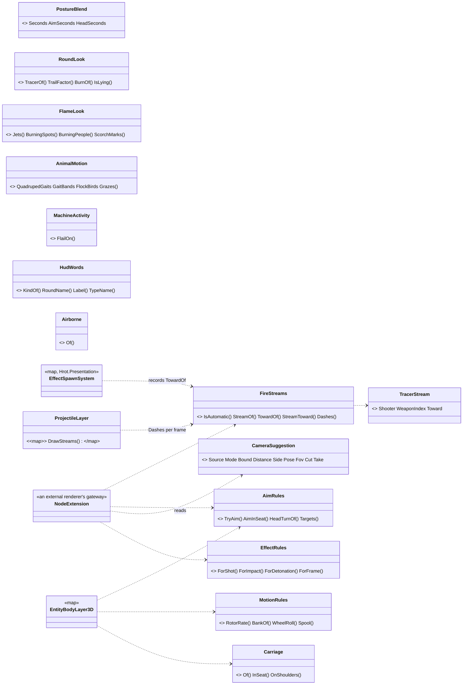
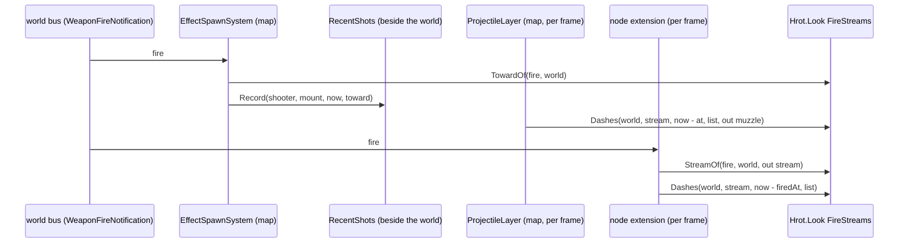
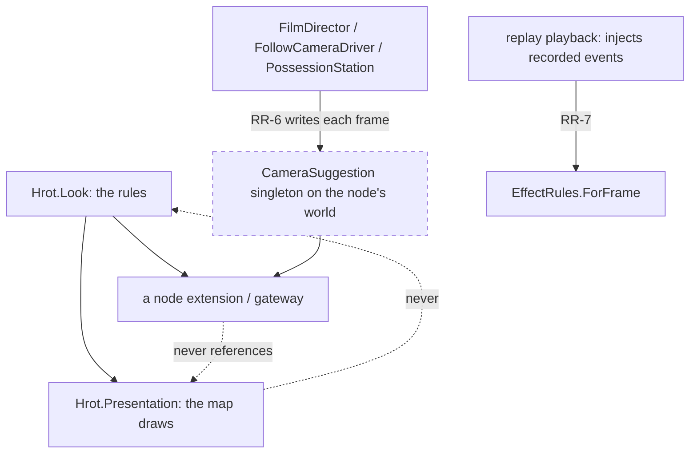
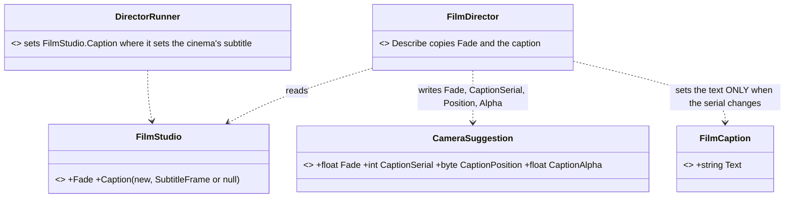
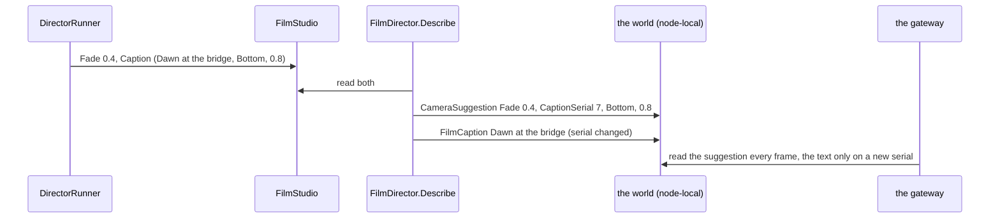

<!--STATUS
state: LIVE
updated: 2026-11-22
build-state: BUILT (RR-1…RR-6, RR-8…RR-11; RR-7 needs no engine change, D-2)
current-answer: §3 (what moves where, per item) and §5 (the decisions, with leans)
stale-below: nothing yet
known-rot: none
known-conflict: none
related-designs:
  - ../IG/DESIGN_Linked_Client_Director.md — OWNS the director's LINKED CLIENT (a node extension as the frame sink and sound source, DD-022's HROT half; CE-11017, Q113)
  - DESIGN_Vehicle_Appearance_State.md — OWNS the look library itself (§7, LK-1…LK-7: Hrot.Look, no presentation reference, the map and a gateway call the same functions; R-4296). THIS design extends it with the rules that still live only in the map
  - ../../DESIGN_Map_3D_Mode.md — OWNS how the 3-D map draws (§6u the burst stream B-1/B-2, §6n the bodies, the aimed upper body WL-6, the motion tracker S-4); the map keeps the drawing, the rules move out
  - ../../DESIGN_Visual_Effects.md — OWNS the effect entities and the spawner (VE-A…VE-M, LR-E lightweight rounds); RR-4 and RR-7 move rules beside its spawner, never a second spawner
  - ../films/DESIGN_Film_Director.md — OWNS the director, takes, shots and FilmStudio; RR-6 publishes its CURRENT camera, it does not change how it decides
  - ../../DESIGN_Player_Join.md — OWNS the possession station and its HUD; RR-5 moves the HUD's WORDS, never its drawing
  - ../weapons/DESIGN_Flame_Weapons.md — OWNS the flame jet and burning ground; RR-4 moves the flame look's rules
-->

# Look rules for renderers — HROT's presentation rules, outside the 3-D map

> 🔒 **User, `2026-11-20`:** *"Please make HROT's presentation rules available outside the 3-D map, so that external renderers and node extensions …
> show exactly what HROT's own map shows, without re-implementing HROT's rules from its source code."* · *"the map must draw from the same functions so
> the two can never disagree."*

⭐ **The pattern is not new — it is `Hrot.Look` (R-4296, [Vehicle Appearance §7](DESIGN_Vehicle_Appearance_State.md)).** A rule is a pure function of
components, events, the TKB, sim time and an entity seed; it fills a caller's list (0 B steady); the map calls it; a node extension calls it. This design
moves the rules the map still keeps to itself, item by item, in the user's priority order. ⛔ Nothing here draws.

## 1. INVENTORY — the queries run (graph re-indexed `2026-11-20`)

| query | result |
|---|---|
| `search_graph name_pattern="(EffectRules\|PersonLook\|VehicleLook\|…\|FireStreams)"` | 43 nodes; ⭐ `Hrot.Look` today: `EffectRules`, `EffectSpec`, `PersonLook`, `PersonParts`, `Outfits`, `OutfitPalettes`, `Wardrobe`, `VehicleLook`, `VehicleSockets`, `BrakeLights`, `FiringBlasts`, `VisualFamily`, `AirMissiles`, `Rgba` |
| `search_graph name_pattern=".*Camera.*" label=Class` (total 27) | ⭐ engine-level only `MapCameraTkb` (the scenario camera ENTITY, type 7201) and the 2-D `MapCameraView`; ⛔ **no camera-suggestion type anywhere** |
| `search_graph name_pattern=".*(FlightState\|Flock\|Airborne\|Flies).*"` (75) | ⭐ `FlightState.Airborne` (aircraft, `Flight.cs:58`); ⛔ no airborne state for a bird or a flock other than `FlockState.Mode` |
| grep `FireStreams\.\|StreamToward` | the stream rule split over two files: `Hrot.Presentation/Effects/FireStreams.cs` + `EffectSpawnSystem.StreamToward` (`EffectSystems.cs:295`) |
| a sweep of items 2–8 (file:line, inputs, state, blockers, rails) | §3 below; ⭐ **no rule is blocked by Raylib** — they are blocked by small Presentation types (`MotionPose`, `ShapeKits` radii, `BlockFigure` constants, `PostureBlend`) that move with them |

⚠ `check_index_coverage` is not available through the CLI — the absence claims above (no camera suggestion, no bird airborne state) rest on the graph
**and** grep, not on a coverage check.

## 2. Diagrams

*What the picture shows that prose hid: every arrow from the map and every arrow from a node extension lands on the SAME box — there is no second copy
of a rule to drift.*

*RR-1 as built: both sides make the same two calls; the map keeps only where it remembers the stream (`RecentShots`) and the colour it draws it in.*

*Who calls what each frame. Dashed: RR-6's singleton does not exist yet — it is written only on a node that runs a map (the director and the follow camera
are map-side), so a node extension in that process reads it; a headless node has no camera to suggest (D-1).*

## 3. Per item — what moves, where it lands, what stays

| item | id | moves to `Hrot.Look` | stays in the map, and why | state |
|---|---|---|---|---|
| **RR-1** tracer streams | [CE-11001](../../blueprints/Blueprint_Issues_Tracker.md) | `Hrot.Look.Effects.FireStreams`: `Window` 0.35 s · `Spacing` 5 m · `DashLength` 1.8 m · `Speed` 900 m/s · `MaxLength` 500 m · `StreamConeCos` 0.7071 · `IsAutomatic(mount)` · `StreamOf(fire, world, out TracerStream)` · `TowardOf(fire, world)` · `StreamToward(…)` · `Dashes(…)` (geometry, and per stream from the live muzzle) | `RecentShots` (the map's memory of the last shot per shooter — a renderer keeps its own); the colour (255,154,48), additive, and the line width | ✅ BUILT |
| **RR-2** aimed upper body | [CE-11002](../../blueprints/Blueprint_Issues_Tracker.md) | `TryAim` (twist ≤ 75° `HumanGait.MaxAimTwist`, pitch ≤ 35°, shoulder (crouched 0.98 : 1.41 − 0.10) / 1.8 × height), `AimInSeat` (shoulder 0.53 m, twist ≤ 160°), `HeadTurnOf` (LookOf.HeadYaw − drawn twist, ≤ TKB head limit, 70°), `PostureBlend`'s constants (0.3 / 0.12 / 0.15 s, exponential, a gap > 1 s snaps) and its per-entity easing as a caller-owned state | `FigureMotion` (it builds a `MotionPose` for the block figure — a drawing); the lean shear | ✅ BUILT — `Hrot.Look.People.UpperBody` (`Targets`, `TryAim`, `AimInSeat`, `HeadTurnOf`, `ShoulderHeight`, limits) + `Hrot.Look.People.PostureBlend`; the map forwards |
| **RR-3** spinning parts, leans | [CE-11003](../../blueprints/Blueprint_Issues_Tracker.md) | rotor 4.3 rev/s, run-on 20 s, spool 3 s; drone 7.3; antenna 0.6; flail 4 rev/s, spool 1 s; the bank `−atan(v·yawRate/g)` ≤ 35°, eased 0.15 s; wheel roll by distance over the wheel radius — as functions of replicated state on SIM time | the per-frame accumulator (`MotionTracker.State`) — a renderer keeps its own; ⚠ the map advances rotor angles by frame time × sim pace — the shared function takes sim seconds, the map's pacing stays its own | ✅ BUILT — `Hrot.Look.Vehicles.MotionRules` (`Spool`, `Spin`, `RotorRuns`, `DroneProp`, `BankTarget`, `EaseBank`, `Roll`, `CarWheelRadius` + constants); `MotionTracker` calls it |
| **RR-4** rounds, flame | [CE-11004](../../blueprints/Blueprint_Issues_Tracker.md) | `TracerOf`, `TrailFactor`, `BurnOf`, the lying / stopped rule, the trail constants; the flame look: jets, burning spots (size clamp(r·0.7, 0.3, 8)), burning people, scorch marks — as specs | the `Color`s (an `Rgba` in Look where a colour IS the rule), the path ring buffer | ✅ BUILT — `Hrot.Look.Effects.RoundLook` (+ `RoundState`) and `FlameLook` (+ `FlameSpec`, `FlameKind`); the map calls them |
| **RR-5** bodies, gaits, carriage, flail, HUD | [CE-11005](../../blueprints/Blueprint_Issues_Tracker.md) | `QuadrupedGaits`, `GaitBands`, `FlockBirds`, the grazing cycle; `Carriage.Of` + `CarriageKind` + placement; `FlailActivity.IsOn`; the HUD words (`KindOf`, `RoundName`, `Label`, `TypeName`) | `AnimalCoats` (colours of kits); the HUD's drawing and colours; `DismountDrop` (a per-entity timer of the map) | ✅ BUILT — moved verbatim (namespace `Hrot.UI.Common.Map3D` kept, as `VisualFamily`): `Hrot.Look/Animals/AnimalMotion.cs`, `People/Carriage.cs`, `Vehicles/FlailActivity.cs`; new `Hrot.Look.Hud.HudWords` (the station forwards) |
| **RR-6** the suggested camera | [CE-11006](../../blueprints/Blueprint_Issues_Tracker.md) | a NEW engine-level singleton (D-1) | the drivers themselves | ✅ BUILT — `Hrot.Map.Common.Components.CameraSuggestion` (Hrot.Core, id 86, NoReplay), read with `Hrot.Look.CameraAdvice.TryGet`; drivers implement `ICameraSuggests`, the ONE writer is `CameraSuggestions.Write` from `MapViewModeLayer.Update` while 3-D is on. ⭐ **CE-11066 (`2026-11-27`):** on a THREADED node (the default, R-4224) the map writes on the presentation world A while a node extension reads the node's world S — the suggestion (and the caption text) now reaches S through ONE pending sim job per link (the newest of the UI frames, 0 B steady). ⛔ SUPERSEDED: *written on the node's world* held only for a single-world node; measured on Unreal, a whole live take sent 0 `View` samples |
| **RR-7** effects in replay | [CE-11007](../../blueprints/Blueprint_Issues_Tracker.md) | one path (D-2) | — | ✅ no engine change (D-2) |
| **RR-8** airborne | [CE-11008](../../blueprints/Blueprint_Issues_Tracker.md) | `Airborne.Of(world, e)` (D-3) | the map's lone-bird flap (reads its speed) | ✅ BUILT — `Hrot.Look.Airborne.Of`; the flag is `AnimalFlags.InFlight`, set by the bird's brain (not `FlightState`: sensors would hear it; not "Flying": the IDL scope) |

⭐ **Results the node extension's ports must match:** the motorcycle bank (RR-3), `Carriage.Of` (RR-5), `FlailActivity.IsOn` (RR-5), the HUD words (RR-5)
move **verbatim** — same constants, same branches — and the map's existing rails stay the proof that the result did not change.

### 3.1 RR-1 as built (`2026-11-20`)

- ⭐ `Hrot.UI.Common.Effects.FireStreams` and `EffectSpawnSystem.StreamToward` / `StreamConeCos` / `AimPointOf` are **gone**; one class,
  `Hrot.Look.Effects.FireStreams`. The spawner records `FireStreams.TowardOf(fire, world)`; `ProjectileLayer.DrawStreams` draws
  `FireStreams.Dashes(world, stream, since, list, out muzzle)`.
- ⭐ **Deviation from a frozen-muzzle struct, measured:** the map re-reads the muzzle EVERY FRAME (`Muzzle.TryOf` inside the draw loop) — a turning
  turret carries its stream. ⇒ `TracerStream` holds the shooter and mount, not a muzzle; the per-instant `Dashes` reads the live muzzle. A renderer that
  only has the notification gets the identical picture.
- ⭐ **Result identical to before:** the same constants and branches; `TowardOf` reads the target, the aim posture and the launch exactly as the spawner
  did (`view` there IS the world, `EffectSystems.cs:135`).
- Rails: `Hrot.Look.Tests.FireStreamsTests` (`RR1_*`, the per-fire result, the point-shot fallback, 0 B per instant); the map's own
  `EffectTests.CE1105_*` / `CE1357_*` now call the Look class.

### 3.2 RR-6, RR-9, RR-10, RR-11 as built (`2026-11-20`)

| item | as built | ⚠ deviation / note |
|---|---|---|
| **RR-6** ([CE-11006](../../blueprints/Blueprint_Issues_Tracker.md)) | `CameraSuggestion` { Source (Operator / Follow / Director), Mode (Free / Orbit / Eyes / Shoulder / Chase / FixedKey), ShoulderSide, Bound, BoundNetId, Distance, Position, LookAt, Orientation (+X forward, +Y left, +Z up), FovyDegrees, Cut, Take } — a world singleton in **Hrot.Core** (not Fdp.Toolkits as D-1 leaned: the follow / director / possession drivers and the map are Hrot, and a node extension references Hrot.Core anyway). Each driver says what it is (`ICameraSuggests.Describe`); the pose is the camera's own | the director names its follow unit by NETWORK id (`BoundNetId`), the others by `Bound`; `Take` = the director's segment on screen (`FilmStudio.ShotName`) |
| **RR-9** ([CE-11009](../../blueprints/Blueprint_Issues_Tracker.md)) | `Fdp.Toolkit.Combat.ImpactMaterial` (Unknown, Asphalt, Concrete, Brick, Metal, Glass, Wood, Soil, Sand, Vegetation, Water, Snow) = the crossing's terrain material folded through its THERMAL CLASS (the fixed list); on `RoundImpact` (the record), `RoundImpactNotification.Material` and the wire's `RoundImpact.Material` (a byte each); a ground stop is Soil | a byte on the wire, not the enum: the IDL puts enum members in one scope |
| **RR-10** ([CE-11010](../../blueprints/Blueprint_Issues_Tracker.md)) | `EffectCause` { Surface, Material, Target, Damage, Ammo } (Hrot.Core, id 72, recorded, never saved) on every effect a HIT made — stamped by `EffectRules.ForImpact` / `ForDetonation` on `EffectSpec.Cause`, added by the spawner. ⭐ **CE-11024 (as built `2026-11-21`, backend): two fields APPENDED** — `byte Impact` (`ImpactKind` + 1: 1 Entry, 2 Exit, 3 Stop; 0 = not a round's impact, i.e. a detonation, so a zero never reads as "entered") and `Entity Shooter` (from the impact's or the detonation's `Shooter`); the earlier fields keep their offsets. Rail: `EffectStateTests.CE11024_AnImpactsEffect_CarriesItsKindAndShooter_LiveAndAfterASeek` (record → play back → seek) | ⭐ **CE-11030 (as built `2026-11-21`, ui, from the gateway's T-051): which effect IS the impact, and its normal.** `ForImpact` makes a puff AND a mark, both used to carry the same `Impact`, so a renderer making one impact per effect entity saw two. Now **ONE** effect of a round's impact carries `EffectCause.Impact != 0` — the FIRST spec the rule makes (its puff; the mark, or the puff's absence, never leaves the round without one) — and the others carry 0. Measured first: the only reader of `EffectCause.Impact` in HROT is the CE-11024 rail (`rg "\.Impact"` over `*.cs`: `EffectRules.cs` writer, `EffectStateTests.cs` reader); no renderer, the map or the recorder reads the mark's — so a shared impact id was not needed. ⭐ A third field APPENDED, unmanaged: `Vector3 Normal` (the notification's `NormalX/Y/Z`, all 0 = not stated; on every effect of the impact, 0 on a detonation's). `EffectCause` is a COMPONENT (id 72, not an `[EventId]` event), so its layout hash and size changed (CE-11024 base: `0x99F49FE46F4AA46E`, 40 bytes): `SchemaValidator` only WARNS for a component and skips ITS recorded data, the rest of the recording plays (rail: a manifest at the old hash validates, the cause is in the changed list). Rails (`EffectStateTests`): one impact = exactly one entity with a non-zero `Impact`; its effects carry the notification's `Normal`, a detonation's `Impact` 0 and `Normal` 0; the old manifest. Red-proofs: every effect stamped; `Normal` dropped. The gateway drops its fold (SimNetGateway T-051 finding 1 / 2). |
| **RR-11** ([CE-11011](../../blueprints/Blueprint_Issues_Tracker.md)) | `LightweightRound.LaunchedAt` (the marker WIDENED — user: *"old recordings not important; rather widen the marker"*), set by `FireProcessingSystem.MarkIfVisible` from the sim clock, sent as `EntityMaster.LaunchedAt` (0 for every other entity), stamped by the master's ingress | ⛔ recordings made before this replay the round marker with the old size |

⚠ **Component ids:** the ui block (460–475) is full; 72 and 86 were the production-free ids whose only other use is a test struct in a project that never registers Hrot types. Finding them took a measurement the catalogue rail should give for free — [CE-11013](../../blueprints/Blueprint_Issues_Tracker.md).

### 3.3 State, not events — stance timing, effects and streams for renderers (`2026-11-20`, R-11006, R-11007)

| | as built |
|---|---|
| **stance** ([CE-11014](../../blueprints/Blueprint_Issues_Tracker.md)) | `StanceStatus.TransitionStartedAt` / `FromStance` / `TransitionSeconds` (muscle-written at a blend's start, replicated on `DdsStanceStatus`, recorded); progress anywhere = `StanceTiming.ProgressAt(status, now)`; the ONE duration rule `StanceTiming.Effective` (BlendTime, else 0.35 / 0.8 s by pair) is what the muscle hands its backend and what the map's blend uses |
| **effects** ([CE-11015](../../blueprints/Blueprint_Issues_Tracker.md)) | `EffectRules.SpecOf(world, effectEntity, tkb, out spec)` — the live spec, rebuilt from the recorded entity (with `StartedAt`) |
| **streams** ([CE-11016](../../blueprints/Blueprint_Issues_Tracker.md)) | `FireStreams.StreamOfFlash(world, flash, out stream, out firedAt)`; the flash records the stream's own aim (`TowardOf`) |

⛔ **Rejected: re-raising recorded events in the cluster replay** (`ReplayModule` passes no bus) — events between keyframes are lost or burst on a seek; component state is restored by it. The events stay recorded; nothing reads them in replay.

### 3.4 The director's fade and subtitle on the suggested camera, live (`2026-11-22`, CE-11035, R-11015; build-state: BUILT, as-built below)

🔒 User, `2026-11-22`: *"yes add live fade and subtitles too"* — a client WATCHING the director live (not rendering a film) gets the dip to
black and the subtitle the screen shows. ⭐ Measured: the camera already reaches clients live through `CameraSuggestion` (`FilmDirector.Describe`,
`Film.cs:210-223`); the fade lives only in `FilmStudio.Fade` (`Film.cs:80`, set by `DirectorRunner.cs:1010, :1129`) and the subtitle only in
`DirectorRunner.SubtitleNow` (`:441`, `:1002`) — both reach a client only inside a render job (`FilmFrame`).

| rule | why |
|---|---|
| ⭐ the fade and the caption's alpha / position / serial on the unmanaged suggestion; the TEXT on its own managed singleton, replaced only when the serial changes | 0 B per steady frame (CLAUDE.md HOT PATH): a fade animates every frame, the text changes a few times a take |
| ⭐ only the director writes them; any other driver leaves 0 (no fade, no caption) | the suggestion is composed fresh each frame (`CameraSuggestions.Write`) |
| ⛔ still node-local, never recorded or replicated | as D-1 |

⭐ **As-built (`2026-11-22`)** — deviations from the sketch above, the prior state SUPERSEDED:

| prior (the sketch) | as-built |
|---|---|
| ~~`FilmStudio.Caption` = a `SubtitleFrame` or null, the serial kept by `Describe`~~ SUPERSEDED | `FilmStudio.Caption` (set by `DirectorRunner` beside `_cinema.Subtitle`) owns the SERIAL too: it grows by one exactly when the shown text differs from the last one; `FilmStudio.ReadCaption` reads serial / last text / position / alpha in one locked read (0 B). `Release()` clears the frame, keeps serial and text |
| ~~"no subtitle: text empty"~~ SUPERSEDED | no subtitle: alpha 0, serial unchanged, `FilmCaption.Text` keeps the last line (empty before the first); the same text shown again is no new serial (a client's cached text is right) |
| the text set "when the serial changes" | `FilmDirector` remembers the serial / world it last published and sets `FilmCaption` when either differs or the singleton is absent — 0 B otherwise |
| component id | `GlobalComponentIds.FilmCaption = 87` (a managed record, NoReplay/NoScenario/NoPreview/NodeLocal) |

Rails: `FilmTests.CE11035_*` (fade follows; subtitle serial / text / position / alpha; set only on a serial change; 0 B per steady frame) and
`DirectorRunnerTests.CE11035_ALivePlay_HandsTheSubtitleToTheStudio_ForTheSuggestedCamera`.

Acceptance: a rail per field through `CameraSuggestions.Write` with the real `FilmDirector`; the serial changes exactly when the text does;
0 B per steady frame with a fade animating; a follow / operator camera has Fade 0 and no caption.

## 4. What this design does NOT move, and why

| | |
|---|---|
| ⛔ any drawing — meshes, `MotionPose`-to-matrix, colours that are style rather than rule | ⭐ a renderer has its own models; it needs the NUMBERS (angles, rates, points, kinds) |
| ⛔ per-frame accumulators (`MotionTracker.State`, `PostureBlend._states`, `RecentShots`) as shared state | ⭐ the RULE is shared (a pure step `next = f(prev, inputs, dt)`); each consumer owns its own state — two renderers must never share one easing state |
| ⚠ `VisualFamily`'s namespace (`Hrot.UI.Common.Map3D`, already inside `Hrot.Look`) | a rename is a Roslyn rename across every caller — not part of this programme; filed as a note on CE-11000 |

## 5. Decisions — for the user, each with a lean

**D-1 (RR-6) — where the suggested camera lives. ✅ APPROVED `2026-11-20` (R-11000).** Lean: ⭐ **an unmanaged singleton `CameraSuggestion` in `Fdp.Toolkits` (no presentation type in it:
position, orientation quaternion, field of view, source enum {Operator, Follow, Director}, mode enum {Free, Orbit, Eyes, Shoulder, Chase, FixedKey},
bound `Entity`, continuum distance, shoulder side ±1, a cut counter, the take/shot name as a `FixedString64`)**, written every frame by whichever driver
holds the map camera on that node, ⛔ **not recorded, not replicated** (`DataPolicy.NoReplay | NoScenario`, node-local advice). Blast radius: one new
component id; three writers (FilmDirector, FollowCameraDriver, the free operator camera). What would change the lean: if the external renderer runs on a
node with NO map (a headless gateway node), the suggestion must cross nodes — then it becomes a small DDS topic, a separate step.

**D-2 (RR-7) — effects in replay. ✅ RESOLVED `2026-11-20`: NO ENGINE CHANGE (R-11001).** Measured: the map never draws effects from the events in
replay — the spawner turns every fire / impact / detonation into an effect ENTITY (`SimTransform` + the effect's `TkbIdentity` + `Lifespan` + an optional
`EffectAnchor`, `EffectSystems.cs:294-298`) on every map host (`MapInteraction.cs:255`); those entities are RECORDED, and in replay the spawner is off
(`EffectSystems.cs:31-34`) and the map draws the recorded ones. ⇒ ⭐ **a gateway reads the effect entities exactly as the map does — one path, live and
replay.** Conditions: ① the gateway's node runs the map's spawner (every map host does); a node with no map has no effect entities and calls `EffectRules`
on the events itself. ② ⚠ the burst stream (RR-1) is NOT an entity — the map keeps it in `RecentShots`, empty in replay, so the map draws no streams in
replay; a gateway matches that, or calls `FireStreams.StreamOf` on replayed fire notifications where the replay raises them (the Replay Browser does).
🔒 User, `2026-11-20`: *"in D2 i do not think we really need to extend the HROT engine as the HROT side of the gateway can read whatever it needs same was
as HROT's 3d map"*. ⛔ **Superseded lean (kept for the record):** a rail per replay host proving the four events are raised, and `ForFrame` as the one path.

**D-3 (RR-8) — airborne. ✅ APPROVED `2026-11-20` (R-11002).** Lean: ⭐ **a pure `Hrot.Look.Airborne.Of(world, e)`**: `FlightState.Airborne` where present (aircraft, the dragon), else
`FlockState.Mode == Flying` (a flock), else **a new bit `AnimalFlags.Flying` in the replicated `AnimalState.Flags`** written by the bird's own motion (the
behaviors lane's animal system — today the map guesses it from speed). Blast radius: one flag bit, one writer. What would change it: if the behaviors lane
already plans a flight state for animals.

**D-5 (RR-9) — the material an impact struck** ✅ **APPROVED `2026-11-20` (R-11003).** *(gateway note, `2026-11-20`)*. Measured: `RoundImpactNotification` carries point, normal, travel,
ammo, kind — no material (`RoundImpactNotification.cs:15-36`); `EffectRules.ForImpact` guesses only Ground vs Building from the height above the ground
(`EffectRules.cs:155`); the ballistics DOES know the material at each crossing (`TerrainWorld.Crossing.Material`, a name). Lean: ⭐ **a byte
`ImpactMaterial` class on the notification (Earth, Concrete, Brick, Wood, Metal, Glass, Water, Flesh, Vegetation, Unknown), mapped once from the terrain
material name, carried on the NED wire, and used by `ForImpact` for its own surface** — one source for the map and a gateway. Blast radius: one FDP event
field, the impact IDL + translator (a wire change, the backend lane's area — said in the commit), the rule. What would change it: if the wire must stay
frozen, the gateway can resolve the material locally from the point (TerrainWorld query) — a second copy of the lookup, so worse.

**D-6 (RR-10) — what a recorded explosion hit** ✅ **APPROVED `2026-11-20` (R-11004).** *(gateway note)*. Measured: `DetonationNotification` DOES carry `Target` and `Damage`, and events are
recorded (`RecorderSystem.cs:211`, only `NoReplay` types skipped — it has none) — but the effect ENTITY the map and a gateway read (R-11001) does not:
the explosion's type is the same for a unit and the ground (`EffectRules.cs:176`); only a ground hit adds a decal. Lean: ⭐ **the spawner adds one small
unmanaged, recorded, never-saved component to each effect it makes from a hit — `EffectCause { EffectSurface Surface; Entity Target; float Damage;
long Ammo }`, straight from the spec the rule already computes** — so the entity alone says unit / person / ground / air, live and in replay. Blast
radius: one new component id, one writer (the spawner), a few bytes per recorded effect. ⛔ Not "read the replayed event": that is a second path beside R-11001.

**D-7 (RR-11) — a round's exact launch time** ✅ **APPROVED `2026-11-20` (R-11005).** *(gateway note)*. Measured: a round carries only `BallisticProjectile.SpawnTick` (a tick,
`CombatComponents.cs:125`); the replicated round (`LightweightRound`) is a bare tag. Lean: ⭐ **a `SimInstant LaunchedAt` on the round, set once by the
shooter at creation and replicated with the round's creation (immutable after)** — sim time, so live and replay agree. Blast radius: one field on the round
component and its creation sample (wire). What would change it: none known.

⚠ **Correction to the gateway's note on the dragon:** the dragon FLIES AS A ROTORCRAFT (`FunTkbCatalog.cs:35`, `RotorcraftModel` unchanged), so it HAS
`FlightState.Airborne` like any helicopter — the map reads exactly that (`EntityBodyLayer3D.cs:1521`). Only a LONE BIRD lacks flight state (D-3's flag).

**D-4 — the small types RR-2…RR-5 need** (`MotionPose`, `ShapeKits` wheel radii, `BlockFigure` constants, `PostureBlend`): lean ⭐ **move them into
`Hrot.Look` with the rules (namespace `Hrot.Look.Bodies`), the map using them from there** — the same move as `VisualFamily`; covered by R-4296, no
approval needed unless you object.
