<!--STATUS
state: LIVE
updated: 2026-11-19
build-state: READY-TO-BUILD — ✅ APPROVED by the user `2026-11-18` ("approved, fold both into the design", R-4296): VA-1…VA-12, LK-1…LK-7, with §3a (partial damage, how expressed) and LK-7 (effect categories + the DIS munition type); ids fixed at dispatch — `2026-11-18`: components 290 `VehicleOpenings` · 291 `VehicleLights`; descriptors 243 · 244 (`HANDOFF_Coordinator_To_Backend_Vehicle_Appearance.md`)
current-answer: §1 inventory · §2 the proven solution · §3 decisions · §3a partial damage, how expressed · §4 components and TKB · §5 UML · §6 slices · §6a hatches, doors, ramps as built (VA-S2) · §6b lights as built (VA-S3) · §6c partial damage and the kill kind as built (VA-S1) · §6d rotors and engines as built (VA-S4) · §6e smoke dischargers as built (VA-S5) · §6f pop smoke as built (behaviors) · §7 the shared look library (CE-4671) · §7a effect categories · §7b LK-S1 as built (Hrot.Look, EffectRules) · §7d CE-4670 our 3-D map draws openings + lights, the station's H / U (ui, as built)
stale-below: nothing
known-rot: none
known-conflict: none
related-designs:
  - ../sensor-view/DESIGN_Sensor_View.md — the sensor views show the lit lamps (seen, never lighting)
  - ../weapons/DESIGN_Flame_Weapons.md — the flame jet (one new EffectVisualDto kind) and burning ground through §7a's effect rules
  - ../../DESIGN_Scenario_Rules.md — the trigger verbs (SR-74's action list) that HeadOut / SetVehicleLights join
  - ../thermal/DESIGN_Thermal_Drivers.md — OWNS `HeatSource` (engine Off / Idle / Running / Dead + Since) and `FireState` (fire spots, ignition, burn damage, the wreck's flames) — this design READS both for rotors, engine sound and burning parts, and adds nothing beside them
  - ../hit-location/DESIGN_Body_Parts_And_Hit_Location.md — OWNS `PartDamage` (per-part levels for vehicles and aircraft, HL-6), the part ids, the zones (HL-12 class templates) and the DERIVED mobility / firepower kill (S2-8, S2b-6) — this design only exposes them as a visible state
  - ../../DESIGN_Operations_Behaviour_Catalogue.md — §10.1 D1 OWNS R-263 (mobility kill · firepower kill · destroyed)
  - ../../DESIGN_Visual_Effects.md — OWNS W3 (`WreckSpawnSystem`, a per-display burn) that the thermal design re-bases on `FireState`; our 3D map draws THIS design's state
  - ../../DESIGN_Entity_Interactions.md — §7.4 OWNS embarkation, the seats and the boarding arbiter (the `PassengerBuffer` owner) that the openings follow
  - ../IG/DRAFT_Unreal_Image_Generator.md — an external renderer is the first outside consumer (U-2 "the minimal entity snapshot")
  - ../../reference/NED_DDS_Protocol.md — the wire as outsiders see it; "appearance bits" listed as NOT carried — VA-11 fills that for the gateway
  - ../weather/DESIGN_Weather_And_Time.md — the light curve (R-3017) the light rule reads
-->

# DESIGN — RENDERER-FACING VEHICLE STATE: lights, hatches and doors, rotors, partial damage (CE-4670)

🔒 Request (`2026-11-18`, another lane for the user): an external renderer reading HROT over DDS through a gateway must show vehicles convincingly —
lights, hatches / doors / ramps, rotors and engines, partial damage, smoke launchers, wreck flames. *Simulation state, not presentation;
recorded; replicated; generic and renderer-agnostic; per-type data in the TKB with ids a renderer maps to its model parts; HROT's own 3D map
consumes the same state.* Lights, hatches and partial damage matter most.

## 1. INVENTORY *(measured `2026-11-18`; grep over `FDP/` and `Hrot/` for `struct .*(Light|Hatch|Door|Ramp|Rotor|Engine|PartDamage|VehicleState|FlightState|Seat|Smoke|Wreck|Effect|TurretPose|WeaponSystem)`, `Headlight|Blackout|Searchlight`, `Rpm`, `Mobility|Firepower`; the design corpus for hatch / ramp / rotor / kill kinds. ⚠ graph search returned document sections only for these names, so the list rests on grep; index coverage cannot be checked through the CLI)*

| piece | where | what it gives a renderer | verdict |
|---|---|---|---|
| `PartDamage` | `Physics/BodyParts/BodyPartComponents.cs:17` | a level 0–255 per part, written by the Health owner, replicated (`dtPartDamage`) — ⭐ vehicles AND aircraft | ✅ partial damage EXISTS |
| vehicle part ids | `BodyParts.cs` — Hull 0 · Turret 1 · Gun 2 · RunningGearL 3 · RunningGearR 4 · Engine 5; aircraft Fuselage · Cockpit · Wing · Engine · Tail · Turret · Gun · Stores | fixed ids, the same on every node and the wire | ✅ the ids a renderer maps |
| mobility / firepower kill | `WoundEffect.Mobility` / `Firepower` (`BodyZonesDto.cs:17-20`) DERIVED from `PartDamage` (`Wounds`); applied in `CombatLife.ApplyHitCapabilities` (S2-8); `MobilityKill` (a type's health-fraction rule) | ✅ derived, never stored — every node agrees |
| `HitMarks` | `BodyPartComponents.cs:70` | where rounds struck, per part, part-local | ✅ |
| `TurretPose`, `WeaponSystemState` (incl. `Destroyed`) | existing, replicated | turret and weapon pose / status | ✅ |
| `HeatSource` (thermal, approved, CE-4657/4658) | `DESIGN_Thermal_Drivers.md` §3e | engine Off · Idle · Running · Dead + `Since` | ✅ the engine half of "rotors and engines" |
| `FireState` (thermal, approved, CE-4660) | §3c | fire SPOTS in the vehicle's frame; the wreck burn becomes simulation state | ✅ "burning" per part and the wreck's flames |
| `FlightState` | `Motion/Flight.cs:62` | airborne, vertical speed | ✅ |
| `AreaEffectCloud` (`CloudKind.Smoke`) | `Combat/AreaEffectClouds.cs:35` | a smoke cloud: radius, height, transmittance, lifetime, replicated (`EntityAreaEffectCloud`); IR-blocking flag (CE-4662) | ✅ the smoke a launcher would make |
| `CarrierSeats` (`ExposedMask` = seats that ride exposed — a TYPE fact) · `PassengerBuffer` | `InteractionComponents.cs:147`, `Embarkation.cs` | who sits where; the boarding arbiter is the `PassengerBuffer` owner (`Embarkation.cs:53-55`) | ⚠ no RUNTIME hatch / ramp state |
| `DoorState` / `EntityDoorState` | buildings | a building's doors | ⛔ buildings only |
| `WreckSpawnSystem` | `Hrot.Presentation/Effects/EffectSystems.cs` (W3) | flames + smoke decided per display | ⛔ presentation — re-based on `FireState` by CE-4660 |
| lights | — | grep `Headlight|Blackout|Searchlight|NavLight|LightDiscipline` ⇒ **nothing** | ⛔ missing |
| hatches, doors, ramps (vehicle) | — | nothing beside the seat list | ⛔ missing |
| rotor rpm / engine start-stop | — | grep `Rpm` ⇒ nothing; `HeatSource` gives the state and its time | ⚠ derivable (VA-5) |
| kill KIND (catastrophic vs knocked out vs burnt out) | — | `Health` 0 + `PartDamage` + `FireState`; a turret blown off is not stated | ⛔ one byte missing (VA-7) |
| smoke LAUNCHERS (dischargers) | — | grep `SmokeLauncher|Discharger` ⇒ nothing | ⛔ missing (VA-9) |

⇒ ⭐ **Half of the request is already state.** Partial damage, kills, the engine and fire are built or approved; what is missing is **lights,
openings, the kill kind, smoke launchers — and ONE reader every renderer shares** so nobody re-derives "damaged" or "rotor speed" differently.

## 2. The proven solution, and what we take

| practice | what it is | ⭐ we |
|---|---|---|
| **DIS Entity State appearance / RPR-FOM `PhysicalEntity`** | bit fields for lights (head, tail, brake, blackout, interior, landing, nav, anti-collision, searchlight), hatch (closed / popped / open), ramp, smoke / flaming, damage (none / slight / moderate / destroyed), power plant | ⭐ ADOPT the vocabulary — the gateway maps 1:1 (VA-11); ⛔ not the encoding (our parts and lights are per-type lists with ids, richer than DIS bits) |
| **game-engine vehicle rigs** | a model names its light sockets, doors and damage sets; the simulation drives them by id | ⭐ ADOPT: TKB ids per type, the renderer maps id → its socket |
| **our thermal drivers rule (TD-1)** | a state + the time it began, written on change; every reader computes "now" (a ramp half-open, a rotor spinning up) | ⭐ ADOPT — so an animation's progress is computed, never streamed |

## 3. Decisions — leans for the user

| # | question | ⭐ lean | why |
|---|---|---|---|
| **VA-1** | the shape | ⭐ semantic STATES + `Since`, written on change, recorded and replicated; animation progress is DERIVED (`Since` + the TKB's open / spin-up seconds) | the thermal rule; a late joiner sees a ramp mid-opening right |
| **VA-2** | one reader | ⭐ ONE static reader `VehicleLook` (Fdp.Toolkits): per-part visible state, kill kind, rotor speed, effective lights (brake from deceleration), opening progress — our 3D map, the gateway and any renderer call it | one truth; ⛔ no renderer re-derives "damaged" its own way |
| **VA-3** | lights | ⭐ NEW `VehicleLights`: an on-mask over the type's light GROUPS + a `Discipline` (Normal · Convoy · Blackout · Off) + `Since` + a searchlight azimuth / elevation. Written by the vehicle's BRAIN (the crew decides): the rule = discipline (SOP / ROE / an order) × darkness (the weather light curve, R-3017) × engine state (`HeatSource`) × airborne (nav, anti-collision, landing near the ground); a possessed vehicle by the station's switches (a command to the owner). ⛔ brake lights are NOT stored — derived from deceleration | lights are a crew decision; light discipline is the military point (a blacked-out convoy) |
| **VA-4** | hatches, doors, ramps | ⭐ NEW `VehicleOpenings`: per opening of the type (≤ 8) a state (Closed · Opening · Open · Closing; a hatch also `CrewExposed`) + `Since`. Written by the BOARDING ARBITER (the `PassengerBuffer` owner, `Embarkation.cs:53`) — embark / dismount OPENS the ramp or doors and closes them after; a crew member's "head out" (observing, an order, the SOP) is a request to that owner; doors-off helicopters are TYPE data (no opening) | one writer that already owns who boards; the opening follows what the simulation does |
| **VA-5** | rotors, propellers, engines | ⭐ NOTHING NEW: `HeatSource` (engine state + `Since`) + `FlightState` + the TKB's spin-up / spin-down seconds ⇒ `VehicleLook.RotorSpeed(now)` 0..1 (ground idle vs flight from airborne) and starting / stopping from `Since` | ruling 9 — the engine state is already approved; a speed field would be per-frame noise |
| **VA-6** | partial damage | ⭐ NOTHING NEW for the parts: `PartDamage` (exists, per part, replicated) → `VehicleLook.PartState` = Intact · Damaged · Destroyed by the zone's thresholds (HL-12 class templates), Burning when a `FireState` spot covers the part; the kills stay DERIVED (`Wounds` — mobility / firepower, R-263) | the request's own words: *"if the damage model already computes this internally, expose it"* — it does |
| **VA-7** | the kill KIND | ⭐ append ONE byte to `Health` / `EntityDamage`: `Destruction` = None · KnockedOut (crew dead, hull intact) · BurntOut · Catastrophic (an ammunition / fuel explosion — the turret thrown); decided ONCE by the Health owner at destruction from the killing hit's part and the type's TKB (ammo / fuel stowage) | the one fact a renderer cannot derive and that changes the model completely; beside the thermal `Health.StateSince` |
| **VA-8** | the TKB | ⭐ `Gen.Lights` { groups: id, kind (Head · Tail · Brake · Interior · Convoy · Searchlight · Nav · AntiCollision · Landing), a socket name } and `Gen.Openings` { id, kind (Hatch · Door · Ramp · CargoDoor), the seat(s) it serves, open seconds, a socket name }; parts already have ids (body plans, zones); ⭐ defined ONCE PER CLASS (an MBT, an APC, a truck, a car, a helicopter, a jet) and overridden per type only where needed — HL-12's rule | a renderer maps `socket` / id → its model; classes keep the TKB small |
| **VA-9** | smoke launchers | ⭐ a weapon-mount kind `SmokeDischarger` (a salvo pattern in the TKB) whose round makes the EXISTING `AreaEffectCloud` (Smoke, IR-blocking by type); the "pop smoke when threatened" decision is a behaviour (behaviors) | the cloud, its replication and its IR flag already exist |
| **VA-10** | wreck flames and smoke | ⭐ NOTHING NEW: the thermal `FireState` (CE-4660) makes the wreck's fire simulation state; smoke after the flames = the spot's end + the type's smoulder seconds (`VehicleLook`) | already approved and dispatched |
| **VA-11** | the gateway | the DIS appearance mapping joins the thermal TD-11 table in the protocol reference: lights → the light bits, openings → hatch / ramp, `PartState` + `Destruction` → the damage state, `FireState` → flaming / smoking, `HeatSource` → power plant | an outside product needs it written down |
| **VA-12** | the wire | ⭐ two descriptors (`VehicleLights`, `VehicleOpenings`) with the wire's OWN types and enums (R-4295); their translators in the vehicle subsystem's bridge, handed to the node by the host; `EntityDamage` gains `Destruction` (APPENDED, R-169) | the network layer stays separate from HROT internals |

⭐ **Component ids — there is room** *(re-measured `2026-11-18`, user: "the components ID space cannot be full … just look for it")*: production
requires an explicit `[ComponentId]` (`FdpConfig.cs:106-118`), so the used set is exactly the constants of the classes `[ComponentId(…)]`
references (`GlobalComponentIds`, `HrotComponentIds`, the `*ComponentIds` classes, `NavFakeIds`) plus literal ids, on every lane branch:
**≈ 112 of 512 are free** (e.g. 86–108, 171–199, 228–254, 290–299, 319–329, 500–511). ⛔ The earlier "space 0–511 is FULL" note
(`GlobalComponentIds.cs` R-10000) counted the constants of EVERY `*Ids` class — behaviour, panel, request and tool ids too — an overcount.
VA-3 / VA-4 take two at dispatch.

## 3a. Partial damage — how it is expressed *(VA-6 / VA-7 in full; approved `2026-11-18`)*

| layer | what | where |
|---|---|---|
| **stored** (replicated, recorded) | `PartDamage { Plan, Levels[16] }` — one byte per part, 0 untouched … 255 destroyed; vehicle ids Hull 0 · Turret 1 · Gun 2 · RunningGearL 3 · RunningGearR 4 · Engine 5; aircraft Fuselage · Cockpit · Wing · Engine · Tail · Turret · Gun · Stores; written by the Health owner when a hit lands on a part (the hit model finds the part); `Health` stays the overall pool | existing (HL-6) |
| **stored, new** | `Health.Destruction` — None · KnockedOut · BurntOut · Catastrophic, decided ONCE at destruction | VA-7 |
| **derived, every node** | each part belongs to a ZONE whose threshold is TKB data (per class, overridden per type — HL-12); running gear / engine over it ⇒ MOBILITY kill (`CanMove` off), turret / gun ⇒ FIREPOWER kill (`CanShoot` off) | existing (S2-8, R-263) |
| **derived for renderers** (`VehicleLook.PartState`) | **Intact** (0) · **Damaged** (> 0, under the zone's destroy threshold) · **Destroyed** (at / over it) · **Burning** (a `FireState` spot covers the part) | new, pure |
| **DIS** (gateway, VA-11) | overall damage (none / slight / moderate / destroyed) from `Health` + `Destruction`; the mobility-kill and firepower-kill flags from the derived kills; smoking / flaming from `FireState` | per-part detail goes beyond DIS: a direct reader of our wire maps part ids to its model parts |

## 4. Components and TKB

| component | on | fields (unmanaged; times `SimInstant`) | size | written by | replicated / recorded / saved |
|---|---|---|---|---|---|
| **`VehicleLights`** *(new)* | a vehicle or aircraft whose type has `Gen.Lights` | `OnMask` (bit per group id) · `Discipline` · `Since` · `SearchAz` · `SearchEl` | ≈ 20 B | the vehicle's Brain (the light rule; a station's switches by command) | a descriptor · recorded · the authored `Discipline` saved |
| **`VehicleOpenings`** *(new)* | a vehicle whose type has `Gen.Openings` | `Count` + per opening (≤ 8): `State` · `Since` | ≈ 72 B | the `PassengerBuffer` owner (embark / dismount; a crew head-out request) | a descriptor · recorded · not saved (a scenario starts closed unless authored) |
| `Health` / `EntityDamage` *(existing, gains a field)* | anything with Health | `Destruction` (None · KnockedOut · BurntOut · Catastrophic) | + 1 B | the Health owner, once, at destruction | the existing descriptor (APPENDED) |
| `PartDamage`, `HeatSource`, `FireState`, `FlightState`, `TurretPose`, `AreaEffectCloud` | *(existing / approved)* | — | — | — | read by `VehicleLook` |

| TKB (type data, never sent at runtime) | |
|---|---|
| `Gen.Lights` (new) | groups: `Id` · `Kind` · `Socket` — per class, overridden per type |
| `Gen.Openings` (new) | openings: `Id` · `Kind` · `Seats` · `OpenSeconds` · `Socket` — per class, overridden per type |
| `Gen.PowerPlant` (thermal's `HasPowerPlant` / `PowerClass`) gains | `SpinUpSeconds` · `SpinDownSeconds` (rotors, engines) |
| combat platform gains | `AmmoStowage` / `FuelStowage` parts (what makes a kill Catastrophic / BurntOut) · `SmoulderSeconds` |
| weapon mount gains | `SmokeDischarger` kind + its salvo pattern |

## 5. UML

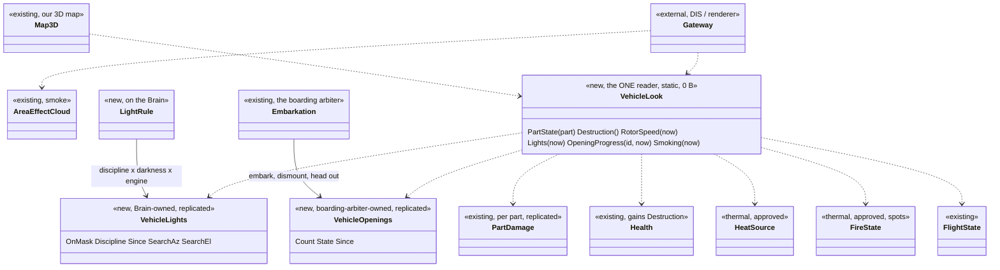
*What it shows that prose hid: only TWO components are new; everything a renderer needs about damage, engines, rotors and fire comes from state
that already exists or is approved, through ONE reader — our 3D map and an outside renderer cannot disagree.*

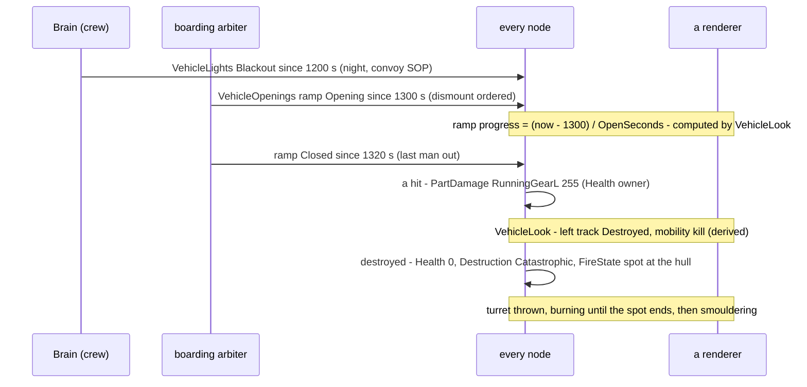
*What it shows: a renderer receives a handful of samples per event and computes every animation's progress itself.*

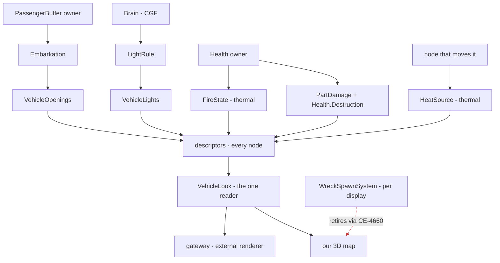
*What it shows: who writes each piece and where; the red edge is the per-display wreck burn the thermal work retires.*

## 6. Slices — what to build first *(lean; ids and lanes at dispatch)*

| order | slice | builds | done when (R-4277) |
|---|---|---|---|
| 1 | **VA-S1 partial damage exposed** | `VehicleLook.PartState` / `Destruction`, `Health.Destruction` decided at destruction, the TKB stowage parts; our 3D map draws a damaged / destroyed part and a thrown turret from it | a scenario: an MBT hit on the left track shows that part Destroyed + mobility kill on every node; an ammo hit kills Catastrophic |
| 2 | **VA-S2 hatches, doors, ramps** | `Gen.Openings` per class, `VehicleOpenings` written by the boarding arbiter, the head-out request; our 3D map draws them | a scenario: an IFV dismount opens the ramp, the squad leaves, it closes; a late joiner sees the right state |
| 3 | **VA-S3 lights** | `Gen.Lights` per class, `VehicleLights` + the light rule (discipline, darkness, engine, airborne), the station switches | a scenario: a convoy at night drives blacked out under its SOP, with headlights under Normal; a helicopter's anti-collision light on while running |
| 4 | **VA-S4 rotors and engines** | `VehicleLook.RotorSpeed` from `HeatSource` + `FlightState` + spin-up seconds (after thermal CE-4658) | a helicopter on the ground spins up before take-off, down after shutdown |
| 5 | **VA-S5 smoke launchers** | the `SmokeDischarger` mount + its salvo; the "pop smoke" behaviour (behaviors) | a tank under ATGM threat fires its smoke; the clouds block sight and IR |
| 6 | **VA-S6 the gateway mapping** | VA-11's rows in the protocol reference | the table |

## 6a. As built — hatches, doors and ramps *(VA-S2, CE-4670, backend, `2026-11-18`)*

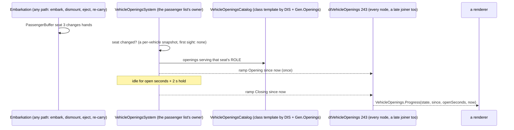
*What the picture shows that prose hid:* nothing calls the opening writer — it WATCHES the passenger list, so a new boarding path needs no wiring; and a
renderer computes the animation from two samples per dismount.

| piece | as built |
|---|---|
| **`VehicleOpenings`** (component 290, NoScenario) | `Count` + ≤ 8 × (`OpeningState` Closed · Opening · Open · Closing, `Since`); `Progress(state, since, openSeconds, now)` — the ONE progress rule every reader calls (ui's `VehicleLook.OpeningProgress` delegates to it when LK-S1 lands) |
| **the class templates** | ⛔ deviation from "`Gen.Openings` per class": the class template rides on the EXISTING body profiles of `bodies.json` (matched by DIS class — the one class match, ruling 9): MBT / SP artillery 3 hatches · AFV (APC / IFV) a rear ramp + 3 hatches · wheeled utility 2 doors + a cargo door · car 3 doors · helicopter cockpit + cabin door · jets / attack helicopter a canopy · cargo plane a ramp + crew door. `Gen.Openings` (`VehicleOpeningsDto`) is the type's SPARSE override by id (replace · `Remove` · add) — HL-12's rule. `VehicleOpeningsCatalog.Of(template)`, cached per type, in id order = slot order |
| an opening serves seat ROLES | ⛔ deviation from "seats": a class template cannot know a type's seat INDICES, so an opening names `SeatRole`s; a seat's role comes from `CarrierSeats.Roles` |
| **`VehicleOpeningsSystem`** (`Interactions` capability, last) | on the passenger list's owner (`Embarkation.OwnsVehicle`): a seat whose occupant changed opens every opening serving its role (Opening since now, once — a second man out keeps it); idle `OpenSeconds` + `HoldSeconds` (2 s) ⇒ Closing. First sight / a reload / a replay: nothing. The component is ADDED on first sight, all closed (D-31). 0 B per steady frame |
| the wire | `EntityVehicleOpenings` + `DdsOpening` (the wire's own byte for the state, R-4295), `dtVehicleOpenings` 243, Brain group (with `PassengerBuffer`); translators beside the thermal ones in `Hrot.Network.NED` — ⛔ deviation from VA-12's "the vehicle subsystem's bridge": the component lives in `Fdp.Toolkits`, which NED already references (no subsystem internals crossed) |
| rails | `VehicleOpeningsTests` (the class template + an override; a dismount opens the ramp once and closes it; only the arbiter writes; 0 B; the progress rule) · `EntityVehicleOpeningsTranslatorTests` (ids; byte for byte to a late joiner; the owner keeps its own) |
| scenario | `uc-convoy-hit` + 3 rows: the carrier's ramp opens as the squad dismounts, is closing by the end, the driver's hatch never opens |
| ⭐ **head out** *(`2026-11-18`)* | `OpeningRequestEvent` { Vehicle · Man · `OpeningVerb` HeadOut / HeadIn } (event 5018), asked by `VehicleRequests.HeadOut`; carried to the arbiter by the interaction transport as kind **15 `OpeningRequest`** (owner test `Embarkation.OwnsVehicle`); `VehicleOpeningsSystem.ApplyRequests` opens the HATCHES serving the man's seat role and marks them `OpeningSlot.CrewExposed` (in what was padding — the slot stays 16 B); the idle close skips an exposed hatch; head in closes it; his seat changing hands clears the mark. A passenger (ramp, no hatch) or a man not aboard: nothing. The wire: `DdsOpening.CrewExposed` APPENDED (R-169) |
| ⭐ **the reader** *(`2026-11-18`)* | `VehicleLook.OpeningProgress(world, v, id, now)` (Hrot.Look) — by the opening's TKB id, delegating to `VehicleOpenings.Progress` with the type's open seconds |
| rails *(head out)* | `VehicleOpeningsTests.CE4670_ACrewmansHeadOut_HoldsHisHatchOpen_UntilHeGoesIn` · `InteractionTransportTests.CE4670_AHeadOutAndALightSwitch_CrossAsTheirUnionCases_ToTheVehiclesOwners` · the `CrewExposed` byte in `EntityVehicleOpeningsTranslatorTests` · `VehicleLookTests.CE4670_AnOpeningsProgress_IsReadByItsId` |
| ⭐ **a trigger can ask** *(`2026-11-18`)* | the scenario verbs `HeadOut` { target = the VEHICLE, `role` (Commander by default — a preset crewman has no authored id), `out` } and `SetVehicleLights` { target, `discipline` } (`Hrot.AI.Behaviors/Brains/Objectives/Verbs/VehicleVerbs.cs`, behaviors' file — cross-lane); the seat is read in the serial follow-up (`RuleAfterPhase`). Scenario **`va-crew-switches`** |
| ⭐ **who asks — as built `2026-11-19` (behaviors, D-10 A, user-approved)** | the vehicle's SOP (`BasicVehicleSop`) runs a side step every tick before its rows (`VehicleCrewNodes.HatchByThreat`, inverted so it never wins the selector): the man in the **Commander** seat is asked OUT while the vehicle is calm, IN on a hit / near miss / first threat / new contact within 30 s, OUT again after 30 s quiet — one `VehicleRequests.HeadOut` per change (an event: parallel-safe). ⚠ every crewed vehicle with a commander now opens its commander's hatches while calm. Rails `VehicleCrewNodesTests.CE4670_D10A_*` (red-proved) |
| ⏳ not built | an observation behaviour of its own ·  opening BEFORE a man arrives (it opens on the boarding itself) · our 3D map drawing them and the exposed crewman (ui, with LK-S1) · reopening while Closing restarts from 0 |

## 6b. As built — lights *(VA-S3, CE-4670, backend, `2026-11-18`)*

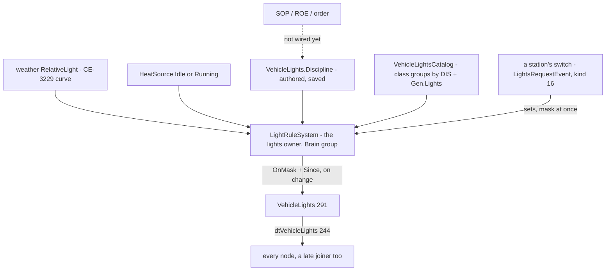
*What the picture shows that prose hid:* the discipline is an INPUT the rule never writes — today it is authored; the dashed edge (an SOP or an
order setting it) is the open half.

| piece | as built |
|---|---|
| **`VehicleLights`** (component 291, DataPolicy Default — saved) | `OnMask` (bit i = the type's light group i) · `Discipline` (Normal · Convoy · Blackout · Off) · `Since` (the mask's last change) · `SearchAz` / `SearchEl` |
| the class templates | `lights` on the same body profiles as the openings: road vehicles head · tail · brake · convoy; a car interior instead of convoy; helicopter nav · anti-collision · landing · searchlight; jets / cargo nav · anti-collision · landing. `Gen.Lights` the sparse override; `VehicleLightsCatalog` merges with the SAME `MergeById` as the openings (one copy) |
| **`LightRuleSystem`** (`Interactions` capability, on the `dtVehicleLights` owner) | every 0.5 s: `MaskOf(lights, discipline, dark, engine)` — head + tail when dark (relative light < 0.3) under Normal, the convoy marker under Convoy, an aircraft's nav + anti-collision whenever its engine runs (day too); nothing blacked out / off / engine off; writes only on a change (`Since` = then); the component ADDED on first sight (D-31). 0 B steady |
| the wire | `EntityVehicleLights` (blittable, compared whole — the `EntityHeatSource` shape), the wire's own byte for the discipline (R-4295), `dtVehicleLights` 244, Brain group; `LightRuleSystem.DescriptorOrdinal` pinned to it by a rail |
| rails | `VehicleLightsTests` (the rule over discipline × darkness × engine; owner-only, on change, an authored Blackout holds, 0 B) · `EntityVehicleLightsTranslatorTests`-in-`EntityVehicleOpeningsTranslatorTests` (byte for byte to a late joiner) |
| scenario | `scenarios/demos/platoons-and-vehicles/va-lights-night` — two crewed T-72s idling at 00:30: the Normal one lit (head + tail, `OnMask` 3), the authored Blackout one never |
| ⭐ **a station's switch** *(`2026-11-18`)* | `LightsRequestEvent` { Vehicle · Actor · `LightDiscipline` } (event 5019), asked by `VehicleRequests.SwitchLights`; carried to the lights owner as interaction kind **16 `LightsRequest`** (owner test `LightRuleSystem.OwnsLights`); `LightRuleSystem.ApplyRequests` sets the discipline and the mask by the rule AT ONCE (not at the next 0.5 s step). ⛔ deviation from "the station's switches" as per-group switches: a switch sets the DISCIPLINE — the one input the rule reads — so the rule stays the one writer of the mask and an operator cannot light what the discipline forbids |
| ⭐ **brake lights** *(`2026-11-18`)* | `VehicleLook.Lights(world, v, now, BrakeLights?)` — the stored mask + every `Brake` group while braking, under Normal only. ⛔ deviation from "a pure reader": the wire carries VELOCITY, not acceleration (`WorldPos`), so one sample cannot show a deceleration — each renderer owns ONE `BrakeLights` tracker (speed from `SimVelocity`, else the replica's `NetworkVelocity`; ≥ 0.8 m/s² over ≥ 0.25 s lights them, held 0.5 s; a seek back restarts it). 0 B steady |
| rails *(switch, brakes)* | `VehicleLightsTests.CE4670_AStationsSwitch_SetsTheDiscipline_AndTheMaskFollowsAtOnce` · the transport rail above · `VehicleLookTests.CE4670_BrakeLights_AreDerivedFromDeceleration` / `_OnAReplica_ReadTheReceivedVelocity` / `CE4670_TheOpeningAndLightReaders_AllocateNothing` |
| scenario *(switch)* | `va-crew-switches`: at 5 s a trigger blacks the lit T-72 out (OnMask 3 → 0), at 10 s switches the other to Convoy (OnMask 8) |
| ⭐ **the discipline — as built `2026-11-19` (behaviors, D-10 B, user-approved)** | the STANDING discipline is the vehicle's authored `VehicleLights.Discipline` (Normal unless the scenario sets it; ⚠ deviation: D-10 said "an SOP parameter" — an SOP takes no params (CE-2132), so the per-unit default is the authored component; a trigger or an operator changing it changes the standing one). `MoveOrder` / `ConvoyOrder` gain `Lights` (`OrderLights`: Unset · Normal · Convoy · Blackout · Off); while such an order runs the vehicle SOP's second side step (`VehicleCrewNodes.LightsByOrder`) asks for it, and the standing one when it ends — one `SwitchLights` per change; the order's JSON is read once per task instance (its `BehaviorStartRecord`), never per frame. Rails `VehicleCrewNodesTests.CE4670_D10B_*` (red-proved) |
| ⏳ not built |  the station's UI (ui) · the searchlight's aim · interior lights · landing lights near the ground — filed as `CE-3475` |

## 6c. As built — partial damage and the kill kind *(VA-S1, CE-4670, backend, `2026-11-18`)*

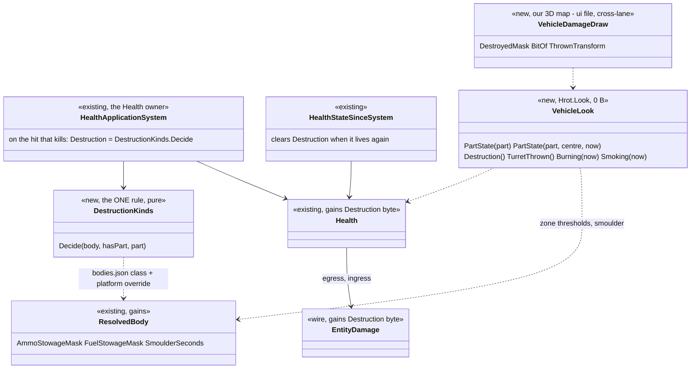
*What it shows that prose hid: ONE decision site (the Health owner, on the killing hit) and ONE reader; the map and a gateway call the same reader.*

| as built | why / deviation |
|---|---|
| ⭐ the kill kind: killing hit's part in the type's **ammunition** stowage ⇒ Catastrophic · **fuel** ⇒ BurntOut · any other part, or a blast with no part ⇒ KnockedOut · a person ⇒ None; decided once (a hit on the wreck never changes it); cleared by `HealthStateSinceSystem` when it lives again | ⭐ the stowage rides on the `bodies.json` class profiles (`ammoStowage`, `fuelStowage`, `smoulderSeconds` — Tank: ammunition turret, fuel engine, 1800 s; AFV: turret / hull + engine; wheeled: engine; aircraft: stores / wing), overridden per type on `Combat.PlatformDef` (`AmmoStowage`, `FuelStowage`, `SmoulderSeconds`; the NED catalogue's `SimCombatDefBuilder` passes them through) — HL-12's rule, the same profile match as the zones. 📌 First override: the **T-72** keeps its ammunition in the hull carousel under the turret (hull + turret) — 📐 measured in `va-tank-kill-kinds`: the M1's round lands on the T-72's HULL, which under the class rule was only a KnockedOut |
| ⭐ `PartState` = Intact · Damaged · Destroyed by the part's ZONE threshold (the same number that makes the mobility / firepower kill); the hull (no effect) is Destroyed only at 255 | — |
| ⚠ **deviation — Burning per part needs the renderer's part centre** (`PartState(part, centre, now)`, the vehicle's frame): the simulation keeps no part geometry it could send. `Burning(now)` answers for the whole vehicle | §3a said "a FireState spot covers the part" — true only where the part's position is known, which is the renderer |
| ⭐ `Smoking(now)`: dead, no burning spot, within the type's smoulder seconds after its last spot went out (never lit: after its time of death) | VA-10 |
| ⭐ the wire: `EntityDamage.Destruction` APPENDED (R-169), the wire's own byte (R-4295), copied by egress / ingress; an unknown value decodes to None | VA-12 |
| ⚠ our map (`EntityBodyLayer3D`, ui's file — cross-lane, NOTE to ui): a kit part maps to a simulation part by ROLE (turret, gun), a running-gear part (track, wheels — Hull role) by being low on one side; a destroyed part draws wreck-dark; a Catastrophic wreck draws its turret and gun thrown beside the hull | kit parts carry no simulation part id; the thrown pose is a starter for ui to tune |

Rails: `BodyPartDamageTests.CE4670_*` (2), `HealthStateSinceSystemTests.CE4670_*`, `VehicleLookTests` (4, 0 B), `EntityDamageEgressTranslatorTests.CE4670_*` (late joiner),
`EntityDamageTranslatorTests.CE4670_*`, `VehicleDamageDrawTests` (3). Scenario: `scenarios/demos/platoons-and-vehicles/va-tank-kill-kinds`.

## 6d. As built — rotors and engines *(VA-S4, CE-4670, backend, `2026-11-19`)*

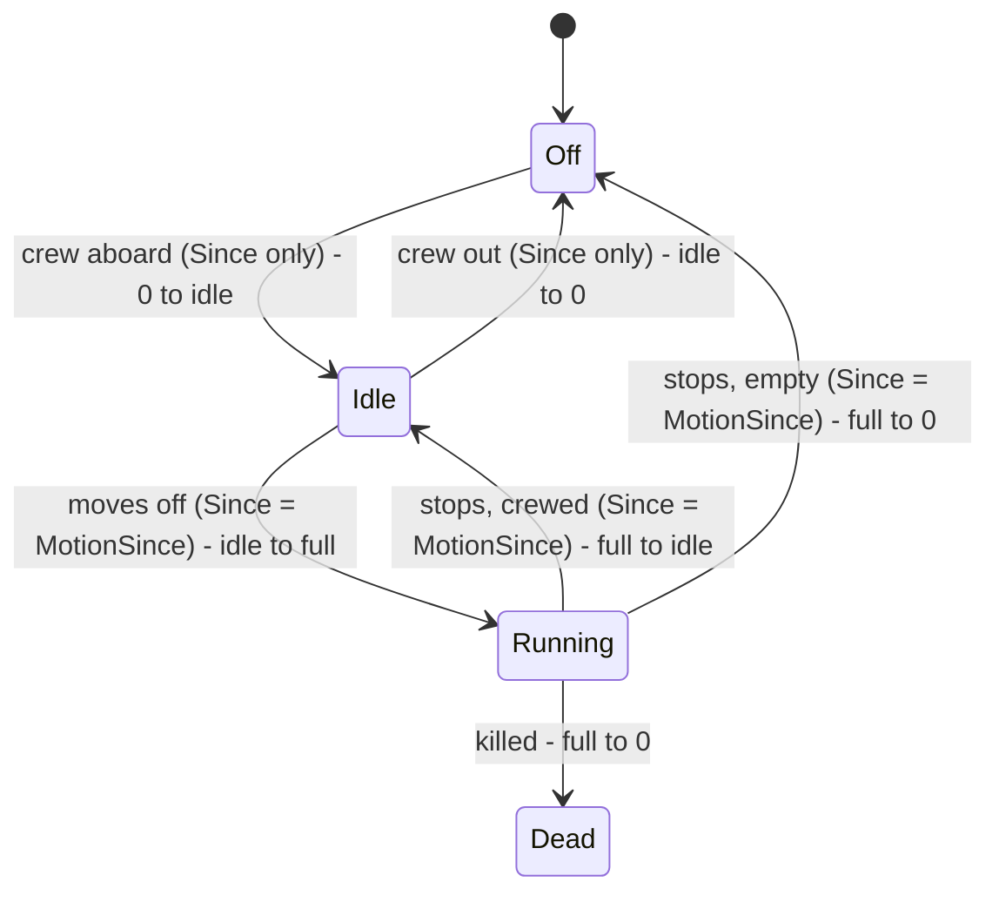
*What the picture shows that prose hid:* the speed's STARTING point is not replicated, but each edge leaves a different pair of times — a stop writes
`Since = MotionSince`, a crew change writes `Since` alone — so the reader knows which edge it is on from the two replicated times.

| piece | as built |
|---|---|
| **`VehicleLook.RotorSpeed(world, v, now)`** (Hrot.Look) | 0..1: Running → 1 · Idle → `IdleSpeed` 0.6 · Off / Dead → 0, at full scale per the type's spin-up / spin-down seconds, from the state the edge left (the diagram); a state held from the scenario's start (`Since` ≤ 0) is at its target at once (a parked helicopter never runs down at load). ⛔ NO new component, nothing sent (VA-5). 0 B |
| **`VehicleLook.EngineLevel`** | the same value — the engine sound follows the engine (one rule) |
| the type data | `ThermalSignatureDto` (thermal's power plant, §4 "`Gen.PowerPlant` gains") + `SpinUpSeconds` · `SpinDownSeconds` (APPENDED); class defaults in `ThermalDefaults` — ground engines 2 s / 3 s, aircraft 20 s / 30 s (starter values) |
| ⛔ deviation | the design read `FlightState` for "ground idle vs flight": `FlightState` is NOT replicated, so a replica could not match the owner — the engine state (Idle = stopped, Running = moving) carries it instead. ⚠ An uncrewed hull driven off from Off reads as from idle |
| rails | `VehicleLookTests.CE4670_ARotorsSpeed_RunsUpAndDown_FromTheEngineStateAndItsTime` (red-proved twice: no time ⇒ red; no stop/crew distinction ⇒ red) · `_IsTheSameOnAReplica_AtEverySample` · `CE4670_TheRotorReader_AllocatesNothing` |
| scenario | `ua-air-assault` + 2 rows: the UH-60's engine Running while it flies, Idle once landed and stopped |

## 6e. As built — smoke dischargers *(VA-S5, CE-4670, backend, `2026-11-19`)*

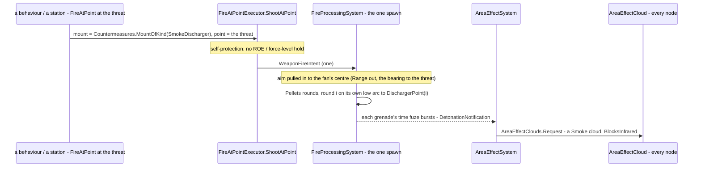
*What the picture shows that prose hid:* nothing new between the intent and the cloud — the discharger is the shotgun's "N rounds from one intent" with a
FAN instead of a random pattern, and the round's burst is the smoke grenade's existing path to the cloud.

| piece | as built |
|---|---|
| **`WeaponCategory.SmokeDischarger`** (15, appended) | a mount, not a component: `Pellets` = grenades per salvo · `PelletSpreadMils` = the FAN's width · `Range` = how far out they burst · `InitialAmmunition` = salvos. ⛔ deviation from "a salvo pattern in the TKB" as new fields: the pellet fields ARE that pattern (ruling 9) |
| **`WeaponCategories.IsSelfProtection`** | ⭐ the ONE "is this mount a weapon?" test (dispenser or dischargers) — the eight hand-written `== Countermeasure` checks (armed, lethal, ammo choice, air defence, air combat, barrel heat, the role line, the held-weapon marking) now call it; a discharger is never chosen to fire at anything |
| **the salvo** (`FireProcessingSystem`) | the aim pulled in to the fan's centre (a far threat is never refused as out of reach); round i to `DischargerPoint(i)` — the bearing to the asked point ± its share of the fan, `Range` out, on the ground the vehicle stands on — by `ArcLaunch` (low); no dispersion draw (the same fan on every node); never spent by `Range` (it is where they burst) |
| **holds** (`ShootAtPoint`) | a self-protection mount is not held by hold-fire or the force level (popping smoke is no engagement); a stunned or restrained crew still cannot |
| **the round** | `TkbVehicleSmokeGrenade` 6068: a screening smoke (radius 10 m, 6 m high, 60 s), **blocks infrared** (CE-4662), indirect, a 1.5 s time fuze |
| the types | M1 Abrams 12 tubes × 2 salvos · M2 Bradley 8 × 2 · T-72 8 × 1 — each its LAST mount (no existing mount index moved) |
| finding it | `Countermeasures.MountOfKind(world, unit, WeaponCategory.SmokeDischarger, …)` — the dispenser's walk, generalised (one copy) |
| rails | `FireProcessingSystemTests.CE4670_SmokeDischargers_FireAFanOfGrenades_TowardsTheThreat_ThirtyMetresOut` (red-proved: no fan ⇒ red; the range limit kept ⇒ red); the touched suites 144 / 0 |
| ⏳ not built | ~~WHO fires it~~ ✅ §6f (behaviors) · the turret's own discharger bank turning with the turret (the fan is centred on the bearing asked, whatever the turret) · our 3D map drawing the tubes firing (ui) |

## 6f. As built — "pop smoke": WHO fires the dischargers *(VA-S5 behaviour half, CE-4670, behaviors, `2026-11-19`)*

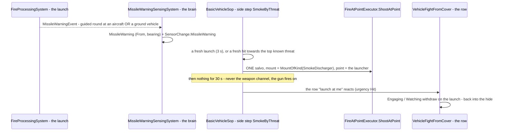
*What the picture shows that prose hid:* the trigger already existed for aircraft (the launch warning, CE-2189) and the move out of sight already
existed (the exposure cycle's withdraw on a heard launch or a hit) — the new pieces are one gate widened and one side step; the in-flight
command missile then loses the tank by the existing rule (`GuidedRoundSystem`: a gunner's sight line through a cloud ⇒ `Lost`).

| piece | as built |
|---|---|
| the trigger | ⭐ `FireProcessingSystem`'s launch warning now warns a ground VEHICLE as well as an aircraft (`Locomotions.IsVehicle`; cross-lane, said) — its crew sees a guided launch. ⛔ An unguided RPG warns nobody (its flight is too short for smoke to matter; the survived hit covers it) |
| **`VehicleCrewNodes.SmokeByThreat`** (`CrewSmokeParams`) | the SOP's third side step (inverted, never a row): a launch fresher than 3 s and not yet answered ⇒ the salvo at `MissileWarning.From`; else a fresh hit ⇒ at the top known threat's remembered point (none known ⇒ nothing). One salvo per threat, `SmokeCooldownSeconds` (30) between salvos; no dischargers or none left ⇒ nothing. Shot through `ShootAtPoint` (a self-protection mount: hold-fire and the force level never hold it) — ⛔ never `FireAtPoint`, which takes the weapon channel from the gun |
| the move | `BasicVehicleSop`'s new row *"launch at me → VehicleFightFromCover"* (urgency Hit); the cycle's `Engaging` and `Watching` withdraw on a launch at me since the exposure began (`LaunchedAtMe`, beside `LaunchHeard`) |
| rails | `VehicleCrewNodesTests.CE4670_PopSmoke_*` (red-proved: the cool-down removed ⇒ red; the freshness removed ⇒ red) |
| scenario | ✅ `va-pop-smoke` 6/6 — a Bradley's TOW at an M1 in the open (11.37 s); the salvo 0.07 s later; the tank (hit, 1000 HP left) backs out of sight behind the block by 15.5 s and is never hit again. 📌 Measured: the first TOW still hits — at 170 m it arrives before the screen blooms (1.5 s fuze); the smoke denies the NEXT shot. ⛔ **`2026-11-26` (CE-4698): a survived-HIT salvo by a hull with no hide (`StandAndFight`, `ua-tank-ammo`'s open desert) blinds the hull itself — its sight to the threat stays blocked by its own cloud past 48 s, one round fired in the run; the salvo is only useful to a hull that can back out of sight** |

## 7. The shared LOOK library — every renderer derives the same picture *(CE-4671, `2026-11-18`)*

🔒 Request (`2026-11-18`, the same lane): *"Move these rules (kinds, anchors, timings, which munition gives which effect) into a shared library with no
presentation dependency. HROT's map should keep using it, and external renderers' gateways should use it too … The same library is the home for the
person-appearance resolver … Pure functions over components and events; deterministic; no Stride, no ImGui."*

⭐ **The overlap with §3:** `VehicleLook` (VA-2) IS such a derivation — so the library is ONE home for three readers: vehicles (this design),
effects, and people (`DESIGN_Person_Outfits.md`). ⛔ Not three libraries.

| measured `2026-11-18` | where | ⛔ what ties it to presentation today |
|---|---|---|
| the effect RULES — muzzle flash per fire event (none for silent weapons, bombs), explosion + ground mark per detonation, impact puffs and marks per surface, dust for inert thrown items and broken barriers; kinds and lifetimes from `EffectTkbCatalog` (the round's `Effect.Set`, else its calibre class, VE-D) | `Hrot.Presentation/Effects/EffectSystems.cs` (`EffectSpawnSystem`, 525 lines) | the rule and the SPAWNING (effect entities on each map host) and two HUD feeds (player messages, the kill feed) share one system |
| the wreck's flames ~60 s and smoke ~180 s | `WreckSpawnSystem` (same file, :449) | a per-display decision ⇒ the thermal `FireState` (CE-4660) replaces the decision; the library keeps only "smoke after the fire" |
| the person-appearance resolver | `Map3D/Outfits.cs` (624 lines), `Wardrobe.cs`, `KitFromTkb.cs` | the resolved look carries `Raylib.Color` |

| # | question | ⭐ lean | why |
|---|---|---|---|
| **LK-1** | where | ⭐ ONE new assembly **`Hrot.Look`** (refs `Fdp.Toolkits` + `Hrot.Core`; ⛔ no Raylib, Stride, ImGui or `Hrot.UI`) — `VehicleLook`, `EffectRules`, `PersonLook` | the person resolver needs `Hrot.Core.Tkb`, so it cannot sit in `Fdp.Toolkits`; one home for all three keeps renderers agreeing (ruling 9) |
| **LK-2** | the effect rules | ⭐ split RULE from SPAWN: `EffectRules.For(event, view, tkb) → EffectSpec[]` (kind, anchor, lifetime, size — pure, deterministic, 0 B on the steady path); `EffectSpawnSystem` keeps spawning the map's effect entities FROM the specs; the HUD feeds move out of it (they are not effects) | a gateway calls the same function on its node's events and gets the same flashes and marks |
| **LK-3** | the wreck | `WreckSpawnSystem` retires into the thermal `FireState` (CE-4660, dispatched); `EffectRules`/`VehicleLook` answer "smoke after the fire" from the spot's end + the type's smoulder seconds | one truth: fire is simulation state |
| **LK-4** | people | `PersonLook.Of(view, entity, tkb) → PersonAppearance` — the outfit, colours as a plain RGBA struct (⛔ no `Raylib.Color`), the face, the extras (Person Outfits design); the map converts to its colour type when drawing | the resolver is already pure apart from the colour type |
| **LK-5** | determinism | every function a pure function of components, events, the TKB and an entity-seeded random (the outfits' seeded variety) — never the wall clock, never a frame count | the same picture on every renderer, in replay too |
| **LK-7** | ⭐ *(approved `2026-11-18`)* effect CATEGORIES vs the DIS entity type | ⭐ BOTH, for different jobs: every `EffectSpec` carries ① the munition's DIS entity type (identity — every TKB type has one, `TkbMaster.DisType`) and ② OUR category = kind × size class × surface (§7a), built to map ONE-TO-ONE onto DIS's detonation-result vocabulary | the DIS type says WHAT exploded, not how it looks (a renderer without that munition's asset cannot size it); the category is the look every renderer and our map share; the gateway fills both DIS fields by table |
| **LK-6** | the order | ⭐ FIRST move what exists (the effect rules, the person resolver) with their rails unchanged — a pure refactor; THEN `VehicleLook` grows there with VA-S1 | moving first is cheap and testable (the map's rails must stay green); new code then lands in its final home |

| slice | builds | done when |
|---|---|---|
| **LK-S1** | `Hrot.Look`; `EffectRules` extracted, `EffectSpawnSystem` spawns from it, the HUD feeds moved out | the map's effect rails (`EffectTests`, the 3-D frame rails under `xvfb-run -a`) green UNCHANGED; a rail calls `EffectRules` with no presentation assembly loaded |
| **LK-S2** | `PersonLook` extracted (RGBA, no Raylib) | the outfit / wardrobe rails green unchanged; the same rail with no presentation assembly |
| **LK-S3** | `VehicleLook` lands here (VA-S1 onward) | as §6 |

### 7a. Effect categories *(LK-7, approved `2026-11-18`)*

| today (measured) | where |
|---|---|
| an effect TYPE = kind (MuzzleFlash · Explosion · Decal · Tracer · Fire · Smoke · Flare · Chaff) + duration, size, colour, fade | `EffectVisualDto`, `EffectDtos.cs:7-52` |
| an AMMO type names its effect set (which flash, explosion, mark) — HEAT and APFSDS of one gun differ | VE-D, `Effect.Set` |
| no set ⇒ a default by SIZE CLASS Small · Medium · Large · Huge, from damage per hit (< 50 small, ≥ 500 large) or explosive mass (0.01 / 1 / 5 kg) — a hit and a miss look alike | `EffectTkbCatalog.cs:46-60` (CE-1231) |
| impacts: a puff + a mark per surface a round enters or leaves, by the same class | CE-1129 |

| ⭐ the `EffectSpec` every renderer receives from `EffectRules` | |
|---|---|
| `Kind` · `SizeClass` (Small · Medium · Large · Huge) · `Surface` (Ground · Water · Building · Vehicle · Air) | our category — the look |
| `MunitionDis` | the munition's DIS entity type — the identity, for a renderer with its own asset and for interop |
| `EffectType` (TKB id) | the exact per-ammo override, when one is set |
| anchor, lifetime, size | as today |

⭐ The category set is chosen so that kind × size × surface maps 1:1 onto DIS's detonation-result codes (HE hit small / medium / large, dirt blast
small / medium / large, water blast, building hit, air burst, smoke …). ⭐ **Pinned `2026-11-19` (VA-S6):** the table is in
[`NED_DDS_Protocol.md`](../../reference/NED_DDS_Protocol.md) §"Appearance and thermal mapping" → *Detonation result* — SISO-REF-010 codes 0–33 as KDIS and
OpenDIS-7 both state them (⚠ not read from the SISO document itself); a KINETIC round on a vehicle ⇒ 10 Armor-piercing hit, a smoke burst ⇒ 5 Detonation
(the munition type says smoke). ⛔ SUPERSEDED: "the exact code list is pinned by the gateway slice (VA-S6) — not verified here".

### 7b. LK-S1 — the effect rules in `Hrot.Look` *(ui, `2026-11-18`; UML drawn before the build, folded to the as-built after)*

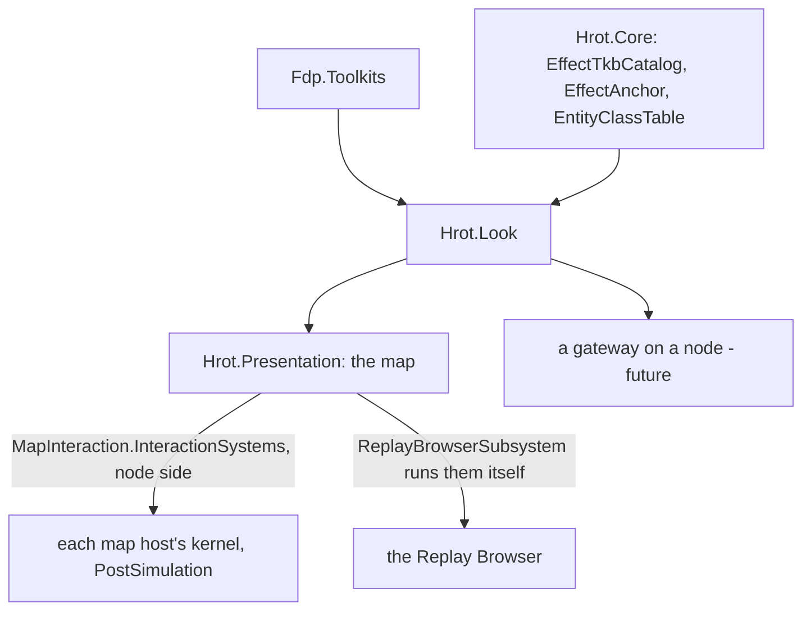
*What the picture shows that prose hid:* `Hrot.Look` sits BELOW the presentation (no Raylib / ImGui / `Hrot.UI` reference), so a gateway can call the
same rules; the map still reaches its kernel only through `MapInteraction`, and the Replay Browser runs the same two systems by hand — both callers
get the HUD-feed system next to the spawner, or the feeds go dark there.

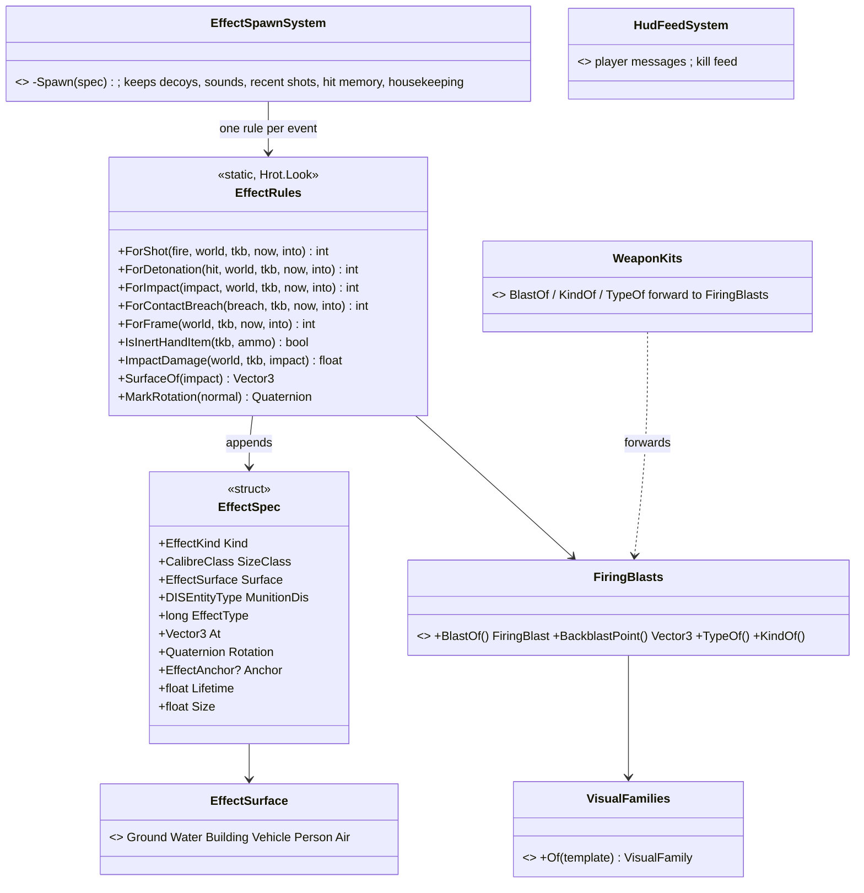
*What the picture shows that prose hid:* the RULE (which effects, where, how long) and the SPAWN (an entity per spec) are two classes now; the blast
rule pulls the type classifier (`VisualFamilies`, `WeaponKind`) down with it — moved with its namespace so no presentation caller changes; the
HUD feeds leave the effect system for their own.

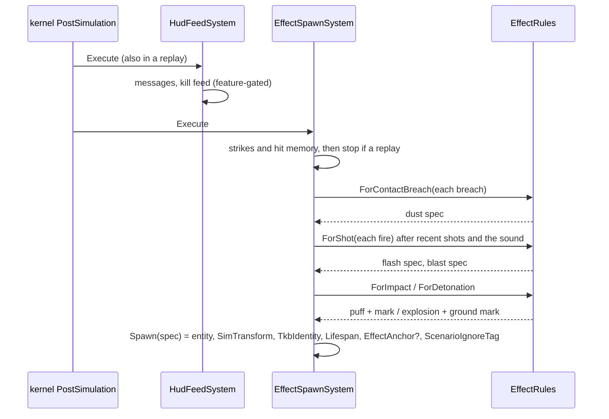
*What the picture shows that prose hid:* the specs come back in the order the old inline code spawned them, so the effect entities are created in the
same order — the goldens and frames cannot move.

**As built (LK-S1, `2026-11-18`) — where it differs from LK-2 / §7a, and why**

| | as built | why |
|---|---|---|
| the signature | per event: `ForShot` · `ForDetonation` · `ForImpact` · `ForContactBreach`, and `ForFrame` (all four, in the map's order) — each APPENDS `EffectSpec`s to a caller's list and returns the count | ⛔ not `→ EffectSpec[]`: an array per event allocates; a reused list keeps the steady path at 0 B (rail `LKS1_AFrameWithNoEvents_AllocatesNothing`) |
| `EffectSurface` | Ground · Water · Building · Vehicle · **Person** · Air | a body that is not a vehicle needed its own (§7a had none); ⚠ Water is not told apart yet (reads Ground); Building = an impact more than 0.25 m off the ground — the category only, the map draws by `EffectType` |
| the classifier | `VisualFamily` / `VisualFamilies`, `WeaponKind`, `FiringBlast`, `FiringBlasts`, `AirMissiles` live in `Hrot.Look` UNDER THEIR OLD NAMESPACE `Hrot.UI.Common.Map3D` | the blast rule needs them; keeping the namespace made it a move with no caller edited (`WeaponKits` / `JetStores` forward). ⚠ known-rot: a `Hrot.UI.*` namespace in a non-UI assembly — rename when a renderer-facing name is chosen |
| the HUD feeds | `HudFeedSystem` (presentation), scheduled right before the spawner on every map host and in the Replay Browser | the two HUD rails changed ONE line each (the system they build), their assertions unchanged |
| unchanged | every effect type, position, anchor, lifetime and the creation ORDER | the map's effect rails pass unchanged (`EffectTests` 66 / 66 with the self-check) |

### 7c. LK-S2 — `PersonLook` in `Hrot.Look` *(ui, `2026-11-18`; the plan, drawn before the build)*

**INVENTORY** *(grep + the files read; `search_graph` for `PersonLook|Outfit|Wardrobe` found no look library — `2026-11-18`)*: the outfit RULES are
`Outfits.cs` (624 lines: `Outfit`, `FaceLook`, `PartDetail`, `Outfits.For / FaceOf / Details / ColourOfPart / CarColour`), `OutfitPalettes.cs` (53) and
`Wardrobe.cs` (107) — Raylib only through `Color`; but the INPUTS a gateway needs live in the map's `EntityBodyLayer3D` (2 300 lines): `SeedOf`
(network id, else index), `SideOf`, `OwnColourOf` / `ColourOf` / `HasEntityColour` / `ParseHex`, and the PERSON half of `TypeLook Resolve(template)`
(soldier, child — which reads the kit catalogue's default person height —, kit, elderly, sex, wardrobe, the type's colour). `KitFromTkb` (56) is a
vehicle's turret geometry over `ShapeKit`'s type head (`ShapeKit.cs` lines 1–308, Raylib-free) — moved with LK-S2 as the handoff lists it, but it is
`VehicleLook`'s material, not a person's.

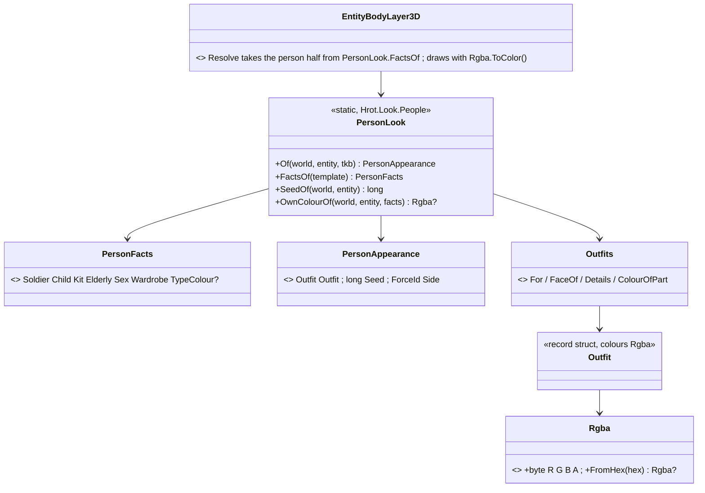
*What the picture shows that prose hid:* the outfit rules alone are not enough for a gateway — the FACTS (who the type is) and the seed / side / own-colour
reads move too, or a gateway would dress a man differently; the map's `Resolve` then TAKES its person half from `PersonLook.FactsOf` (one owner).

| ⭐ step | | the check |
|---|---|---|
| 1 | `Rgba` in `Hrot.Look`; the map's `ToColor()` / `ToRgba()` conversions in the presentation | — |
| 2 | move `Outfits`, `OutfitPalettes`, `Wardrobe` (namespace kept), their `Color` → `Rgba`; the person part indices `BlockFigure` names → `PersonParts` (forwarded) | the outfit / wardrobe rails, changed only where a test builds a `Raylib.Color` literal to compare (named in the report) |
| 3 | `PersonLook.FactsOf` = the person half of `Resolve`; `Of` = `SeedOf` + `SideOf` + `OwnColourOf` + `Outfits.For` | a `Hrot.Look.Tests` rail: `PersonLook.Of` on a world with no presentation equals what the map draws for the same entity (the same `Outfit`) |
| 4 | `KitFromTkb` + `ShapeKit`'s type head to `Hrot.Look/Kits` (namespace kept) | the kit rails unchanged |

**As built (LK-S2, `2026-11-18`) — where it differs from the plan above, and why**

| | as built | why |
|---|---|---|
| ⭐ the colour | `Hrot.Look.Rgba` (R G B A bytes, laid out like the map's colour); the moved files say `using Color = Hrot.Look.Rgba`, so the rules' text did not change; the map converts in ONE place, `LookColours.ToColor()` / `ToRgba()` | 20 draw sites in the map (body layer, face shader, held weapons and bows) convert at the boundary |
| one owner each | `PersonLook.SeedOf` / `SideOf` / `ColourOf` / `HasEntityColour` / `OwnColourOf`, `Rgba.FromHex` (the map's span parser, alpha ignored as before), `PersonLook.DefaultSize` / `ChildHeight` / `DefaultColour`, `PersonParts.TorsoIndex` / `HeadIndex` | the map's `EntityBodyLayer3D`, `ShapeKits.DefaultSize(Person)` and `BlockFigure` forward to them; `Resolve` takes its person half from the cached `PersonLook.FactsOf` |
| ⛔ NOT moved: `KitFromTkb` | stays in the presentation | its kit types (`ShapeKit.cs`'s head) import `Hrot.MuscleCharacter.Animation` and call `BlockFigure` / `ShapeKits` helpers — moving them drags the animation assembly into `Hrot.Look`; it is a VEHICLE's turret geometry ⇒ it moves with LK-S3 / VA-S1 (`VehicleLook`), where its owner decides the split |
| the rails | the outfit / wardrobe / kit rails' ASSERTIONS unchanged — 12 lines of `Map3DTests` changed TYPE only (helpers `ColourText` / `Light` / `Gap` take `Rgba`; four colour locals built as `Rgba`; four compares convert); the outfit fingerprint rail (every outfit field over many seeds) is unchanged and green ⇒ the outfits are byte-identical | ⭐ the proof that a gateway dresses a man as the map does: `PersonOutfitsRail.CE4671_LKS2_ThePersonLook_IsWhatTheMapDresses_ForEveryPersonType` (every person type × 4 men); `Hrot.Look.Tests.PersonLookTests` (no presentation) |

### 7d. CE-4670 — our 3-D map DRAWS the openings and the lights; the station's head-out and light keys *(ui, `2026-11-19`; drawn before the build; mockup [`docs/UX/vehicle-openings-lights.svg`](../../UX/vehicle-openings-lights.svg))*

**INVENTORY** *(`2026-11-19`)*: `search_graph name_pattern=.*(Socket|Hatch|Headlight|VehicleLight|Opening).* label=Class` → **1** (`TerrainOpening`, unrelated);
grep over `Hrot/Engine/Hrot.Presentation`, `Hrot/Engine/Hrot.Look`, `FDP/Engine/Fdp.Presentation` for `Socket|Headlight|Hatch` → no socket placement anywhere;
the socket NAMES exist only in `bodies.json` (`hatch_commander` · `hatch_gunner` · `hatch_driver` · `ramp_rear` · `door_front_left/right` · `door_rear` ·
`door_cabin` · `door_cockpit` · `door_crew` · `canopy` · `light_head` · `light_tail` · `light_brake` · `light_convoy` · `light_nav` · `light_beacon` ·
`light_landing` · `light_search` · `light_interior`) — ⛔ no kit or model carries them. The one precedent for "where on the box": `EntityBodyLayer3D.CrewEye`
(a commander's eye above the TURRET's roof, a quarter of its width left — CE-1200). The readers exist (`VehicleLook.OpeningProgress` / `Lights`, §6a / §6b);
the requests exist (`VehicleRequests.HeadOut` / `SwitchLights`); the station's HUD block is `PossessionStation.Hud.Lines` (`SeatLine`, `FireModeLine`).

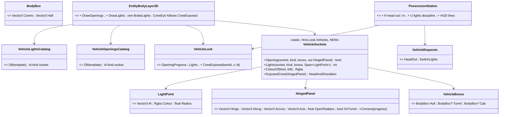
*What the picture shows that prose hid:* WHERE a socket sits is a pure rule over three boxes (hull, turret, cab) in the shared library, so a gateway's renderer
places a hatch where our map does; the map only measures its kit's boxes and draws. A turret socket carries `OnTurret`, so it turns with the turret.

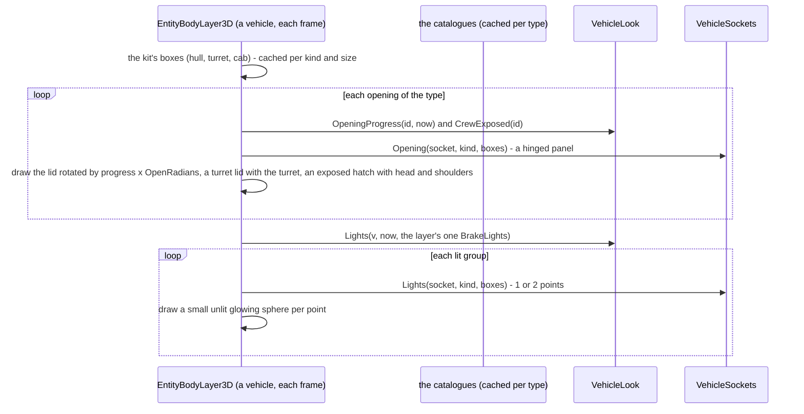
*What the picture shows that prose hid:* nothing is stored by the map — the progress, the exposed mark and the light mask are the replicated state read

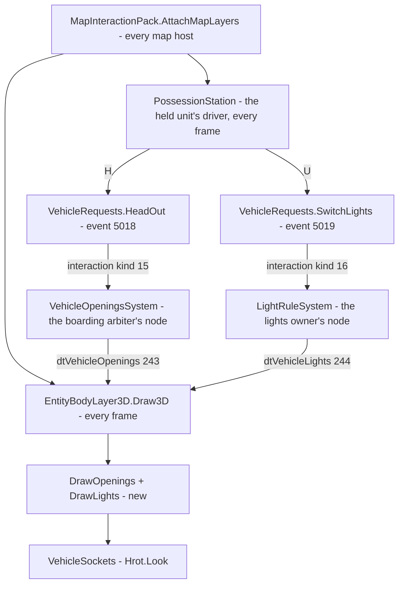
*What the picture shows that prose hid:* the station never writes the vehicle — a key is a REQUEST carried to the owner's node, and the picture changes only
when the replicated state comes back; so a key on a node that does not own the vehicle works the same, one round trip later.
each frame (a late joiner and a replay draw the same), and the only memory is the one `BrakeLights` the reader requires.

| ⭐ decision | lean (taken — ui's own topic) | rejected |
|---|---|---|
| **D-1 where sockets sit** | a fixed rule per socket name over the hull / turret / cab boxes (table below), in `Hrot.Look` | sockets in every kit — 40+ kits to edit, and a gateway would not have them · leave undrawn until models carry sockets — the state would stay invisible |
| **D-2 the lid** | a thin box hinged on one edge, rotated by `progress × OpenRadians`: a hatch 0.6 m square, up 100° about its rear edge; a ramp the hull's width × 0.7, down 95° about its bottom; a side door 0.9 × 1.0 m, out 70° about its front edge; a rear door out 100°; a canopy up 50° about its rear | a slide / fade — reads as nothing at map distance |
| **D-3 the exposed crewman** | head and shoulders (the crew's dark green, skin face) out of a `CrewExposed` hatch while it is open ≥ 0.9 | a full figure — it is inside the hull |
| **D-4 lights** | an unlit sphere per point (0.07 m, a halo sphere 0.18 m at 35 % alpha), the colour by kind: head warm white · tail red · brake bright red · convoy dim blue · nav red left / green right · beacon red · landing / search white · interior amber | projected light cones — no lighting model for them; a later slice |
| **D-5 the commander's eye (CE-1200)** | above the turret's roof by `HatchEyeAboveRoof` (0.55) only while the `hatch_commander` is crew-exposed; else at the periscope, 0.12 above the roof | inside the turret — the box culls itself from inside but the view would show its own hull |
| **D-6 the station's keys** | **H** head out / in (a crewman whose seat role a hatch serves — the driver's man when the held unit is the vehicle), **U** lights: Normal → Convoy → Blackout → Off → Normal; both rebindable rows in `EmbodiedKeys`; two HUD lines: `HATCH CLOSED  (H: head out)` / `HEAD OUT  (H: head in)` and `LIGHTS NORMAL  (U: switch)` — shown only in a vehicle whose type has a hatch for him / light groups | a panel — the station has no panels in first person; L was asked but is the fire mode's (CE-4143) |

| socket | on | where (body frame: x forward, y left, z up) |
|---|---|---|
| `hatch_commander` · `hatch_gunner` | turret roof (else the hull roof) | its centre; y ± half its half-width (commander left, as CE-1200) |
| `hatch_driver` | hull roof | x 70 % forward of centre, y 40 % left |
| `ramp_rear` | hull rear face | hinge at the bottom, the hull's width × 0.7, up to 80 % of its height |
| `door_front_left` / `_right` · `door_cockpit` · `door_cabin` · `door_crew` | hull side (left unless `_right`) | x +25 % (front) · +60 % (cockpit) · 0 (cabin, crew) of the half-length |
| `door_rear` · `canopy` | rear face · the cab's top (else the hull's front top) | — |
| `light_head` / `_tail` / `_brake` | front / rear face, a pair at ± 70–75 % of the half-width | mid height (brake a little higher) |
| `light_convoy` · `light_beacon` · `light_landing` · `light_search` · `light_interior` | rear low centre · the top centre · under the front · front top right · the cab's centre | single |
| `light_nav` | the hull's sides at the widest | a pair, red left, green right |

**Acceptance:** rails — `Hrot.Look.Tests` (every socket of `bodies.json` places on an MBT / an APC / a car / a helicopter box; a turret socket is `OnTurret`;
the pair rule; 0 B); a frame rail under `xvfb-run -a` (an APC with its ramp half open and a head out of a hatch; a T-72 with head + tail lit at night;
compared with the mockup, R-4146); the station's keys (`HeadOut` / `SwitchLights` published with the right man / discipline; the HUD lines). Scenarios:
`uc-convoy-hit` (the ramp) and `va-lights-night` / `va-crew-switches` (the lights) run once — their verdicts are sim state, unchanged by drawing.

**As built (`2026-11-19`)** — as drawn above, with these specifics:

| | as built |
|---|---|
| the shared rule | `Hrot.Look.Vehicles.VehicleSockets` (`Opening` → `HingedPanel` with `BoxAt(progress)`, `Lights` → `LightPoint`s, `ExposedCrew`, `ColourOf`) + `VehicleLook.CrewExposed(world, v, id)`; rails `Hrot.Look.Tests/VehicleSocketsTests` (every socket of `bodies.json`, the directions, the pairs, 0 B) |
| the boxes | `EntityBodyLayer3D.BoxesOf`, cached per kit array and size: the hull = the PAINTED hull parts (`ColourRole.Body`) — ⚠ measured: with the tracks in it the lights sat on the track ends — the turret = the turret parts, the cab = the first glass part |
| the drawing | `EntityBodyLayer3D.Fittings.cs` (`DrawFittings`, after the parts, not for a wreck or a weapon system): the lid a box in the vehicle's colour, a turret lid by the turret part's pose against its neutral one; the lit points collected and drawn unlit after the batch (`DrawLightPoints`, a halo with no depth write); counters `OpeningsDrawn` / `CrewOutDrawn` / `LightsDrawn` |
| D-5 the eye | `EntityBodyLayer3D.CommanderEye` — only for a kind whose eye is above the turret (no glass) and a vehicle carrying `VehicleOpenings` whose type has `hatch_commander`; otherwise CE-1200's eye unchanged |
| D-6 the station | `CrewControls` (`ManOf` · `HatchOf` · `ToggleHeadOut` · `CycleLights` · `HatchLine` · `LightsLine`); `EmbodiedKeys.HeadOut` (H, `fps.vehicle.head-out`) and `.Lights` (U, `fps.vehicle.lights`); `PossessionStation` asks on the key and adds the two HUD lines (pale blue / amber); rails `CrewControlsTests` (3, red-proved) |
| the frame rail | `VehicleFittingsFrameRail` (`xvfb-run -a`): an IFV shut → its ramp half down and the commander out (pixels change), a T-72's head lights lit — frames checked against the mockup A / B |
