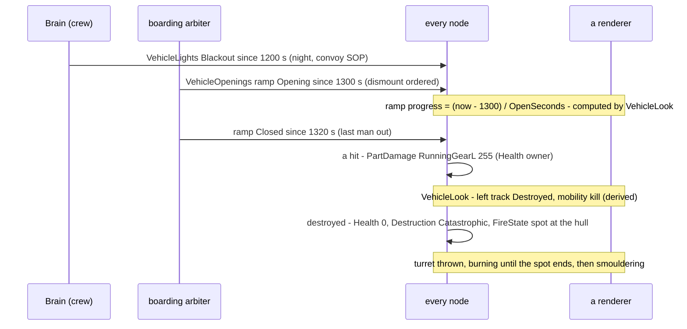
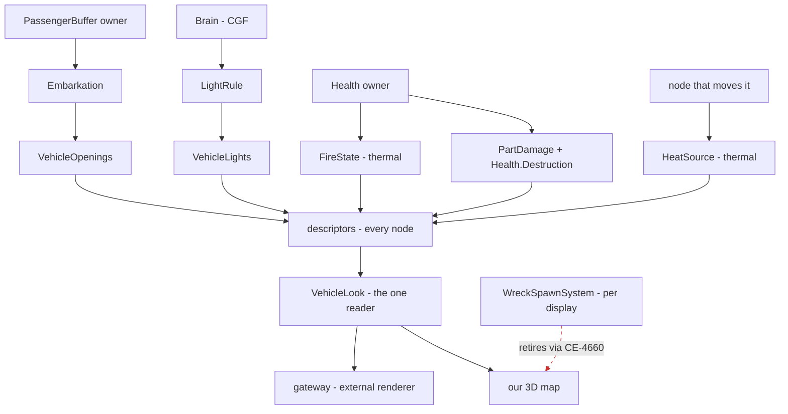

<!--STATUS
state: LIVE
updated: 2026-11-18
build-state: DESIGN — leans VA-1…VA-12 for the user; NOT approved; ids fixed at dispatch
current-answer: §1 inventory · §2 the proven solution · §3 decisions · §4 components and TKB · §5 UML · §6 slices
stale-below: nothing
known-rot: none
known-conflict: none
related-designs:
  - ../thermal/DESIGN_Thermal_Drivers.md — OWNS `HeatSource` (engine Off / Idle / Running / Dead + Since) and `FireState` (fire spots, ignition, burn damage, the wreck's flames) — this design READS both for rotors, engine sound and burning parts, and adds nothing beside them
  - ../hit-location/DESIGN_Body_Parts_And_Hit_Location.md — OWNS `PartDamage` (per-part levels for vehicles and aircraft, HL-6), the part ids, the zones (HL-12 class templates) and the DERIVED mobility / firepower kill (S2-8, S2b-6) — this design only exposes them as a visible state
  - ../../DESIGN_Operations_Behaviour_Catalogue.md — §10.1 D1 OWNS R-263 (mobility kill · firepower kill · destroyed)
  - ../../DESIGN_Visual_Effects.md — OWNS W3 (`WreckSpawnSystem`, a per-display burn) that the thermal design re-bases on `FireState`; our 3D map draws THIS design's state
  - ../../DESIGN_Entity_Interactions.md — §7.4 OWNS embarkation, the seats and the boarding arbiter (the `PassengerBuffer` owner) that the openings follow
  - ../IG/DRAFT_Unreal_Image_Generator.md — an external renderer is the first outside consumer (U-2 "the minimal entity snapshot")
  - ../../reference/NED_DDS_Protocol.md — the wire as outsiders see it; "appearance bits" listed as NOT carried — VA-11 fills that for the gateway
  - ../weather/DESIGN_Weather_And_Time.md — the light curve (R-3017) the light rule reads
-->

# DESIGN — RENDERER-FACING VEHICLE STATE: lights, hatches and doors, rotors, partial damage (CE-4670)

🔒 Request (`2026-11-18`, another lane for the user): an external renderer reading HROT over DDS through a gateway must show vehicles convincingly —
lights, hatches / doors / ramps, rotors and engines, partial damage, smoke launchers, wreck flames. *Simulation state, not presentation;
recorded; replicated; generic and renderer-agnostic; per-type data in the TKB with ids a renderer maps to its model parts; HROT's own 3D map
consumes the same state.* Lights, hatches and partial damage matter most.

## 1. INVENTORY *(measured `2026-11-18`; grep over `FDP/` and `Hrot/` for `struct .*(Light|Hatch|Door|Ramp|Rotor|Engine|PartDamage|VehicleState|FlightState|Seat|Smoke|Wreck|Effect|TurretPose|WeaponSystem)`, `Headlight|Blackout|Searchlight`, `Rpm`, `Mobility|Firepower`; the design corpus for hatch / ramp / rotor / kill kinds. ⚠ graph search returned document sections only for these names, so the list rests on grep; index coverage cannot be checked through the CLI)*

| piece | where | what it gives a renderer | verdict |
|---|---|---|---|
| `PartDamage` | `Physics/BodyParts/BodyPartComponents.cs:17` | a level 0–255 per part, written by the Health owner, replicated (`dtPartDamage`) — ⭐ vehicles AND aircraft | ✅ partial damage EXISTS |
| vehicle part ids | `BodyParts.cs` — Hull 0 · Turret 1 · Gun 2 · RunningGearL 3 · RunningGearR 4 · Engine 5; aircraft Fuselage · Cockpit · Wing · Engine · Tail · Turret · Gun · Stores | fixed ids, the same on every node and the wire | ✅ the ids a renderer maps |
| mobility / firepower kill | `WoundEffect.Mobility` / `Firepower` (`BodyZonesDto.cs:17-20`) DERIVED from `PartDamage` (`Wounds`); applied in `CombatLife.ApplyHitCapabilities` (S2-8); `MobilityKill` (a type's health-fraction rule) | ✅ derived, never stored — every node agrees |
| `HitMarks` | `BodyPartComponents.cs:70` | where rounds struck, per part, part-local | ✅ |
| `TurretPose`, `WeaponSystemState` (incl. `Destroyed`) | existing, replicated | turret and weapon pose / status | ✅ |
| `HeatSource` (thermal, approved, CE-4657/4658) | `DESIGN_Thermal_Drivers.md` §3e | engine Off · Idle · Running · Dead + `Since` | ✅ the engine half of "rotors and engines" |
| `FireState` (thermal, approved, CE-4660) | §3c | fire SPOTS in the vehicle's frame; the wreck burn becomes simulation state | ✅ "burning" per part and the wreck's flames |
| `FlightState` | `Motion/Flight.cs:62` | airborne, vertical speed | ✅ |
| `AreaEffectCloud` (`CloudKind.Smoke`) | `Combat/AreaEffectClouds.cs:35` | a smoke cloud: radius, height, transmittance, lifetime, replicated (`EntityAreaEffectCloud`); IR-blocking flag (CE-4662) | ✅ the smoke a launcher would make |
| `CarrierSeats` (`ExposedMask` = seats that ride exposed — a TYPE fact) · `PassengerBuffer` | `InteractionComponents.cs:147`, `Embarkation.cs` | who sits where; the boarding arbiter is the `PassengerBuffer` owner (`Embarkation.cs:53-55`) | ⚠ no RUNTIME hatch / ramp state |
| `DoorState` / `EntityDoorState` | buildings | a building's doors | ⛔ buildings only |
| `WreckSpawnSystem` | `Hrot.Presentation/Effects/EffectSystems.cs` (W3) | flames + smoke decided per display | ⛔ presentation — re-based on `FireState` by CE-4660 |
| lights | — | grep `Headlight|Blackout|Searchlight|NavLight|LightDiscipline` ⇒ **nothing** | ⛔ missing |
| hatches, doors, ramps (vehicle) | — | nothing beside the seat list | ⛔ missing |
| rotor rpm / engine start-stop | — | grep `Rpm` ⇒ nothing; `HeatSource` gives the state and its time | ⚠ derivable (VA-5) |
| kill KIND (catastrophic vs knocked out vs burnt out) | — | `Health` 0 + `PartDamage` + `FireState`; a turret blown off is not stated | ⛔ one byte missing (VA-7) |
| smoke LAUNCHERS (dischargers) | — | grep `SmokeLauncher|Discharger` ⇒ nothing | ⛔ missing (VA-9) |

⇒ ⭐ **Half of the request is already state.** Partial damage, kills, the engine and fire are built or approved; what is missing is **lights,
openings, the kill kind, smoke launchers — and ONE reader every renderer shares** so nobody re-derives "damaged" or "rotor speed" differently.

## 2. The proven solution, and what we take

| practice | what it is | ⭐ we |
|---|---|---|
| **DIS Entity State appearance / RPR-FOM `PhysicalEntity`** | bit fields for lights (head, tail, brake, blackout, interior, landing, nav, anti-collision, searchlight), hatch (closed / popped / open), ramp, smoke / flaming, damage (none / slight / moderate / destroyed), power plant | ⭐ ADOPT the vocabulary — the gateway maps 1:1 (VA-11); ⛔ not the encoding (our parts and lights are per-type lists with ids, richer than DIS bits) |
| **game-engine vehicle rigs** | a model names its light sockets, doors and damage sets; the simulation drives them by id | ⭐ ADOPT: TKB ids per type, the renderer maps id → its socket |
| **our thermal drivers rule (TD-1)** | a state + the time it began, written on change; every reader computes "now" (a ramp half-open, a rotor spinning up) | ⭐ ADOPT — so an animation's progress is computed, never streamed |

## 3. Decisions — leans for the user

| # | question | ⭐ lean | why |
|---|---|---|---|
| **VA-1** | the shape | ⭐ semantic STATES + `Since`, written on change, recorded and replicated; animation progress is DERIVED (`Since` + the TKB's open / spin-up seconds) | the thermal rule; a late joiner sees a ramp mid-opening right |
| **VA-2** | one reader | ⭐ ONE static reader `VehicleLook` (Fdp.Toolkits): per-part visible state, kill kind, rotor speed, effective lights (brake from deceleration), opening progress — our 3D map, the gateway and any renderer call it | one truth; ⛔ no renderer re-derives "damaged" its own way |
| **VA-3** | lights | ⭐ NEW `VehicleLights`: an on-mask over the type's light GROUPS + a `Discipline` (Normal · Convoy · Blackout · Off) + `Since` + a searchlight azimuth / elevation. Written by the vehicle's BRAIN (the crew decides): the rule = discipline (SOP / ROE / an order) × darkness (the weather light curve, R-3017) × engine state (`HeatSource`) × airborne (nav, anti-collision, landing near the ground); a possessed vehicle by the station's switches (a command to the owner). ⛔ brake lights are NOT stored — derived from deceleration | lights are a crew decision; light discipline is the military point (a blacked-out convoy) |
| **VA-4** | hatches, doors, ramps | ⭐ NEW `VehicleOpenings`: per opening of the type (≤ 8) a state (Closed · Opening · Open · Closing; a hatch also `CrewExposed`) + `Since`. Written by the BOARDING ARBITER (the `PassengerBuffer` owner, `Embarkation.cs:53`) — embark / dismount OPENS the ramp or doors and closes them after; a crew member's "head out" (observing, an order, the SOP) is a request to that owner; doors-off helicopters are TYPE data (no opening) | one writer that already owns who boards; the opening follows what the simulation does |
| **VA-5** | rotors, propellers, engines | ⭐ NOTHING NEW: `HeatSource` (engine state + `Since`) + `FlightState` + the TKB's spin-up / spin-down seconds ⇒ `VehicleLook.RotorSpeed(now)` 0..1 (ground idle vs flight from airborne) and starting / stopping from `Since` | ruling 9 — the engine state is already approved; a speed field would be per-frame noise |
| **VA-6** | partial damage | ⭐ NOTHING NEW for the parts: `PartDamage` (exists, per part, replicated) → `VehicleLook.PartState` = Intact · Damaged · Destroyed by the zone's thresholds (HL-12 class templates), Burning when a `FireState` spot covers the part; the kills stay DERIVED (`Wounds` — mobility / firepower, R-263) | the request's own words: *"if the damage model already computes this internally, expose it"* — it does |
| **VA-7** | the kill KIND | ⭐ append ONE byte to `Health` / `EntityDamage`: `Destruction` = None · KnockedOut (crew dead, hull intact) · BurntOut · Catastrophic (an ammunition / fuel explosion — the turret thrown); decided ONCE by the Health owner at destruction from the killing hit's part and the type's TKB (ammo / fuel stowage) | the one fact a renderer cannot derive and that changes the model completely; beside the thermal `Health.StateSince` |
| **VA-8** | the TKB | ⭐ `Gen.Lights` { groups: id, kind (Head · Tail · Brake · Interior · Convoy · Searchlight · Nav · AntiCollision · Landing), a socket name } and `Gen.Openings` { id, kind (Hatch · Door · Ramp · CargoDoor), the seat(s) it serves, open seconds, a socket name }; parts already have ids (body plans, zones); ⭐ defined ONCE PER CLASS (an MBT, an APC, a truck, a car, a helicopter, a jet) and overridden per type only where needed — HL-12's rule | a renderer maps `socket` / id → its model; classes keep the TKB small |
| **VA-9** | smoke launchers | ⭐ a weapon-mount kind `SmokeDischarger` (a salvo pattern in the TKB) whose round makes the EXISTING `AreaEffectCloud` (Smoke, IR-blocking by type); the "pop smoke when threatened" decision is a behaviour (behaviors) | the cloud, its replication and its IR flag already exist |
| **VA-10** | wreck flames and smoke | ⭐ NOTHING NEW: the thermal `FireState` (CE-4660) makes the wreck's fire simulation state; smoke after the flames = the spot's end + the type's smoulder seconds (`VehicleLook`) | already approved and dispatched |
| **VA-11** | the gateway | the DIS appearance mapping joins the thermal TD-11 table in the protocol reference: lights → the light bits, openings → hatch / ramp, `PartState` + `Destruction` → the damage state, `FireState` → flaming / smoking, `HeatSource` → power plant | an outside product needs it written down |
| **VA-12** | the wire | ⭐ two descriptors (`VehicleLights`, `VehicleOpenings`) with the wire's OWN types and enums (R-4295); their translators in the vehicle subsystem's bridge, handed to the node by the host; `EntityDamage` gains `Destruction` (APPENDED, R-169) | the network layer stays separate from HROT internals |

⚠ **The component id space is nearly full** (`2026-11-18`: free and unreserved ids are essentially gone; the thermal rows took the last three
coordinator ids, each shared with a test-local struct). VA-3 / VA-4 need two ⇒ the ids are a dispatch-time question; a lane block's spare ids,
or freeing retired ones, is the backend lane's call.

## 4. Components and TKB

| component | on | fields (unmanaged; times `SimInstant`) | size | written by | replicated / recorded / saved |
|---|---|---|---|---|---|
| **`VehicleLights`** *(new)* | a vehicle or aircraft whose type has `Gen.Lights` | `OnMask` (bit per group id) · `Discipline` · `Since` · `SearchAz` · `SearchEl` | ≈ 20 B | the vehicle's Brain (the light rule; a station's switches by command) | a descriptor · recorded · the authored `Discipline` saved |
| **`VehicleOpenings`** *(new)* | a vehicle whose type has `Gen.Openings` | `Count` + per opening (≤ 8): `State` · `Since` | ≈ 72 B | the `PassengerBuffer` owner (embark / dismount; a crew head-out request) | a descriptor · recorded · not saved (a scenario starts closed unless authored) |
| `Health` / `EntityDamage` *(existing, gains a field)* | anything with Health | `Destruction` (None · KnockedOut · BurntOut · Catastrophic) | + 1 B | the Health owner, once, at destruction | the existing descriptor (APPENDED) |
| `PartDamage`, `HeatSource`, `FireState`, `FlightState`, `TurretPose`, `AreaEffectCloud` | *(existing / approved)* | — | — | — | read by `VehicleLook` |

| TKB (type data, never sent at runtime) | |
|---|---|
| `Gen.Lights` (new) | groups: `Id` · `Kind` · `Socket` — per class, overridden per type |
| `Gen.Openings` (new) | openings: `Id` · `Kind` · `Seats` · `OpenSeconds` · `Socket` — per class, overridden per type |
| `Gen.PowerPlant` (thermal's `HasPowerPlant` / `PowerClass`) gains | `SpinUpSeconds` · `SpinDownSeconds` (rotors, engines) |
| combat platform gains | `AmmoStowage` / `FuelStowage` parts (what makes a kill Catastrophic / BurntOut) · `SmoulderSeconds` |
| weapon mount gains | `SmokeDischarger` kind + its salvo pattern |

## 5. UML

*What it shows that prose hid: only TWO components are new; everything a renderer needs about damage, engines, rotors and fire comes from state
that already exists or is approved, through ONE reader — our 3D map and an outside renderer cannot disagree.*

*What it shows: a renderer receives a handful of samples per event and computes every animation's progress itself.*

*What it shows: who writes each piece and where; the red edge is the per-display wreck burn the thermal work retires.*

## 6. Slices — what to build first *(lean; ids and lanes at dispatch)*

| order | slice | builds | done when (R-4277) |
|---|---|---|---|
| 1 | **VA-S1 partial damage exposed** | `VehicleLook.PartState` / `Destruction`, `Health.Destruction` decided at destruction, the TKB stowage parts; our 3D map draws a damaged / destroyed part and a thrown turret from it | a scenario: an MBT hit on the left track shows that part Destroyed + mobility kill on every node; an ammo hit kills Catastrophic |
| 2 | **VA-S2 hatches, doors, ramps** | `Gen.Openings` per class, `VehicleOpenings` written by the boarding arbiter, the head-out request; our 3D map draws them | a scenario: an IFV dismount opens the ramp, the squad leaves, it closes; a late joiner sees the right state |
| 3 | **VA-S3 lights** | `Gen.Lights` per class, `VehicleLights` + the light rule (discipline, darkness, engine, airborne), the station switches | a scenario: a convoy at night drives blacked out under its SOP, with headlights under Normal; a helicopter's anti-collision light on while running |
| 4 | **VA-S4 rotors and engines** | `VehicleLook.RotorSpeed` from `HeatSource` + `FlightState` + spin-up seconds (after thermal CE-4658) | a helicopter on the ground spins up before take-off, down after shutdown |
| 5 | **VA-S5 smoke launchers** | the `SmokeDischarger` mount + its salvo; the "pop smoke" behaviour (behaviors) | a tank under ATGM threat fires its smoke; the clouds block sight and IR |
| 6 | **VA-S6 the gateway mapping** | VA-11's rows in the protocol reference | the table |
