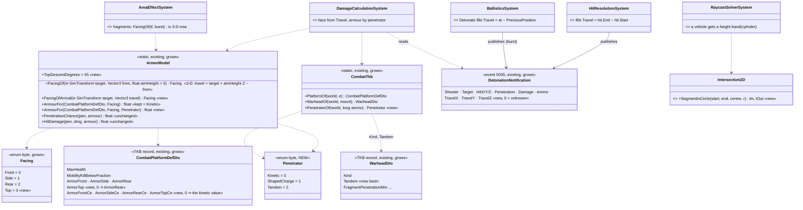
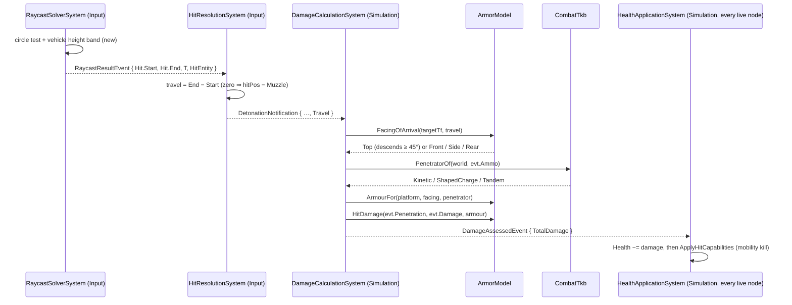
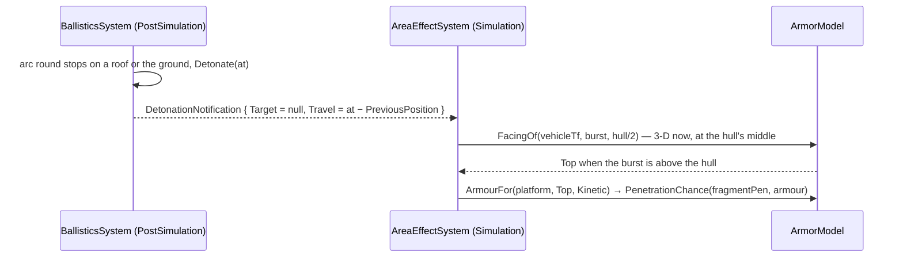
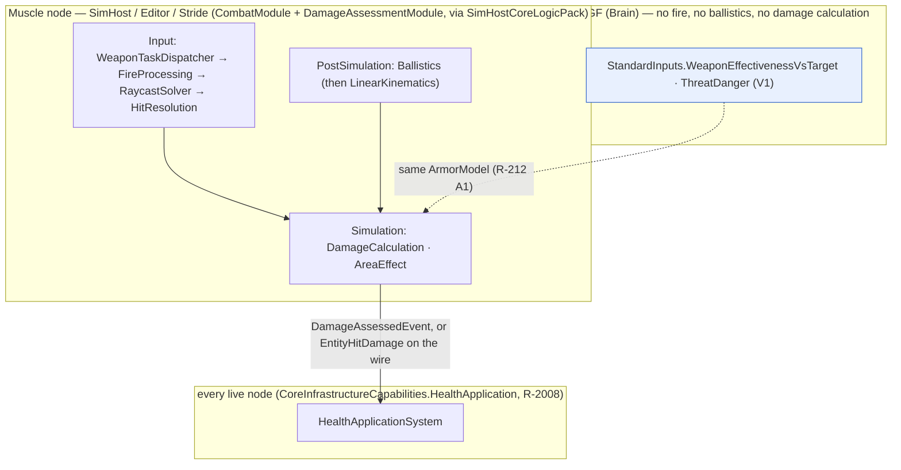
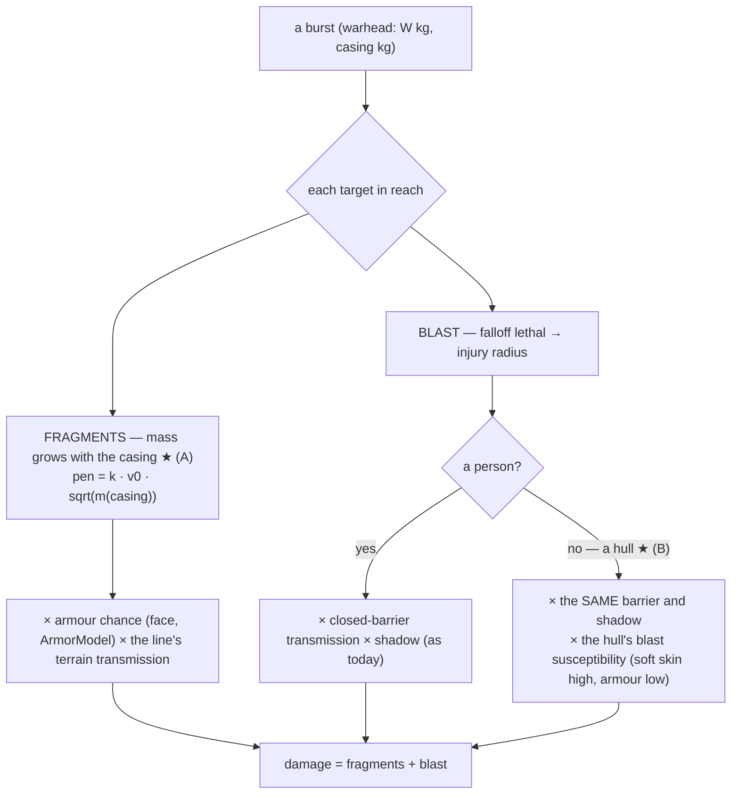
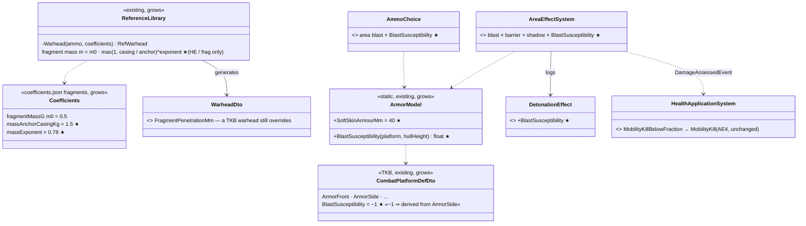
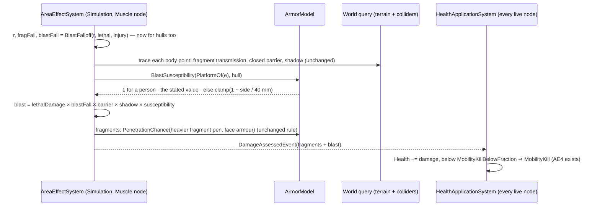

<!--STATUS
state: LIVE
updated: 2026-10-15 (§7 D-M area effects vs vehicles — frame by behaviors, R-2019; §7.5 designed and §7.6 as built by backend)
build-state: READY-TO-BUILD — 🔒 user, 2026-10-14: "Leans accepted. Write the designs" (D-A, D-B, D-C, D-F, D-G approved earlier the same day)
current-answer: §2 (classes), §3 (sequences), §4 (who runs it), §5 (rails) — §1 is the measured ground; §6 as-built; §7 D-M (area effects against vehicles: frame §7.1–7.4, design §7.5, BUILT §7.6).
stale-below: nothing.
known-rot: none.
known-conflict: none.
related-designs:
  - docs/designs/structure-damage/DESIGN_Structure_Damage.md — OWNS destructible structures (D-M4's plug-in point: the barrier changes when the building breaks)
  - docs/designs/air-attack/DESIGN_Air_Operations.md — §9c the live miss (a Mk-82 15 m from a pickup did nothing) that produced §7
  - docs/designs/indirect-fire/DESIGN_Indirect_Fire.md — OWNS mortars and artillery: the falling mortar / howitzer round whose roof hit this model already takes
  - docs/designs/vehicle-tactics/DESIGN_Urban_Armour_Tactics.md — the PROGRAMME (items M1–M3, M6; decisions D-A…D-L); this file is its hit-model build design
  - docs/DESIGN_Utility_AI_Demo_Scenarios.md — OWNS the armour model as decided (§9, R-212: facing, penetration chance, expected damage, A3 numbers fixed per type); this file extends its Facing and its armour table, never the formula
  - docs/DESIGN_Building_Interiors.md — OWNS R-217's penetration lookup and the one rule for armour and walls (§3d, §3h) — unchanged here; the penetrator kind is read beside it
  - docs/designs/vehicle-tactics/DESIGN_Missiles_And_Ammo.md — the rounds that arrive (guidance, top-attack dive, the ammo a mount loads); this file decides where they land and what they do
  - docs/designs/vehicle-tactics/DESIGN_FPV_Drone.md — a drone detonates through this same chain (a direct hit with its own direction)
-->

# Armour hit model — the round's arrival direction, a top face, and armour against shaped charges

**Items:** M1 (3-D arrival, Top face, vehicle hit height), M2 (armour per face × penetrator), M3 (the penetrator on the round), M6's data
shape (explicit health). **Decisions applied:** D-A (Top when the round descends ≥ 45°), D-B (an optional shaped-charge column, absent =
the kinetic value), D-C (ERA / cages later, data), D-F (explicit health per type), D-G (no hull / turret split).

## 1. What exists — measured `2026-10-14`

| fact | where |
|---|---|
| a hit is detected in `HitResolutionSystem` (Input, Muscle), which publishes `DetonationNotification { Shooter, Target, HitX/Y/Z, IsRemote, Penetration, Damage, Ammo }` — **no direction**; it is an in-process event (id 5005): the wire type `MunitionDetonation` is built field by field, so a new field changes no wire | `HitResolutionSystem.cs:94-151`, `DetonationNotification.cs:24`, `MunitionDetonationEgressTranslator.cs:97-104` |
| the swept segment of the hit is in hand there: `hit.Start` / `hit.End` (`RaycastHit`) — the arrival direction, correct for arcs too; the first segment of a round is zero-length | `HitResolutionSystem.cs:94` |
| `BallisticProjectile` carries NO velocity on purpose (pinned by `BallisticProjectile_HasPreviousPosition_NotVelocity`) | `CombatComponents.cs:66-75`, `CombatComponentTests.cs:55` |
| `DamageCalculationSystem` picks the face from the shooter's CURRENT position (or the hit point when he is gone) with the 2-D `FacingOf` | `DamageCalculationSystem.cs:71-77` |
| `AreaEffectSystem` picks a fragment's face with `FacingOf(tf, burst)`; blast skips vehicles | `AreaEffectSystem.cs:116,149-150` |
| `FacingOf` is horizontal; a source straight above ⇒ `Front` | `ArmorModel.cs:29-38` |
| every `ArmorModel` caller: `DamageCalculationSystem.cs:74-77`, `AreaEffectSystem.cs:149-150`, `AreaEffect.cs:77`, `TerrainPenetration.cs:50,68`, `StandardInputs.cs:409-412`, `TerrainReport.cs:81` | grep (`search_code` missed them) |
| `RaycastSolverSystem` gives a PERSON a body band in Z; a vehicle is a 2-D circle at any height (pinned by `P2_AVehicleKeepsTheCircle`) | `RaycastSolverSystem.cs:157-171` |
| `WarheadKind { Kinetic, HighExplosive, Fragmentation, ShapedCharge }` — read by nothing in the hit chain | `WarheadDto.cs:9` |
| the "RPG-7 rocket" / "TOW missile" names DELIBERATELY miss the library's "PG-7V HEAT" / "TOW-2 HEAT", so they carry no warhead — pinned by `EffectTests.LR1_EveryBuiltInMountLoadsAMunitionType_AndNoCombatNumberMoved` | `MunitionTkbCatalog.cs:27-32`, `EffectTests.cs:448` |
| `ParameterResolver.Warhead`: the template's own `WarheadDto` FIRST, then the library by name, then none | `ParameterResolver.cs:274-281` |
| `CombatPlatformDefDto { MaxHealth, MobilityKillBelowFraction, ArmorFront, ArmorSide, ArmorRear }`, a `[TkbDescriptor("Combat.PlatformDef")]` record; TKB data comes only from C# catalogs (no TKB JSON files) | `CombatPlatformDefDto.cs:12`, `BdcTkbBuilder.cs:215-221` |
| health is generated as front armour × 5 when the BDC catalog sets none | `BdcTkbBuilder.cs:217` |
| `DamageSystem` (`HitEvent` consumer) is wired only in examples; production damage = `DetonationNotification` → `DamageAssessedEvent` → `HealthApplicationSystem` | `HealthApplicationSystem.cs:88` |

### INVENTORY — the queries run

| query | total | the set |
|---|---|---|
| `search_graph name_pattern=.*Armou?r.*` (Class) | 1 class (+ tests) | `ArmorModel` (with `CombatTkb` in the same file) |
| `search_graph name_pattern=.*Penetrat.*` (Class) | 1 | `TerrainPenetration` |
| `search_graph name_pattern=.*Warhead.*` (Class) | 3 | `WarheadDto`, `RefWarhead`, `WarheadRound` |
| `search_graph name_pattern=.*Facing.*` (Class) | 0 | (an enum inside `ArmorModel.cs`) |
| grep `ArmorModel\.` over `*.cs` | 7 call sites | listed in §1 |

⇒ one armour model, one penetration rule, one warhead DTO — everything below extends them; nothing new duplicates one.

## 2. Classes

*What the picture shows that prose hid: no new system and no new component — two enum values, five TKB fields, three event floats and one
new resolver. Every existing caller keeps compiling: `FacingOf(target, from)` keeps its signature and `ArmourFor(platform, facing)` means
"kinetic".*

| rule | why |
|---|---|
| **Top** when the travel direction descends ≥ `TopDescentDegrees` (45°): `-travel.Z / |travel| ≥ sin 45°`; else the 2-D bearing of `-travel` as today | D-A; an RPG from a 4th-floor window 10 m away arrives ~50° down ⇒ the roof; from 50 m ~13° ⇒ the side |
| a degenerate horizontal component (straight down) ⇒ **Top**, never Front | fixes `ArmorModel.cs:34` |
| `FacingOf(target, from)` becomes 3-D (`travel = target.Position − from`) | the AI estimate (`StandardInputs`) and the fragment burst get the top for free — a burst ABOVE a hull is a roof hit |
| `ArmorTop` 0 ⇒ `ArmorRear` | a type that declares no roof gets its thinnest declared face, never 0 (which means "no armour") |
| a `…Ce` field 0 ⇒ that face's kinetic value | D-B: every existing type is unchanged until its data says otherwise |
| `Penetrator`: `ShapedCharge` when the ammo's warhead `Kind == ShapedCharge` (`Tandem` when `WarheadDto.Tandem`), else `Kinetic`; fragments and blast stay kinetic | R-217's penetration lookup is untouched — only WHICH armour column it is compared with changes |
| `Tandem` reads the same column as `ShapedCharge` until ERA exists | D-C: ERA, cages and slat armour come later as per-face data that scales a SINGLE shaped charge |
| no hull / turret split | D-G: the hull's rotation picks the face; the top covers the turret roof |
| a vehicle round hit needs its height: `z ∈ [feet, feet + PhysicsCollider.Height]` (a collider of height 0 keeps the circle) | M1 — a round passing over a hull no longer hits it; a drone's dive arrives from above |
| **M3 data**: the RPG and TOW munition TEMPLATES get their own `WarheadDto` (ShapedCharge, small blast) in `MunitionTkbCatalog` — the template-first rule of `ParameterResolver.Warhead` makes it win; the names stay | keeps LR1's deliberate name split; LR1 is re-pinned on purpose (its "no combat number moved" now moves, by decision) |
| **M6 data**: every combat vehicle declares `MaxHealth`; the front × 5 fallback stays only for a type that declares none | D-F |

## 3. Sequences

*What the picture shows: the direction is born where the hit is detected and dies after the face is chosen — it never needs to be stored
on the round (the no-velocity rule stands) or sent on the wire.*

*A mortar or a dropped grenade bursting above a vehicle now meets its roof, not its front.*

**Legacy branch kept:** a `DetonationNotification` with `Travel = 0` (a published-by-hand detonation, an old test) keeps today's rule — the
face from the shooter's position (`DamageCalculationSystem.cs:71-73`).

## 4. Who runs it — modules and nodes

*What the picture shows: every change in §2 runs only on the node that owns the Muscle (the phase lists are ticked by the toggleable groups
`SharedApplicationBootstrapper.cs:211-222`); CGF reads the SAME `ArmorModel` for its estimates, so the AI and the shot cannot disagree on
the face (R-212 A1).*

## 5. Rails — in the features' own suites

| rail | suite |
|---|---|
| `M1_TheFace_FromTheArrival`: level from ahead / beside / behind ⇒ Front / Side / Rear; descending 50° ⇒ Top; straight down ⇒ Top (the old Front bug) | new `ArmorModelTests` (none exists — no test calls `ArmorModel` directly) |
| `M1_ARoundFromAFourthFloorWindow_HitsTheRoof_AtTenMetres_TheSideAtFifty` | `DamageCalculationSystemTests` |
| `M1_HitResolution_CarriesTheTravelDirection` (straight round, arc round, zero-length first segment) | `HitResolutionSystemDetonationTests` |
| `M1_ARoundPassingOverAHull_DoesNotHitIt` — **replaces** `P2_AVehicleKeepsTheCircle` (a decided change) | `RaycastSolverSystemTests` |
| `M1_ABurstAboveAHull_MeetsItsRoof` | `AreaEffectSystemTests` |
| `M2_AShapedCharge_ReadsTheCeColumn_AbsentMeansTheKineticValue`; `M2_NoArmourTop_ReadsArmourRear` | `DamageCalculationSystemTests` |
| `M3_TheRpgAndTowRounds_CarryAShapedChargeWarhead` + LR1 re-pinned | `ReferenceLibraryTests` · `EffectTests` |
| the three CE3071 rails stay GREEN unchanged (flat shots, kinetic) | `DamageCalculationSystemTests` |
| a DTO shape rail for the five new fields | `TkbDtosTests` |
| the effectiveness input reads the 3-D face (a shooter above the target) | `StandardInputReaderTests` |

## 6. As-built `2026-10-14` (backend, handoff B3 · B4 · B5)

The design carries **12 classes** (§2, now 13 with `Intersection2D`) and **2 sequences** (§3); every box is built. Deviations, each argued:

| design said | built | why |
|---|---|---|
| `FacingOf(target, from)`, travel = `target.Position − from` | ⚠ **`FacingOf(target, from, aimHeight = 0)`** — travel to the position raised by `aimHeight`; `AreaEffectSystem` passes **hull / 2** | from the FEET, a burst beside a hull at its side's height read Top (2.3 m up, 1.8 m out ⇒ 52°); from the hull's middle it reads the side, and a burst on the roof still reads Top. Every other caller keeps 0 |
| legacy branch (`Travel = 0`) keeps today's rule | ✅, and **horizontal on purpose** — `from.Z` is set to the target's height | "today's rule" WAS horizontal; a 3-D `FacingOf` from a hit point high on a tall hull would have turned a legacy side hit into Top. The three CE3071 rails stay green unchanged |
| the effectiveness input reads the 3-D face | ✅ from the shooter's EYE to `AimPoint.Middle` (the line `FireProcessingSystem` flies) **plus the round's penetrator** (`CombatTkb.PenetratorOf(mount.AmmoGuid)`) | R-212 A1: the AI and the shot read one model — a 3-D face with a kinetic column would have let the AI over-rate a HEAT round against a …Ce face |
| the vehicle hit height `z ∈ [feet, feet + Height]` | ✅ as a CYLINDER: the first t of the segment inside the circle (`Intersection2D.SegmentInCircle`, new) AND the band (`RaycastSolverSystem.ZBandOverlap`) | `RaycastCircle` returns only an entry/exit point and misses a segment wholly inside the circle — exactly a round dropping onto a roof (a vertical segment divides by zero there) |
| zero-length first segment ⇒ `hitPos − Muzzle` | ✅ when the round carries its muzzle (`TerrainFlags` bit 0); else travel stays 0 (unknown ⇒ legacy branch) | a round built without a muzzle (older tests, examples) has no honest direction |
| RPG / TOW templates get "ShapedCharge, small blast" | ✅ **copied from the library's `PG-7V HEAT` / `TOW-2 HEAT`** (`MunitionTkbCatalog.ShapedChargeOf`), `Kind` forced ShapedCharge | one source for the numbers; the names stay (LR-1). ⚠ a missed RPG/TOW now BURSTS on the terrain (impact fuze) — an area effect it never had |

Rails (§5) — all built, red-proved by breaking the mechanism: `ArmorModelTests.M1_TheFace_FromTheArrival` + `M2_TheArmourColumn_PerFace_AndPenetrator` ·
`DamageCalculationSystemTests.M1_ARoundFromAFourthFloorWindow_…` (window 12 m above the hull's middle — a "4th floor" by this rail's geometry) +
`M2_AShapedCharge_ReadsTheCeColumn_…` + `M2_NoArmourTop_ReadsArmourRear` · `HitResolutionSystemDetonationTests.M1_HitResolution_CarriesTheTravelDirection` ·
`RaycastSolverSystemTests.M1_ARoundPassingOverAHull_DoesNotHitIt` (replaces `P2_AVehicleKeepsTheCircle`) · `AreaEffectSystemTests.M1_ABurstAboveAHull_MeetsItsRoof` ·
`StandardInputReaderTests.M1_Effectiveness_ReadsTheFaceInThreeD_…` · `TkbDtosTests.M2_ThePlatformArmourColumns_…` · `EffectTests.M3_TheRpgAndTowRounds_CarryAShapedChargeWarhead`
+ `LR1_…` re-pinned (RPG and TOW join the explosive set) · `CombatComponentTests` event size 48 → 60.

⚠ **Blast radius:** every vehicle hit (the height band) and every fragment burst above a vehicle (the top face). Demos to re-check:
`ua-weapon-choice`, `hill-attack`, `tt-convoy-ambush`.

**M6 data (backend, handoff B8):** ✅ every combat vehicle in the built-in catalogues STATES its health (each equal to the old front × 5, so
no fight moves on it) and its roof and shaped-charge columns — M1, T-72, Bradley (`NedTkbCatalog`) and the `MilitaryAPC` (now armoured
30 / 20 / 15 / top 10 against rifles). The front × 5 fallback stays only for a type that states none. The numbers and the argument:
[Missiles §5a](DESIGN_Missiles_And_Ammo.md).

⚠ **Found re-checking `hill-attack` after B8 (`2026-10-14`):** every NED hull had collider **height 0** — the only height source was the Stride
render descriptor, which NED types lack — so the M1 height band never applied to them, and the blast rule (personnel only, `HullHeight ≤ 0`)
took a tank for a person. With B8's loadouts the weapon brain then picked HEAT-MP against a 50 hp M1 (its blast "kills"), the round met the
900 mm composite front, and the attack stalled (both hostiles untouched; at B7 they died by t = 46 s). ✅ Fixed at the source: `WithPhysics`
states the hull's `Body.Geometry` (ground-centred size; people excluded) and `VehicleKinematicsTkbTranslator` falls back to its height. Rail
`NedTkbBuilderCombatTests.B8_ANedHull_StatesItsSizeAndLocomotion_…`; the live hill attack is the proof (handoff report).

## 7. Area effects against vehicles — D-M *(🔒 user, `2026-10-15`, R-2019; build-state: BUILT `2026-10-15` — §7.5 design, §7.6 as built)*

🔒 **User, `2026-10-15`:** *"A and B together is the most realistic … chosing this one, most realistic.*
*Blast should be reduced by buildings (later we will be destructing buildings, backend can think about that, but not needed immediately)."*

### 7.1 What exists — measured `2026-10-15`

| fact | where |
|---|---|
| 📌 **the live miss:** a Mk-82 burst 15 m from a pickup leaves it at Health 100 (`ua-air-strike`; `GET /combat/detonations` on SimHost: `fragmentArmourChance 0`, `blastDamage 0`) | `DESIGN_Air_Operations.md` §9c |
| blast skips every hull: `blastFall = hull > 0 ? 0 : …` — *"personnel only (v1)"* | `AreaEffectSystem.cs:116` |
| ONE fragment mass for every warhead (`fragmentMassG 0.5`) ⇒ a Mk-82 fragment penetrates ≈ 2.4 mm (Gurney v₀ ≈ 1760 m/s, `k · v₀ · √m`), the pickup is 5 mm all round ⇒ `PenetrationChance` 0 (ramp 0.8–1.2 × armour) | `ReferenceLibrary.cs:155-180`, `coefficients.json` `fragments`, `ArmorModel.cs:96` |
| ⭐ buildings ALREADY reduce blast — for people: a closed barrier passes `exp(−R / 100 mm)`, an open obstacle taller than the target leaves a diffraction shadow (W-7′) | `AreaEffect.cs:20-70`, `AreaEffectSystem.cs:119-147`, `DESIGN_Building_Interiors.md` §3k W-7′ |
| fragment penetration ALSO decides what a fragment passes through walls (`FragmentTransmission`) | `AreaEffectSystem.cs:124` |

### 7.2 The rule — one burst, two effects, for every target

*What the picture shows that prose hid: B adds no new attenuation — the hull goes through the same building barrier and shadow the person
does, so "blast reduced by buildings" holds for vehicles by construction. The two new inputs are a fragment mass that depends on the casing
and a blast susceptibility per hull.*

### 7.3 Decisions *(leans for backend to confirm in its design step; the user's choice above is fixed)*

| # | decision | rejected |
|---|---|---|
| **D-M1** | **(A) fragment mass grows with the casing** (e.g. `m = m₀ · (casing / casing₀)^⅓`), anchored so a hand grenade, a 40 mm grenade and an RPG keep today's 0.5 g — a bomb, a 155 mm shell, a 120 mm mortar throw heavier fragments that go through light armour (and through more wall) | one larger mass for all (grenades would start piercing walls) |
| **D-M2** | **(B) blast damages a hull**, scaled by a per-type **blast susceptibility** (TKB): soft-skinned (a pickup, a truck, a car) near 1, armoured low — an MBT ≈ 0 outside the lethal radius; through the same barrier / shadow as a person | blast on every hull equally (a tank killed by a near miss) · a hard threshold on armour thickness |
| **D-M3** | a light vehicle may take a **mobility kill** from blast before it dies (`MobilityKill` exists, M9) — backend's call | — |
| **D-M4** | **buildings that break** (a wall blown in, a house collapsing) are NOT in this slice — backend owns when; the barrier model is where it would plug in | doing it now |

### 7.4 Acceptance *(the numbers backend reports; the demos are the behaviours lane's)*

| | |
|---|---|
| ① | a Mk-82 within ~25 m of a pickup destroys or disables it; a 155 mm HE within ~15 m heavily damages it; an 81 mm within ~5 m damages it |
| ② | an MBT is unhurt by blast outside the lethal radius; fragments still meet its armour as today |
| ③ | a pickup behind a building from the burst takes less blast than one in the open (the existing barrier / shadow) |
| ④ | ⛔ **no person number moves** for grenades, 40 mm and RPG HE (golden or rail); ⚠ any number that DOES move (a bomb's fragments through a wall) is listed in the report |
| ⑤ | `ua-air-strike` ③ passes live (the behaviours lane re-runs it) |

⭐ **Handoff:** [HANDOFF_Behaviors_To_Backend_Area_Effects_Vehicles.md](../../blueprints/batches/HANDOFF_Behaviors_To_Backend_Area_Effects_Vehicles.md).

### 7.5 Classes and sequence — backend's design step (`2026-10-15`)

📐 **Measured first:** the area rule has TWO readers that must agree (R-212 A1) — `AreaEffectSystem.Assess` (the burst) and
`AmmoChoice.Split` (the weapon brain's expected area damage, `AmmoChoice.cs:54-60`, which copies *"blast harms personnel only"*). The fragment
mass is one coefficient (`coefficients.json fragments.fragmentMassG`) read once, by `ReferenceLibrary.Warhead`. A vehicle is told from a person
by `PhysicsColliderReaders.HullHeight > 0`. ⇒ two pure functions and one TKB field; no new system, no new component, no wire.

*What the picture shows that prose hid: the brain's ammo choice and the burst read the SAME susceptibility function — a technical stops looking
blast-proof to the AI the moment it stops being blast-proof in the sim. And no TKB warhead changes: the mass rule lives only in the library
generator, so a template that states its own `WarheadDto` (the RPG and TOW, M3) keeps its numbers.*

| decision (confirming §7.3) | as designed | rejected |
|---|---|---|
| **D-M1** mass law | **Mott scaling**: `m = m₀ · (casing / 1.5 kg)^0.78` above the anchor, `m₀` (0.5 g) at or below it. For a geometrically scaled shell the mean Mott fragment mass grows as `t^(5/3) · d^(2/3)` ∝ s^(7/3) while the casing grows as s³ ⇒ exponent 7/9 ≈ 0.78. The anchor 1.5 kg is the RPG's casing (1.47 kg), the heaviest the fence keeps; the grenade (0.16) and 40 mm (0.185) sit below it. **Only HE and fragmentation warheads scale** — a shaped charge's "casing" here is a whole rocket or missile body | the frame's example `^⅓` (a Mk-82 fragment 2.2 g, 5 mm — too light against light armour) · scaling shaped charges (a TOW's casing is its motor) |
| **D-M2** susceptibility | `CombatPlatformDefDto.BlastSusceptibility`, **−1 = derived** `clamp(1 − ArmorSide / 40 mm, 0, 1)`; a person (hull 0) and a hull with no platform record = 1. Every catalogued vehicle STATES it (AE3) | 0 as "unset" (0 must mean immune — an MBT) · a threshold on armour |
| **D-M3** mobility kill | **no new code**: blast is a `DamageAssessedEvent`, and `HealthApplicationSystem` already immobilises a type below its `MobilityKillBelowFraction` (the technicals: 0.6) | a blast-only mobility rule |
| **D-M4** where breakable buildings plug in | the closed barrier and the shadow come from `IWorldQuery.Trace` crossings (`TraceCrossing.Loss`, `.ClosedBarrier`, `.TopZ`) — a damaged wall changes its crossing (a hole = no barrier; a collapse = a new prism), and `AreaEffect.ClosedBarrierTransmission` / `TerrainShadow` need no change. The burst's own breach precedent is `BreachDoors` (W-9) | — (not this batch) |
| what does NOT change | the distance `r` is to the hull's centre axis, not its skin (a hull's radius is small against a bomb's radii) | the skin distance (moves every fragment number on vehicles) |

### 7.6 As built `2026-10-15` (backend, handoff AE1–AE4)

The §7.5 diagrams are what was built: no deviation from them. What the build adds:

| item | built | where |
|---|---|---|
| **AE1** | the mass law in the library generator (`ReferenceLibrary.FragmentMassG`), its two coefficients optional in `coefficients.json` (absent ⇒ one mass, so a hand-written coefficient file keeps working); the fragment formula on `GET /tkb/resolve` shows the scaling | `ReferenceLibrary.cs`, `coefficients.json` |
| **AE2** | `ArmorModel.BlastSusceptibility`; `AreaEffectSystem` multiplies the blast by it (a hull at 0 skips the blast falloff); `AmmoChoice` reads the same rule; `DetonationEffect.BlastSusceptibility` and `blastSusceptibility` on `GET /combat/detonations` | `ArmorModel.cs`, `AreaEffectSystem.cs`, `AmmoChoice.cs`, `DetonationLog.cs`, `CombatReport.cs` |
| **AE3** | every catalogued platform with a combat record states it (§7.6 table in the report); `SimCombatDef.BlastSusceptibility` → `BdcTkbBuilder` | `BdcTkbCatalog.cs`, `UrbanCombatTkbCatalog.cs` |
| **AE4** | nothing to build: blast is an ordinary `DamageAssessedEvent`, so `HealthApplicationSystem` immobilises a technical below 60 % health as it does for any hit | — |

Fragment penetration, before → after (every other library warhead unchanged): 81 mm 1.65 → 2.24 mm · 70 mm rocket 1.67 → 2.32 ·
105 mm 1.27 → 2.94 · 120 mm mortar 1.63 → 3.49 · 125 mm HE-frag 1.31 → 3.56 · 155 mm 1.33 → 4.63 · Mk-82 2.37 → 13.6.

Rails: `ReferenceLibraryTests.AE1_ABiggerShell_ThrowsHeavierFragments_…` · `ArmorModelTests.AE2_BlastSusceptibility_…` ·
`AreaEffectSystemTests.AE2_AMk82_WrecksAPickupInTheOpen_LessBehindABuilding_AndLeavesAnMbtUnhurt` (red-proved) ·
`NedTkbBuilderCombatTests.AE3_EveryVehicle_StatesItsBlastSusceptibility`. Report:
[REPORT_Backend_Area_Effects_Vehicles.md](../../blueprints/batches/REPORT_Backend_Area_Effects_Vehicles.md).
