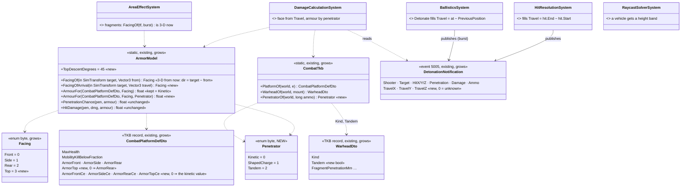
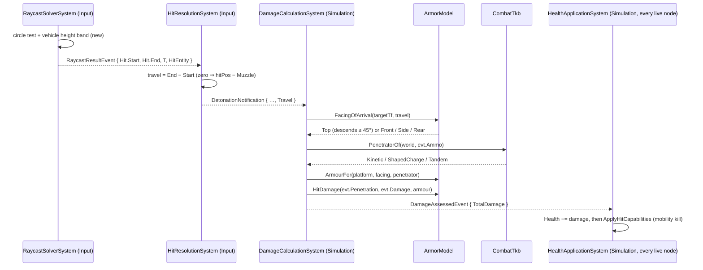
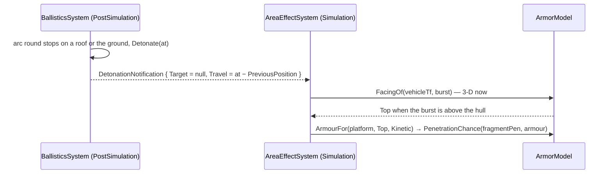
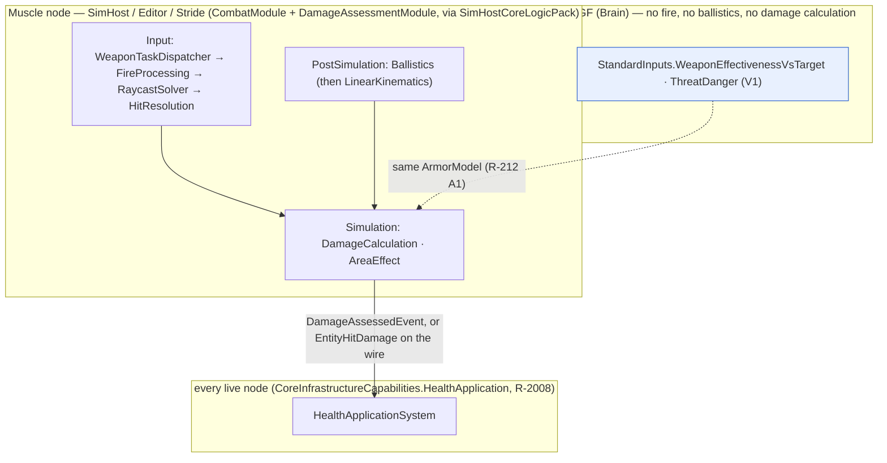

<!--STATUS
state: LIVE
updated: 2026-10-14
build-state: READY-TO-BUILD — 🔒 user, 2026-10-14: "Leans accepted. Write the designs" (D-A, D-B, D-C, D-F, D-G approved earlier the same day)
current-answer: §2 (classes), §3 (sequences), §4 (who runs it), §5 (rails) — §1 is the measured ground.
stale-below: nothing.
known-rot: none.
known-conflict: none.
related-designs:
  - docs/designs/vehicle-tactics/DESIGN_Urban_Armour_Tactics.md — the PROGRAMME (items M1–M3, M6; decisions D-A…D-L); this file is its hit-model build design
  - docs/DESIGN_Utility_AI_Demo_Scenarios.md — OWNS the armour model as decided (§9, R-212: facing, penetration chance, expected damage, A3 numbers fixed per type); this file extends its Facing and its armour table, never the formula
  - docs/DESIGN_Building_Interiors.md — OWNS R-217's penetration lookup and the one rule for armour and walls (§3d, §3h) — unchanged here; the penetrator kind is read beside it
  - docs/designs/vehicle-tactics/DESIGN_Missiles_And_Ammo.md — the rounds that arrive (guidance, top-attack dive, the ammo a mount loads); this file decides where they land and what they do
  - docs/designs/vehicle-tactics/DESIGN_FPV_Drone.md — a drone detonates through this same chain (a direct hit with its own direction)
-->

# Armour hit model — the round's arrival direction, a top face, and armour against shaped charges

**Items:** M1 (3-D arrival, Top face, vehicle hit height), M2 (armour per face × penetrator), M3 (the penetrator on the round), M6's data
shape (explicit health). **Decisions applied:** D-A (Top when the round descends ≥ 45°), D-B (an optional shaped-charge column, absent =
the kinetic value), D-C (ERA / cages later, data), D-F (explicit health per type), D-G (no hull / turret split).

## 1. What exists — measured `2026-10-14`

| fact | where |
|---|---|
| a hit is detected in `HitResolutionSystem` (Input, Muscle), which publishes `DetonationNotification { Shooter, Target, HitX/Y/Z, IsRemote, Penetration, Damage, Ammo }` — **no direction**; it is an in-process event (id 5005): the wire type `MunitionDetonation` is built field by field, so a new field changes no wire | `HitResolutionSystem.cs:94-151`, `DetonationNotification.cs:24`, `MunitionDetonationEgressTranslator.cs:97-104` |
| the swept segment of the hit is in hand there: `hit.Start` / `hit.End` (`RaycastHit`) — the arrival direction, correct for arcs too; the first segment of a round is zero-length | `HitResolutionSystem.cs:94` |
| `BallisticProjectile` carries NO velocity on purpose (pinned by `BallisticProjectile_HasPreviousPosition_NotVelocity`) | `CombatComponents.cs:66-75`, `CombatComponentTests.cs:55` |
| `DamageCalculationSystem` picks the face from the shooter's CURRENT position (or the hit point when he is gone) with the 2-D `FacingOf` | `DamageCalculationSystem.cs:71-77` |
| `AreaEffectSystem` picks a fragment's face with `FacingOf(tf, burst)`; blast skips vehicles | `AreaEffectSystem.cs:116,149-150` |
| `FacingOf` is horizontal; a source straight above ⇒ `Front` | `ArmorModel.cs:29-38` |
| every `ArmorModel` caller: `DamageCalculationSystem.cs:74-77`, `AreaEffectSystem.cs:149-150`, `AreaEffect.cs:77`, `TerrainPenetration.cs:50,68`, `StandardInputs.cs:409-412`, `TerrainReport.cs:81` | grep (`search_code` missed them) |
| `RaycastSolverSystem` gives a PERSON a body band in Z; a vehicle is a 2-D circle at any height (pinned by `P2_AVehicleKeepsTheCircle`) | `RaycastSolverSystem.cs:157-171` |
| `WarheadKind { Kinetic, HighExplosive, Fragmentation, ShapedCharge }` — read by nothing in the hit chain | `WarheadDto.cs:9` |
| the "RPG-7 rocket" / "TOW missile" names DELIBERATELY miss the library's "PG-7V HEAT" / "TOW-2 HEAT", so they carry no warhead — pinned by `EffectTests.LR1_EveryBuiltInMountLoadsAMunitionType_AndNoCombatNumberMoved` | `MunitionTkbCatalog.cs:27-32`, `EffectTests.cs:448` |
| `ParameterResolver.Warhead`: the template's own `WarheadDto` FIRST, then the library by name, then none | `ParameterResolver.cs:274-281` |
| `CombatPlatformDefDto { MaxHealth, MobilityKillBelowFraction, ArmorFront, ArmorSide, ArmorRear }`, a `[TkbDescriptor("Combat.PlatformDef")]` record; TKB data comes only from C# catalogs (no TKB JSON files) | `CombatPlatformDefDto.cs:12`, `BdcTkbBuilder.cs:215-221` |
| health is generated as front armour × 5 when the BDC catalog sets none | `BdcTkbBuilder.cs:217` |
| `DamageSystem` (`HitEvent` consumer) is wired only in examples; production damage = `DetonationNotification` → `DamageAssessedEvent` → `HealthApplicationSystem` | `HealthApplicationSystem.cs:88` |

### INVENTORY — the queries run

| query | total | the set |
|---|---|---|
| `search_graph name_pattern=.*Armou?r.*` (Class) | 1 class (+ tests) | `ArmorModel` (with `CombatTkb` in the same file) |
| `search_graph name_pattern=.*Penetrat.*` (Class) | 1 | `TerrainPenetration` |
| `search_graph name_pattern=.*Warhead.*` (Class) | 3 | `WarheadDto`, `RefWarhead`, `WarheadRound` |
| `search_graph name_pattern=.*Facing.*` (Class) | 0 | (an enum inside `ArmorModel.cs`) |
| grep `ArmorModel\.` over `*.cs` | 7 call sites | listed in §1 |

⇒ one armour model, one penetration rule, one warhead DTO — everything below extends them; nothing new duplicates one.

## 2. Classes

*What the picture shows that prose hid: no new system and no new component — two enum values, five TKB fields, three event floats and one
new resolver. Every existing caller keeps compiling: `FacingOf(target, from)` keeps its signature and `ArmourFor(platform, facing)` means
"kinetic".*

| rule | why |
|---|---|
| **Top** when the travel direction descends ≥ `TopDescentDegrees` (45°): `-travel.Z / |travel| ≥ sin 45°`; else the 2-D bearing of `-travel` as today | D-A; an RPG from a 4th-floor window 10 m away arrives ~50° down ⇒ the roof; from 50 m ~13° ⇒ the side |
| a degenerate horizontal component (straight down) ⇒ **Top**, never Front | fixes `ArmorModel.cs:34` |
| `FacingOf(target, from)` becomes 3-D (`travel = target.Position − from`) | the AI estimate (`StandardInputs`) and the fragment burst get the top for free — a burst ABOVE a hull is a roof hit |
| `ArmorTop` 0 ⇒ `ArmorRear` | a type that declares no roof gets its thinnest declared face, never 0 (which means "no armour") |
| a `…Ce` field 0 ⇒ that face's kinetic value | D-B: every existing type is unchanged until its data says otherwise |
| `Penetrator`: `ShapedCharge` when the ammo's warhead `Kind == ShapedCharge` (`Tandem` when `WarheadDto.Tandem`), else `Kinetic`; fragments and blast stay kinetic | R-217's penetration lookup is untouched — only WHICH armour column it is compared with changes |
| `Tandem` reads the same column as `ShapedCharge` until ERA exists | D-C: ERA, cages and slat armour come later as per-face data that scales a SINGLE shaped charge |
| no hull / turret split | D-G: the hull's rotation picks the face; the top covers the turret roof |
| a vehicle round hit needs its height: `z ∈ [feet, feet + PhysicsCollider.Height]` (a collider of height 0 keeps the circle) | M1 — a round passing over a hull no longer hits it; a drone's dive arrives from above |
| **M3 data**: the RPG and TOW munition TEMPLATES get their own `WarheadDto` (ShapedCharge, small blast) in `MunitionTkbCatalog` — the template-first rule of `ParameterResolver.Warhead` makes it win; the names stay | keeps LR1's deliberate name split; LR1 is re-pinned on purpose (its "no combat number moved" now moves, by decision) |
| **M6 data**: every combat vehicle declares `MaxHealth`; the front × 5 fallback stays only for a type that declares none | D-F |

## 3. Sequences

*What the picture shows: the direction is born where the hit is detected and dies after the face is chosen — it never needs to be stored
on the round (the no-velocity rule stands) or sent on the wire.*

*A mortar or a dropped grenade bursting above a vehicle now meets its roof, not its front.*

**Legacy branch kept:** a `DetonationNotification` with `Travel = 0` (a published-by-hand detonation, an old test) keeps today's rule — the
face from the shooter's position (`DamageCalculationSystem.cs:71-73`).

## 4. Who runs it — modules and nodes

*What the picture shows: every change in §2 runs only on the node that owns the Muscle (the phase lists are ticked by the toggleable groups
`SharedApplicationBootstrapper.cs:211-222`); CGF reads the SAME `ArmorModel` for its estimates, so the AI and the shot cannot disagree on
the face (R-212 A1).*

## 5. Rails — in the features' own suites

| rail | suite |
|---|---|
| `M1_TheFace_FromTheArrival`: level from ahead / beside / behind ⇒ Front / Side / Rear; descending 50° ⇒ Top; straight down ⇒ Top (the old Front bug) | new `ArmorModelTests` (none exists — no test calls `ArmorModel` directly) |
| `M1_ARoundFromAFourthFloorWindow_HitsTheRoof_AtTenMetres_TheSideAtFifty` | `DamageCalculationSystemTests` |
| `M1_HitResolution_CarriesTheTravelDirection` (straight round, arc round, zero-length first segment) | `HitResolutionSystemDetonationTests` |
| `M1_ARoundPassingOverAHull_DoesNotHitIt` — **replaces** `P2_AVehicleKeepsTheCircle` (a decided change) | `RaycastSolverSystemTests` |
| `M1_ABurstAboveAHull_MeetsItsRoof` | `AreaEffectSystemTests` |
| `M2_AShapedCharge_ReadsTheCeColumn_AbsentMeansTheKineticValue`; `M2_NoArmourTop_ReadsArmourRear` | `DamageCalculationSystemTests` |
| `M3_TheRpgAndTowRounds_CarryAShapedChargeWarhead` + LR1 re-pinned | `ReferenceLibraryTests` · `EffectTests` |
| the three CE3071 rails stay GREEN unchanged (flat shots, kinetic) | `DamageCalculationSystemTests` |
| a DTO shape rail for the five new fields | `TkbDtosTests` |
| the effectiveness input reads the 3-D face (a shooter above the target) | `StandardInputReaderTests` |

⚠ **Blast radius:** every vehicle hit (the height band) and every fragment burst above a vehicle (the top face). Demos to re-check:
`ua-weapon-choice`, `hill-attack`, `tt-convoy-ambush`.
