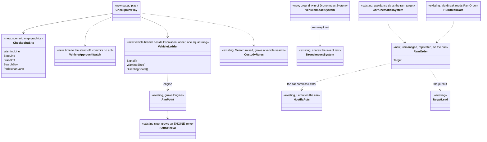
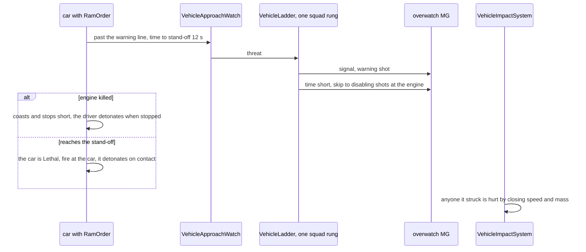
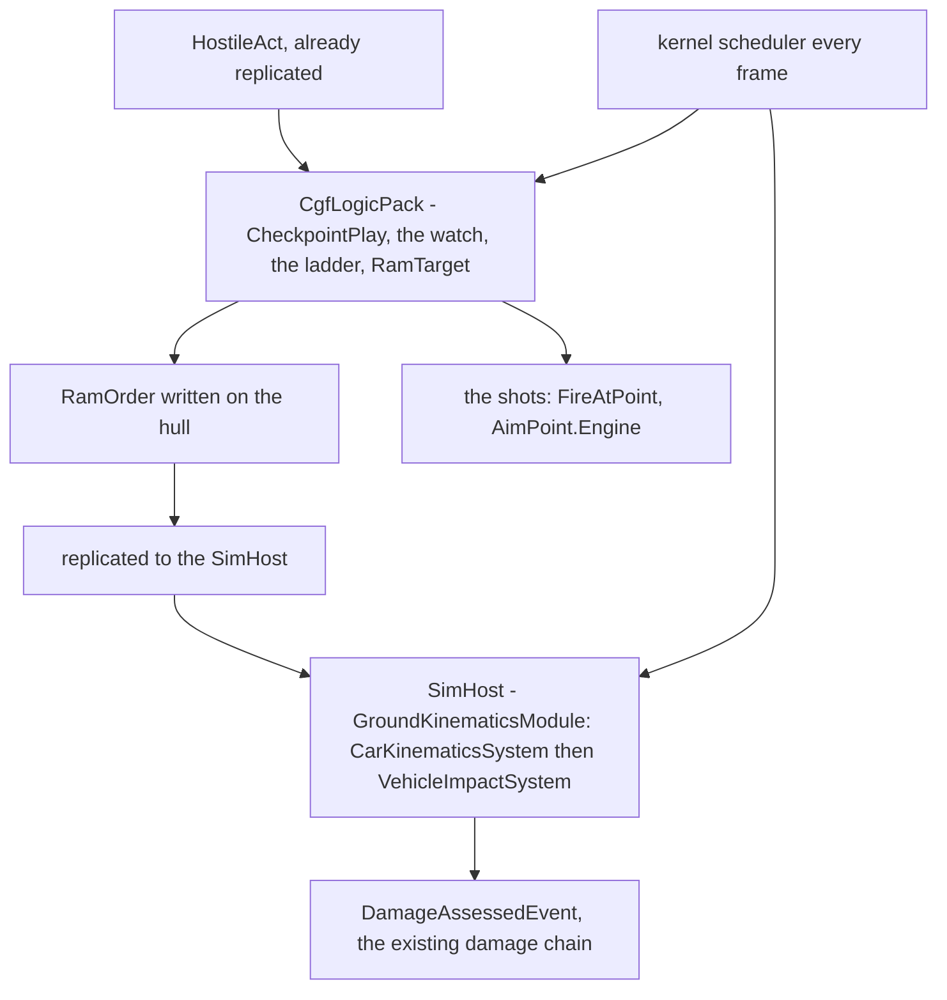

<!--STATUS
state: LIVE
updated: 2026-11-18 (§5b K-1 run-over, CE-1967)
build-state: READY-TO-BUILD → DISPATCHED 2026-11-16 to `behaviors` as a follow-up after minefields (§5a ids) (2026-11-15) — R-4260 decisions, R-4262 the review folded; slices §5 K-1…K-7
current-answer: §1 inventory · §2 decisions · §3 UML · §4 the checkpoint in time · §5 slices and acceptance · §5b as built (behaviors) · §8 the review
stale-below: § HISTORY at the bottom (§2–§5 as first written); §8 is the review record, folded into §2–§5
known-rot: none
known-conflict: none
related-designs:
  - ../../DESIGN_Terrain_Editor_UX.md — CE-4594 TE-5 (R-4264): the terrain editor's Obstacle tool draws the serpentine's blocks as obstacle ENTITIES, a row = one undo / one group
  - ../../DESIGN_Operations_Behaviour_Catalogue.md — §12.4 / §12.5: the analysis this design builds (SQD-13, VEH-4, ASY-2)
  - DESIGN_Motorcycle.md — the two-wheeler: the bike-borne bomb (IM-3) uses `RamTarget`; "two men on one bike" (IM-8) is an indicator here
  - ../../DESIGN_Civilians_And_Crowd_Control.md — OWNS the escalation ladder (§5k), the hostile act, custody / search, hidden weapons (§5h), AW-19 ("a vehicle driven at people is a hostile act")
  - ../../DESIGN_Vehicle_Breaching.md — OWNS `ContactBreach`; B-D1 AMENDED by R-4260 (a `RamTarget` AI vehicle breaches a weak barrier)
  - ../../DESIGN_Ground_Patches_And_Road_Blockage.md — OWNS static obstacles that SUMO cars respect and road closure (CE-4590)
  - ../hit-location/DESIGN_Body_Parts_And_Hit_Location.md — OWNS vehicle part damage (the mobility kill the disabling shots aim for)
  - ../../DESIGN_Injury_States.md — OWNS the injury states a vehicle impact writes into
  - ../../DESIGN_Terrain_Authoring.md — OWNS the `checkpoint` terrain recipe this design's site extends
-->

# DESIGN — the checkpoint, ramming and the car bomb

🔒 User, `2026-11-15`: *"the second one is the checkpoint and the car RAM attack. Please think about it and analyze"* · *"Checkpoint and ramming is
approved."* (R-4260) · *"Approved, write both designs and review them"*.

**The proven pattern** (vehicle checkpoint doctrine): warning signs far out → a serpentine of barriers that FORCES slow speed → a stop line → a
search bay off the road → an overwatch weapon covering the approach → a reaction element; escalation of force by distance: signal → warning shot →
disabling shots → lethal; the threat indicator: a vehicle not slowing by the line. The ram / car-bomb attack is exactly what that layout defeats —
so the two are ONE design: the attack is the checkpoint's test.

## 1. INVENTORY *(measured `2026-11-15`; graph: `search_graph name_pattern=".*(Checkpoint|Collision|VehicleImpact|Escalation|HostileAct|Custody|RunOver).*" label=Class` ⇒ `EscalationLadder`, `HostileActs`, `Custody` (+ its translators); every "checkpoint" class is the save-state sense; no vehicle-collision class in production; a read-only code sweep; grep. Index coverage could not be checked through the CLI)*

| exists | where | used as |
|---|---|---|
| the `checkpoint` terrain recipe: jersey barriers ×2, a booth, sandbags, a car | `assets/terrain-recipes/checkpoint.recipe.json`, `TerrainPicks.cs:263` | CP-1's site |
| static obstacles SUMO cars stop / swerve for; a fully blocked road closed | `TrafficBodies.cs:44-50, :110`, `BridgeClosureSystem.cs:29` (CE-4590) | the serpentine works on traffic for free |
| ROE force level Warn → NonLethal → Lethal; `EscalationLadder` (`Warn` = a 2 s gesture, `WarnIfDue`, `Level`) | `Roe.cs:24-36`, `EscalationLadder.cs:34-123` | CP-3 extends it with the vehicle rungs |
| ⛔ no warning shot, no disabling shot (listed later, Civilians :1191-1194) | — | CP-3 |
| the hostile act: `HostileActKind` None / NonLethal / Lethal, replicated, recorded; ⛔ no vehicle act | `HostileActs.cs:14-76` | RM-3 adds the vehicle act |
| custody: `CustodyRules.Ask(man, by, Search)` reveals hidden weapons — ⛔ nothing raises it | `Custody.cs:65-160` | CP-4 raises it |
| own cars with occupants: `CivilianCar` 4 seats + a concealed boot; SUMO cars (`TrafficCar` 8851) carry NOBODY | `UrbanCombatTkbCatalog.cs:198-201`, `TkbEntityTypes.cs:169-171` | CP-4 searches own cars only |
| the car bomb `ua-car-bomb`: a boot charge, `FollowRoute` at 8 m/s, `TriggerIed` at 15 m; `run_car_bomb` checks it | `scenarios/demos/civilians-and-crowd/ua-car-bomb`, `utility-demo-check.py:4630-4675` | CP-5 / RM-4's test |
| charges: `Charges.Ask` (a phone unless carried / worn by the asker), `Detonate` | `Charges.cs:34-57` | the VBIED's detonation |
| the lead predictor (`TargetLead.Point`) the drone uses | `GuidedRoundSystem.cs:218`, `AirAttackBehaviors.cs:610` | RM-2's pursuit |
| ⛔ vehicles avoid people; no vehicle hurts anyone | `CarKinematicsSystem.cs:476-490`; Breaching `:34` | RM-1 |
| `ContactBreach` (a player's heavy hull breaks weak barriers; the bulldozer on order) | Breaching §7, `ContactBreachTranslators.cs` | RM-5 (amended B-D1) |
| vehicle part damage (mobility kill) | Body Parts design, `ArmorModel` | the disabling shot's target |

## 2. Decisions *(✅ R-4260 · the review R-4262 — folded `2026-11-15`; the first text is in HISTORY)*

| # | decision | why / review |
|---|---|---|
| **CP-1** | a **`Checkpoint`** squad play on a site authored as scenario MAP GRAPHICS (areas / routes the play takes by link — the terrain recipe stays scenery): the WARNING line, the STOP line, the STAND-OFF, the SEARCH BAY, a PEDESTRIAN lane; roles: stopper, 2 searchers, overwatch (a **machine gun** covering the approach), reaction — reusing `HoldTheLine`, `Sentry`, the squad role ids | KV-8, KV-15 |
| **CP-1a** | the STAND-OFF is DERIVED from the expected charge's lethal radius; the searchers are accepted exposed, everyone else behind barriers (⚠ barriers do not block blast today — stated) | KV-13 |
| **CP-2** | the **`VehicleApproachWatch`** — the play's own judgement, it commits NO act: each vehicle's **time to the stand-off** at its speed; slowing to < 3 m/s by the stop line ⇒ routine; still fast past the warning line ⇒ THREAT; indicators raise suspicion (an ignored signal, two men on one bike); a pedestrian approaching outside the lane ⇒ suspicious; at night the watch is bounded by detection range; the suspicion sensor (D4) is a named dependency | KV-4 / KV-5 (no act), KV-14 |
| **CP-3** | the **vehicle ladder** — a VEHICLE branch beside `EscalationLadder`, keyed on TIME lines, ONE rung state for the whole squad (an EL-4 amendment), capped by the ROE: SIGNAL (the gesture, a light at night) → **WARNING SHOT** (`FireAtPoint` at the ground ahead; NonLethal level or higher; switchable by the ROE) → **DISABLING SHOTS** (`AimPoint.Engine` at the car's ENGINE zone, the MG) → LETHAL (fire at the CAR, CP-6); ⭐ rungs SKIP when time runs out (self-defence overrides); a car with a dead engine COASTS; per vehicle CLASS a rung table (a bike has no engine block); the warning line 200–300 m out, or the serpentine physically caps speed before it | KV-2, KV-3, KV-7, KV-14 |
| **CP-4** | **search**: the stopped civilian driver gets *"out, hands up"* as an EVENT to his brain (never a write); a civilian driver who SEES the signal slows to the line; the occupants searched by `Custody` Search; ⭐ a **vehicle search** reveals CONCEALED stations (the boot); a SUMO car (nobody aboard) is stopped by a soldier or a vehicle in the lane (it brakes for a crowd disc) and waved on — no traffic-hold command | KV-9, KV-10, KV-11 |
| **CP-5** | the test: `ua-car-bomb` re-cast at a checkpoint: a routine car stopped, searched, released; a car that does not slow is laddered — disabled before the stand-off, or reaching it and detonating; and the compliant bomber who stops and detonates as the searchers come close | KV-10 |
| **CP-6** | ⭐ **the VEHICLE is the target**: occupants of an enclosed car are hidden — lethal fire is fire at the car, plus ONE soft-skin rule: a penetrating hit may hit an occupant; whoever drives is stated: the driver's incapacitation ENDS the car's move | KV-1 |
| **CP-7** | the soft-skin car gains a front **ENGINE zone** with `WoundEffect.Mobility` (`VehiclePart.Engine` exists) | KV-3 |
| **RM-1** | ⭐ **a vehicle hurts a person by impact** — the GROUND TWIN of `DroneImpactSystem` (one shared swept test, the hull rectangle, a replay gate), serial after `CarKinematicsSystem` in `GroundKinematicsModule`; it publishes a Blunt `DamageAssessedEvent` (the `Melee.Strike` precedent) scaled by CLOSING speed × the vehicle's mass, a seeded spread, bands as Health fractions; riders and men boarding exempt; for every vehicle (AI or a player's) | KV-4 |
| **RM-2** | **`RamTarget`**: ONE unmanaged replicated **`RamOrder { EntityRef Target }`** on the hull — the avoidance skips the target (all PERSONS when the target is a crowd), the breach gate reads it, the contact branch pushes; the pursuit re-issued every 0.5 s to a `TargetLead` point; inside ~50 m a direct move (no path round a weak barrier) | KV-6 |
| **RM-3** | a ram is a **LETHAL** hostile act (AW-19) — `RamTarget` commits it on its OWN entity, the CAR; the driver's act a `BatchContext.Later` follow-up; no enum, wire or recording change | KV-5 |
| **RM-4** | the **VBIED driver** = `RamTarget` at the checkpoint / the crowd + detonate ON CONTACT or WHEN STOPPED (the boot charge by phone, `Charges.Ask`); ⛔ "when shot" DROPPED (no dead-man switch) | KV-12 |
| **RM-5** | a car with a `RamOrder` breaches a WEAK barrier through `ContactBreach` (`HullBreakGate.MayBreak` reads the marker) — amends Breaching B-D1 | KV-6 |

## 3. UML *(as folded)*


*What it shows that prose hid: the attacker and the checkpoint meet only through the CAR — the ram marks the car Lethal, the checkpoint shoots the
car and its engine — and every new piece grows an existing seam (the drone's impact test, the breach gate, the aim points, custody).*


*What it shows: the outcome is a race in TIME the defenders can win or lose — the ladder skips rungs rather than finishing them too late.*


*What it shows: the brain decides (CGF), the hull carries the decision to where vehicles move (SimHost), and the damage returns through the chain
that already exists — no node writes another node's entity.*

## 4. The checkpoint in time *(defaults; the builder tunes, recording each)*

| the vehicle | time to the stand-off | routine car | threat car |
|---|---|---|---|
| warning line (200–300 m) | ~15 s at 18 m/s | slows on the signal | still fast ⇒ THREAT, signal |
| — | ~10 s | — | warning shot |
| — | ~6 s | stops at the stop line ⇒ out, search | disabling shots (MG at the engine) |
| — | < 3 s | — | lethal at the car; skipped rungs as time runs out |

## 5. Slices and acceptance

| # | builds | ⭐ done when (a rail each, red-proved) |
|---|---|---|
| **K-1** | RM-1 `VehicleImpactSystem` (+ the shared swept test) | a man struck at rising closing speeds falls in rising Health bands, with a seeded spread; riders / boarding exempt; ⭐ every existing vehicle scenario's hash and goldens re-checked |
| **K-2** | RM-2 `RamOrder` + `RamTarget` + RM-3 + RM-5 | a ram reaches a walking man and a crowd; the CAR is Lethal; it breaks a weak barrier; a car without the marker cannot |
| **K-3** | CP-6 / CP-7 the engine zone + the soft-skin rule | MG fire at the engine stops a car in a stated time; a penetrating hit may hurt an occupant; the driver's incapacitation ends the move |
| **K-4** | CP-1 / CP-1a / CP-2 site + play + watch | a routine car (signal obeyed) stops at the line; a fast car is a threat by time |
| **K-5** | CP-3 the vehicle ladder | rungs by time, skipped when short; warning shot only at NonLethal+; disabled car coasts |
| **K-6** | CP-4 search | out, hands up, searched; the boot's charge found by the vehicle search |
| **K-6 ⏭ the signalled vehicle stops** *(`2026-11-17`, R-2133's follow-up)* | ⭐ at the SIGNAL (the moment the play marks a vehicle `SignalledVehicle`), the checkpoint sends that vehicle `StopAtSignal {X, Y}` = the stop line, as a REACTION (an event). `StopAtSignalBehavior` (Halts): a vehicle under a RAM order (its own `RamOrder`) ignores it; else it stops ON ITS OWN COURSE (the point along its heading abeam of the stop point): 5 m/s to 20 m short, 2 m/s to the line, 8 m arrival (inside the watch's 12 m "at the line"); Running while it stands; ends once its people got out and are ALL back in (released — its own passenger list), or nobody got out within 120 s (a safety: K-6 searches every routine vehicle at the line), or 300 s; the task it paused (a route, the traffic) goes on. ⭐ Two K-6 fixes found by `cp-civilian-stops`: the RELEASE is an instruction (`Embark` Superior, key `vehicle`) — as a reaction it was refused by the man's running "hands up" and every released man stood beside his car for good (the committed `cp-routine-car` golden: released ~50 s, out at 90 s); and the watch WAVES THROUGH the last vehicle it searched (not held) — the released car read as a threat the moment it moved off | 📐 measured on the way: aimed at the stop point itself the car swerved off its lane; a 3 m arrival made the path follower loop back ~20 s; at 5 m/s to the line it rolled through and read as a threat. ⚠ a SUMO car with nobody aboard (the waved-on traffic) is still not handled — not measured whether a traffic car takes the reaction at all (SUMO drives it); the stop is on the vehicle, the occupants' "out, hands up" stays K-6 |
| **K-7** | CP-5 / RM-4 the scenario | a routine car released; the VBIED stopped short OR detonating; the compliant bomber — three seeded runs each |
| **K-8** *(added `2026-11-16`, R-4277)* | the FEATURE-TEST SCENARIOS — each a regression test (a What / Judge `description` + `checks.json` expect rows + golden) | `cp-routine-car` · `cp-vbied` · `cp-compliant-bomber` · ⭐ `cp-moto-attack` (a two-up bike approaches: "two men on one bike" raises the watch (IM-8); the bike ladder has no engine rung (KV-14); the pillion fires or throws; the checkpoint answers) · `cp-ram-barrier` — DONE = `scripts/scenario-regression.sh` passes in the deterministic editor run |

⭐ Every slice: `HROT_PARALLEL_SIM=1` + `HROT_READ_CHECK=1` + `HROT_WORLD_GUARD=1`; `stepped-hash.py --threads 1,4,8`; 0 B per steady frame (R-2084);
invariant number output (R-4221).

## 5a. The fixed ids *(coordinator, `2026-11-16`; measured free on every lane incl. the three `exp/agg-*`)*

| what | the value | note |
|---|---|---|
| `RamOrder` (unmanaged, replicated, on the hull) | component id **126** | 127 = `CheckpointWatch` (K-4); ~~128 held~~ RELEASED `2026-11-17` to the air lane (`MissileDefenceState`, R-4285) (e.g. the squad's vehicle-ladder rung if it must be a component) |
| its descriptor | **`dtRamOrder` = 196** | 197 held; 194 / 195 are terrain's minefield ordinals |
| tracker / rulings | the building lane's own block | — |
| the scenarios (K-8) | `scenarios/demos/checkpoint/cp-routine-car` · `cp-vbied` · `cp-compliant-bomber` · `cp-moto-attack` · `cp-ram-barrier` | each a What / Judge `description` + `checks.json` + golden (R-4277) |

## 5b. As built — behaviors, `2026-11-16` (CE-4622; ⭐ lane decisions in `docs/blueprints/batches/STATUS_Behaviors_Checkpoint.md`)

| slice | as built | deviation from §2 / §3 |
|---|---|---|
| **K-1** | `VehicleImpactSystem` (`Fdp.Toolkit.Motion`), in `GroundKinematicsModule`'s PostSimulation right after `CarKinematicsSystem`, serial: every ground vehicle moving ≥ 2 m/s sweeps its hull's FRONT by the distance travelled this frame (`Intersection2D.SweptFrontMeetsCircle`); a person or an animal it reaches, not embarked, closing ≥ 2 m/s, is struck — a `HitEffect.Blunt` `DamageAssessedEvent` (Source = the vehicle, knock-down 3 s) of `HarmFraction(closing, mass, seed)` × Health.Max; a pair once per 2 s | ⚠ R-2128: the "one shared swept test" is a shared PRIMITIVE beside the flyer's `SegmentInCircle`, not one function; bands are starter values; no knock-back |
| **K-1 run-over** *(CE-1967, `2026-11-18`, R-2138)* | ⭐ a hull of **≥ 3.5 t** (`CrushMassKg`) moving ≥ 0.3 m/s that passes OVER a body — its centre inside the hull's footprint, the front not reaching it this frame — CRUSHES it: a Blunt hit of 1.2 × Health (killed), once per pair per 2 s. 📐 Why: the user drove a bulldozer over soldiers and they stood up after it passed — measured: a 49 t D9 at its top speed (4.5 m/s) scored ≤ 0.86 (the mass factor is capped at ×2 ⇒ 9 m/s, the "badly hurt" band), at 1 m/s nothing (under the strike's 2 m/s floor), and the hull passing over the man did nothing (front-only test). Rails `VehicleImpactSystemTests.CE1967_*`; scenario `ua-dozer-runover` | ⛔ cars and pickups (1.5–2.4 t) are NOT crushed — the system has no knock-back, so a car "passes over" every man it strikes and the ramming results would all change; their strike band alone stays. Every armoured / engineering hull in the catalogue is ≥ 17.5 t |
| **K-1 lethal** *(CE-1967, `2026-11-18`, R-2139)* | ⭐⭐ every vehicle hit — strike and crush — is a `HitEffect.Impact` (new, value 5): knocked down like a blow AND lethal. 📐 **The real cause of CE-1967, measured live** (editor over HTTP): the dozer drove straight over the man and he stayed at exactly **30.000002 / 100** — K-1 published `Blunt` (the `Melee.Strike` precedent) and `HealthApplicationSystem.NonLethalFloor` floors every non-Kinetic hit at the incapacitated line (the baton rule, R-2085) ⇒ **no vehicle could ever kill anyone**, against this design's own RM-1 ("killed ≥ 14 m/s"). Rails `HealthApplicationSystemTests.CE1967_*` and `VehicleImpactSystemTests.CE1967_…ThroughTheDamageChain` (end to end — the first crush rail summed PUBLISHED damage and could not see the floor) | ⚠ §5b K-1's "a Blunt DamageAssessedEvent" is SUPERSEDED by this row. `Blunt` keeps its floor (baton, stone, baton round). `Melee.Strike` still rides `Blunt` — not changed (not measured) |
| **K-2** | `RamOrder { Active, Target (EntityRef), Crowd }` (component 126, unmanaged, recorded, Brain group, `dtRamOrder` 196 + translators, the MineClearing shape) on the hull; `CarKinematicsSystem`'s avoidance skips the target — every person for a crowd; `HullBreakGate.MayBreak` answers true for an active order (never in a replay) and the push runs at full throttle; `RamTarget` (a vehicle's behaviour): writes the order, commits LETHAL on the car and on its seat-0 driver (follow-ups in the parallel phase — `HostileActs.Commit` marks witnesses), re-issues a move every 0.5 s to the target's `TargetLead` point, ends (order OFF) when the target is down / the crowd's place is reached | ⚠ R-2129: the order is switched OFF, never removed (so the off replicates); NO "direct move inside 50 m" — the navigation move has no path-less flag (the flags are full), so inside 50 m the pursuit aims at the target itself through the planner; `cp-ram-barrier` shows whether that breaks the barrier or paths round it |
| **K-3** | the shipped Car body profile (DIS 1.1.*.81) ALREADY had a front `Engine` zone (Mobility) — KV-3's "no engine" was stale; built what was missing: `AimPoint.Engine(world, vehicle)` (the engine end ±length/3, a third of the height, turned with the hull — the disabling shots' aim); `CarKinematicsSystem` lets a RAMMING car whose engine is hit (or a wreck) COAST (`CoastDecel` 0.7 m/s², never accelerate) — any other disabled car brakes as before; `EmbarkedStateSystem`: a penetrating Kinetic hit on a SOFT SKIN (side armour ≤ 10 mm, not a person carrier) reaches one non-station occupant at 30 % (seeded) with the same damage, and the seat-0 man out of the fight clears the vehicle's `CanMove` | ⚠ R-2130: coasting is for a ramming car only; the driver is seat 0; the occupant chance 30 % at ≤ 10 mm (starter values) |
| **K-4** | the site is ONE route map graphic (`Checkpoint.Approach`, drawn the way traffic comes in): its last point the STOP line, its last leg the inbound direction; the stand-off = 2 × the expected charge's lethal blast radius (the TKB warhead of `ExpectedCharge`, the explosive charge by default) within 25–150 m, else 50 m; the STOP line lies that far in front of the protected men, so reaching it IS reaching the stand-off. `CheckpointPlay` (`CheckpointManeuver`, kind 19, one phase): the MG's man is the overwatch (else the last), the next live men the stopper, two searchers, the rest the reaction; each a `Watch` post with an arc toward the approach — stopper beside the lane at the line, searchers at the bay past it, overwatch and reaction at the stand-off. `VehicleApproachWatch` (`Fdp.Toolkit.Combat`) over what every man REMEMBERS seeing (`TargetMemory`), the motion as this node knows it (`ReplicatedMotion`): time = metres to the line ÷ closing speed; beyond the warning line (15 s) Approaching; past it, a vehicle that would need more than 4 m/s² to stop at the line is a THREAT (through the line at ≥ 3 m/s too); < 3 m/s near the line Routine; a two-up bike is raised a step. The commander's `CheckpointWatch` (component 127, brain-local) holds the vehicle, verdict, seconds, indicators and the threat / routine counts | ⚠ R-2131: the site is a ROUTE, not five areas (the warning line is a TIME, KV-2, and the stand-off is derived — only the stop line and the direction need drawing); "still fast past the warning line" is read as "cannot stop at the line with an ordinary brake" (a routine car slowing on the signal is not a threat); a pedestrian outside the lane is NOT watched yet (no lane drawn — K-6) |
| **K-5** | `VehicleLadder` (`Fdp.Toolkit.Combat`, beside `EscalationLadder`): ONE rung for the squad (in the commander's `CheckpointWatch.Rung`), by TIME to the stand-off as fractions of the warning time — every vehicle inside the warning line SIGNAL (the stopper's `GestureKind.Warning`, a follow-up in the parallel phase), a threat's WARNING SHOT at ⅔ (the MG: `FireAtPoint` 3 rounds into the ground 15 m ahead), DISABLING at 0.4 (the MG: `FireAtPoint` 8 rounds at `AimPoint.Engine`, re-aimed every 1.5 s), LETHAL at 0.2 (everyone: `Suppress` the car); a rung already past is SKIPPED; never down while the same vehicle is a threat; a bike's table goes from the warning shot to lethal at the disabling time; capped by the commander's ROE (warning shot ≥ NonLethal, disabling / lethal = Lethal), lifted when the vehicle has committed a LETHAL act (a ram). ⭐ IGNORED THE SIGNAL: a vehicle signalled inside the warning line still above 80 % of that speed at the warning-shot time is a THREAT | ⚠ R-2132: the ignored-signal rule (K-4's brake test alone names a fast car ~2 s out — too late for any rung but lethal: measured on the rail); the signal is the Warning gesture (no light at night yet); the bike's lethal comes at the disabling time; one rung table per class = car / bike only |
| **K-6** | the SEARCH in the `Checkpoint` play (`CheckpointWatch.SearchStage`): a vehicle ROUTINE and standing at the line ⇒ every man aboard (not a concealed station, not a weapon) gets `ComplyAtCheckpoint` as a REACTION (an event: the ingress's reaction rules — a man whose ROE keeps him on task never takes it): he gets out (the library disembark node) and stands hands up; searcher 0 goes to each man out, searcher 1 to the vehicle's side; each asks custody `Search` when in reach — ⭐ `Custody` (cross-lane, toolkit) grows a VEHICLE search: a stopped vehicle complies, its reach is 4 m, `RevealHidden` puts its concealed boot's things down as it does a man's; both searched ⇒ nothing concealed aboard at the demand ⇒ RELEASED (each man told `Embark` back, a reaction) · something ⇒ FOUND, the men DETAINED (held); the stage resets when the vehicle drives off | ⚠ R-2133: release = the men board again (driving on is the vehicle's own task — no traffic hold); a SUMO car (nobody aboard) is not handled; a driver who sees the signal SLOWING is the scenario's authored stop, not a reaction yet |
| **K-7 / K-8** | the five feature scenarios (`scenarios/demos/checkpoint/`): `cp-routine-car`, `cp-vbied`, `cp-compliant-bomber`, `cp-moto-attack` PASS in the deterministic editor run, goldens captured; `cp-ram-barrier` ⚠ (CE-2445). ⭐ What the scenarios FOUND and was fixed: the squad SOP's contact drill paused the checkpoint (`CheckpointBehavior.Manning` now spares it in `SquadDefendBehavior.NotDefending`, beside the defence and the base of fire); the MG's post stood on the stopper's line (now the far side of the lane); the ram was a lethal act from the order's start, so everyone fired 370 m out (R-2134: inside its 50 m run-in); the men's searcher was sent once while the man was still aboard, then stood where he had been (re-sent when the man changes or moves 1 m), the complying man drifted (he now stops, as `Surrender`), and custody's 1.5 m reach lay inside the crowd's separation (R-2135: 2 m) | ✅ R-2134, R-2135 (approved `2026-11-17`) |
| **CE-2445** (RM-2 the direct move) | `NavigationIntentBridgeSystem` (where the hull moves, where `RamOrder` replicates): a `PathToPoint` from a hull with an active `RamOrder` whose end lies inside `RamOrder.RunInMetres` (50 m — the ONE run-in, also `RamTarget`'s lethal-act distance) is driven as `DirectPoint` → `KinematicsMode.Direct`: no path request, the stored intent untouched; `HullBreakGate.MayBreak` decides at the obstacle. `cp-ram-barrier` goes through four barrels; the defenders then fire on it (its act) and stop it short of the Gunner | ⚠ built by behaviors in backend's navigation bridge (user, `2026-11-17`); no new flag (R-2129's full flags byte), no new field — `NavigationComponents.cs` (the air lane's contract file) untouched |

## 8. ⛔ The review — `2026-11-15` *(two independent reviewers: realism + plays, engine fit; ✔ = re-measured by the coordinator)* — ✅ ALL APPROVED as leaned, user `2026-11-15`: *"Approved."* (R-4262; KV-12: "detonates when shot" DROPPED; KV-2: lines in time)

⭐ 25 raw findings merged into 15. The design is NOT buildable as drawn until KV-1…KV-5 are ruled.

| # | sev | the defect | evidence | ⭐ lean |
|---|---|---|---|---|
| KV-1 | ⛔ BLOCKER | the car-bomb driver CANNOT be shot and killing him changes nothing: a car's seats are ENCLOSED (hidden, never hit), the CAR drives itself (`FollowRoute` on the car), passengers are hit only when the car dies | ✔ `CarrierDefDto.cs:64`, ✔ `UrbanCombatTkbCatalog.cs:198`, `InteractionComponents.cs:91-93` | the VEHICLE is the target: lethal fire is fire at the car, plus ONE soft-skin rule — a penetrating hit may hit an occupant; who drives is stated: the driver's incapacitation ends the car's move |
| KV-2 | ⛔ BLOCKER | the ladder cannot finish: warning → stop line is 4–5 s at 15–20 m/s; disabling a car takes ~10 rifle hits (~15 s); a dead engine still COASTS | `EscalationLadder.cs:47`, `ArmorModel.cs:119-122`, `CarKinematicsSystem.cs:443` | lines in TIME to the stand-off, not metres; rungs SKIP when time runs out (self-defence overrides the ladder); the warning line 200–300 m out, or the serpentine physically caps speed before it; the coast distance modelled |
| KV-3 | ⛔ BLOCKER | a car has no engine to aim at: its mobility kill is a whole-body Health fraction, no zones; no aim-at-part path | ✔ `CombatLife.cs:72-79`, `AimPoint.cs:41-122`, `VehicleBody.cs:20` (`VehiclePart.Engine`) | a front ENGINE zone with `WoundEffect.Mobility` on the soft-skin car; `AimPoint.Engine(vehicle)`; the overwatch weapon is a MACHINE GUN; §4 states the expected time to disable |
| KV-4 | ⛔ BLOCKER | the impact rule missed its precedent and has no build shape: `DroneImpactSystem` already tests a swept body and hurts by `DamageAssessedEvent`; injury states are DERIVED from Health; a knock-down is a blunt-hit effect | ✔ `DroneImpactSystem.cs:122`, `Injury.cs:16-41`, `Melee.cs:69-82` | the GROUND TWIN of `DroneImpactSystem` (one shared swept test, the hull rectangle, a replay gate) after `CarKinematicsSystem`; it publishes a Blunt `DamageAssessedEvent` (the `Melee.Strike` precedent) scaled by CLOSING speed × mass with a seeded spread; riders and men boarding exempt; the existing vehicle scenarios re-checked (hashes, goldens) before done |
| KV-5 | ⛔ BLOCKER | `HostileActKind.Vehicle` breaks the severity order, the wire, and self-defence (which fires only on `== Lethal`); and the act on the DRIVER is invisible to soldiers who shoot the CAR | ✔ `ForceLevels.cs:62`, `HostileActs.cs:14-76` | commit **Lethal** (AW-19 is the lethality ruling) — no enum, wire or recording change; `RamTarget` commits on its OWN entity, the car; the driver's act a `BatchContext.Later` follow-up; the checkpoint's watch never commits an act |
| KV-6 | SHOULD | `RamTarget` / RM-5 need state the move order cannot carry; the breach gate is player-only; an AI hull never pushes; a ram into a CROWD still swerves round every other person | ✔ `HullBreakGate.cs:21-29`, `CarKinematicsSystem.cs:483-487, :778, :1078-1150` | ONE unmanaged replicated `RamOrder { EntityRef Target }` on the hull: avoidance skips the target (persons altogether when the target is a crowd), `MayBreak` reads it, the contact branch pushes; pursuit re-issued every 0.5 s to a `TargetLead` point; inside ~50 m a direct move (no path round a weak barrier) |
| KV-7 | SHOULD | the vehicle rungs do not fit `EscalationLadder` (keyed on a man's posture, warned per warner); a warning shot needs NonLethal or higher | `EscalationLadder.cs:51-57`, `ForceLevels.cs:22-25` | a vehicle branch keyed on the time lines; ONE rung state for the squad (an EL-4 amendment); the warning shot through `FireAtPoint` at the ground, switchable by the ROE |
| KV-8 | SHOULD | the site cannot come from the terrain recipe (clutter, no names, 25 m radius) | `checkpoint.recipe.json`, `TerrainPicks.cs:263` | the lines and the bay are scenario MAP GRAPHICS (areas / routes) the play takes by link; the recipe stays scenery |
| KV-9 | SHOULD | `TrafficHold` is unnecessary and cross-node | `TrafficRuntime.cs:78-104`, `TrafficSession.cs:260` | dropped: a soldier or a vehicle in the lane holds SUMO cars (they brake for a crowd disc) |
| KV-10 | SHOULD | a person search never finds the bomb in the boot | Civilians §5h limit ③ | a VEHICLE search that reveals concealed stations; and the realistic attack: comply, stop, detonate as the searchers come close |
| KV-11 | SHOULD | nothing makes a routine car obey: the signal is UI-only; nothing orders people out | `OverheadMarkGizmo.cs:44`, `EmbarkBehaviors.cs:84` | a civilian driver who sees the signal slows to the line; "out, hands up" as an EVENT to the civilian's brain (never a write) |
| KV-12 | SHOULD | "detonates when shot" was NOT approved (RM-4 said on contact or when stopped); no dead-man exists | Civilians §5h limits ② ⑤ | drop it — or a dead-man component on the charge, the user's call |
| KV-13 | SHOULD | the stand-off has no number; 25 m is inside a real car bomb's lethal radius | `ua-car-bomb` (8 kg, 15 m) | the stand-off DERIVED from the charge's lethal radius; searchers accepted exposed, the rest behind barriers; barriers do not block blast today (stated) |
| KV-14 | SHOULD | pedestrians, bikes and night are missing | — | a pedestrian lane (the vest bomber — the person search exists); a rung table per vehicle class (a bike has no engine block); detection range at night; the suspicion sensor (D4) named a dependency |
| KV-15 | NIT | reuse unnamed; the module diagram | — | `HoldTheLine`, `Sentry`, the squad roles, `FireAtPoint`; the ladder's vehicle half is its own state machine; the boot charge fires by phone (`Charges.Ask`); the brain issues the shots (CGF), the impact reaches a Health owner by the hit egress |

⭐ **Found sound:** people and vehicles move in the same system on one node (one impact system covers AI and player vehicles); damage by event
fits the parallel rule; the brain drives a vehicle through the existing move path; `TargetLead` exists; the hostile act is replicated and
recorded; SUMO cars carry nobody (search own cars only); the car already has a mobility kill below 60 %.

## ⛔ HISTORY — §2–§5 as first written (R-4260), before the review — ⛔ do not quote

## 2. Decisions *(✅ APPROVED `2026-11-15`, R-4260)*

| # | decision | why |
|---|---|---|
| **CP-1** | a **`Checkpoint`** squad play on an authored SITE — the terrain recipe gains named lines: WARNING (~100 m out), STOP (~25 m), the STAND-OFF (the closest a threat may get), the SEARCH BAY; roles: stopper, 2 searchers, overwatch (the squad's MG covering the approach), reaction (the rest) | the doctrine's roles; the scenery exists |
| **CP-2** | the **`VehicleApproachWatch`** (a sensor of the play): each vehicle on the approach, its speed at each line — slowing below 3 m/s by the stop line ⇒ routine; still fast past the WARNING line ⇒ a THREAT; two men on one bike, an ignored signal ⇒ raised suspicion (IM-8) | measured, never scripted |
| **CP-3** | the **vehicle ladder** in `EscalationLadder`, rung by distance line and capped by the ROE force level: SIGNAL (the gesture + a light at night) → **WARNING SHOT** (a burst into the ground ahead of it) → **DISABLING SHOTS** (at the engine — a mobility kill through vehicle part damage) → LETHAL (the driver) | ⛔ today there is no warning or disabling shot |
| **CP-4** | **search**: an OWN car stopped at the line → the occupants out → `Custody` Search on each → release, or detain on a find; a SUMO car (no occupants) is waved through or HELD by a new per-car hold command on the traffic bridge | SUMO cars carry nobody |
| **CP-5** | the test: `ua-car-bomb` re-cast at a checkpoint — a routine car searched and released; a car that does not slow is laddered and stopped before the stand-off, or reaches it and detonates | the existing bomb is the acceptance |
| **RM-1** | ⭐ **a vehicle that hits a person hurts him by the impact speed** — knocked down (≥ 3 m/s), seriously injured (≥ 8 m/s), killed (≥ 14 m/s), into the existing injury states; ONE rule beside the vehicle integrator, for every vehicle (AI or a player's) | needed for ramming and for realism |
| **RM-2** | **`RamTarget`**: an AI vehicle drives AT an entity (or the middle of a crowd) with the lead pursuit, its avoidance switched off for its TARGET only (it still avoids everything else) | ⛔ no ground pursuit exists; one lead predictor |
| **RM-3** | **`HostileActKind.Vehicle`** — a vehicle driven at people (RM-2, or CP-2's threat crossing the stand-off) is a hostile act of the DRIVER; every soldier's ROE answers it | AW-19 rules it; nothing raised it |
| **RM-4** | the **VBIED driver** = `RamTarget` at the checkpoint / the crowd + detonate on contact, or when stopped, or when shot (his boot charge, `Charges.Ask` — carried) | composes what exists |
| **RM-5** | a `RamTarget` vehicle breaches a WEAK barrier through `ContactBreach`'s own rules (amends Breaching B-D1) | the classic truck attack |

### 3. UML

```text
classDiagram
  class CheckpointSite {
    <<new, from the recipe>>
    WarningLine
    StopLine
    StandOff
    SearchBay
  }
  class CheckpointPlay {
    <<new squad play>>
    Stopper
    Searchers
    Overwatch
    Reaction
  }
  class VehicleApproachWatch {
    <<new, the play's sensor>>
    SpeedAtLine()
    Threat()
  }
  class EscalationLadder {
    <<existing, grows the vehicle rungs>>
    Signal()
    WarningShot()
    DisablingShots()
  }
  class HostileActs {
    <<existing, grows HostileActKind.Vehicle>>
  }
  class CustodyRules {
    <<existing, Search finally raised>>
  }
  class TrafficHold {
    <<new, per-car hold on the SUMO bridge>>
  }
  class VehicleImpactSystem {
    <<new, beside the ground integrator>>
  }
  class InjuryStates {
    <<existing>>
  }
  class RamTarget {
    <<new behaviour>>
  }
  class TargetLead {
    <<existing, the drone's predictor>>
  }
  class ContactBreach {
    <<existing, B-D1 amended>>
  }
  class Charges {
    <<existing>>
  }
  CheckpointPlay --> CheckpointSite
  CheckpointPlay ..> VehicleApproachWatch
  VehicleApproachWatch ..> HostileActs : threat past the stand-off
  CheckpointPlay ..> EscalationLadder
  CheckpointPlay ..> CustodyRules : search
  CheckpointPlay ..> TrafficHold : SUMO car
  RamTarget ..> TargetLead
  RamTarget ..> HostileActs : Vehicle act
  RamTarget ..> ContactBreach : weak barrier
  RamTarget ..> Charges : VBIED detonates
  VehicleImpactSystem ..> InjuryStates
```
*What it shows that prose hid: the checkpoint and the attack meet in TWO existing seams — the hostile act (the attacker raises it, every soldier's
ROE answers it) and the escalation ladder (the checkpoint climbs it) — so neither side needs to know the other's play.*

```text
sequenceDiagram
  participant C as car, a VBIED on RamTarget
  participant W as VehicleApproachWatch
  participant S as stopper and overwatch
  participant L as EscalationLadder
  participant V as VehicleImpactSystem
  C->>W: crosses the warning line at 15 m/s
  W->>S: threat, not slowing
  S->>L: signal, then warning shot
  C->>W: still fast past the stop line
  L->>S: disabling shots at the engine
  alt mobility kill before the stand-off
    C->>C: stops, the driver detonates or is shot
  else reaches the stand-off
    C->>C: HostileAct Vehicle, lethal fire, detonation at the barrier
  end
  V->>V: anyone it struck is hurt by its speed
```
*What it shows: the outcome is decided by DISTANCE AND TIME — the lines turn the ladder into a race the defenders can win or lose; nothing is
scripted.*

```text
graph TD
  SIM[SimHost - GroundKinematicsModule, CarKinematicsSystem] --> VI[VehicleImpactSystem, serial after the integrator]
  CGF[CgfLogicPack - the brains] --> CP[CheckpointPlay and VehicleApproachWatch]
  CGF --> RAM[RamTarget]
  SIMF[SimHost - the fire path, part damage] --> DS[disabling shots, mobility kill]
  TRAF[Hrot.Traffic bridge] --> TH[TrafficHold]
  NET[replication - HostileAct already replicated] --> CP
  SCH[kernel scheduler every frame] --> SIM
  SCH --> CGF
  SCH --> SIMF
```
*What it shows: the impact rule runs where the vehicles move (the ground integrator's node), the plays where the brains run, and the hostile act
crosses between them on a path that already exists.*

### 4. The checkpoint in time *(defaults; the builder tunes, recording each)*

| the vehicle | routine car | threat car |
|---|---|---|
| warning line (~100 m) | slows | still fast ⇒ THREAT, signal |
| ~60 m | — | warning shot |
| stop line (~25 m) | stops ⇒ occupants out, search | disabling shots |
| stand-off | — | hostile act ⇒ lethal; a bomb detonates where it is stopped |

### 5. Slices and acceptance

| # | builds | ⭐ done when (a rail each, red-proved) |
|---|---|---|
| **K-1** | RM-1 `VehicleImpactSystem` | a man struck at 5 / 10 / 15 m/s is knocked down / seriously injured / killed; avoidance unchanged for ordinary driving |
| **K-2** | RM-2 `RamTarget` + RM-3 the vehicle act + RM-5 the barrier | a car on `RamTarget` reaches a walking man; the driver's hostile act is raised; it breaks a weak barrier; a car NOT on the order still cannot |
| **K-3** | CP-1 site + play + CP-2 the watch | a routine car stops at the line; a fast car is a threat at the warning line |
| **K-4** | CP-3 the vehicle ladder | signal → warning shot → disabling shots at the lines, capped by the ROE level; a disabled car stops |
| **K-5** | CP-4 search + `TrafficHold` | an own car's occupants searched, a hidden weapon found and detained; a SUMO car held then released |
| **K-6** | CP-5 / RM-4 `ua-car-bomb` at a checkpoint | routine car released; the VBIED stopped before the stand-off OR detonating there — three seeded runs, both outcomes possible by distance and timing |

⭐ Every slice: `HROT_PARALLEL_SIM=1` + `HROT_READ_CHECK=1` + `HROT_WORLD_GUARD=1`; `stepped-hash.py --threads 1,4,8`; 0 B per steady frame (R-2084);
invariant number output (R-4221).


