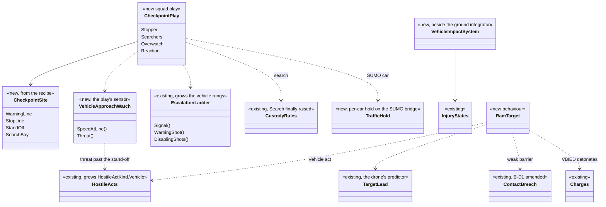
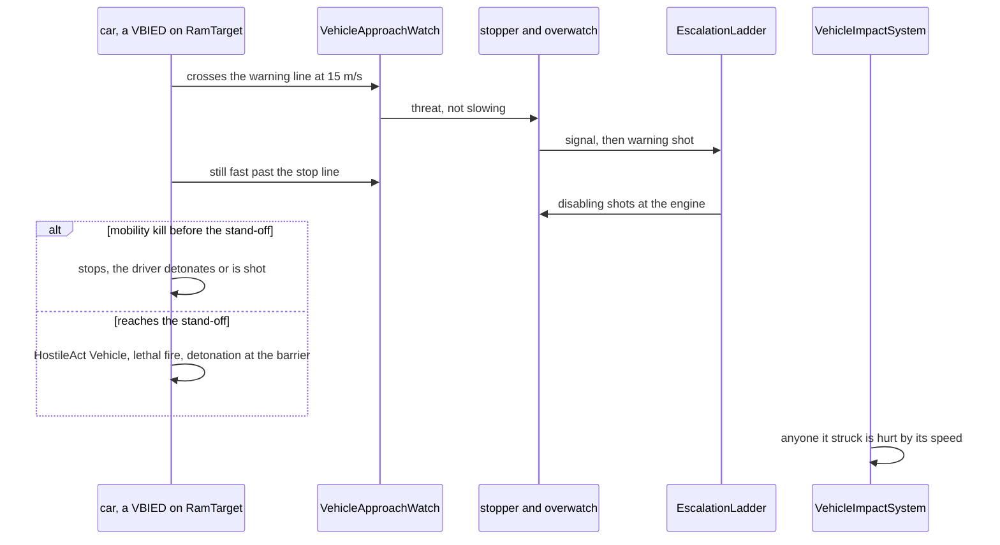
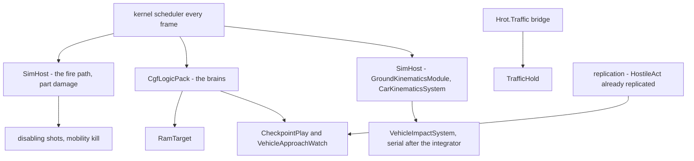

<!--STATUS
state: LIVE
updated: 2026-11-15
build-state: DESIGN — decisions APPROVED (R-4260); ⏳ the review (§8) before READY-TO-BUILD
current-answer: §1 inventory · §2 decisions · §3 UML · §4 the checkpoint in time · §5 slices and acceptance · §8 the review
stale-below: nothing
known-rot: none
known-conflict: none
related-designs:
  - ../../DESIGN_Operations_Behaviour_Catalogue.md — §12.4 / §12.5: the analysis this design builds (SQD-13, VEH-4, ASY-2)
  - DESIGN_Motorcycle.md — the two-wheeler: the bike-borne bomb (IM-3) uses `RamTarget`; "two men on one bike" (IM-8) is an indicator here
  - ../../DESIGN_Civilians_And_Crowd_Control.md — OWNS the escalation ladder (§5k), the hostile act, custody / search, hidden weapons (§5h), AW-19 ("a vehicle driven at people is a hostile act")
  - ../../DESIGN_Vehicle_Breaching.md — OWNS `ContactBreach`; B-D1 AMENDED by R-4260 (a `RamTarget` AI vehicle breaches a weak barrier)
  - ../../DESIGN_Ground_Patches_And_Road_Blockage.md — OWNS static obstacles that SUMO cars respect and road closure (CE-4590)
  - ../hit-location/DESIGN_Body_Parts_And_Hit_Location.md — OWNS vehicle part damage (the mobility kill the disabling shots aim for)
  - ../../DESIGN_Injury_States.md — OWNS the injury states a vehicle impact writes into
  - ../../DESIGN_Terrain_Authoring.md — OWNS the `checkpoint` terrain recipe this design's site extends
-->

# DESIGN — the checkpoint, ramming and the car bomb

🔒 User, `2026-11-15`: *"the second one is the checkpoint and the car RAM attack. Please think about it and analyze"* · *"Checkpoint and ramming is
approved."* (R-4260) · *"Approved, write both designs and review them"*.

**The proven pattern** (vehicle checkpoint doctrine): warning signs far out → a serpentine of barriers that FORCES slow speed → a stop line → a
search bay off the road → an overwatch weapon covering the approach → a reaction element; escalation of force by distance: signal → warning shot →
disabling shots → lethal; the threat indicator: a vehicle not slowing by the line. The ram / car-bomb attack is exactly what that layout defeats —
so the two are ONE design: the attack is the checkpoint's test.

## 1. INVENTORY *(measured `2026-11-15`; graph: `search_graph name_pattern=".*(Checkpoint|Collision|VehicleImpact|Escalation|HostileAct|Custody|RunOver).*" label=Class` ⇒ `EscalationLadder`, `HostileActs`, `Custody` (+ its translators); every "checkpoint" class is the save-state sense; no vehicle-collision class in production; a read-only code sweep; grep. Index coverage could not be checked through the CLI)*

| exists | where | used as |
|---|---|---|
| the `checkpoint` terrain recipe: jersey barriers ×2, a booth, sandbags, a car | `assets/terrain-recipes/checkpoint.recipe.json`, `TerrainPicks.cs:263` | CP-1's site |
| static obstacles SUMO cars stop / swerve for; a fully blocked road closed | `TrafficBodies.cs:44-50, :110`, `BridgeClosureSystem.cs:29` (CE-4590) | the serpentine works on traffic for free |
| ROE force level Warn → NonLethal → Lethal; `EscalationLadder` (`Warn` = a 2 s gesture, `WarnIfDue`, `Level`) | `Roe.cs:24-36`, `EscalationLadder.cs:34-123` | CP-3 extends it with the vehicle rungs |
| ⛔ no warning shot, no disabling shot (listed later, Civilians :1191-1194) | — | CP-3 |
| the hostile act: `HostileActKind` None / NonLethal / Lethal, replicated, recorded; ⛔ no vehicle act | `HostileActs.cs:14-76` | RM-3 adds the vehicle act |
| custody: `CustodyRules.Ask(man, by, Search)` reveals hidden weapons — ⛔ nothing raises it | `Custody.cs:65-160` | CP-4 raises it |
| own cars with occupants: `CivilianCar` 4 seats + a concealed boot; SUMO cars (`TrafficCar` 8851) carry NOBODY | `UrbanCombatTkbCatalog.cs:198-201`, `TkbEntityTypes.cs:169-171` | CP-4 searches own cars only |
| the car bomb `ua-car-bomb`: a boot charge, `FollowRoute` at 8 m/s, `TriggerIed` at 15 m; `run_car_bomb` checks it | `scenarios/demos/civilians-and-crowd/ua-car-bomb`, `utility-demo-check.py:4630-4675` | CP-5 / RM-4's test |
| charges: `Charges.Ask` (a phone unless carried / worn by the asker), `Detonate` | `Charges.cs:34-57` | the VBIED's detonation |
| the lead predictor (`TargetLead.Point`) the drone uses | `GuidedRoundSystem.cs:218`, `AirAttackBehaviors.cs:610` | RM-2's pursuit |
| ⛔ vehicles avoid people; no vehicle hurts anyone | `CarKinematicsSystem.cs:476-490`; Breaching `:34` | RM-1 |
| `ContactBreach` (a player's heavy hull breaks weak barriers; the bulldozer on order) | Breaching §7, `ContactBreachTranslators.cs` | RM-5 (amended B-D1) |
| vehicle part damage (mobility kill) | Body Parts design, `ArmorModel` | the disabling shot's target |

## 2. Decisions *(✅ APPROVED `2026-11-15`, R-4260)*

| # | decision | why |
|---|---|---|
| **CP-1** | a **`Checkpoint`** squad play on an authored SITE — the terrain recipe gains named lines: WARNING (~100 m out), STOP (~25 m), the STAND-OFF (the closest a threat may get), the SEARCH BAY; roles: stopper, 2 searchers, overwatch (the squad's MG covering the approach), reaction (the rest) | the doctrine's roles; the scenery exists |
| **CP-2** | the **`VehicleApproachWatch`** (a sensor of the play): each vehicle on the approach, its speed at each line — slowing below 3 m/s by the stop line ⇒ routine; still fast past the WARNING line ⇒ a THREAT; two men on one bike, an ignored signal ⇒ raised suspicion (IM-8) | measured, never scripted |
| **CP-3** | the **vehicle ladder** in `EscalationLadder`, rung by distance line and capped by the ROE force level: SIGNAL (the gesture + a light at night) → **WARNING SHOT** (a burst into the ground ahead of it) → **DISABLING SHOTS** (at the engine — a mobility kill through vehicle part damage) → LETHAL (the driver) | ⛔ today there is no warning or disabling shot |
| **CP-4** | **search**: an OWN car stopped at the line → the occupants out → `Custody` Search on each → release, or detain on a find; a SUMO car (no occupants) is waved through or HELD by a new per-car hold command on the traffic bridge | SUMO cars carry nobody |
| **CP-5** | the test: `ua-car-bomb` re-cast at a checkpoint — a routine car searched and released; a car that does not slow is laddered and stopped before the stand-off, or reaches it and detonates | the existing bomb is the acceptance |
| **RM-1** | ⭐ **a vehicle that hits a person hurts him by the impact speed** — knocked down (≥ 3 m/s), seriously injured (≥ 8 m/s), killed (≥ 14 m/s), into the existing injury states; ONE rule beside the vehicle integrator, for every vehicle (AI or a player's) | needed for ramming and for realism |
| **RM-2** | **`RamTarget`**: an AI vehicle drives AT an entity (or the middle of a crowd) with the lead pursuit, its avoidance switched off for its TARGET only (it still avoids everything else) | ⛔ no ground pursuit exists; one lead predictor |
| **RM-3** | **`HostileActKind.Vehicle`** — a vehicle driven at people (RM-2, or CP-2's threat crossing the stand-off) is a hostile act of the DRIVER; every soldier's ROE answers it | AW-19 rules it; nothing raised it |
| **RM-4** | the **VBIED driver** = `RamTarget` at the checkpoint / the crowd + detonate on contact, or when stopped, or when shot (his boot charge, `Charges.Ask` — carried) | composes what exists |
| **RM-5** | a `RamTarget` vehicle breaches a WEAK barrier through `ContactBreach`'s own rules (amends Breaching B-D1) | the classic truck attack |

## 3. UML

*What it shows that prose hid: the checkpoint and the attack meet in TWO existing seams — the hostile act (the attacker raises it, every soldier's
ROE answers it) and the escalation ladder (the checkpoint climbs it) — so neither side needs to know the other's play.*

*What it shows: the outcome is decided by DISTANCE AND TIME — the lines turn the ladder into a race the defenders can win or lose; nothing is
scripted.*

*What it shows: the impact rule runs where the vehicles move (the ground integrator's node), the plays where the brains run, and the hostile act
crosses between them on a path that already exists.*

## 4. The checkpoint in time *(defaults; the builder tunes, recording each)*

| the vehicle | routine car | threat car |
|---|---|---|
| warning line (~100 m) | slows | still fast ⇒ THREAT, signal |
| ~60 m | — | warning shot |
| stop line (~25 m) | stops ⇒ occupants out, search | disabling shots |
| stand-off | — | hostile act ⇒ lethal; a bomb detonates where it is stopped |

## 5. Slices and acceptance

| # | builds | ⭐ done when (a rail each, red-proved) |
|---|---|---|
| **K-1** | RM-1 `VehicleImpactSystem` | a man struck at 5 / 10 / 15 m/s is knocked down / seriously injured / killed; avoidance unchanged for ordinary driving |
| **K-2** | RM-2 `RamTarget` + RM-3 the vehicle act + RM-5 the barrier | a car on `RamTarget` reaches a walking man; the driver's hostile act is raised; it breaks a weak barrier; a car NOT on the order still cannot |
| **K-3** | CP-1 site + play + CP-2 the watch | a routine car stops at the line; a fast car is a threat at the warning line |
| **K-4** | CP-3 the vehicle ladder | signal → warning shot → disabling shots at the lines, capped by the ROE level; a disabled car stops |
| **K-5** | CP-4 search + `TrafficHold` | an own car's occupants searched, a hidden weapon found and detained; a SUMO car held then released |
| **K-6** | CP-5 / RM-4 `ua-car-bomb` at a checkpoint | routine car released; the VBIED stopped before the stand-off OR detonating there — three seeded runs, both outcomes possible by distance and timing |

⭐ Every slice: `HROT_PARALLEL_SIM=1` + `HROT_READ_CHECK=1` + `HROT_WORLD_GUARD=1`; `stepped-hash.py --threads 1,4,8`; 0 B per steady frame (R-2084);
invariant number output (R-4221).
