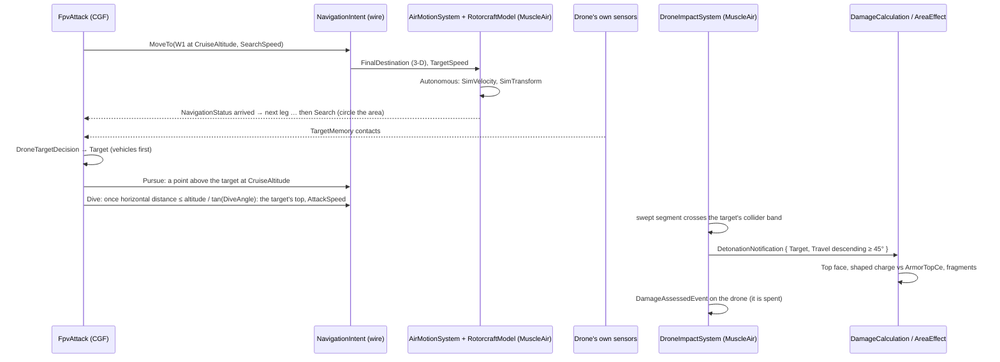
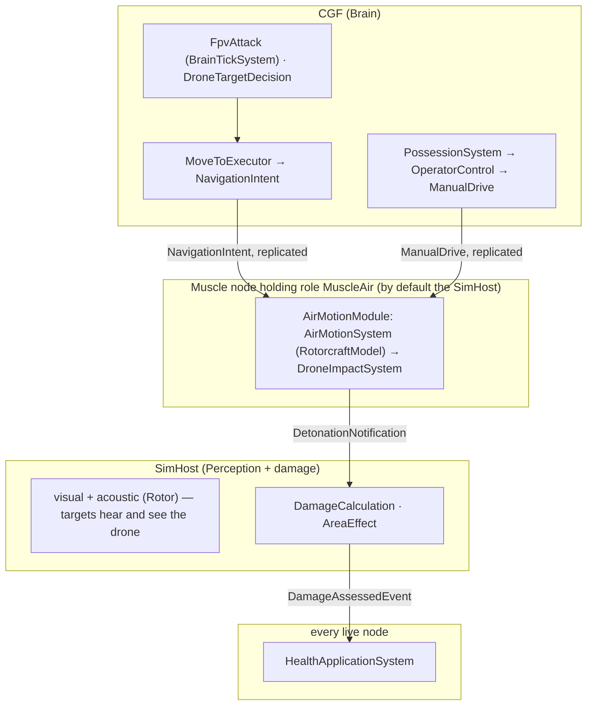

<!--STATUS
state: LIVE
updated: 2026-10-14
build-state: READY-TO-BUILD — 🔒 user, 2026-10-14: "MD-A to MD-H approved"; the drone flies as a RotorcraftModel (Motion Domains)
current-answer: §2 classes, §3 sequences, §4 who runs it, §5 rails — §1 is the measured ground.
stale-below: nothing.
known-rot: none (the first draft's PointMassFlightSystem and Stride registration are in §HISTORY).
known-conflict: none.
related-designs:
  - docs/designs/motion-models/DESIGN_Motion_Domains.md — OWNS how the drone moves: RotorcraftModel in the AirMotionModule (role MuscleAir), autonomous AND manual (FPS possession)
  - docs/designs/vehicle-tactics/DESIGN_Urban_Armour_Tactics.md — the PROGRAMME (item M7, decision D-E)
  - docs/DESIGN_Operations_Behaviour_Catalogue.md — OWNS R-263 D2 ("point-mass flight + acoustic signature + battery … follow a planned 3d path and … attack autonomously") and AIR-1…AIR-4; this file is AIR-2's first slice (FPV: search, select, pursue, dive)
  - docs/designs/vehicle-tactics/DESIGN_Armour_Hit_Model.md — the drone detonates through that chain; its dive arrives from above ⇒ the Top face
  - docs/designs/vehicle-tactics/DESIGN_Vehicle_Exposure_Cycle.md — the target's reaction (AirThreat, ShelterFromAir) and the danger of a drone (§2)
  - docs/DESIGN_Thermal_And_Acoustic_Sensing.md — OWNS heard contacts and sound classes; §2 adds Rotor (7)
  - docs/designs/navig-2/Navigation_Design_v2_0.md — OWNS NavigationIntent and the volumetric path provider; v1 flies straight legs between waypoints, no 3-D path planning
-->

# FPV drone — a small attack copter that flies a 3-D route, finds a target, and dives on its roof

**Item:** M7. **Decision applied:** D-E (a minimal FPV drone in this programme). **Scope v1:** a scenario-placed drone with its own
behaviour: fly the route → search → select → pursue → dive → detonate. Reconnaissance drones, loitering munitions, launch from an operator,
jamming and the full 3-D route type are later (R-263, catalogue AIR-1…AIR-4).

## 1. What exists — measured `2026-10-14`

| fact | where |
|---|---|
| no drone in code; air types (UH-60 400, F-16 401, C-130 402) are data only, with no kinematics and no behaviour; air TKB ids 403–499 free | `BdcTkbCatalog.cs:284-330`, `TkbEntityTypes.cs` |
| entity routing to motion is by COMPONENT today (no motion-model seam): `VehicleState + VehicleParams + NavState` ⇒ CarKinematics; `CrowdAgent` ⇒ crowd; else `SimTransform + SimVelocity` ⇒ `LinearKinematicsSystem` (projectiles) — the seam is Motion Domains (MD-C) | `LinearKinematicsSystem.cs:91-111`, `GroundKinematicsModule.cs:88-102` |
| `NavigationIntent { Mode, Flags, MaxReplans, ReverseAllowed, Vector3 FinalDestination (Z carried), TargetSpeed, … }` is replicated Brain → Muscle and written by `MoveToExecutor`; the bridge skips an entity with no `NavState` unless it is `PathToPoint` | `NavigationComponents.cs:230-260`, `NavigationIntentBridgeSystem.cs:134-169` |
| `KinematicsMode.Flying = 7` declared, read by nothing; a volumetric provider exists but SimHost never passes it | `NavigationEnums.cs:23`, `SimHostNodeBootstrapper.cs:319` |
| sight works in 3-D (`LosStrategies.cs:211-233`), but `VisionBroadphase.Select` drops a target at the observer's exact X/Y (2-D epsilon), so hearing drops it too | `VisionBroadphase.cs:86-87` |
| hearing is 3-D; a source slower than 0.5 m/s is silent (a hovering drone would be); no rotor class (class 7 free) | `SoundEmissionSystem.cs:24-69`, `SignaturesDto.cs:84-93` |
| `DetonationNotification` may be published by anything; `DamageCalculationSystem` (direct) and `AreaEffectSystem` (warhead area) consume it; a kill goes through `DamageAssessedEvent` → `HealthApplicationSystem` on the `Health` owner | `DetonationNotification.cs:24`, `HealthApplicationSystem.cs:88` |
| turret elevation limits are enforced (`OutOfArc`); hit spread is horizontal; a target with no collider is a 0.3 m circle | `TurretSlew.cs:23-25`, `HitModel.cs:29,75-80` |
| R-136: entity state has two legal sources, the TKB or a published TransientLocal descriptor | `RULINGS.md` R-136 |

### INVENTORY — the queries run

| query | total | the set |
|---|---|---|
| `search_graph .*Drone.*\|.*Uav.*\|.*Flight.*\|.*Flying.*` (Class) | 0 relevant (1 hit: `FlightRecorderExample`) | — |
| `search_code Drone` (docs + code) | design mentions only (catalogue, Add Entity Picker `AboveLevel`) | — |
| grep `KinematicsMode.Flying` readers | 0 | — |

⇒ nothing to reuse for flight itself; everything else (motion integration, the intent on the wire, sensing, the damage chain, the threat
ranking) exists and is reused.

## 2. Classes

```mermaid
classDiagram
  class LocomotionDto { <<new TKB "Gen.Locomotion" — Motion Domains MD-A>> Class = Rotorcraft }
  class FlightParamsDto {
    <<new TKB descriptor "Gen.Flight">>
    MaxSpeedMps = 30
    ClimbMps = 8
    TurnRateDeg = 120
    EnduranceSeconds = 600
    ContactRadiusM = 0.8
  }
  class FlightParams { <<new ECS component, from the TKB, every node>> copy of FlightParamsDto }
  class FlightState { <<new ECS component, MuscleAir group>> Airborne · VerticalSpeed }
  class IMotionModel { <<new interface — Motion Domains MD-C>> Autonomous(frame, intent, dt) · Manual(frame, drive, dt) }
  class RotorcraftModel {
    <<new IMotionModel — Motion Domains MD-H>>
    Autonomous: turn ≤ TurnRateDeg, climb ≤ ClimbMps toward FinalDestination
    Manual: ManualDrive Forward · Lateral · Yaw · Vertical
    hover · a dead rotorcraft falls
  }
  class AirMotionModule { <<new — role MuscleAir>> AirMotionSystem: MotionModelTable → RotorcraftModel }
  class DroneImpactSystem {
    <<new, Muscle, AirMotionModule, after AirMotionSystem>>
    swept segment vs terrain and colliders
    publishes DetonationNotification, then kills the drone
  }
  class FpvAttackNodes { <<new static, Hrot.AI.Behaviors/Brains>> +FpvAttack(ref Params, ref State, self, world) NodeStatus }
  class FpvAttackParams {
    <<new ParamsDto>>
    W1 · W2 · W3 · W4 : Vector3  «the route, v1»
    SearchCentre · SearchRadius
    CruiseAltitudeM = 60
    SearchSpeed = 15 · AttackSpeed = 30
    DiveAngleDeg = 60
  }
  class FpvAttackState {
    <<new working state>>
    Phase : Route | Search | Pursue | Dive | Spent
    int Leg
    Entity Target
    double FlightStartedAt  «the battery»
  }
  class DroneTargetDecision { <<new utility decision>> freshness × my warhead's effectiveness × IsVehicle }
  class LocomotionMoveTo { <<existing>> Issue a 3-D point }
  class VisionBroadphase { <<existing, grows>> 3-D epsilon }
  class SoundEmissionSystem { <<existing, grows>> a flyer is audible while airborne }
  IMotionModel <|.. RotorcraftModel
  AirMotionModule ..> RotorcraftModel
  RotorcraftModel ..> FlightParams
  RotorcraftModel ..> FlightState
  RotorcraftModel ..> NavigationIntent
  RotorcraftModel ..> ManualDrive
  LocomotionDto ..> AirMotionModule : Class selects the domain
  DroneImpactSystem --> DetonationNotification
  FpvAttackNodes ..> FpvAttackParams
  FpvAttackNodes ..> FpvAttackState
  FpvAttackNodes ..> LocomotionMoveTo
  FpvAttackNodes ..> DroneTargetDecision
```

*What the picture shows that prose hid: the drone adds no mover of its own — it is the first `RotorcraftModel` in the Air domain
(Motion Domains §3), driven by the SAME two commands every mover takes: `NavigationIntent` from its behaviour, `ManualDrive` from a
possessing operator. The kill is the existing damage chain.*

| rule | why |
|---|---|
| a drone is a TKB air type (DIS domain 2, id 403 "FPV drone"): `Gen.Locomotion = Rotorcraft`, `FlightParamsDto`, a collider (r 0.3 m, h 0.3 m), `Health` 10, a weapon mount = the warhead (munition 6016, range = `ContactRadiusM`), an acoustic signature (class `Rotor` = 7, ~300 m), a visual sensor (~1500 m) | R-263: point-mass + acoustic + battery; one entity like any other — seen, heard, ranked, shot, possessed |
| it is owned by role **MuscleAir** (its kinematic group: `SimTransform, SimVelocity, FlightState`) and moved only on that node | MD-B; "motion needs to stay on muscle node" |
| **autonomous**: the behaviour issues `MoveTo` to 3-D points; `RotorcraftModel.Autonomous` turns ≤ `TurnRateDeg`, climbs ≤ `ClimbMps`, speed → min(`TargetSpeed`, `MaxSpeedMps`); arrival within 2 m sets `NavigationStatus`, so `LocomotionMoveTo.Status` works unchanged | MD-D, MD-E (straight legs, v1) |
| **manual (FPS possession)**: the station's rotorcraft scheme (W/S forward, A/D lateral, mouse yaw, Space / C vertical) → `OperatorControlFrameEvent` → `PossessionSystem` → `OperatorControl` → `ManualDrive { Forward, Lateral, Yaw, Vertical }` → `RotorcraftModel.Manual` | MD-D; the existing possession chain (Motion Domains §3 sequence) |
| the bridge skips an entity whose locomotion is not Ground-domain (no ground path request for a flyer) | §1 |
| **the battery is the behaviour's**: `FlightStartedAt`; at `EnduranceSeconds` it dives on whatever is below, or crashes; under possession the operator has the same budget (the behaviour is paused, its clock is not) | R-136: no runtime state component for a timer |
| **impact**: each frame the swept segment `p → p + v·dt` against terrain (`IWorldQuery.SightBlocked`) and colliders within 10 m (circle + height band, M1); a contact publishes `DetonationNotification { Shooter = drone, Target, Hit, Penetration / Damage of the warhead mount, Ammo = 6016, Travel = v }` and a lethal `DamageAssessedEvent` on the drone | whoever flies it — AI or an operator; the rest is the existing chain (Top face by the dive, fragments, the wreck) |
| the overhead fix: `VisionBroadphase` skips only the observer itself (3-D epsilon); a flyer is audible while airborne at any speed | §1 |
| target choice: `DroneTargetDecision` = contact freshness × `WeaponEffectivenessVsTarget` (its warhead on the target's roof) × `IsVehicle` (vehicle 1, person 0.3) | R-263 "the existing sensor + threat ranking" |

## 3. Sequences

*Under possession the same picture holds with the first three rows replaced by the possession chain (Motion Domains §3) — the impact
and the damage are identical. The target's side: it hears the rotor (class 7), `AirThreat` fires, its SOP runs `ShelterFromAir`; under
the garage deck the dive meets the slab first (Exposure Cycle §8).*

## 4. Who runs it

*What the picture shows: the drone's motion and impact live in the Air domain's module on whichever Muscle node holds MuscleAir — the
SimHost by default (MD-B), a dedicated air node in a split deployment.*

## 5. Rails — in the features' own suites

| rail | suite |
|---|---|
| `M7_ARotorcraft_FliesToA3DPoint_AndReportsArrival` · `M7_ARotorcraft_Hovers_ClimbsAndYaws_UnderManualDrive` · `M7_ADeadRotorcraft_Falls` | new `RotorcraftModelTests` |
| `M7_APossessedDrone_FollowsTheStation_AndTheAiResumesOnRelease` | `PossessionTests` (Entity Control's suite) |
| `M7_ADive_OnATank_HitsItsRoof_AndKillsTheDrone` · `M7_ADive_UnderADeck_MeetsTheSlab` | new `DroneImpactSystemTests` + `DamageCalculationSystemTests` |
| `M7_AHoveringDrone_IsHeard_AsRotor` · `M7_ADroneOverhead_IsInTheBroadphase` | `SoundEmissionSystemTests` · `VisionBroadphaseTests` |
| `M7_FpvAttack_FliesTheRoute_Searches_PicksTheTankOverTheRifleman_AndDives` · `M7_TheBattery_EndsTheFlight` | new `FpvAttackNodesTests` |
| `M7_TheBridge_SkipsAFlyer` | `NavigationIntentBridgeSystemTests` |
| `M7_TheAirModule_RunsWhereMuscleAirIsHeld` (SimHost, editor) | `SimHostCoreLogicPackTests` · `EditorCapabilitiesTests` |
| a TKB rail for type 403 | `NedTkbBuilderCombatTests` |
| demo `ua-drone-shelter` | `scripts/utility-demo-check.py` |

## ⛔ HISTORY

- *2026-10-14, first draft (superseded the same day):* the drone had its own `PointMassFlightSystem` integrating its position (because
  Stride's linear integration moves only projectiles) and was registered in both `GroundKinematicsModule` and `StrideKinematicsModule`.
  🔒 User: *"no ad hoc exceptions, rather initially limited but extendable architecture. Motion needs to stay on muscle node"* · *"Drone
  will need to be controllable also from FPS possess mode"* · *"We can ignore stride completely."* ⇒ replaced by `RotorcraftModel` in the
  Air domain (Motion Domains, MD-A…MD-H approved).
