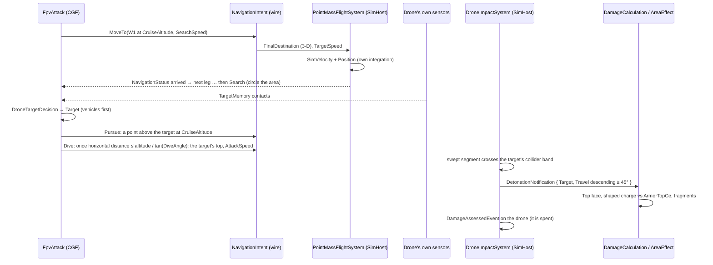
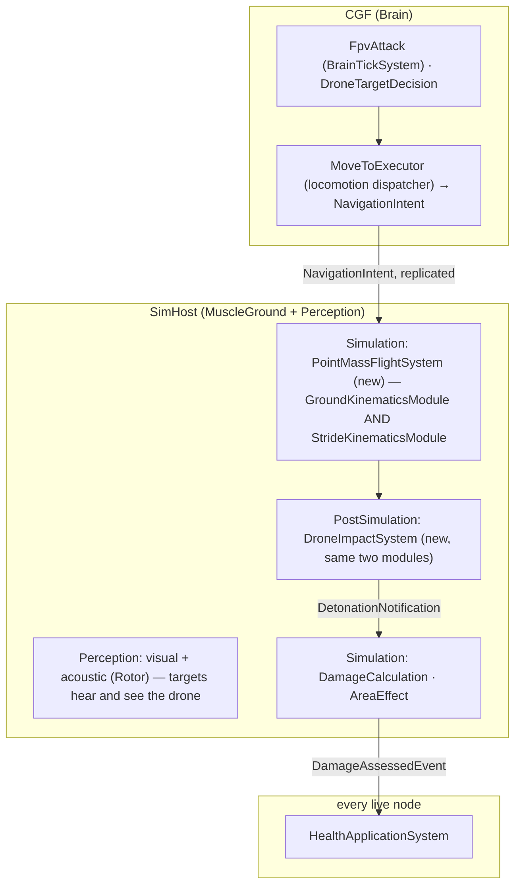

<!--STATUS
state: LIVE
updated: 2026-10-14
build-state: DESIGN — the FLIGHT half waits on DESIGN_Motion_Domains (MD-A…MD-H); the impact, sensing and behaviour halves stand
current-answer: §2 classes, §3 sequences, §4 who runs it, §5 rails — §1 is the measured ground.
stale-below: nothing.
known-rot: §2's PointMassFlightSystem / own position integration / the Stride registration are SUPERSEDED (2026-10-14) — the drone flies as a RotorcraftModel in the AirMotionModule (DESIGN_Motion_Domains §3); user: "We can ignore stride completely", "no ad hoc exceptions".
known-conflict: none.
related-designs:
  - docs/designs/motion-models/DESIGN_Motion_Domains.md — OWNS how the drone moves: RotorcraftModel in the AirMotionModule (role MuscleAir), autonomous AND manual (FPS possession)
  - docs/designs/vehicle-tactics/DESIGN_Urban_Armour_Tactics.md — the PROGRAMME (item M7, decision D-E)
  - docs/DESIGN_Operations_Behaviour_Catalogue.md — OWNS R-263 D2 ("point-mass flight + acoustic signature + battery … follow a planned 3d path and … attack autonomously") and AIR-1…AIR-4; this file is AIR-2's first slice (FPV: search, select, pursue, dive)
  - docs/designs/vehicle-tactics/DESIGN_Armour_Hit_Model.md — the drone detonates through that chain; its dive arrives from above ⇒ the Top face
  - docs/designs/vehicle-tactics/DESIGN_Vehicle_Exposure_Cycle.md — the target's reaction (AirThreat, ShelterFromAir) and the danger of a drone (§2)
  - docs/DESIGN_Thermal_And_Acoustic_Sensing.md — OWNS heard contacts and sound classes; §2 adds Rotor (7)
  - docs/designs/navig-2/Navigation_Design_v2_0.md — OWNS NavigationIntent and the volumetric path provider; v1 flies straight legs between waypoints, no 3-D path planning
-->

# FPV drone — a small attack copter that flies a 3-D route, finds a target, and dives on its roof

**Item:** M7. **Decision applied:** D-E (a minimal FPV drone in this programme). **Scope v1:** a scenario-placed drone with its own
behaviour: fly the route → search → select → pursue → dive → detonate. Reconnaissance drones, loitering munitions, launch from an operator,
jamming and the full 3-D route type are later (R-263, catalogue AIR-1…AIR-4).

> ⛔ **SUPERSEDED IN PART `2026-10-14`** — 🔒 user: *"no ad hoc exceptions, rather initially limited but extendable architecture. Motion needs to stay on muscle node"* · *"Drone will need to be controllable also from FPS possess mode as any possessable movable entity"* · *"We can ignore stride completely."*
> ⇒ the drone's MOTION is no longer its own `PointMassFlightSystem`: it is a `RotorcraftModel` (`Gen.Locomotion = Rotorcraft`) run by the `AirMotionModule` on the Muscle, with `Autonomous` (the same `NavigationIntent` as below) and `Manual` (FPS possession through the existing chain, `ManualDrive` + a `Vertical` axis) — [DESIGN_Motion_Domains.md](../motion-models/DESIGN_Motion_Domains.md) §3, MD-D, MD-H (leans pending). Everything Stride-specific below is void. **What stands unchanged:** the TKB type, the rotor sound, the broadphase fix, `DroneImpactSystem` (it detects the contact whoever flies the drone — AI or a possessing operator), the detonation through the damage chain, and the `FpvAttack` behaviour.

## 1. What exists — measured `2026-10-14`

| fact | where |
|---|---|
| no drone in code; air types (UH-60 400, F-16 401, C-130 402) are data only, with no kinematics and no behaviour; air TKB ids 403–499 free | `BdcTkbCatalog.cs:284-330`, `TkbEntityTypes.cs` |
| entity routing to motion is by COMPONENT: `VehicleState + VehicleParams + NavState` ⇒ CarKinematics; `CrowdAgent` ⇒ crowd; else `SimTransform + SimVelocity` ⇒ `LinearKinematicsSystem` (`Position += Linear·dt`, no rotation), PostSimulation on the Muscle; ⚠ **Stride narrows it to projectiles** (`new LinearKinematicsSystem(BallisticProjectile)`) | `LinearKinematicsSystem.cs:91-111`, `GroundKinematicsModule.cs:88-102`, `StrideKinematicsModule.cs:157` |
| `NavigationIntent { Mode, Flags, MaxReplans, ReverseAllowed, Vector3 FinalDestination (Z carried), TargetSpeed, … }` is replicated Brain → Muscle and written by `MoveToExecutor`; the bridge skips an entity with no `NavState` unless it is `PathToPoint` | `NavigationComponents.cs:230-260`, `NavigationIntentBridgeSystem.cs:134-169` |
| `KinematicsMode.Flying = 7` declared, read by nothing; a volumetric provider exists but SimHost never passes it | `NavigationEnums.cs:23`, `SimHostNodeBootstrapper.cs:319` |
| sight works in 3-D (`LosStrategies.cs:211-233`), but `VisionBroadphase.Select` drops a target at the observer's exact X/Y (2-D epsilon), so hearing drops it too | `VisionBroadphase.cs:86-87` |
| hearing is 3-D; a source slower than 0.5 m/s is silent (a hovering drone would be); no rotor class (class 7 free) | `SoundEmissionSystem.cs:24-69`, `SignaturesDto.cs:84-93` |
| `DetonationNotification` may be published by anything; `DamageCalculationSystem` (direct) and `AreaEffectSystem` (warhead area) consume it; a kill goes through `DamageAssessedEvent` → `HealthApplicationSystem` on the `Health` owner | `DetonationNotification.cs:24`, `HealthApplicationSystem.cs:88` |
| turret elevation limits are enforced (`OutOfArc`); hit spread is horizontal; a target with no collider is a 0.3 m circle | `TurretSlew.cs:23-25`, `HitModel.cs:29,75-80` |
| R-136: entity state has two legal sources, the TKB or a published TransientLocal descriptor | `RULINGS.md` R-136 |

### INVENTORY — the queries run

| query | total | the set |
|---|---|---|
| `search_graph .*Drone.*\|.*Uav.*\|.*Flight.*\|.*Flying.*` (Class) | 0 relevant (1 hit: `FlightRecorderExample`) | — |
| `search_code Drone` (docs + code) | design mentions only (catalogue, Add Entity Picker `AboveLevel`) | — |
| grep `KinematicsMode.Flying` readers | 0 | — |

⇒ nothing to reuse for flight itself; everything else (motion integration, the intent on the wire, sensing, the damage chain, the threat
ranking) exists and is reused.

## 2. Classes

```mermaid
classDiagram
  class FlightParamsDto {
    <<new TKB descriptor "Gen.Flight">>
    MaxSpeedMps = 30
    ClimbMps = 8
    TurnRateDeg = 120
    EnduranceSeconds = 600
    ContactRadiusM = 0.8
  }
  class FlightParams {
    <<new ECS component, from the TKB, every node>>
    copy of FlightParamsDto
  }
  class FlightTkbTranslator {
    <<new TKB translator>>
    adds FlightParams, NavigationIntent, NavigationStatus, SimVelocity
  }
  class PointMassFlightSystem {
    <<new, Muscle, Simulation phase>>
    steers SimVelocity toward NavigationIntent.FinalDestination
    integrates its own position (like CrowdAgentUpdateSystem)
    sets NavigationStatus on arrival
    a dead drone falls
  }
  class DroneImpactSystem {
    <<new, Muscle, PostSimulation, before LinearKinematics>>
    swept segment vs terrain and colliders
    publishes DetonationNotification, then kills the drone
  }
  class FpvAttackNodes {
    <<new static, Hrot.AI.Behaviors/Brains>>
    +FpvAttack(ref Params, ref State, self, world) NodeStatus
  }
  class FpvAttackParams {
    <<new ParamsDto>>
    W1 · W2 · W3 · W4 : Vector3  «the route, v1»
    SearchCentre · SearchRadius
    CruiseAltitudeM = 60
    SearchSpeed = 15 · AttackSpeed = 30
    DiveAngleDeg = 60
  }
  class FpvAttackState {
    <<new working state>>
    Phase : Route | Search | Pursue | Dive | Spent
    int Leg
    Entity Target
    double FlightStartedAt  «the battery»
  }
  class DroneTargetDecision {
    <<new utility decision>>
    freshness × my warhead's effectiveness × IsVehicle
  }
  class LinearKinematicsSystem { <<existing, grows>> Without FlightParams }
  class LocomotionMoveTo { <<existing>> Issue a 3-D point }
  class VisionBroadphase { <<existing, grows>> 3-D epsilon }
  class SoundEmissionSystem { <<existing, grows>> a flyer is audible while airborne }
  FlightTkbTranslator --> FlightParams
  PointMassFlightSystem ..> FlightParams
  PointMassFlightSystem ..> NavigationIntent
  PointMassFlightSystem --> SimVelocity
  DroneImpactSystem --> DetonationNotification
  FpvAttackNodes ..> FpvAttackParams
  FpvAttackNodes ..> FpvAttackState
  FpvAttackNodes ..> LocomotionMoveTo
  FpvAttackNodes ..> DroneTargetDecision
```

*What the picture shows that prose hid: the drone is an ordinary entity — the Brain moves it with the SAME locomotion MoveTo (the intent
already carries Z), one new Muscle system turns that intent into motion, and the kill is the existing damage chain. Two new systems, one
new component, no new wire topic. The flight system integrates its own position (and `LinearKinematicsSystem` skips a flyer) because Stride's
linear integration moves projectiles only.*

| rule | why |
|---|---|
| a drone is a TKB air type (DIS domain 2, id 403 "FPV drone"): `FlightParamsDto`, a collider (r 0.3 m, h 0.3 m), `Health` 10, a weapon mount = the warhead (munition 6016, range = `ContactRadiusM`), an acoustic signature (class `Rotor` = 7, ~300 m), a visual sensor (~1500 m, eye 0 — it sees from where it is) | R-263: point-mass + acoustic + battery; one entity like any other, so it can be seen, heard, ranked and shot |
| **point-mass flight**: velocity turns toward the destination at ≤ `TurnRateDeg`, climbs ≤ `ClimbMps`, speed → min(`TargetSpeed`, `MaxSpeedMps`); arrival within 2 m sets `NavigationStatus` so `LocomotionMoveTo.Status` works unchanged | D-E; no aerodynamics |
| the bridge skips an entity with `FlightParams` (no ground path request for a flyer) | §1: it would ask for a ground path |
| **the battery is the behaviour's**: `FlightStartedAt` in the working state; at `EnduranceSeconds` the behaviour dives on whatever is below, or crashes | R-136: no new runtime state component — Brain working state is the standard home for a behaviour's timer |
| **impact**: each frame the swept segment `p → p + v·dt` is tested against terrain (`IWorldQuery.SightBlocked`) and against colliders within 10 m (circle + height band, the M1 rule); a contact publishes `DetonationNotification { Shooter = drone, Target, Hit, Penetration / Damage of the warhead mount, Ammo = 6016, Travel = v }` and a lethal `DamageAssessedEvent` on the drone itself | the existing chain does the rest: the Top face by the dive angle (Hit Model D-A), fragments by `AreaEffectSystem`, the wreck by R-269 (ui) |
| a dead drone (shot down, or after its detonation) falls under gravity and stops | `PointMassFlightSystem` |
| the overhead fix: `VisionBroadphase` skips only the observer itself (3-D epsilon) | §1 |
| a flyer is audible while airborne at any speed (a hovering copter is loud) | `SoundEmissionSystem` |
| target choice: `DroneTargetDecision` = contact freshness × `WeaponEffectivenessVsTarget` (its warhead on the target's roof) × `IsVehicle` (vehicle 1, person 0.3) | R-263 "the existing sensor + threat ranking"; an FPV pilot hunts vehicles |

## 3. Sequences

*The target's side of the same minute: it hears the rotor (class 7), `AirThreat` fires, its SOP runs `ShelterFromAir` — under the garage
deck the dive meets the slab (`DroneImpactSystem` hits terrain first), in the open it meets the roof (Exposure Cycle §8).*

## 4. Who runs it

*What the picture shows: the two new systems sit in the two modules that own motion on a Muscle — `GroundKinematicsModule` (SimHost,
editor) and `StrideKinematicsModule` (Stride) — and a composition rail asserts both register them, so no Muscle host lacks them (R-254).*

## 5. Rails — in the features' own suites

| rail | suite |
|---|---|
| `M7_AFlyer_FliesToA3DPoint_AndReportsArrival` · `M7_ADeadFlyer_Falls` | new `PointMassFlightSystemTests` (beside `LinearKinematicsSystemTests`) |
| `M7_ADive_OnATank_HitsItsRoof_AndKillsTheDrone` · `M7_ADive_UnderADeck_MeetsTheSlab` | new `DroneImpactSystemTests` + `DamageCalculationSystemTests` |
| `M7_AHoveringDrone_IsHeard_AsRotor` · `M7_ADroneOverhead_IsInTheBroadphase` | `SoundEmissionSystemTests` · `VisionBroadphaseTests` |
| `M7_FpvAttack_FliesTheRoute_Searches_PicksTheTankOverTheRifleman_AndDives` · `M7_TheBattery_EndsTheFlight` | new `FpvAttackNodesTests` |
| `M7_TheBridge_SkipsAFlyer` | `NavigationIntentBridgeSystemTests` |
| `M7_EveryMuscleHost_RegistersTheFlightSystems` (SimHost, editor, Stride) | `SimHostCoreLogicPackTests` · Stride kinematics module rail |
| a TKB rail for type 403 | `NedTkbBuilderCombatTests` |
| demo `ua-drone-shelter` | `scripts/utility-demo-check.py` |
