<!--STATUS
state: LIVE
updated: 2026-10-16 (§3a the top-attack profile fits the range, the dive branch and pitch-aware trigger, a locking mount never fires blind — CE-2201, CE-2200)
build-state: READY-TO-BUILD — 🔒 user, 2026-10-14: "Leans accepted. Write the designs" (D-D, D-I, D-L)
current-answer: §2 ammo loadout (M8), §3 missiles (M4), §4 fire on the move (D-L), §5 data (M5), §6 who runs it, §7 rails — §1 is the measured ground.
stale-below: nothing.
known-rot: §3c's DispenseCountermeasureIntent / DispenseCountermeasure message (dt 134) and its translators are SUPERSEDED (2026-10-15, R-1002) — the release travels as a fire both ways, BS-1-DESIGN §5.4b; §3c's decoy, seduction and counts stand.
known-conflict: none.
related-designs:
  - docs/designs/brain-split/BS-1-DESIGN.md — OWNS the fire event and its wire message; §5.4b (CE-1111, R-1002): a flare / chaff RELEASE is a fire with an expendable munition, no countermeasure message
  - docs/designs/indirect-fire/DESIGN_Indirect_Fire.md — OWNS mortars and artillery: the mortar and howitzer rounds and their charges (IF-A, IF-B)
  - docs/designs/weapons/DESIGN_Weapon_Systems.md — OWNS the launchers as entities (Javelin, NLAW, LAW, Kornet, TOW as weapon systems; 2006 / 2007 as presets, R-2016); the rounds and guidance stay here
  - docs/designs/air-attack/DESIGN_Air_Operations.md — OWNS the free-fall bomb, the Air-domain launch velocity, BombBallistics and the weapon brain's Release profile (R-2015); a GPS bomb becomes a GuidanceKind here later
  - docs/designs/vehicle-tactics/DESIGN_Urban_Armour_Tactics.md — the PROGRAMME (items M4, M5, M8; decisions D-D, D-I, D-L)
  - docs/DESIGN_Weapon_Layers.md — OWNS the three weapon layers (R-261), the turret task (R-267, W-11), W-6 "the profile picks the ammo with the SAME ArmorModel" and W-12d "one AmmoGuid per mount until a mount declares a second round"; this file is W-6 / W-12d built, and the guided-weapon timing rule (WL-5) turned into guidance
  - docs/designs/vehicle-tactics/DESIGN_Armour_Hit_Model.md — where a round lands (3-D arrival, Top face, penetrator kind); a top-attack missile reaches the roof through it by geometry alone
  - docs/DESIGN_Building_Interiors.md — OWNS R-217 (penetration looked up on the launcher × ammo pair) — keyed by the LOADED ammo from now
  - docs/DESIGN_Terrain_Combat_Tuning.md — OWNS the ammo reference library; §5's rounds join it
  - docs/DESIGN_Entity_Control.md §8e — OWNS the operator's round choice (the F key → AmmoChoice.Cycle, same one-reload cost) and the HUD's loaded round (WeaponAmmo grows)
  - docs/DESIGN_Peek_And_Fire.md — OWNS the aim time D3 (R-234) that is a fire-and-forget missile's lock
-->

# Missiles and ammunition — a mount's loadout, guidance, lock, and firing on the move

**Items:** M8 (ammo loadout + the weapon brain's choice), M4 (guided rounds), M5 (munition data). **Decisions applied:** D-I (the
weapon brain picks the round with the one `ArmorModel`, a switch costs one reload, the behaviour never names a round), D-D (three guidance
kinds as munition data on the existing round, lock = `AimSeconds`, no aerodynamics), D-L (per-mount `FireOnMove`; command-guided halts
for the flight, fire-and-forget only for the lock).

## 1. What exists — measured `2026-10-14`

| fact | where |
|---|---|
| two fire paths: **turret** — Brain `AimAndFireExecutor.TurretPath` writes `WeaponTask` on the turret part (Brain group, wire `EntityWeaponTask`); Muscle `WeaponTaskDispatcherSystem` slews and publishes `WeaponFireIntent`; **per-shot** — the Brain publishes `WeaponFireIntent`, wire `WeaponFireRequest`, Muscle re-publishes it | `AimAndFireExecutor.cs:67-221,321-407`, `WeaponTaskDispatcherSystem.cs:35-104`, `WeaponFireIntentEgressTranslator.cs:78` |
| **no ammo is chosen anywhere**: `WeaponTask.AmmoGuid` is only copied across the wire; `WeaponFireIntent` and `WeaponFireRequest` have no ammo field; `FireProcessingSystem` takes the round from `WeaponMountDto.AmmoGuid` | `WeaponTask.cs:59-60`, `FireProcessingSystem.cs:152-162` |
| ammo is counted PER MOUNT: one `WeaponState { Ammo, MaxAmmo, MagazineRounds, MagazineSize, ReloadSeconds, ReloadSecondsRemaining, CooldownSecondsRemaining, MuzzleVelocity }` per mount (mount 0 on the owner, ≥ 1 on `WeaponMountInfo` children, CGF only); `Magazine.Spend / Ready / Tick` | `CombatComponents.cs:13-41`, `Magazine.cs` |
| the mount is chosen once per engagement (`EngagementMount` → `WeaponChoice.Choose` over `WeaponSelectionDecision`); ⚠ its effectiveness input reads the mount's own `Penetration`, not the resolved round's `PenetrationOf` | `AimAndFireExecutor.cs:488-504`, `StandardInputs.cs:403-405` |
| R-217's penetration lookup is keyed by `mount.AmmoGuid` (`ParameterResolver.MountPenetration`) | `ParameterResolver.cs:226-254` |
| guided = a timing rule: `GuidedWeaponProfile.RoundsInFlight = 1`; `TurretPath` holds the next grant for `GuidedFlightSeconds` (flat distance ÷ speed + 0.5 s); the round itself flies straight | `WeaponBrainProfiles.cs:43-46`, `AimAndFireExecutor.cs:327-380,417-428` |
| a round lives 120 ticks (≈ 2 s) unless it is an arc round (3600); only `BallisticsSystem` reads the lifetimes | `CombatConstants.cs:80,88`, `BallisticsSystem.cs:132-133` |
| the aim time D3 runs on the PER-SHOT path only; the turret path has none | `AimAndFireExecutor.cs:139-151` |
| nothing checks the shooter stands still; moving doubles σ | `HitModel.cs:20-46` |
| `WeaponMountDto` has `Category, TurretIndex, MuzzleOffset*, WeaponGuid, InitialAmmunition, AmmoGuid, Penetration, DamagePerHit, Range, AimSeconds, MagazineSize, ReloadSeconds, DispersionMils, MuzzleVelocity` | `WeaponSuiteDto.cs:21-97` |
| ⚠ defect found on the way (**CE-2166**): a per-shot cooldown is drained TWICE a frame while an aim or point-fire action runs — by `WeaponDispatcherSystem` and again by the executor — ✅ **FIXED `2026-10-14` (backend, B1):** `WeaponDispatcherSystem.DrainCooldown` is the one drain (owner and mounts); the executors only read; a FOURTH drain was found and removed too (`AimAndFireExecutor`'s operator point-fire branch). Rail `AimAndFireExecutorTests.CE2166_ThroughTheDispatcher_A10SecondCooldown_FiresEvery10Seconds` (red-proved) | `WeaponDispatcherSystem.cs:55,66-72`, `AimAndFireExecutor.cs:154-156`, `FireAtPointExecutor.cs:78-80` |

### INVENTORY — the queries run

| query | total | the set |
|---|---|---|
| `search_graph .*Guided.*\|.*Missile.*\|.*Lock.*On.*` (Class) | 1 relevant | `GuidedWeaponProfile` |
| `search_graph .*Ammo.*` (Class, non-test) | 8 | `AmmoWeaponBallisticsDto`, `AmmoRefAttribute`, `WeaponAmmo`, `WeaponAmmoMirrorSystem`, `EntityWeaponAmmo` + its two translators, `RefAmmo` |
| grep `AmmoGuid` | 3 readers, 0 brain writers | §1 |

⇒ no ammo-choice class and no guided-round class exist; `WeaponAmmo` is a HUD mirror (up to 4 mounts), not a loadout — it is extended to show the loaded round, never used as the store.

## 2. Ammo loadout and choice (M8, D-I)

*What the picture shows that prose hid: the ammo GUID already travels Brain → Muscle on the turret path; only the two fire events and the
`FireProcessingSystem` read are new. One new component holds the loadout, beside the per-mount `WeaponState` that stays the magazine.*

| rule | why |
|---|---|
| a mount with no `Loadout` behaves exactly as today (one `AmmoGuid`, `InitialAmmunition`) | no existing type changes |
| `AmmoChoice.ValueOf` = expected damage of ONE round on the target's face (Armour Hit Model §2: face from the 3-D geometry, the round's penetrator) ÷ the target's max health; an HE round adds its warhead's area value at distance 0 (`AreaEffect` fragment chance vs that face, blast for an unarmoured target) | D-I: one model for the shot and the choice; HE wins against men, technicals and buildings, APFSDS against tanks |
| the choice is made once per engagement (beside `EngagementMount`) and kept while the target lives; a tie keeps the loaded round | no needless switches |
| a switch costs one `ReloadSeconds` (`SwitchRemaining`); the action reports `Reloading` meanwhile | D-I |
| `WeaponEffectivenessVsTarget` reads the mount's BEST round (and the resolved penetration) | fixes §1's ⚠ and makes the mount choice see HE |
| the behaviour never names a round | R-261 |

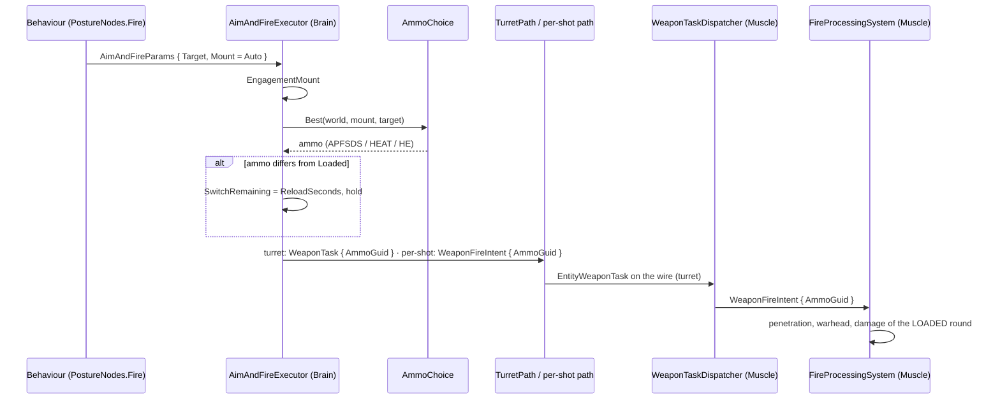

### 2a. As-built `2026-10-14` (backend, handoff B6)

The design carries **11 classes** and **1 sequence** for M8; all are built (the class diagram above is updated in place). Deviations, argued:

| design said | built | why |
|---|---|---|
| `AmmoLoadout` with `fixed` arrays | named fields `Ammo0..3` / `Rounds0..3` (the `WeaponAmmo` pattern) **+ `ChosenFor`** | no unsafe code in a replicable component; `ChosenFor` makes "once per engagement" hold on EVERY path (a named mount never runs `EngagementMount`) |
| `EngagementAmmo()` in the executor | `AmmoChoice.Choose(…)` called beside `EngagementMount` | the choice, the switch and the "once per target" rule live in one static the effectiveness input also reads |
| `ValueOf` = expected damage ÷ max health | ✅, **plus a tie-break on the AREA damage** | capped at 1, every round kills a man ⇒ a tie, and a tie keeps the loaded round — "HE wins against men" could never happen. With the area tie-break HE wins against men and technicals, APFSDS against tanks (`M8_TheTankGun_…`) |
| `CombatTkb.PenetrationOf(world, mount, ammo)` | **`CombatTkb.RoundOf(world, mount, ammo)` → (penetration, damage)** | a round has its own damage too (`AmmoWeaponBallisticsDto.Damage`); another round of a loadout does NOT fall back to the mount's own `Penetration` (that number belongs to the mount's default round) |
| `Magazine.Spend` decrements the loadout | `AmmoChoice.SpendLoaded` beside each `Spend` (per-shot, blind, turret path) | `Magazine` stays free of ECS access |
| the switch | `SwitchRemaining` drained by `WeaponDispatcherSystem.DrainSwitch`, beside the reload; the per-shot path holds with `Reloading`, the turret path withdraws the grant (as for a reload) | one drain, every frame, fired or not (the CE-2166 lesson) |
| `WeaponEffectivenessVsTarget` reads the best round + resolved penetration | ✅ through `AmmoChoice.ExpectedDamage` (incl. the HE area at distance 0) | ONE expected-damage formula for the choice and the AI estimate (R-212 A1) |
| — | operator fire and blind fire also carry the loaded round; `FireAtPoint` and the hidden-target throw do not | grenade and mortar mounts have no loadout |

Wire: `WeaponFireRequest.AmmoGuid` (the only new wire field, R-169); `EntityWeaponTask.AmmoGuid` existed and is now written. Component id **373**
(registered in `CombatComponentRegistry`, so CGF, SimHost and the editor). Rails: `AmmoChoiceTests.M8_*` (2) · `AimAndFireExecutorTests.M8_ASwitch_…` +
`M8_ATie_…` · `FireProcessingSystemTests.M8_AMountWithNoLoadout_…` · `WeaponTaskDispatcherTests.M8_TheLoadedRound_ReachesTheMuscle_OnTheTurretPath` ·
`WeaponFireIntentEgressTranslatorTests.M8_TheLoadedRound_RoundTripsTheWire` · `StandardInputReaderTests.M8_Effectiveness_…`. ⚠ No built-in type carries a
loadout yet — that is B8's data (M5).

### 2b. Enough, not most — a munition has a COST (`CE-2186`, W2, 🔒 R-2020; backend `2026-10-15`, [handoff](../../blueprints/batches/HANDOFF_Behaviors_To_Backend_Munition_Cost.md))

🔒 **User, `2026-10-15`:** *"not using non-reasonably strong or expensive ammo or weak or collateral-damage sensitive targets"* → W2 *"accepted"*
([Air Ops §7b](../air-attack/DESIGN_Air_Operations.md)). 📐 Measured: `AmmoChoice.Best` takes the HIGHEST value — the strongest round always wins,
however weak the target (`AmmoChoice.cs`, §2 above); no munition carries a cost (`Tkb/Domain/*.cs`).

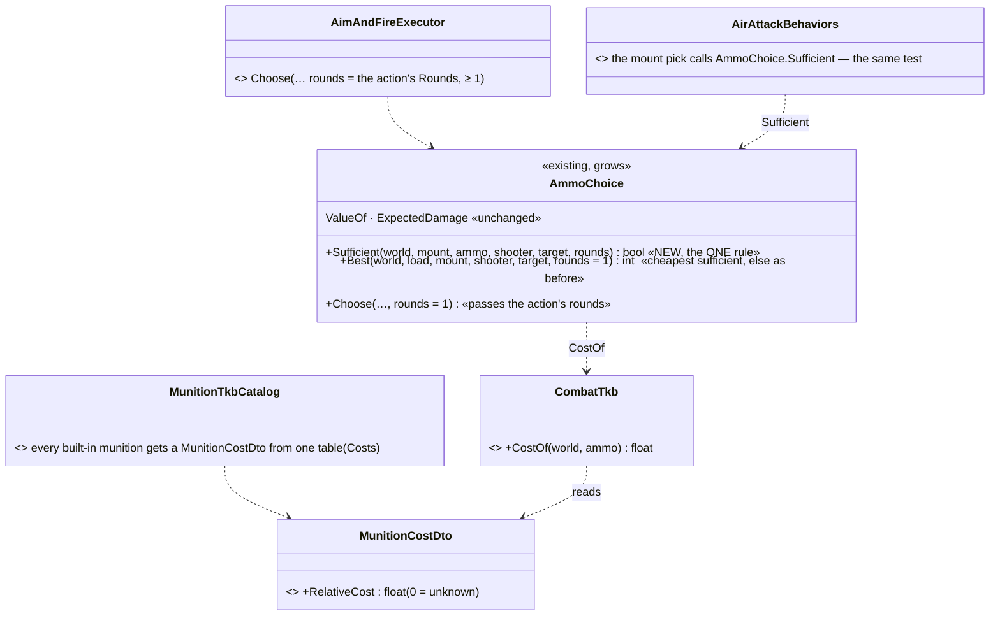

*What the picture shows that prose hid: the cost is one TKB record the choice READS; the sufficiency test is ONE static the air attack's
mount pick calls too — two callers, one rule (R-212 A1), and the value model underneath is untouched.*

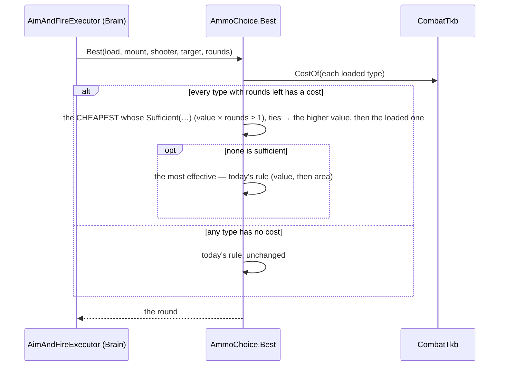

| rule | why |
|---|---|
| `Sufficient` = `ValueOf × max(1, rounds) ≥ 1` — the burst is expected to kill | the handoff's lean; one function for the round AND (behaviors) the mount |
| among the loaded types: the CHEAPEST sufficient; none sufficient ⇒ the most effective (§2's rule) | "enough, not most"; a tank still draws the ATGM |
| a loadout where any type has no cost ⇒ §2's rule exactly | fence: no existing rail moves without a reason |
| costs: one table in `MunitionTkbCatalog` (§2c) | data, not code |

#### 2c. The cost table — the rule used

Relative unit cost, **tiers by munition class, ordered by public unit prices** (5.56 / 7.62 ball ≈ $0.5–1, 12.7 mm ≈ $3–5, 25–30 mm ≈ $30–100,
RPG / LAW rocket ≈ $0.5–2k, mortar / artillery / tank shell ≈ $1–10k, Hydra ≈ $3k, ATGM ≈ $40–200k): the scale is COMPRESSED — only the
order and the handoff's "a rifle round 1, an ATGM / a bomb in the hundreds" matter to the choice.

| class | relative cost | munitions |
|---|---|---|
| small arms | 1 | 5.56 ball / tracer, 7.62 ball / tracer |
| heavy MG | 3 | 12.7 / 14.5 AP |
| hand grenade | 5 | M67 |
| autocannon | 10–20 | GAU-8 HEI / API 10, 25 mm APDS-T 20 |
| unguided rocket | 30–60 | RPG-7 30, LAW 30, PG-7VL 40, PG-7VR 60 |
| mortar / artillery / tank shell | 30–100 | 60 mm 30, 81 mm 50, tank HE-FRAG 60, 120 mm mortar 80, 105 mm 80, tank HEAT-MP 80, 120 / 125 mm APFSDS 100, 155 mm 100 |
| guided / air | 50–500 | FPV warhead 50, Hydra 70 100, TOW 300, NLAW 300, Kornet 300, Mk-82 300, Javelin 500 |

## 3. Guided rounds (M4, D-D)

*What the picture shows: guidance is ONE system that steers the velocity of the round that already flies; the hit, the face and the damage
are the unchanged chain. Climb-and-dive is three phases of that steering — the Top face then follows from the arrival angle (Armour Hit
Model D-A), so nothing marks a hit "top attack".*

| guidance | each frame | what defeats it |
|---|---|---|
| `Unguided` (RPG, LAW) | nothing — today's straight round | the aim time and the dispersion |
| `Command` (TOW-like, ATGM technicals) | steer onto the LAUNCHER's sight line: a turret launcher's sight = its `TurretPose` (Muscle-owned), which the weapon brain keeps on the target during the flight hold (WL-5's hold already writes `Track`); a per-shot launcher's sight = the gunner's eye → the target while `IWorldQuery.SightBlocked` is false. Sight blocked ⇒ `Lost` — the round keeps its last velocity | ⭐ break sight during the flight (the vehicle reverses into its hide); an operator possessing the gunner guides it by aiming — no extra channel |
| `FireAndForget` (Javelin, NLAW) | the round's own SEEKER: steer toward the locked target while the ROUND has sight of it (its last seen point otherwise); with `TopAttack` (range ≥ `TopAttackMinRangeM`): Climb to `CruiseAltitudeM` → Cruise → Dive at `DiveAngleDeg` once the horizontal distance ≤ altitude / tan(dive) | ⭐ deny the LOCK — the gunner's aim time is the lock (D3), a short exposure never completes it; once launched, nothing in v1 |

| rule | why |
|---|---|
| steering = turn the velocity toward the aim point at a fixed turn rate (≤ 30°/s) at `SpeedMps` — no aerodynamics, no thrust curve | D-D |
| ⭐ **where it lives and what crosses the wire**: `GuidedRoundSystem` runs on the MUSCLE beside `BallisticsSystem` — the round, its target, the launcher's turret pose and the terrain are all on that node; **no new channel**: the fire intent already names the target, and the turret task (Brain → Muscle, `EntityWeaponTask`) keeps the sight on it | user: "where is missile steering living, how would it work, what channel?" |
| `MaxFlightSeconds` replaces the 2 s bullet lifetime for a guided round (Javelin ~20 s, TOW ~22 s) | §1: a 2 km missile vanished mid-flight |
| `SpeedMps` replaces the generated `range × 0.5` muzzle speed for a missile | §1: the TOW flew ~7× too fast |
| below `MinRangeM` the weapon brain refuses (`ActionReason.TooClose`); between `MinRangeM` and `TopAttackMinRangeM` a top-attack weapon fires direct | Javelin 65 m direct, 150 m top |
| the lock: a fire-and-forget mount's `AimSeconds` IS the lock — the per-shot path already times it (D3); the TURRET path gains the same continuous-sight timer before its first grant | D-D: one aim-time concept, not a second "lock" field |
| the one-in-flight hold (WL-5) stays; `Command` reports `Guiding` while its round flies | the vehicle behaviour reads it (§4) |

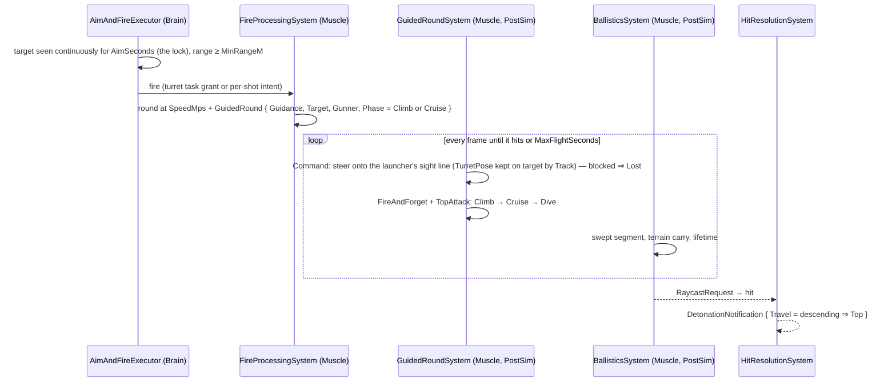

### 3a. The profile FITS the range, and a locking mount never fires blind (`CE-2201`, `CE-2200`; backend `2026-10-16`, [handoff](../../blueprints/batches/HANDOFF_Behaviors_To_Backend_Javelin_Lock.md))

⛔ SUPERSEDES two lines above: the `FireAndForget` row's *"with `TopAttack` (range ≥ `TopAttackMinRangeM`)"* and the rule *"between
`MinRangeM` and `TopAttackMinRangeM` a top-attack weapon fires direct"*. `TopAttackMinRangeM` is still a floor, but no longer enough on its own.

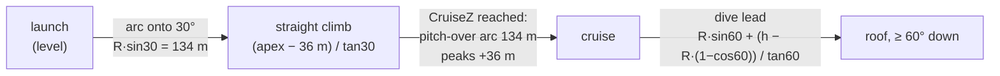

*What the picture shows that the prose hid: at the 30°/s turn limit (R = 140 / 0.52 ≈ 267 m) every arc costs ground. The Javelin's
150 m profile needs ≈ 727 m, and even its lowest apex that still dives at 60° needs ≈ 607 m. At 230 m the round was still climbing when it
passed the tank.*

| question | as built | why |
|---|---|---|
| ⭐⭐ does the climb-and-dive fit? | `GuidedRoundSystem.TopAttackFits(missile, speed, groundRange, launchAboveGoal, out apex)`: the system's own flight in closed form, as in the picture; it fits when the ground needed ≤ the range AND the peak ≥ R·(1 − cos dive), so the dive arc completes and the round arrives at the dive angle. It takes the HIGHEST apex ≤ `CruiseAltitudeM` that fits (bisection: the ground grows with the apex); none fits ⇒ false | 📐 the handoff's lean ("an apex capped by range, a direct fallback below the geometric minimum"); ⛔ raising `TopAttackMinRangeM` to ~730 m would have thrown away the capped band (607–727 m) |
| who asks it | ⭐ **one function, two readers**: `FireProcessingSystem` at launch (Climb with `CruiseZ` = muzzle + apex, or direct) and `ThreatDanger` (my top, or the face it meets) | the danger a tank reads must be the flight it will actually get |
| below the minimum | **direct**: the seeker homes on the middle and meets the face it meets (front/side) | D-D's ≤ 30°/s is a ruling; a tighter turn just for short range would be a second flight model |
| a missile with no `SpeedMps` or no `CruiseAltitudeM` | declares no geometry ⇒ the declared `TopAttackMinRangeM` alone (as before) | test fixtures and partial TKB data keep their behaviour |
| ⭐ the dive itself | ⛔ **found dead and fixed**: `Steer` returned pure pursuit for `Phase == Dive` BEFORE the dive branch, so §4a's *"holds at least the dive angle, then homes once the line is steeper"* never ran, and the arrival angle was down to timing. 📐 At 900 m the full profile arrived 40° down, on the side; the 1200 m rail passed by luck. Now the dive branch runs | §4a's row states the intent; the code had fallen behind it |
| ⭐ the dive TRIGGER reads the round's pitch | ⛔ SUPERSEDES §4a's lead `R·sin θ + (h − R(1−cos θ)) / tan θ`, which is the LEVEL-entry case. The cruise's altitude hold swings the pitch after the pitch-over (a +36 m overshoot), so the dive now starts at `R·(sin γ + sin θ) + (h − R(cos γ − cos θ)) / tan θ`, with γ = the current pitch (the same arc, from γ to −θ) | 📐 once the dive branch was live, the level lead fell 23–73 m short entering pitched down (750, 800, 900 m) and overflew entering pitched up (1000 m). A 2D replica of `Steer` that reproduced those misses to the decimetre then swept 600–2590 m in 10 m steps: every fitting range hits, ≥ 45° down |
| ⭐ `CE-2200`: blind fire | `AimAndFireExecutor.NeedsLock(world, mount, loadedAmmo)`: a guided round (any `Guidance` but `Unguided`) from a mount that declares `AimSeconds` ⇒ `FireBlind` holds (`HoldNotSeen`), as an indirect mount already does. An RPG / LAW keeps its blind round | M4 D-D *"the lock IS the aim time"*: a blind round has nothing to lock on. 📐 Live: both `ua-javelin-lock` hits were blind rounds on a hidden tank's side |

⭐ Rails (the features' own suites): `GuidedRoundSystemTests.CE2201_TheTopAttack_ArrivesOnTheRoof_AtEveryRangeItIsChosenFor_ElseFliesDirect`
(230…2000 m: every range hits, and every top attack arrives ≥ 45° down on the Top face) and
`AimAndFireExecutorTests.CE2200_ALockingMount_NeverFiresBlind_AnRpgDoes`. Both are red-proofed.
⚠ **Consequence for the `ua-javelin-lock` demo** (behaviors): Javelin B's 230 m shot is now a DIRECT hit, not "from above". Check ② must
place the open tank ≥ ~610 m away to see a top attack, or accept a direct hit at 230 m.

### 3b. The OVERFLY top attack — the NLAW (`CE-3198`, backend `2026-10-15`; gate lifted by the user)

📐 **Why §3's climb–cruise–dive cannot fly it** (§5a): at 200 m/s and 30°/s the turn onto any dive is a ~380 m arc — longer than the NLAW's
20–800 m range — so it never arrives at ≥ 45° and `ArmorModel.FacingOfArrival` never reads Top. The real NLAW does not dive: it flies ~1 m above
the sight line and fires its charge DOWN as it passes over the target.

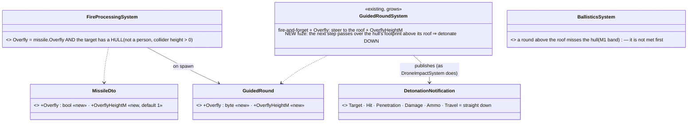

*What the picture shows that prose hid: the overfly needs NO new hit path — the existing detonation event with a downward travel IS a Top-face
hit for the unchanged damage chain (`ArmorModel.FacingOfArrival`), exactly as the FPV drone's dive is; only the steering goal and one fuze test are
new.*

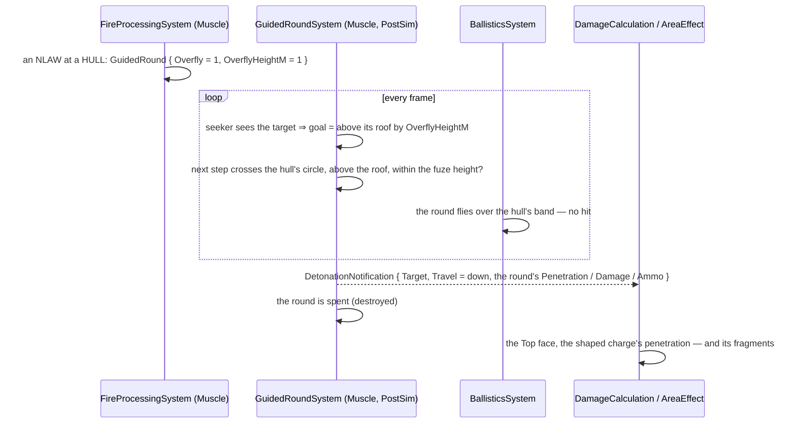

| rule | why |
|---|---|
| overfly only at a HULL (a vehicle collider with a height, not a person); a man is attacked direct, as before | the downward charge is an anti-armour mode; a soft target has no roof to fire through |
| the fuze fires when the round's NEXT step enters the hull's footprint (its collider circle) while it is above the roof and no more than `OverflyHeightM` + 2 m over it | a pass over the roof, not a pass beside it or far above it |
| the detonation: `Travel` straight down, the round's own penetration and damage (muzzle values — a missile is not carried through terrain), its ammo for the fragments | the unchanged chain decides the face (Top) and the damage |
| Javelin keeps its dive (§3); only the NLAW states `Overfly` | `ua-javelin-lock` unchanged |

## 3c. Air defence — the IR seeker, the proximity fuze, flares and chaff, the missile warning (`CE-2187`…`CE-2189`, backend, `2026-10-15`; build-state: BUILDING)

🔒 Frame: [Air Operations §7d](../air-attack/DESIGN_Air_Operations.md) AD1–AD6 (behaviors' leans, sent with
[the handoff](../../blueprints/batches/HANDOFF_Behaviors_To_Backend_Air_Defence.md)); 🔒 user `2026-10-15`: *"approved, start air defence"*,
including moving `SimRng` down to `Fdp.Toolkits`. The launchers and the ZU-23 are [Weapon Systems §5c](../weapons/DESIGN_Weapon_Systems.md).

**INVENTORY** (`2026-10-15`, graph CLI `search_graph` + grep): `.*Countermeasure.*|.*Decoy.*|.*Flare.*|.*Chaff.*` → **0**;
`.*Seeker.*|.*Fuze.*|.*Proximity.*` → `FuzeKind` (Impact, Time), `GuidedRoundSystem.OverflyFuze`; `.*Guided.*` → `GuidedRound`,
`GuidedRoundSystem`, `AimAndFireExecutor.GuidedFlightSeconds`; `.*MissileWarning.*` → **0**; `.*SimRng.*` → `SimRng` (Hrot.AI.Behaviors —
the brain side; the SimHost combat code has **no** random draw: dispersion is a fixed sequence, `HitModel.Deflection`). Prior art reused:
the near-miss path (`CE-3064`: SimHost event → DDS → `…SensingSystem` → `SensorChange`), the off-target burst (`BallisticsSystem.Detonate`
→ the area effect, 3-D distance to the body), `AmmoChoice.Split` (the one place both the round and the mount choice value a round).

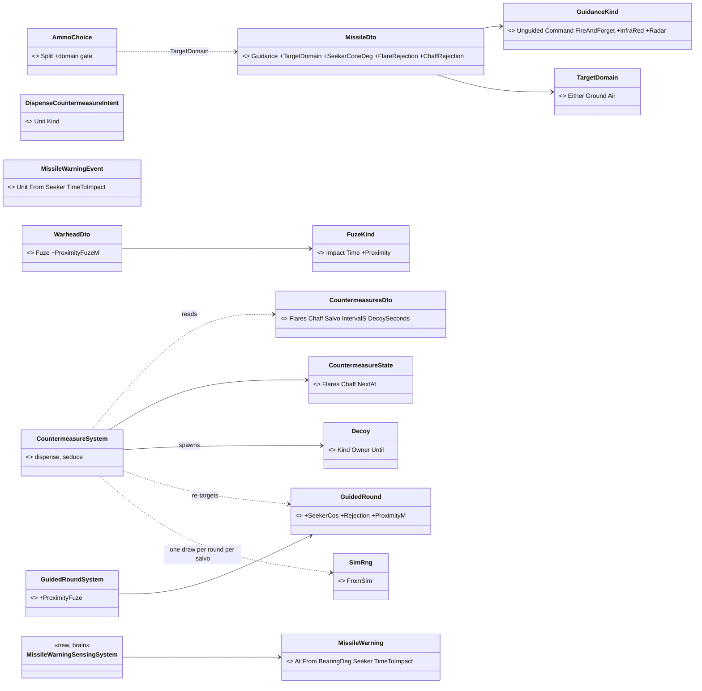

*What the picture shows that prose hid: nothing new STEERS — a seduced round simply has a decoy as its `Target`, so the existing steering,
lifetime and proximity fuze do the rest; and the only new random draw sits in one system on one node.*

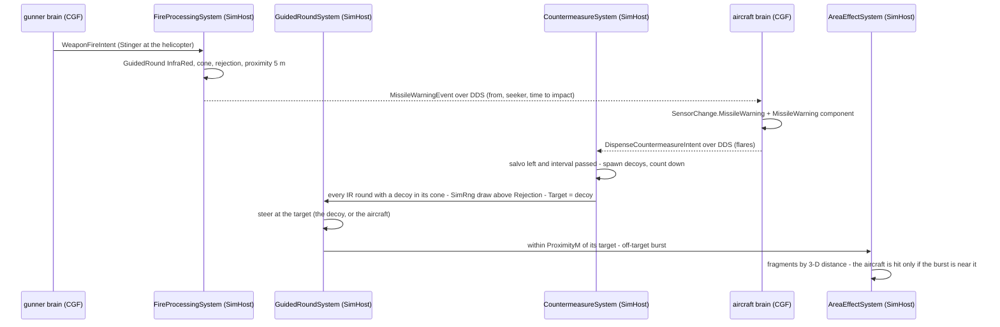

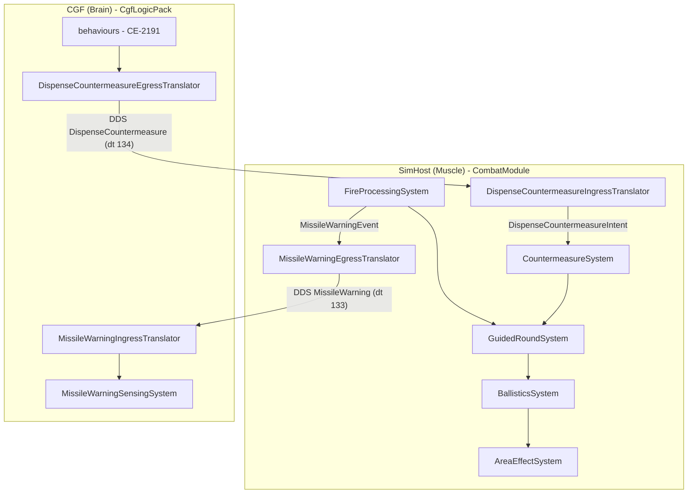

*What the picture shows that prose hid: the loop crosses the wire twice, and both halves ride the SimHost auxiliary pack beside
`NearMiss` — on a one-world host (editor, `--mode all`'s combat node) the events are local and the translators are not involved.*

| rule | why |
|---|---|
| `GuidanceKind.InfraRed` steers like `FireAndForget` (its own seeker, `LastSeen`) but sees its target only inside its **cone** (`SeekerConeDeg` about its velocity) | only an IR round can be seduced by a flare; out of the cone it flies to where it last saw the target |
| `GuidanceKind.Radar` exists for chaff only — **no munition uses it** (AD6) | chaff is railed against a test round |
| `MissileDto.TargetDomain` Air / Ground / Either: `AmmoChoice.Split` values a round at **0** against the wrong domain (the target is Air when `Locomotions.InAir` — by its locomotion CLASS, so a helicopter on its pad is still Air) | ⭐ one gate for the round choice, the mount ranking (`StandardInputs`) and behaviors' `Sufficient` — a MANPADS is never chosen against a truck, an ATGM never against a helicopter, flying or landed (the class decides — measured, `Locomotion.cs:53`) |
| the proximity fuze: `WarheadDto.Fuze = Proximity`, `ProximityFuzeM`; the round bursts (the off-target `DetonationNotification`, the existing area effect) the tick its step passes within `ProximityFuzeM` of its target's middle | a SAM rarely strikes the hull; the fragments' 3-D distance does the damage, so a burst at a decoy spares the aircraft by geometry, not by a rule |
| a dispense: the aircraft type's `CountermeasuresDto` ⇒ `CountermeasureState` on the SimHost; a `DispenseCountermeasureIntent` spawns `Salvo` decoys (flare or chaff) at the aircraft, its velocity, falling, for `DecoySeconds`; ignored while the interval has not passed or the count is 0 | the BRAIN decides when (CE-2191); the engine decides what happens |
| seduction: each homing round of the matching seeker (flare ↔ InfraRed, chaff ↔ Radar) with a new decoy in its cone draws ONCE per salvo — `SimRng.FromSim(round, salt, simTime)`; above its `FlareRejection` / `ChaffRejection` it re-targets the nearest such decoy | deterministic (replay, R-3009's spirit); a round that ignored one salvo can still take the next |
| the warning: published by `FireProcessingSystem` the moment a guided round is launched at an **air** target; one per round | AD4; "on lock" needs no second event — the brain's lock is the gunner's aim time, the launch follows it |
| `SimRng` moves to `Fdp.Toolkits` (namespace `Fdp.Toolkit.Determinism`), unchanged | ⭐ one generator for brain and engine (user-approved); its callers in `Hrot.AI.Behaviors` change only their `using` (cross-lane, named) |

**As built — CE-2187 (`2026-10-15`)** — matches the table above, with these deviations, each argued:

| deviation | why |
|---|---|
| ⭐ a HOMING seeker (IR, radar) steers at the **lead point** (`TargetLead.Point`, AT2's predictor) of a target it sees; command and fire-and-forget rounds still pursue | 📐 measured: pure pursuit at the 30°/s turn limit passed **6.8 m** behind a helicopter crossing at 60 m/s — outside the 4 m fuze. A real IR missile flies proportional navigation; the lead is its cheapest honest stand-in |
| the IR lock is the mount's `AimSeconds` (4 s) — no `LockSeconds` on `MissileDto` | one aim clock (D3, R-234), as the Javelin's lock already is |
| `TargetDomain.Either`, not `Any` | the DDS code generator emits the enum as IDL, where `any` is a keyword (the build failed on it) |
| an aircraft is `Air` by its locomotion CLASS (`Locomotion.cs:53`) — a helicopter on its pad too | the one domain rule already in the code; no landed flag exists |
| the weapon brain HOLDS a wrong-domain missile (`ActionReason.WrongDomain`, weapon posture Ready) | `WeaponChoice` falls back to mount 0 when every mount scores 0 — without the hold a soldier with only a Stinger fired it at a truck |
| `WeaponCategory.Sam` (11, appended): the `Guided` profile, one round per press, does not fire on the move | a MANPADS is not an ATGM to the operator HUD (`SAM`) or the 3-D launcher kit (cross-lane `Hrot.Presentation`, a name and a launcher test) |
| the library gains `"Stinger warhead"`, `"Igla warhead"` (frag), `"23mm HEI"`, `"23mm API"` | one source for warhead numbers (R-212); the SAMs take the library warhead with the fuze switched to proximity (4 m) |

Rails: `GuidedRoundSystemTests.CE2187_AnIrRound_HomesOnACrossingHelicopter_AndBurstsWithinItsProximityFuze` (red without the lead, red
without the fuze) · `…CE2187_AnIrSeeker_DoesNotSeeATargetOutsideItsCone` · `AmmoChoiceTests.CE2187_ASamIsWorthNothingAgainstATruck_…`
(red without the gate) · `…CE2187_TheWeaponBrain_HoldsAWrongDomainMissile` · `AreaEffectSystemTests.CE2187_AStingerBurstFourMetres…` ·
`NedTkbBuilderCombatTests.CE2187_TheAirDefenceCatalogue_…`.

⛔ **SUPERSEDED IN PART `2026-10-15` — CE-2188's TRANSPORT and COUNT** ([BS-1 §5.4c](../brain-split/BS-1-DESIGN.md), 🔒 user: *"no magic
numbers for weapon slot … chaff launcher can be weapon type"*, *"approved"*): the release is a **fire on a dispenser weapon mount**
(`WeaponCategory.Countermeasure`, a flare / chaff loadout counted on the brain like any round), reported by `WeaponFireNotification`.
⇒ `CountermeasuresDto`, `CountermeasureState`, `DispenseCountermeasureIntent` and DDS `DispenseCountermeasure` (dt 134) below are being
removed; the decoy, its `DecoyFlight` path and the seduction stay here. The two rows below that name them are history once that lands.

**As built — CE-2188 / CE-2189 (`2026-10-15`)** — as the class, sequence and module diagrams above, with these details:

| piece | as built |
|---|---|
| dispensers | `CountermeasuresDto` (`Combat.Countermeasures`) on every crewed aircraft: UH-60 ×2 30/30, AH-64 60/60, A-10 120/240, F-16 60/60, C-130 120/120 (flares / chaff), salvo 2, interval 1 s, decoys 5 s; the FPV drone none |
| ⚠ a decoy moves ITSELF | its velocity is in `Decoy` and `CountermeasureSystem` integrates it — ⛔ no `SimVelocity`: the Stride host narrows `LinearKinematicsSystem` to projectiles (CE-238), so a flare with one would hang in the air there |
| the draw | `SimRng.FromSim(round index, 0x2188 + the aircraft's salvo count, sim time)` — the salvo count keeps two salvoes in one second from drawing alike; a round already on a decoy is not drawn again |
| `SimRng` | MOVED to `Fdp.Toolkits/Determinism` (namespace `Fdp.Toolkit.Determinism`), unchanged; its 6 callers in `Hrot.AI.Behaviors` + `SimRngRails` gained one `using` (cross-lane, behaviors' files) |
| the warning | published by `FireProcessingSystem` for any GUIDED round (command, fire-and-forget, IR, radar) launched at an Air target; time to impact = distance / the round's speed at launch |
| the wire | `MissileWarning` (dt 133, Muscle → Brain) and `DispenseCountermeasure` (dt 134, Brain → Muscle), both `Reliable`, in `SimHostAuxiliaryTranslatorPack` beside `NearMiss`; each ingress has a `ProcessSample` (the detonation translator's testable shape) |
| the brain | `MissileWarningSensingSystem` in `CgfLogicPack` beside `NearMissSensingSystem`: `SensorChange.MissileWarning` (17, HSM `Sensor.MissileWarning` 0xFF11) + the `MissileWarning` component (bearing 0 = north, clockwise) |

Rails: `CountermeasureSystemTests.CE2188_*` ×4 (the seduction red-proved: 3 of 4 redden without it) ·
`FireProcessingSystemTests.CE2189_AMissileAtAHelicopter_WarnsIt_NoneAtAGroundTarget` ·
`AirDefenceTranslatorsTests.CE2189_AMissileWarning_CrossesToTheAircraftsBrain_…` + `.CE2188_AFlareRequest_CrossesToTheSimHost` (two
worlds, two entity maps — the egress sample is what the other node's ingress reads). ⚠ **Not gated by a cluster run:** the DDS
transport is the shared machinery every topic rides; the end-to-end check is behaviors' `ua-air-defence` demo (CE-2191).

## 4. Firing on the move (D-L)

| mount | `FireOnMove` default (from `Category`, overridable per mount) |
|---|---|
| SmallArms · MachineGun · Autocannon · Grenade | yes (moving σ × 2, as today) |
| TankGun | yes — a stabilised gun; an old tank sets `false` |
| Atgm · Mortar | no |

| rule | why |
|---|---|
| `FireOnMove = false` ⇒ the weapon brain holds fire while the shooter moves faster than `HitModel.MovingSpeed` (0.5 m/s): `ActionReason.Moving` | D-L; the same gate shape as ROE |
| `Command` guidance reports `Guiding` for the flight; the vehicle cycle stays at its firing point while it reads `Guiding` (Exposure Cycle §3) | the gunner must keep sight; the behaviour, not the weapon, decides to stand |
| `FireAndForget` needs to stand only during the lock (`FireOnMove = false` until the round is away) | D-L |

### 4a. As-built `2026-10-14` (backend, handoff B7 — §3 and §4)

The design carries **8 classes** and **1 sequence** for M4 + D-L; all are built. Deviations, argued:

| design said | built | why |
|---|---|---|
| `GuidedRound { Guidance, Target, Gunner, Phase Climb/Cruise/Dive/Lost, TopAttack }` | ✅ + `SpeedMps`, `LifetimeTicks`, `CruiseZ`, `DiveAngleDeg`, `LastSeen` (component **374**, `NoScenario`, Muscle) | the system needs them per round; the TKB is read once, at spawn |
| Command: steer onto the LAUNCHER's sight line (a turret launcher's `TurretPose`) | ⚠ the GUNNER's eye → the target's middle, on both paths; blocked (`IWorldQuery.SightBlocked`) or a dead gunner ⇒ `Lost` | the turret pose is kept on the target by the Track hold anyway, and it is not on the brain-less muscle path the rails run; the eye line is the same line within the turret's offset. A turret-pose line is a later refinement if a scenario needs it |
| top attack: dive once horizontal ≤ altitude / tan(dive) | ⛔ the lead below is the level-entry case and the dive branch it names was dead code until `CE-2201`; see [§3a](#3a-the-profile-fits-the-range-and-a-locking-mount-never-fires-blind-ce-2201-ce-2200-backend-2026-10-16-handoff). ⚠ the dive starts a TURN LEAD earlier (`R·sin θ + (h − R(1−cos θ)) / tan θ`, R = speed / turn rate) and holds at least the dive angle, then homes once the line to the target is steeper | 📐 at 140 m/s and 30°/s the turn is a 267 m arc: the design's trigger overshoots the target before the nose is down (red-proved: `M4_AJavelin_…` fails with it) |
| `ActionReason.TooClose`; the D-L hold as `ActionReason.Moving` | `TooClose` and a NEW `HoldMoving` | `Moving` is the LOCOMOTION row's word ("moving toward the destination"); a weapon hold must read as a hold (both are in `IsHold`, posture Ready) |
| `FireOnMove` per mount | ✅ `WeaponMountDto.FireOnMove : bool?` + `CombatTkb.FiresOnTheMove` (null ⇒ Atgm / Mortar stand, the rest fire) and `HitModel.IsMoving` — the ONE moving test the spread already used | — |
| the turret path gains the aim-time lock | ✅ only for a mount that DECLARES `AimSeconds`; the lock rides the aim clock (`Ready` = locked), which after the lock carries the guided-flight hold as before | the 32-byte channel state is full; every turret mount without an aim time is unchanged |
| `MaxFlightSeconds` / `SpeedMps` | ✅ `BallisticsSystem` reads `GuidedRound.LifetimeTicks`; `FireProcessingSystem` flies a missile at `SpeedMps` (an unguided missile gets speed + lifetime only) | — |
| ✅ CE-2170 FIXED `2026-10-14` (backend, Air Ops handoff E1) | the launcher's flight HOLD (`GuidedFlightSeconds`) reads the round's `MissileDto.SpeedMps` first (the loaded round, else the mount's ammo — the lookup the spawn uses), then the mount, then the state ⇒ a TOW at 2 km holds 7.6 s (was 1.57 s). Rail `AimAndFireExecutorTests.CE2170_ATowAtTwoKm_HoldsTheLauncherForItsFlight`, red-proved | the spawn and the hold now read ONE speed |

Wiring: `GuidedRoundSystem` in `CombatModule.PostSimulationSystems` before `BallisticsSystem` (SimHost and the editor's Muscle);
`GuidedRound` registered in `CombatComponentRegistry`. No wire change (§3's rule holds). Rails: `GuidedRoundSystemTests.M4_ACommandRound_…`,
`M4_AJavelin_ClimbsAndDives_AndArrivesOnTheRoof`, `M4_TheTurn_IsLimitedTo30DegreesASecond` · `BallisticsSystemTests.M4_AGuidedRound_LivesItsFlight_NotTwoSeconds` ·
`AimAndFireExecutorTests.M4_BelowMinRange_TheWeaponHolds`, `M4_TheTurretPath_TimesTheLock`, `DL_AnAtgm_HoldsFireWhileMoving_AnHmg_FiresAtDoubleSpread`.
⚠ No built-in munition carries a `MissileDto` yet — the TOW / Javelin / NLAW numbers are B8's data (§5).

## 5. Data (M5) — new munition types (ids 6010…) and mounts

Approximate public figures; tuning starts here (programme §2 sources).

| munition | id | penetrator | pen (mm) | damage | speed (m/s) | guidance | top attack | min / max range (m) | on mount: aim (s) · reload (s) · rounds |
|---|---|---|---|---|---|---|---|---|---|
| PG-7V (exists, 6009) | 6009 | ShapedCharge | 300 | 400 | 300 | — | — | — / 300 | 2.0 · 6 · 4 |
| PG-7VL | 6010 | ShapedCharge | 500 | 450 | 300 | — | — | — / 300 | 2.0 · 6 |
| PG-7VR | 6011 | Tandem | 650 | 500 | 280 | — | — | — / 200 | 2.2 · 6 |
| M72-class LAW | 6012 | ShapedCharge | 300 | 350 | 145 | — | — | — / 200 | 1.5 · — · 1 (disposable; a man carries 2) |
| NLAW | 6013 | ShapedCharge | 500 | 900 | 200 | FireAndForget | yes (shallow overfly) | 20 / 800 | 2.5 · — · 1 |
| Javelin | 6014 | Tandem | 760 | 1500 | 140 | FireAndForget | yes (150 m climb) | 65 (150 top) / 2500 | 4.0 lock · 20 · 2 |
| TOW-2 (exists as 6008) | 6008 | ShapedCharge | 800 | 2000 | 280 | Command | — | 65 / 3750 | 1.5 · 15 · 7 |
| technical ATGM (Kornet-class) | 6015 | Tandem | 1100 | 2000 | 300 | Command | — | 100 / 5000 | 1.5 · 20 · 4 |
| FPV warhead (the drone's, M7) | 6016 | ShapedCharge | 400 | 450 | — | (the drone flies) | (dives) | — | — |
| 120 mm HEAT-MP | 6017 | ShapedCharge | 600 | 1200 | 1400 | — | — | — / 3000 | tank loadout |
| 120 / 125 mm HE-FRAG | 6018 | Kinetic + HE warhead | 50 | 600 + area | 900 | — | — | — / 4000 | tank loadout |
| 12.7 / 14.5 mm AP | 6019 | Kinetic | 25 | 60 | 900 | — | — | — / 1500 | HMG, `FireOnMove` |

Mounts: M1 / T-72 main gun loadout APFSDS + HEAT-MP + HE (e.g. 20 / 10 / 10) + a coax MG (7.62, hull-fixed to the turret) · the RPG man
(`Insurgent`, 2003): RPG with 4 rockets + a rifle · an AT team type with Javelin or NLAW · technicals (Exposure Cycle §6).

### 5a. As-built `2026-10-14` (backend, handoff B8 — M5, with M6's data)

§5 adds no class and no sequence; it is data on the classes §2–§4 built. Everything in the table is built; deviations, argued:

| design said | built | why |
|---|---|---|
| a munition's numbers per §5 | each new type (6010–6019) states a generic `AmmoWeaponBallisticsDto` (pen, damage), a `WarheadDto` copied from the NEAREST library entry (`PG-7V HEAT` for the rockets, the NLAW and the FPV warhead, `TOW-2 HEAT` for Javelin and Kornet, `120mm HEAT`, `125mm HE-frag`; tandem set where §5 says Tandem) and a `MissileDto` | one source for the fragment / blast numbers; the names match no library entry, so nothing is picked up by name |
| TOW 6008, PG-7V 6009 "exist" | both gain a `MissileDto`: TOW command, 280 m/s, 15 s, min 65 m; PG-7V unguided 300 m/s, 4.5 s | 📐 the TOW flew at the NED builder's `range × 0.5` = 1875 m/s; their penetration and damage stay on the mounts (LR-1) |
| NLAW "yes (shallow overfly)" top attack | ~~⚠ **flies DIRECT**~~ ⛔ SUPERSEDED `2026-10-15` — the overfly is built ([§3b](#3b-the-overfly-top-attack--the-nlaw-ce-3198-backend-2026-10-15-gate-lifted-by-the-user), CE-3198) | the overfly attack fires DOWN as it passes over; §3's climb/cruise/dive at a 30°/s turn needs a ~380 m radius, longer than its 20–800 m range ⇒ a downward-fuze model is needed — **CE-3198** |
| a coax MG "7.62" | two new types **6020 / 6021** (7.62 × 51 ball, tracer 1 in 5) — §5's table had no 7.62 round, and R-271 wants every mount's ammo typed; on the turret beside the gun, 200-round belt, 6 s to change, MG ⇒ fires on the move | the T-72's PKT (7.62 × 54R) shares the type |
| tank loadout "e.g. 20 / 10 / 10" | M1 20 / 10 / 12, T-72 18 / 9 / 12 — **sums equal the old ammunition** (42, 39); the T-72's HEAT is 6017 (the 120 mm one) | no rounds appear or vanish; one HEAT type until a 125 mm one is needed |
| the RPG man | `Insurgent` (2003): RPG 4 rockets (was 1), lay 2 s, reload 6 s, `FireOnMove = false`, mount 0 as before; rifle on mount 1 | mount 0 stays the RPG so every scenario that named it keeps working |
| "an AT team type with Javelin or NLAW" | **both**: `JavelinTeam` (2006: 2 missiles, 4 s lock, 20 s reload) and `NlawGunner` (2007: 2 tubes, 2.5 s, 3 s), each + a rifle, sight = the launcher's range | round-out: one helper (`AntiTank`), two rows. Their mounts state no penetration — the munition's own is read |
| the TOW's "1.5 · 15 · 7" | `AimSeconds = 1.5` (the turret path's lock, §4a); reload left to the mount's 2 / min | the rate already spaces the shots by 30 s |
| M6: explicit health + top + CE | M1 3000 / top 60 / front CE 900, side CE 450 · T-72 2500 / 40 / 700 / 350 · Bradley 500 / 30 / 150 / 80 · `MilitaryAPC` (2001) armour 30 / 20 / 15 / top 10 (was none), health 500 · eye heights M1 2.5, Bradley 2.7, T-72 2.2 m | every stated health EQUALS the old front × 5, so no fight moves on it. ⚠ The APC change is a combat change: a rifle (5 mm) no longer scratches it; an RPG still does full damage |

Plumbing: `SimCombatDef` gains `ArmorTop`, the four `…Ce`, `MaxHealth`, `MobilityKillBelowFraction`, `EyeHeight`; `WeaponMount` gains `Loadout`,
`FireOnMove`, `AimSeconds`, `MagazineSize`, `ReloadSeconds`; `NedTkbBuilder.WithCombat` copies them (a stated health is no longer recorded as
Generated). Rails: `NedTkbBuilderCombatTests.M5_M6_TheTanks_…` (+ `Stage0_M1_…` re-pinned: health Explicit, eye 2.5) ·
`UrbanCombatCatalogRails.M5_M6_TheRpgMan_TheAntiTankTeams_AndTheArmouredApc` (+ count 7 → 9) · `EffectTests.M5_TheNewMunitions_…` (+ `LR1_…`
re-pinned: Javelin and NLAW join the explosive set).

## 6. Who runs it

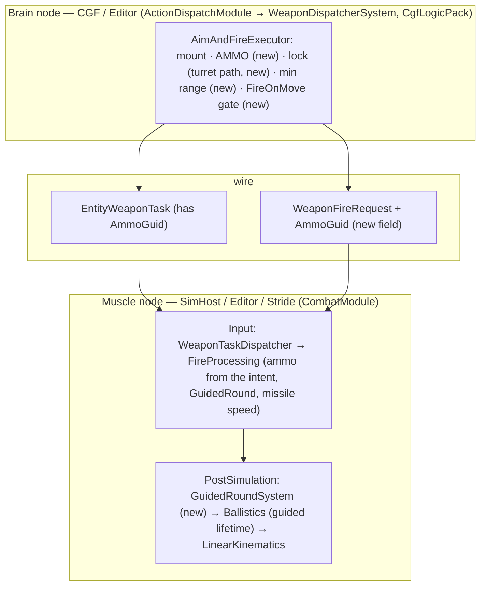

*What the picture shows: the ammo choice and the lock live on the Brain with the rest of the weapon brain; guidance lives on the Muscle
beside the round it steers — no new wire topic, one new field on one existing request.*

## 7. Rails — in the features' own suites

| rail | suite |
|---|---|
| `M8_AMountWithNoLoadout_FiresItsOneRound_AsBefore` | `FireProcessingSystemTests` |
| `M8_TheTankGun_PicksApfsdsForATank_HeForMenInABuilding_HeatOrHeForATechnical` | new `AmmoChoiceTests` |
| `M8_ASwitch_CostsOneReload_ATie_KeepsTheLoadedRound` | `AimAndFireExecutorTests` |
| `M8_TheLoadedRound_ReachesTheMuscle_OnBothPaths` | `WeaponTaskDispatcherTests` · `EntityTurretPoseTranslatorTests` (WL2b) · a `WeaponFireRequest` round-trip |
| `M8_Effectiveness_ReadsTheBestRound_AndTheResolvedPenetration` | `StandardInputReaderTests` |
| `M4_ACommandRound_FollowsTheTarget_WhileTheGunnerSeesIt_AndGoesStraightWhenSightBreaks` | new `GuidedRoundSystemTests` |
| `M4_AJavelin_ClimbsAndDives_AndArrivesOnTheRoof` | `GuidedRoundSystemTests` + `DamageCalculationSystemTests` |
| `M4_AGuidedRound_LivesItsFlight_NotTwoSeconds` | `BallisticsSystemTests` |
| `M4_BelowMinRange_TheWeaponHolds` · `M4_TheTurretPath_TimesTheLock` | `AimAndFireExecutorTests` |
| `DL_AnAtgm_HoldsFireWhileMoving_AnHmg_FiresAtDoubleSpread` | `AimAndFireExecutorTests` |
| `WL5_W12c_AnAtgm_FiresOneRoundPerFlight` stays green | `AimAndFireExecutorTests` |
| ⚠ CE-2166's fix (one drain per frame) re-times every cooldown rail — fix it FIRST, separately | `AimAndFireExecutorTests`, `WeaponInteractionDispatcherTests` |

> ⭐ **`2026-10-14` (Air Ops slice 4 — 📄 `docs/designs/air-attack/DESIGN_Air_Operations.md` §8a):** `WeaponCategory.Bomb` and a
> fourth weapon-brain behaviour, the **Release** profile: the per-shot path held in `AimAndFireExecutor.HoldOf` (`ActionReason
> .AwaitingRelease`) until `BombBallistics` says the impact reaches the target; munition 6022 (Mk-82). An Air-domain shooter launches
> with its carrier's velocity (`FireProcessingSystem`); ground shooters unchanged.
