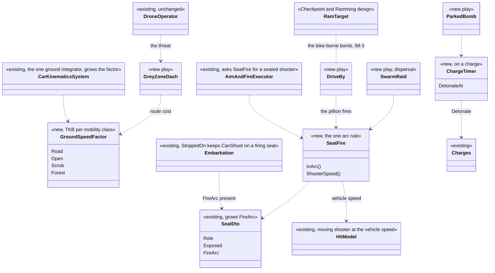
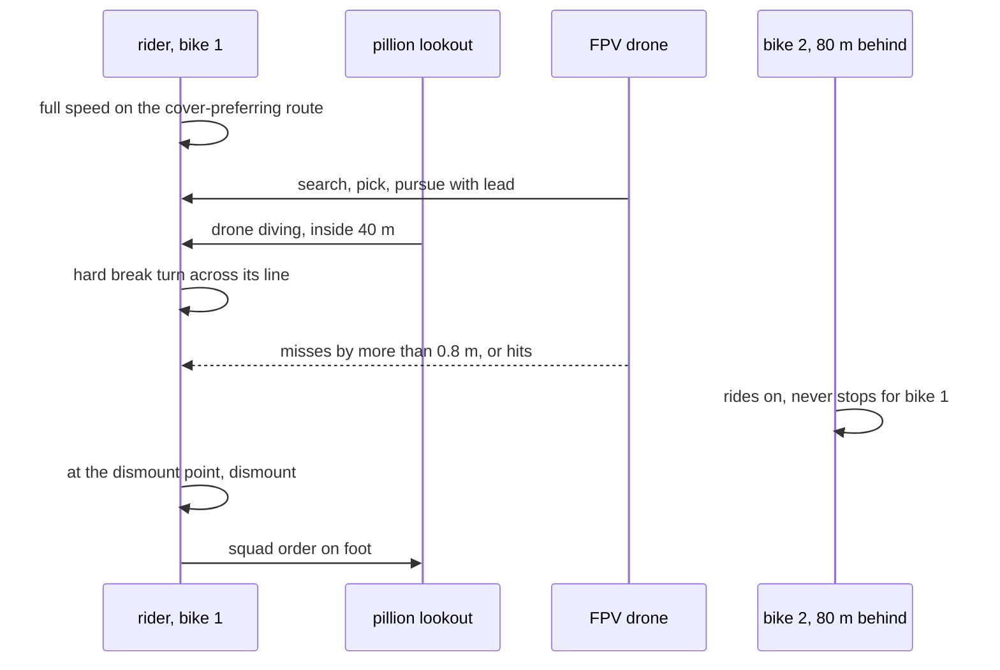
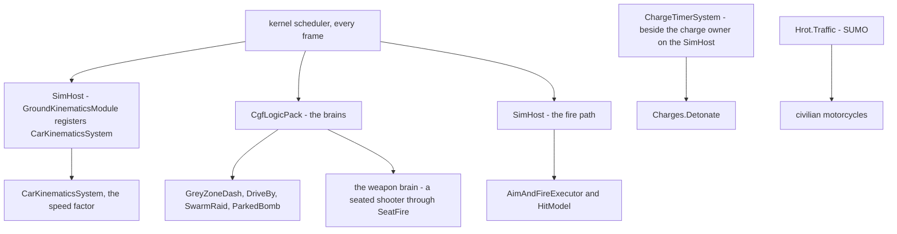

<!--STATUS
state: LIVE
updated: 2026-11-15
build-state: DESIGN — decisions APPROVED (R-4261); ⏳ the review (§8) before READY-TO-BUILD
current-answer: §1 inventory · §2 decisions · §3 UML · §4 the dash in time · §5 the plays · §6 slices and acceptance · §8 the review
stale-below: nothing
known-rot: none
known-conflict: none
related-designs:
  - ../../DESIGN_Operations_Behaviour_Catalogue.md — §12.3 / §12.6 / §12.6a: the analysis and the open sources this design builds (VEH-3, ASY-3, IM-*, PF-*)
  - DESIGN_Checkpoint_And_Ramming.md — OWNS the checkpoint, `RamTarget`, the vehicle ladder and the hostile act the bike-borne bomb (IM-3) and the two-up indicator (IM-8) use
  - DESIGN_FPV_Drone.md — OWNS the FPV's search / pursue / dive the dash is played against
  - DESIGN_Vehicle_Exposure_Cycle.md — OWNS `ShelterFromAir` (a vehicle's evade legs) the dash's break turn sits beside
  - ../../DESIGN_Civilians_And_Crowd_Control.md — OWNS hidden weapons (§5h), the hostile act, the crowd — the insurgent rider blends in through them
  - ../group-maneuvers/DESIGN_Squad_Tactics.md — OWNS the squad's embark / dismount and contact drills the riders fall back on
  - ../weapons/DESIGN_Weapon_Systems.md — OWNS seats, stations and who fires a vehicle's mount (W-I) — the firing seat PF-1 extends it
-->

# DESIGN — the motorcycle: a grey-zone dash, an insurgent's tool, a passenger who fires

🔒 User, `2026-11-15`: *"Some motorcyclist trying to get over the no man's zone, which is full of suicide drones … to cross the land as quickly as
possible and to avoid the drones by speed driving … used for transporting the troops over the exposed areas"* · *"could we use something similar for
Far East terrorist attacks, or in general for the movement of the terrorists or insurgents"* · *"Can we have the second passenger on the motorcycle
firing from his hand weapon while riding, behaving like the gunner in a technical?"* · *"Approved, write both designs and review them"* (R-4261).

**The proven pattern** (open sources, catalogue §12.1 / §12.6): bikes in groups of 2–3, 1–2 men each, cross an FPV-saturated zone at 50–60 km/h
off-road and drop the men at the enemy's edge; insurgents use them because they BLEND, are fast in narrow streets and DISPERSE at once — drive-by
(the pillion fires), parked bombs, a bomb ridden to a checkpoint, massed raids at night. ⭐ An FPV is FASTER than a bike off-road; speed buys less
exposure, the last-second break turn buys a miss.

## 1. INVENTORY *(measured `2026-11-15`; graph: `search_graph name_pattern=".*(Motor|Bike|TwoWheel|Surface|OffRoad|SpeedFactor).*" label=Class` ⇒ no two-wheeler, `TerrainSurface` only; a read-only code sweep; grep. Index coverage could not be checked through the CLI)*

| exists | where | used as |
|---|---|---|
| wheeled vehicles: `SimVehicleDef` (`MaxSpeed`, `TerrainMobility`), the pickup 25 m/s, seats `CarrierDefDto` / `SeatDto` with `Exposed` and roles | `SimVehicleDef.cs:3-45`, `NedTkbCatalog.cs:142-216` | MC-1's type, the pattern |
| the ground integrator: `BicycleModel` + pure pursuit; ⛔ **no off-road factor** — only a tracked hull in a wood is capped | `CarKinematicsSystem.cs:216-223, :542-560` | MC-2 adds the factor in the ONE integrator |
| ground classes: `TerrainSurfaceType` Open · Forest · Water · Scrub; roads from the road graph | `TerrainWorld.cs:17` | MC-2's classes: road · open · scrub · forest |
| routing: `RoadUse` (Never / Neutral / Prefer), `MoveToLocation` (target, speed, roadUse) | `NavigationComponents.cs:176-186` | the dash's route |
| boarding STRIPS `CanMove \| CanShoot` from every passenger; the one exception a weapon system's Gunner seat; on a vehicle crew seat the HOST fires (W-I) | `Embarkation.cs:50, :517-525` | ⭐ PF-1 adds the firing seat here |
| the moving-shooter law: σ × 2 above 0.5 m/s | `HitModel.cs:20-34` | PF-2 |
| the FPV: search → pursue (0.5 s) → dive (0.2 s), LEAD on the target's velocity, 30 m/s, 120°/s, contact 0.8 m; target score = freshness × kill share × kind (vehicle 1, person 0.3) | `AirAttackBehaviors.cs:548-635, :1047-1085`, `FlightParamsDto.cs:15-27` | the threat the dash is played against — unchanged |
| a vehicle evading a drone: ±35° legs away (`ShelterFromAir`) | `ShelterFromAirNodes.cs:184-198` | the break turn (MC-4) is the dash's own, at the dive |
| hidden weapons drawn on the act, the hostile act, the grenade throw | Civilians §5h, `HostileActs.cs`, `HiddenTargetThrow` | the drive-by |
| charges (`Charges.Ask` / `Detonate`), cargo stations, `TriggerIed` (phone) | `Charges.cs:34-57`, `TriggerIedBehavior.cs` | the parked bomb |
| SUMO's `motorcycle` class; traffic types are `TrafficVehicleDto` rows | `VTypeDefaults.cs:156`, `UrbanCombatTkbCatalog.cs:206, :439` | civilian bikes (IM-7) |
| ⛔ a timer detonation · a firing seat · a dispersal play · a two-wheeler | — | built here |

## 2. Decisions *(✅ APPROVED `2026-11-15`, R-4261)*

| # | decision | why |
|---|---|---|
| **MC-1** | ONE `Motorcycle` type (soldiers and insurgents; the side from the faction): rider (Driver) + pillion (a FIRING seat, PF-1), both exposed; ~28 m/s on a road; a small body; a civilian variant for traffic (IM-7) | one transport, every use |
| **MC-2** | ⭐ an **off-road speed factor per mobility class × ground class** (road · open · scrub · forest), applied in the ONE ground integrator; every existing type defaults to 1.0 everywhere (nothing changes until calibrated; a row files the calibration); the motorcycle: road 1.0 · open 0.6 · scrub 0.45 · forest 0.3 | ⛔ today a field is crossed at road speed — the dash means nothing without it |
| **MC-3** | `GreyZoneDash` — a squad on 2–3 bikes: a route that prefers cover (woods edges, hedges, dead ground — an exposure cost on the route), **≥ 80 m between bikes**, full speed, never stop for the hit | the reported doctrine |
| **MC-4** | the pillion is the LOOKOUT (eyes; ⭐ riding masks both riders' HEARING — the reported weakness); a drone diving inside ~40 m ⇒ the rider breaks HARD across its line; a drone tailing ⇒ a jink | the one counter a rider has; our drone re-aims every 0.2 s |
| **MC-5** | a bike hit or a man down ⇒ the others ride on; survivors go to cover on foot (`UnderFireMove`, `TakeCover`) | doctrine; existing reflexes |
| **MC-6** | at the dismount point: dismount, leave the bikes, the squad's order on foot (`SquadDismount`, then Attack / Hold) | the bike is a transport |
| **MC-7** | the defender is the existing `DroneOperator` / `DroneTeam`, unchanged | no defender code |
| **IM-1** | `DriveBy` — two up: ride to the target, slow and hold a steady line past it while the PILLION fires a burst (or throws a grenade), escape at speed, the bikes split | the commonest insurgent attack |
| **IM-2** | parked bomb — ride in, park among bikes / at a market / beside a post, leave (on foot or a waiting bike), detonate by TIMER (new) or phone | Pattani 2019 / 2025 |
| **IM-3** | the bike-borne bomb at a checkpoint = `RamTarget` on a two-wheeler ([Checkpoint & Ramming](DESIGN_Checkpoint_And_Ramming.md)) | Pattani 2026; for free |
| **IM-5** | `SwarmRaid` — N bikes converge on a post from several directions (often at night), pillions fire on the approach, dismount and fight, then **DISPERSE** on divergent routes | the Sahel |
| **IM-6** | scout (a lone rider watches and reports to the cell) and getaway (a bike waits to extract) — compositions | — |
| **IM-7** | civilian motorcycles in SUMO traffic; an insurgent rides like one, neutral, weapon hidden, until his act | blending is the point |
| **IM-8** | the counters: a motorcycle ban (a scenario rule), "two men on one bike" an indicator at a checkpoint | the trainees' side |
| **PF-1** | ⭐ a **firing seat**: `SeatDto.FireArc` (bearings relative to the hull; the pillion: both sides and the rear, never forward across the rider); its man KEEPS `CanShoot` and fires his OWN weapon through his own `WeaponChannel` — ONE rule in `Embarkation.StrippedOn` | ⭐ generic: pickup beds, open trucks, an IFV's firing ports |
| **PF-2** | his spread = the moving-shooter law at HIS VEHICLE's speed + a rough-ride factor off-road (MC-2's classes) | one law |
| **PF-3** | the passenger's own weapon brain decides to fire (threat evaluation, ROE, inside the arc); the rider only drives | 🔒 user |
| **PF-4** | the rider fires only when stopped | the same |
| ⛔ IM-4 | the sticky bomb — DROPPED (🔒 user: *"Ignore the sticky car bomb."*) | — |

## 3. UML

*What it shows that prose hid: the motorcycle needs only TWO engine changes — the speed factor in the one integrator, the firing seat in the one
boarding rule — and both are generic (every vehicle, every open seat); everything else is a play composed from parts that exist.*

*What it shows: the drone is beaten by geometry at the last second, not by speed — and the group's spacing is what keeps one drone to one bike.*

*What it shows: each piece rides the module that already runs its neighbours — the factor in the ground integrator every simulating node runs, the
seat rule in the boarding / fire path, the timer beside the charge's owner.*

## 4. The dash in time *(defaults; the builder tunes, recording each)*

| t | bike 1 | bike 2 / 3 | the drone |
|---|---|---|---|
| 0 | starts, full speed, the cover route | 80 m spacing | searching |
| +20 s | spotted (the drone's eyes) | — | picks the nearest bike, pursues with lead |
| +25 s | the pillion sees it dive (< 40 m) ⇒ break turn | ride on | re-aims every 0.2 s, 120°/s |
| +26 s | missed ⇒ rides on · hit ⇒ survivors to cover | ride on | spent; the operator launches the next |
| arrival | dismount at the edge, order on foot | the same | — |

## 5. The insurgent plays

| play | steps | built from |
|---|---|---|
| `DriveBy` | approach as traffic (neutral, hidden weapon) → slow alongside the target → the pillion draws and fires a burst / throws → speed away → split at the first junction | traffic, hidden weapons, `SeatFire`, `HiddenTargetThrow`, the hostile act |
| `ParkedBomb` | ride to the spot → park → walk to the getaway bike → the timer (or the phone) | `ChargeTimer` / `TriggerIed`, `MoveToLocation` |
| `SwarmRaid` | rally points → converge from N directions → pillions fire on the approach → dismount and fight (`SquadDismount`, the attack) → on the signal DISPERSE: each bike its own divergent route | the motorcycle squad, `PlatoonAttack`, `BreakContact` |
| scout / getaway | `Sentry` + the report path; a waiting `MoveToLocation` | compositions |

## 6. Slices and acceptance

| # | builds | ⭐ done when (a rail each, red-proved) |
|---|---|---|
| **M-1** | MC-2 the speed factor (all types 1.0) + MC-1 the type (+ the civilian traffic variant) | a bike crosses open ground at 0.6 × its road speed; every existing vehicle's suite unchanged |
| **M-2** | PF-1…PF-4 the firing seat | a pillion fires at a target in his arc, not at one ahead; his spread doubles moving; the rider never fires moving; a pickup-bed rifleman fires too |
| **M-3** | `GreyZoneDash` + MC-4…MC-6 | seeded runs on open ground vs two FPV operators: the break turn makes a dive miss in a measured share; 80 m spacing; the survivors dismount at the edge |
| **M-4** | `DriveBy` + `ParkedBomb` + `ChargeTimer` | the drive-by fires from the pillion and escapes; the parked bomb goes off on its timer after the rider has left |
| **M-5** | `SwarmRaid` + dispersal | N bikes converge, fight, disperse on divergent routes |

⭐ Every slice: `HROT_PARALLEL_SIM=1` + `HROT_READ_CHECK=1` + `HROT_WORLD_GUARD=1`; `stepped-hash.py --threads 1,4,8`; 0 B per steady frame (R-2084);
invariant number output (R-4221); a new recorded component unmanaged and fixed before its first recording.
