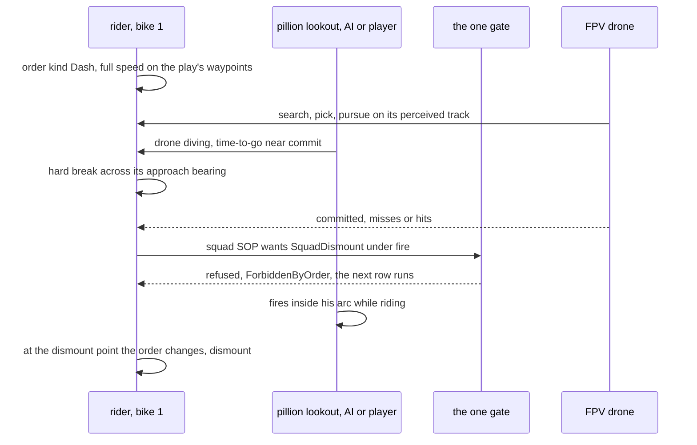
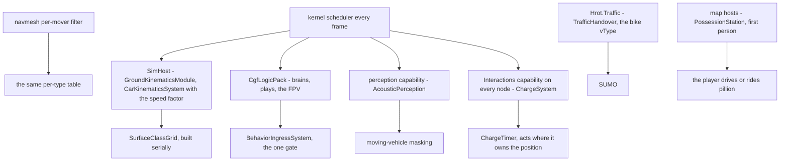

<!--STATUS
state: LIVE
updated: 2026-11-15
build-state: READY-TO-BUILD (2026-11-15) — R-4261 decisions, R-4262 the review, R-4263 conduct categories + the player; slices §6 (backend M-1 / M-2, ui M-1v / M-2p, behaviors M-3…M-6)
current-answer: §1 inventory · §2 decisions · §3 UML · §4 the dash in time · §5 the plays · §6 slices and acceptance · §8 the review
stale-below: § HISTORY at the bottom (§2–§6 as first written); §8 is the review record, folded into §2–§6
known-rot: none
known-conflict: none
related-designs:
  - ../../DESIGN_Operations_Behaviour_Catalogue.md — §12.3 / §12.6 / §12.6a: the analysis and the open sources this design builds (VEH-3, ASY-3, IM-*, PF-*)
  - DESIGN_Checkpoint_And_Ramming.md — OWNS the checkpoint, `RamTarget`, the vehicle ladder and the hostile act the bike-borne bomb (IM-3) and the two-up indicator (IM-8) use
  - DESIGN_FPV_Drone.md — OWNS the FPV's search / pursue / dive the dash is played against
  - DESIGN_Vehicle_Exposure_Cycle.md — OWNS `ShelterFromAir` (a vehicle's evade legs) the dash's break turn sits beside
  - ../../DESIGN_Civilians_And_Crowd_Control.md — OWNS hidden weapons (§5h), the hostile act, the crowd — the insurgent rider blends in through them
  - ../group-maneuvers/DESIGN_Squad_Tactics.md — OWNS the squad's embark / dismount and contact drills the riders fall back on
  - ../weapons/DESIGN_Weapon_Systems.md — OWNS seats, stations and who fires a vehicle's mount (W-I) — the firing seat PF-1 extends it
-->

# DESIGN — the motorcycle: a grey-zone dash, an insurgent's tool, a passenger who fires

🔒 User, `2026-11-15`: *"Some motorcyclist trying to get over the no man's zone, which is full of suicide drones … to cross the land as quickly as
possible and to avoid the drones by speed driving … used for transporting the troops over the exposed areas"* · *"could we use something similar for
Far East terrorist attacks, or in general for the movement of the terrorists or insurgents"* · *"Can we have the second passenger on the motorcycle
firing from his hand weapon while riding, behaving like the gunner in a technical?"* · *"Approved, write both designs and review them"* (R-4261).

**The proven pattern** (open sources, catalogue §12.1 / §12.6): bikes in groups of 2–3, 1–2 men each, cross an FPV-saturated zone at 50–60 km/h
off-road and drop the men at the enemy's edge; insurgents use them because they BLEND, are fast in narrow streets and DISPERSE at once — drive-by
(the pillion fires), parked bombs, a bomb ridden to a checkpoint, massed raids at night. ⭐ An FPV is FASTER than a bike off-road; speed buys less
exposure, the last-second break turn buys a miss.

## 1. INVENTORY *(measured `2026-11-15`; graph: `search_graph name_pattern=".*(Motor|Bike|TwoWheel|Surface|OffRoad|SpeedFactor).*" label=Class` ⇒ no two-wheeler, `TerrainSurface` only; a read-only code sweep; grep. Index coverage could not be checked through the CLI)*

| exists | where | used as |
|---|---|---|
| wheeled vehicles: `SimVehicleDef` (`MaxSpeed`, `TerrainMobility`), the pickup 25 m/s, seats `CarrierDefDto` / `SeatDto` with `Exposed` and roles | `SimVehicleDef.cs:3-45`, `NedTkbCatalog.cs:142-216` | MC-1's type, the pattern |
| the ground integrator: `BicycleModel` + pure pursuit; ⛔ **no off-road factor** — only a tracked hull in a wood is capped | `CarKinematicsSystem.cs:216-223, :542-560` | MC-2 adds the factor in the ONE integrator |
| ground classes: `TerrainSurfaceType` Open · Forest · Water · Scrub; roads from the road graph | `TerrainWorld.cs:17` | MC-2's classes: road · open · scrub · forest |
| routing: `RoadUse` (Never / Neutral / Prefer), `MoveToLocation` (target, speed, roadUse) | `NavigationComponents.cs:176-186` | the dash's route |
| boarding STRIPS `CanMove \| CanShoot` from every passenger; the one exception a weapon system's Gunner seat; on a vehicle crew seat the HOST fires (W-I) | `Embarkation.cs:50, :517-525` | ⭐ PF-1 adds the firing seat here |
| the moving-shooter law: σ × 2 above 0.5 m/s | `HitModel.cs:20-34` | PF-2 |
| the FPV: search → pursue (0.5 s) → dive (0.2 s), LEAD on the target's velocity, 30 m/s, 120°/s, contact 0.8 m; target score = freshness × kill share × kind (vehicle 1, person 0.3) | `AirAttackBehaviors.cs:548-635, :1047-1085`, `FlightParamsDto.cs:15-27` | the threat the dash is played against — unchanged |
| a vehicle evading a drone: ±35° legs away (`ShelterFromAir`) | `ShelterFromAirNodes.cs:184-198` | the break turn (MC-4) is the dash's own, at the dive |
| hidden weapons drawn on the act, the hostile act, the grenade throw | Civilians §5h, `HostileActs.cs`, `HiddenTargetThrow` | the drive-by |
| charges (`Charges.Ask` / `Detonate`), cargo stations, `TriggerIed` (phone) | `Charges.cs:34-57`, `TriggerIedBehavior.cs` | the parked bomb |
| SUMO's `motorcycle` class; traffic types are `TrafficVehicleDto` rows | `VTypeDefaults.cs:156`, `UrbanCombatTkbCatalog.cs:206, :439` | civilian bikes (IM-7) |
| ⛔ a timer detonation · a firing seat · a dispersal play · a two-wheeler | — | built here |

## 2. Decisions *(✅ R-4261 · the review R-4262 · conduct categories R-4263 · the player R-4263 — folded `2026-11-15`; the first text is in HISTORY)*

🔒 User, `2026-11-15`: *"Approved, fold them in. I think the motorcycle also needs to be possessable and player can also embark it as a passenger
(the one that can shoot while motorcycle drives)"*.

| # | decision | why / review |
|---|---|---|
| **MC-1** | ONE `Motorcycle` type (soldiers and insurgents; the side from the faction): a Driver seat + a pillion FIRING seat (PF-1), both exposed; ~28 m/s on a road; its own SUMO vType (MV-10); its own 3-D family and kit (two wheels, riders seated) by the ui lane, mockup first (MV-11) | — |
| **MC-2** | ⭐ an **off-road speed factor per TYPE** (open · scrub · forest; road 1.0) on `VehicleParametersDto` → `VehicleParams` (0 = 1.0, so every existing type is unchanged) — read from ONE surface-class grid (the 25 m `TerrainWoods` grid generalised: one array index, built in the serial pre-pass), applied in the ONE ground integrator; the tracked-in-woods cap folds into the same table; ONE forest source. The bike: open 0.6 · scrub 0.45 · forest 0.3, grip ~0.45 g off-road | MV-3, MV-4 |
| **MC-2a** | the SAME per-type table prices the route planner's per-mover filter — a bike may enter a wood at its factor (today `WheeledWoodsCost = 0` closes it); a cover-seeking route = waypoints the play sets now; an exposure cost on the planner is a later row | MV-5 — one owner |
| **MC-3** | `GreyZoneDash` — a squad on 2–3 bikes under an order of kind **`Dash`** (CD-2): the play's waypoints, ≥ 80 m between bikes (one drone, one bike — reuse `PlatoonConvoy`'s gap), full speed, never stop | MV-12, MV-13 |
| **MC-4** | the pillion is the LOOKOUT: the rider reads the exposed crew's memory as a DECLARED cross read; **riding masks hearing** — one rule in the acoustic masking (a listener on a moving vehicle hears × k); a diving drone at **time-to-go ≈ commit + 0.3 s** ⇒ break hard ACROSS its approach bearing (two sightings) | MV-7, MV-8 |
| **MC-4a** | ⭐ **the FPV's terminal guidance becomes realistic** (cross-lane into the FPV design): it aims from its OWN perceived track with an operator delay (~0.3–0.5 s) and stops re-aiming at a COMMIT point (time-to-go ≈ 0.7 s); the expected miss of a break is ½·a·(commit + delay)² — ⚠ every drone scenario changes (R-4262) | MV-1 |
| **MC-5** | a bike hit or a man down ⇒ the others ride on (CD-2 forbids halting); survivors of a disabled bike may dismount (CD-5) and go to cover on foot | MV-2 |
| **MC-6** | at the dismount point the bike halts, the squad dismounts (`SquadDismount`), the order changes from `Dash`; the abandoned bikes stay where they are, owned by nobody (any unit may take one) | MV-13 |
| **MC-7** | the defender is the existing `DroneOperator` / `DroneTeam`; it picks by its score (a bike 1 beats a rider 0.3) | MV-13 |
| **CD-1** | ⭐ every REACTION declares its **conduct** on `[Behavior]`: `Halts` · `Dismounts` · `LeavesRoute` · `SeeksCover` | 🔒 user: categories, never names |
| **CD-2** | ⭐ every ORDER KIND declares the conduct it **forbids**, in ONE table beside `OrderKind`: new kind **`Dash`** forbids all four; Defend / Hold forbid LeavesRoute (`HoldsFirm` folds in) | the order is compared, never a behaviour |
| **CD-3** | ⭐ the ONE gate (`BehaviorIngressSystem.Admit`) refuses a reaction whose conduct the unit's current order forbids — refusal `ForbiddenByOrder`, journaled; no SOP row changes; ⚠ the refused row FALLS THROUGH to the next row (never a re-try loop — the build verifies `SopActions.React`'s return) | MV-2 |
| **CD-4** | the dash orders each bike with kind `Dash` too — the bike and the squad each read ONLY their own order | the parallel rule |
| **CD-5** | the forbidding yields when the unit cannot comply (immobile, its carrier dead) | — |
| **CD-6** | firing is not a conduct — the pillion still fires; self-defence is never refused | — |
| **IM-1** | `DriveBy` — our bike handed to traffic (`TrafficHandover`), neutral, weapon hidden → a brain move at the act → slow to 2–5 m/s alongside → the pillion fires a burst / throws → the pre-chosen escape route at speed → split; re-blend (dump the bike) | MV-10, MV-12 |
| **IM-2** | `ParkedBomb` — ride in, park, leave (on foot / a waiting bike), detonate by `ChargeTimer` or phone; optional secondary device for responders | MV-9, MV-12 |
| **IM-3** | the bike-borne bomb at a checkpoint = `RamTarget` on a two-wheeler ([Checkpoint & Ramming](DESIGN_Checkpoint_And_Ramming.md)) | — |
| **IM-5** | `SwarmRaid` — an assembly area → converge from N directions (night allowed) → pillions fire on the approach → dismount and fight → DISPERSE on divergent routes to a rally point, picking up casualties; defenders HEAR massed engines | MV-12 |
| **IM-6** | scout / getaway — compositions (`Sentry` + reports; a waiting move) | — |
| **IM-7** | civilian bikes in SUMO; the INSURGENT is our own entity handed to traffic (never a SUMO mirror) | MV-10 |
| **IM-8** | the counters: a motorcycle ban (a scenario rule); "two men on one bike" an indicator at the checkpoint | — |
| **PF-1** | ⭐ a **firing seat**: any seat may state a traverse arc — the EXISTING station arc (`SeatDto.TraverseMinDeg/MaxDeg` → `WeaponSystems.InStationArc`, generalised, ⚠ wrapping through ±180°); its man KEEPS `CanShoot` (one rule in `Embarkation.StrippedOn`; `CombatLife.RestoreHitCapabilities` asks it too) and fires his own weapon; the seat is placed at its X/Y/Z like a station (his eye and muzzle) | MV-6 — generic: pickup beds, firing ports |
| **PF-2** | his spread = the moving-shooter law (his velocity is already the vehicle's) + a rough-ride factor off-road | MV-6 |
| **PF-3** | the passenger's own weapon brain decides to fire inside the arc; the rider only drives | 🔒 user |
| **PF-4** | the rider's seat keeps `CanShoot` with NO fire on the move — the existing `HoldMoving` gate | MV-6 |
| **PL-1** | ⭐ **the player may DRIVE the bike** — possess a soldier, *Drive* (the existing use verb, any vehicle with a Driver seat) ⇒ manual driving; the speed factor (MC-2) slows him off-road too | 🔒 user |
| **PL-2** | ⭐ **the player may RIDE PILLION and shoot** — *Board* (the existing verb) takes the firing seat while an AI (or another player) drives; in first person his camera is at the seat's eye, he looks freely and fires his own weapon INSIDE the arc (outside it the HUD shows *out of arc* and nothing fires) with PF-2's spread; ⚠ the first-person fire path for an EMBARKED man is unmeasured — the build measures it first | 🔒 user |
| **PL-3** | the AI rider of a player's pillion obeys the player's squad order (or a *Drive to* order from the player) — the player does not steer | — |
| ⛔ IM-4 | the sticky bomb — DROPPED | 🔒 user |

## 3. UML *(as folded)*

```mermaid
classDiagram
  class VehicleParams {
    <<existing, grows OffRoad factors per type>>
    Open
    Scrub
    Forest
  }
  class SurfaceClassGrid {
    <<new, generalises TerrainWoods, serial build>>
    ClassAt()
  }
  class CarKinematicsSystem {
    <<existing, the one integrator>>
  }
  class NavMoverFilter {
    <<existing per-mover filter, priced by the same table>>
  }
  class SeatDto {
    <<existing, any seat may state TraverseMin and Max>>
  }
  class InStationArc {
    <<existing WeaponSystems, generalised to seats, wraps>>
  }
  class Embarkation {
    <<existing, StrippedOn keeps CanShoot on a firing seat>>
  }
  class AcousticPerception {
    <<existing, masking grows a moving-vehicle term>>
  }
  class BehaviorIngressSystem {
    <<existing, THE ONE GATE refuses ForbiddenByOrder>>
  }
  class BehaviorConduct {
    <<new flags on Behavior attribute>>
    Halts
    Dismounts
    LeavesRoute
    SeeksCover
  }
  class OrderConduct {
    <<new table beside OrderKind>>
    Forbids()
  }
  class FpvTerminalGuidance {
    <<FPV design, perceived track, delay, commit>>
  }
  class ChargeTimer {
    <<new, unmanaged, recorded>>
    DetonateAt
  }
  class Charges {
    <<existing, Ask with no asker is the timer path>>
  }
  class TrafficHandover {
    <<existing, our bike into SUMO and back>>
  }
  class GreyZoneDash {
    <<new play, order kind Dash>>
  }
  class DriveBy {
    <<new play>>
  }
  class SwarmRaid {
    <<new play>>
  }
  class OperatorUse {
    <<existing, Drive and Board verbs>>
  }
  CarKinematicsSystem ..> VehicleParams
  CarKinematicsSystem ..> SurfaceClassGrid
  NavMoverFilter ..> VehicleParams : one table
  Embarkation ..> SeatDto
  InStationArc ..> SeatDto
  BehaviorIngressSystem ..> BehaviorConduct : the reaction
  BehaviorIngressSystem ..> OrderConduct : the current order
  GreyZoneDash ..> OrderConduct : Dash
  ChargeTimer ..> Charges
  DriveBy ..> TrafficHandover
  DriveBy ..> InStationArc : the pillion fires
  SwarmRaid ..> InStationArc
  OperatorUse ..> SeatDto : the player drives or rides pillion
  FpvTerminalGuidance .. GreyZoneDash : the threat
  AcousticPerception .. GreyZoneDash : riders hear less
```


*What it shows that prose hid: every engine change GROWS an existing seam — the integrator's params, the woods grid, the station arc, the boarding
rule, the acoustic mask, the one admission gate — and the player rides on the same seat rules as the AI (the existing Drive / Board verbs).*


*What it shows: the drone is beaten only because it COMMITS; the squad's own reflexes are held back by its order's category at the one gate; the
pillion's fire is untouched by it.*


*What it shows: each change rides the module that already owns its neighbour, on every node that needs it — the timer on every node (acting only
where it owns the charge), the masking where perception solves, the gate where the brains run.*

## 4. The dash in time *(defaults; the builder tunes, recording each)*

| t | bike 1 | bike 2 / 3 | the drone |
|---|---|---|---|
| 0 | order `Dash`, full speed, waypoints | 80 m spacing | searching |
| +20 s | spotted | — | picks by score, pursues on its perceived track |
| dive, ~2.3 s out | the pillion sees it dive | ride on | re-aims, with its operator delay |
| time-to-go ≈ 1 s | hard break across its bearing | ride on | commits at ≈ 0.7 s, stops re-aiming |
| impact | miss ⇒ ride on · hit ⇒ survivors may dismount (CD-5) | ride on | spent |
| arrival | the order changes, dismount, fight on foot | the same | — |

## 5. The plays

| play | steps | built from |
|---|---|---|
| `GreyZoneDash` | order `Dash` → waypoints → spacing → MC-4 break → dismount at the edge | `PlatoonConvoy`'s gap, `SquadDismount`, the gate |
| `DriveBy` | traffic handover → brain move at the act → 2–5 m/s alongside → burst / throw → escape route → split, re-blend | `TrafficHandover`, hidden weapons, the firing seat, `HiddenTargetThrow`, the hostile act |
| `ParkedBomb` | ride → park → leave → `ChargeTimer` / phone (+ secondary) | `Charges.Ask(charge, Null)`, `TriggerIed` |
| `SwarmRaid` | assembly → converge from N directions → pillions fire → dismount, fight → disperse to a rally point with casualties | the motorcycle squad, `PlatoonAttack`, `BreakContact` |
| scout / getaway | `Sentry` + reports; a waiting move | compositions |

## 6. Slices and acceptance

| # | lane | builds | ⭐ done when (a rail each, red-proved) |
|---|---|---|---|
| **M-1** | backend | MC-2 / MC-2a (per-type factors, the surface-class grid, the nav pricing) + MC-1 the type (SUMO vType) | a bike crosses open ground at 0.6 × its road speed and may route through a wood; every existing vehicle suite and scenario hash unchanged; 0 B per frame |
| **M-1v** | ui | the motorcycle family + kit (two wheels, seated riders), mockup first | drawn in 2-D and 3-D; a frame rail under `xvfb-run -a` |
| **M-2** | backend | PF-1…PF-4 the firing seat (the generalised arc, seat placement, the capability paths) | a pillion fires inside his arc, not ahead; the arc wraps through ±180°; the rider never fires moving; a pickup-bed rifleman fires too |
| **M-2p** | ui + backend | PL-1…PL-3 the player: drive, and ride pillion firing in first person | possess → Drive → the bike drives and is slowed off-road; possess → Board pillion → fire inside the arc only, the HUD's *out of arc* outside it |
| **M-3** | behaviors | CD-1…CD-6 conduct + the gate | a squad on a `Dash` under fire does not dismount and its bike does not shelter; the next row runs; a disabled bike's men dismount; the journal shows `ForbiddenByOrder` |
| **M-4** | behaviors (+ the FPV design) | MC-4a the realistic FPV guidance; MC-3…MC-7 the dash; the hearing mask | seeded runs on open ground vs two FPV operators: the riders are UNHURT (miss beyond the casualty radius) in a measured share; existing drone scenarios re-run and their rails reconciled |
| **M-5** | behaviors | `DriveBy`, `ParkedBomb`, `ChargeTimer` | the drive-by fires from the pillion and escapes; the parked bomb goes off on its timer after the rider has left |
| **M-6** | behaviors | `SwarmRaid` + dispersal | N bikes converge, fight, disperse to a rally point |

⭐ Every slice: `HROT_PARALLEL_SIM=1` + `HROT_READ_CHECK=1` + `HROT_WORLD_GUARD=1`; `stepped-hash.py --threads 1,4,8`; 0 B per steady frame (R-2084);
invariant number output (R-4221); a new recorded component unmanaged and fixed before its first recording.

## 8. ⛔ The review — `2026-11-15` *(two independent reviewers: realism + plays, engine fit; ✔ = re-measured by the coordinator)* — ✅ ALL APPROVED as leaned, user `2026-11-15`: *"Approved."* (R-4262; MV-1 the realistic FPV terminal guidance included)

⭐ 23 raw findings merged into 13. The design is NOT buildable as drawn until MV-1…MV-5 are ruled.

| # | sev | the defect | evidence | ⭐ lean |
|---|---|---|---|---|
| MV-1 | ⛔ BLOCKER | the break turn CANNOT beat the FPV as coded: it re-aims every 0.2 s at the target's TRUE position with a lead, turning ~31 m/s² against the bike's ~8 — the escape is ~0.16 m; and a miss still bursts on the ground (PG-7: 2 m lethal, 5 m casualty) | `AirAttackBehaviors.cs:346, :613-631`, `RotorcraftModel.cs:93`, `DroneImpactSystem.cs:54-67` | ⭐ **cross-lane, the FPV's terminal guidance becomes realistic**: it aims from the drone's own perceived track + an operator delay (~0.3–0.5 s) and STOPS re-aiming at a commit point (time-to-go ≈ 0.7 s); the design states the expected miss ½·a·(commit + delay)²; M-3's acceptance = the riders UNHURT (miss beyond the casualty radius) in a measured share. ⚠ every drone scenario changes — the user's call |
| MV-2 | ⛔ BLOCKER | the existing reactions break "never stop": the squad SOP dismounts a mounted squad under fire (above the Riding row) and the vehicle SOP sends a bike to `ShelterFromAir` on a drone | ✔ `BasicSquadSop.cs:91-98` (origin/behaviors), `BasicVehicleSop.cs:60-64` | during a dash those rows YIELD (the `PushThrough` precedent: "a carrier never stops in the kill zone"); the bike's drone row becomes MC-4; a rail: a burst nearby in a dash ⇒ no dismount, no route change |
| MV-3 | ⛔ BLOCKER | the speed factor keyed per MOBILITY CLASS cannot tell a bike from a pickup (both `Wheeled`) | ✔ `NedTkbBuilder.cs:184-189` | per TYPE: three factors on `VehicleParametersDto` → `VehicleParams` (unmanaged, on every node, already read in the integrator), 0 = 1.0 |
| MV-4 | ⛔ BLOCKER | the ground-class lookup per vehicle per tick walks every surface polygon (`foreach` over an interface — allocates) | `TerrainWorld.cs:1103-1109` | ONE surface-class grid, generalising the 25 m `TerrainWoods` grid (one array index), built in the serial pre-pass; ONE forest source; the tracked-in-woods cap folds into the same table |
| MV-5 | ⛔ BLOCKER | the route planner cannot do what the dash assumes: a wheeled mover never enters a wood (cost 0 = closed), open / scrub are not navmesh areas, no exposure cost exists | ✔ `NavDoorways.cs:211` (`WheeledWoodsCost = 0f`) | the same per-type table prices the integrator AND the per-mover nav filter (a bike may enter a wood at its factor); the cover-seeking route = waypoints the play authors now, an exposure cost on the planner later (its own row) |
| MV-6 | SHOULD | the firing seat duplicates an arc that exists, sits at the hull's ground point, and two capability paths bypass it | `CarrierDefDto.cs:128` (`TraverseMinDeg`), `WeaponSystems.InStationArc :128-140`, `EmbarkedStateSystem.cs:129-151`, `CombatLife.cs:93` | reuse the station arc for any seat (wrap through ±180° — a rail); place firing seats at their seat position like stations; the rider = a seat with no fire on the move through the existing `HoldMoving` gate; `RestoreHitCapabilities` asks `StrippedOn`; `ShooterSpeed` dropped (the velocity is already copied) |
| MV-7 | SHOULD | the lookout and "riding masks hearing" have no hook: the vehicle reacts from its own memory; hearing is masked by weather only | `AirDefenceBehaviors.cs:34-55`, `AcousticPerception.cs:261-263` | the rider reads the exposed crew's memory as a DECLARED cross read; one rule in the acoustic masking: a listener on a moving vehicle hears × k; both in the UML (a third and fourth engine touch) |
| MV-8 | SHOULD | "40 m" is the wrong trigger; the dive starts ~69 m slant, ~2.3 s out | `AirAttackBehaviors.cs:342, :619-623` | trigger on time-to-go (commit + 0.3 s); break across the approach bearing from two sightings; lower grip off-road (~0.45 g) |
| MV-9 | SHOULD | the timer calls the wrong API and the wrong host | `Charges.cs:42-57`, `CoreInfrastructureCapabilities.cs:149` | `Charges.Ask(charge, Null)` is the timer path; an unmanaged recorded `ChargeTimer { SimInstant DetonateAt }` ticked beside `ChargeSystem` (every node; acts where it owns the position) |
| MV-10 | SHOULD | blending: SUMO's own civilian bikes can never become insurgents; our bike handed to SUMO falls back to a CAR's vType | `TrafficHandover.cs:15-65`, `TrafficVehicleCatalog.cs:28` | the insurgent is OUR entity handed to traffic (`TrafficHandover`), then a brain move at the act; the motorcycle type registers its own SUMO vType; a rail that the shadow is despawned |
| MV-11 | SHOULD | no two-wheeler visual (`CarKits` draws four wheels); no mockup (R-4143) | `VisualFamily.cs:10-35`, `CarKits.cs:43-59` | a `Motorcycle` family + kit (+ riders seated) by the ui lane, with a mockup first |
| MV-12 | SHOULD | the plays miss steps | §5 | drive-by: fire at 2–5 m/s, a pre-chosen escape route, re-blend (dump the bike); parked bomb: an optional secondary device for responders; swarm: assembly area, rally point, casualty pick-up; night (speed, detection); defenders HEAR massed engines; a defender counter-play |
| MV-13 | NIT | wording / reuse | — | the drone picks by score (bike 1 > rider 0.3), not "nearest"; spacing's reason = one drone one bike (reuse `PlatoonConvoy`'s gap); an owner for abandoned bikes; the SUMO file path; "only TWO engine changes" → four |

⭐ **Found sound:** a passenger's brain, perception and weapon brain keep running aboard; the weapon dispatcher's only gate is `CanShoot`, so the
one `StrippedOn` rule reaches the executor; his own bike never blocks his fire; exposed riders are seen and targetable; the FPV numbers in §1 are
right; the takeover from traffic works (a non-traffic move despawns the shadow); the speed values are sensible (open 0.6 ≈ 60 km/h).

### 8a. How a unit knows it must not halt — CONDUCT CATEGORIES, never behaviour names *(✅ CD-1…CD-6 APPROVED `2026-11-15`, R-4263 — folded into §2)*

🔒 User, `2026-11-15`: *"how would we detect that the motorcycle is on the dash to suppress the undesired behaviors like the crew stopping when under
fire … We shouldn't compare exact behavior names. We need to somehow flag different behaviors by their category. What we can compare is the name of
the order, but never a concrete behavior."*

📐 **Measured:** every reaction reaches a unit through ONE gate — `BehaviorIngressSystem.Admit` (*"THE ONE GATE"*, R-188, origin/behaviors
`BehaviorIngressSystem.cs:224-260`), which already refuses some reactions and journals why (`BrainRefusal`). The typed order exists
(`CurrentOrders.Of`, its `OrderKind`, CE-4612); `HoldsFirm` (kind ∈ {Defend, Hold}) is today's one order-kind question. ⛔ No reaction declares
what it DOES to the unit.

| # | lean | why |
|---|---|---|
| CD-1 | ⭐ every REACTION behaviour declares its **conduct** as flags on its `[Behavior]` attribute (beside `Fulfils`): `Halts` · `Dismounts` · `LeavesRoute` · `SeeksCover` (e.g. `SquadDismount` = Dismounts \| Halts; `ShelterFromAir` = LeavesRoute \| SeeksCover; `VehicleFightFromCover` = Halts) | the CATEGORY of what a behaviour does, declared once by its author — never compared by name |
| CD-2 | ⭐ every ORDER KIND declares the conduct it **forbids**, in ONE table beside `OrderKind`: a new kind **`Dash`** (cross an exposed zone at all costs) forbids Halts \| Dismounts \| LeavesRoute \| SeeksCover; Move / March forbid nothing; `HoldsFirm`'s Defend / Hold become the same table (forbids LeavesRoute) — one mechanism | the user's rule: the ORDER is compared, never a behaviour |
| CD-3 | ⭐ the ONE gate refuses a reaction whose conduct the unit's current order forbids — a new refusal cause `ForbiddenByOrder`, journaled like the others; NO SOP row changes; ⚠ the refused row must FALL THROUGH to the next SOP row (so the dash's own break-turn row is reached), never spin re-trying — verify `SopActions.React`'s return on a refusal | zero edits across the SOPs; every unit type gets it by construction |
| CD-4 | the dash's carriers get the SAME order kind: the dash play orders each bike with kind `Dash`, so the bike and the squad each read ONLY their own current order (no cross-entity read) | the parallel rule |
| CD-5 | the forbidding YIELDS when the unit cannot comply — immobile (a mobility kill), or its carrier dead: then halting / dismounting is allowed | a disabled bike's men must get off |
| CD-6 | firing is not a conduct — the pillion still fires, a self-defence shot is never refused | the dash fights on the move |

## ⛔ HISTORY — §2–§6 as first written (R-4261), before the review and the conduct categories — ⛔ do not quote

## 2. Decisions *(✅ APPROVED `2026-11-15`, R-4261)*

| # | decision | why |
|---|---|---|
| **MC-1** | ONE `Motorcycle` type (soldiers and insurgents; the side from the faction): rider (Driver) + pillion (a FIRING seat, PF-1), both exposed; ~28 m/s on a road; a small body; a civilian variant for traffic (IM-7) | one transport, every use |
| **MC-2** | ⭐ an **off-road speed factor per mobility class × ground class** (road · open · scrub · forest), applied in the ONE ground integrator; every existing type defaults to 1.0 everywhere (nothing changes until calibrated; a row files the calibration); the motorcycle: road 1.0 · open 0.6 · scrub 0.45 · forest 0.3 | ⛔ today a field is crossed at road speed — the dash means nothing without it |
| **MC-3** | `GreyZoneDash` — a squad on 2–3 bikes: a route that prefers cover (woods edges, hedges, dead ground — an exposure cost on the route), **≥ 80 m between bikes**, full speed, never stop for the hit | the reported doctrine |
| **MC-4** | the pillion is the LOOKOUT (eyes; ⭐ riding masks both riders' HEARING — the reported weakness); a drone diving inside ~40 m ⇒ the rider breaks HARD across its line; a drone tailing ⇒ a jink | the one counter a rider has; our drone re-aims every 0.2 s |
| **MC-5** | a bike hit or a man down ⇒ the others ride on; survivors go to cover on foot (`UnderFireMove`, `TakeCover`) | doctrine; existing reflexes |
| **MC-6** | at the dismount point: dismount, leave the bikes, the squad's order on foot (`SquadDismount`, then Attack / Hold) | the bike is a transport |
| **MC-7** | the defender is the existing `DroneOperator` / `DroneTeam`, unchanged | no defender code |
| **IM-1** | `DriveBy` — two up: ride to the target, slow and hold a steady line past it while the PILLION fires a burst (or throws a grenade), escape at speed, the bikes split | the commonest insurgent attack |
| **IM-2** | parked bomb — ride in, park among bikes / at a market / beside a post, leave (on foot or a waiting bike), detonate by TIMER (new) or phone | Pattani 2019 / 2025 |
| **IM-3** | the bike-borne bomb at a checkpoint = `RamTarget` on a two-wheeler ([Checkpoint & Ramming](DESIGN_Checkpoint_And_Ramming.md)) | Pattani 2026; for free |
| **IM-5** | `SwarmRaid` — N bikes converge on a post from several directions (often at night), pillions fire on the approach, dismount and fight, then **DISPERSE** on divergent routes | the Sahel |
| **IM-6** | scout (a lone rider watches and reports to the cell) and getaway (a bike waits to extract) — compositions | — |
| **IM-7** | civilian motorcycles in SUMO traffic; an insurgent rides like one, neutral, weapon hidden, until his act | blending is the point |
| **IM-8** | the counters: a motorcycle ban (a scenario rule), "two men on one bike" an indicator at a checkpoint | the trainees' side |
| **PF-1** | ⭐ a **firing seat**: `SeatDto.FireArc` (bearings relative to the hull; the pillion: both sides and the rear, never forward across the rider); its man KEEPS `CanShoot` and fires his OWN weapon through his own `WeaponChannel` — ONE rule in `Embarkation.StrippedOn` | ⭐ generic: pickup beds, open trucks, an IFV's firing ports |
| **PF-2** | his spread = the moving-shooter law at HIS VEHICLE's speed + a rough-ride factor off-road (MC-2's classes) | one law |
| **PF-3** | the passenger's own weapon brain decides to fire (threat evaluation, ROE, inside the arc); the rider only drives | 🔒 user |
| **PF-4** | the rider fires only when stopped | the same |
| ⛔ IM-4 | the sticky bomb — DROPPED (🔒 user: *"Ignore the sticky car bomb."*) | — |

### 3. UML

```text
classDiagram
  class GroundSpeedFactor {
    <<new, TKB per mobility class>>
    Road
    Open
    Scrub
    Forest
  }
  class CarKinematicsSystem {
    <<existing, the one ground integrator, grows the factor>>
  }
  class SeatDto {
    <<existing, grows FireArc>>
    Role
    Exposed
    FireArc
  }
  class Embarkation {
    <<existing, StrippedOn keeps CanShoot on a firing seat>>
  }
  class SeatFire {
    <<new, the one arc rule>>
    InArc()
    ShooterSpeed()
  }
  class HitModel {
    <<existing, moving shooter at the vehicle speed>>
  }
  class AimAndFireExecutor {
    <<existing, asks SeatFire for a seated shooter>>
  }
  class GreyZoneDash {
    <<new play>>
  }
  class DriveBy {
    <<new play>>
  }
  class SwarmRaid {
    <<new play, dispersal>>
  }
  class ParkedBomb {
    <<new play>>
  }
  class ChargeTimer {
    <<new, on a charge>>
    DetonateAt
  }
  class Charges {
    <<existing>>
  }
  class RamTarget {
    <<Checkpoint and Ramming design>>
  }
  class DroneOperator {
    <<existing, unchanged>>
  }
  CarKinematicsSystem ..> GroundSpeedFactor
  Embarkation ..> SeatDto : FireArc present
  AimAndFireExecutor ..> SeatFire
  SeatFire ..> SeatDto
  SeatFire ..> HitModel : vehicle speed
  GreyZoneDash ..> GroundSpeedFactor : route cost
  DriveBy ..> SeatFire : the pillion fires
  SwarmRaid ..> SeatFire
  ParkedBomb ..> ChargeTimer
  ChargeTimer ..> Charges : Detonate
  DroneOperator ..> GreyZoneDash : the threat
  RamTarget .. DriveBy : the bike-borne bomb, IM-3
```
*What it shows that prose hid: the motorcycle needs only TWO engine changes — the speed factor in the one integrator, the firing seat in the one
boarding rule — and both are generic (every vehicle, every open seat); everything else is a play composed from parts that exist.*

```text
sequenceDiagram
  participant R as rider, bike 1
  participant P as pillion lookout
  participant D as FPV drone
  participant B as bike 2, 80 m behind
  R->>R: full speed on the cover-preferring route
  D->>R: search, pick, pursue with lead
  P->>R: drone diving, inside 40 m
  R->>R: hard break turn across its line
  D-->>R: misses by more than 0.8 m, or hits
  B->>B: rides on, never stops for bike 1
  R->>R: at the dismount point, dismount
  R->>P: squad order on foot
```
*What it shows: the drone is beaten by geometry at the last second, not by speed — and the group's spacing is what keeps one drone to one bike.*

```text
graph TD
  SIM[SimHost - GroundKinematicsModule registers CarKinematicsSystem] --> CK[CarKinematicsSystem, the speed factor]
  CGF[CgfLogicPack - the brains] --> PLAYS[GreyZoneDash, DriveBy, SwarmRaid, ParkedBomb]
  CGF --> FIRE[the weapon brain - a seated shooter through SeatFire]
  SIMF[SimHost - the fire path] --> AE[AimAndFireExecutor and HitModel]
  TIMER[ChargeTimerSystem - beside the charge owner on the SimHost] --> CH[Charges.Detonate]
  TRAF[Hrot.Traffic - SUMO] --> CIVB[civilian motorcycles]
  SCH[kernel scheduler, every frame] --> SIM
  SCH --> CGF
  SCH --> SIMF
```
*What it shows: each piece rides the module that already runs its neighbours — the factor in the ground integrator every simulating node runs, the
seat rule in the boarding / fire path, the timer beside the charge's owner.*

### 4. The dash in time *(defaults; the builder tunes, recording each)*

| t | bike 1 | bike 2 / 3 | the drone |
|---|---|---|---|
| 0 | starts, full speed, the cover route | 80 m spacing | searching |
| +20 s | spotted (the drone's eyes) | — | picks the nearest bike, pursues with lead |
| +25 s | the pillion sees it dive (< 40 m) ⇒ break turn | ride on | re-aims every 0.2 s, 120°/s |
| +26 s | missed ⇒ rides on · hit ⇒ survivors to cover | ride on | spent; the operator launches the next |
| arrival | dismount at the edge, order on foot | the same | — |

### 5. The insurgent plays

| play | steps | built from |
|---|---|---|
| `DriveBy` | approach as traffic (neutral, hidden weapon) → slow alongside the target → the pillion draws and fires a burst / throws → speed away → split at the first junction | traffic, hidden weapons, `SeatFire`, `HiddenTargetThrow`, the hostile act |
| `ParkedBomb` | ride to the spot → park → walk to the getaway bike → the timer (or the phone) | `ChargeTimer` / `TriggerIed`, `MoveToLocation` |
| `SwarmRaid` | rally points → converge from N directions → pillions fire on the approach → dismount and fight (`SquadDismount`, the attack) → on the signal DISPERSE: each bike its own divergent route | the motorcycle squad, `PlatoonAttack`, `BreakContact` |
| scout / getaway | `Sentry` + the report path; a waiting `MoveToLocation` | compositions |

### 6. Slices and acceptance

| # | builds | ⭐ done when (a rail each, red-proved) |
|---|---|---|
| **M-1** | MC-2 the speed factor (all types 1.0) + MC-1 the type (+ the civilian traffic variant) | a bike crosses open ground at 0.6 × its road speed; every existing vehicle's suite unchanged |
| **M-2** | PF-1…PF-4 the firing seat | a pillion fires at a target in his arc, not at one ahead; his spread doubles moving; the rider never fires moving; a pickup-bed rifleman fires too |
| **M-3** | `GreyZoneDash` + MC-4…MC-6 | seeded runs on open ground vs two FPV operators: the break turn makes a dive miss in a measured share; 80 m spacing; the survivors dismount at the edge |
| **M-4** | `DriveBy` + `ParkedBomb` + `ChargeTimer` | the drive-by fires from the pillion and escapes; the parked bomb goes off on its timer after the rider has left |
| **M-5** | `SwarmRaid` + dispersal | N bikes converge, fight, disperse on divergent routes |

⭐ Every slice: `HROT_PARALLEL_SIM=1` + `HROT_READ_CHECK=1` + `HROT_WORLD_GUARD=1`; `stepped-hash.py --threads 1,4,8`; 0 B per steady frame (R-2084);
invariant number output (R-4221); a new recorded component unmanaged and fixed before its first recording.


