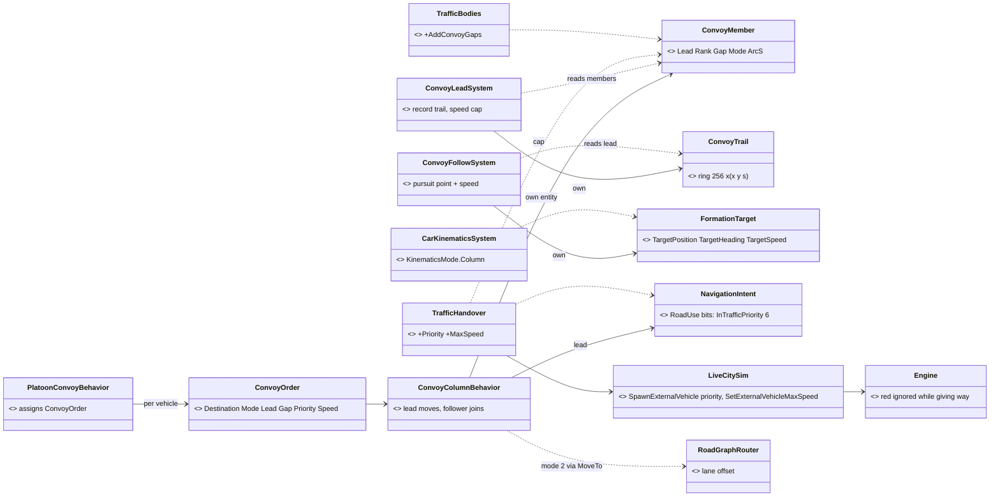
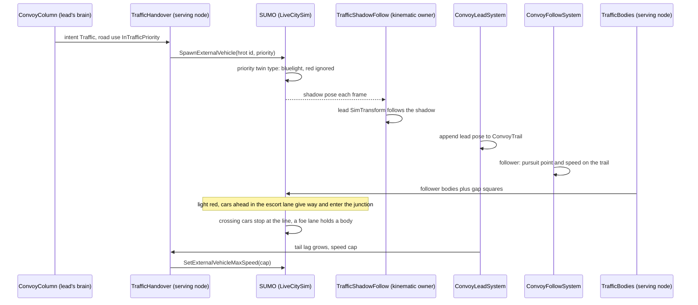
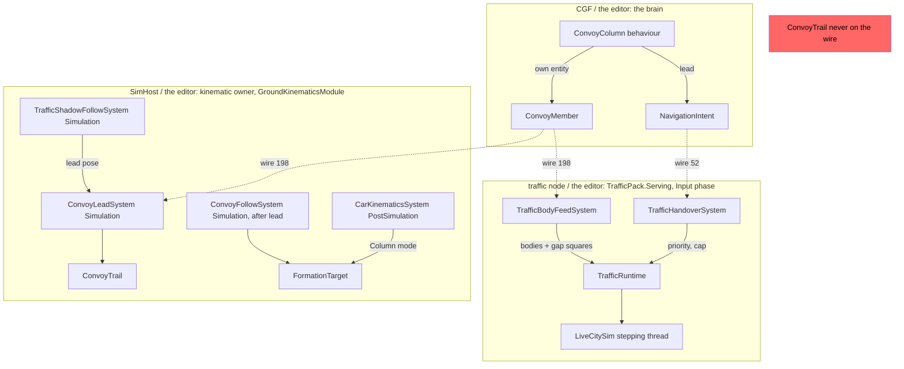

<!--STATUS
state: LIVE
updated: 2026-11-16
build-state: READY-TO-BUILD (convoy lane, CE-4631 / CE-9000…; R-9000…R-9010 lane decisions, for the user's review)
current-answer: §1 inventory · §2 the proven solution · §3 decisions · §4 UML · §5 slices and acceptance · §6 as built (filled as the steps land)
stale-below: nothing
known-rot: none
known-conflict: none
supersedes: DRAFT_Road_Convoy.md (the direction; every row of it is carried here)
related-designs:
  - DRAFT_Road_Convoy.md — SUPERSEDED by this file; kept for the user's words and the first measurements
  - ../../blueprints/Architect_Question_93_Sumo_Traffic_Node.md — OWNS the SUMO traffic node: §13 our bodies into SUMO (`TrafficBodies`), §14 the handover (`TrafficHandover`, the shadow `hrot:<id>`), §15 replicas; this design extends §13 (gap fillers) and §14 (priority + a speed cap)
  - ../navig-2/Navigation_Design_v2_0.md — OWNS the ground route planner (§5.2a `RoutePlanner` / `RoadGraphRouter`); mode 2 adds the lane offset where road points are emitted
  - ../group-maneuvers/DESIGN_Defend_And_Attack_Position.md — OWNS the platoon's mounted convoy (§11a `PlatoonConvoyBehavior`, R-2069); its vehicles now drive as ONE column (§3 C-9)
  - ../group-maneuvers/DESIGN_City_Battle_Showcase.md — OWNS the convoy-under-contact plays (§11 C-5, R-7010) that take over when a convoy is hit
  - DESIGN_Checkpoint_And_Ramming.md — a neighbour: a convoy meeting a checkpoint is that design's case, not this one's
  - ../../reference/NED_DDS_Protocol.md — the wire: `ConvoyMember` (descriptor 198) is the one new type
  - ../../DESIGN_Scenario_Regression.md — the feature scenarios' format (R-4277, R-4279)
-->

# DESIGN — the road convoy in SUMO traffic (CE-4631)

🔒 User, `2026-11-16`: *"Convoy never split, ignores traffic lights, and the sumo vehicles needs to react to it."* · *"I meant the leading sumo vehicle to be
the one with priority, with beacon or siren. So no traffic lights apply … because Sumo handles all of that already … The route can stay as a second valid
option because it works outside of Sumo, offroad, so it is worth supporting it."* (R-4282)

## 0. The rules — the acceptance of everything (the user's, never traded)

| rule | measured by |
|---|---|
| the convoy NEVER splits | max gap along the lead's path between two consecutive vehicles ≤ the limit; no vehicle overtakes its predecessor |
| it IGNORES traffic lights | no convoy vehicle's speed drops to 0 in front of a red it then crosses |
| SUMO's vehicles REACT to it | no SUMO car is ever between two convoy vehicles on the column's path; cars queue behind it and stop for it at junctions |
| it ACTS when the scenario needs it | attacked / ordered to battle ⇒ the shadow is gone and the contact plays run within N s; no vehicle re-created |

## 1. INVENTORY *(2026-11-16 — code graph CLI + grep; three read-only sweeps; ⚠ `check_index_coverage` is not in the CLI, so no absence below is proven complete)*

Queries run: `search_graph name_pattern ".*Traffic.*"` (Class) · `".*(Avoid|Rvo|RVO|Separation|Collision).*"` · `".*(Convoy|Column|Follow|Trail|Breadcrumb|Platoon|Formation).*"` (101) ·
`".*LaneChange.*"` (33) · `".*(GiveWay|Obstacle|DriveAfterRed).*"` · `search_code "Convoy"` (83), `"laneChange"`, `"lefthand"` (0) — and grep for each finding.

| # | the handoff's question | measured | file:line |
|---|---|---|---|
| ① | do our vehicles brake for SUMO replicas? | ⚠ only RVO **steering**, and the replica (no `SimVelocity`) counts as **stationary**; no car-following brake | `CarKinematicsSystem.cs:539-542, 1143-1207`; replica comps `TrafficReplicas.cs:266-288` |
| ② | can SumoSharp command a lane change / make cars yield? | ⛔ no external lane-change command (`ICommandBuffer.ChangeLane` is internal). ⭐ **But a BLUE-LIGHT vehicle makes cars ahead in its edge (≤ 25 m) move aside** — SUMO's emergency-vehicle model, ported; LiveCity turns cooperative lane change on | `Engine.cs:5941-5990` (`DetectGiveWay`), `:407`, `:14037`; `LiveCityConfig.cs:216` |
| ②b | the red light | `jmDriveAfterRedTime > redDuration` ⇒ the red constraint is removed; follow-leader, junction yield, keep-clear and obstacles still apply. ⛔ settable only from a rou.xml vType (not `VTypeParams`, not `VehicleParamOverride`). `JmIgnoreFoe*` ARE in the override (`SetVehicleParams`) | `Engine.cs:7344`, `:3128-3160`; `VTypeParams.cs:33` (`HasBluelight` is) |
| ②c | a runtime blue-light vehicle | ✅ the give-way switch flips when ANY vehicle with a blue-light type is initialised, runtime spawns included | `Engine.cs:1873` |
| ③ | driving side | right-hand only (no `lefthand` anywhere); lane index 0 = rightmost | `NetworkParser.cs:75-109` |
| ④ | `FormationFollower` toward a column | ⚠ a SLOT formation keyed to the commander (`UnitSubordinate.Commander` + `FormationController`); "ghost rails" sample the leader's PLANNED trajectory at `leaderS + offset.X`; distance euclidean; no trail, no overtake guard, no stretch feedback; driven by no behaviour in production | `FormationTargetSystem.cs:111, 177`; `CarKinematicsSystem.cs:412-425` (Formation mode: straight to the slot + P catch-up) |
| ④b | trail precedents | `SquadTrail` — infantry breadcrumbs, 2 m, the lead's actual path; `UrbanMovementBehavior` — rank × spacing ALONG the route | `SquadManeuverRunner.cs:201, 240`; `UrbanMovementBehavior.cs:66-73` |
| ⑤ | the shadow | spawned from `TkbIdentity.TkbType` as the vType (unmapped ⇒ default car); route fixed at spawn by SUMO's router (`SetDestination`/`Reroute` unused); a new `IntentId` despawns + respawns; `hrot:` cars never become replicas; our entity follows the shadow pose (`TrafficShadowFollowSystem`) | `TrafficHandover.cs:49-68`; `TrafficSession.cs:234-254`; `LiveCitySim.cs:1488-1547`; `TrafficShadowFollowSystem.cs:46-97` |
| ⑥ | one vehicle's priority params at runtime | `SetVehicleParams(handle, VehicleParamOverride{ MaxSpeed, JmIgnoreFoe* … })` on the engine — ⛔ `LiveCitySim` keeps the engine private and exposes no per-vehicle override; `HasBluelight` / `jmDriveAfterRedTime` only via a vType | `Engine.cs:3128`; `VehicleParamOverride.cs:15-41` |
| ⑦ | bodies on lanes | each body ⇒ a moving obstacle on EVERY vehicle lane it overlaps (internal junction lanes included); placed by its centre; an obstacle on the car's CURRENT lane is a virtual leader; a car approaching a junction whose foe internal lane holds a body stops at the line; ⭐ a long body is told as a CHAIN of squares with synthetic NEGATIVE ids (the static-obstacle precedent) | `ExternalBodyFeed.cs:30-45, 227-264`; `Engine.cs:11533-11597, 10176`; `TrafficBodies.cs:103-128` |
| ⑧ | taking over mid-route | `PlatoonConvoyBehavior` (HSM Plan → Move → Contact → Secure → Remount): every vehicle `FollowRoute`s the SAME route, no spacing; Contact = a squad's contact reaction / a seen enemy ≤ 300 m / `!ConvoyConditions.CanMove`; a vehicle then runs its SOP (`PushThrough`, `VehicleFightFromCover` R-7010). No convoy ORDER exists (`OrderKind` ends at `Dash = 14`) | `PlatoonConvoyBehavior.cs:108-131, 278-286, 383`; `OrderKind.cs:9-42` |
| ⑨ | the intent's road-use bits | 3 bits, `RoadUse` 0…5 used (`InTraffic = 5`) ⇒ **6 and 7 free** — a priority flag fits the wire as it is | `NavigationConstants.cs:128-138`; `NavigationComponents.cs:176-192` |
| ⑩ | mode 2's emission point | `RoadGraphRouter.Partial` samples each road segment's centre line, direction known; `RoadSegment.LaneCount` = the WHOLE carriageway (half-width = `LaneWidth × LaneCount / 2`) | `RoadGraphRouter.cs:184-207`; `TerrainRoads.cs:92`; `DangerAlongRouteClassifier.cs:257` |
| ⑪ | SumoSharp changes | vendored READ-ONLY (R-4046): a change is made UPSTREAM (`pjanec/SumoSharp`, ref `hrot/slice2`) and synced (`scripts/sync-sumosharp.sh`); its parity goldens live upstream. ✅ this session can push upstream | `FDP/ExtDeps/SumoSharp/UPSTREAM.md` |

## 2. The proven solution for this problem class — and what we take

**Escorted convoys in road traffic** (police / military escort doctrine; SUMO's own emergency-vehicle model — the `bluelight` device, `jmDriveAfterRedTime`,
the rescue lane; platoon control in traffic simulation — CACC "string stability"): ONE vehicle carries the priority (beacon, siren) and opens the way;
the rest keep a TIGHT, FIXED order behind it on the SAME path; other traffic yields to the escort and treats the column as one body; the escort
modulates its speed so the tail never falls back (string stability: an error must not grow down the column).

| piece | adopt? | the strong reason, measured here |
|---|---|---|
| the escort is SUMO's emergency vehicle (blue-light vType) | ✅ adopt | SumoSharp already ports it (`Engine.cs:5941`, `:7344`); routing, lanes, queues and junction behaviour are SUMO's, exactly what the user asked ("Sumo handles all of that already") |
| followers on the escort's ACTUAL path (breadcrumbs), gap measured along it | ✅ adopt | the only way the column cannot split at a junction: a follower never routes on its own. Precedent `SquadTrail` (foot) — the vehicle version is new |
| predecessor-follower spacing with the leader's speed fed forward (CACC-like) | ✅ adapt | our vehicles are kinematic: a P-controller on the along-path gap + the predecessor's speed is string-stable enough at convoy speeds; no radio model needed |
| the escort slows when the column stretches | ✅ adopt | the user's rule ("stops and starts together"); a speed CAP on the escort from the tail's lag |
| a rescue LANE (cars in every lane move aside) | ⚠ adapt | ported only for cars ≤ 25 m ahead on the same edge; enough for the escort's lane. ⛔ we do not build a corridor model |
| cars queued AHEAD at a red enter the junction for the escort | ✅ adopt (small rule) | real practice; without it the escort waits behind a red queue (the lights rule would hold for the convoy but not for the cars in front) |
| a real platoon radio (V2V) with its delays | ⛔ reject | nothing in the scenario reads it; it would add latency we would then fight |

## 3. Decisions *(lane decisions R-9000…, each "for the user's review", with what would change it)*

| id | decision | ⭐ lean (built) | rejected — one line each | would change it |
|---|---|---|---|---|
| **C-1** (R-9000) | how the lead is marked PRIORITY | `RoadUse.InTrafficPriority = 6` in the intent's road-use bits: "in traffic, beacon and siren on" | a new component on the wire: the intent already reaches every node that needs it (the traffic node composes its ingress, AQ93 G2) · a TKB "always priority" type: the beacon is a per-run state, not a vehicle class | a vehicle that must be priority WITHOUT being handed to SUMO |
| **C-2** (R-9001) | what SUMO is told | upstream **H14**: `LiveCitySim.SpawnExternalVehicle(…, priority: true)` spawns the same vType's **priority twin** `<vType>@priority` = the base type + `HasBluelight`, `jmDriveAfterRedTime = ∞`, `jmIgnoreFoeProb = 1`, `jmIgnoreJunctionFoeProb = 1` (`VTypeParams` gains the four jm fields, `DefineVType` passes them) | per-vehicle overrides only: `HasBluelight` / `jmDriveAfterRedTime` are vType-only (②b) | SUMO gaining a per-vehicle device API |
| **C-3** (R-9002) | cars ahead of the escort at a red | upstream **H14**: a car giving way to a blue-light vehicle IN ITS OWN LANE (`GiveWaySide ≠ 0 && GiveWayEvSameLane`) ignores the red; junction yield and keep-clear still guard it | the escort waits behind them: it would stop at every red queue — the convoy's lights rule would read as broken | the user preferring the realistic wait |
| **C-4** (R-9003) | the column-follower | ONE trail on the LEAD (`ConvoyTrail`, unmanaged ring: 256 points every 2 m + their arc length); every follower drives it at `rank × gap` behind the lead **along the path**, steered by pursuit of a point a lookahead ahead of its own position on the trail; its speed = predecessor's speed + a P-term on the gap error; at ≤ the minimum gap it stops; it never passes its predecessor's arc length. New `KinematicsMode.Column = 10` consumes the existing `FormationTarget` (pursuit point + authoritative speed). `ConvoyMember` (component 108): lead, rank, gap, mode, own arc length | `FormationFollower` slots: commander-tied, planned path, euclidean (④) — extended instead by reusing `FormationTarget` and its consumer · followers routing on their own: they split at the first junction | a column wider than one vehicle (a two-abreast formation is the formation system's, not this) |
| **C-5** (R-9004) | no cutting in | the serving node tells SUMO each GAP between two consecutive convoy vehicles as a chain of rest/moving squares along the trail (synthetic negative ids `-(follower.Index·64 + k + 1)`, the static-obstacle scheme) — with the bodies themselves, ONE continuous obstacle | a single long body: placed by its centre, straight per lane — misses bends and junctions (⑦) | SumoSharp gaining a polyline obstacle |
| **C-6** (R-9005) | the escort slows when the column stretches | the lead's speed CAP = `v · clamp(1 − (tailLag − slack) / slack, 0.2, 1)` (stops entirely at 3 × slack); mode 1: carried to SUMO by upstream **H14** `LiveCitySim.SetExternalVehicleMaxSpeed(id, cap)` (→ `SetVehicleParams{ MaxSpeed }`); mode 2: the lead's own `NavState.TargetSpeed` | stopping the lead outright: stop-and-go waves (string instability) | — |
| **C-7** (R-9006) | mode 2's lane | the route's road points are offset to the OUTER lane on the travel side: `max(0, LaneWidth·(LaneCount − 1)/2)` right of the centre line (right-hand traffic — the only side SUMO models, ③); the access and egress legs are untouched | the centre line (today): head-on with oncoming SUMO cars in the 3-D view and in SUMO (our body overlaps both lanes) | a left-hand terrain (a `drivingSide` field on the road graph would then flip the sign) |
| **C-8** (R-9007) | where the column lives | `ConvoyMember` is written by each vehicle's OWN behaviour (own entity, R-4212) and replicated (descriptor 198) so the kinematic owner and the traffic node see the column; `ConvoyTrail` is LOCAL to the kinematic owner (never on the wire, recorded) | the trail on the wire: 4 KB per lead per change — the followers' owner records it itself | the lead and its followers on DIFFERENT kinematic owners (then the trail goes on the wire) |
| **C-9** (R-9008) | the order | `OrderKind.Convoy = 15` + `ConvoyOrder { Destination, Mode (Auto / Traffic / Route), Lead, Gap, Priority, Speed }`; behaviour `ConvoyColumn` on each vehicle: the lead moves (mode 1 `NavigationMode.Traffic` with C-1, mode 2 `MoveTo` with `RoadUse.StronglyPrefer`), a follower writes its `ConvoyMember`. `PlatoonConvoyBehavior` assigns its vehicles THIS order (rank by the route) instead of N independent `FollowRoute`s | N `FollowRoute`s (today): no order, no spacing — the split this programme exists to stop | — |
| **C-10** (R-9009) | switching to action | contact (the existing `InContact` signals) or a new order ⇒ each vehicle's `ConvoyColumn` ends: the lead's intent leaves `Traffic` (the handover despawns the shadow, AQ93 G5), every `ConvoyMember` is removed, the vehicle's SOP / the platoon's Contact phase runs. Nothing is re-created | handing the vehicles back from SUMO: only the lead was ever handed | — |
| **C-11** (R-9010) | where SumoSharp changes land | UPSTREAM on `pjanec/SumoSharp` (a branch off `hrot/slice2`, its own tests + goldens there), then `scripts/sync-sumosharp.sh` — R-4046 | editing the vendored copy: `--verify` would fail and R-4046 forbids it | — |

## 4. UML

### 4.1 Classes

*What the picture shows that prose hid:* one new pair of systems (lead / follower) and two components; every other box already exists and grows by a field or a method.
The follower writes only ITS OWN `FormationTarget` — the lead's trail is a declared read — so the per-entity rule holds by construction.

### 4.2 Sequence — a mode-1 convoy crosses a junction on red while SUMO cars stop

### 4.3 Sequence — an ambush switches the convoy to action

### 4.4 Modules — who registers each system, on which node, who calls it each frame

*What the picture shows that prose hid:* the trail exists ONLY on the kinematic owner (red); the serving node, which needs the column's shape for the gap
squares, reconstructs it from the members' replicated poses — so C-8's limit (lead and followers on one kinematic owner) is visible here, not buried.
`ConvoyLeadSystem` / `ConvoyFollowSystem` join `GroundKinematicsModule`'s Simulation list after `FormationTargetSystem`, so every host that moves
vehicles runs them — the editor, SimHost and any lightweight host by construction.

## 5. Slices and acceptance

| slice | what | acceptance (the feature's own rails) |
|---|---|---|
| **S-1** (step 3) | H14 upstream (C-2, C-3, C-6 API) + sync; `RoadUse.InTrafficPriority`; `TrafficHandover.Priority/MaxSpeed` | upstream: a priority vehicle runs a red; a car ahead of it in its lane enters on red; cap slows it. HROT `AVehicleHandedToSumoArrivesTests` + a priority case |
| **S-2** (step 4) | `ConvoyMember`, `ConvoyTrail`, the two systems, `KinematicsMode.Column` | a lead on a curved path + 3 followers: max along-path gap error ≤ 25 %, nobody passes, all stop within 2 s of the lead; 0 B per steady frame; under `HROT_PARALLEL_SIM=1 HROT_READ_CHECK=1` |
| **S-3** (step 5) | gap squares in `TrafficBodies` | demo-city: a SUMO car never enters between two convoy vehicles |
| **S-4** (step 6) | the lane offset; mode 2 | the route's road points lie on the outer lane; access / egress unchanged |
| **S-5** (step 7) | `OrderKind.Convoy`, `ConvoyOrder`, `ConvoyColumn`; `PlatoonConvoyBehavior` uses it; contact ends it | an order forms the column; contact removes the shadow and every member |
| **S-6** (step 8) | the six feature scenarios (`scenarios/demos/convoy/`) | `scripts/scenario-regression.sh <name>` passes |

## 6. As built *(filled as the slices land — the deviations go here with their reason)*

*(nothing yet)*
