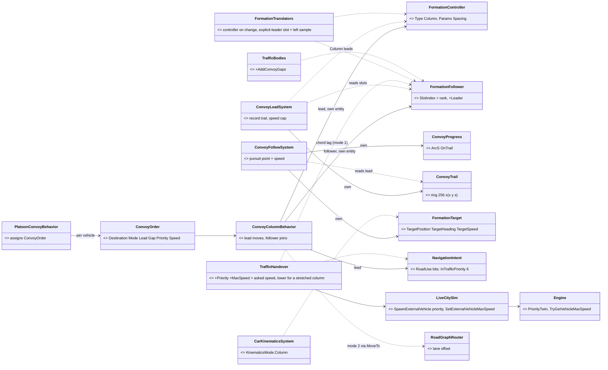
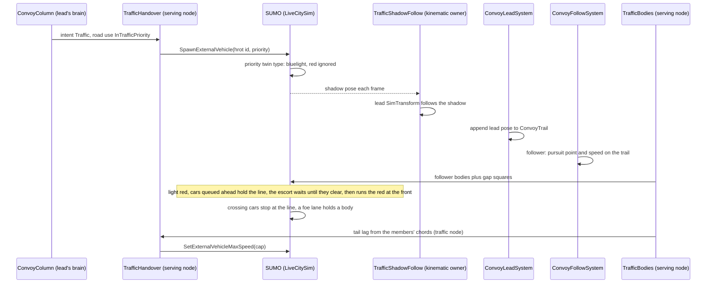
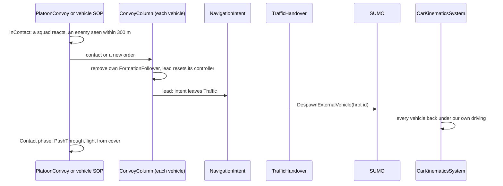
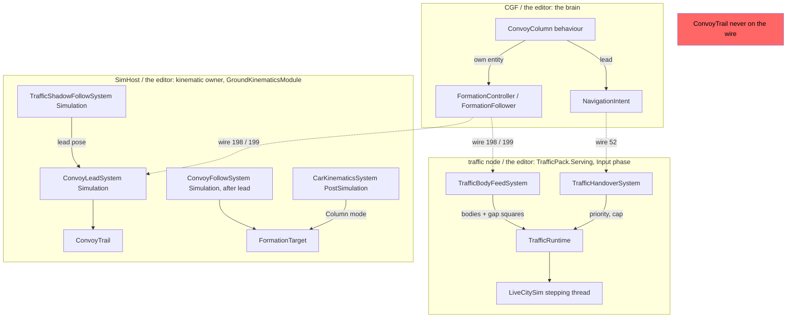

<!--STATUS
state: LIVE
updated: 2026-11-16
build-state: READY-TO-BUILD (convoy lane, CE-4631 / CE-9000…; R-9000…R-9010 lane decisions, for the user's review)
current-answer: §1 inventory · §2 the proven solution · §3 decisions · §4 UML · §5 slices and acceptance · §6 as built (filled as the steps land)
stale-below: nothing
known-rot: none
known-conflict: none
supersedes: DRAFT_Road_Convoy.md (the direction; every row of it is carried here)
related-designs:
  - DRAFT_Road_Convoy.md — SUPERSEDED by this file; kept for the user's words and the first measurements
  - ../../blueprints/Architect_Question_93_Sumo_Traffic_Node.md — OWNS the SUMO traffic node: §13 our bodies into SUMO (`TrafficBodies`), §14 the handover (`TrafficHandover`, the shadow `hrot:<id>`), §15 replicas; this design extends §13 (gap fillers) and §14 (priority + a speed cap)
  - ../navig-2/Navigation_Design_v2_0.md — OWNS the ground route planner (§5.2a `RoutePlanner` / `RoadGraphRouter`); mode 2 adds the lane offset where road points are emitted
  - ../group-maneuvers/DESIGN_Defend_And_Attack_Position.md — OWNS the platoon's mounted convoy (§11a `PlatoonConvoyBehavior`, R-2069); its vehicles now drive as ONE column (§3 C-9)
  - ../group-maneuvers/DESIGN_City_Battle_Showcase.md — OWNS the convoy-under-contact plays (§11 C-5, R-7010) that take over when a convoy is hit
  - DESIGN_Checkpoint_And_Ramming.md — a neighbour: a convoy meeting a checkpoint is that design's case, not this one's
  - ../../reference/NED_DDS_Protocol.md — the wire: `FormationController` / `FormationFollower` (descriptors 198 / 199) carry the column
  - ../aggregate-units/DESIGN_Stochastic_Units_And_Resolution.md (on exp/agg-*) — OWNS the STOCHASTIC unit's column (§14 M-3 / M-4: one point, head on its route, tail `Depth` behind) and its split (§16a); a mounted column unit that splits should hand its vehicles a `ConvoyOrder` — ../../blueprints/batches/NOTE_Convoy_To_AggLanes.md
  - ../commander-subordinates/DESIGN.md — OWNS `FormationController` / `FormationFollower`; §2.2 amended: `FormationFollower.Leader` (an explicit leader, the convoy's)
  - ../../DESIGN_Scenario_Regression.md — the feature scenarios' format (R-4277, R-4279)
-->

# DESIGN — the road convoy in SUMO traffic (CE-4631)

🔒 User, `2026-11-16`: *"Convoy never split, ignores traffic lights, and the sumo vehicles needs to react to it."* · *"I meant the leading sumo vehicle to be
the one with priority, with beacon or siren. So no traffic lights apply … because Sumo handles all of that already … The route can stay as a second valid
option because it works outside of Sumo, offroad, so it is worth supporting it."* (R-4282)

## 0. The rules — the acceptance of everything (the user's, never traded)

| rule | measured by |
|---|---|
| the convoy NEVER splits | max gap along the lead's path between two consecutive vehicles ≤ the limit; no vehicle overtakes its predecessor |
| it IGNORES traffic lights | no convoy vehicle's speed drops to 0 in front of a red it then crosses |
| SUMO's vehicles REACT to it | no SUMO car is ever between two convoy vehicles on the column's path; cars queue behind it and stop for it at junctions |
| it ACTS when the scenario needs it | attacked / ordered to battle ⇒ the shadow is gone and the contact plays run within N s; no vehicle re-created |

## 1. INVENTORY *(2026-11-16 — code graph CLI + grep; three read-only sweeps; ⚠ `check_index_coverage` is not in the CLI, so no absence below is proven complete)*

Queries run: `search_graph name_pattern ".*Traffic.*"` (Class) · `".*(Avoid|Rvo|RVO|Separation|Collision).*"` · `".*(Convoy|Column|Follow|Trail|Breadcrumb|Platoon|Formation).*"` (101) ·
`".*LaneChange.*"` (33) · `".*(GiveWay|Obstacle|DriveAfterRed).*"` · `search_code "Convoy"` (83), `"laneChange"`, `"lefthand"` (0) — and grep for each finding.

| # | the handoff's question | measured | file:line |
|---|---|---|---|
| ① | do our vehicles brake for SUMO replicas? | ⚠ only RVO **steering**, and the replica (no `SimVelocity`) counts as **stationary**; no car-following brake | `CarKinematicsSystem.cs:539-542, 1143-1207`; replica comps `TrafficReplicas.cs:266-288` |
| ② | can SumoSharp command a lane change / make cars yield? | ⛔ no external lane-change command (`ICommandBuffer.ChangeLane` is internal). ⭐ **But a BLUE-LIGHT vehicle makes cars ahead in its edge (≤ 25 m) move aside** — SUMO's emergency-vehicle model, ported; LiveCity turns cooperative lane change on | `Engine.cs:5941-5990` (`DetectGiveWay`), `:407`, `:14037`; `LiveCityConfig.cs:216` |
| ②b | the red light | `jmDriveAfterRedTime > redDuration` ⇒ the red constraint is removed; follow-leader, junction yield, keep-clear and obstacles still apply. ⛔ settable only from a rou.xml vType (not `VTypeParams`, not `VehicleParamOverride`). `JmIgnoreFoe*` ARE in the override (`SetVehicleParams`) | `Engine.cs:7344`, `:3128-3160`; `VTypeParams.cs:33` (`HasBluelight` is) |
| ②c | a runtime blue-light vehicle | ✅ the give-way switch flips when ANY vehicle with a blue-light type is initialised, runtime spawns included | `Engine.cs:1873` |
| ③ | driving side | right-hand only (no `lefthand` anywhere); lane index 0 = rightmost | `NetworkParser.cs:75-109` |
| ④ | `FormationFollower` toward a column | ⚠ a SLOT formation keyed to the commander (`UnitSubordinate.Commander` + `FormationController`); "ghost rails" sample the leader's PLANNED trajectory at `leaderS + offset.X`; distance euclidean; no trail, no overtake guard, no stretch feedback; driven by no behaviour in production | `FormationTargetSystem.cs:111, 177`; `CarKinematicsSystem.cs:412-425` (Formation mode: straight to the slot + P catch-up) |
| ④b | trail precedents | `SquadTrail` — infantry breadcrumbs, 2 m, the lead's actual path; `UrbanMovementBehavior` — rank × spacing ALONG the route | `SquadManeuverRunner.cs:201, 240`; `UrbanMovementBehavior.cs:66-73` |
| ⑤ | the shadow | spawned from `TkbIdentity.TkbType` as the vType (unmapped ⇒ default car); route fixed at spawn by SUMO's router (`SetDestination`/`Reroute` unused); a new `IntentId` despawns + respawns; `hrot:` cars never become replicas; our entity follows the shadow pose (`TrafficShadowFollowSystem`) | `TrafficHandover.cs:49-68`; `TrafficSession.cs:234-254`; `LiveCitySim.cs:1488-1547`; `TrafficShadowFollowSystem.cs:46-97` |
| ⑥ | one vehicle's priority params at runtime | `SetVehicleParams(handle, VehicleParamOverride{ MaxSpeed, JmIgnoreFoe* … })` on the engine — ⛔ `LiveCitySim` keeps the engine private and exposes no per-vehicle override; `HasBluelight` / `jmDriveAfterRedTime` only via a vType | `Engine.cs:3128`; `VehicleParamOverride.cs:15-41` |
| ⑦ | bodies on lanes | each body ⇒ a moving obstacle on EVERY vehicle lane it overlaps (internal junction lanes included); placed by its centre; an obstacle on the car's CURRENT lane is a virtual leader; a car approaching a junction whose foe internal lane holds a body stops at the line; ⭐ a long body is told as a CHAIN of squares with synthetic NEGATIVE ids (the static-obstacle precedent) | `ExternalBodyFeed.cs:30-45, 227-264`; `Engine.cs:11533-11597, 10176`; `TrafficBodies.cs:103-128` |
| ⑧ | taking over mid-route | `PlatoonConvoyBehavior` (HSM Plan → Move → Contact → Secure → Remount): every vehicle `FollowRoute`s the SAME route, no spacing; Contact = a squad's contact reaction / a seen enemy ≤ 300 m / `!ConvoyConditions.CanMove`; a vehicle then runs its SOP (`PushThrough`, `VehicleFightFromCover` R-7010). No convoy ORDER exists (`OrderKind` ends at `Dash = 14`) | `PlatoonConvoyBehavior.cs:108-131, 278-286, 383`; `OrderKind.cs:9-42` |
| ⑨ | the intent's road-use bits | 3 bits, `RoadUse` 0…5 used (`InTraffic = 5`) ⇒ **6 and 7 free** — a priority flag fits the wire as it is | `NavigationConstants.cs:128-138`; `NavigationComponents.cs:176-192` |
| ⑩ | mode 2's emission point | `RoadGraphRouter.Partial` samples each road segment's centre line, direction known; `RoadSegment.LaneCount` = the WHOLE carriageway (half-width = `LaneWidth × LaneCount / 2`) | `RoadGraphRouter.cs:184-207`; `TerrainRoads.cs:92`; `DangerAlongRouteClassifier.cs:257` |
| ⑪ | SumoSharp changes | vendored READ-ONLY (R-4046): a change is made UPSTREAM (`pjanec/SumoSharp`, ref `hrot/slice2`) and synced (`scripts/sync-sumosharp.sh`); its parity goldens live upstream. ✅ this session can push upstream | `FDP/ExtDeps/SumoSharp/UPSTREAM.md` |

## 2. The proven solution for this problem class — and what we take

**Escorted convoys in road traffic** (police / military escort doctrine; SUMO's own emergency-vehicle model — the `bluelight` device, `jmDriveAfterRedTime`,
the rescue lane; platoon control in traffic simulation — CACC "string stability"): ONE vehicle carries the priority (beacon, siren) and opens the way;
the rest keep a TIGHT, FIXED order behind it on the SAME path; other traffic yields to the escort and treats the column as one body; the escort
modulates its speed so the tail never falls back (string stability: an error must not grow down the column).

| piece | adopt? | the strong reason, measured here |
|---|---|---|
| the escort is SUMO's emergency vehicle (blue-light vType) | ✅ adopt | SumoSharp already ports it (`Engine.cs:5941`, `:7344`); routing, lanes, queues and junction behaviour are SUMO's, exactly what the user asked ("Sumo handles all of that already") |
| followers on the escort's ACTUAL path (breadcrumbs), gap measured along it | ✅ adopt | the only way the column cannot split at a junction: a follower never routes on its own. Precedent `SquadTrail` (foot) — the vehicle version is new |
| predecessor-follower spacing with the leader's speed fed forward (CACC-like) | ✅ adapt | our vehicles are kinematic: a P-controller on the along-path gap + the predecessor's speed is string-stable enough at convoy speeds; no radio model needed |
| the escort slows when the column stretches | ✅ adopt | the user's rule ("stops and starts together"); a speed CAP on the escort from the tail's lag |
| a rescue LANE (cars in every lane move aside) | ⚠ adapt | ported only for cars ≤ 25 m ahead on the same edge; enough for the escort's lane. ⛔ we do not build a corridor model |
| cars queued AHEAD at a red enter the junction for the escort | ✅ adopt (small rule) | real practice; without it the escort waits behind a red queue (the lights rule would hold for the convoy but not for the cars in front) |
| a real platoon radio (V2V) with its delays | ⛔ reject | nothing in the scenario reads it; it would add latency we would then fight |

## 3. Decisions *(lane decisions R-9000…, each "for the user's review", with what would change it)*

| id | decision | ⭐ lean (built) | rejected — one line each | would change it |
|---|---|---|---|---|
| **C-1** (R-9000) | how the lead is marked PRIORITY | `RoadUse.InTrafficPriority = 6` in the intent's road-use bits: "in traffic, beacon and siren on" | a new component on the wire: the intent already reaches every node that needs it (the traffic node composes its ingress, AQ93 G2) · a TKB "always priority" type: the beacon is a per-run state, not a vehicle class | a vehicle that must be priority WITHOUT being handed to SUMO |
| **C-2** (R-9001) | what SUMO is told | upstream **H17** (purely additive — §6): `LiveCitySim.SpawnExternalVehicle(…, priority: true)` spawns the same vType's **priority twin** `<vType>@priority` = the base type + `HasBluelight`, `jmDriveAfterRedTime = ∞`, `jmIgnoreFoeProb = 1`, `jmIgnoreJunctionFoeProb = 1` — every one a feature SumoSharp already ports (ER3–ER5, A3); `VTypeParams` gains the four jm fields (null = unchanged) | per-vehicle overrides only: `HasBluelight` / `jmDriveAfterRedTime` are vType-only (②b) | SUMO gaining a per-vehicle device API |
| **C-3** (R-9002) | cars ahead of the escort at a red | ⛔ **nothing new** (user, `2026-11-17`): on a single lane they drift to its edge but hold the line; the escort WAITS behind them until green and the queue clears; on two or more lanes they give way into the other lane and it passes; at the front it runs the red | a rule letting give-way cars enter on red — WITHDRAWN: real SUMO never does it, and it would have moved the parity goldens of SumoSharp's own emergency-vehicle scenarios | — |
| **C-4** (R-9003) | the column-follower | ONE trail on the LEAD (`ConvoyTrail`, unmanaged ring: 256 points every 2 m + their arc length); every follower drives it at `rank × gap` behind the lead **along the path**, steered by pursuit of a point a lookahead ahead of its own position on the trail; its speed = predecessor's speed + a P-term on the gap error; at ≤ the minimum gap it stops; it never passes its predecessor's arc length. New `KinematicsMode.Column = 10` consumes the existing `FormationTarget` (pursuit point + authoritative speed). ⭐ **The column IS a formation (R-9012, §6):** the lead's `FormationController { Type = Column, Params.Spacing = gap }` (the minimum gap = half the spacing), each follower's `FormationFollower { SlotIndex = rank, Leader = lead }` — `ConvoyLeadSystem` / `ConvoyFollowSystem` are the `Column` type's follower, `FormationTargetSystem` keeps the other types | ⛔ SUPERSEDED: a new `ConvoyMember` component (108) — a second component for the concept `FormationController`/`FormationFollower` already name · `FormationFollower`'s slot SOLVER (planned path, euclidean, ④) for a column: it splits at junctions — the solver is replaced for `Column`, the components are kept · followers routing on their own: they split at the first junction | a column wider than one vehicle (a two-abreast formation is the formation system's, not this) |
| **C-5** (R-9004) | no cutting in | the serving node tells SUMO each GAP between two consecutive convoy vehicles as a chain of rest/moving squares along the trail (synthetic negative ids `-(follower.Index·64 + k + 1)`, the static-obstacle scheme) — with the bodies themselves, ONE continuous obstacle | a single long body: placed by its centre, straight per lane — misses bends and junctions (⑦) | SumoSharp gaining a polyline obstacle |
| **C-6** (R-9005) | the escort slows when the column stretches | the lead's speed CAP = `clamp(1 − (tailLag − slack) / (2 · slack), 0, 1)` × its top speed (stops at 3 × slack); mode 1: upstream **H17** `LiveCitySim.SetExternalVehicleMaxSpeed(id, cap)` — a MAX-SPEED cap (`SetVehicleParams{ MaxSpeed }`), the original remembered through a read-only `Engine.TryGetVehicleMaxSpeed` and restored exactly by `cap = null`; the vehicle's own drawn speed factor is never touched; ⭐ the cap (R-9013) is the shadow's generic top speed — the asked speed, lowered on the traffic node from the members' chords (§6 CE-9008); mode 2: the lead's own `NavState.TargetSpeed`, from the trail | stopping the lead outright: stop-and-go waves (string instability) | — |
| **C-7** (R-9006) | mode 2's lane | (as built: for `RoadUse.StronglyPrefer` only — §6) the route's road points are offset to the OUTER lane on the travel side: `max(0, LaneWidth·(LaneCount − 1)/2)` right of the centre line (right-hand traffic — the only side SUMO models, ③); the access and egress legs are untouched | the centre line (today): head-on with oncoming SUMO cars in the 3-D view and in SUMO (our body overlaps both lanes) | a left-hand terrain (a `drivingSide` field on the road graph would then flip the sign) |
| **C-8** (R-9007) | where the column lives | the formation components (`FormationController` on the lead, `FormationFollower` on each follower) are written by each vehicle's OWN behaviour (own entity, R-4212) and replicated (descriptors 198 / 199) so the kinematic owner and the traffic node see the column; `ConvoyTrail` is LOCAL to the kinematic owner (never on the wire, recorded) | the trail on the wire: 4 KB per lead per change — the followers' owner records it itself | the lead and its followers on DIFFERENT kinematic owners (then the trail goes on the wire) |
| **C-9** (R-9008) | the order | `OrderKind.Convoy = 15` + `ConvoyOrder { Destination, Mode (Auto / Traffic / Route), Lead, Gap, Priority, Speed }`; behaviour `ConvoyColumn` on each vehicle: the lead moves (mode 1 `NavigationMode.Traffic` with C-1, mode 2 `MoveTo` with `RoadUse.StronglyPrefer`), the lead sets its own `FormationController` to `Column`, a follower writes its own `FormationFollower` slot (built as `PlatformConvoy`). `PlatoonConvoyBehavior` assigns its vehicles THIS order (rank by the route) instead of N independent `FollowRoute`s | N `FollowRoute`s (today): no order, no spacing — the split this programme exists to stop | — |
| **C-10** (R-9009) | switching to action | contact (the existing `InContact` signals) or a new order ⇒ each vehicle's `ConvoyColumn` ends: the lead's intent leaves `Traffic` (the handover despawns the shadow, AQ93 G5), every convoy `FormationFollower` is removed and the lead's controller reset (`ConvoyMembershipSystem`), the vehicle's SOP / the platoon's Contact phase runs. Nothing is re-created | handing the vehicles back from SUMO: only the lead was ever handed | — |
| **C-11** (R-9010) | where SumoSharp changes land | UPSTREAM on `pjanec/SumoSharp` (a branch off `hrot/slice2`, its own tests + goldens there), then `scripts/sync-sumosharp.sh` — R-4046 | editing the vendored copy: `--verify` would fail and R-4046 forbids it | — |

## 4. UML

### 4.1 Classes

*What the picture shows that prose hid:* one new pair of systems (lead / follower) and two LOCAL components (trail, progress) — the membership itself is the existing formation pair; every other box already exists and grows by a field or a method.
The follower writes only ITS OWN `FormationTarget` — the lead's trail is a declared read — so the per-entity rule holds by construction.

### 4.2 Sequence — a mode-1 convoy crosses a junction on red while SUMO cars stop

### 4.3 Sequence — an ambush switches the convoy to action

### 4.4 Modules — who registers each system, on which node, who calls it each frame

*What the picture shows that prose hid:* the trail exists ONLY on the kinematic owner (red); the serving node, which needs the column's shape for the gap
squares, reconstructs it from the members' replicated poses — so C-8's limit (lead and followers on one kinematic owner) is visible here, not buried.
`ConvoyLeadSystem` / `ConvoyFollowSystem` join `GroundKinematicsModule`'s Simulation list after `FormationTargetSystem`, so every host that moves
vehicles runs them — the editor, SimHost and any lightweight host by construction.

## 5. Slices and acceptance

| slice | what | acceptance (the feature's own rails) |
|---|---|---|
| **S-1** (step 3) | H17 upstream (C-2, C-6 API; additive) + sync; `RoadUse.InTrafficPriority`; `TrafficHandover.Priority/MaxSpeed` | upstream: a priority twin runs a red at the front and waits behind a red queue; cars ahead on a multi-lane edge give way; the cap slows it and `null` restores it exactly; every existing golden byte-identical. HROT `AVehicleHandedToSumoArrivesTests` + a priority case |
| **S-2** (step 4) | the `Column` formation (was `ConvoyMember`), `ConvoyTrail`, the two systems, `KinematicsMode.Column` | a lead on a curved path + 3 followers: max along-path gap error ≤ 25 %, nobody passes, all stop within 2 s of the lead; 0 B per steady frame; under `HROT_PARALLEL_SIM=1 HROT_READ_CHECK=1` |
| **S-3** (step 5) | gap squares in `TrafficBodies` | demo-city: a SUMO car never enters between two convoy vehicles |
| **S-4** (step 6) | the lane offset; mode 2 | the route's road points lie on the outer lane; access / egress unchanged |
| **S-5** (step 7) | `OrderKind.Convoy`, `ConvoyOrder`, `ConvoyColumn`; `PlatoonConvoyBehavior` uses it; contact ends it | an order forms the column; contact removes the shadow and every member |
| **S-6** (step 8) | the six feature scenarios (`scenarios/demos/convoy/`) | `scripts/scenario-regression.sh <name>` passes |

## 6. As built *(filled as the slices land — the deviations go here with their reason)*

| slice | as built | deviation, and why |
|---|---|---|
| S-2 (CE-9001) | `ConvoyMember` 108, `ConvoyTrail` 109, **`ConvoyProgress` 157** (the follower's place on the trail, local), `ConvoyLeadSystem` + `ConvoyFollowSystem` in `GroundKinematicsModule` after `FormationTargetSystem`, `KinematicsMode.Column = 10` | ⚠ `ConvoyMember` was one component in §4.1; the follower's place moved to its own `ConvoyProgress` — the member is written by the BRAIN (and replicated), the place by the KINEMATIC OWNER; one component would have two writers on two nodes. The lead is itself a member of rank 0 (so its system writes only its own components). The cap is `clamp(1 − (lag − slack)/(2·slack), 0, 1)` (C-6's first formula contradicted its own "stops at 3 × slack"). The pursuit lookahead is `clamp(2 + 0.4·v, 3, 8)` m — measured: 11 m cut a 90° corner by 3.3 m, 6 m by 1.1 m |
| S-3 (CE-9002) | `TrafficBodies.AddConvoyGaps` — squares along the trail where the node holds it, else along the chord between the two vehicles | the chord fallback is new: a dedicated traffic node holds no trail (C-8) |
| S-4 (CE-9003) | `RoadGraphRouter.KeepLane`, set by `RoutePlanner` for `RoadUse.StronglyPrefer` only — ⚠ and only on a net that declares **`linesAreCentres`** (R-9011) | ⚠ C-7 offset EVERY road leg at first; three `CE-3128` rails (a Prefer route on Main Street's centre line) went red ⇒ the lane is opt-in for the convoy's road use, so no other feature's routes (or goldens) move. ⏳ every vehicle keeping its lane is a later decision for the user |
| S-4 amended (R-9011) | 📌 `cv-offroad-join-leave` on `city-battle`: the convoy drove onto the roadside hedge — an imported net (`NetRoadNetwork`) is written along each SUMO edge's LANE 0 (lanes 8 m wide there), so its lines are already the driving lane; the offset assumed centre lines. ⇒ `RoadNetworkJson.linesAreCentres` (absent = lane lines, as drawn); no asset changes (every terrain file is in its content hash) | ⚠ a two-way road imported as ONE forward edge is still driven on the forward lane both ways — the importer's choice (`written` skips the reverse edge) |
| S-2 amended | 📌 the same scenario: a lead that overshot the turn onto the road and backed up (hull recovery) left a doubled-back trail, and the followers knotted on it ⇒ the trail records FORWARD motion only, and a follower also stops at `MinGap` + its stopping distance IN METRES from its predecessor (rail `ALeadThatBacksUp_…`) | — |
| ⭐ **folded into formations** (R-9012, `2026-11-17`) | ⭐ **`ConvoyMember` WITHDRAWN** (user: *"Is the convoy member necessary? Cannot it be replaced with one of the formations components?"*). The lead's `FormationController { Type = Column, Params.Spacing }` — ⛔ no new `MinGap` field: `FormationController`'s bytes are hashed in 75 scenario goldens, so the minimum gap is half the spacing (every vehicle already carries one — `VehicleKinematicsTkbTranslator.cs:81`, default `Type` 0 = `Column`, so a column LEADS only with a follower, and the behaviour marks it by a `Spacing > 0`); each follower's `FormationFollower { SlotIndex = rank, Leader = lead (new, `Entity.Null` = the commander, as before) }`. `FormationTargetSystem` skips `Column` leaders (the convoy systems drive them); `UnitHierarchySystem` removes only commander-led slots. Component 108 is reserved again. Rails unchanged in meaning: `ConvoyColumnTests` / `PlatformConvoyTests` (+ the commander-led slot left alone, the lead's contact ends the column) / `TrafficBodyFeedTests.CE9002` | the explicit leader, not `UnitSubordinate.Commander`: 21 vehicles in 7 scenarios have a unit commander that is not their convoy lead, and a column must not re-parent the command chain |
| ⭐ **on the wire** (CE-9007, `2026-11-17`) | `dtFormationController` 198 · `dtFormationFollower` 199, both in the Brain group (`HrotOwnershipGroups`, `NedOwnershipGroupBinding`), in `SharedTranslatorPack` (every node). The controller on change; the follower slot ONLY with an explicit leader (its leader as a network id, resolved by the receiver), and one `LeaderId 0` sample when it ends — the `EntityDescent` pattern. Rails `FormationWireTests` 4/4, `TheDescriptorMapIsWiredTests`, `RoleGroupOwnershipStrategyTests`; `protocol-doc-check.py` / `ned-wire-inventory.py --check` OK | ⛔ a commander-led slot is NOT sent and never removed by the wire: `UnitHierarchySystem` derives it on every node from the replicated assign events — sending it too would give that state two producers. ⛔ A controller's removal is not sent: every vehicle carries one from its type on every node |
| ⭐ **the shadow's top speed** (CE-9008, R-9013, `2026-11-17`) | `TrafficHandoverSystem.Gather`: `MaxSpeed` = the intent's `TargetSpeed` (generic — any vehicle handed to SUMO drives at most the speed its brain asked; 0 = SUMO's own), lowered while the vehicle LEADS a road column whose tail lags: `ConvoyLeadSystem.ChordLag` (the chords lead → … → tail, on the traffic node) through the one `CapFactor` formula the kinematic owner's trail uses. Rail `CE9008_TheShadowsTopSpeed_…` | ⚠ C-6 / S-1 first read the lead's `ConvoyTrail.SpeedCapFactor` in `Gather` — present only where the traffic node is also the kinematic owner (the editor). ⛔ SUPERSEDED (user: *"Isn't the speed cap something generic … just a limit for the sumo car speed?"*). ⚠ The plan stated in chat — the lead's BRAIN lowering its own intent speed — was dropped after measuring: it needs the followers' positions and slots read inside the parallel brain phase (a declared cross-entity read of a type the phase writes), where the traffic node already holds both, replicated, for the gap squares |
| ⭐ **no traffic ⇒ our route** (CE-9010, `2026-11-17`) | `PlatformConvoyBehavior.TrafficRuns` (the terrain's SUMO net AND a `TrafficDemand` entity — R-4047) decides `LeadRoadUse`: `Traffic` / `Auto` hand the lead to SUMO only then, else `StronglyPrefer` (+ a warning for an explicit `Traffic`). `TrafficDemand` declared a stable read of the brains' phase (`AiBrainReads`) | 📌 `cv-red-lights`' first run: no traffic settings ⇒ SUMO never started ⇒ the lead, asked `InTraffic`, was handed to nobody and stood at t 0 for the whole run (no error anywhere — `TrafficSession` retries a refused / absent hand-over silently). ⚠ The same holds for ANY `MoveTo` with `RoadUse.InTraffic` — an executor-level fallback is AQ93's to decide (not done here). `Auto` was `Route` while H17 was unsynced — superseded |
| 🐞 **found: the imported road graph kinks at junctions** (CE-9011 → terrain) | `cv-offroad-join-leave` traced at 1 s: the whole column swerved to y 556 at x 300 on a road whose lane 0 is y 541.8 — the graph's node 332 sits at the SUMO junction's centre (y 553.8) while its edges run along lane 0. 205 such kinks on `city-battle` | the scenario judges the lane on x 350–450 (no junction); the importer is the terrain lane's |
| ⭐ **C-10 as built: a reaction PAUSES the order, a failure ENDS it** (CE-9014, CE-9015, `2026-11-17`) | `PlatformConvoyBehavior.Tick` remembers the locomotion action instance it wrote (`ConvoyState.MoveInstance`): another instance in the channel = a reaction drove the vehicle while the order was paused ⇒ on resume the lead issues its move again, a follower stops again; a Failure on ITS OWN action (a mobility kill, no path) fails the order and resets the lead's controller, so the column ends | 📌 `cv-ambush` (traced): the IED hit the lead, its SOP's `VehicleFightFromCover` found nothing to fight and ended within a tick, the order resumed — and before CE-9015 the lead stood for good with its column parked in the kill zone; now the column drives out of it together. ⚠ An APC TKB 2001 never feels a hit (no `TargetMemory`, CE-1056) — the scenario uses IFVs |
| ⭐ **blocked ⇒ the convoy waits; the executor's arrival counts** (CE-9017, CE-9018, `2026-11-17`) | a lead whose own move fails but `ConvoyConditions.CanMove` (a queue, a breakdown — the executor's `FailedBlocked`) asks again every `RetrySeconds` = 2 s, the column standing whole behind it; only a lead that cannot move fails the order (CE-9014). The lead's own move reporting Success is its arrival | 📌 `cv-blocked-road` (traced 1 s): FailedBlocked came 6 s behind a broken truck and CE-9014 ended the column; SUMO's "Arrived" came 22 m short (it ends a shadow ≤ 25 m short, `ArrivalSlackMetres`) and the 15 m radius never completed the order. 🐞 CE-9019 (→ AQ93): the waiting shadow is LOST in SUMO, and each re-hand-over's shadow lives ~1 s — the convoy copes, at the price of a despawn + respawn per retry |
| ⏳ **mode 1 → 2 — NOT BUILT** (CE-9020) | `cv-mode-1-to-2` (traced): a destination off the SUMO network is REFUSED by the hand-over (H13 routes lane to lane) and the executor holds for ever (no shadow yet = a deliberate hold) | lean: SUMO drives to the network point nearest the destination and the executor drives the rest on our own route — generic for every `InTraffic` move (AQ93's), the convoy needing nothing; until then a refused hand-over should time out to our route |
| ⛔ **the platoon as one column — ON HOLD** (CE-9012, `2026-11-17`) | built and green on its rails (`PlatoonConvoyBehavior.KeepVehicle` → a `ConvoyOrder` each, `RankColumn` by how far along the route), then REVERTED: in `uc-urban-battle` it exposed CE-9013 (a unit memory growing the occurrence store inside the parallel brain phase kills the process). ✅ Kept: `ConvoyOrder.Route` — a lead given a route follows it through `CgfNodes.WriteFollowRoute`, the one writer `FollowRoute` itself now calls | ⚠ C-9 sketched the lead as a `MoveTo` to the destination; a platoon's route is AUTHORED, so the lead follows it. Resumes when CE-9013 (the behaviors lane's runtime) is fixed |
| 📐 **the cluster tier** (`2026-11-17`) | editor tier: `cv-offroad-join-leave`, `cv-red-lights`, `cv-no-cut-in` 3 / 3 PASS; cluster tier: `cv-red-lights`, `cv-no-cut-in` PASS (the handover, the priority twin, the gap squares and the replicated column, all live across nodes) | ⚠ `cv-offroad-join-leave` first failed there: under the verifier's load a follower fell ~40 m behind at the 12 m junction kink (CE-9011) and recovered — the C-6 cap at work. ⭐ The split rows now use C-6's own tolerance (a pair > gap + 3 gaps = 60 m: the cap failed to hold the column); ⛔ 35 m was an arbitrary number from an editor trace |
| ⭐ **the scenarios' checks judge the same in both tiers** | lane rows as a `never` band between two position marks (every sample, not one 3 m circle); never-splits as `far` per consecutive pair (positions, not the trail — the trail lives only on the kinematic owner, so a trail row was vacuous in the cluster tier) | 📌 measured on the first cluster runs: 99 samples over 121 sim s; the trail-read anti-vacuity row failed there |
| found | 🐞 `city-battle`'s hedges cut 4 of its road segments (CE-9006, for the terrain lane) — a vehicle on the y-954 road is held at x 131 | the scenario routes along y 541.8 |
| S-1 (CE-9000) | ✅ **BUILT end to end `2026-11-17`**: SumoSharp H17 pushed upstream (`hrot/slice2` → `eb88338`, together with HROT's T-7b closed edges, which had lived only in the vendored copy) and synced — `sync-sumosharp.sh --verify` passes again. `TrafficSession` spawns a `Priority` handover as the blue-light twin and caps its top speed from `TrafficHandover.MaxSpeed` (the lead's `ConvoyTrail.SpeedCapFactor` × its top speed; null restores). Rails: the arrival test as a theory (ordinary + priority), `AStretchedConvoysEscort_IsCappedThroughItsShadow_AndFreedAgain` (red-proved) — traffic suite 90/90. Upstream gate: `Traffic.sln` Release 0 failures (parity 793/5 incl. the emergency goldens, LiveCity 130/130 with 4 new H17 tests), `Sim.Bench` `A134ED3716DDE7BC` unchanged | ⛔ SUPERSEDED by CE-9008 below: the cap reached SUMO only where the serving node held the lead's trail (the editor) |
