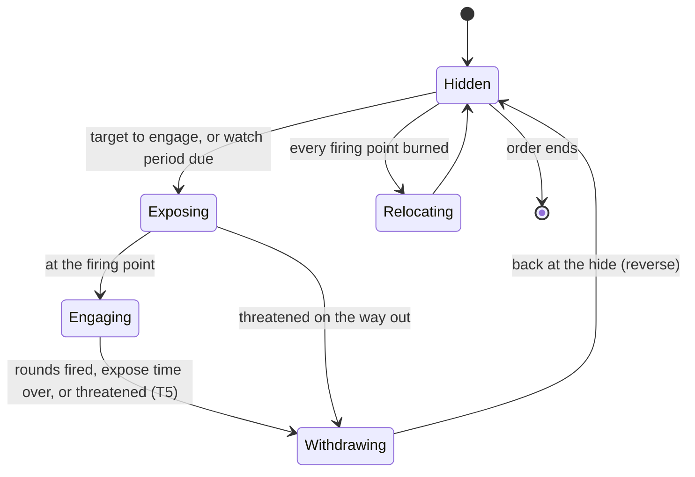

<!--STATUS
state: LIVE
updated: 2026-10-14
build-state: DESIGN
current-answer: §3 (the programme, with leans) — §1 is the measured ground (do not re-derive), §2 the real-world tactics it models.
stale-below: nothing.
known-rot: none.
known-conflict: none.
related-designs:
  - docs/DESIGN_Peek_And_Fire.md — OWNS the INFANTRY fight-from-cover node (hide / expose / fire / heat, FiringPositionMemory); G8 (R-257) keeps vehicles OUT of it, so this design's cycle is a vehicle sibling that reuses its memory and fire step
  - docs/designs/hill-attack/DESIGN.md — OWNS HullDownAttackRun (demo-local): creep until seen → fire → reverse to baseline; the one built vehicle exposure, which V4 generalises
  - docs/designs/group-maneuvers/Squad_Coordination_Design_v1_1.md — OWNS the HillCrestHullDown manoeuvre table (§8.4: waves, burned slots) — the PLATOON layer above this unit-level cycle
  - docs/DESIGN_Weapon_Layers.md — OWNS turrets, the weapon brain / muscle, weapon and ammo choice (W-5, W-11, W-12) — this design only names targets and asks for track-while-hidden
  - docs/DESIGN_Utility_AI_Demo_Scenarios.md — OWNS the armour model (§9, R-212): facing, penetration chance, expected damage — V1 reads it the other way round (his weapon vs my armour)
  - docs/DESIGN_Sensors_And_Doctrine.md — OWNS threat = danger × freshness (§7.8, R-201) and the G1 lean "danger from weapons vs my armour" (§11.2) that V1 builds
  - docs/designs/eqs-2/EQS_Design_v1.3_final.md — OWNS the cover generator and exposure tests that V3 sizes for a hull
  - docs/DESIGN_Operations_Behaviour_Catalogue.md — OWNS the operations GAP list; its VEH group has no armour-combat entry — this design is that entry
  - docs/designs/look-direction/DESIGN_Look_Direction_And_FOV.md — OWNS FOV per seat (LD-6); tanks keep 360° here
-->

# Urban armour tactics — a tank hides behind a building, shows itself briefly, and kills the anti-tank man first

🔒 User, `2026-10-14`: *"a tank in an urban area which is supposed to hide behind a building to not be exposed to enemy fire and just go out
of the cover for a short while for firing or watching and then move back again to the cover. This should be accompanied with some enemy
soldiers using RPG or anti-tank weapons, so the tank can be threatened and has a reason to go back to the cover. And also the tank will
recognize that kind of enemy as a threat and will attack him with priority."*

**State: a proposal. The leans in §3 are not yet approved.**

## 1. What exists — measured `2026-10-14` (do not re-derive)

```mermaid
graph TD
  subgraph BUILT["built"]
    REV["Reverse: MoveTo ReverseAllowed — backs up while the point is BEHIND the hull<br/>CarKinematicsSystem.cs:329-335"]
    TUR["Turret part, slews on its own; TrackTarget keeps the gun on a target<br/>TurretSlew.cs · TrackTargetExecutor.cs"]
    ARM["ArmorModel: facing (front &lt;60°, rear &gt;120°), P = clamp((pen/armour − 0.8)/0.4)<br/>ArmorModel.cs:21-69"]
    EFF["WeaponEffectivenessVsTarget: MY mount vs HIS armour, facing, hit chance<br/>StandardInputs.cs:398-434"]
    HDR["HullDownAttackRun (demo-local): creep until seen → fire → reverse to baseline<br/>HillAttackTankNodes.cs:592-603"]
    PAF["PeekAndFire (infantry only, G8): hide · expose · fire · heat in FiringPositionMemory"]
    VC["A STANDING vehicle is cover for men (R-245)"]
  end
  subgraph PART["partial"]
    DNG["ThreatDanger.Of(self, target): armed 1 · unarmed 0.3 — ignores self<br/>ThreatDanger.cs:21-28"]
    CP["Cover points 0.75 m off walls — man-sized, no hull footprint<br/>TerrainCoverProvider.cs:22-23,70"]
    EYE["Tank sees from the soldier default eye (1.7 / 1.1 m), 360°"]
    TBL["HillCrestHullDown table — nothing runs it"]
  end
  subgraph MISS["missing"]
    M1["danger to ME (his weapon vs my armour)"]
    M2["a vehicle hide point + a firing point ahead of it"]
    M3["a vehicle exposure cycle in the library"]
    M4["tank coax MG + HE round; RPG man with spare rockets and a rifle"]
  end
  EFF -. "same maths, swapped" .-> M1
  DNG -. "the one place to put it (R-194)" .-> M1
  HDR -. "generalise" .-> M3
  PAF -. "reuse memory + fire step" .-> M3
  classDef dead fill:#f8d7da,stroke:#c00
  class M1,M2,M3,M4 dead
```

*What the picture shows that prose hid: every missing piece has a built neighbour it is derived from. Danger-to-me is the effectiveness
input with the two sides swapped; the cycle is the hill-attack run made repeatable.*

| fact that decides the design | where |
|---|---|
| ⚠ **with today's numbers an RPG barely threatens a tank**: RPG 300 mm, 400 dmg; M1 600/350/200 mm, 3000 HP ⇒ front P 0 · side ≈ 57 · rear 400 (≈ 8 rear hits). T-72 500/250/150, 2500 HP ⇒ side 400 | `UrbanCombatTkbCatalog.cs:214-229`, `BdcTkbCatalog.cs:50-52,171-173`, HP = front × 5 `EngineFallbacks.cs:54` |
| the RPG man (`Insurgent` 2003) carries **1 rocket and no rifle** | `UrbanCombatTkbCatalog.cs:81,89` |
| tanks carry only the main gun with APFSDS — no coax MG, no HE; `WeaponTask.AmmoGuid` is never written | `BdcTkbCatalog.cs:53-64,174-177`, `MunitionTkbCatalog.cs:38-46` |
| `TargetMemory` holds no weapon class; the enemy's weapons are known through his TYPE (`CombatTkb.MountOf`) | `PerceptionComponents.cs:45-100`, `ArmorModel.cs:97-102` |
| no pivot turn: vehicles steer like a car | `CarKinematicsSystem.cs:339-341` |
| ⚠ open: a tank hull clips building corners (CE-3027), the follower cuts inside corners (CE-3029) — a corner peek lives on exactly that | tracker |
| test-town is the urban terrain (6 buildings, 2 walls); `tt-convoy-ambush` already has an RPG insurgent; `ua-weapon-choice` has the T-72 | recipes |

## 2. Real-world tactics this models

| # | tactic | what it means for the AI |
|---|---|---|
| T1 | **hide → firing position → back** ("shoot and scoot", jockeying) | fully masked behind a building; drive a few metres out to a point that sees the enemy; fire 1–2 rounds or watch ~5–10 s; reverse into the hide |
| T2 | **never re-emerge where you were last seen** | alternate 2–3 firing points (left corner, right corner, over rubble); the enemy pre-aims the last one ⇒ peek-and-fire's HEAT |
| T3 | **front to the threat; reverse in and out, never turn round** | frontal armour stops what the side does not — the armour model already rewards this |
| T4 | **gun laid while hidden** | the turret points where the target will be, so the exposure is mostly the aim time |
| T5 | **cut the exposure short when threatened** | a hit, a near miss, a heard RPG launch, an AT man seen aiming ⇒ reverse now |
| T6 | **most dangerous first** | targets that can kill ME (AT team, ATGM, a tank) > those that can hurt me > those that cannot; a rifleman is last (coax MG) |
| T7 | **fire back at the launch point** | a launch shows where the gunner is: blind fire at the spot before he moves (`FireAtPoint`, R-269 backend) |
| T8 *(later)* | stand off from tall buildings | the gun cannot elevate onto upper floors close in (turret limits are in the TKB) |
| T9 *(later)* | never alone | pairs overwatch each other; infantry screens the AT teams (the squad layer, HillCrestHullDown / BoundingOverwatch) |
| T10 *(later)* | smoke, then reverse | needs smoke that blocks sight |
| **R1** | **the RPG side** | hide in a building; fire at the side or rear when the tank shows; then move at once (the infantry library: PeekAndFire from a window + WeaponSelection) |

## 3. The programme

*What the picture shows: one exposure is the hill-attack run (Exposing → Engaging → Withdrawing); the loop and the burned-point rotation
are what make it the urban behaviour. In Hidden the turret tracks the expected target (T4).*

| id | owner | what | lean |
|---|---|---|---|
| **V1** | behaviors | **danger to me**: `ThreatDanger.Of(self, target)` = the expected damage of the target's best mount on the face I show him now ÷ my max health, with armed-but-harmless kept above 0 (a floor) so it is still watched. A self with NO armour keeps today's armed 1 / unarmed 0.3, so every infantry reader is unchanged | ⭐ in the ONE place (R-194, R-201) with the armour model (R-212 A1) — the same maths as `WeaponEffectivenessVsTarget`, swapped. Then `ThreatRanking`, `TopThreat`, `ThreatsAtLeast` and the squad strength all rank the RPG man first with no change of their own |
| **V2** | backend (data) | tank eye height ≈ 2.4 m; a coax MG and an HE round for M1/T-72; the RPG man gets 3–4 rockets and a rifle (`WeaponSelection` then picks the RPG against armour, U5's rule); a tandem RPG round (~600 mm) | data only; the model change (separate armour vs shaped charges) only if the data cannot make an RPG dangerous to a side |
| **V3** | behaviors (EQS, cross-lane) | **vehicle hide + firing points**: the cover generator stands points off by the querier's half width (+ margin) and drops those whose hull footprint is not clear; exposure tested at the querier's sight height; a firing-point query near the hide, ahead of it, reachable on the Vehicle layer | parametrise from the querier (R-137), no second generator |
| **V4** | behaviors | **the cycle** as a library vehicle node (scope: vehicle): §3's state diagram — `HullDownAttackRun`'s exposure made repeatable, `FiringPositionMemory` heat and `PostureNodes.Fire`'s target lock reused, the return a `MoveTo` with reverse; a library BTree around it and an order for tanks | a SIBLING of PeekAndFire, not a mode in it — G8 (R-257) keeps vehicles out of the infantry node; the hill attack is later re-pointed at this node (R-256 d: one vehicle implementation) |
| **V5** | backend (kinematics) | a rail for AI reverse (none exists); the corner defects CE-3027 / CE-3029 | needed before V4 is trusted live |
| **V6** | behaviors | the RPG ambush: infantry library composition (window PeekAndFire + WeaponSelection); later a preference for side / rear shots | no new node first |
| **V7** | behaviors | demo `ua-tank-corner` on test-town + checker: exposures short; back in the hide each time; never the same firing point twice in a row; the RPG man engaged before the rifleman; an exposure cut short by a near miss | `scripts/utility-demo-check.py` |

**Order:** V1 → V2 → V3 → V4 (+V5) → V6 → V7. **Later:** T8 elevation stand-off, T9 pairs and infantry cooperation (the HillCrestHullDown
play), T10 smoke, pivot turns, damage states (R-263).

⚠ Before building, per CLAUDE.md: a `classDiagram` + `sequenceDiagram` for V1/V3/V4, a read of `PeekAndFireNodes` and
`HillAttackTankNodes` end to end (assumed, not read, in this draft), and the user's approval of the leans.
