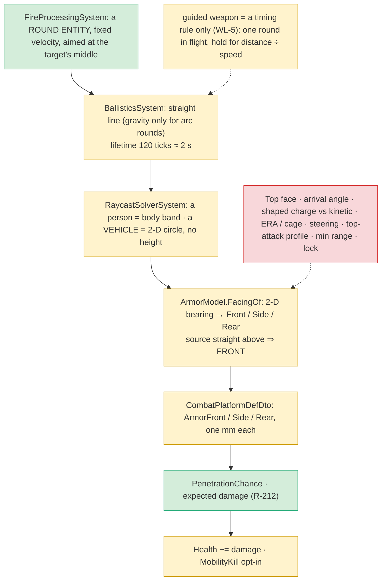
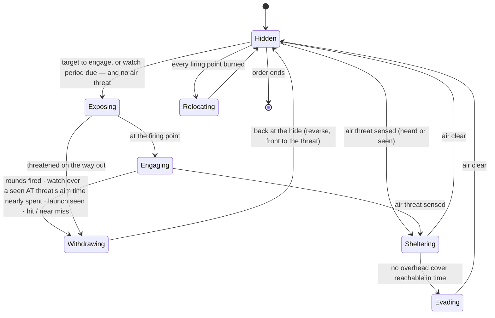

<!--STATUS
state: LIVE
updated: 2026-10-14 (round 2: V1–V7 leans APPROVED; scope widened to every combat vehicle, realistic RPG / LAW / NLAW / Javelin and FPV drones; new items M1–M7, V8; new decisions D-A…D-H not yet approved)
build-state: DESIGN — 🔒 user, 2026-10-14: "No building, still designing."
current-answer: §4 (the programme) and §5 (the open decisions D-A…D-H, each with a lean) — §1 is the measured ground (do not re-derive), §2 the threats and how a vehicle defeats each, §3 the behaviour.
stale-below: nothing.
known-rot: none.
known-conflict: none.
related-designs:
  - docs/DESIGN_Peek_And_Fire.md — OWNS the INFANTRY fight-from-cover node (hide / expose / fire / heat, FiringPositionMemory); G8 (R-257) keeps vehicles OUT of it, so this design's cycle is a vehicle sibling that reuses its memory and fire step
  - docs/designs/hill-attack/DESIGN.md — OWNS HullDownAttackRun (demo-local): creep until seen → fire → reverse to baseline; the one built vehicle exposure, which V4 generalises
  - docs/designs/group-maneuvers/Squad_Coordination_Design_v1_1.md — OWNS the HillCrestHullDown manoeuvre table (§8.4: waves, burned slots) — the PLATOON layer above this unit-level cycle
  - docs/DESIGN_Weapon_Layers.md — OWNS turrets, the weapon brain / muscle, weapon and ammo choice, the guided-weapon timing rule (W-5, W-11, W-12, WL-5) — M4 turns WL-5's timing rule into real guidance
  - docs/DESIGN_Utility_AI_Demo_Scenarios.md — OWNS the armour model (§9, R-212): facing, penetration chance, expected damage — M1/M2 add the top face and the shaped-charge column; V1 reads it the other way round
  - docs/DESIGN_Terrain_Combat_Tuning.md — OWNS the ammo reference library and the shaped-charge formula (§ L93, L123, L217) — M5 adds the AT rounds to it
  - docs/DESIGN_Sensors_And_Doctrine.md — OWNS threat = danger × freshness (§7.8, R-201) and the G1 lean "danger from weapons vs my armour" (§11.2) that V1 builds
  - docs/DESIGN_Thermal_And_Acoustic_Sensing.md — OWNS heard contacts and sound classes (R-207) — M7 adds a rotor class for drones
  - docs/designs/eqs-2/EQS_Design_v1.3_final.md — OWNS the cover generator and exposure tests that V3 sizes for a hull and extends with an overhead-cover test
  - docs/DESIGN_Operations_Behaviour_Catalogue.md — OWNS the operations GAP list and R-263 (D1 vehicle damage states, D2 drones: "follow a planned 3d path and … attack autonomously"); AIR-2 (FPV) / AIR-4 (counter-drone) / OverheadCoverTest / FindShelter are named there — M7 and V8 are their first slice
  - docs/designs/look-direction/DESIGN_Look_Direction_And_FOV.md — OWNS FOV per seat (LD-6); vehicles keep 360° here
-->

# Combat vehicles in urban terrain — hide, show briefly, reverse back; know what can kill you and kill it first

🔒 User, `2026-10-14`:
- *"a tank in an urban area which is supposed to hide behind a building to not be exposed to enemy fire and just go out of the cover for a
  short while for firing or watching and then move back again to the cover … enemy soldiers using RPG or anti-tank weapons … the tank will
  recognize that kind of enemy as a threat and will attack him with priority."*
- *"Leans approved."* (V1–V7, §4)
- *"Rpg should be realistic, the tactics is not just for tanks, maybe it can be used by lighter combat vehicles where rpg still matters and
  rpg might still penetrate thinner armour at the back or top. And rpg is not the only threat, lets count with missile systems like law or
  javelin. And also with small copter drone attacks which are so popular and deadly these days, making tanks an easy prey. No building,
  still designing."*

**Scope:** every combat vehicle — main battle tank, infantry fighting vehicle, armoured personnel carrier, armoured car — and the threats
that kill them: small arms and MGs (light vehicles only), unguided AT rockets, guided AT missiles, attack drones.

## 1. What exists — measured `2026-10-14` (do not re-derive)

### 1.1 The hit chain — where realism is lost

*What the picture shows that prose hid: rounds are already real flying entities, so the arrival direction exists at impact — it is just thrown
away before the face is chosen. Top attack is one field and one angle away, not a new ballistics system.*

| fact | where |
|---|---|
| a source straight above the hull resolves to **Front**, the thickest face | `ArmorModel.cs:29-38` |
| a vehicle is hit as a 2-D circle at any height — a round passing high over it hits it | `RaycastSolverSystem.cs:157-170` (people get a body band, vehicles not) |
| a round lives 120 ticks (≈ 2 s): a missile over 2 km vanishes mid-flight; arc rounds live 3600 | `CombatConstants.cs:80,88` |
| missile speed is generated as range × 0.5 (TOW 1875 m/s, ~7× too fast) | `BdcTkbBuilder.cs:244`, `EngineFallbacks.cs:58` |
| no guidance, no lock-on, no min range, no top-attack profile anywhere; `WeaponMountDto` has `AimSeconds`, `ReloadSeconds`, `MagazineSize`, `DispersionMils`, `Range`, `Category` | `WeaponSuiteDto.cs:21-97` |
| `WarheadKind.ShapedCharge` exists but only labels a log line; the "RPG-7 rocket" / "TOW missile" names do not match the library's "PG-7V HEAT" / "TOW-2 HEAT", so neither has a warhead | `WarheadDto.cs:18`, `MunitionTkbCatalog.cs:26-31` |
| ammo library: PG-7V 298 mm, TOW-2 806 mm, 120 mm HEAT, 40 mm HEDP; no LAW / AT4 / NLAW / Javelin / PG-7VL / PG-7VR | `Tkb/Reference/Data/ammo.json:16-18` |
| vehicles: M1 600/350/200, Bradley 100/60/40, T-72 500/250/150, health = front × 5; MilitaryAPC no armour; no light vehicle with armour | `BdcTkbCatalog.cs:50-52,98-100,171-173`, `BdcTkbBuilder.cs:217` |
| R-263 D1 vehicle damage states (mobility / firepower kill / destroyed, per compartment) — decided, not built | Operations catalogue §10.1 |

### 1.2 The vehicle side

| fact | where |
|---|---|
| AI reverse: `MoveTo` + `ReverseAllowed` backs up while the point is BEHIND the hull; only `HullDownAttackRun` uses it; no AI reverse rail; no pivot turn | `CarKinematicsSystem.cs:329-335` |
| turret part slews on its own; `TrackTarget` keeps the gun on a target; elevation M1 −10…+20°, Bradley −10…+60°, T-72 −6…+14° | `TurretSlew.cs`, `BdcTkbCatalog.cs:69,113,181` |
| `ThreatDanger.Of(view, self, target)` = armed 1 / unarmed 0.3 — `self` is unused | `ThreatDanger.cs:21-28` |
| `WeaponEffectivenessVsTarget` = MY mount vs HIS armour + facing + hit chance — "danger to me" is the same maths swapped (⚠ it reads the mount's penetration, not the resolved round's) | `StandardInputs.cs:398-434` |
| cover points 0.75 m off walls (man-sized); exposure judged from a soldier's eye | `TerrainCoverProvider.cs:22-23,70` |

### 1.3 Above the vehicle — drones and overhead cover

| fact | where |
|---|---|
| **no drone** in code; air types (UH-60, F-16, C-130) are data with no flight model; `KinematicsMode.Flying` declared, unread; `LinearKinematicsSystem` already moves any entity by a 3-D velocity | `BdcTkbCatalog.cs:284-318`, `NavigationEnums.cs:23`, `LinearKinematicsSystem.cs:91-110` |
| a 3-D path provider exists but returns a straight line; no 3-D route type | `EngineBackedVolumetricPathProvider.cs:14-39` |
| sight works in 3-D (the LOS line is raised from the target's own Z); the broadphase is 2-D and skips a target at exactly the observer's X/Y (a drone straight overhead) | `LosStrategies.cs:211-233`, `VisionBroadphase.cs:86` |
| hearing is 3-D; no rotor sound class (3 bits, one value free); a hovering entity (speed 0) makes no sound | `SignaturesDto.cs:84-93`, `AcousticPerception.cs:36` |
| any code can publish a `DetonationNotification`; `AreaEffectSystem` then applies the warhead — a drone can blow itself up with today's code | `DetonationNotification.cs:19-53` |
| ⭐ **overhead cover is answerable today**: a vertical `SightBlocked(p + hull height, p + (0,0,N))` is blocked by slabs, decks and templated roofs; no EQS test makes that call | `TerrainWorld.cs:390-412`, `IWorldQuery.cs:47-65` |
| a vehicle fits UNDER the test-town garage deck (slab at 3 m, vehicle layer 2 m) and the highway-rest overpass (6 m); it cannot enter any building (template doors 0.9 m; a solid building has no inside); trees have no canopy | `test-town.world.geojson:360`, `TerrainHeightTests.cs:230-253` |
| design intent already names the pieces: AIR-2 FPV (search, select, pursue, dive), AIR-4 counter-drone (shoot, hide), `ShelterFrom(drone)`, `OverheadCoverTest`, `FindShelter` | Operations catalogue :130-134, :180, :210 |

## 2. The threats — and how a vehicle defeats each

Figures are public, approximate and disputed between sources; they are tuning starting points, not claims.

| threat | penetration (mm RHA vs shaped charge) | lands on | the gunner needs | ⭐ how the vehicle defeats it |
|---|---|---|---|---|
| rifle / MG (7.62, 12.7 AP) | ~10 / ~20 | the face toward him | sight | armour — only light vehicles care: stand off, hide |
| **RPG-7** PG-7V / PG-7VL / PG-7VR (tandem) | ~300 / ~500 / ~650 | the face toward him — **the TOP from an upper floor close in** | aim ~2 s, big dispersion, reload ~6 s, ~200–300 m | front toward him; exposure shorter than his aim; stand off beyond ~300 m; kill him first |
| **LAW** (M72 class), disposable | ~300 | the face toward him | aim ~1.5 s, one shot, ~200 m | as RPG; a light-vehicle killer, not a tank killer |
| **TOW** class, wire-guided (SACLOS) | ~800 | the face toward him | sight of the target for the WHOLE flight (~13 s to 3.75 km) | ⭐ break sight during the flight — reverse into the hide when a launch is seen |
| **NLAW** (overfly top attack) | ~500 | **the top** | tracking ~2–3 s, 20–800 m | deny the track: exposure shorter than his aim while he sees you |
| **Javelin** (fire-and-forget, top attack) | ~760 tandem | **the top** (direct mode close in / under cover) | **lock before launch** (seconds), 65 / 150 – 2500 m, ~14 s to 2 km | ⭐ deny the lock: never stay seen by him that long; once launched, nothing (APS / smoke are later) |
| **FPV drone** (often an RPG warhead) | ~300–500 | **the top / the rear deck** | a pilot, ~100+ km/h, km range | hear it early → **overhead cover**; keep moving; shoot it if seen (MG); cages / jammers later |
| drop-grenade drone | fragmentation | the top | hovers over the target | overhead cover; keep moving |

📌 Sources: [Javelin (Wikipedia)](https://en.wikipedia.org/wiki/FGM-148_Javelin) · [Javelin (CSIS)](https://missilethreat.csis.org/missile/fgm-148-javelin/) ·
[RPG-7 (Wikipedia)](https://en.wikipedia.com/wiki/RPG7) · [drones vs top armour (Plasan)](https://plasan.com/drone-threats-and-top-attack-protection-does-modern-armor-defeats-fpv-and-loitering-munitions/) ·
[cope cages (Defense News)](https://defensenews.com/global/europe/2024/05/14/ukraine-russia-race-to-shield-battle-tanks-from-exploding-drones) ·
[tank vs drones (TWZ)](https://www.twz.com/tank-runs-for-its-life-under-constant-barrage-of-attack-drones) ·
[Bradley armour](https://en.wikipedia.org/wiki/M2_Bradley) · [Chieftain: use of cover](https://worldoftanks.com/en/news/history/The_Chieftains_Guide_Use_of_Cover/)

⭐ **The unifying idea:** every defence is one of four moves — *armour faces it*, *don't be seen by it long enough* (aim / lock / track
time), *be out of its range*, *have something solid above you*. The behaviour does not need a branch per weapon: it needs each threat's
**danger to me**, **aim time**, **range** and **direction (ground or air)**, all read from the threat's TKB type.

## 3. The behaviour

*What the picture shows: ground threats are beaten by the exposure cycle (time and front armour), air threats by a different refuge —
the hide behind a building protects nothing from above. One exposure is the hill-attack run; the loop, the burned points and the air
branch are what make it the urban behaviour. In Hidden the turret tracks the expected target; in Sheltering / Evading a weapon that can
elevate fires at a SEEN drone.*

| rule | from |
|---|---|
| ⭐ **exposure budget from the enemy**: withdraw before any SEEN AT threat has had sight of me for k × his `AimSeconds` (the lock time of a Javelin, the aim of an RPG); with no such threat, a fixed `ExposeSeconds` cap | R-246 (if I see him, he sees me) + `SightNow` + his TKB mount |
| ⭐ **stand-off**: a firing point beyond a threat's effective range scores higher; an IFV with a 25 mm engages RPG men from 400 m | danger to me falls to 0 beyond his `Range` |
| **front to the threat**: drive out forward, back in reversing — never turn the side to the most dangerous seen threat | the armour model rewards it |
| **launch seen → break sight**: a wire-guided missile in flight is defeated by reversing into the hide | M4 command guidance |
| **air threat → shelter**: the nearest point with overhead cover reachable on the vehicle layer; else keep moving (no exposure cycle while a drone hunts) | M7, V8 |
| **light vehicles**: the same node — their danger profile already includes rifles and MGs, so they hide more and stand off further | V1 |

## 4. The programme

**Approved `2026-10-14` (V1–V7, "Leans approved"), extended in round 2:**

| id | owner | what | lean |
|---|---|---|---|
| **V1** ✅ | behaviors | **danger to me** in `ThreatDanger.Of`: the threat's best weapon (its resolved round) on the face it would hit — from M1's 3-D direction, or the top for a top-attack munition — × 0 outside its range / below its min range, ÷ my max health; a drone = its warhead on my top; a floor above 0 for armed-but-harmless; an UNARMOURED self keeps armed 1 / unarmed 0.3 | the one place (R-194, R-201), the armour model (R-212 A1); a HEARD contact keeps its sound-class estimate (R-207) |
| **V2** ✅ → see M5 / M6 | backend (data) | was: tank eye height, coax MG + HE, RPG rockets + rifle, tandem round | widened into M5 / M6 |
| **V3** ✅ | behaviors (EQS, cross-lane) | hull-sized hide and firing points, judged at the vehicle's sight height; **+ `OverheadCoverTest`** (vertical `SightBlocked` from the hull top) **and a `FindShelter` template** (catalogue :210); **+ a "beyond threat range" score** | parametrise from the querier (R-137) |
| **V4** ✅ | behaviors | the vehicle exposure cycle (§3), a sibling of PeekAndFire (G8), scope: any combat vehicle; with the exposure budget and stand-off rules | generalises `HullDownAttackRun`; reuses `FiringPositionMemory` + the fire step |
| **V5** ✅ | backend | AI-reverse rail; CE-3027 / CE-3029 corner defects | before V4 runs live |
| **V6** ✅ | behaviors | the AT side: RPG / LAW men ambush from windows (upper floors give top hits by M1 geometry), fire, relocate; a Javelin / NLAW team stays back, needs its lock time with sight; a TOW-type gunner holds sight through the flight | infantry library composition first |
| **V7** ✅ | behaviors | demos — see the table below | `scripts/utility-demo-check.py` |
| **V8** 🆕 | behaviors | **counter-drone reaction**: an SOP reaction row above Contact — Sheltering → Evading (§3); fire at a seen drone with a weapon that can elevate | AIR-4's first slice |

**New model items (round 2) — mostly the combat engine, so backend:**

| id | owner | what | lean |
|---|---|---|---|
| **M1** | backend | **3-D arrival**: the round's velocity reaches `DetonationNotification`; `FacingOf` takes the incoming direction and gains **Top** (and Bottom for mines later); fix "overhead ⇒ Front"; a vehicle hit test with the hull's height | D-A |
| **M2** | backend | **armour per face × penetrator**: `ArmorTop` (+ optional `ArmorBottom`) and an optional shaped-charge column per face (absent ⇒ the same as kinetic, so every current type is unchanged); a tandem round ignores ERA | D-B, D-C |
| **M3** | backend | **the penetrator on the round**: kinetic / shaped charge / tandem from the warhead; fix the RPG / TOW name mismatch so both get their HEAT warhead | — |
| **M4** | backend | **missiles**: per-munition lifetime and real speed; three guidance kinds as munition data — unguided (RPG, LAW), command (TOW: hits only while the gunner keeps sight), fire-and-forget (Javelin, NLAW: lock = the existing `AimSeconds`, then steers to the locked entity) — plus `TopAttack` and `MinRange` | D-D |
| **M5** | backend (data) | munitions: PG-7V / VL / VR, M72-class LAW, NLAW, Javelin, an FPV warhead, a drop grenade; weapons with real aim, reload, dispersion, rounds carried; the RPG man with a rifle and 3–4 rockets; tank coax MG + HE; vehicle eye heights | §2 numbers |
| **M6** | backend (data) | vehicles: MBT, IFV, APC, armoured car with per-face kinetic / shaped-charge / top values and an explicit health (not front × 5); light vehicles opt into mobility kill | D-F |
| **M7** | backend + behaviors | **a minimal FPV drone**: a TKB air type on `LinearKinematicsSystem` (point-mass: speed, climb, turn), a rotor sound class, a small collider with a height, a warhead it detonates on contact (itself as shooter); its behaviour: fly a 3-D route → search → select (threat ranking) → pursue → dive on the top / rear; the overhead broadphase fix (`VisionBroadphase.cs:86`) | D-E; R-263 D2 (AIR-2's first slice) |

**Demos (V7):**

| demo | terrain | shows |
|---|---|---|
| `ua-tank-corner` | test-town | the cycle; the RPG man engaged before the rifleman; never the same point twice; a near miss cuts an exposure |
| `ua-ifv-standoff` | test-town | a 25 mm IFV kills RPG men from beyond their range; up close an RPG kills it |
| `ua-javelin-lock` | basic-desert or test-town | the tank's short exposures deny a Javelin team its lock; a long exposure is punished from above |
| `ua-drone-shelter` | test-town (garage deck) | an FPV drone hunts a tank; the tank hears it and backs under the deck; a tank in the open is hit on the roof |

**Order:** M1 → M2 → M3 (the hit chain) · V1 · M5 / M6 data · V3 → V4 (+V5) → V6 → `ua-tank-corner`, `ua-ifv-standoff` · M4 →
`ua-javelin-lock` · M7 → V8 → `ua-drone-shelter`. **Later:** ERA / cage / slat numbers, active protection, smoke, jammers and
electronic warfare, hull-vs-turret armour, R-263 damage states, pairs and infantry cooperation, gun-elevation stand-off, loitering munitions.

## 5. Open decisions (round 2) — each with a lean

| id | question | lean | blast radius / what would change it |
|---|---|---|---|
| **D-A** | when is a hit on the TOP? | the incoming direction descends ≥ **45°**, or the munition is `TopAttack`; so an RPG from a 4th-floor window 10 m away hits the roof, from 50 m the side | the armour model and its rails; every existing hit keeps its face (they are near-flat) |
| **D-B** | a shaped-charge armour value separate from kinetic? | **yes, optional per face** (absent = the kinetic value) — without it an RPG can never be both "harmless to an M1's front" and "deadly to its side or roof" with credible numbers | `CombatPlatformDefDto` (TKB schema, backend); R-212 A3 still holds (fixed per type) |
| **D-C** | ERA, cages, slat armour now? | **later**, as per-face data: ERA scales a single shaped charge down (tandem ignores it), a cage defeats a shaped charge with a probability (expected value, no dice — R-212 A2) | data only once M2 exists |
| **D-D** | how far do missiles go? | **three guidance kinds as munition data on the existing round** (steer toward the locked entity, climb-and-dive for top attack); lock = `AimSeconds` | backend ballistics; WL-5's timing rule stays for the one-in-flight limit. ⛔ not a full flight model (no aerodynamics) |
| **D-E** | build a drone now, or wait for the whole air programme (catalogue P5)? | **a minimal FPV drone in this programme** (M7) — the vehicle demos need a top-attack hunter; it is R-263 D2's first slice, the rest of AIR later | a new TKB air type + one motion rule on an existing system; reconnaissance and loitering drones stay later |
| **D-F** | vehicle health | **explicit per type** (an RPG penetration knocks out an APC or IFV; an MBT survives 1–2 side penetrations; a Javelin top hit kills it); light vehicles opt into mobility kill; R-263's per-compartment states stay their own item | data; changes every vehicle demo's numbers ⇒ re-check `ua-weapon-choice` |
| **D-G** | separate hull and turret armour? | **no, later** — the face is chosen from the hull; the top face covers the turret roof | — |
| **D-H** | counter-drone means in v1 | **shelter, keep moving, shoot it if seen**; jammers (they need a radio-link model), active protection, smoke later | V8 only |

⚠ Before building (user: "still designing"): `classDiagram` + `sequenceDiagram` per item; read `PeekAndFireNodes`, `HillAttackTankNodes`,
`BallisticsSystem`, `DamageCalculationSystem` end to end (assumed here, not read); a backend handoff for M1–M7 once D-A…D-H are decided.
