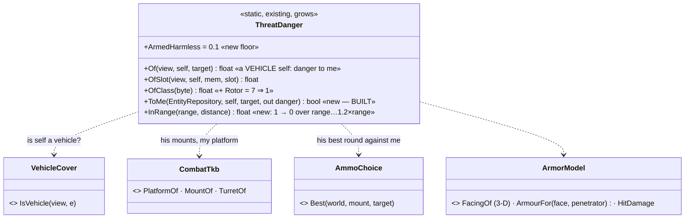
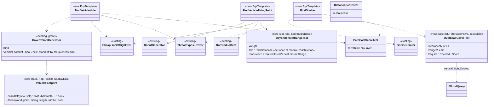
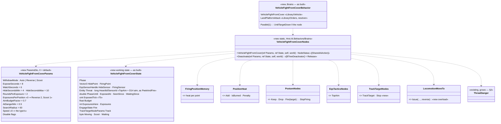
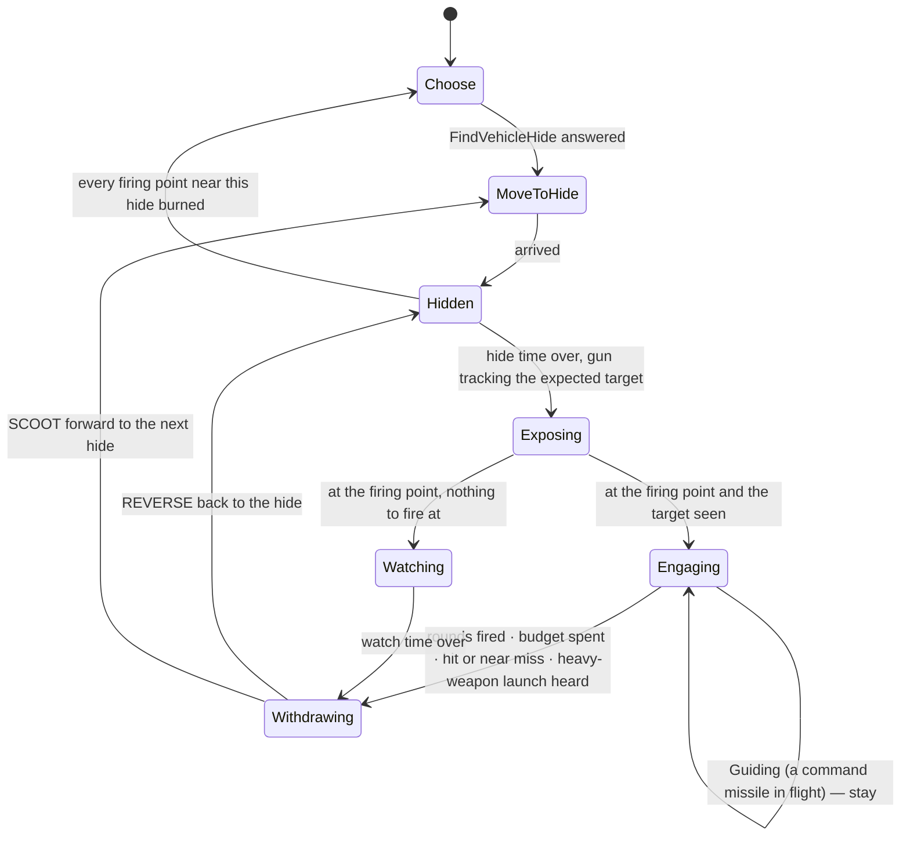
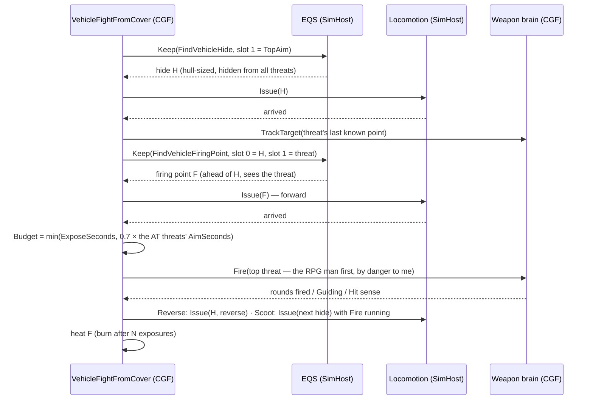
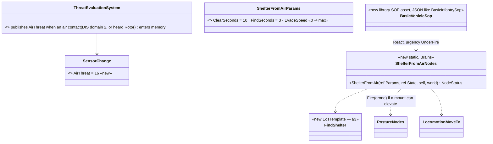
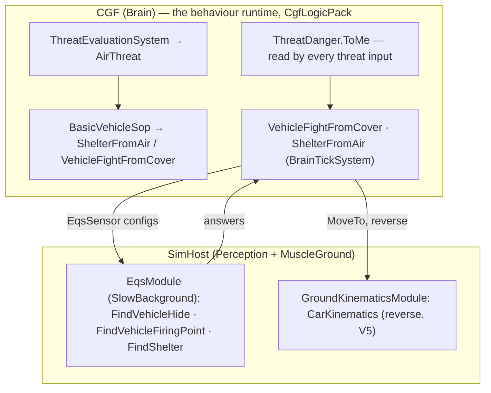

<!--STATUS
state: LIVE
updated: 2026-10-14
build-state: BUILDING — V1, V3, V4 built (as-built rows in §2–§4); V6, V8 to build. 🔒 user, 2026-10-14: "Leans accepted. Write the designs" (V1–V8, D-H, D-J, D-K approved)
current-answer: §2 danger to me (V1), §3 vehicle points (V3), §4 the node (V4), §5 reverse (V5), §6 technicals (M9), §7 the AT side (V6), §8 counter-drone (V8), §9 who runs it, §10 rails — §1 is the measured ground.
stale-below: nothing.
known-rot: none.
known-conflict: none.
related-designs:
  - docs/designs/motion-models/DESIGN_Motion_Domains.md — V5's reverse fix lives in the ground domain's wheeled / tracked models
  - docs/designs/vehicle-tactics/DESIGN_Urban_Armour_Tactics.md — the PROGRAMME (V1–V8, M9; decisions D-A…D-L)
  - docs/DESIGN_Peek_And_Fire.md — OWNS the infantry fight-from-cover node; G8 (R-257) keeps vehicles out of it — this node is its vehicle sibling and reuses FiringPositionMemory, PositionHeat, PostureNodes.Keep / Fire
  - docs/designs/hill-attack/DESIGN.md — OWNS HullDownAttackRun (one exposure: creep → fire → reverse); this node makes it repeatable; the hill attack is re-pointed at it later (R-256 d)
  - docs/DESIGN_Sensors_And_Doctrine.md — OWNS threat = danger × freshness (§7.8, R-201) and the G1 lean this file builds (§2)
  - docs/DESIGN_Decision_Layer.md — OWNS the SOP slot and reaction urgency (R-199); §8 adds a vehicle SOP and one sense
  - docs/designs/eqs-2/EQS_Design_v1.3_final.md — OWNS generators, tests and templates (§19); §3 adds a vehicle footprint mode, OverheadCoverTest and three templates
  - docs/DESIGN_Orders_Params_Entity_Classes.md — OWNS order naming by entity class (R-278); §4 adds LandPlatformAttack
  - docs/designs/vehicle-tactics/DESIGN_Armour_Hit_Model.md — the face and armour a threat's round would meet (V1 reads it)
  - docs/designs/vehicle-tactics/DESIGN_Missiles_And_Ammo.md — FireOnMove, Guiding, the lock that bounds an exposure
  - docs/designs/vehicle-tactics/DESIGN_FPV_Drone.md — the air threat §8 reacts to
-->

# The vehicle exposure cycle — danger to me, hull-sized points, hide · expose · withdraw, technicals, counter-drone

## 1. What exists — measured `2026-10-14`

| fact | where |
|---|---|
| `ThreatDanger.Of(ISimulationView view, Entity self, Entity target)` = armed 1 / unarmed 0.3 / out of the fight 0 — **`self` unused**; `OfSlot` (heard ⇒ `OfClass`), `OwnStrength`; `CombatTkb` takes `EntityRepository` — every production caller passes one, the pattern is `view is EntityRepository repo` | `ThreatDanger.cs:15-64`, `EntityRepository.View.cs:10` |
| ⚠ a SOLDIER also has a `CombatPlatformDefDto` (5 mm body armour) — "has armour" cannot be the vehicle test | `BdcTkbCatalog.cs:210` |
| callers of the danger (all on CGF): `ContactThreatLevel`, `ContactDanger`, `EnemyStrengthRatio` (`OfSlot`), `SquadContactThreatLevel`, `SquadEnemyStrengthRatio`, `ThreatsAtLeast`, `DangerAreaSensorSystem.ThreatOn`; `TopThreat` ranks through `ContactThreatLevel`; ⚠ `UtilityTestWorld.SetEnemyStrengthRatio` re-implements the formula | `StandardInputs.cs:164-286`, `SquadInputs.cs:190-276`, `SensorNodes.cs:122-140`, `DangerAreaSensorSystem.cs:138-145`, `EqsTacticsNodes.cs:322-342` |
| sound classes 0–6 in 3 bits (one value, 7, free); heard danger by class `OfClass` | `SignaturesDto.cs:84-93`, `ThreatDanger.cs:52`, `AcousticPerception.cs:36` |
| `SensorChange` members 1–15 used | `SensorChangedEvent.cs:12-56` |
| EQS templates are `[EqsTemplate]` static classes with one generator and four test arrays; each needs a golden scenario (`EqsFlatTerrainGoldenTests.RegisteredTemplates_AllHaveAGoldenScenario`) | `EqsQueryTemplate.cs:61-120`, `EqsFlatTerrainGoldenTests.cs:55-122` |
| cover points are baked by `TerrainCoverProvider` at 0.75 m off each face, 2.5 m apart; `CoverPoint` has a facing (`DirectionX/Y`) but no size; `VehicleCover.StandingPoints` derives points round live vehicles per query | `TerrainCoverProvider.cs:22-24,70-106`, `CoverPoint.cs:14-40`, `VehicleCover.cs:93` |
| tests measure the self at `EqsTerrainSight.Mount(self)` (its `SensorMount`, else 1.7 / 1.1 / 0.35) — a vehicle's sight height is TKB data | `EqsTerrainSight.cs:29`, `ThreatExposureTest.cs:67-75` |
| the EQS solver's systems run on a replica WORLD the kernel refreshes for the background module; a world singleton (`SetSingletonManaged`) lives in one world, and the replica receives only eight of the live world's singleton references (`SyncSingletonById`) — the TKB (`ITkbDatabase`, id 60, one object per process built by `HrotEnvironment.CreateTkb`, no production hot reload) is not among them | `EntityRepository.Sync.cs:103-125`, `SimHostNodeBootstrapper.cs:268,515`, `HrotEnvironment.cs:28-41` |
| no overhead test exists, but a vertical `SightBlocked` sees slabs, decks and templated roofs | `TerrainWorld.cs:390-412` |
| PeekAndFire's reusable parts: `FiringPositionMemory` (8 slots, heat) + `PositionHeat`, `PostureNodes.Keep / Drop` (owned EQS sensors), `PostureNodes.Fire(…, target)`, `EqsTacticsNodes.TopAim`, `CoverClaim`, `LocomotionMoveTo.Issue / Status / Stop` (`ReverseAllowed` 0 until B2 added `Issue(…, reverseAllowed)`), `TrackTargetNodes.TrackTarget` (shares the weapon channel with Fire; no stop helper) | `PeekAndFireNodes.cs`, `FiringPositionMemory.cs:37-110`, `PostureNodes.cs:396-468`, `LocomotionMoveTo.cs:85-122`, `TrackTargetExecutor.cs:86-103` |
| ⚠ **today a tank's attack order runs the INFANTRY posture tree** (`PlatformAttack` → CombatPosture → PeekAndFire) — no `Tank*` / `Armor*` / `LandPlatform*` behaviour exists | `ClassOrderBehaviors.cs:68-71`, `OrderResolver.cs:33` |
| ⚠ **AI reverse does not work**: `CarKinematicsSystem` computes `speedSign = −1` (`:330-336`) but `BicycleModel.Integrate` clamps `Speed = max(0, Speed)`; only manual drive reverses; `MaxSpeedRev` is 0 in every preset but Tank; reversing freezes `ProgressS` (`max(0, dot)`) | `BicycleModel.cs:34`, `VehicleClass.cs:96-112`, `CarKinematicsSystem.cs:413` |
| a pickup fits the DIS class `SmallWheeledUtilityVehicle` (1.1.*.6, under `WheeledUtility`, `LandPlatform`); free ground TKB ids 104–199 | `EntityClassTable.cs:118-135`, `TkbEntityTypes.cs` |

### INVENTORY — the queries run

| query | total | the set |
|---|---|---|
| `search_graph .*ThreatDanger.*\|.*DangerTo.*` (Class) | 1 | `ThreatDanger` — the one place (R-194) |
| `search_graph .*HullDown.*\|.*Exposure.*` (Class) | 6 | `HillCrestHullDownManeuver`, `HullDownAttackBlackboard`, `HullDownAttackParams`, `HullDownAttackIntentDto`, `HullDownAttackMapper`, `ThreatExposureTest` |
| `search_graph .*Shelter.*\|.*Overhead.*` (Class) | 0 | — |
| grep `Tank\|Armor\|LandPlatform` behaviour names | 0 | — |

⇒ no vehicle fight-from-cover, no shelter, no danger-to-me exists; each is built ONCE below from the parts listed in §1.

## 2. Danger to me (V1)

| rule | why |
|---|---|
| ⭐ **the danger to a VEHICLE self** (`VehicleCover.IsVehicle(self)` and a `CombatPlatformDefDto` with armour) = max over the target's mounts of `ArmorModel.PenetrationChance(his round vs me, on the face it would hit)` × `InRange`, clamped to [`ArmedHarmless` 0.1, 1] for an armed target — the person scale's *armed = he can hurt me = 1*; an UNKNOWN round (penetration ≤ 0) ignores armour ⇒ 1, as `HitDamage` does; a person self keeps armed 1 / unarmed 0.3 | V1; a soldier's 5 mm vest must not make riflemen harmless to riflemen (§1 ⚠). ⚠ **AS-BUILT `2026-10-14` — deviates from the first draft** (`HitDamage` ÷ my max health, ⛔ SUPERSEDED): that put a side-on RPG at 400 / 2500 = **0.16**, under every ABSOLUTE threshold — the `Sentry` order's `ThreatsAtLeast.MinDanger` default 0.5 (`TacticsTreesTests.cs:686`, `Sentry.btree.json`) would not count the RPG man as a threat to a tank, the opposite of the requirement. Damage-per-hit stays the WEAPON brain's business (`AmmoChoice`, Missiles §2), not the danger's |
| the face: `ArmorModel.FacingOf(myTransform, hisPosition)` — 3-D, so a man on a roof close in reads my Top; a `TopAttack` munition at ≥ its top-attack range reads Top | Armour Hit Model D-A; Missiles §3 |
| ⭐ **AS-BUILT `2026-10-14` (on backend B3–B7)** — per mount, the BEST of the rounds it carries (`Loadout`, else its one round): `CombatTkb.RoundOf` → penetration, `CombatTkb.PenetratorOf` → the armour column (`ArmourFor(platform, face, penetrator)`: a shaped charge reads `…Ce`), on the face `FacingOfArrival(me, myHullMiddle − hisEye)`; a `FireAndForget` `TopAttack` missile at ≥ `TopAttackMinRangeM` reads `Top` (the rule `FireProcessingSystem.cs:262` flies); inside a missile's `MinRangeM` ⇒ 0. ⚠ `CombatTkb.RoundOf` / `PenetratorOf` gained a TKB-taking overload (the world ones delegate — one implementation) so `ToMe` runs on a solver snapshot too (cross-lane, additive) | rails `ThreatDangerTests.V1_ADangerIsTheBestRound_*`, `V1_TheFaceIs3D_*`, red-proved five ways (2-D face, no loadout, kinetic only, no top attack, no min range) |
| `InRange` = 1 within his mount's `Range`, falling to 0 at 1.2 × `Range`; 0 below a missile's `MinRangeM` | stand-off falls out of the danger (programme §3) |
| a drone (`DIS domain 2` with a warhead mount) = its warhead on my Top | M7 |
| a heard contact keeps `OfClass`; class 7 `Rotor` = 1 | R-207; a drone is heard before it is seen |
| `self` unknown to the TKB, or a view that is not an `EntityRepository` ⇒ today's rule | the solver snapshot has no TKB (§1) |
| every caller in §1 picks it up unchanged — `TopThreat` now ranks the RPG man (and the ATGM technical) above the rifleman for a tank | one place (R-194, R-201); `UtilityTestWorld` is updated with it |

## 3. Hull-sized points, overhead cover and the templates (V3)

*What the picture shows that prose hid: two new tests and one generator mode; the three templates are compositions of tests otherwise
existing. ⛔ SUPERSEDED (2026-10-14, user: "tkb is singleton and is constant does not need any snapshot"): the first draft said a
range-aware test could not run in the solver — wrong; the TKB is one constant object, handed to the test once when the EQS module is
built (a reference, nothing copied) and read by `BeyondThreatRangeTest`.*

| template | generator | filter | score | answer |
|---|---|---|---|---|
| **FindVehicleHide** | `CoverPointsGenerator{VehicleFootprint}` (baked points pushed out to the hull's stand-off, kept only where the hull's box is clear) | `CheapLineOfSight{slot 1, Slot viewer, Hidden}` | `Distance` (near self), `ThreatExposure{HideFromAll}`, `PathCost` | a hide hidden from every known threat at the vehicle's sight height |
| **FindVehicleFiringPoint** | `Donut{anchor slot 0 = the hide, 2 rings, ~25 m}` | `CheapLineOfSight{slot 1, Candidate viewer, Visible}` | `DotProduct` (ahead of the hide's facing — a straight drive out and a straight reverse back), `BeyondThreatRange` (outside each known threat's weapon range scores 1, inside it falls with distance), `ThreatExposure` (fewest OTHER threats), `PathCost` | a point that sees the target and as little else as possible |
| **FindShelter** | `Grid{anchor self, spacing 5}` | `OverheadCover{Covered}` | `Distance` (near), `PathCost` | the nearest reachable spot with solid above the hull (a deck, a bridge, a roof slab) |

| rule | why |
|---|---|
| `VehicleFootprint` acts only for a vehicle querier; a person's cover points are unchanged | infantry templates, goldens and rails untouched |
| ⭐ **AS-BUILT `2026-10-14` (V3 slice 3)** — `CoverPointsGenerator.VehicleFootprint` + static `VehicleFootprint`: the hull = `VehicleParams` length × width (else the square inside the collider) × collider height; a point moves AWAY from its cover along its protection direction to `width/2 + 0.5 m` (it was baked at 0.75 m for a man) and is kept only where the hull's box — length along the wall, width toward it — touches no solid overlapping the hull's HEIGHT BAND (a deck above it does not count: ⚠ `EqsTerrainSight.InsideSolid` is plan-only, so the box test has its own Z-aware check); points round the querier's OWN standing box (within its half diagonal + 1.25 m) are dropped | rail `TerrainEqsTests.V3_VehicleFootprint_*`, red-proved three ways (no push; own box kept; a deck above blocks) |
| ⭐ **AS-BUILT `2026-10-14` (V3 slice 1)** — `EqsModule.ForTerrainHost` calls `BeyondThreatRangeTest.InjectTkb(registry, CombatTkb.Live(world))`: every `ITkbAwareTest` of every registered template gets a `Func<ITkbDatabase?>` that reads the LIVE world's singleton when called — the same reference, nothing copied (the twin of `TerrainWorldSource.Live`). ⚠ Refines the row below: a SOURCE, not the object, because the editor publishes the TKB only *"if absent"* (`EditorSubsystem.cs:1417`) with no guaranteed order against the EQS capability — a value captured at construction could be null. A test with no source falls back to the view's own singleton (a live world in rails) | each world's registry builds its own template instances (`EqsTemplateRegistry.Discover`), so the hand-over cannot leak across worlds; the registry the solver reads is that same object (singleton 210, synced by reference) |
| ⭐ **`BeyondThreatRangeTest` as built**: per known threat (`EqsKnownThreats.Collect` — the set `ThreatExposureTest` reads, extracted so both agree) that can hurt me at all — `ThreatDanger.ReachAgainst`: his longest mount `Range` whose round penetrates my THINNEST armoured face (any mount for an unarmoured self; an unknown round counts) — `min(1, ground distance ÷ his reach)`; the score gains `Weight` × the MEAN. A rifleman never pushes a tank back | the same `CanHurt` as `ThreatDanger.ToMe` (R-212 A1, one armour model); `ToMe` itself now runs on any view with the TKB handed in |
| ⭐ **the TKB reaches a test ONCE, AT CONSTRUCTION, by reference**: `EqsModule.ForTerrainHost(world)` (built once per node from the LIVE world, `EqsInfrastructureCapability.cs:97`) reads `world.GetSingletonManaged<ITkbDatabase>()` and sets it on every registered test that declares a `Tkb` property (`ITkbAwareTest`) — templates are built once at registration, so this is one hand-over per node; the solver's replica world and its singleton list (`EntityRepository.Sync.cs:117-124`) are NOT touched | 🔒 user, 2026-10-14: *"passing the TKB to the solver once at construction sounds ok … Certainly not snapshotting it please. Pass reference somehow."* — the same pattern as the sight strategy's terrain (`LosStrategies.cs:81-82`) |
| ⚠ a TKB FILE load refills the same object (`Register` / `Clear`); holding the reference sees the current content — assumed, not measured: no solve runs while a load refills it | `ITkbDatabase.cs:10-33` |
| `OverheadCoverTest`: covered when `SightBlocked(c + (0, 0, hullHeight + 0.1), c + (0, 0, hullHeight + 30))` | §1: the vertical ray already sees decks and roofs |
| ⭐ **AS-BUILT `2026-10-14` (V3 slice 2)** — `OverheadCoverTest` (FilterExpensive, cost Sight): the vertical line from `ClearanceM` 0.1 above the self's height — its collider HULL (`PhysicsColliderReaders.HullHeight`) or, for a person, its standing eye — up `RangeM` 30 m, through `EqsTerrainSight.Sight` (terrain prisms and vehicle boxes). `Require = Covered` drops an open-sky point; `Score` adds `Weight`. Measured on a floating deck: a soldier is covered under a 1.5 m and a 4 m deck, a 2.4 m tank only under the 4 m one | rails `TerrainEqsTests.V3_OverheadCover_*` (2), red-proved (hull ignored ⇒ the tank "fits" under the low deck) |
| the vehicle's sight height is its `SensorMount` (TKB: tank ~2.4 m, technical ~2.2 m) — hidden means hidden at the commander's sight | data (Missiles §5), read by the existing tests |
| each new template gets its golden scenario (flat terrain ⇒ an empty `FindShelter` answer is the golden) | `EqsFlatTerrainGoldenTests` |
| ⭐ **AS-BUILT `2026-10-14` (V3 slice 4)** — `VehicleTemplates.cs`: `FindVehicleHide` (`0x10B0D9B3`), `FindVehicleFiringPoint` (`0xF15555E6`), `FindShelter` (`0x072E6926`), as the table above. The firing point's "ahead of the hide" is `DotProductTest{Pivot 0, Reference 1, Preferred 1}` — straight out from the hide TOWARD the target (the drive-out / reverse-back line), since the hide has no stored facing. Goldens: the self is a 7 × 3.6 × 2.4 m tank; the hide reads the terrain's own cover (`TerrainCoverProvider`); ⚠ the shelter golden adds a 4.5 m deck instead of pinning an empty answer — an empty answer would pin nothing. ⚠⚠ **Measured: a deck is a `TerrainWalkable` slab, not a prism** — a slab blocks a sight line that crosses it (`TerrainWorld.SegmentBlocked`) and the ground under it is standable, while `TerrainWorldQuery.TryStandAt` rejects ANY point inside a prism's footprint at any height (`:50-54`), so a deck modelled as a floating prism leaves nothing under it for a generator to place (first capture: 0 points) | `EqsFlatTerrainGoldenTests` (3 scenarios, `CaptureOnFlatGround`'s `tankSelf` / `terrainCover` / `extra` knobs, no-ops for the existing ones) |

## 4. The node — VehicleFightFromCover (V4)

*What the picture shows: one new node with its params and state; every box it calls exists except two small overloads (`Issue` with
reverse, `TrackTarget.Stop`). It is a sibling of PeekAndFire (G8), sharing that node's memory and steps — not a copy of its phases.*

| rule | why |
|---|---|
| **withdraw mode** `Auto`: the type's `ArmorFront ≥ 2 × ArmorSide` ⇒ `Reverse` to the SAME hide (a straight reverse — the firing point is chosen ahead of the hide's facing); else `Scoot`: drive forward to a NEW `FindVehicleHide` answer away from the threat, and the point burns after 1 use | D-J |
| **exposure budget**: at each exposure, `Budget = min(ExposeSeconds, AimBudgetFactor × the AimSeconds of every seen threat whose danger to me ≥ AtDangerMin)`; `SeenAtFor` counts continuous sight of such a threat; withdraw at `SeenAtFor ≥ Budget` | the enemy's aim / lock time bounds the exposure (programme §3; R-246: if I see him, he sees me) |
| **cut short** on a Hit / NearMiss since `ExposedAt`, or a heard `HeavyWeapon` source within 30° of the threat (a launch) — `RecentSenses` | T5 |
| **Guiding** (the weapon channel's reason): stay in Engaging until the round lands, unless hit | a command missile needs its gunner (Missiles §4) |
| **hidden**: `TrackTarget` keeps the gun on the threat's last known point; firing replaces it; `TrackTarget.Stop` on leaving | T4; the two share one channel (§1) |
| **front to the threat**: Exposing drives forward along the hide's facing; Reverse withdraws backwards — never turns | T3 |
| **fire on the move**: in `Scoot`, `Fire` keeps running during the drive when the target is seen (a `FireOnMove` mount fires, others hold — the weapon brain decides) | D-L |
| **watching**: no target ⇒ `Watching` (an observation exposure) for `WatchSeconds` | "for firing or watching" |
| releases: stop fire, stop track, drop both sensors, stop the move, `ws = default`; `FiringPositionMemory` is kept | as PeekAndFire's `Release` |

⭐ **As-built `2026-10-14` (V4) — `Hrot.AI.Behaviors/Brains/VehicleFightFromCoverNodes.cs` + `VehicleFightFromCoverBehavior.cs`; deviations, argued:**

| design said | built | why |
|---|---|---|
| a heard launch is a `RecentSenses` cut | ⚠ read from `TargetMemory`: an ANONYMOUS slot of class `HeavyWeapon` whose `LastSeenTick ≥ ExposedTick`, within 30° of the threat | `RecentSenses` has no heard-sound kind (`SensorChange` 1–8, measured). ⚠ A shot heard inside a SEEN contact's circle refreshes THAT contact (`TargetMemory.HearContact`), so this cut sees only the launch from a window nobody saw — a seen dangerous shooter is the budget's (`Budget`) |
| Guiding = "the weapon channel's reason" | the aimed-fire executor's own row: `ActionStatus.Weapon.Reason == Guiding` while the channel runs `AimAndFire` | the reason exists only there (`AimAndFireExecutor` W-12c writes it); the channel carries no reason |
| `Hidden → Choose : every firing point near this hide burned` | also after `NoCoverSeconds` with NO firing-point answer (as PeekAndFire's G2) | a hide no query can fight from is as used-up as a burned one |
| `VehicleFightFromCover = Sequence(the node)` | `Parallel(1){ UntilTargetDown ‖ the node }` for both the library tree and `LandPlatformAttack` | an ATTACK names its target: `UntilTargetDown` designates it (the ranking puts it first, so `TopAim` fights IT) and ends the order with Success when it is down — `CombatPostureBehavior`'s C-5 reading, reused (its `Resolve` fills the designation) |
| state `NextHide · SeenAtFor · Reversing` | `SeenSince` (since when a dangerous threat has seen me); the next hide is picked at the withdraw, so no `NextHide`; `Scoot` (the resolved mode) replaces `Reversing` | fewer fields, one decision point |
| — | ⚠ **open:** the budget is NOT floored at my own aim time (PeekAndFire's G8 floors an exposure at 2 × it). A tank slower to aim than the RPG man is fast (aim 2 s ⇒ budget 1.4 s) withdraws before it fires | the design's rule is the enemy's clock; the gun is already on him from the hide (T4 tracking), which shortens my aim — ⛔ not measured live; the demo (`ua-tank-corner`) is where it is settled |

Rails: `VehicleFightFromCoverNodesTests` (`Hrot.SimHost.Tests`, beside `PeekAndFireNodesTests`, the same faked body/weapon/EQS
harness) · `TacticalIntentResolutionSystemTests.V4_ATanksAttackOrder_ResolvesTo_LandPlatformAttack` (production registry) ·
`CuratedBehaviorRegistrarTests.SR_R2` (the two names).

**The library behaviour and the order:** a curated C# BTree `VehicleFightFromCover` (`Group = "Library/Vehicle"`, scope: any armed land
vehicle) = `Sequence(the node)`; and **`LandPlatformAttack`** (R-278: `<Class><Order>`, more specific than `PlatformAttack`) maps the
attack order of every land vehicle — tank, IFV, APC, technical — to it, so a tank no longer runs the infantry posture (§1 ⚠).

## 5. Reverse driving (V5, backend)

| change | where |
|---|---|
| `BicycleModel.Integrate` clamps to `[−MaxSpeedRev, MaxSpeedFwd]` instead of `≥ 0` (manual drive already does) | `BicycleModel.cs:34`; `BicycleModelTests` re-pinned on purpose |
| trajectory progress counts reversing distance: `ProgressS += |Speed|·dt·max(0, dot(travelDir, tangent))` with `travelDir = sign(Speed)·forward` | `CarKinematicsSystem.cs:413` |
| presets get a reverse speed: PersonalCar 6, Truck 4 (Tank keeps 8); TKB `MaxSpeedRev` overrides | `VehicleClass.cs` |
| `LocomotionMoveTo.Issue(…, bool reverseAllowed)` | §4 |
| first rail: `V5_AnAiTank_ReversesToAPointBehindIt_FacingUnchanged` — and re-measure the hill attack's `ReverseToBaseline` live (assumed broken by the clamp, not run) | `CarKinematicsSystemTests`, `HillAttackNodeTests` |
| CE-3027 (hull clips corners) / CE-3029 (follower cuts inside corners) before the cycle runs live | tracker |

⭐ **As-built `2026-10-14` (backend, B2) — one deviation, argued:**

| design said | built | why |
|---|---|---|
| `Integrate` clamps to `[−MaxSpeedRev, MaxSpeedFwd]` | ⚠ **`Integrate(…, maxSpeedRev = 0, maxSpeedFwd = ∞)`** — the caller passes `MaxSpeedRev` **only while `NavState.ReverseAllowed == 1`**, else 0 | ⛔ a bare `[−MaxSpeedRev, …]` would let ANY AI vehicle whose speed controller undershoots (the reverse-heading `speedSign`, `CarKinematicsSystem.cs:330-336`) back up without being asked. Reverse stays an order's choice (`LocomotionMoveTo.Issue(…, reverseAllowed)`), never a side-effect of a preset gaining a reverse speed. `MaxSpeedFwd` 0 (an unknown profile, CE-103) = no cap |
| progress `|Speed|·dt·max(0, dot(travelDir, tangent))` | ✅ as written (`CarKinematicsSystem.cs`, the trajectory branch) | — |
| presets PersonalCar 6, Truck 4, Tank 8 | ✅; ⚠ the BDC catalog's tank overrides to **10** (`BdcTkbCatalog.cs:164`) — that is what the hill attack drives | — |

📐 **Hill attack, live (`hill-attack-close`, `--mode all`, 150 s, SimHost perspective, 0.5 s samples):** **before** — tanks 1001–1003 asked to reverse on 10–11 samples and **reversed on 0** (the clamp). **After** — 1002 backed up on 20 samples (115 m, down to −10.0 m/s), 1003 on 12 (47 m, −8.3 m/s); 1001 was asked on 14 samples and did not reverse (its reverse leg ended inside the arrival radius — not chased); 1004 is never asked. Rails: `CarKinematicsSystemTests.V5_AnAiTank_ReversesToAPointBehindIt_FacingUnchanged`, `V5_ReversingAlongAPath_MakesProgress`, `BicycleModelTests.CE2167_BicycleModel_WithAReverseSpeed_BacksUp_ToThatSpeedOnly` (all three red with the old `≥ 0` clamp).

## 6. Technicals (M9, D-K)

| field | Technical (HMG) — TKB 104 | Technical (ATGM) — TKB 105 |
|---|---|---|
| DIS | 1.1.*.6 `SmallWheeledUtilityVehicle` (→ `LandPlatformAttack`) | same |
| kinematics | `PersonalCar` preset, 5.3 × 1.9 m, 25 m/s, reverse 6 m/s | same |
| platform | armour 5 / 5 / 5, top 3; `MaxHealth` 300; mobility kill below 0.6 | same |
| turret (a pintle) | ±180°, −10…+70°, 90 / 45 °/s — it can fire at drones | ±120°, −10…+20°, 40 / 20 °/s |
| weapon | 12.7 mm HMG, AP (6019), `MachineGun`, `FireOnMove` yes, range 1500 | ATGM (6015, Command), `Atgm`, `FireOnMove` no, 4 missiles |
| sensors / signature | visual 2000 m, eye 2.2 m; `WheeledEngine` | same |
| SOP | `BasicVehicleSop` (§8) | same |

D-K: the gunner is not a separate person; the vehicle's ~0 armour makes it weak to rifles. A shootable gunner comes with R-263's damage
states and the carrier's per-seat exposure (R-2009). Withdraw mode `Auto` ⇒ `Scoot` for both (front 5 < 2 × side 5).

## 7. The AT side (V6) — compositions, no new node

| shooter | how it fights | what makes it realistic |
|---|---|---|
| RPG man (Insurgent 2003: RPG × 4 + rifle) | `CombatPosture` → PeekAndFire from a window (`FindWindowFiringPosition`); `WeaponSelection` picks the RPG against a vehicle (its effectiveness reads the armour face — Missiles §2) | an upper floor close in hits the roof by geometry (Hit Model D-A); aim 2 s, reload 6 s |
| LAW man | the same; the LAW is disposable (1 round each, 2 carried) | a light-vehicle killer |
| Javelin / NLAW team (new type) | `CombatPosture` with `FiringPosition` (`FindOpenFiringPosition`) at range | the lock (aim time) needs continuous sight — the tank's short exposure denies it |
| ATGM technical | `LandPlatformAttack` (this node, `Scoot`) | halts for the flight (FireOnMove no), Guiding |

## 8. Counter-drone (V8, D-H)

| SOP row (`BasicVehicleSop`, first true wins) | runs | urgency |
|---|---|---|
| `SensedFresh{AirThreat, 3 s}` | `ShelterFromAir` | UnderFire (above Contact) |
| `SensedFresh{Hit, 3 s}` | `VehicleFightFromCover` | Hit |
| `SensedFresh{FirstThreat, 3 s}` | `VehicleFightFromCover` | Contact |
| else | `Idle` | DoWhenIdle |

| `ShelterFromAir` | |
|---|---|
| 1 | `Keep(FindShelter)`; an answer within `FindSeconds` ⇒ drive there (reverse allowed) and hold until no air contact has been fresh for `ClearSeconds` |
| 2 | no answer ⇒ **Evade**: keep moving at full speed between points away from the drone's last position — never stop |
| 3 | throughout: `Fire(the drone)` when it is SEEN and a mount can elevate onto it (the weapon brain fails it `OutOfArc` otherwise — a tank's gun cannot, a technical's HMG can) |
| 4 | ends when clear; the paused task (e.g. the exposure cycle) resumes (R-199) |

## 9. Who runs it

*What the picture shows: nothing new runs on SimHost except one EQS test and a generator mode inside the existing solver, and the reverse
fix inside the existing kinematics; the behaviour and the danger stay on the Brain.*

## 10. Rails — in the features' own suites

| rail | suite |
|---|---|
| ✅ `V1_ToATank_TheAtGunnerIsTheThreat_TheRiflemanIsNearlyHarmless_AndToASoldier_BothAreArmed` *(as-built: here, not `StandardInputReaderTests` — the reader is a one-line pass-through of `ThreatDanger.Of`)* | new `ThreatDangerTests` |
| ✅ `V1_BeyondHisRange_TheDangerFades_AndUnarmedOrKilledAreUnchanged` · `V1_InRange_IsOneInside_FadesLinearly_AndZeroBeyondTheFade` · ✅ `V1_ADangerIsTheBestRound_ThroughItsOwnPenetrator` · ✅ `V1_TheFaceIs3D_ARoofShotAndATopAttackMissileReadMyTop_AndAMissileInsideItsMinRangeIsHarmless` | new `ThreatDangerTests` |
| ✅ `V1_TopThreat_PicksTheAtGunner_ForAVehicle` *(as-built: in the ranking decision's own suite, not `TacticsTreesTests` — `TopThreat` IS `ThreatRankingDecision`)* | `StarterPackIntegrationTests` |
| `V3_AVehicleHide_StandsOffByItsHull_AndAPersonsPointsDoNotMove` | `TerrainEqsTests` |
| `V3_OverheadCover_SeesTheGarageDeck_NotTheOpenSky` | `TerrainEqsTests` (test-town) |
| goldens for the three templates | `EqsFlatTerrainGoldenTests` |
| ✅ `V4_TheCycle_HidesExposesFiresAndReverses_ToTheSameHide` · ✅ `V4_ATechnical_Scoots_ToANewHide_EveryTime` · ✅ `V4_TheBudget_IsTheAtGunnersAimTime` · ✅ `V4_ANearMiss_CutsTheExposure` · ✅ `V4_Guiding_Holds_TheFiringPoint` · *(as-built, also)* ✅ `V4_ATank_ExposesTwiceFromOneHide_ThenRelocates` · `V4_TheBudget_CountsOnlyASeenDangerousThreat` · `V4_ALaunchHeard_TowardTheThreat_CutsTheExposure` · `V4_NothingInSight_Watches_ThenWithdraws_OrFiresWhenHeShowsHimself` · `V4_UnderFireOrReloading_StaysHidden` · `V4_Leaving_ReleasesEverything_ButTheMemory` · `V4_NothingRemembered_Succeeds` · `V4_AutoWithdraw_ReversesATank_ScootsATechnical` | new `VehicleFightFromCoverNodesTests` (Hrot.SimHost.Tests, beside `PeekAndFireNodesTests`) |
| ✅ `V4_ATanksAttackOrder_ResolvesTo_LandPlatformAttack` | `TacticalIntentResolutionSystemTests` |
| V5 rails (§5) | `CarKinematicsSystemTests`, `BicycleModelTests` |
| `V8_AHeardDrone_Raises_AirThreat` · `V8_ShelterFromAir_GoesUnderTheDeck_OrKeepsMoving` · `V8_AnHmg_FiresAtASeenDrone_ATankGun_IsOutOfArc` | `ThreatEvaluationSystemTests`, new `ShelterFromAirNodesTests`, `AimAndFireExecutorTests` |
| demos: `ua-tank-corner`, `ua-ifv-standoff`, `ua-technical-scoot`, `ua-tank-ammo`, `ua-javelin-lock`, `ua-drone-shelter` | `scripts/utility-demo-check.py` |
