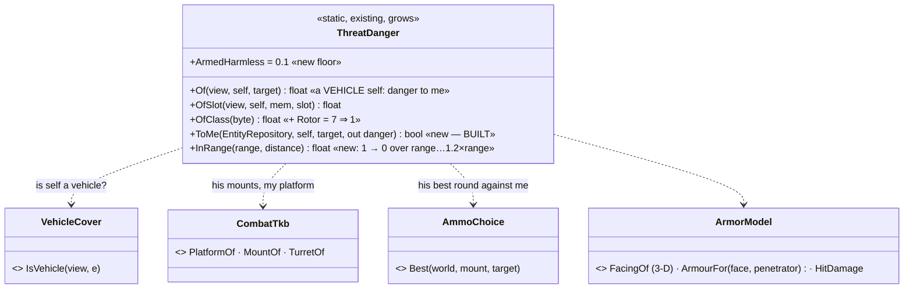
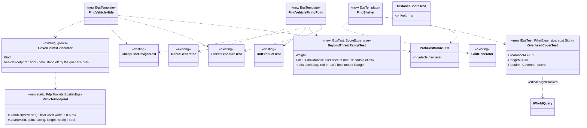
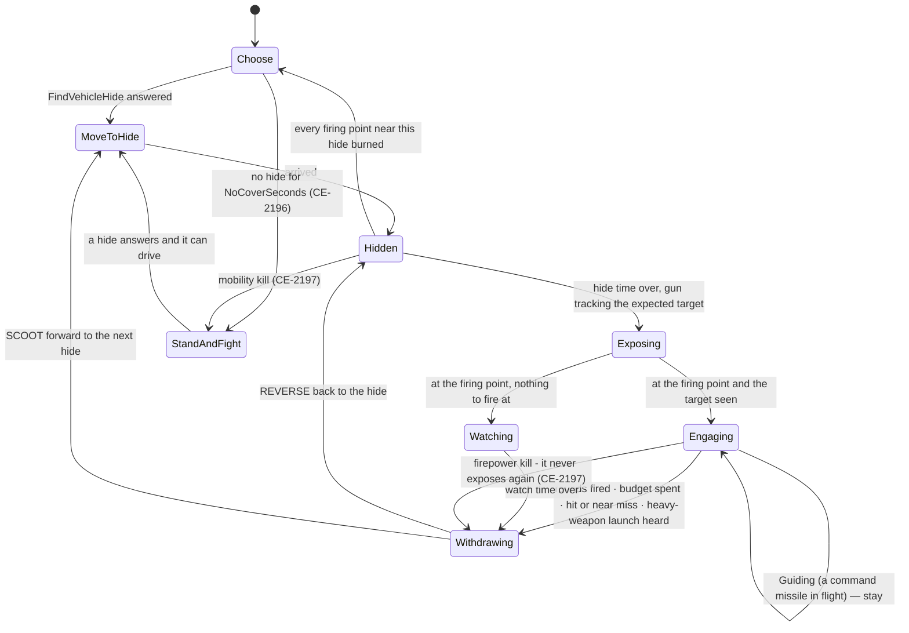
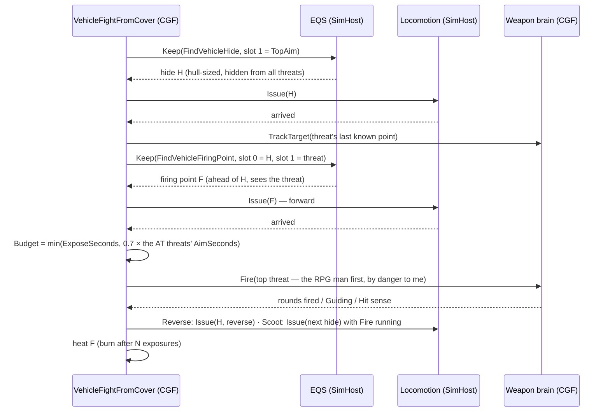
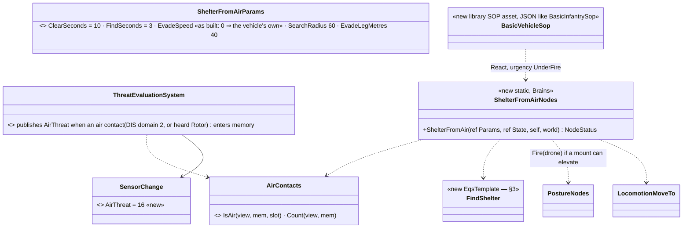
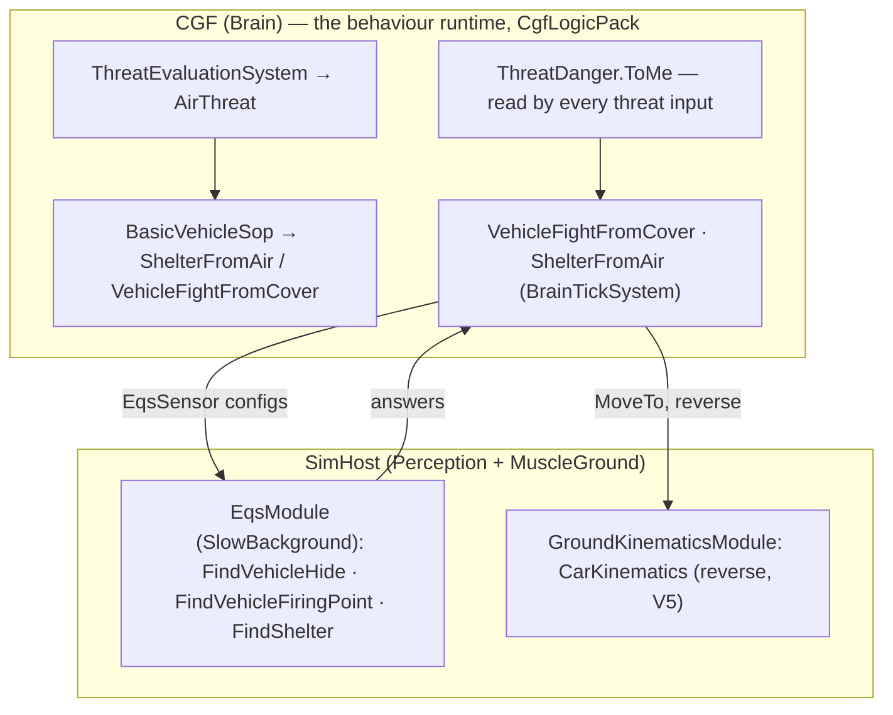

<!--STATUS
state: LIVE
updated: 2026-10-16 (§8 CE-2212 the shelter query is pointed once)
build-state: BUILDING — V1, V3, V4, V8 built (as-built rows in §2–§4, §8); V6 compositions + demos to do. 🔒 user, 2026-10-14: "Leans accepted. Write the designs" (V1–V8, D-H, D-J, D-K approved)
current-answer: §2 danger to me (V1), §3 vehicle points (V3), §4 the node (V4), §5 reverse (V5), §6 technicals (M9), §7 the AT side (V6), §8 counter-drone (V8), §9 who runs it, §10 rails — §1 is the measured ground.
stale-below: nothing.
known-rot: §8 counter-drone — the vehicle FIRES at a seen drone, but no round can hit an aircraft (bullet rays mask out layer 2, which is the only layer a flyer has — measured 2026-10-15, Air Operations §7c, CE-2182).
known-conflict: docs/designs/weapons/DESIGN_Weapon_Systems.md (R-2016) — §6 builds the technicals 104 / 105 as pickup TYPES with a pintle turret; the weapon-systems design turns them into presets (a bare pickup + a weapon in its bed station). §6 stays true until WS-4 lands.
related-designs:
  - docs/designs/weapons/DESIGN_Weapon_Systems.md — OWNS the weapon systems that turn the technicals 104 / 105 into presets (a bare pickup host + a weapon in its bed station, R-2016)
  - docs/designs/motion-models/DESIGN_Motion_Domains.md — V5's reverse fix lives in the ground domain's wheeled / tracked models
  - docs/designs/vehicle-tactics/DESIGN_Urban_Armour_Tactics.md — the PROGRAMME (V1–V8, M9; decisions D-A…D-L)
  - docs/DESIGN_Peek_And_Fire.md — OWNS the infantry fight-from-cover node; G8 (R-257) keeps vehicles out of it — this node is its vehicle sibling and reuses FiringPositionMemory, PositionHeat, PostureNodes.Keep / Fire
  - docs/designs/hill-attack/DESIGN.md — OWNS HullDownAttackRun (one exposure: creep → fire → reverse); this node makes it repeatable; the hill attack is re-pointed at it later (R-256 d)
  - docs/DESIGN_Sensors_And_Doctrine.md — OWNS threat = danger × freshness (§7.8, R-201) and the G1 lean this file builds (§2)
  - docs/DESIGN_Decision_Layer.md — OWNS the SOP slot and reaction urgency (R-199); §8 adds a vehicle SOP and one sense
  - docs/designs/eqs-2/EQS_Design_v1.3_final.md — OWNS generators, tests and templates (§19); §3 adds a vehicle footprint mode, OverheadCoverTest and three templates
  - docs/DESIGN_Orders_Params_Entity_Classes.md — OWNS order naming by entity class (R-278); §4 adds LandPlatformAttack
  - docs/designs/vehicle-tactics/DESIGN_Armour_Hit_Model.md — the face and armour a threat's round would meet (V1 reads it)
  - docs/designs/vehicle-tactics/DESIGN_Missiles_And_Ammo.md — FireOnMove, Guiding, the lock that bounds an exposure
  - docs/designs/vehicle-tactics/DESIGN_FPV_Drone.md — the air threat §8 reacts to
-->

# The vehicle exposure cycle — danger to me, hull-sized points, hide · expose · withdraw, technicals, counter-drone

## 1. What exists — measured `2026-10-14`

| fact | where |
|---|---|
| `ThreatDanger.Of(ISimulationView view, Entity self, Entity target)` = armed 1 / unarmed 0.3 / out of the fight 0 — **`self` unused**; `OfSlot` (heard ⇒ `OfClass`), `OwnStrength`; `CombatTkb` takes `EntityRepository` — every production caller passes one, the pattern is `view is EntityRepository repo` | `ThreatDanger.cs:15-64`, `EntityRepository.View.cs:10` |
| ⚠ a SOLDIER also has a `CombatPlatformDefDto` (5 mm body armour) — "has armour" cannot be the vehicle test | `BdcTkbCatalog.cs:210` |
| callers of the danger (all on CGF): `ContactThreatLevel`, `ContactDanger`, `EnemyStrengthRatio` (`OfSlot`), `SquadContactThreatLevel`, `SquadEnemyStrengthRatio`, `ThreatsAtLeast`, `DangerAreaSensorSystem.ThreatOn`; `TopThreat` ranks through `ContactThreatLevel`; ⚠ `UtilityTestWorld.SetEnemyStrengthRatio` re-implements the formula | `StandardInputs.cs:164-286`, `SquadInputs.cs:190-276`, `SensorNodes.cs:122-140`, `DangerAreaSensorSystem.cs:138-145`, `EqsTacticsNodes.cs:322-342` |
| sound classes 0–6 in 3 bits (one value, 7, free); heard danger by class `OfClass` | `SignaturesDto.cs:84-93`, `ThreatDanger.cs:52`, `AcousticPerception.cs:36` |
| `SensorChange` members 1–15 used | `SensorChangedEvent.cs:12-56` |
| EQS templates are `[EqsTemplate]` static classes with one generator and four test arrays; each needs a golden scenario (`EqsFlatTerrainGoldenTests.RegisteredTemplates_AllHaveAGoldenScenario`) | `EqsQueryTemplate.cs:61-120`, `EqsFlatTerrainGoldenTests.cs:55-122` |
| cover points are baked by `TerrainCoverProvider` at 0.75 m off each face, 2.5 m apart; `CoverPoint` has a facing (`DirectionX/Y`) but no size; `VehicleCover.StandingPoints` derives points round live vehicles per query | `TerrainCoverProvider.cs:22-24,70-106`, `CoverPoint.cs:14-40`, `VehicleCover.cs:93` |
| tests measure the self at `EqsTerrainSight.Mount(self)` (its `SensorMount`, else 1.7 / 1.1 / 0.35) — a vehicle's sight height is TKB data | `EqsTerrainSight.cs:29`, `ThreatExposureTest.cs:67-75` |
| the EQS solver's systems run on a replica WORLD the kernel refreshes for the background module; a world singleton (`SetSingletonManaged`) lives in one world, and the replica receives only eight of the live world's singleton references (`SyncSingletonById`) — the TKB (`ITkbDatabase`, id 60, one object per process built by `HrotEnvironment.CreateTkb`, no production hot reload) is not among them | `EntityRepository.Sync.cs:103-125`, `SimHostNodeBootstrapper.cs:268,515`, `HrotEnvironment.cs:28-41` |
| no overhead test exists, but a vertical `SightBlocked` sees slabs, decks and templated roofs | `TerrainWorld.cs:390-412` |
| PeekAndFire's reusable parts: `FiringPositionMemory` (8 slots, heat) + `PositionHeat`, `PostureNodes.Keep / Drop` (owned EQS sensors), `PostureNodes.Fire(…, target)`, `EqsTacticsNodes.TopAim`, `CoverClaim`, `LocomotionMoveTo.Issue / Status / Stop` (`ReverseAllowed` 0 until B2 added `Issue(…, reverseAllowed)`), `TrackTargetNodes.TrackTarget` (shares the weapon channel with Fire; no stop helper) | `PeekAndFireNodes.cs`, `FiringPositionMemory.cs:37-110`, `PostureNodes.cs:396-468`, `LocomotionMoveTo.cs:85-122`, `TrackTargetExecutor.cs:86-103` |
| ⚠ **today a tank's attack order runs the INFANTRY posture tree** (`PlatformAttack` → CombatPosture → PeekAndFire) — no `Tank*` / `Armor*` / `LandPlatform*` behaviour exists | `ClassOrderBehaviors.cs:68-71`, `OrderResolver.cs:33` |
| ⚠ **AI reverse does not work**: `CarKinematicsSystem` computes `speedSign = −1` (`:330-336`) but `BicycleModel.Integrate` clamps `Speed = max(0, Speed)`; only manual drive reverses; `MaxSpeedRev` is 0 in every preset but Tank; reversing freezes `ProgressS` (`max(0, dot)`) | `BicycleModel.cs:34`, `VehicleClass.cs:96-112`, `CarKinematicsSystem.cs:413` |
| a pickup fits the DIS class `SmallWheeledUtilityVehicle` (1.1.*.6, under `WheeledUtility`, `LandPlatform`); free ground TKB ids 104–199 | `EntityClassTable.cs:118-135`, `TkbEntityTypes.cs` |

### INVENTORY — the queries run

| query | total | the set |
|---|---|---|
| `search_graph .*ThreatDanger.*\|.*DangerTo.*` (Class) | 1 | `ThreatDanger` — the one place (R-194) |
| `search_graph .*HullDown.*\|.*Exposure.*` (Class) | 6 | `HillCrestHullDownManeuver`, `HullDownAttackBlackboard`, `HullDownAttackParams`, `HullDownAttackIntentDto`, `HullDownAttackMapper`, `ThreatExposureTest` |
| `search_graph .*Shelter.*\|.*Overhead.*` (Class) | 0 | — |
| grep `Tank\|Armor\|LandPlatform` behaviour names | 0 | — |

⇒ no vehicle fight-from-cover, no shelter, no danger-to-me exists; each is built ONCE below from the parts listed in §1.

## 2. Danger to me (V1)

| rule | why |
|---|---|
| ⭐ **the danger to a VEHICLE self** (`VehicleCover.IsVehicle(self)` and a `CombatPlatformDefDto` with armour) = max over the target's mounts of `ArmorModel.PenetrationChance(his round vs me, on the face it would hit)` × `InRange`, clamped to [`ArmedHarmless` 0.1, 1] for an armed target — the person scale's *armed = he can hurt me = 1*; an UNKNOWN round (penetration ≤ 0) ignores armour ⇒ 1, as `HitDamage` does; a person self keeps armed 1 / unarmed 0.3 | V1; a soldier's 5 mm vest must not make riflemen harmless to riflemen (§1 ⚠). ⚠ **AS-BUILT `2026-10-14` — deviates from the first draft** (`HitDamage` ÷ my max health, ⛔ SUPERSEDED): that put a side-on RPG at 400 / 2500 = **0.16**, under every ABSOLUTE threshold — the `Sentry` order's `ThreatsAtLeast.MinDanger` default 0.5 (`TacticsTreesTests.cs:686`, `Sentry.btree.json`) would not count the RPG man as a threat to a tank, the opposite of the requirement. Damage-per-hit stays the WEAPON brain's business (`AmmoChoice`, Missiles §2), not the danger's |
| the face: `ArmorModel.FacingOf(myTransform, hisPosition)` — 3-D, so a man on a roof close in reads my Top; a `TopAttack` munition at ≥ its top-attack range reads Top | Armour Hit Model D-A; Missiles §3 |
| ⭐ **AS-BUILT `2026-10-14` (on backend B3–B7)** — per mount, the BEST of the rounds it carries (`Loadout`, else its one round): `CombatTkb.RoundOf` → penetration, `CombatTkb.PenetratorOf` → the armour column (`ArmourFor(platform, face, penetrator)`: a shaped charge reads `…Ce`), on the face `FacingOfArrival(me, myHullMiddle − hisEye)`; a `FireAndForget` `TopAttack` missile at ≥ `TopAttackMinRangeM` reads `Top` (the rule `FireProcessingSystem.cs:262` flies); inside a missile's `MinRangeM` ⇒ 0. ⚠ `CombatTkb.RoundOf` / `PenetratorOf` gained a TKB-taking overload (the world ones delegate — one implementation) so `ToMe` runs on a solver snapshot too (cross-lane, additive) | rails `ThreatDangerTests.V1_ADangerIsTheBestRound_*`, `V1_TheFaceIs3D_*`, red-proved five ways (2-D face, no loadout, kinetic only, no top attack, no min range) |
| `InRange` = 1 within his mount's `Range`, falling to 0 at 1.2 × `Range`; 0 below a missile's `MinRangeM` | stand-off falls out of the danger (programme §3) |
| a drone (`DIS domain 2` with a warhead mount) = its warhead on my Top | M7 |
| a heard contact keeps `OfClass`; class 7 `Rotor` = 1 | R-207; a drone is heard before it is seen |
| `self` unknown to the TKB, or a view that is not an `EntityRepository` ⇒ today's rule | the solver snapshot has no TKB (§1) |
| every caller in §1 picks it up unchanged — `TopThreat` now ranks the RPG man (and the ATGM technical) above the rifleman for a tank | one place (R-194, R-201); `UtilityTestWorld` is updated with it |
| 📐 **measured `2026-10-15` (`CE-3138`, backend)** — `DangerAreaSensorSystem.ThreatOn` on CGF: a T-72 watcher 110 m off an Abrams's FRONT reads danger **0.50**, exactly the crossing sensor's `ThreatenedAt` (0.5) ⇒ whether an Abrams holds at a street a T-72 watches head-on is decided at the threshold edge. ⚠ Recorded, not changed: a tuning question for this programme's owner | `EqsDistributedTests.DangerAlongRoute_AcrossHosts_…` (its unit is now a rifleman) |

## 3. Hull-sized points, overhead cover and the templates (V3)

*What the picture shows that prose hid: two new tests and one generator mode; the three templates are compositions of tests otherwise
existing. ⛔ SUPERSEDED (2026-10-14, user: "tkb is singleton and is constant does not need any snapshot"): the first draft said a
range-aware test could not run in the solver — wrong; the TKB is one constant object, handed to the test once when the EQS module is
built (a reference, nothing copied) and read by `BeyondThreatRangeTest`.*

| template | generator | filter | score | answer |
|---|---|---|---|---|
| **FindVehicleHide** | `CoverPointsGenerator{VehicleFootprint}` (baked points pushed out to the hull's stand-off, kept only where the hull's box is clear) | `CheapLineOfSight{slot 1, Slot viewer, Hidden}` | `Distance` (near self), `ThreatExposure{HideFromAll}`, `PathCost` | a hide hidden from every known threat at the vehicle's sight height |
| **FindVehicleFiringPoint** | `Donut{anchor slot 0 = the hide, 2 rings, ~25 m}` | `CheapLineOfSight{slot 1, Candidate viewer, Visible}` | `DotProduct` (ahead of the hide's facing — a straight drive out and a straight reverse back), `BeyondThreatRange` (outside each known threat's weapon range scores 1, inside it falls with distance), `ThreatExposure` (fewest OTHER threats), `PathCost` | a point that sees the target and as little else as possible |
| **FindShelter** | `Grid{anchor self, spacing 5}` | `OverheadCover{Covered}` | `Distance` (near), `PathCost` | the nearest reachable spot with solid above the hull (a deck, a bridge, a roof slab) |

| rule | why |
|---|---|
| `VehicleFootprint` acts only for a vehicle querier; a person's cover points are unchanged | infantry templates, goldens and rails untouched |
| ⭐ **AS-BUILT `2026-10-14` (V3 slice 3)** — `CoverPointsGenerator.VehicleFootprint` + static `VehicleFootprint`: the hull = `VehicleParams` length × width (else the square inside the collider) × collider height; a point moves AWAY from its cover along its protection direction to `width/2 + 0.5 m` (it was baked at 0.75 m for a man) and is kept only where the hull's box — length along the wall, width toward it — touches no solid overlapping the hull's HEIGHT BAND (a deck above it does not count: ⚠ `EqsTerrainSight.InsideSolid` is plan-only, so the box test has its own Z-aware check); points round the querier's OWN standing box (within its half diagonal + 1.25 m) are dropped | rail `TerrainEqsTests.V3_VehicleFootprint_*`, red-proved three ways (no push; own box kept; a deck above blocks) |
| ⭐ **AS-BUILT `2026-10-14` (V3 slice 1)** — `EqsModule.ForTerrainHost` calls `BeyondThreatRangeTest.InjectTkb(registry, CombatTkb.Live(world))`: every `ITkbAwareTest` of every registered template gets a `Func<ITkbDatabase?>` that reads the LIVE world's singleton when called — the same reference, nothing copied (the twin of `TerrainWorldSource.Live`). ⚠ Refines the row below: a SOURCE, not the object, because the editor publishes the TKB only *"if absent"* (`EditorSubsystem.cs:1417`) with no guaranteed order against the EQS capability — a value captured at construction could be null. A test with no source falls back to the view's own singleton (a live world in rails) | each world's registry builds its own template instances (`EqsTemplateRegistry.Discover`), so the hand-over cannot leak across worlds; the registry the solver reads is that same object (singleton 210, synced by reference) |
| ⭐ **`BeyondThreatRangeTest` as built**: per known threat (`EqsKnownThreats.Collect` — the set `ThreatExposureTest` reads, extracted so both agree) that can hurt me at all — `ThreatDanger.ReachAgainst`: his longest mount `Range` whose round penetrates my THINNEST armoured face (any mount for an unarmoured self; an unknown round counts) — `min(1, ground distance ÷ his reach)`; the score gains `Weight` × the MEAN. A rifleman never pushes a tank back | the same `CanHurt` as `ThreatDanger.ToMe` (R-212 A1, one armour model); `ToMe` itself now runs on any view with the TKB handed in |
| ⭐ **the TKB reaches a test ONCE, AT CONSTRUCTION, by reference**: `EqsModule.ForTerrainHost(world)` (built once per node from the LIVE world, `EqsInfrastructureCapability.cs:97`) reads `world.GetSingletonManaged<ITkbDatabase>()` and sets it on every registered test that declares a `Tkb` property (`ITkbAwareTest`) — templates are built once at registration, so this is one hand-over per node; the solver's replica world and its singleton list (`EntityRepository.Sync.cs:117-124`) are NOT touched | 🔒 user, 2026-10-14: *"passing the TKB to the solver once at construction sounds ok … Certainly not snapshotting it please. Pass reference somehow."* — the same pattern as the sight strategy's terrain (`LosStrategies.cs:81-82`) |
| ⚠ a TKB FILE load refills the same object (`Register` / `Clear`); holding the reference sees the current content — assumed, not measured: no solve runs while a load refills it | `ITkbDatabase.cs:10-33` |
| `OverheadCoverTest`: covered when `SightBlocked(c + (0, 0, hullHeight + 0.1), c + (0, 0, hullHeight + 30))` | §1: the vertical ray already sees decks and roofs |
| ⭐ **AS-BUILT `2026-10-14` (V3 slice 2)** — `OverheadCoverTest` (FilterExpensive, cost Sight): the vertical line from `ClearanceM` 0.1 above the self's height — its collider HULL (`PhysicsColliderReaders.HullHeight`) or, for a person, its standing eye — up `RangeM` 30 m, through `EqsTerrainSight.Sight` (terrain prisms and vehicle boxes). `Require = Covered` drops an open-sky point; `Score` adds `Weight`. Measured on a floating deck: a soldier is covered under a 1.5 m and a 4 m deck, a 2.4 m tank only under the 4 m one | rails `TerrainEqsTests.V3_OverheadCover_*` (2), red-proved (hull ignored ⇒ the tank "fits" under the low deck) |
| the vehicle's sight height is its `SensorMount` (TKB: tank ~2.4 m, technical ~2.2 m) — hidden means hidden at the commander's sight | data (Missiles §5), read by the existing tests |
| each new template gets its golden scenario (flat terrain ⇒ an empty `FindShelter` answer is the golden) | `EqsFlatTerrainGoldenTests` |
| ⭐ **AS-BUILT `2026-10-14` (V3 slice 4)** — `VehicleTemplates.cs`: `FindVehicleHide` (`0x10B0D9B3`), `FindVehicleFiringPoint` (`0xF15555E6`), `FindShelter` (`0x072E6926`), as the table above. The firing point's "ahead of the hide" is `DotProductTest{Pivot 0, Reference 1, Preferred 1}` — straight out from the hide TOWARD the target (the drive-out / reverse-back line), since the hide has no stored facing. Goldens: the self is a 7 × 3.6 × 2.4 m tank; the hide reads the terrain's own cover (`TerrainCoverProvider`); ⚠ the shelter golden adds a 4.5 m deck instead of pinning an empty answer — an empty answer would pin nothing. ⚠⚠ **Measured: a deck is a `TerrainWalkable` slab, not a prism** — a slab blocks a sight line that crosses it (`TerrainWorld.SegmentBlocked`) and the ground under it is standable, while `TerrainWorldQuery.TryStandAt` rejects ANY point inside a prism's footprint at any height (`:50-54`), so a deck modelled as a floating prism leaves nothing under it for a generator to place (first capture: 0 points) | `EqsFlatTerrainGoldenTests` (3 scenarios, `CaptureOnFlatGround`'s `tankSelf` / `terrainCover` / `extra` knobs, no-ops for the existing ones) |

## 4. The node — VehicleFightFromCover (V4)

*What the picture shows: one new node with its params and state; every box it calls exists except two small overloads (`Issue` with
reverse, `TrackTarget.Stop`). It is a sibling of PeekAndFire (G8), sharing that node's memory and steps — not a copy of its phases.*

| rule | why |
|---|---|
| **withdraw mode** `Auto`: the type's `ArmorFront ≥ 2 × ArmorSide` ⇒ `Reverse` to the SAME hide (a straight reverse — the firing point is chosen ahead of the hide's facing); else `Scoot`: drive forward to a NEW `FindVehicleHide` answer away from the threat, and the point burns after 1 use | D-J |
| **exposure budget**: at each exposure, `Budget = min(ExposeSeconds, AimBudgetFactor × the AimSeconds of every seen threat whose danger to me ≥ AtDangerMin)`; `SeenAtFor` counts continuous sight of such a threat; withdraw at `SeenAtFor ≥ Budget` | the enemy's aim / lock time bounds the exposure (programme §3; R-246: if I see him, he sees me). ⭐ **CE-2215 (`2026-10-16`, as built): "seen" = the threat CAN SEE ME — I see him, OR the line from where I remember him (eye 1.6 m) to my hull's top is clear of the terrain** (`VehicleFightFromCoverNodes.CanSeeMe`, read by `Budget` and the `SeenSince` clock). ⛔ SUPERSEDED: *"every seen threat"* (my own visual track only) — sight is not symmetric: live `ua-javelin-lock`, the tank did not see the Javelin gunner it knew of, exposed its full 8 s and gave him his 4 s lock. Rail `VehicleFightFromCoverNodesTests.CE2215_AnUnseenThreat_ThatCanSeeMe_BoundsTheExposure_AWallBetweenUsDoesNot` · ⭐ **CE-2216: the clock starts on the DRIVE OUT** (`Exposing`), not at the firing point: seen on the way out and over budget ⇒ back to the hide before the point; a clock already running on arrival keeps running (the tighter budget). ⛔ SUPERSEDED: *"at each exposure"* = from the firing point — live, Javelin A saw the tank ~3 s before it reached the point and launched as it arrived. Rail `CE2216_SeenOnTheDriveOut_TheBudgetRunsOut_BackToTheHide_BeforeTheFiringPoint` |
| **cut short** on a Hit / NearMiss since `ExposedAt`, or a heard `HeavyWeapon` source within 30° of the threat (a launch) — `RecentSenses` | T5 |
| **Guiding** (the weapon channel's reason): stay in Engaging until the round lands, unless hit | a command missile needs its gunner (Missiles §4) |
| **hidden**: `TrackTarget` keeps the gun on the threat's last known point; firing replaces it; `TrackTarget.Stop` on leaving | T4; the two share one channel (§1) |
| **front to the threat**: Exposing drives forward along the hide's facing; Reverse withdraws backwards — never turns | T3 |
| **fire on the move**: in `Scoot`, `Fire` keeps running during the drive when the target is seen (a `FireOnMove` mount fires, others hold — the weapon brain decides). ⭐ **CE-2219 (`2026-10-16`, as built): EVERY drive to a hide (`MoveToHide`, the first one after contact included) fires at the threat it sees and tracks him when it does not** — `FireOrTrack`, the step `StandAndFight` already had. ⛔ SUPERSEDED: *"in `Scoot`"* only — live `ua-rpg-window`, an IFV surprised in the open drove 6 s to its first hide with the gun only tracking the RPG man it saw, and died without a round | D-L |
| **watching**: no target ⇒ `Watching` (an observation exposure) for `WatchSeconds` | "for firing or watching" |
| releases: stop fire, stop track, drop both sensors, stop the move, `ws = default`; `FiringPositionMemory` is kept | as PeekAndFire's `Release` |

⭐ **As-built `2026-10-14` (V4) — `Hrot.AI.Behaviors/Brains/VehicleFightFromCoverNodes.cs` + `VehicleFightFromCoverBehavior.cs`; deviations, argued:**

| design said | built | why |
|---|---|---|
| a heard launch is a `RecentSenses` cut | ⚠ read from `TargetMemory`: an ANONYMOUS slot of class `HeavyWeapon` whose `LastSeenTick ≥ ExposedTick`, within 30° of the threat | `RecentSenses` has no heard-sound kind (`SensorChange` 1–8, measured). ⚠ A shot heard inside a SEEN contact's circle refreshes THAT contact (`TargetMemory.HearContact`), so this cut sees only the launch from a window nobody saw — a seen dangerous shooter is the budget's (`Budget`) |
| Guiding = "the weapon channel's reason" | the aimed-fire executor's own row: `ActionStatus.Weapon.Reason == Guiding` while the channel runs `AimAndFire` | the reason exists only there (`AimAndFireExecutor` W-12c writes it); the channel carries no reason |
| `Hidden → Choose : every firing point near this hide burned` | also after `NoCoverSeconds` with NO firing-point answer (as PeekAndFire's G2) | a hide no query can fight from is as used-up as a burned one |
| `VehicleFightFromCover = Sequence(the node)` | `Parallel(1){ UntilTargetDown ‖ the node }` for both the library tree and `LandPlatformAttack` | an ATTACK names its target: `UntilTargetDown` designates it (the ranking puts it first, so `TopAim` fights IT) and ends the order with Success when it is down — `CombatPostureBehavior`'s C-5 reading, reused (its `Resolve` fills the designation) |
| state `NextHide · SeenAtFor · Reversing` | `SeenSince` (since when a dangerous threat has seen me); the next hide is picked at the withdraw, so no `NextHide`; `Scoot` (the resolved mode) replaces `Reversing` | fewer fields, one decision point |
| — | ⚠ **open:** the budget is NOT floored at my own aim time (PeekAndFire's G8 floors an exposure at 2 × it). A tank slower to aim than the RPG man is fast (aim 2 s ⇒ budget 1.4 s) withdraws before it fires | the design's rule is the enemy's clock; the gun is already on him from the hide (T4 tracking), which shortens my aim — ⛔ not measured live; the demo (`ua-tank-corner`) is where it is settled |

⭐ **Live `2026-10-15` — `ua-tank-corner` PASS 4 / 4** (`python3 scripts/utility-demo-check.py --launch ua-tank-corner`; test-town, an M1 on
`BasicVehicleSop` beside a 4-storey block, a Javelin team on an attack order at it 164 m off, a rifleman 210 m off): its first rounds go at the
Javelin team, it fires from two points (on the move — the team died in the first exposure, so the cycle's repeats were not exercised) and
kills it, taking one hit (3000 → 2550). 📐 **What the run taught — five rounds of findings:**

| run | what the tank did | the cause, and where it went |
|---|---|---|
| 1 | nothing for 210 s | a plain `VehicleFightFromCover` order before contact ends at once (nothing to fight) ⇒ the demo runs the SOP |
| 2 | reacted, never moved | no hide within 60 m; the failed cycle hung the behaviour ⇒ **CE-2195** fixed; the tank starts beside its cover |
| 3 | drove 26 m INTO the building | the follower does not brake for a short leg at 20 m/s ⇒ **CE-2198** (backend); the cycle creeps at 5 m/s |
| 4 | shot the rifleman first, against an RPG / an NLAW | ✅ **correct** — a PG-7V's ~300 mm and a direct NLAW's 500 mm cannot pass an M1's 900 mm front: both read as harmless as a rifle (0.1). Only a top attack on the 60 mm roof (a Javelin past 150 m) is a real danger |
| 5 | shot the rifleman first, against a Javelin on its SOP | the team took cover on contact and stayed out of sight — the ranking is a product with line of sight ⇒ the team fights on an attack order |
| — | 8 rounds of 120 mm in ~1.3 s | cooldown 0 (= "the weapon's own") is taken literally by the executor ⇒ **CE-2199** (backend) |

⭐ **As-built `2026-10-15` — CE-2196 / CE-2197 (the cycle answers its own damage; backend's hit location S2 strips the bits):**

| case | built | why |
|---|---|---|
| no hide for `NoCoverSeconds` | `StandAndFight`: hold, track, fire at the seen threat; take a hide the moment one answers (was: Failure) | an attack order should attack — the no-hide Failure hung a target-named `LandPlatformAttack` (CE-2196) |
| mobility kill — `CanMove` stripped or `Wounds.Has(Mobility)` | `StandAndFight` and never drives again | a hull that cannot reach a hide fights where it stands |
| firepower kill — `CanShoot` stripped or `Wounds.Has(Firepower)` | withdraws into its hide (the normal reverse / scoot) and never exposes again; still Success when nothing is left to fight | a broken gun has no business in the open |
| both | Failure (nothing it can do; the crew's bail-out is R-263's damage states) | — |
| arrival | ⭐ CE-2205: one test, `MoveStatus` — within `ArrivalRadius` **4 m** (was 2) of the hide / firing point HAS arrived, the move stopped, whatever the follower says | live: an M1 sent 2.3 m to a cover point (inside its ~5 m turning circle) orbited it for 60 s and the cycle never left MoveToHide — the motion half is backend's (CE-2206, [handoff](../../blueprints/batches/HANDOFF_Behaviors_To_Backend_Vehicle_Orbit.md)) |
| drive speed | `Speed` 0 ⇒ **5 m/s** (was: the type's own) | CE-2198: at 20 m/s an M1 overshot its hide by its braking distance (~26 m) into a building — the follower does not brake for a short leg (backend [handoff](../../blueprints/batches/HANDOFF_Behaviors_To_Backend_Vehicle_Overshoot.md)) |

Rails `VehicleFightFromCoverNodesTests.CE2196_*` / `CE2197_*` (mutants red).

⭐ **Live `2026-10-16` — `ua-ifv-standoff`, `ua-javelin-lock`, `ua-tank-ammo`: what the runs taught** (`scripts/utility-demo-check.py`):

| demo | what happened | the cause, and where it went |
|---|---|---|
| `ua-ifv-standoff` | the IFV never fired at the two RPG men walking in from 340 m; they reached 18 m and hit it | ① **scenario**: the IFV sat on the 2.5 m compound wall (x 380–440, y 100–160) and the men walked in along it — never seen, no memory slot at 120 m ⇒ the vignette moved to y 40 |
| | … and it stood with its gun `done` on a man 420 m off for 100 s | ② **CE-2202 (fixed here)**: it had killed that man; `TopThreat` kept the dead current (nothing else scored above zero) and the ranking's top can be a body ⇒ `VehicleFightFromCover` guarded a corpse. Now a kept current and the top must be `CombatLife.IsAlive`, else the first live remembered entity. Rail `CE2202_ADeadThreat_IsNotFought_ALiveOneRemembered_Is`. ⚠ `TopThreat` is shared by every posture behaviour |
| `ua-javelin-lock` | both Javelin hits were SIDE hits, one on the cycling tank | **CE-2200 (backend)**: `AimAndFireExecutor.FireBlind` fires the Javelin at a hidden tank's last-known point with no lock — flown direct; the lock denial is bypassed |
| | the locked top attack at 230 m landed 580 m beyond its tank | **CE-2201 (backend)**: the profile (30° climb to +150 m, 30°/s turn) cannot come back down on a target that close — [handoff](../../blueprints/batches/HANDOFF_Behaviors_To_Backend_Javelin_Lock.md) |
| `ua-tank-ammo` | the M1 fired nothing in 260 s | **scenario**: at y 80 the ridge (crest y 210) hid every target ⇒ the tank moved north of it |

⭐ **`ua-ifv-standoff` PASS 4 / 4** after both fixes (`2026-10-16`): no hide answers in the open, so the IFV fights from where it stands
(CE-2196). Its 25 mm kills both advancing RPG men at **326 m**, outside their 300 m reach; their 4 rockets miss and it is untouched
(health 500). Up close the second IFV takes an RPG hit (500 → 91).

⭐ **After backend's CE-2198 / CE-2200 / CE-2201 (`2026-10-16`):** `ua-tank-corner` **PASS 4 / 4** again (no building overshoot; first
rounds at the Javelin gunner, two firing points, gunner killed). `ua-javelin-lock`: both Javelins now LOCK before they fire and fly
DIRECT at test-town ranges (the top attack only fits beyond ~607 m). The open tank dies, but ⛔ **so does the cycling tank — the
exposure budget did not deny Javelin A its 4 s lock**. 📐 Measured with a per-second trace (Javelin A's lock progress, the
tank's memory, the cycle's EQS answers), four scenario faults and one cycle defect:

| run | what the trace showed | fix |
|---|---|---|
| 1 | the tank started in A's view and was locked while driving 40 m to its hide (lock 0.4 → 3.9 s) | the tank starts in its hide |
| 2 | then A, on an assault order, walked inside his 65 m minimum range | A holds (an `advance` objective on his own spot) |
| 3 | on its SOP the tank idled: a SEEDED memory never fires the `FirstThreat` sense the SOP reacts to | the tank gets an attack order (`LandPlatformAttack`) |
| 4 | with A at (200, 200) the block hid every firing point from him | A on `ua-tank-corner`'s measured geometry, (100, 225) |
| 5 | ⛔ the tank ORBITED a cover point 2.3 m off for 60 s and never left MoveToHide | **CE-2205** (above) — the cycle's own arrival test |
| 6, 7 | ✅ **the lock is denied** in both: one exposure each, A's lock reached 1.5 / 4 s, then 2.5 / 4 s; the tank was back in cover and nothing was launched | — |
| 8 | the tank fought (2 rounds), but at Javelin **B**: A was never seen, his seeded slot expired, and the designation lapsed with it (it holds only while remembered) | vignette ② moved to the open north strip, out of the cycling tank's view |
| 9 | A never saw the tank: the cycle's firing points vary run to run, and from (100, 225) A sees only some of them | ⏸ **stopped here** |

⏸ **Status of `ua-javelin-lock` (`2026-10-16`):** ② passes every run. Javelin B locks the open tank and hits it direct, and the face read is
correct: a FRONT hit, 760 mm against the M1's 900 mm, did 378. Of ①, **the lock denial is demonstrated (runs 6–7)**. The tank firing
back has also been seen (run 8). ⛔ **They have not yet come together in ONE run**: whether Javelin A sees an exposure depends on which
firing point the EQS picks. The check refuses a vacuous pass ("exercised" needs A to aim). The next step, not taken: give A a position
that sees the block's whole west face, or let the cycle prefer firing points that see the designated target. ⚠ An unseen designated
target expiring from memory, which ends the designation, is how `TopThreat` (CE-3170) is meant to behave. It is noted here because a
long hidden standoff reads it as "the order lapsed". `ThreatDanger.ToMe` reads the same `TopAttackFits` the launch
does (backend aligned it in CE-2201).

✅ **Update, after backend's `CE-2222` (`2026-10-16`) — ① PASSES live:** with the Javelin's turn rate and climb as munition data
(120 °/s, 45°), its top attack fits from its declared 150 m, so A at ~190 m dives on the roof and the cycling tank rates it dangerous.
`ua-javelin-lock` 5/5: ② the tank left in the open locked and hit (2 launches, 2 hits); ① the cycling tank fights (it fires), A sees and
aims at it in 4 sampled seconds with a best lock of **3.8 of 4 s**, and its short exposures deny the lock — 1 launch, 0 hits, health
untouched (1500). ⛔ The park below is history.

⏸ **Update, after backend's CE-2217 (`2026-10-16`) — ① PARKED on `CE-2222` (backend):** backend measured ② live 2/2 on the
HULL FRONT (the face the danger model predicts). ① still loses the lock race, and that is now RIGHT by the model: A, ~190 m off and ~19°
off the nose, fires DIRECT (front armour, `ToMe` 0.11), so the tank has nothing to hide from. 📐 Why it is direct: `GuidedRoundSystem.TopAttackFits`
(30 °/s turn at 140 m/s ⇒ a 267 m turn radius, 30° climb, 60° dive) fits the Javelin's top attack only from **~610 m**, while its TKB says
`TopAttackMinRangeM = 150` — a real Javelin top-attacks from ~150 m. ⇒ ⭐ the demo is not re-placed to 610 m (beyond test-town's blocks and
the soldier's 150 m sight); `CE-2222` asks backend to make the profile fit from `TopAttackMinRangeM`, after which A at 190 m dives on the
roof, the tank rates it dangerous and ① is the real test again. ⭐ **And `Masked`** (`CE-2221`): an exposure whose gun holds `Masked`
(backend's `CE-2218` muzzle-line hold) burns its firing point and withdraws — Peek and Fire §10.10's answer, one reader.

⏸ **Update, after CE-2215/2216 (`2026-10-16`):** ① now runs end to end — A sees the tank on its drive out, the tank sees A, the tank
fires back — ⛔ and still loses the lock race. 📐 Probed: the tank rates A at danger **0.11** (A is ~19° off the nose ⇒ the eye→hull line
reads FRONT, and the direct Javelin barely beats the front's CE armour). 0.11 < `AtDangerMin` ⇒ A does not bound the budget, which is the
budget working as designed. The round then scored on the **SIDE** (760 mm, 3000 → 1500). ⇒ the face the danger model predicts and the face
the impact is scored on disagree for this shot: **CE-2217 (backend)**. Not measured: what turned the impact to the side (the missile
curving after the reversing tank, the tank turning, or the body-part face).

⏸ **`ua-technical-scoot` (`2026-10-16`) — written, three runs, parked; geometry, not behaviour, so far:**

| run | what happened | lesson |
|---|---|---|
| 1 | the tank started in its hide south of the 4-storey block; nobody fired | no firing point of an attacker can see a tank hidden from it — start the target where the attackers' firing points see it |
| 2 | the tank at the crossing (200, 200): the HMG technical **shot and scooted** (some 20 positions, 2 rounds); the ATGM technical never fired | the Kornet's `MinRangeM` is 100 m and its firing points were closer than that |
| 3 | the tank in the south street (200, 120): nobody fired | from the ATGM technical's hide behind the 20 m block, no point within the 25 m `FiringSearchRadius` sees past the block |

⇒ Next step, not taken: print the technicals' firing-point sensor answers (as `ua-javelin-lock` does) and place each hide one block-corner
from a line of sight, beyond the Kornet's minimum.

⏸ **Update `2026-10-16` (behaviors, after CE-2224…CE-2228) — the ATGM half works; the HMG half is open:**

| run | what happened | where it went |
|---|---|---|
| 4 | the ATGM technical moved to **(185, 295)** — its line to the tank at (200, 120) runs down the street gap (x 170–230), ~176 m, past the Kornet's 100 m | ✅ it fires; the tank's first round goes at it (②); in one run it scooted, in the next the tank killed it (hull, gunner and Kornet at 0 HP) ~2 s after its first missile |
| 4 | the check's ① required the ATGM technical to drive ≥ 5 m after its shot | ⭐ checker: a technical the tank kills after its shot has done its part — the row above names that ending |
| 4–7 | ⛔ the HMG technical drives to (285, 230) by 30 s and stays there 100 s, its weapon `Aiming` with no sight (progress 0 / needed 0), never out to a firing point. It shot from (263, 226) when the ATGM technical was still hidden | ⏳ **open**: the HMG's phase is not on the debug API; lean: the tank now turns north to the ATGM first and the HMG's `ToMe` budget never clears — measure the node state next |

⭐ **`ua-tank-ammo` PASS 2 / 2 — but the soft targets survive** (`2026-10-16`): an M1 north of the ridge against an idle T-72, an HMG technical and two
advancing riflemen. The weapon brain picks the round by the target (M8): APFSDS (650) at the T-72 (3 / 3 hits, killed); HE / HEAT (50 / 600) at the
technical and the men. ⛔ Those rounds fly through a soft body and burst 230 m beyond it — **CE-2203** (backend). One of the M1's own rounds hit
its own hull — **CE-2204** (backend) ([handoff](../../blueprints/batches/HANDOFF_Behaviors_To_Backend_Tank_Rounds.md)). Scenario lessons: still men 230 m
off were never seen (they advance now); a bare pickup (106) was swapped for the design's HMG technical (104).

⭐ **Found live `2026-10-15` (`ua-tank-corner`), fixed — CE-2195:** the `Parallel(1)` above is RequireOne, which FAILS only when every
child failed — and `UntilTargetDown` with no target named was Running for ever, so a cycle that failed (no hide for `NoCoverSeconds`)
left the behaviour running dead and the SOP could not react again. ⇒ with no target it now ABSTAINS (Failure) and the cycle's result is
the behaviour's. ⚠ Open — **CE-2196**: with a target named, the same failure still hangs `LandPlatformAttack` (lean: fight from where it
stands — BUILT, CE-2196 below). ⚠ And a plain `VehicleFightFromCover` order given BEFORE contact ends on its first tick ("nothing left to fight") — a vehicle
that must wait for its enemy runs `BasicVehicleSop`, which reacts with it on the first contact.

Rails: `VehicleFightFromCoverNodesTests` (`Hrot.SimHost.Tests`, beside `PeekAndFireNodesTests`, the same faked body/weapon/EQS
harness) · `TacticalIntentResolutionSystemTests.V4_ATanksAttackOrder_ResolvesTo_LandPlatformAttack` (production registry) ·
`CuratedBehaviorRegistrarTests.SR_R2` (the two names).

**The library behaviour and the order:** a curated C# BTree `VehicleFightFromCover` (`Group = "Library/Vehicle"`, scope: any armed land
vehicle) = `Sequence(the node)`; and **`LandPlatformAttack`** (R-278: `<Class><Order>`, more specific than `PlatformAttack`) maps the
attack order of every land vehicle — tank, IFV, APC, technical — to it, so a tank no longer runs the infantry posture (§1 ⚠).

## 5. Reverse driving (V5, backend)

| change | where |
|---|---|
| `BicycleModel.Integrate` clamps to `[−MaxSpeedRev, MaxSpeedFwd]` instead of `≥ 0` (manual drive already does) | `BicycleModel.cs:34`; `BicycleModelTests` re-pinned on purpose |
| trajectory progress counts reversing distance: `ProgressS += |Speed|·dt·max(0, dot(travelDir, tangent))` with `travelDir = sign(Speed)·forward` | `CarKinematicsSystem.cs:413` |
| presets get a reverse speed: PersonalCar 6, Truck 4 (Tank keeps 8); TKB `MaxSpeedRev` overrides | `VehicleClass.cs` |
| `LocomotionMoveTo.Issue(…, bool reverseAllowed)` | §4 |
| first rail: `V5_AnAiTank_ReversesToAPointBehindIt_FacingUnchanged` — and re-measure the hill attack's `ReverseToBaseline` live (assumed broken by the clamp, not run) | `CarKinematicsSystemTests`, `HillAttackNodeTests` |
| CE-3027 (hull clips corners) / CE-3029 (follower cuts inside corners) before the cycle runs live | tracker |

⭐ **As-built `2026-10-14` (backend, B2) — one deviation, argued:**

| design said | built | why |
|---|---|---|
| `Integrate` clamps to `[−MaxSpeedRev, MaxSpeedFwd]` | ⚠ **`Integrate(…, maxSpeedRev = 0, maxSpeedFwd = ∞)`** — the caller passes `MaxSpeedRev` **only while `NavState.ReverseAllowed == 1`**, else 0 | ⛔ a bare `[−MaxSpeedRev, …]` would let ANY AI vehicle whose speed controller undershoots (the reverse-heading `speedSign`, `CarKinematicsSystem.cs:330-336`) back up without being asked. Reverse stays an order's choice (`LocomotionMoveTo.Issue(…, reverseAllowed)`), never a side-effect of a preset gaining a reverse speed. `MaxSpeedFwd` 0 (an unknown profile, CE-103) = no cap |
| progress `|Speed|·dt·max(0, dot(travelDir, tangent))` | ✅ as written (`CarKinematicsSystem.cs`, the trajectory branch) | — |
| presets PersonalCar 6, Truck 4, Tank 8 | ✅; ⚠ the BDC catalog's tank overrides to **10** (`BdcTkbCatalog.cs:164`) — that is what the hill attack drives | — |

📐 **Hill attack, live (`hill-attack-close`, `--mode all`, 150 s, SimHost perspective, 0.5 s samples):** **before** — tanks 1001–1003 asked to reverse on 10–11 samples and **reversed on 0** (the clamp). **After** — 1002 backed up on 20 samples (115 m, down to −10.0 m/s), 1003 on 12 (47 m, −8.3 m/s); 1001 was asked on 14 samples and did not reverse (its reverse leg ended inside the arrival radius — not chased); 1004 is never asked. Rails: `CarKinematicsSystemTests.V5_AnAiTank_ReversesToAPointBehindIt_FacingUnchanged`, `V5_ReversingAlongAPath_MakesProgress`, `BicycleModelTests.CE2167_BicycleModel_WithAReverseSpeed_BacksUp_ToThatSpeedOnly` (all three red with the old `≥ 0` clamp).

## 6. Technicals (M9, D-K)

| field | Technical (HMG) — TKB 104 | Technical (ATGM) — TKB 105 |
|---|---|---|
| DIS | 1.1.*.6 `SmallWheeledUtilityVehicle` (→ `LandPlatformAttack`) | same |
| kinematics | `PersonalCar` preset, 5.3 × 1.9 m, 25 m/s, reverse 6 m/s | same |
| platform | armour 5 / 5 / 5, top 3; `MaxHealth` 300; mobility kill below 0.6 | same |
| turret (a pintle) | ±180°, −10…+70°, 90 / 45 °/s — it can fire at drones | ±120°, −10…+20°, 40 / 20 °/s |
| weapon | 12.7 mm HMG, AP (6019), `MachineGun`, `FireOnMove` yes, range 1500 | ATGM (6015, Command), `Atgm`, `FireOnMove` no, 4 missiles |
| sensors / signature | visual 2000 m, eye 2.2 m; `WheeledEngine` | same |
| SOP | `BasicVehicleSop` (§8) | same |

D-K: the gunner is not a separate person; the vehicle's ~0 armour makes it weak to rifles. A shootable gunner comes with R-263's damage
states and the carrier's per-seat exposure (R-2009). Withdraw mode `Auto` ⇒ `Scoot` for both (front 5 < 2 × side 5).

**As-built `2026-10-14` (backend, handoff B9):** ✅ the table, in `NedTkbCatalog` (`TkbEntityTypes.Technical_Hmg` 104 / `Technical_Atgm` 105,
one `Technical(…)` helper for both). Deviations, argued:

| design said | built | why |
|---|---|---|
| the `PersonalCar` preset | ✅ through a new `SimVehicleDef.Preset` override | `TerrainMobility.Wheeled` maps to `Truck` (`NedTkbBuilder.MapMobility`); a stated preset wins, every other type unchanged |
| a `WheeledEngine` signature | ✅ through a new `NedTkbBuilder.WithSignatures` (moving 100 m, firing `HeavyWeapon` 1000 m) | the NED builder had no way to add one |
| DIS "→ `LandPlatformAttack`" | 1.1.**0**.6 — `SmallWheeledUtilityVehicle`, country 0 (generic) | no such class in `EntityClassTable`; the picker folders it beside the HMMWV |
| the weapons' penetration | stated by the munition (6019: 25 mm, 6015: 1100 mm tandem) — the mounts state none | one source (Missiles §5a) |
| HMG ammunition | 300 carried, 50-round belts, 8 s to change, 4 mils; ATGM 4 missiles, 1.5 s lay, 20 s reload | approximate, tuning starts here; hostile (faction 2) |

Rail `NedTkbBuilderCombatTests.M9_TheTechnicals_APickupWithAPintle_ShootAndScoot` (the HMG elevates to +70°, the ATGM to +20°); picker golden
`EntityTypeCatalogTests.CE2138_…` re-pinned (two lines added). The SOP (`BasicVehicleSop`, §8) and the demo `ua-technical-scoot` are the
behaviour lane's.

## 7. The AT side (V6) — compositions, no new node

| shooter | how it fights | what makes it realistic |
|---|---|---|
| RPG man (Insurgent 2003: RPG × 4 + rifle) | `CombatPosture` → PeekAndFire from a window (`FindWindowFiringPosition`); `WeaponSelection` picks the RPG against a vehicle (its effectiveness reads the armour face — Missiles §2) | an upper floor close in hits the roof by geometry (Hit Model D-A); aim 2 s, reload 6 s |
| LAW man | the same; the LAW is disposable (1 round each, 2 carried) | a light-vehicle killer |
| Javelin / NLAW team (new type) | `CombatPosture` with `FiringPosition` (`FindOpenFiringPosition`) at range | the lock (aim time) needs continuous sight — the tank's short exposure denies it |
| ATGM technical | `LandPlatformAttack` (this node, `Scoot`) | halts for the flight (FireOnMove no), Guiding |
| ⭐ TOW-type gunner (infantry, command-guided) — **as built `2026-10-16`, `CE-2228`** | `CombatPosture` → PeekAndFire, as the RPG man | ⭐ he HOLDS SIGHT THROUGH THE FLIGHT: while the aimed-fire executor reports `Guiding` (a command round of his in the air), PeekAndFire's `Aimed` phase ignores the exposure cap and the lost-sight grace — he comes down when the round lands or when he is shot at. The one reader `PeekAndFireNodes.Guiding` is the vehicle node's own check, now shared (`VehicleFightFromCover` reads it too). Rail `PeekAndFireNodesTests.CE2228_AGuidedRoundInFlight_HoldsTheGunnerUp_UntilItLands` |

⭐ **Live `2026-10-16` — `ua-rpg-window` PASS 4 / 4** (bt-range; an RPG man at House A's upper window on `WindowDuel` shape A with
`exposuresPerPosition` 1, two IFVs on `BasicVehicleSop` 50 m south). The composition holds with no new node: he hits an IFV's side, moves along
the floor to the next window (x 107 → 102) and fires again; the IFVs fire back on the move and kill him. 📐 What the runs taught:

| run | what happened | where it went |
|---|---|---|
| 1 | the IFV 23 m off drove under the window; his steep shot met his own wall 5 cm from the muzzle and killed him | **CE-2218 (backend)**: nothing tests muzzle → aim before release. The demo starts the IFVs 50 m off |
| 2 | the IFV drove 6 s to its first hide with the gun only TRACKING him, and died without a round | **CE-2219 (fixed)**: `MoveToHide` fires at a seen threat (§4 *fire on the move*) |
| 3 | the IFVs killed him after his first rocket, before the 3 exposures shape A spends at a window | an AT man fires and moves: `exposuresPerPosition` 1 |

## 8. Counter-drone (V8, D-H)

| SOP row (`BasicVehicleSop`, first true wins) | runs | urgency |
|---|---|---|
| `SensedFresh{AirThreat, 3 s}` | `ShelterFromAir` | UnderFire (above Contact) |
| `SensedFresh{Hit, 3 s}` | `VehicleFightFromCover` | Hit |
| `SensedFresh{FirstThreat, 3 s}` | `VehicleFightFromCover` | Contact |
| else | `Idle` | DoWhenIdle |

| `ShelterFromAir` | |
|---|---|
| 1 | `Keep(FindShelter)`; an answer within `FindSeconds` ⇒ drive there (reverse allowed) and hold until no air contact has been fresh for `ClearSeconds` |
| 2 | no answer ⇒ **Evade**: keep moving at full speed between points away from the drone's last position — never stop |
| 3 | throughout: `Fire(the drone)` when it is SEEN and a mount can elevate onto it (the weapon brain fails it `OutOfArc` otherwise — a tank's gun cannot, a technical's HMG can) |
| 4 | ends when clear; the paused task (e.g. the exposure cycle) resumes (R-199) |

⭐ **As-built `2026-10-14` (V8) — `Perception/AirContacts.cs`, `ThreatEvaluationSystem`, `Brains/ShelterFromAirNodes.cs`, `Sop/BasicVehicleSop.btree.json`; deviations, argued:**

| design said | built | why |
|---|---|---|
| an air contact = DIS domain 2, or heard `Rotor` | ⚠ = its **`Locomotion` is in the Air domain** (`Locomotions.DomainOf`), or heard `Rotor` — ONE rule, `AirContacts.IsAir`, read by the sense AND the node | `Gen.Locomotion` is the class the motion modules and the FPS station already route by (CE-2168 MD-A, stamped on every node); a second, DIS-based reading would be a second implementation of "is it a flyer" |
| `AirThreat` when an air contact ENTERS memory | when the COUNT of air contacts rises in a frame | a heard drone later SEEN is one contact (the sighting absorbs the heard slot, CE-3063) — new-id counting would raise it twice |
| — | 📐 **found:** `RecentSenses.SeenMask` was a `ushort` — kind 16 would have been recorded as never seen, SILENTLY (the `SensedFresh` row could never fire). Widened to `uint` (the struct stays 144 B with the new `AirThreat` time; no other reader of the mask) | the 16-kind wall had been reached exactly; the next kind would have died without a trace |
| — | `BuiltInHsmEvents.SensorNames` gains `Sensor.AirThreat` (id `0xFF10`) — an HSM can transition on it | the enum's second mirror; `BrainTickSystemHsmArmTests.CE3040_TheBuiltInNames_MatchTheRuntimeEnum` caught it |
| "clear" = no air contact FRESH for `ClearSeconds` | = no NEW sensing (a newer `LastSeenTick` on any air slot) for `ClearSeconds` | memory freshness fades over ≈ 70 s, so "fresh" would hold the shelter a minute after the drone left; a new sighting or hearing is the edge the node can count |
| no answer ⇒ evade | ✅ 40 m legs away from the drone's last spot, swerving ±35° on alternate sides; a shelter that answers MID-evade is taken; a failed shelter move evades | a straight line is what a diving drone leads |
| `Fire(the drone)`; the weapon brain fails a mount that cannot elevate | ✅, and a FAILED fire (out of arc) is retried only after 2 s | `PostureNodes.Fire` re-issues on Failure — every frame against a tank gun's `OutOfArc` |
| `Keep(FindShelter)` aimed at the drone | ⭐ **CE-2212 (`2026-10-16`, live `ua-drone-shelter`)**: the sensor is pointed at the drone ONCE, when it starts, and never re-pointed as the drone moves | `FindShelter` scores from the self alone (slot 0 — the grid, the overhead line, the distance, the path), so the point changes nothing in its answer, while every re-point bumps the epoch and CLEARS the answer (`EqsChildSensor.Refresh`). ⛔ SUPERSEDED: *"re-pointed when it moves (> 2 m, as PeekAndFire)"* — measured live: a 30 m/s drone moved past 2 m every perception update, the epoch climbed ~13/s, the answer stayed `ready: false` for the whole raid, and the tank by the deck evaded instead of backing under it. The same query on the same terrain off-line answers 25 covered points |
| `EvadeSpeed 0 ⇒ max` | 0 ⇒ the vehicle's own speed | `LocomotionMoveTo` has a speed, not a "max" knob — ⛔ open: a top-speed evade needs the type's max speed read here |

Rails: `ThreatEvaluationSystemTests.V8_AHeardDrone_Raises_AirThreat` · `V8_ASeenFlyer_Raises_AirThreat_ATankDoesNot_AndHeardThenSeenIsOneAlarm` ·
`ShelterFromAirNodesTests` (6: under the deck / hold / clear · evade legs · shelter mid-evade · fire + out-of-arc retry · release · ⭐ CE-2212 a moving drone does not reset the query) ·
`BasicVehicleSopTests` (2: registered + idles · the rows in order) · ✅ `AimAndFireExecutorTests.V8_AnHmg_FiresAtASeenDrone_ATankGun_IsOutOfArc`
(backend, handoff 2 C4 — the weapon-brain half: a drone 40 m up, 30 m out (~52°) — the technical's pintle HMG (−10…+70°) is granted and fires 5 rounds; the M1's
gun (−10…+20°) ends its task `OutOfArc` and fires none; green without a code change; the behaviour half is
`ShelterFromAirNodesTests.V8_ASeenDrone_IsFiredAt_AndAnOutOfArcFailure_IsRetriedLater`). ⭐ The demo `ua-drone-shelter`: ✅ **LIVE PASS `2026-10-16` (`scripts/utility-demo-check.py ua-drone-shelter --launch`, two runs): ① the tank by the deck backs under Garage Deck 1 (~10.5 s after the drone is heard), the drone's dive meets the slab, the tank is untouched (3000 → 3000); ② the tank in the open, evading, is hit from above (3000 → 2550).** Three defects found on the way and fixed: CE-2212 (the shelter query was reset every perception update), CE-2213 (the strike overshot an evading tank — and the rails' stand-in flight had hidden it), CE-2214 (a low deck let the hull's grown band poke through the slab).

## 9. Who runs it

*What the picture shows: nothing new runs on SimHost except one EQS test and a generator mode inside the existing solver, and the reverse
fix inside the existing kinematics; the behaviour and the danger stay on the Brain.*

## 10. Rails — in the features' own suites

| rail | suite |
|---|---|
| ✅ `V1_ToATank_TheAtGunnerIsTheThreat_TheRiflemanIsNearlyHarmless_AndToASoldier_BothAreArmed` *(as-built: here, not `StandardInputReaderTests` — the reader is a one-line pass-through of `ThreatDanger.Of`)* | new `ThreatDangerTests` |
| ✅ `V1_BeyondHisRange_TheDangerFades_AndUnarmedOrKilledAreUnchanged` · `V1_InRange_IsOneInside_FadesLinearly_AndZeroBeyondTheFade` · ✅ `V1_ADangerIsTheBestRound_ThroughItsOwnPenetrator` · ✅ `V1_TheFaceIs3D_ARoofShotAndATopAttackMissileReadMyTop_AndAMissileInsideItsMinRangeIsHarmless` | new `ThreatDangerTests` |
| ✅ `V1_TopThreat_PicksTheAtGunner_ForAVehicle` *(as-built: in the ranking decision's own suite, not `TacticsTreesTests` — `TopThreat` IS `ThreatRankingDecision`)* | `StarterPackIntegrationTests` |
| `V3_AVehicleHide_StandsOffByItsHull_AndAPersonsPointsDoNotMove` | `TerrainEqsTests` |
| `V3_OverheadCover_SeesTheGarageDeck_NotTheOpenSky` | `TerrainEqsTests` (test-town) |
| goldens for the three templates | `EqsFlatTerrainGoldenTests` |
| ✅ `V4_TheCycle_HidesExposesFiresAndReverses_ToTheSameHide` · ✅ `V4_ATechnical_Scoots_ToANewHide_EveryTime` · ✅ `V4_TheBudget_IsTheAtGunnersAimTime` · ✅ `V4_ANearMiss_CutsTheExposure` · ✅ `V4_Guiding_Holds_TheFiringPoint` · *(as-built, also)* ✅ `V4_ATank_ExposesTwiceFromOneHide_ThenRelocates` · `V4_TheBudget_CountsOnlyASeenDangerousThreat` · `V4_ALaunchHeard_TowardTheThreat_CutsTheExposure` · `V4_NothingInSight_Watches_ThenWithdraws_OrFiresWhenHeShowsHimself` · `V4_UnderFireOrReloading_StaysHidden` · `V4_Leaving_ReleasesEverything_ButTheMemory` · `V4_NothingRemembered_Succeeds` · `V4_AutoWithdraw_ReversesATank_ScootsATechnical` | new `VehicleFightFromCoverNodesTests` (Hrot.SimHost.Tests, beside `PeekAndFireNodesTests`) |
| ✅ `V4_ATanksAttackOrder_ResolvesTo_LandPlatformAttack` | `TacticalIntentResolutionSystemTests` |
| V5 rails (§5) | `CarKinematicsSystemTests`, `BicycleModelTests` |
| ✅ `V8_AHeardDrone_Raises_AirThreat` · ✅ `V8_ShelterFromAir_GoesUnderTheDeck_HoldsWhileSensed_EndsWhenClear` + `V8_NoShelter_KeepsMoving_AwayFromTheDrone` *(as built: the design's one rail split in two)* · ✅ `V8_AnHmg_FiresAtASeenDrone_ATankGun_IsOutOfArc` *(both halves built — the executor half by backend, handoff 2 C4)* | `ThreatEvaluationSystemTests`, new `ShelterFromAirNodesTests`, `AimAndFireExecutorTests` |
| demos: `ua-tank-corner`, `ua-ifv-standoff`, `ua-technical-scoot`, `ua-tank-ammo`, `ua-javelin-lock`, `ua-drone-shelter` | `scripts/utility-demo-check.py` |
