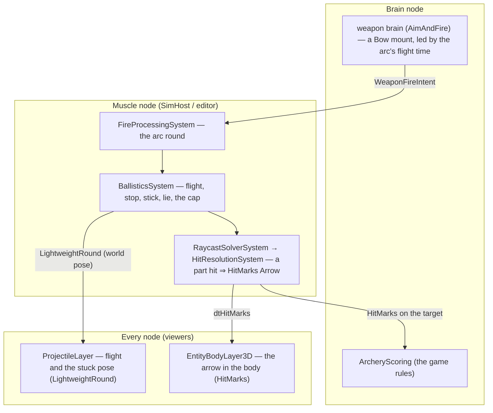
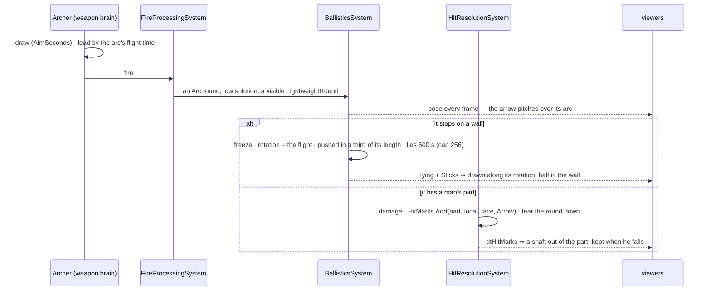

<!--STATUS
state: LIVE
updated: 2026-11-17
build-state: READY-TO-BUILD — BW-1…BW-13 ✅ APPROVED `2026-11-17` (R-4289); BW-14 withdrawn → Animals AN-20, ⛔ NOT approved
current-answer: §0 the ask · §1 inventory · §2 the claim table · §3 decisions · §4 UML · §5 the numbers · §6 scenarios · §7 ids · §8 slices · §9 the first fun content (NA-1…NA-7, not approved)
stale-below: none
known-rot: none
known-conflict: none
related-designs:
  - ../hit-location/DESIGN_Body_Parts_And_Hit_Location.md — OWNS `HitMarks` (HL-8, CE-3210): the replicated ring of marks in a body part's frame that an arrow stuck in a body becomes (BW-5)
  - ../../DESIGN_Visual_Effects.md — OWNS the rounds' looks (`ProjectileLayer`), the thrown blades (CE-1190: axe, spear, star), the lying rounds and the impact decals BW-4 / BW-11 extend
  - ../animals/DESIGN_Animals.md — OWNS the riding horse and its firing seats (R-4269, AR-10 "mounted archers — LATER") BW-8 uses
  - ../../DESIGN_Civilians_And_Crowd_Control.md — OWNS the thrown blades as weapons (CE-3247) and the hand-item lie time the arrows reuse
  - ../fun/BACKLOG_Fun_Ideas.md — F-1 arrows, F-2 the wagon raid, F-8 the archery contest (the Western pack CE-4633 builds its content on this)
  - ../../DESIGN_Scenario_Regression.md — the checks grammar the scenarios use
-->

# DESIGN — bows and crossbows (CE-4649)

🔒 **User, `2026-11-16`:** *"Indians driving horses and shooting from a bow. while drawing the arrows in the flight, and also when the arrow hits a
surface it should stay sticked there. As in Western movies. And if the arrow hits some animal form like human and the human falls down, the arrow
should be sticked to the body still."* · *"Archery contest is nice."* · `2026-11-17`: *"Lets design bows and crossbows please. Both share a lot."*

## 0. The ask

| # | requirement |
|---|---|
| A | an arrow (a crossbow bolt) is SEEN in flight, along its arc |
| B | it STICKS in what it hits — the ground, a wall, a wagon, a tree — and stays |
| C | it stays stuck in a person's or an animal's body, also after he falls |
| D | archers shoot from HORSEBACK |
| E | an archery target scores by the ring hit |
| F | bow and crossbow share everything they can; they differ in speed, draw and reload |

## 1. INVENTORY *(measured `2026-11-17`; an Explore pass over the combat, physics and presentation code + grep)*

Queries: `search_graph name_pattern=".*(Projectile|Ballistic|Round|Munition|Lying|Stuck|Embed|Arrow|Bow|Thrown|Grenade|HitLocation|BodyZone|Mounted|Rider|Pickup|PickUp).*" label=Class`
and `".*(Arrow|Bow|Stuck|Archer).*"` ⇒ **no bow, crossbow, arrow or stuck-projectile code** (only the HSM editor's arrow renderer); grep of `docs/` + `.dev/` ⇒
F-1 / F-2 / F-8, AR-10, CE-4625 only. ⚠ Index coverage cannot be checked through the CLI.

| exists | what it gives | file |
|---|---|---|
| a fired round is an ENTITY | `SimTransform`, `SimVelocity`, `BallisticProjectile` (shooter, damage, penetration, ammo, warhead bits, arc lifetime, range limit) | `FireProcessingSystem.cs:325-374`, `CombatComponents.cs:110-181` |
| ⭐ gravity on an ARC round | only rounds with `WarheadRound.Arc` (indirect, bombs, hand throws) fall: `Linear.Z −= 9.81·dt`; launch by `ThrowArc` / `ArcLaunch` with a low or high solution (`IndirectArc`) | `BallisticsSystem.cs:152-159`, `CombatComponents.cs:188`, `WeaponSuiteDto.cs:117-129` |
| ⭐ a VISIBLE round is replicated | a munition with a look ⇒ `LightweightRound` (entity master + world pose, no lifecycle) — viewers see it fly; bullets stay local | `FireProcessingSystem.cs:510-524`, `LightweightRound.cs` |
| the round's look | `MunitionVisualDto` (shape, length, diameter, colour, trail, tracer); shapes Grenade … Bullet, **Axe, Spear, Star** (the thrown blades, CE-1190); drawn along the velocity in flight | `MunitionVisualDto.cs`, `ProjectileLayer.cs:121-260` |
| ⭐ a LYING round | an inert hand item lies `HandItemDto.LiesSeconds` (thrown blades 300 s) then is destroyed; ⚠ **drawn FLAT on the ground** (yaw from its heading or a seeded one) — no stuck pose | `BallisticsSystem.cs:94-133`, `ProjectileLayer.cs:157-191`, `MunitionTkbCatalog.cs:178, 525` |
| a hit on the ground / a wall | stopped in `BallisticsSystem` (`TerrainPenetration.Carry`); `RoundImpactNotification` with the point AND the **surface normal**; viewers draw a puff, a decal on the normal, a ricochet sound | `BallisticsSystem.cs:189-215, 280-301`, `EffectSystems.cs:243-253` |
| a hit on a body / a vehicle | `RaycastSolverSystem` gives the part, the face and the LOCAL point in the part box; the round is torn down | `RaycastSolverSystem.cs:248-327`, `HitResolutionSystem.cs:88-194` |
| ⭐ **`HitMarks`** | a replicated ring of **24** marks per body — part, local point, face, kind (Bullet, Fragment, Burn, Penetration) — written by the muscle, drawn IN THE PART'S FRAME, so they move with the arm and **follow the dead pose** | `BodyPartComponents.cs:50-104`, `HitResolutionSystem.cs:183`, `EntityBodyLayer3D.cs:1957-1970` |
| lying pose | `PersonPose.Downed`, `BlockFigure.DeadPose` | `PersonBody.cs:18`, `ShapeKit.cs:1372-1388` |
| the weapon mount | `WeaponMountDto`: muzzle velocity, range, penetration, damage, dispersion, **AimSeconds**, magazine, **ReloadSeconds**, arc, hands, appearance; categories SmallArms … AirToAir — ⛔ no bow | `WeaponSuiteDto.cs:21-190`, `TurretSuiteDto.cs:49-79` |
| held looks | Rifle, Pistol, MachineGun, ScopedRifle, Rpg, MissileTube, Manpads, Mortar — ⛔ no bow | `HeldWeapons.cs:13-66` |
| ⭐ riding and firing | the riding horse's seats have arcs ⇒ firing seats (driver ±150°, passenger 30–330°), not stopped-only; the rider's `MountedAiming` figure; moving fire doubles the spread | `AnimalTkbCatalog.cs:92-101`, `CarrierTkbTranslator.cs:89-94`, `HitModel.cs:46-60` |
| damage | `ArmorModel.HitDamage` = damage × penetration chance (pen / armour); bleeding only once incapacitated | `ArmorModel.cs:121-142`, `InjuryDefDto.cs` |
| sounds | the munition's or type's `SoundSet` (shot / far / burst) | `SoundTkbCatalog.cs:85-96` |
| the game score | the built score (multiplayer) | Fun backlog §"the built game score" |
| caps | decals 256, `HitMarks` 24, shot log 256 — ⛔ no cap on lying rounds | `EffectSystems.cs:44`, `ShotLog.cs:70` |

## 2. The claim table

| the design rests on | code — how it IS | design — how it was MEANT |
|---|---|---|
| an arrow's arc needs no new physics | ✅ the `Arc` warhead bit + `ArcLaunch` low solution already fly hand throws | ✅ CE-1190 / CE-3247 (thrown blades) |
| an arrow is seen in flight on every node | ✅ any munition with a look is a `LightweightRound` | ✅ Visual Effects |
| a stuck arrow keeps its angle on every node | ✅ `LightweightRound` replicates the world POSE (rotation included — `WorldPos`, `SimDescriptors.cs:34-37`); ⚠ the viewer flattens a lying round today (`ProjectileLayer.cs:157-163`) | ⛔ searched: no stuck pose designed — BW-4 adds it |
| an arrow in a body follows the body | ✅ `HitMarks` are drawn in the part frame, dead pose included | ✅ HL-8 (*"bullet holes … in a fixed size array … owned by muscle"*) — an arrow is one more mark kind |
| riders can already shoot | ✅ the horse's firing seats | ✅ R-4269 / AR-10 |
| ⛔ a horse / animal has body parts for `HitMarks` | ⚠ not measured — step 0 | — |
| the proven solution | games and sims fly arrows as gravity projectiles (light drag), turn them into a **static prop with the impact pose** on a surface (a pool, oldest removed), and **attach** them to the hit bone with a local offset on a character | adopted: arc = the existing arc round; prop = the round itself frozen with its pose; attachment = a `HitMarks` kind (the bone = the part). ⛔ Drag rejected for v1: at ≤ 100 m it moves the impact by centimetres and adds a second flight model |

## 3. Decisions — ✅ approved `2026-11-17` (R-4289)

| # | decision — ⭐ lean | why | rejected — one line |
|---|---|---|---|
| **BW-1** | **ONE weapon kind for both**: `WeaponCategory.Bow` (a held, two-handed direct weapon); bow and crossbow are two MOUNT rows that differ only in numbers — speed, draw (`AimSeconds`), reload (`ReloadSeconds`, a crossbow spans slowly) — and in their held look | the user: *"Both share a lot"*; one category for every rule that reads it (weapon brain, held look, sounds) | two categories (every reader learns both) |
| **BW-2** | **the arrow flies the existing ARC**: the arrow / bolt munitions are `Arc` rounds launched on the LOW `ArcLaunch` solution at the aim point (the target's led point — `TargetLead` with the arc's flight time); dispersion as today | gravity already exists for throws; an arrow is a fast throw | a new flight model with drag (§2) |
| **BW-3** | **seen in flight** by giving each a look: a NEW `MunitionShape.Arrow` (shaft, point, three fletching vanes; a bolt is the same shape, shorter and thicker); nose along the velocity, so it pitches over the arc | requirement A; the look rows already replicate it | a tracer (an arrow is not a streak) |
| **BW-4** | **stuck in a surface**: when an arrow round STOPS on the ground, a wall, a fence, a tree or a building (the `RoundImpactNotification` path), it is NOT torn down: it freezes **with its rotation = its flight direction** and its point pushed **a third of its length** into the surface along the flight; it lies `LiesSeconds` (**600 s**); the viewer draws a lying round of a `Sticks` look **along its rotation** instead of flat. ⭐ A cap: **at most 256 stuck arrows per shooter's node, oldest removed first** — for every lying round, not only arrows | requirement B; one more lying-round case, no new entity kind | a separate "stuck arrow" entity (a second lying mechanism) · decals (presentation only, not world state) |
| **BW-5** | **stuck in a body or a vehicle**: a hit that the raycast resolves on a PART writes a `HitMarks` entry of a NEW kind **`Arrow`** (or **`Bolt`**) at the local point and face; viewers draw the shaft sticking OUT of the part — along the face's normal tilted by up to 25° (seeded by the mark) toward the shooter's side — in the part's frame, so it stays in the body when he falls (`DeadPose`). The round itself is torn down as today | requirement C exactly; `HitMarks` is already replicated, recorded and pose-following | a stuck-round entity glued to a body (a second attachment mechanism; follows no pose) · storing the arrow's true direction (changes a replicated struct for every mark) |
| **BW-6** | **damage**: low penetration (≈ 4 mm RHA bow, 6 mm crossbow — a soft vest and a helmet stop it), damage high enough that a torso hit wounds and two incapacitate; `WarheadKind.Kinetic`; the existing injury and bleed-out | an arrow kills by bleeding, not by speed | velocity-dependent damage (the engine has none) |
| **BW-7** | **the weapon brain treats a bow as direct fire** with its own short range (§5); it leads the target by the ARC's flight time | the existing brain; only the time of flight differs | a special archer brain |
| **BW-8** | **from horseback**: a bow fires from the riding horse's seats as any held weapon (R-4269); moving fire doubles the spread (as built); a crossbow may too, its 6 s span makes it rare | requirement D with no new rule | a stopped-only bow (cavalry archers shot at the gallop) |
| **BW-9** | **SILENT to the AI**: a bow or crossbow shot emits NO sound the AI hears (no `SoundFamily`, no hearing range) and no muzzle flash — 🔒 user, `2026-11-17`: *"the shot from the bow or crossbow is so silent that we do not need an AI to hear anything at all, 30 meters is way too far"*. A person NEAR the shooter in the 3-D view still hears a faint twang / clack (audio only, never a sensor) | an archer can be found only by being SEEN, or by his arrows arriving | a short hearing range (✗ user) |
| **BW-10** | **the looks** (ui): the held bow (a curved stave + string, the string drawn back while aiming), the crossbow, a quiver on the back, the archer's draw pose, the arrow shape, the stuck arrow on a part — ⛔ mockups first (R-4143) | requirement A–C on screen | — |
| **BW-11** | **the archery target**: a TKB prop type (a straw boss on a stand, a scoring face); an arrow that sticks in it writes its `HitMarks` (BW-5) and the ring = the distance of the mark from the face centre (10 rings); a `ScoreArcheryHit` rule adds it to the built game score | requirement E; the score from the mark already written | a separate hit test for targets |
| **BW-12** | **the catalogue**: munitions **arrow** and **crossbow bolt**; mounts **Bow** (self / hunting bow) and **Crossbow**; person types **Archer** and **Crossbowman** (a civilian-look body with the weapon, a soldier brain) — ⭐ the Western content (Native American riders, cowboys) is the FUN PACK's (CE-4633), built on these rows | engine pieces shared, content separate (R-4281) | putting the Western riders here |
| ~~**BW-14**~~ | ⛔ WITHDRAWN `2026-11-17` — hunting birds is not an archery feature; moved to the animals design as **AN-20** (🔒 user: *"Aren't they out of reach of a usual bow? … the ducks should stay just the relation to the archery might be confusing"*). An arrow can hit a bird like any round can | — | — |
| **BW-13** | **who builds**: **backend** (BW-1, -2, -4, -5, -6, -7, -9, -11, -12: combat, catalogue, the cap), **ui** (BW-3, -10, the stuck draws), **behaviors** only if the weapon brain needs more than numbers (step 0 decides) | the usual split | one lane for all (the looks belong to ui) |

## 4. UML

### 4a. Classes

```mermaid
classDiagram
  class WeaponCategory { <<existing enum, grows>> + Bow }
  class WeaponMountDto { <<existing>> MuzzleVelocity · AimSeconds = the draw · ReloadSeconds = the nock / the span · Arc = Low }
  class MunitionShape { <<existing enum, grows>> + Arrow }
  class MunitionVisualDto { <<existing, grows>> + Sticks }
  class HandItemDto { <<existing>> LiesSeconds = 600 }
  class FireProcessingSystem { <<existing>> a Bow mount ⇒ an Arc round on the low ArcLaunch, led by TargetLead }
  class BallisticsSystem { <<existing, grows>> a Sticks round that stops ⇒ frozen with its pose, pushed in a third of its length · the lying cap 256 }
  class HitResolutionSystem { <<existing, grows>> a Sticks round on a part ⇒ HitMarks kind Arrow / Bolt }
  class HitMarks { <<existing, replicated>> + HitMarkKind.Arrow · + HitMarkKind.Bolt }
  class ProjectileLayer { <<existing, grows>> Arrow shape · a lying Sticks round drawn along its rotation }
  class EntityBodyLayer3D { <<existing, grows>> an Arrow mark drawn as a shaft out of the part (part frame, dead pose) }
  class HeldWeapons { <<existing, grows>> + HeldLook.Bow · + HeldLook.Crossbow }
  class ArcheryScoring { <<★ new rule>> ring from the mark's distance to the face centre ⇒ the game score }
  FireProcessingSystem ..> WeaponMountDto
  BallisticsSystem ..> MunitionVisualDto : Sticks
  BallisticsSystem ..> HandItemDto : LiesSeconds
  HitResolutionSystem --> HitMarks : writes (muscle)
  ProjectileLayer ..> MunitionShape
  EntityBodyLayer3D ..> HitMarks : reads (every node)
  ArcheryScoring ..> HitMarks : reads the target's
```

*What the picture shows that prose hid: there is NO new entity kind and NO new replicated component — an arrow is an existing arc round, a
stuck arrow is an existing lying round with its pose kept, and an arrow in a body is one more `HitMarks` kind; every new box is a value in an
existing enum or one branch in an existing system.*

### 4b. Who runs it

### 4c. An arrow into a wall, an arrow into a man

## 5. The numbers *(public figures, rounded; the builder tunes and records each as a lane decision)*

| | bow | crossbow |
|---|---|---|
| speed | 60 m/s | 90 m/s |
| draw (`AimSeconds`) · reload (`ReloadSeconds`) | 1.0 s · 1.0 s (nock the next) | 0.5 s · **6 s** (span) |
| effective range · max | 60 m · 150 m | 80 m · 200 m |
| penetration · damage | 4 mm · 0.45 of a soldier's health | 6 mm · 0.55 |
| dispersion | 8 mils | 4 mils |
| ammunition | a quiver of 20 | 15 bolts |
| munition look | arrow 0.75 m, Ø 8 mm, fletched | bolt 0.40 m, Ø 10 mm, fletched |

## 6. Feature-test scenarios *(R-4277 — each a `description` and `checks.json` expect rows, and a golden)*

| scenario | what happens | expect rows |
|---|---|---|
| **`bw-arrow-arc`** | an archer shoots at a man 80 m away across open ground | `shot by Archer` with `hit` before 20 s (the arc reaches) · `health Target < max` |
| **`bw-unheard`** | an archer shoots at a man from behind; two soldiers stand 15 m from the archer, facing away | the soldiers never react to the archer before seeing him (`never field Soldier*` threat on the archer before he is in their view) — the shot is silent to the AI |
| **`bw-stuck-wall`** | an archer shoots 5 arrows at a wall and the ground around a target behind cover | ≥ 3 `shot by Archer` with outcome `StoppedByTerrain` · golden captures the stuck rounds' poses (a rail checks they are not flat) |
| **`bw-stuck-body`** | an archer kills a man in the open | `health Target == 0` · `field Target HitMarks.NextSeq >= 2` (the rail checks the kind is `Arrow` and the mark is drawn after the fall) |
| **`bw-crossbow`** | a crossbowman fires three bolts | 3 `shot by Crossbowman` · the gaps between them ≥ 6 s |
| **`bw-mounted-archers`** | four mounted archers circle a guarded wagon at a gallop and shoot | ≥ 6 `shot by *Rider` while moving · ≥ 1 hit on a guard · no rider stops to shoot |
| **`bw-archery-contest`** | three archers shoot five arrows each at three targets | 15 shots · every arrow stuck in a target or the ground · a score per archer · the best archer named in the score (`field` on the game score) |

Rails (not scenarios): the stuck pose (not flat, a third in); the cap (257th removes the oldest); the arrow mark drawn after the dead pose blend; the
ring score from a mark; the held bow drawn while aiming (frame vs mockup).

## 7. Ids *(⛔ permanent once built; re-checked on every lane by the builder)*

| what | id |
|---|---|
| `WeaponCategory.Bow` | **14** (13 = `AirToAir`, the air lane) |
| `MunitionShape.Arrow` | **9** (8 = Star) |
| `HitMarkKind.Arrow`, `.Bolt` | **5, 6** |
| munitions: arrow, crossbow bolt | **6066, 6067** (6060–6065 are the air lane's) |
| person types Archer, Crossbowman · the archery target prop | measured at step 0 (the urban-combat 2010–2012 are the Middle-East fighters) |
| tracker | `CE-4649` (programme row) |

## 8. Slices

| slice | items | done when |
|---|---|---|
| **S0 measure** — STOP rule (R-106) | horses / animals have `HitMarks` parts? · `WorldPos` rotation reaches a viewer's lying round? · the type and prop ids · whether the weapon brain needs more than the numbers | answers + ids in §1 / §7 |
| **S1 the arrow flies** (backend) | BW-1, BW-2, BW-6, BW-7, BW-9, BW-12 (munitions, mounts, Archer / Crossbowman) | `bw-arrow-arc`, `bw-crossbow` |
| **S2 it sticks** (backend) | BW-4 (the stuck pose, the cap), BW-5 (the `Arrow` / `Bolt` marks) | `bw-stuck-wall`, `bw-stuck-body` (rails for the kind) |
| **S3 the looks** (ui, from S1) | BW-3, BW-10, the stuck draws — mockups first | the frame rails vs mockups |
| **S4 riders and the contest** | BW-8 (+ the scenario), BW-11 (target prop + scoring) | `bw-mounted-archers`, `bw-archery-contest` |

## 9. The first fun content — the Native American archer and the mounted archer *(coordinator, `2026-11-17`; ⛔ NOT approved; the fun pack, CE-4650)*

🔒 User, `2026-11-17`: *"please add also an Indian guy with the bow. As one of the first funny items. and the one who can ride horse and shoot from his back."*

📐 What it builds on: the bow (§3, BW-1…BW-13), the person outfits from the TKB (`DESIGN_Person_Outfits.md`, CE-4648 — a wardrobe per type), the riding
horse and its firing seats (Animals, R-4269), the thrown hatchet (`TkbThrowingHatchet` 6044, CE-3247 — a tomahawk), the insurgent's soldier brain.

| # | decision — ⭐ lean | why | rejected — one line |
|---|---|---|---|
| **NA-1** | ONE person type **Native American warrior** (fun pack): a **bow** (BW-1) + a **tomahawk** to throw (the existing thrown hatchet), a knife-range melee; no armour; the insurgent's brain and temperament | the user's ask; every piece exists | a new brain |
| **NA-2** | **his look from the TKB** (CE-4648's `OutfitDto`): top — buckskin shirt with fringe 50 / bare chest 50 (skin tones of the type); legs — leggings + breechcloth (buckskin, dark); head — a headband with 1–3 feathers 60, a single feather 25, none 15; hair — long black, two braids 60 / loose 40; face paint stripes 30 (red, white, black); a quiver on the back (BW-10). ⭐ New garment kinds for ui: `Buckskin`, `Breechcloth`, `Headband` (+ feathers), hair `Braids`, a `FacePaint` detail | requirement — the look is data, seeded per man (R-4287) | a fixed figure (every warrior identical) |
| **NA-3** | **riding**: the same type MOUNTS a riding horse (703) and shoots from its seat (R-4269, BW-8) — a mounted warrior is the person + his horse, no separate type; a scenario places them mounted | one type on foot and on horseback | a "mounted warrior" type (a second copy) |
| **NA-4** | **the circle raid** (behaviors): a mounted group CIRCLES its target at a gallop at 40–80 m, each rider shooting inward while riding, breaking off when a rider is hit and rejoining — ONE new group play over the existing riders | the iconic picture and the reason to shoot from the horse | riders standing still to shoot |
| **NA-5** | **fun pack placement** (R-4281): the type in a `FunTkbCatalog` file, the scenarios under `scenarios/fun/western/`: **`war-party`** (a mounted party circles a guarded camp and raids it; expect: the riders circle — ≥ 6 shots fired while galloping, ≥ 1 guard hit, no rider stops to shoot) and **`archer-ambush`** (warriors on foot ambush a patrol from cover; silent shots — the patrol reacts only on SEEING an archer or being hit) | the user's "first funny items" | — |
| **NA-6** | **order**: after bows S1 + S3 and outfits S1 + S2; the circle raid in parallel by behaviors | dependencies | — |
| **NA-7** | **ids**: the person type measured at step 0 (urban 2010–2012 are the Middle-East fighters; the bow design's Archer / Crossbowman take the next) | — | — |

⚠ The covered wagon, the cowboys and the cavalry stay CE-4633's (the Western pack) — the war party raids a CAMP until the wagon exists.
