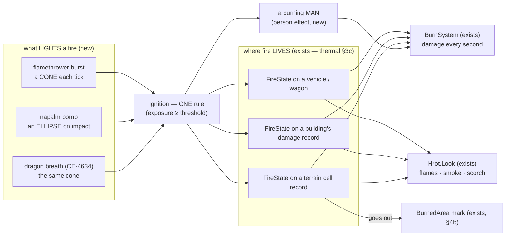
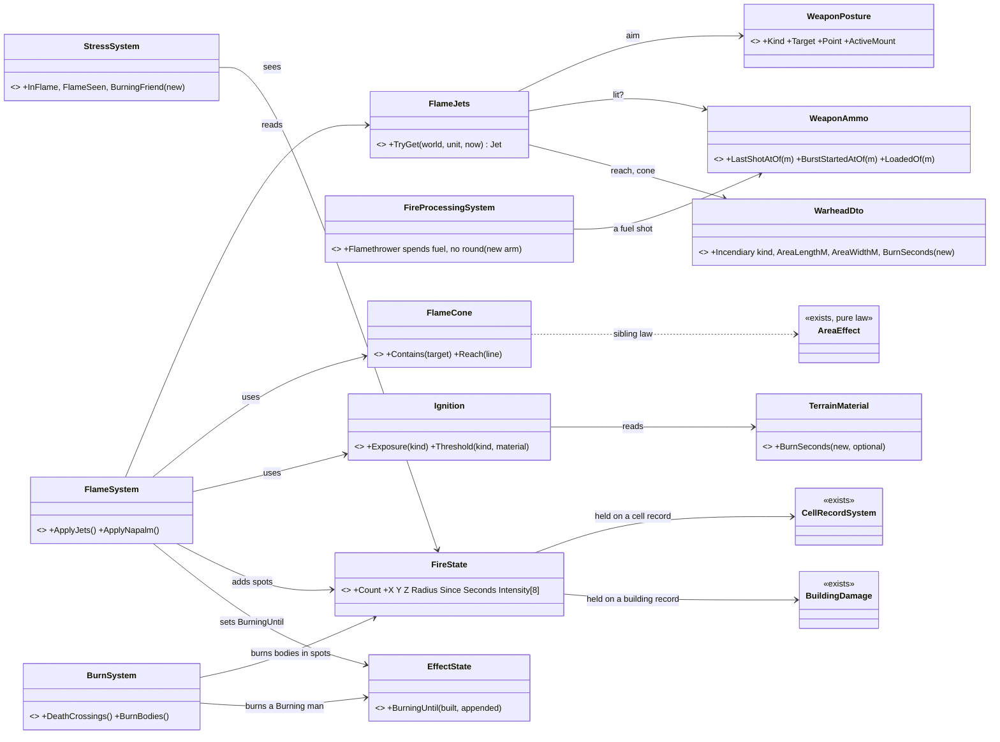
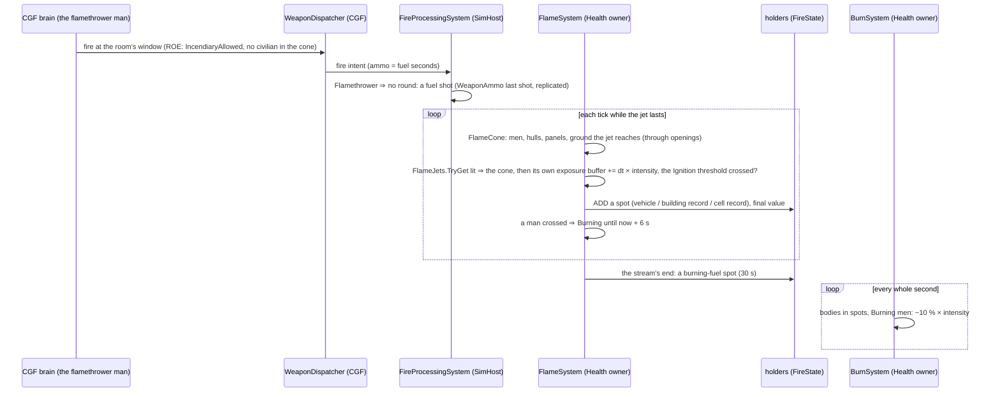
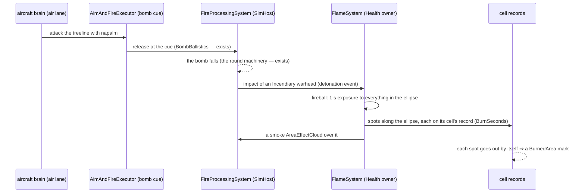
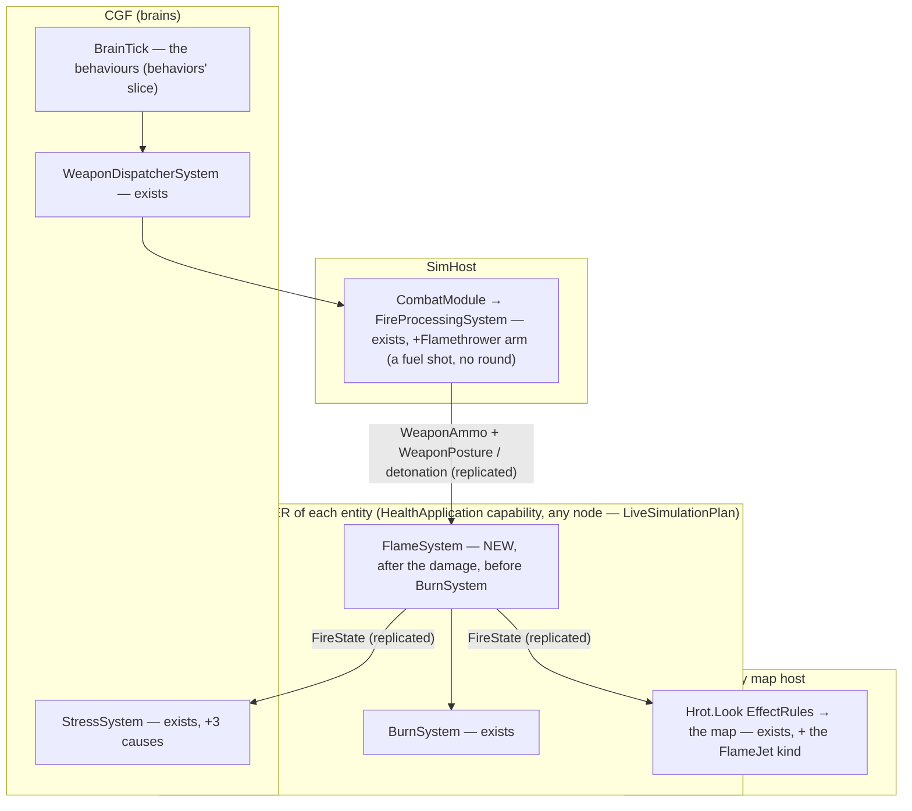

<!--STATUS
state: LIVE — ✅ APPROVED 2026-11-19 (R-3111); nothing built yet (HANDOFF_Coordinator_To_Backend_Reload_And_Fire_Weapons.md row 2)
build-state: DESIGN
updated: 2026-11-19
current-answer: §0 the picture · §3 decisions (leans F-1…F-12) · §5 slices
related-designs:
  - ../thermal/DESIGN_Thermal_Drivers.md — OWNS how fire is STORED and SENT (§3b TD-16 the coupling to damage, §3c the three FireState holders, §4b the BurnedArea mark, §4g BurnSystem as built); this design adds what LIGHTS it
  - ../vehicle-appearance/DESIGN_Vehicle_Appearance_State.md — §7 / §7a: Hrot.Look's effect rules and categories — the flame and the burning-ground look go through them
  - DESIGN_Weapon_Systems.md — mounts, stations and the TKB weapon rows a flamethrower is one more of
  - ../../DESIGN_Building_Interiors.md — §3k the area-effect laws (AreaEffect, AreaEffectSystem) the flame cone stands beside, and the building damage record a roof fire is held on
  - ../fun/BACKLOG_Fun_Ideas.md — F-11 the dragon's breath (CE-4634) is this flame on another carrier; S-1 / S-2 are CE-4635 / CE-4637
-->

# DESIGN — flame weapons: the flamethrower and napalm (CE-4635, CE-4637)

🔒 User, `2026-11-16`: *"I forgot about the flamethrower weapon. Good point, thank you. We should use it. It's unhuman, but unfortunately very military."* ·
*"Also some napalm bomb with adequate effect on the ground, both visual and damage."* · `2026-11-19`: *"the flamethrower (CE-4635) and napalm (CE-4637)
design … could be given to backend"*.

## 0. The picture

*What the picture shows that prose hid:* the storage, the wire, the damage tick and the wreck flames are BUILT (thermal TD-S4) — the whole new
work is the LEFT column and one ignition rule; everything right of it is reused.

## 1. INVENTORY *(2026-11-19; graph `search_graph name_pattern=".*(Flame|Napalm|Incendiar|Burn).*"` ⇒ only `BurnSystem` + unrelated `Burn*`
methods; `".*Fire(State|Spot|Ignit|Spread).*" label=Class` ⇒ 8 (`FireState`, `FireSpot`, `EntityFireState` + its translators); `".*AreaEffect.*"
label=Class` ⇒ 12; grep for `Flammab|Combust|Ignit|Burnable` ⇒ nothing but `BurnSystem.Ignited`; ⚠ index coverage is not checkable through the CLI)*

| exists | where | used here as |
|---|---|---|
| `FireState` — 8 spots {x, y, z, radius, since, seconds, intensity}, ADDED at first ignition, replicated `dtFireState` 241, recorded | `Perception/Signatures/HeatSource.cs:82` | the ONE fire store, all holders |
| `BurnSystem` — ignites a fuelled hull at its death crossing; −10 % × intensity of max Health per whole second to a body inside a burning spot | `Combat/Systems/BurnSystem.cs`, `HealthApplication` capability (the Health owner) | the damage tick; gains a second igniter input |
| the three holders: vehicle · building damage record (`BuildingDamage`, one per building) · terrain cell record (`ICellRecord<T>`, `CellRecordSystem`) | thermal §3c | where cone and napalm put spots |
| `GroundHeatMarks` kind `BurnedArea` | thermal §4b | the scorch a ground fire leaves |
| `AreaEffect` (pure laws: fragments, blast, barrier transmission, shadow) · `AreaEffectSystem` | `Combat/AreaEffect.cs`, `DamageAssessmentModule` | the precedent for "pure law + one applying system"; the flame cone is a sibling law |
| `AreaEffectCloud` — a warhead's persistent cloud entity (tear gas, smoke, the smoke dischargers) | `Combat/AreaEffectClouds.cs` | the smoke of a big fire (napalm) |
| `WarheadKind` (Kinetic … Smoke = 7) · `WeaponCategory` (… SmokeDischarger = 15) | `Tkb/Domain/WarheadDto.cs`, `TurretSuiteDto.cs` | each gains ONE appended value |
| `TerrainMaterial.ThermalClass` (wood, grass, dense-vegetation …) | `Terrain/TerrainMaterials.cs:14` | what burns, by data that exists |
| `StressSystem` causes (near miss 0.08, hit 0.25, friend down 0.2) | `Brains/StressSystem.cs:26` | fear of fire = new causes, same machinery |
| the bomb release cue (`BombBallistics.ReleaseNow`) | `AimAndFireExecutor.cs:735` | napalm is a `Bomb` — released like any bomb |
| `EffectVisualDto` kinds incl. **Fire** and **Smoke**; `EffectRules` / `EffectSpec` (kind × size × surface, `MunitionDis`) | `EffectDtos.cs`, `Hrot.Look` §7a | the look, no new kind but one (the jet) |

## 2. The proven solution, and what we take

| the problem class | how it is solved (real weapons; simulators and games) | ⭐ we take / adapt / reject — because |
|---|---|---|
| a flame STREAM | real: thickened fuel thrown 20–70 m (man-portable; LPO-50, M2), ~100–150 m (vehicle); ~7–10 s of fuel in 1–3 s bursts; it splashes round corners and into openings. Sims/games: a CONE or capsule volume tested each tick with occlusion, plus burning patches where the fuel lands | ⭐ **adopt the cone-per-tick** — one test per burst tick against the frame grid; ⛔ reject droplet entities (thousands of short-lived rounds through the projectile machinery for a 2 s burst) |
| what catches fire | real: fuel + heat + time; sims: an ignition chance per tick | ⭐ **adapt: no dice** (R-212, "expected values"): an EXPOSURE accumulates (seconds × intensity) and ignites at a per-kind threshold — deterministic at any thread count |
| a burning ground area (napalm) | real: Mk 77 ≈ 75 gal ⇒ ~2 500 m² burning 5–10 min; sims: a set of fire patches | ⭐ **adopt patches = `FireState` spots on cell records** (thermal §3c decided the holder); ⛔ reject one big area entity (a fire must tie to the ground it burns, and go out piecewise) |
| spread (wind, materials) | real and good sims model it | ⛔ **not in v1** (thermal §3c fenced it here): a spot burns its time where it was lit; napalm's area is laid by the bomb, not grown. Spread = a later slice once v1 is seen |

## 3. Decisions — ✅ APPROVED `2026-11-19` (R-3111)

🔒 User, `2026-11-19`: *"F-9 lean approved, numbers fine."* ⇒ F-9 as leaned (incendiary allowed for military forces, off in a police / civil scenario; never released with a civilian in the cone or the ellipse) and F-3 / F-5's numbers stand; the other rows were engineering leans the user did not contest.

| # | question | ⭐ lean | what would change it |
|---|---|---|---|
| **F-1** | how a flamethrower burst works | a fire intent like any other (the dispatcher, ROE, ammo — fuel counts as rounds) ⇒ on SimHost `FireProcessingSystem` spawns **no round** for a `Flamethrower`. ⭐ **No component of its own** (user, `2026-11-19`: *"does this need any new component?"*): the jet IS the active mount's burst record — `WeaponPosture` (aim, `ActiveMount`) + `WeaponAmmo` (`LastShotAtOf`, `BurstStartedAtOf`) + the munition's `WarheadDto` — read by ONE reader, **`FlameJets.TryGet`** (built, §6); `FlameSystem` (Health owner side) applies the CONE each tick while it is lit | a scenario where a flame must arc over a wall (then: a short ballistic stream — v2) |
| **F-2** | the cone test | `FlameCone` pure law (the `AreaEffect` sibling): reach + half-angle; stopped by a wall / closed door / hull on the line (`LineOfFire` + `BarrierTransmission` = 0 for flame); ⭐ an OPENING passes it — the flame enters a room through a window or a door (its classic use) | — |
| **F-3** | what ignites, and when | ⭐ ONE `Ignition` rule: exposure (s × intensity) per target ≥ threshold — man 0.3 s · soft vehicle / wagon 1.5 s · building panel of a burning material (wood, thatch) 2 s · ground of grass / dense vegetation 1 s; ⭐ the stream's END always leaves a burning-fuel spot (~30 s) whatever the surface | armour: a heavy-armoured hull does NOT ignite (its crew is stressed; engine-deck fire = v2) |
| **F-4** | a burning MAN | not a `FireState` holder (thermal §3b rejected fire in person state for THINGS; a man is the opposite case): a person effect **Burning** until-time — ⭐ BUILT as `EffectState.BurningUntil` + `HitEffect.Burning` (appended; `dtEffectState` carries it) — (~6 s, rolling on the ground ends it early — v2) ⇒ `BurnSystem` burns him each second like a body in a spot; he panics (F-8) | — |
| **F-5** | napalm | `WarheadKind.Incendiary` (appended, 8); a `Bomb` released by the existing cue; on impact lays spots in an ELLIPSE along the flight line (TKB `AreaLengthM` × `AreaWidthM`, e.g. 80 × 25 m), each on its cell's record, `BurnSeconds` (e.g. 300 s), intensity 1; plus the impact's fireball = one exposure of 1 s to everything inside; a big fire's smoke = an `AreaEffectCloud` | — |
| **F-6** | the TKB | weapon: `WeaponCategory.Flamethrower` (appended, 16); munition: `FlameRangeM`, `FlameHalfAngleDeg`, `FlameIntensity`, `BurnSeconds`, and fuel as the magazine (seconds of flame); napalm: `Incendiary` warhead + `AreaLengthM` / `AreaWidthM` / `BurnSeconds` | — |
| **F-7** | materials | `TerrainMaterial` gains ONE optional `BurnSeconds` (materials.json); default from `ThermalClass` (wood 600 s, grass / dense-vegetation 120 s, others 0 = does not burn) | a terrain needing a burning class that has no thermal class |
| **F-8** | fear | `StressSystem` gains three causes: **in a flame** (= Hit, 0.25) · **a flame seen within 30 m** (per second, like *heard close*) · **a burning friend** (= friend down × 1.5) | — |
| **F-9** | the ROE | ⭐ a scenario / force rule **`IncendiaryAllowed`** (default ON for military forces, OFF in a police / civil scenario); and like Protocol III: a flame is never released when a civilian is inside the cone or a napalm ellipse would cover one (the dispatcher's hold, as `NoHarm`) | the user prefers it OFF by default |
| **F-10** | the look | `Hrot.Look` `EffectRules`: a jet effect (new `EffectKind.FlameJet`, the only new kind — built) drawn from `FlameJets.TryGet`; burning spots = the existing **Fire** + **Smoke** kinds (the wreck path); a dead ground fire = the `BurnedArea` scorch. DIS: the munition's DIS type says incendiary; ⚠ the SISO detonation-result code for a flame / incendiary burst is NOT pinned (`NED_DDS_Protocol` §Detonation result lists none) — v1 sends 5 *Detonation* with the munition type, to be checked against SISO-REF-010 | the SISO list names an incendiary result |
| **F-11** | who uses it | ⭐ behaviors: a squad's flamethrower man — "clear a bunker / room through its opening" (the obvious drill) and the vehicle flame tank; the AIR lane: napalm through its existing bomb attack; the FUN pack: a dragon's breath = a `Flamethrower` mount on the dragon carrier (CE-4634) | — |
| **F-12** | the parallel rule | cone and ignition run in a SERIAL pass on the Health owner (few jets a frame); writes go to each holder's owner as today (a spot ADDED with its final value, D-31); ⭐ exposure is NOT a component: `FlameSystem` keeps it in its own per-target buffer, cleared on a new world, not recorded — a seek or a branch in the middle of a burst restarts a count of ≤ 2 s (the fires and burning men it caused ARE recorded) | a measured cost (hundreds of jets) |

| rejected | the one fact that killed it |
|---|---|
| each droplet a projectile entity | ~60 rounds a second per thrower through the round machinery for an effect that is a volume |
| an ignition CHANCE per tick | dice break the any-thread-count determinism and R-212 |
| one area entity for a napalm strike | it cannot go out piecewise, and it ties to no ground / building it burns |
| fire spread in v1 | thermal §3c fenced it; nothing measured needs it yet |
| `FireState` on a person | a man moves, rolls, dies — his burning is an effect with an until-time, not a set of spots |

## 4. UML

### 4a. Classes

*What the picture shows that prose hid:* only three boxes are new (`FlameCone`, `Ignition`, `FlameSystem`) and one reader is built (`FlameJets`) —
none of them stores anything: the jet is read off the replicated weapon state, fire stays in `FireState` on its three existing holders, a burning
man in `EffectState`. ⭐ **No new component** (user, `2026-11-19`).

### 4b. Sequences — a flamethrower burst; a napalm strike

*What the two pictures show that prose hid:* the flamethrower never makes a round, the napalm bomb IS a round until it lands; both meet in the
same `FlameSystem` → `Ignition` → holder path, so a dragon, a flame tank and a bomb cannot burn things differently.

### 4c. Modules — who registers each system, on which node, who calls it each frame

*What the picture shows that prose hid:* `FlameSystem` must sit in the `HealthApplication` capability (declared only by `LiveSimulationPlan`, the
same place `BurnSystem` lives) — a system registered by a pack instead would never run on the node that owns a target's Health.

## 5. Slices — with their scenarios (R-4277)

| slice | what | scenarios (each with `checks.json` expect rows) |
|---|---|---|
| **FL-0** ✅ | the DATA the look reads (built `2026-11-19`, §6): `EffectState.BurningUntil` + `HitEffect.Burning` (and the wire), `WeaponCategory.Flamethrower`, `WarheadKind.Incendiary` + the warhead's flame fields, `EffectKind.FlameJet`, `TerrainMaterial.BurnSeconds`, the reader `FlameJets.TryGet` | rails only (`FlameJetsTests`, `BodyPartReplicationTests.CE3219_F3_*`, `TerrainWorldTests.CE4635_*`) |
| **FL-1** | `FlameCone`, `Ignition`, `FlameSystem` (its exposure buffer) — a TEST weapon only; rails per rule | `fl-cone-hits-what-it-reaches` (a man in the cone burns, one behind a wall does not, one at a window's line does) |
| **FL-2** | the flamethrower in the TKB (man-portable + a flame-tank mount), the ROE rule, the look (ui: the `FlameJet` kind, §6) | `fl-clear-the-bunker` (a squad burns a bunker through its opening; the defenders burn or break; no civilian hurt) |
| **FL-3** | napalm: the `Incendiary` warhead, the ellipse, cell-record spots, the smoke cloud, the scorch | `fl-napalm-treeline` (the strike burns the treeline's men and its vegetation for its time; a scorch is left; vehicles 50 m away untouched) |
| **FL-4** | buildings and materials: `BurnSeconds`, a roof / facade fire on the building record | `fl-thatched-village` (the fun-pack-shared roof fire; the stone house does not burn) |
| **FL-5** | fear (the three causes) + behaviors' drills (behaviors' slice, against FL-1…FL-3) | covered by FL-2 / FL-3 rows (breaks counted) |
| ⏳ later | spread by wind and material; an engine-deck fire on armour; rolling to put out a burning man; the dragon (CE-4634) | — |

⛔ **Nothing is built until the user approves.** The questions that need the user: **F-9** (the ROE default) and whether **F-3**'s thresholds and
**F-5**'s napalm footprint read right; the rest are engineering leans.

## 6. The look contract — what a renderer reads, by code name *(FL-0 built `2026-11-19`; for ui's handoff)*

| what to draw | read | where it is, on every node | ⭐ the rule |
|---|---|---|---|
| a **flame jet** | `Fdp.Toolkit.Combat.FlameJets.TryGet(world, unit, now, out Jet jet)` | `WeaponPosture` + `WeaponAmmo` (replicated) + the TKB | lit while it returns true (≤ `FlameJets.LitSeconds` 0.25 s after the last fuel shot); from the muzzle of mount `jet.Mount` toward `jet.AimPoint` (its `Target`'s position when it has one), `jet.RangeM` long, `jet.HalfAngleRad` wide, brightness `jet.Intensity`, ramp-up from `jet.BurstStartedAt`. ⚠ A wall shortens it in the SIMULATION (the cone law, FL-1); v1 draws the full reach |
| a **burning spot** (a vehicle, a wagon, a building, the ground) | `Fdp.Toolkit.Perception.Signatures.FireState` — `Count`, `Get(i)` → `FireSpot` {`X`,`Y`,`Z`, `Radius`, `Since`, `Seconds`, `Intensity`}, `IsBurning(now)` | on the holder entity (replicated `dtFireState`) | each spot burning at `now` = flames sized by `Radius`, brightness `Intensity`; ⭐ the frame: a VEHICLE's spots are in its own frame (they move with it); a building record's and a cell record's spots are in their record entity's frame (`SimTransform`). ⛔ Today's wreck rule (`EffectSystems.cs:422`: one Fire + Smoke at the hull centre, on a vehicle only) is replaced by this rule for every holder |
| a **burning man** | `Fdp.Toolkit.Combat.Effects.IsBurning(view, man, now)` (`EffectState.BurningUntil`) | on the person (replicated `dtEffectState`) | flames on the body while true; `PersonLook` (ui) should expose it beside its other states |
| a **big fire's smoke** (napalm) | the strike's `AreaEffectCloud` entity | exists, replicated, drawn today | nothing new — a single spot gets only a small smoke |
| **scorched ground** | `GroundHeatMarks` items of kind `BurnedArea` (thermal §4b) | the terrain cell's record entity | a dark ground decal sized by the mark's length × width; today the marks drive only the thermal picture |
| the **sound** of a burst *(added `2026-11-19`, answering ui's NOTE)* | `Fdp.Toolkit.Tkb.Domain.SoundSourceClass.Flame` (9) — the shooter's `AcousticEmitter.FiringClass` | the TKB (`FlamethrowerSoldier`: `FlameRoarRange` 200 m, no detonation) | ⭐ ONE ROAR, not N shots: `SoundEmissionSystem` puts a Flamethrower mount's fuel shot into the hearing ring at most once per `FlameRoarSeconds` (1 s, gate `AcousticEmitter.RoarTimeLeft` — a component, so a restore roars where the first run did); a rifle's shots stay one each. The AI treats it as weapon fire (`StressSystem.IsFireClass`, a civilian's fear at the heavy-weapon impulse). ui's audio plays a roar for this class, held while `FlameJets.TryGet` is lit |
| the effect's **data** | `Fdp.Toolkit.Tkb.Domain.EffectKind.FlameJet` (8) | the TKB effects (`EffectTkbCatalog`) | ui adds its default visual (colour, size, flicker) and the `EffectRules` row; a spot's size class from its radius |

⚠ Not for the look: `WeaponCategory.Flamethrower`, `WarheadKind.Incendiary`, the warhead's `FlameRangeM` / `FlameHalfAngleDeg` / `FlameIntensity` /
`AreaLengthM` / `AreaWidthM` / `BurnSeconds`, `TerrainMaterial.BurnSeconds` — the simulation's (FL-1…FL-4); `FlameJets` already reads the ones a
renderer needs.

## 7. As built — FL-1 the cone, ignition, `FlameSystem` *(backend, `2026-11-19`)*

| piece | as built |
|---|---|
| **`FlameCone.Contains`** (`Combat/FlameRules.cs`) | ahead of the muzzle, within the reach, within the cone — never thinner than `StreamRadiusM` 0.5 m (the stream near the muzzle) |
| **`Ignition`** (same file) | `Of(world, e)` ⇒ `Person` (pedestrian / quadruped) · `SoftVehicle` · `None` (aircraft, not a vehicle, or ⭐ an ARMOURED hull: side armour ≥ `ArmorModel.SoftSkinArmourMm` 40 — the ONE soft-skin line the blast already uses, instead of a second number); thresholds 0.3 s / 1.5 s; a burning man 6 s; a vehicle fire the munition's `BurnSeconds`, else 120 s; a stay broken > 1 s restarts |
| **`FlameSystem`** (`Combat/Systems/`, `HealthApplication` capability, just before `BurnSystem`) | for each unit whose `FlameJets.TryGet` is lit: from `ShotOrigin.Eye` along the aim, every live man / vehicle in the cone with a clear EQS sight line (`EqsTerrainSight.Sight` — walls and hulls stop, openings pass; a vehicle's line is judged to just short of its own box) gains exposure × the jet's intensity; at the threshold, on the Health owner: a man ⇒ `Effects.Apply(Burning)` (`EffectState` added with its final value when absent); a soft vehicle ⇒ a `FireState` spot (its own frame, half-length + 1.5 m, as a wreck's). Exposure lives in the system's own buffer (F-12) |
| **`BurnSystem`** | + a man with `BurningUntil` ahead burns at full intensity each whole second |
| **`FireProcessingSystem`** | a `Flamethrower` mount's intent spawns NO round: it answers a fired `WeaponFireNotification` (no `Round`, `Quantity` 1, its direction × `FlameStreamMps` 40) so the brain's ledger clears (Q94 A-1) |
| rails | `FlameSystemTests` (a man lit after 0.3 s not 0.2; outside the cone / beyond the reach never; a car lit after 1.5 s and hiding the man behind it — 🔴 red-proved by dropping the sight test; an armoured hull never; a burning man −10 % a whole second) · `FlameJetsTests` · `BurnSystemTests` |

| ⛔ deviation from §5 — and why | |
|---|---|
| ~~FL-1's scenario moved to FL-2~~ | ⛔ REVERSED (user, `2026-11-19`: *"the feature is not done until it has a testing scenario"*): FL-1 ships the man-portable flamethrower TYPE (`UrbanCombatTkbCatalog.TkbFlamethrowerSoldier` 2022, his fuel `MunitionTkbCatalog.TkbFlameFuel` 6069: 40 m, 6°, 60 s, 10 shots a second, 90 shots) and **`fl-flamethrower-cone`** — 7 / 7, golden captured and repeating, and 7 / 7 under the parallel checks (read check + world guard). The flame tank and the ROE rule stay FL-2 |
| ⭐ found BY the scenario, fixed | ① a mount with no loadout leaves `WeaponAmmo.Load0` 0 (the mount's own round) ⇒ `FlameJets` read no warhead — it now falls back to the mount's munition (rail `AMountWithNoLoadout_*`, red-proved); ② the barrel-heat model held the flamethrower "too hot" after 0.7 s (10 fuel shots a second) ⇒ `BarrelHeat`: a flamethrower has no barrel; ③ a man lit once burned 6 s and LIVED while the jet still played on him ⇒ each tick past the threshold extends his burning (the ignition counts once) |
| "the stream's END leaves a burning-fuel spot" (F-3) | ⏳ with **FL-3**: a ground spot needs the cell-record holder napalm builds |
