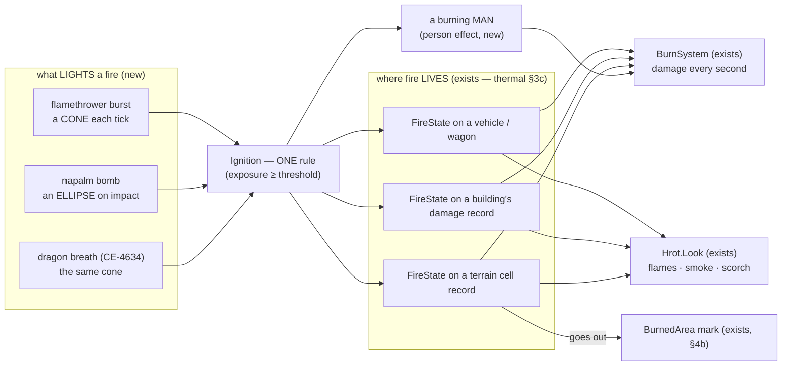
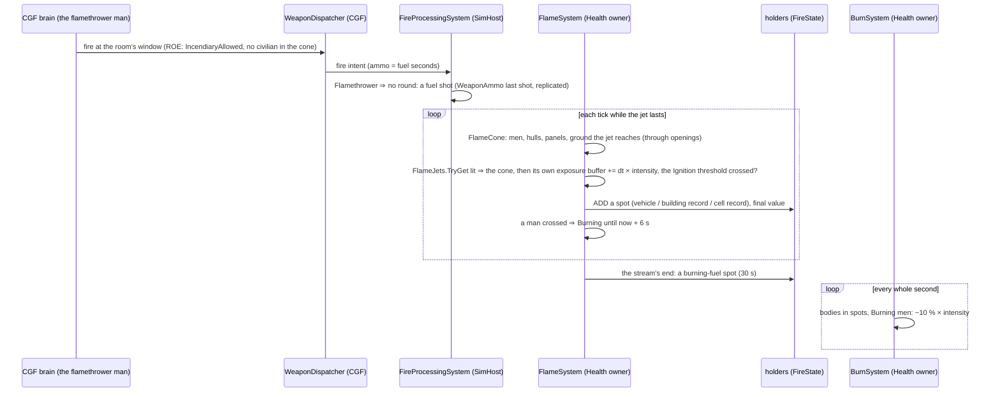
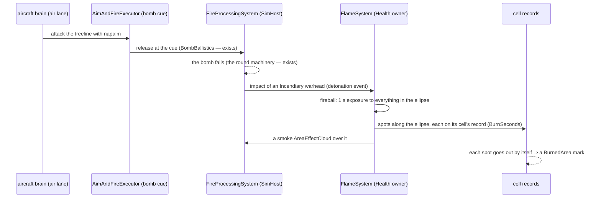
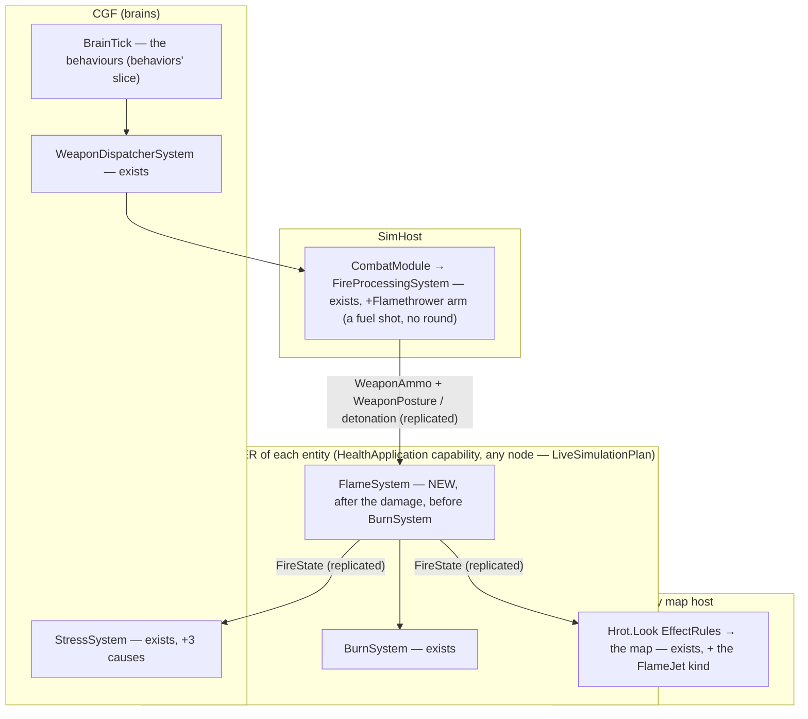
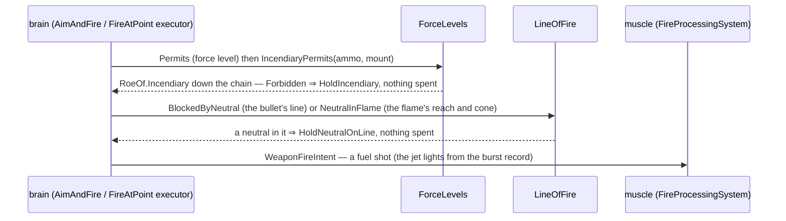
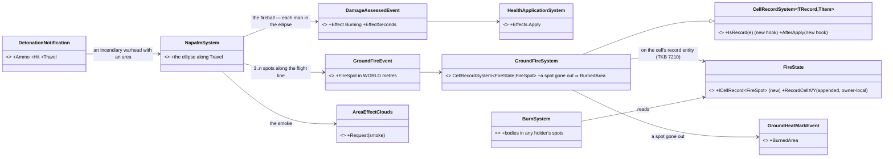
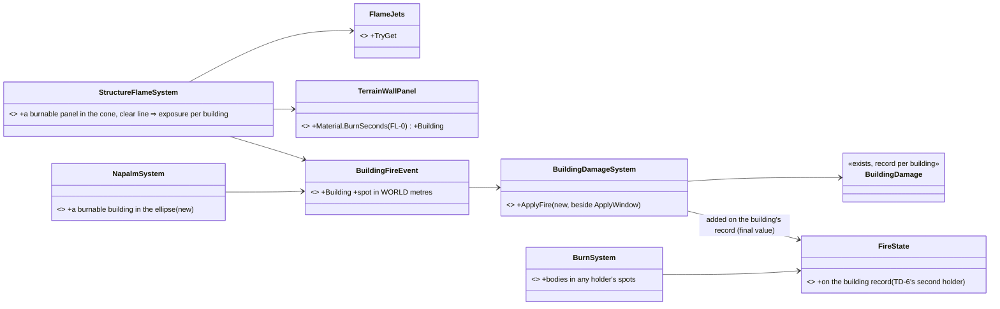
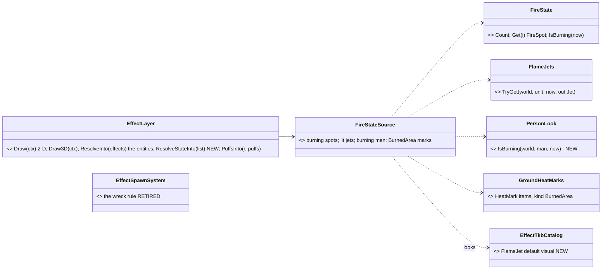
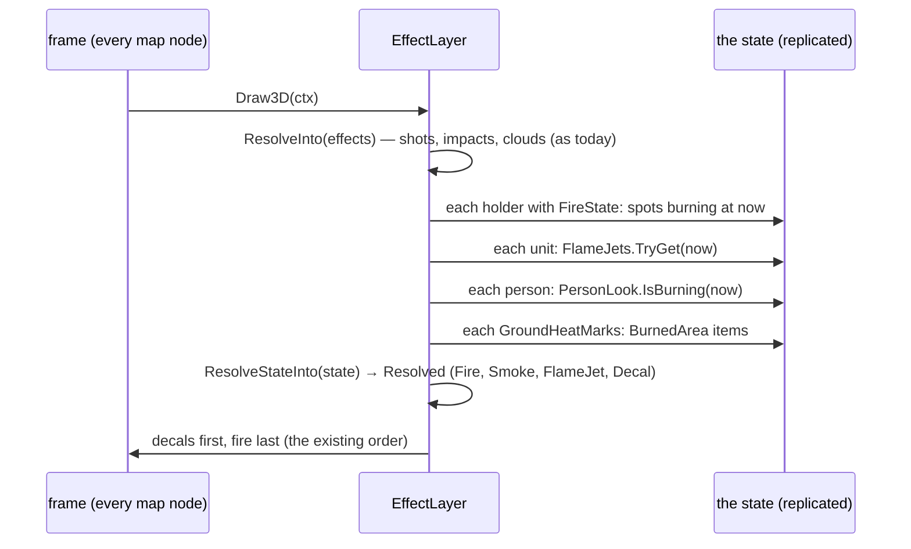

<!--STATUS
state: LIVE — ✅ APPROVED 2026-11-19 (R-3111); FL-0…FL-4 BUILT (§6, §7, §7a, §7b, §7c); FL-5 drills are the behaviors lane's
build-state: BUILT — FL-0…FL-4 (§7, §7a, §7b, §7c)
updated: 2026-11-25 (§7b CE-11057 a napalm bomb bursts on the ground, backend) · 2026-11-19
current-answer: §0 the picture · §3 decisions (F-1…F-12, approved) · §5 slices · §7 / §7a / §7b / §7c as built (FL-1, FL-2, FL-3, FL-4)
related-designs:
  - ../sensor-view/DESIGN_Sensor_View.md — the sensor views show the same fires, jets and burning men (bloom in night vision, saturated in thermal)
  - ../audio/DESIGN_FPS_Audio.md — §10 how the mover loops (the flail, the flame roar) are held; §8 here owns the roar (CE-4635)
  - ../air-attack/DESIGN_Breath_Attack.md — how a FLYER delivers the flame on its own (a strafing pass, a hover for a wall); moves NeutralInFlame to the jet's origin (BA-6)
  - ../fun/DESIGN_Dragon.md — the F-11 carrier: the breath on a dragon's neck turret; moves the jet's origin to the muzzle (DR-5) and keeps a carrier's riders out of its own jet (DR-6)
  - ../thermal/DESIGN_Thermal_Drivers.md — OWNS how fire is STORED and SENT (§3b TD-16 the coupling to damage, §3c the three FireState holders, §4b the BurnedArea mark, §4g BurnSystem as built); this design adds what LIGHTS it
  - ../vehicle-appearance/DESIGN_Vehicle_Appearance_State.md — §7 / §7a: Hrot.Look's effect rules and categories — the flame and the burning-ground look go through them
  - DESIGN_Weapon_Systems.md — mounts, stations and the TKB weapon rows a flamethrower is one more of
  - ../../DESIGN_Building_Interiors.md — §3k the area-effect laws (AreaEffect, AreaEffectSystem) the flame cone stands beside, and the building damage record a roof fire is held on
  - ../fun/BACKLOG_Fun_Ideas.md — F-11 the dragon's breath (CE-4634) is this flame on another carrier; S-1 / S-2 are CE-4635 / CE-4637
-->

# DESIGN — flame weapons: the flamethrower and napalm (CE-4635, CE-4637)

🔒 User, `2026-11-16`: *"I forgot about the flamethrower weapon. Good point, thank you. We should use it. It's unhuman, but unfortunately very military."* ·
*"Also some napalm bomb with adequate effect on the ground, both visual and damage."* · `2026-11-19`: *"the flamethrower (CE-4635) and napalm (CE-4637)
design … could be given to backend"*.

## 8. The sound — as ui builds it *(ui, `2026-11-19`; NOTE_Backend_To_Ui_Flamethrower_Sound_Answer; `build-state: BUILT`)*

A flame burst is ONE roar (`SoundSourceClass.Flame = 9`, the FlamethrowerSoldier's firing class at 200 m), never a gunshot sample per fuel shot (600 a minute). Built exactly as the flail's loop is (CE-4624; [`DESIGN_FPS_Audio.md` §10](../audio/DESIGN_FPS_Audio.md)): a lit flamer (`FlameJets.TryGet`, the same reader the picture uses) is HELD as a `SoundTkbCatalog.FlameRoar` (7357, `SoundSynth.FlameRoar`, id checked free on every lane's catalogue) loop under `SoundSources.FlameKey`, standing still too, gain by the Flame range, pitch 1 × Doppler; the loop ends with the jet. ⛔ The fuel shot queues no `SoundEvents.Shot` and makes no muzzle flash — ONE predicate, `EffectRules.IsFuelShot` (`Hrot.Look`), asked by both. ⚠ As built: "a type that has a Flamethrower mount" is read from its acoustic signature (`FiringClass == Flame`, its `FiringAudibleRange`) — the cached per-type read the movers already do, no TKB mount walk; they are the same type by backend's contract. Rails: `AudioTests.Flame` (a lit flamer held at 150 m standing still, unlit not; no Shot sound for a fuel shot, a rifle's still; the clip is a seamless non-silent loop; a held flamer costs no more allocation than a held engine, R-2084) and `EffectRulesTests.CE4635_…` — each red-proved.

## 0. The picture

*What the picture shows that prose hid:* the storage, the wire, the damage tick and the wreck flames are BUILT (thermal TD-S4) — the whole new
work is the LEFT column and one ignition rule; everything right of it is reused.

## 1. INVENTORY *(2026-11-19; graph `search_graph name_pattern=".*(Flame|Napalm|Incendiar|Burn).*"` ⇒ only `BurnSystem` + unrelated `Burn*`
methods; `".*Fire(State|Spot|Ignit|Spread).*" label=Class` ⇒ 8 (`FireState`, `FireSpot`, `EntityFireState` + its translators); `".*AreaEffect.*"
label=Class` ⇒ 12; grep for `Flammab|Combust|Ignit|Burnable` ⇒ nothing but `BurnSystem.Ignited`; ⚠ index coverage is not checkable through the CLI)*

| exists | where | used here as |
|---|---|---|
| `FireState` — 8 spots {x, y, z, radius, since, seconds, intensity}, ADDED at first ignition, replicated `dtFireState` 241, recorded | `Perception/Signatures/HeatSource.cs:82` | the ONE fire store, all holders |
| `BurnSystem` — ignites a fuelled hull at its death crossing; −10 % × intensity of max Health per whole second to a body inside a burning spot | `Combat/Systems/BurnSystem.cs`, `HealthApplication` capability (the Health owner) | the damage tick; gains a second igniter input |
| the three holders: vehicle · building damage record (`BuildingDamage`, one per building) · terrain cell record (`ICellRecord<T>`, `CellRecordSystem`) | thermal §3c | where cone and napalm put spots |
| `GroundHeatMarks` kind `BurnedArea` | thermal §4b | the scorch a ground fire leaves |
| `AreaEffect` (pure laws: fragments, blast, barrier transmission, shadow) · `AreaEffectSystem` | `Combat/AreaEffect.cs`, `DamageAssessmentModule` | the precedent for "pure law + one applying system"; the flame cone is a sibling law |
| `AreaEffectCloud` — a warhead's persistent cloud entity (tear gas, smoke, the smoke dischargers) | `Combat/AreaEffectClouds.cs` | the smoke of a big fire (napalm) |
| `WarheadKind` (Kinetic … Smoke = 7) · `WeaponCategory` (… SmokeDischarger = 15) | `Tkb/Domain/WarheadDto.cs`, `TurretSuiteDto.cs` | each gains ONE appended value |
| `TerrainMaterial.ThermalClass` (wood, grass, dense-vegetation …) | `Terrain/TerrainMaterials.cs:14` | what burns, by data that exists |
| `StressSystem` causes (near miss 0.08, hit 0.25, friend down 0.2) | `Brains/StressSystem.cs:26` | fear of fire = new causes, same machinery |
| the bomb release cue (`BombBallistics.ReleaseNow`) | `AimAndFireExecutor.cs:735` | napalm is a `Bomb` — released like any bomb |
| `EffectVisualDto` kinds incl. **Fire** and **Smoke**; `EffectRules` / `EffectSpec` (kind × size × surface, `MunitionDis`) | `EffectDtos.cs`, `Hrot.Look` §7a | the look, no new kind but one (the jet) |

## 2. The proven solution, and what we take

| the problem class | how it is solved (real weapons; simulators and games) | ⭐ we take / adapt / reject — because |
|---|---|---|
| a flame STREAM | real: thickened fuel thrown 20–70 m (man-portable; LPO-50, M2), ~100–150 m (vehicle); ~7–10 s of fuel in 1–3 s bursts; it splashes round corners and into openings. Sims/games: a CONE or capsule volume tested each tick with occlusion, plus burning patches where the fuel lands | ⭐ **adopt the cone-per-tick** — one test per burst tick against the frame grid; ⛔ reject droplet entities (thousands of short-lived rounds through the projectile machinery for a 2 s burst) |
| what catches fire | real: fuel + heat + time; sims: an ignition chance per tick | ⭐ **adapt: no dice** (R-212, "expected values"): an EXPOSURE accumulates (seconds × intensity) and ignites at a per-kind threshold — deterministic at any thread count |
| a burning ground area (napalm) | real: Mk 77 ≈ 75 gal ⇒ ~2 500 m² burning 5–10 min; sims: a set of fire patches | ⭐ **adopt patches = `FireState` spots on cell records** (thermal §3c decided the holder); ⛔ reject one big area entity (a fire must tie to the ground it burns, and go out piecewise) |
| spread (wind, materials) | real and good sims model it | ⛔ **not in v1** (thermal §3c fenced it here): a spot burns its time where it was lit; napalm's area is laid by the bomb, not grown. Spread = a later slice once v1 is seen |

## 3. Decisions — ✅ APPROVED `2026-11-19` (R-3111)

🔒 User, `2026-11-19`: *"F-9 lean approved, numbers fine."* ⇒ F-9 as leaned (incendiary allowed for military forces, off in a police / civil scenario; never released with a civilian in the cone or the ellipse) and F-3 / F-5's numbers stand; the other rows were engineering leans the user did not contest.

| # | question | ⭐ lean | what would change it |
|---|---|---|---|
| **F-1** | how a flamethrower burst works | a fire intent like any other (the dispatcher, ROE, ammo — fuel counts as rounds) ⇒ on SimHost `FireProcessingSystem` spawns **no round** for a `Flamethrower`. ⭐ **No component of its own** (user, `2026-11-19`: *"does this need any new component?"*): the jet IS the active mount's burst record — `WeaponPosture` (aim, `ActiveMount`) + `WeaponAmmo` (`LastShotAtOf`, `BurstStartedAtOf`) + the munition's `WarheadDto` — read by ONE reader, **`FlameJets.TryGet`** (built, §6); `FlameSystem` (Health owner side) applies the CONE each tick while it is lit | a scenario where a flame must arc over a wall (then: a short ballistic stream — v2) |
| **F-2** | the cone test | `FlameCone` pure law (the `AreaEffect` sibling): reach + half-angle; stopped by a wall / closed door / hull on the line (`LineOfFire` + `BarrierTransmission` = 0 for flame); ⭐ an OPENING passes it — the flame enters a room through a window or a door (its classic use) | — |
| **F-3** | what ignites, and when | ⭐ ONE `Ignition` rule: exposure (s × intensity) per target ≥ threshold — man 0.3 s · soft vehicle / wagon 1.5 s · building panel of a burning material (wood, thatch) 2 s · ground of grass / dense vegetation 1 s; ⭐ the stream's END always leaves a burning-fuel spot (~30 s) whatever the surface | armour: a heavy-armoured hull does NOT ignite (its crew is stressed; engine-deck fire = v2) |
| **F-4** | a burning MAN | not a `FireState` holder (thermal §3b rejected fire in person state for THINGS; a man is the opposite case): a person effect **Burning** until-time — ⭐ BUILT as `EffectState.BurningUntil` + `HitEffect.Burning` (appended; `dtEffectState` carries it) — (~6 s, rolling on the ground ends it early — v2) ⇒ `BurnSystem` burns him each second like a body in a spot; he panics (F-8) | — |
| **F-5** | napalm | `WarheadKind.Incendiary` (appended, 8); a `Bomb` released by the existing cue; on impact lays spots in an ELLIPSE along the flight line (TKB `AreaLengthM` × `AreaWidthM`, e.g. 80 × 25 m), each on its cell's record, `BurnSeconds` (e.g. 300 s), intensity 1; plus the impact's fireball = one exposure of 1 s to everything inside; a big fire's smoke = an `AreaEffectCloud` | — |
| **F-6** | the TKB | weapon: `WeaponCategory.Flamethrower` (appended, 16); munition: `FlameRangeM`, `FlameHalfAngleDeg`, `FlameIntensity`, `BurnSeconds`, and fuel as the magazine (seconds of flame); napalm: `Incendiary` warhead + `AreaLengthM` / `AreaWidthM` / `BurnSeconds` | — |
| **F-7** | materials | `TerrainMaterial` gains ONE optional `BurnSeconds` (materials.json); default from `ThermalClass` (wood 600 s, grass / dense-vegetation 120 s, others 0 = does not burn) | a terrain needing a burning class that has no thermal class |
| **F-8** | fear | `StressSystem` gains three causes: **in a flame** (= Hit, 0.25) · **a flame seen within 30 m** (per second, like *heard close*) · **a burning friend** (= friend down × 1.5) | — |
| **F-9** | the ROE | ⭐ a scenario / force rule **`IncendiaryAllowed`** (default ON for military forces, OFF in a police / civil scenario); and like Protocol III: a flame is never released when a civilian is inside the cone or a napalm ellipse would cover one (the dispatcher's hold, as `NoHarm`) | the user prefers it OFF by default |
| **F-10** | the look | `Hrot.Look` `EffectRules`: a jet effect (new `EffectKind.FlameJet`, the only new kind — built) drawn from `FlameJets.TryGet`; burning spots = the existing **Fire** + **Smoke** kinds (the wreck path); a dead ground fire = the `BurnedArea` scorch. DIS: the munition's DIS type says incendiary; ⚠ the SISO detonation-result code for a flame / incendiary burst is NOT pinned (`NED_DDS_Protocol` §Detonation result lists none) — v1 sends 5 *Detonation* with the munition type, to be checked against SISO-REF-010 | the SISO list names an incendiary result |
| **F-11** | who uses it | ⭐ behaviors: a squad's flamethrower man — "clear a bunker / room through its opening" (the obvious drill) and the vehicle flame tank; the AIR lane: napalm through its existing bomb attack; the FUN pack: a dragon's breath = a `Flamethrower` mount on the dragon carrier (CE-4634) | — |
| **F-12** | the parallel rule | cone and ignition run in a SERIAL pass on the Health owner (few jets a frame); writes go to each holder's owner as today (a spot ADDED with its final value, D-31); ⭐ exposure is NOT a component: `FlameSystem` keeps it in its own per-target buffer, cleared on a new world, not recorded — a seek or a branch in the middle of a burst restarts a count of ≤ 2 s (the fires and burning men it caused ARE recorded) | a measured cost (hundreds of jets) |

| rejected | the one fact that killed it |
|---|---|
| each droplet a projectile entity | ~60 rounds a second per thrower through the round machinery for an effect that is a volume |
| an ignition CHANCE per tick | dice break the any-thread-count determinism and R-212 |
| one area entity for a napalm strike | it cannot go out piecewise, and it ties to no ground / building it burns |
| fire spread in v1 | thermal §3c fenced it; nothing measured needs it yet |
| `FireState` on a person | a man moves, rolls, dies — his burning is an effect with an until-time, not a set of spots |

## 4. UML

### 4a. Classes

*What the picture shows that prose hid:* only three boxes are new (`FlameCone`, `Ignition`, `FlameSystem`) and one reader is built (`FlameJets`) —
none of them stores anything: the jet is read off the replicated weapon state, fire stays in `FireState` on its three existing holders, a burning
man in `EffectState`. ⭐ **No new component** (user, `2026-11-19`).

### 4b. Sequences — a flamethrower burst; a napalm strike

*What the two pictures show that prose hid:* the flamethrower never makes a round, the napalm bomb IS a round until it lands; both meet in the
same `FlameSystem` → `Ignition` → holder path, so a dragon, a flame tank and a bomb cannot burn things differently.

### 4c. Modules — who registers each system, on which node, who calls it each frame

*What the picture shows that prose hid:* `FlameSystem` must sit in the `HealthApplication` capability (declared only by `LiveSimulationPlan`, the
same place `BurnSystem` lives) — a system registered by a pack instead would never run on the node that owns a target's Health.

## 5. Slices — with their scenarios (R-4277)

| slice | what | scenarios (each with `checks.json` expect rows) |
|---|---|---|
| **FL-0** ✅ | the DATA the look reads (built `2026-11-19`, §6): `EffectState.BurningUntil` + `HitEffect.Burning` (and the wire), `WeaponCategory.Flamethrower`, `WarheadKind.Incendiary` + the warhead's flame fields, `EffectKind.FlameJet`, `TerrainMaterial.BurnSeconds`, the reader `FlameJets.TryGet` | rails only (`FlameJetsTests`, `BodyPartReplicationTests.CE3219_F3_*`, `TerrainWorldTests.CE4635_*`) |
| **FL-1** | `FlameCone`, `Ignition`, `FlameSystem` (its exposure buffer) — a TEST weapon only; rails per rule | `fl-cone-hits-what-it-reaches` (a man in the cone burns, one behind a wall does not, one at a window's line does) |
| **FL-2** | the flamethrower in the TKB (man-portable + a flame-tank mount), the ROE rule, the look (ui: the `FlameJet` kind, §6) | `fl-clear-the-bunker` (a squad burns a bunker through its opening; the defenders burn or break; no civilian hurt) |
| **FL-3** | napalm: the `Incendiary` warhead, the ellipse, cell-record spots, the smoke cloud, the scorch | `fl-napalm-treeline` (the strike burns the treeline's men and its vegetation for its time; a scorch is left; vehicles 50 m away untouched) |
| **FL-4** | buildings and materials: `BurnSeconds`, a roof / facade fire on the building record | `fl-thatched-village` (the fun-pack-shared roof fire; the stone house does not burn) |
| **FL-5** | fear (the three causes) + behaviors' drills (behaviors' slice, against FL-1…FL-3) | covered by FL-2 / FL-3 rows (breaks counted) |
| ⏳ later | spread by wind and material; an engine-deck fire on armour; rolling to put out a burning man; the dragon (CE-4634) | — |

⛔ **Nothing is built until the user approves.** The questions that need the user: **F-9** (the ROE default) and whether **F-3**'s thresholds and
**F-5**'s napalm footprint read right; the rest are engineering leans.

## 6. The look contract — what a renderer reads, by code name *(FL-0 built `2026-11-19`; for ui's handoff)*

| what to draw | read | where it is, on every node | ⭐ the rule |
|---|---|---|---|
| a **flame jet** | `Fdp.Toolkit.Combat.FlameJets.TryGet(world, unit, now, out Jet jet)` | `WeaponPosture` + `WeaponAmmo` (replicated) + the TKB | lit while it returns true (≤ `FlameJets.LitSeconds` 0.25 s after the last fuel shot); from the muzzle of mount `jet.Mount` toward `jet.AimPoint` (its `Target`'s position when it has one), `jet.RangeM` long, `jet.HalfAngleRad` wide, brightness `jet.Intensity`, ramp-up from `jet.BurstStartedAt`. ⚠ A wall shortens it in the SIMULATION (the cone law, FL-1); v1 draws the full reach |
| a **burning spot** (a vehicle, a wagon, a building, the ground) | `Fdp.Toolkit.Perception.Signatures.FireState` — `Count`, `Get(i)` → `FireSpot` {`X`,`Y`,`Z`, `Radius`, `Since`, `Seconds`, `Intensity`}, `IsBurning(now)` | on the holder entity (replicated `dtFireState`) | each spot burning at `now` = flames sized by `Radius`, brightness `Intensity`; ⭐ the frame: a VEHICLE's spots are in its own frame (they move with it); a building record's and a cell record's spots are in their record entity's frame (`SimTransform`). ⛔ Today's wreck rule (`EffectSystems.cs:422`: one Fire + Smoke at the hull centre, on a vehicle only) is replaced by this rule for every holder |
| a **burning man** | `Fdp.Toolkit.Combat.Effects.IsBurning(view, man, now)` (`EffectState.BurningUntil`) | on the person (replicated `dtEffectState`) | flames on the body while true; `PersonLook` (ui) should expose it beside its other states |
| a **big fire's smoke** (napalm) | the strike's `AreaEffectCloud` entity | exists, replicated, drawn today | nothing new — a single spot gets only a small smoke |
| **scorched ground** | `GroundHeatMarks` items of kind `BurnedArea` (thermal §4b) | the terrain cell's record entity | a dark ground decal sized by the mark's length × width; today the marks drive only the thermal picture |
| the **sound** of a burst *(added `2026-11-19`, answering ui's NOTE)* | `Fdp.Toolkit.Tkb.Domain.SoundSourceClass.Flame` (9) — the shooter's `AcousticEmitter.FiringClass` | the TKB (`FlamethrowerSoldier`: `FlameRoarRange` 200 m, no detonation) | ⭐ ONE ROAR, not N shots: `SoundEmissionSystem` puts a Flamethrower mount's fuel shot into the hearing ring at most once per `FlameRoarSeconds` (1 s, gate `AcousticEmitter.RoarTimeLeft` — a component, so a restore roars where the first run did); a rifle's shots stay one each. The AI treats it as weapon fire (`StressSystem.IsFireClass`, a civilian's fear at the heavy-weapon impulse). ui's audio plays a roar for this class, held while `FlameJets.TryGet` is lit |
| the effect's **data** | `Fdp.Toolkit.Tkb.Domain.EffectKind.FlameJet` (8) | the TKB effects (`EffectTkbCatalog`) | ui adds its default visual (colour, size, flicker) and the `EffectRules` row; a spot's size class from its radius |

⚠ Not for the look: `WeaponCategory.Flamethrower`, `WarheadKind.Incendiary`, the warhead's `FlameRangeM` / `FlameHalfAngleDeg` / `FlameIntensity` /
`AreaLengthM` / `AreaWidthM` / `BurnSeconds`, `TerrainMaterial.BurnSeconds` — the simulation's (FL-1…FL-4); `FlameJets` already reads the ones a
renderer needs.

## 7. As built — FL-1 the cone, ignition, `FlameSystem` *(backend, `2026-11-19`)*

| piece | as built |
|---|---|
| **`FlameCone.Contains`** (`Combat/FlameRules.cs`) | ahead of the muzzle, within the reach, within the cone — never thinner than `StreamRadiusM` 0.5 m (the stream near the muzzle) |
| **`Ignition`** (same file) | `Of(world, e)` ⇒ `Person` (pedestrian / quadruped) · `SoftVehicle` · `None` (aircraft, not a vehicle, or ⭐ an ARMOURED hull: side armour ≥ `ArmorModel.SoftSkinArmourMm` 40 — the ONE soft-skin line the blast already uses, instead of a second number); thresholds 0.3 s / 1.5 s; a burning man 6 s; a vehicle fire the munition's `BurnSeconds`, else 120 s; a stay broken > 1 s restarts |
| **`FlameSystem`** (`Combat/Systems/`, `HealthApplication` capability, just before `BurnSystem`) | for each unit whose `FlameJets.TryGet` is lit: from `ShotOrigin.Eye` along the aim, every live man / vehicle in the cone with a clear EQS sight line (`EqsTerrainSight.Sight` — walls and hulls stop, openings pass; a vehicle's line is judged to just short of its own box) gains exposure × the jet's intensity; at the threshold, on the Health owner: a man ⇒ `Effects.Apply(Burning)` (`EffectState` added with its final value when absent); a soft vehicle ⇒ a `FireState` spot (its own frame, half-length + 1.5 m, as a wreck's). Exposure lives in the system's own buffer (F-12) |
| **`BurnSystem`** | + a man with `BurningUntil` ahead burns at full intensity each whole second |
| **`FireProcessingSystem`** | a `Flamethrower` mount's intent spawns NO round: it answers a fired `WeaponFireNotification` (no `Round`, `Quantity` 1, its direction × `FlameStreamMps` 40) so the brain's ledger clears (Q94 A-1) |
| rails | `FlameSystemTests` (a man lit after 0.3 s not 0.2; outside the cone / beyond the reach never; a car lit after 1.5 s and hiding the man behind it — 🔴 red-proved by dropping the sight test; an armoured hull never; a burning man −10 % a whole second) · `FlameJetsTests` · `BurnSystemTests` |

| ⛔ deviation from §5 — and why | |
|---|---|
| ~~FL-1's scenario moved to FL-2~~ | ⛔ REVERSED (user, `2026-11-19`: *"the feature is not done until it has a testing scenario"*): FL-1 ships the man-portable flamethrower TYPE (`UrbanCombatTkbCatalog.TkbFlamethrowerSoldier` 2022, his fuel `MunitionTkbCatalog.TkbFlameFuel` 6069: 40 m, 6°, 60 s, 10 shots a second, 90 shots) and **`fl-flamethrower-cone`** — 7 / 7, golden captured and repeating, and 7 / 7 under the parallel checks (read check + world guard). The flame tank and the ROE rule stay FL-2 |
| ⭐ found BY the scenario, fixed | ① a mount with no loadout leaves `WeaponAmmo.Load0` 0 (the mount's own round) ⇒ `FlameJets` read no warhead — it now falls back to the mount's munition (rail `AMountWithNoLoadout_*`, red-proved); ② the barrel-heat model held the flamethrower "too hot" after 0.7 s (10 fuel shots a second) ⇒ `BarrelHeat`: a flamethrower has no barrel; ③ a man lit once burned 6 s and LIVED while the jet still played on him ⇒ each tick past the threshold extends his burning (the ignition counts once) |
| "the stream's END leaves a burning-fuel spot" (F-3) | ⏳ with **FL-3**: a ground spot needs the cell-record holder napalm builds |

## 7a. As built — FL-2 the ROE, the civilian hold, the flame tank *(backend, `2026-11-19`, CE-3486)*

*What the picture shows that the prose hid:* both F-9 holds are on the BRAIN, before a fuel shot is spent — the jet lights from the brain's own
round count (`WeaponAmmoMirrorSystem`), so a muscle refusal (where `Masked` lives) would have come after the flame was already lit.

| piece | as built |
|---|---|
| **`Roe.Incendiary`** (`RoeIncendiary`: `IncendiaryUnset` ⇒ allowed · `IncendiaryForbidden` · `IncendiaryAllowed`) | appended to `Roe`, `SetRoeEvent`, `SavedRoe` (so the scenario's `Roe` block and the replicated brain intent carry it — no IDL change), `RoeSystem`, `BrainHandOverSystem`, `BehaviorProfileDto.DefaultRoeIncendiary`, the operator wire (`RoeDirectiveJson` `"Incendiary"`), the editor and `/entities/{id}` brain view; read by `RoeOf.Incendiary` down the chain of command like every ROE field. ⭐ A police / civil force needs nothing new: an incendiary round is LETHAL (`Armament.IsLethal`), so its NonLethal cap holds it already |
| **`ForceLevels.IncendiaryPermits`** | an incendiary munition (warhead `Incendiary`, the loaded or the mount's own) is refused where the ROE forbids it — ⚠ self-defence does NOT lift it; asked at both places a round leaves (`AimAndFireExecutor.HoldOf` ⇒ `ActionReason.HoldIncendiary`, appended; `FireAtPointExecutor`) and by `AllowsMount`, so the weapon choice drops a forbidden flamethrower and a flame tank fights with its coax |
| **`LineOfFire.NeutralInFlame`** (Protocol III's rule) | ⭐ ONE rule with AW-20's neutral-on-the-line (`NeutralOnLine`, the shared per-frame body grid, 0 B): the line run to the jet's FULL REACH (a flame does not stop at its target) with the cone as the spread (tan of the half-angle); held as `HoldNeutralOnLine` at the three AW-20 sites |
| **the M67 flame tank** (`TkbEntityTypes.Tank_FlameM67` 117, DIS 1.1.225.1.20) | an M48 hull and turret: mount 0 a turret flamethrower (600 fuel shots, 10 a second), its fuel `MunitionTkbCatalog.TkbTankFlameFuel` 6070 (60 m, 5°, 60 s); the coax and smoke dischargers kept; side armour 76 mm ⇒ its own hull never catches fire; heard as `SoundSourceClass.Flame` |
| rails | `AimAndFireExecutorTests.CE3486_AFlamethrower_IsHeld_WhileANeutralIsAnywhereInItsFlame` (🔴 red-proved: the flame stopped at the target) · `CE3486_TheRoesIncendiaryRule_ForbidsAFlame_DownTheChain_AndTheWeaponChoiceDropsIt` (🔴 red-proved: the rule always true) · `TacticalIntentIngressTranslatorTests.CE3251_*` (the wire carries `Incendiary`) |
| scenarios | ✅ `fl-clear-the-bunker` (4 / 4): the tank flames a window of the CQB house; the man inside on its line is lit at 0.5 s and dies; the man just inside the wall, in the cone but behind brick, never burns · ✅ `fl-roe-holds` (9 / 9): each hold beside a CONTROL given the same order — the flamer with a civilian beyond his target never fires (his control does, and lights his target); the tank whose ROE forbids incendiaries never spends fuel (its control does) |

| 📐 learned by the scenarios — for the drills (FL-5, behaviors) | |
|---|---|
| ⭐ **a flame clears a building by being thrown INTO THE OPENING** (`FireAtPoint`, mount 0, at the window) — it does not need to see who is inside | 📌 `FireAtTarget` at a man inside never engaged: the tank must see him first, and a man 4 m inside reads "not seen" |
| ⚠ **the weapon choice prefers the coax to the flamethrower against a man** in the open (measured: 5 coax rounds, target dead at 0.7 s) | ⇒ when to burn is the DRILL's decision (FL-5), not the weapon scorer's; ⛔ not changed here |
| a window's opening `at` is its START edge along the wall from its first corner (`TerrainOpening.At`) | 📌 the first placement hit brick — `/perception/los` names the panel a line crosses |
| an unbroken GLASS pane passes sight (transmittance 1) and so the flame | a v2 question: should a flame break the pane (GW's shatter) |

## 7b. FL-3 napalm — plan and AS BUILT *(backend, `2026-11-19`, CE-3487; `build-state: BUILT` — as built in the table at the end of this section; where it differs, the as-built wins)*

*What the picture shows that the prose hid:* napalm adds ONE decider (`NapalmSystem`) and ONE writer (`GroundFireSystem`), and the writer is
the existing per-cell record writer (ruling 9 — CE-5000's one implementation), not a fourth copy; every other box exists. The fireball reaches a
man through the damage event that already crosses nodes, so it lands on whichever node owns his Health.

| decision | ⭐ lean (engineering — F-5's numbers stand) | why / what would change it |
|---|---|---|
| **N-1** the holder of ground fire | the CELL record (TD-6, 64 m cells, `GroundDamages.Anchor`), made by `CellRecordSystem` with `FireState` AS the record (`ICellRecord<FireSpot>`; the cell kept in two appended owner-local fields — not on the wire: only the owner writes) | ⛔ a new `GroundFire` component — a second fire component beside `FireState`, which `BurnSystem`, the look and the thermal sensor would each have to learn |
| **N-2** a burning vehicle is not a record | `CellRecordSystem` gains a `IsRecord(e)` hook; the fire writer accepts only its own TKB type (7210) | a vehicle's `FireState` would otherwise read as cell (0, 0) |
| **N-3** where it is decided | `DamageAssessmentModule` (SimHost), after `AreaEffectSystem`, beside the crater writer — the detonation's node | the effect on a man crosses nodes as a `DamageAssessedEvent` (`Effect = Burning`), exactly as a stun does |
| **N-4** the ellipse | along the round's `Travel` (the flight line), `AreaLengthM` × `AreaWidthM`; spots `n = round(L / W)` along the axis, radius `W/2 × 1.2`, each burning the warhead's `BurnSeconds` | — |
| **N-5** the fireball | every person inside the ellipse is set alight (F-3's one 1 s exposure crosses a man's 0.3 s, not a hull's 1.5 s — vehicles burn by standing in the spots) | — |
| **N-6** the scorch | a spot gone out ⇒ one `BurnedArea` heat mark at its place (the owner, once: the spot's seconds set to 0 after) | — |
| **N-7** the ROE | `IncendiaryPermits` holds a napalm release already (it asks the round's warhead); ⭐ the civilian hold = a neutral person inside the ellipse at the impact point (F-9) | — |
| **N-8** the delivery | a Mk 77 firebomb (TKB munition 6071) on an A-10 variant, released by the existing `AirPlatformStrike` | the air lane's own napalm aircraft, when it has one |

Scenario `fl-napalm-treeline`: the strike burns the treeline's men and leaves the ground burning for its time; a scorch is left; vehicles 50 m away untouched.

| ⭐ as built (`2026-11-19`) | |
|---|---|
| the plan above | ✅ built as drawn: `NapalmSystem` + `GroundFireSystem` in `DamageAssessmentModule`; `FireState : ICellRecord<FireSpot>` (`RecordCellX/Y` appended, owner-local); `CellRecordSystem` gained `IsRecord` and `AfterApply`; the record type `GroundFireTkb` 7210 (hidden from the palette; the 3-D body layer skips it — ui's file, one line); the event `GroundFireEvent` (id 5113) |
| ⭐ found by a rail | `GroundHeatMarkRules.Leaves` took only a vehicle STAND (≥ 60 s, engine on) — a 50 s fire left no scorch. ✅ a `BurnedArea` mark needs only a size (a fire scorches however briefly it burned); the stand rule stays a vehicle's |
| ⭐ added, found by the scenario | the burst is written into the combat report's `DetonationLog` (`Warhead` "Incendiary, 80 x 25 m ellipse") — `AreaEffectSystem` logs only bursts with blast or fragments, so the scenario's `blast` cue saw none |
| N-7 | `LineOfFire.NeutralInNapalm` at both release gates (`AimAndFireExecutor.HoldOf` after the release cue; `FireAtPointExecutor.ShootAtPoint`) ⇒ `HoldNeutralOnLine`; the shared body grid walks the axis padded by the half-width, the exact `NapalmSystem.InEllipse` judges |
| N-8 | the A-10 definition takes its bomb as a parameter: `Jet_AttackA10` (405, Mk 82) and `Jet_AttackA10Napalm` (**410** — the aircraft block; DIS specific 1) with the Mk 77 (`MunitionTkbCatalog.TkbMk77Firebomb` 6071: 80 × 25 m, 300 s, a 30 m smoke cloud, no blast) |
| ⛔ deviation from §5's scenario | **`fl-napalm-strike`** on basic-desert, not `fl-napalm-treeline`: a vegetation's own burn time is FL-4's materials; ⭐ the GROUND fire is proved by its effect on a man who walks into it after the fireball (a record entity has no name a check could hold) |
| ⭐⭐ **found live `2026-11-25` (`CE-11057`, backend)** | ⛔ a napalm bomb that met the GROUND never burst: `WarheadRound.BitsOf` set `Area` only for blast / fragments (`HasAreaEffect`) or a cloud, and the Mk 77 has neither ⇒ it burst only by striking a BODY. The fixed-step regression passed because its bomb happened to clip Line Man 2; live, released on time, it landed 1.2 m on and ended `StoppedByTerrain` — no fireball, no ground fire. ✅ `WarheadDto.HasFireArea` (an incendiary with an area) ⇒ `Area` — it bursts where it lands like a Mk 82 (the gas round's CE-3239 fix, same shape). ⛔ Kept OUT of `HasAreaEffect`, which its other readers take as blast / fragments. Rail `WarheadFlightTests.CE11057_ANapalmBomb_BurstsOnTheGround_WhereItLands` |
| rails | `NapalmSystemTests.CE3487_*` (the ellipse along the flight line, the spots) · `GroundFireTests.CE3487_*` (the record in the anchor's frame, never a burning car; one scorch per spot) · `AimAndFireExecutorTests.CE3487_ANapalmBomb_*` — each red-proved |
| scenario | ✅ `fl-napalm-strike`: the firebomb released (19.7 s) and bursting; the three line men lit (27.5 s) and dead (32 s); the Late Man — never in the fireball — burned by the ground fire (84 s); the Far Car 50 m off untouched |

## 7c. FL-4 buildings burn — plan and AS BUILT *(backend, `2026-11-19`, CE-3488; `build-state: BUILT` — as built in the table at the end of this section; where it differs, the as-built wins)*

*What the picture shows that the prose hid:* the building record's writer already queues three kinds of item while its entity is being made
(breaches, a collapse, windows); a fire is the fourth, written the way a window is — no second building-record writer.

| decision | ⭐ lean | why |
|---|---|---|
| **B-1** the holder | `FireState` on the building's damage record (TD-6), added by `BuildingDamageSystem.ApplyFire` (or born with it); ONE spot per building in v1: the footprint's centre, radius to its farthest corner, its material's `BurnSeconds`, in the record's frame (`WallGroups.Anchor`) | the men inside burn by `BurnSystem`'s one rule; a room-by-room spread is v2 |
| **B-2** the flame igniter | `StructureFlameSystem` (SimHost's `DamageAssessmentModule`, beside the record writer — so the event never crosses nodes): a lit jet (`FlameJets`, replicated) whose cone holds a point of a BURNABLE panel (`Material.BurnSeconds > 0`) with a clear line to just short of it gains exposure on that building; ≥ `Ignition.BuildingSeconds` (2 s, F-3) ⇒ a `BuildingFireEvent`; its own buffer, cleared on a new world | ⛔ in `FlameSystem` (the Health owner, any node) the event would be lost where no record writer runs |
| **B-3** the napalm igniter | `NapalmSystem`: a building with a burnable panel whose footprint centre lies in the ellipse (grown by its radius) burns | — |
| **B-4** the materials | a `timber` wall material (thermal class `wood` ⇒ 600 s) and a `timber-house` template; brick, concrete and stone stay unburnable | no building in the repo burns today — every template is brick or concrete |
| **B-5** the scenario | `fl-timber-house` (⛔ not `fl-thatched-village`: no thatch material; the same test): on basic-desert, a placed timber house and a placed brick shed, a man in each, a flamer on each; the timber house burns and its man dies, the shed never burns and its man lives | the houses are placed by the scenario (`TerrainFeature.House`), so no terrain changes |

| ⭐ as built (`2026-11-19`) | |
|---|---|
| B-1 | ✅ as drawn: `BuildingFireEvent` (id 5114, `TerrainEventIds.BuildingFire`; the spot in WORLD metres) → `BuildingDamageSystem.ApplyFire`: an existing record gains ONE spot (in its frame, `WallGroups.Anchor`) unless it already burns; a record still being made queues it (`Pending.LaterFires`, the fourth queued kind); no record yet ⇒ the creation request is BORN holding the `FireState` and no breach. `Ignited` counts them |
| B-1 the one rule | `Terrain/BuildingFires.cs`: `BurnSecondsOf` (the most burnable wall's `BurnSeconds`) · `Extent` (footprint centre, radius to the farthest corner) · `TryOf` (the event; Z a metre above the floor) · `Burnable` / `BurnablePanels` (built once per world, per thread) — read by both igniters, so they cannot light a building differently |
| B-2 | ✅ `Combat/Systems/StructureFlameSystem.cs` in `DamageAssessmentModule` after `NapalmSystem`: per lit jet, each burnable panel's point nearest the jet's axis (`NearestToAxis`) in the `FlameCone`, sight line to 0.4 m short of it ⇒ exposure on its building (once per building per tick; the gap rule of `Ignition.ExposureGapSeconds`); `Ignition.BuildingSeconds` = 2 s ⇒ the event, exposure cleared |
| B-3 | ✅ `NapalmSystem.LightBuildings`: a burnable building whose footprint centre lies in the ellipse grown by its radius |
| B-4 | ✅ `materials.json` `timber` (thermal class `wood` ⇒ 600 s) · `assets/buildings/timber-house.building.json` (8 × 6 m). ⚠ the template is the terrain lane's area (assets/buildings) — named in the commit |
| B-5 | ✅ `scenarios/demos/weapons-and-fires/fl-timber-house`: the timber house's man burns (3 s) and dies (12 s), never caught by the jet itself (the walls stop it — the house's fire burns him); the brick shed's man is never hurt; both flamers spend fuel. Passes under the parallel checks (`HROT_READ_CHECK=1 HROT_WORLD_GUARD=1`) with the same golden |
| rails | `BuildingFireTests.CE3488_*` (the burn time and the one spot; the record born holding the fire, once; 2 s on timber lights it, brick never) · `NapalmSystemTests.CE3488_*` (the burnable building in the ellipse, never brick, never one outside) — red-proved: the "already burning" test dropped (a second spot); the 2 s threshold cut (lit early); brick is guarded TWICE (the burnable-panel filter and `TryOf`'s 0 s refusal — each alone holds; both dropped ⇒ brick lit) |

## 8. The look — as ui builds it *(ui, `2026-11-19`; HANDOFF_Backend_To_Ui_Flame_Visuals; `build-state: BUILT` (ui, `2026-11-19`; as-built below, the design table under it is the plan and where they differ ⛔ the as-built wins); mockup [`UX/flame-visuals.svg`](../../UX/flame-visuals.svg), generated by `scripts/gen-flame-visuals-mockup.py`)*

### As built *(ui, `2026-11-19`; commits named in the report)* — ⭐ the five pictures are drawn; where the plan below says otherwise, THIS wins

| # | the plan said | as built — and why |
|---|---|---|
| 1 | `ResolveStateInto(List<Resolved>)` | ✅ as planned, but it **APPENDS** (does not clear): the draw passes call `ResolveInto(list)` (the effect entities) → `ResolveStateInto(list)` → sort. `EffectLayer.SortForDraw` is the one ordering (decals under, scorch under the impact decals, fire, smoke, the rest; in 2-D flames last) |
| 2 | a spot burns "forever when `Seconds` is 0" | ⛔ **SUPERSEDED.** `FireSpot.IsBurning` is `Seconds > 0 && Since ≤ now < Since + Seconds`, and `IsOut` is true for `Seconds ≤ 0` (the slot is free) — so a `Seconds` 0 spot is NOT burning and is not drawn; the renderer follows the simulation's rule, it does not invent one. A long fire is a long `Seconds` |
| 3 | size "by `EffectTkbCatalog` size class by radius" | the flames' size is **`0.7 × Radius`** (`EffectLayer.SpotSize`, clamped 0.3–8 m): a tank wreck (half-length 3.5 m + the burn's reach 1.5 m ⇒ radius 5 m) keeps the 3.5 m flames its old effect entity had; a napalm spot of radius 5–8 m burns 3.5–5.6 m high. Continuous, not a class: no table to keep in step. A spot's smoke is **0.3 × the flames**, 70 % opaque (a plume, not a column) |
| 4 | frames: a vehicle's spots rotated, a record's offset (two rules) | **ONE rule** (`EffectLayer.HolderPoint`): rotate by the holder's `SimTransform` rotation, then add its position — a building's / cell's record entity has an identity rotation, so for it that IS the offset. A holder with no transform: the point as stored. ⚠ A vehicle's spot **Z** is from the hull's origin (`SimTransform.Position`), as `BurnSystem` writes it (`z = 1`) — not from the top of the drawn box, which the old wreck rule used (`BodyTopOf`) |
| 5 | the wreck rule retires | ✅ `WreckSpawnSystem` is an **empty registered shell** (named by the map packs, the composition snapshots and the hosts' lists; deleting it is a separate pass over those names). Consequence: a wreck burns for its `FireState.Seconds` (a wheeled hull 10 min, a tracked one 30) and dies down over the last 30 %, no longer 60 s fire + 180 s smoke; its smoke is per spot and fades with it |
| 6 | the jet: `RangeM` long | the jet runs from the muzzle (`MuzzleOf(unit, jet.Mount)`) toward `AimPoint` and is **`min(distance to the aim point, RangeM)` long** (the full `RangeM` when the aim point is within 0.5 m of the muzzle): the stream ends at what it is aimed at instead of overshooting it. 64 puffs, each on a 0.35 s loop along the jet, offset round the axis inside the cone (`HalfAngleRad`), the head racing out over 0.2 s (`JetRampSeconds`); yellow → orange → soot. Presentation-only extras on `Resolved` (`Extent`, `HalfAngle`, `Rect`, `Heading`) — no sim field, no component |
| 7 | `EffectRules` row | **the row is a SUPPRESSION** (coordinator addition after backend's FL-1): `EffectRules.ForShot` returns nothing for a shot whose mount `Category == WeaponCategory.Flamethrower` — no muzzle flash, no firing blast; the fuel shot is a normal fired `WeaponFireNotification` (600 a minute, no round), so without it the soldier would flash like a rifle ten times a second under his own jet. Rail: `Hrot.Look.Tests/EffectRulesTests.CE4635_…` (a flamethrower's shot makes no spec, a rifle's still flashes; red-proved). The jet itself needs no event row — it is not an event and not an entity but state read every frame. `EffectKind.FlameJet` has its default look in the catalogue (`EffectTkbCatalog.FlameJet = 7175`: colour `#FF8A2A`, 1 m wide at the muzzle) |
| 8 | a burning man: one body-sized Fire | ✅ `PersonLook.IsBurning(world, man, now)` (→ `Effects.IsBurning`); ONE fire at the feet of his drawn box (`0.8 ×` its height, 0.6–2.4 m), seed `index × 8 + 7`; **no smoke** (the table said Fire only) and no fade — `BurningUntil` carries no start, so the fire is full until it is out |
| 9 | scorch: a dark draped rectangle | ✅ `Length × Width` at `Heading` (radians), draped on `GroundHeight` in an at-most 8 × 8 grid, `DecalLarge`'s dark colour at 80 % so the grain shows; in 2-D a flat rectangle. A mark has no end time, so it stays as long as the record holds it |
| 10 | — | ⚠ a cross-lane edit: **`SimClock.TotalTimeOf(world)`** (`FDP/Toolkits/Fdp.Toolkits/Time/SimClock.cs`) — `SimClock.Of(world)` returns the struct clock as an interface, a **24 B box per call**; the renderer asks the time every frame (R-2084), so it reads through this instead; `WorldSimClock.TotalTime` uses it too (one owner). It also removed the same 24 B from `ResolveInto` and the cloud pass |

**Rails** (feature suite `EffectTests`, partial `EffectTests.FlameVisuals.cs`; GL frames `Map3D/FlameVisualsFrameRail.cs`, `xvfb-run -a`): per picture — drawn where §6 says AND gone when out — the truck's three spots in the hull frame, a building record and a napalm cell, the jet (its puffs inside the cone, the stream's head racing out), the burning man, the scorch (darker than the ground it lies on, under the decals); A-2: 0 B for a steady frame of the state source (`ResolveStateInto` + sort + every item's puffs). The old W3 wreck rails (`EffectTests`, `Map3DFrameRail`, `AirCombatLooksRail`) now read the same flames from the state.

**INVENTORY** — `search_graph name_pattern=".*(Fire|Flame|Smoke|Effect|Scorch|Burn|Decal|PersonLook|GroundHeat).*" label=Class` + grep: fire is drawn in ONE place
today, `EffectLayer` (2-D `Draw` and 3-D `Draw3D`): effect ENTITIES are resolved to `Resolved` items each frame and a `Fire` / `Smoke` one becomes seeded puffs
(`PuffsInto` — from the effect's seed and age alone, no particle state: a replay, a pause, a second node draw the same). `EffectSpawnSystem` spawns a
wreck's one Fire + one Smoke entity when its `FireState` starts burning (`EffectSystems.cs:422`). `EffectRules` (`Hrot.Look`) maps EVENTS to effect
specs; `EffectTkbCatalog` holds each effect type's default visual. `PersonLook` (`Hrot.Look`) says how a person looks. Nothing draws `GroundHeatMarks`
in the normal views. Graph coverage could not be checked through the CLI.

| decision | why |
|---|---|
| ⭐ **`EffectLayer` gets a second SOURCE: the STATE** — each frame `ResolveStateInto` turns every burning `FireSpot`, every lit jet, every burning man and every `BurnedArea` mark into the same `Resolved` items the effect entities become; the existing Fire / Smoke / Decal drawing draws them, plus one new `FlameJet` case | one fire look and one drawing path for a wreck, a room, a field and a man (the shared-not-duplicated rule); ⛔ not effect ENTITIES spawned per spot: an entity per spot would need creating, ageing and removing as the state changes — a second copy of the state that can disagree with it |
| the wreck rule RETIRES (`EffectSpawnSystem`'s Fire + Smoke on a burning hull) | a vehicle's `FireState` spots are now drawn by the state source — two flames otherwise |
| a spot's seed = (holder entity index, slot); its age = `now − Since`; its fade over the last 30 % of `Seconds`; size from `Radius` (`EffectTkbCatalog` size class by radius) | the puffs stay deterministic per spot; a spot that burns forever (`Seconds` 0) never fades |
| frames: a holder with a vehicle body → the spot rotated by its `SimTransform` rotation, then offset; a record entity → offset by its `SimTransform` position | §6's rule, read where the spot is resolved |
| the jet: puffs streaming from the mount's muzzle (the muzzle-flash anchor's point, `CombatTkb.MountOf`) to `AimPoint`, `RangeM` long, widening to `HalfAngleRad`, flaring up over 0.2 s from `BurstStartedAt` | the same tongue ramp as fire, laid along the cone; v1 draws the full reach (the simulation shortens it) |
| a burning man: `PersonLook.IsBurning(world, man, now)` (→ `Effects.IsBurning`) and ONE body-sized spot at his body (seed: his index, a fixed slot) | the handoff's "exposed through PersonLook" |
| scorch: each `BurnedArea` item → a dark draped rectangle (`Length × Width` at `Heading`), a decal | drawn like the impact decals, under every effect |
| hot path: `ResolveStateInto` fills a reused list; queries cached per world | 0 B per steady frame (A-2) |

*What it shows that prose hid:* the new code is ONE source feeding the existing drawing — nothing new draws, and nothing new is stored; the wreck's
spawned flames go because the same state now draws them directly.

| module | registers | runs on | ⚠ |
|---|---|---|---|
| `EffectLayer` | the map packs (unchanged; `MapInteractionPack`) | every map host, 2-D and 3-D | the state is replicated (`dtFireState`, `dtEffectState`, `dtGroundHeatMarks`, the weapon state `FlameJets` reads) ⇒ every node draws the same; replay reads the recorded state |
| `EffectSpawnSystem` | unchanged | every map host | its wreck rule removed (the state source draws the hull's spots) |

Acceptance (the handoff's): A-1 frame rails per picture (`Map3DFrameRail` family, `xvfb-run -a`), each drawn where §6 says and gone when out; A-2 0 B per
steady frame; A-3 `th-burning-wreck` passes; A-4 the FL scenarios when backend's FL-1…FL-3 land.
