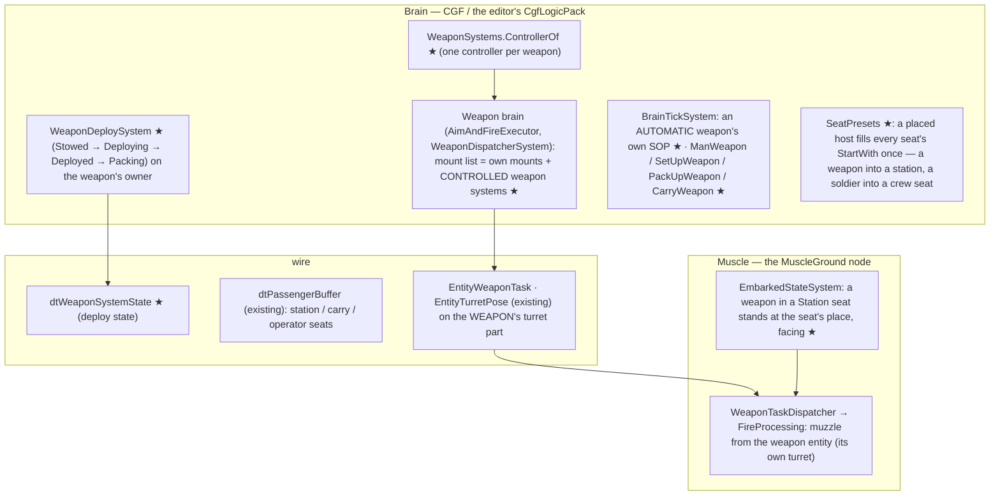
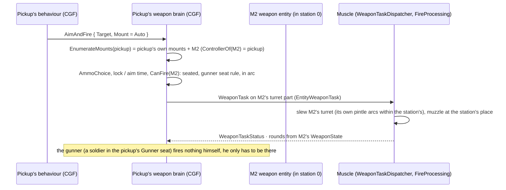
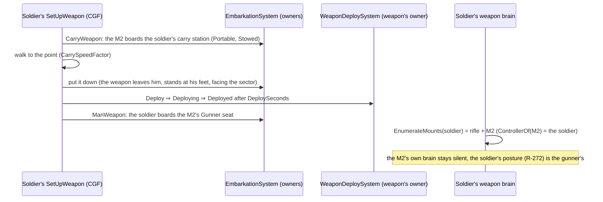
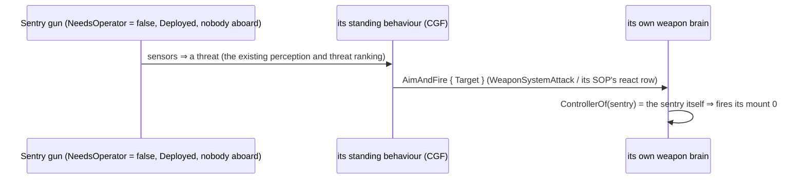
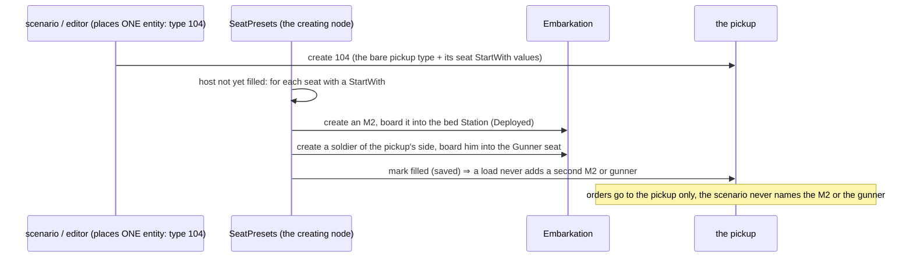
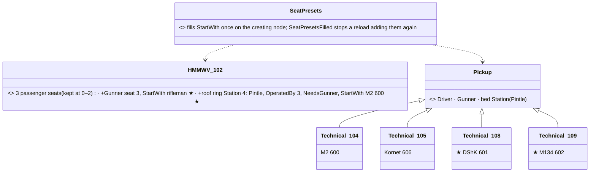
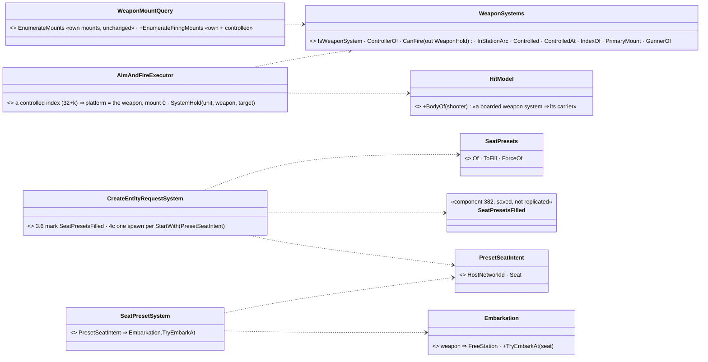

<!--STATUS
state: LIVE
updated: 2026-10-16 (§6 CE-2182 row superseded by CE-3214: a weapon not embarked is hit by its parts; §5c air defence: MANPADS 613/614, ZU-23-2 615, presets 202/203/110 — BUILT; §5b CE-3203: a weapon is broken by fragments and blast, configured per type — as built)
build-state: BUILT (backend WS-1…WS-4, §9; behaviors WS-6 ManWeapon, §9 — SetUpWeapon / PackUpWeapon / CarryWeapon and the demo not yet; 404 door stations and 2006 / 2007 not built — §9) — 🔒 user, 2026-10-14: W-A…W-H approved ("Automatic turret is required" · "the host's gunner seat operates the weapon" · "Sounds good" · "Ok write it") (R-2016); W-I (presets seat their crew) "Agreed" — steered to backend in docs/blueprints/batches/STEER_Behaviors_To_Backend_Weapon_Systems_Crew_Presets.md
current-answer: §2 who runs it, §3 classes, §4 sequences, §5 the TKB, §6 rules, §7 decisions, §8 slices and rails, ⭐ §9 AS BUILT (its DEVIATION rows supersede §2–§6 where they differ) — §1 is the measured ground.
stale-below: nothing.
known-rot: none. (2026-10-14: StationPresets → SeatPresets and StartWith on ANY seat — W-I; the earlier "StartWith : weapon type id" / "fills its StartWith stations" wording is superseded in place.)
known-conflict: DESIGN_Vehicle_Exposure_Cycle.md §6 builds the technicals (104 HMG, 105 ATGM) as a pickup TYPE whose pintle is its own turret mount — ⭐ WS-4 LANDED (§9): they are now presets (a pickup host + a weapon system in its station + a gunner), same numbers; that §6 is history for the weapon, still true for the pickup.
related-designs:
  - docs/designs/hit-location/DESIGN_Body_Parts_And_Hit_Location.md — S2 gives a weapon system its parts, so a round meets a deployed weapon (§6's CE-2182 row)
  - docs/designs/indirect-fire/DESIGN_Indirect_Fire.md — OWNS mortars and artillery: mortar tubes and towed howitzers as weapon systems; FireAtPoint firing a controlled weapon
  - docs/DESIGN_Weapon_Layers.md — OWNS the three weapon layers (R-261), the turret task (R-267) and the weapon posture (R-272); this file only widens WHICH mounts a unit's weapon brain fires (the controlled weapon systems) and keeps the one firing path
  - docs/DESIGN_Entity_Interactions.md — OWNS embarkation, seats, roles, the person carrier (§7, R-2009) and the TEAM CARRY (§7.5, R-2017 — the two-man weapon); this file adds the Station seat role and the weapon carry, so mounting / carrying / manning are all boarding
  - docs/designs/vehicle-tactics/DESIGN_Vehicle_Exposure_Cycle.md — §6 the technicals (M9, D-K) become presets here
  - docs/designs/vehicle-tactics/DESIGN_Missiles_And_Ammo.md — OWNS the rounds, loadouts and guidance the weapon systems fire (6008, 6013–6015, 6019 unchanged)
  - docs/designs/vehicle-tactics/DESIGN_Urban_Armour_Tactics.md — M9 / D-K (the gunner is vehicle-level) — kept: the host fires its stations
  - docs/designs/air-attack/DESIGN_Air_Operations.md — the DoorGunOrbit profile fires the door stations of the doors-off UH-60 (404)
  - docs/DESIGN_Map_3D_Mode.md — §6m draws seated riders; here it draws a weapon stowed / deployed and a gunner at his weapon
  - docs/DESIGN_Orders_Params_Entity_Classes.md — OWNS the class table and order resolution (R-278); this file adds the WeaponSystem class (Kind 1, Domain 1, Category 50)
  - docs/DESIGN_Entity_Control.md — possession of the gunner seat (a player firing a pickup's HMG) is a later item here
  - docs/blueprints/batches/HANDOFF_Behaviors_To_Backend_Weapon_Systems.md · HANDOFF_Behaviors_To_Ui_Weapon_Systems.md — the dispatches of WS-1…WS-4 and WS-5
-->

# Weapon systems — weapons you can place, mount, carry, deploy and man

🔒 **User, `2026-10-14`:** *"those missile systems can be placeable also on the ground anywhere independently, being an entity themselves
… the weapon would need to be deployable (aiming state = shown in deployed ready to fire, at ease = transport position, pickable, can be
carried as passenger maybe?) … a heavy machine gun … mounted on the Toyota pickup or stationary on tripod. Minigun can be mounted on a
helicopter at the side door mount, or on soldier or stationary."* · on the leans: *"Automatic turret is required. This is no different
from a tank or something, Entity having a weapon."* · *"the host's gunner seat operates the weapon"* · W-A / W-D explained → *"Sounds
good"* · *"Ok write it"*.

## 1. What exists — measured `2026-10-14`

| fact | code | design |
|---|---|---|
| a weapon is DATA on its carrier's type: `Combat.WeaponSuite` mounts; mount 0's state on the carrier, mounts 1…N derived child parts (`WeaponMountInfo` + `PartMetadata`, CGF only, rebuilt from the TKB, never saved) | `CombatTkbTranslator.cs:86-130` | Weapon Layers W-9 / W-11 |
| the weapon brain's mount list = the unit + its own mount children | `WeaponMountQuery.cs:23-68` | Utility Demo §12 W1–W3 |
| a turret is a part child on every node (`2000 + index`) with `TurretPose`; the task lives on it | `TurretParts.cs`, `TurretSuiteDto.cs` | R-267, Map 3-D M23–M26 |
| the technicals 104 / 105 are pickup TYPES whose pintle is a turret mount; the gunner is not a person | `BdcTkbCatalog` | Exposure Cycle §6, D-K |
| the person posture At ease · Ready · Aimed is weapon state written by the weapon brain, replicated | W-13 §5h | R-272 (backend) |
| a seat has a role (Passenger · Driver · Gunner · Commander), exposure, and (ui) a place, facing and pose | `CarrierDefDto.cs`, `InteractionComponents.cs:98-104` | R-2009, Map 3-D §6m |
| a passenger is put at the carrier's REFERENCE POINT (a person carrier: behind him); the seat's place is drawn only | `EmbarkedStateSystem.cs:115-121` | §6m ("read only by the 3-D map") |
| a person carries only a man who is down | `Embarkation.cs:107-111` | R-2009 C3 |
| land DIS categories used: 1–10, 81; Category 50 is free on land (only the FPV drone uses 50, in the AIR domain) | `EntityClassTable.cs:120-137`, `BdcTkbCatalog.cs:480` | R-278 |

### INVENTORY — the queries run

| query | total | the set |
|---|---|---|
| `search_graph .*(WeaponMount\|Mount\|Turret\|PartMetadata\|Emplace\|Deploy\|Stow\|Tripod\|Gunner\|Inventory\|Loadout).*` (Class) | 42 (≈ 14 relevant) | `WeaponMountDto`, `WeaponMountInfo`, `WeaponMountQuery`, `SimCombatDef.WeaponMount`, `TurretDto`, `TurretSuiteDto`, `TurretParts`, `TurretPose`, `TurretSlew`, `TurretTkbTranslator`, `TurretWeaponProfile`, `EntityTurretPose` (+ translators), `PartMetadata`, `AmmoLoadout`, `SensorMount` — **no emplacement, deploy, tripod or weapon-entity class** |
| corpus sweep (`docs/`, `.dev/`): crew-served, emplacement, tripod, static weapon, deploy / stow, pick-up weapon, door gun, minigun, inventory | 0 designs | weapons are type data everywhere; `PassengersMayFire` (Entity Interactions :444) is an unbuilt lean |

## 2. Who runs it

*What the picture shows that prose hid: nothing new crosses the wire for FIRING — the weapon entity's turret part carries the existing
task and pose, so the Muscle aims and fires a weapon system exactly as it fires a tank's turret. The new state on the wire is only the
deploy state. All ★ systems sit in packs that already tick each frame (`CgfLogicPack`'s weapon dispatcher and brain tick; the Muscle's
interactions and combat modules).*

## 3. Classes

```mermaid
classDiagram
  direction LR
  class WeaponSystemDto {
    <<★ TKB "Gen.WeaponSystem", on a weapon-system type>>
    NeedsOperator : bool  «false = automatic»
    Portable : None | OneMan | TwoMan
    CarrySpeedFactor
    FireWhileCarried : bool
    DeploySeconds · PackSeconds
    MountKinds : Ground | Pintle | Door | Carried (flags)
  }
  class SeatDto {
    <<existing TKB, grows>>
    Role +Station ★
    +Accepts : MountKinds ★
    +OperatedBy : seat index, −1 = the host ★
    +NeedsGunner : bool ★
    +Traverse/Elevation limits (optional) ★
    +StartWith : type id ★ «a weapon for a Station, a soldier for a crew seat (W-I)»
    X Y Z · FacingDegrees · Pose «existing»
  }
  class SeatRole { <<existing enum, grows>> Passenger · Driver · Gunner · Commander · +Station ★ }
  class WeaponSystemState { <<★ component on the weapon, owner-written, dtWeaponSystemState>> Deploy : Stowed | Deploying | Deployed | Packing ; Until }
  class WeaponSystems {
    <<★ static, Fdp.Toolkits Combat>>
    +IsWeaponSystem(world, e)
    +ControllerOf(world, weapon) Entity
    +CanFire(world, weapon) bool
    +Controlled(world, unit, Span) int
  }
  class WeaponMountQuery { <<existing, grows>> EnumerateMounts = own mounts + WeaponSystems.Controlled ★ }
  class Embarkation { <<existing rules, grows>> +a weapon into a Station seat (Accepts) ★ · +a portable weapon onto a soldier's carry station ★ }
  class EmbarkedStateSystem { <<existing, grows>> a Station passenger at the seat's place and facing ★ }
  class WeaponDeploySystem { <<★ on the weapon's owner>> Deploying → Deployed after DeploySeconds ; Packing → Stowed }
  class SeatPresets { <<★>> Fill(world, host): each seat's StartWith → create it (a weapon / a soldier of the host's side), seat it; mark the host filled }
  class WeaponSystemNodes { <<★ Hrot.AI.Behaviors>> ManWeapon · SetUpWeapon · PackUpWeapon · CarryWeapon }
  class AimAndFireExecutor { <<existing>> unchanged — fires whatever EnumerateMounts returns, on the mount's own turret part }
  class TurretParts { <<existing>> a weapon system's turret part = TurretParts.Find(weapon, 0) }
  WeaponSystemDto ..> WeaponSystemState : DeploySeconds
  SeatDto ..> SeatRole
  WeaponSystems ..> WeaponSystemDto
  WeaponSystems ..> WeaponSystemState
  WeaponSystems ..> SeatDto : OperatedBy, NeedsGunner
  WeaponMountQuery ..> WeaponSystems
  AimAndFireExecutor ..> WeaponMountQuery
  AimAndFireExecutor ..> TurretParts
  Embarkation ..> SeatDto : Station, Accepts
  EmbarkedStateSystem ..> SeatDto : place, facing
  WeaponDeploySystem ..> WeaponSystemState
  SeatPresets ..> Embarkation
  WeaponSystemNodes ..> Embarkation
  WeaponSystemNodes ..> WeaponSystemState
```

*What the picture shows that prose hid: there is ONE new static deciding WHO fires a weapon system (`WeaponSystems.ControllerOf`) and
ONE line widening the mount list; everything else is the existing boarding and the existing weapon brain. A weapon system is an
ordinary entity with a type, a turret part, a mount 0 and seats — "no different from a tank" (user).*

## 4. Sequences

### 4a. The pickup's HMG fires (the host controls its station)

### 4b. A soldier sets up a tripod HMG and mans it

### 4c. An automatic turret fights on its own

### 4d. A preset is placed — technical 104 (W-I)

*What the picture shows that prose hid: the scenario holds ONE entity; the gun and the gunner are the TYPE's business, made once on
the creating node — so an order, a save and a load all see just the pickup, and killing the gunner is an ordinary death that silences
the gun (§6 `CanFire`) until somebody boards the seat.*

## 5. The TKB

| descriptor | on | what |
|---|---|---|
| ★ **`Gen.WeaponSystem`** (`WeaponSystemDto`) | a weapon-system type | `NeedsOperator` · `Portable` · `CarrySpeedFactor` · `FireWhileCarried` · `DeploySeconds` / `PackSeconds` · `MountKinds` |
| `Combat.WeaponSuite` (existing) | the weapon type | its gun = mount 0 (round, ammo, loadout) |
| `Combat.Turrets` (existing) | the weapon type | the tripod's / pintle's own traverse, elevation, slew |
| `Gen.Carrier` (existing) | the weapon type | one `Gunner` seat (+ a `Passenger` seat as the loader for a two-man weapon) — manning on the ground |
| `Body.Geometry`, visual, DIS, faction, combat health / armour (existing) | the weapon type | placed, seen, hit, destroyed |
| sensor + `WithBehavior` (existing) | an AUTOMATIC weapon type | it sees and fights like a tank |
| `Gen.Carrier` `SeatDto` grows ★ | a HOST type | role `Station` · `Accepts` · `OperatedBy` · `NeedsGunner` · optional arc limits · `StartWith` on ANY seat — a weapon type for a `Station`, a soldier type for a crew seat (`Gunner` / `Driver` / `Commander`) (W-I) (place / facing reuse `X Y Z`, `FacingDegrees`) |
| `Gen.Carrier` on a soldier (person carrier) grows | a soldier type | one more seat: `Station` accepting `Carried` — the carry slot |
| ★ class **`WeaponSystem`** | the class table | Kind 1 · Domain 1 · **Category 50** (HROT; free on land); subcategories HMG · Minigun · Atgm · Launcher · Sentry |

**Data (catalogue entries, nothing else new):** M2 HMG · DShK · M134 minigun · Javelin · NLAW · LAW · Kornet (tripod) · TOW (tripod) · a sentry
gun / remote weapon station (automatic) · a bare Toyota pickup (driver, gunner, one bed station `OperatedBy` the gunner) · the doors-off
UH-60 (404) gains a left and a right door station, each operated by a door-gunner seat · presets: **104** = pickup + M2 in its station + a
gunner in its Gunner seat, **105** = pickup + Kornet + a gunner, **2006** = soldier carrying a Javelin, **2007** = soldier carrying an NLAW. Unchanged: `WeaponMountDto`, the munitions,
the tank, the Bradley, the rifles. ⚠ Seats per type stay ≤ 8 (the wire).

### 5a. Presets for every armed vehicle variant (ui handoff P1, `2026-10-15`; R-1001 — data, no editor placement)

*What the picture shows that prose hid: no new mechanism — two new `Pickup(...)` calls and one carrier change; the HMMWV keeps its passenger
seats at the indices scenarios already saved (0–2) and adds the gunner and the ring AFTER them.*

| decision | as designed | rejected |
|---|---|---|
| the HMMWV | **102 itself** carries the M2 (a patrol HMMWV) — as the handoff leans | a bare 102 + an armed variant (a new type only a scenario would need) |
| the ring | all round (no station arc — the weapon's own pintle limits), 2.3 m pivot, the gunner EXPOSED in the ring (`SeatDto.Exposed`) while the passengers stay enclosed | — |
| the new technicals | **108 Technical (DShK)**, **109 Technical (minigun)** — the pickup body, hostile side like 104 / 105; 106 stays bare | — |

**As built (`2026-10-15`)** — as designed. `BdcTkbCatalog.HmmwvSeats()`: seats 0–2 passengers; seat 3 Gunner (rifleman, `Exposed`,
at x −0.4, z 1.2); seat 4 Station (Pintle, OperatedBy 3, NeedsGunner, M2, x −0.4, z 2.0 ⇒ the M2's pivot 2.3 m). 108 / 109 are two more
`Pickup(...)` calls. Rails: `NedTkbBuilderCombatTests.P1_TheHmmwv_…`, `M9_TheTechnicals_…` (+108, 109),
`CreateEntityRequestSystemTests.P1_APlacedArmedVariant_…` (102 / 108 / 109: weapon + gunner into the named seats, boarded, controlled,
may fire; a load adds neither), the type-picker golden (+108, 109).
⚠ **`2026-10-15` (ui, CE-1108 — a cross-lane data edit):** the gunner seats got a drawable place — the HMMWV's (seat 3) now STANDS in the
hatch at x −0.4, z 0.7 (feet); every `Pickup(...)` gunner (seat 1: 104 / 105 / 108 / 109) KNEELS in the bed at x −2.0, z 0.85. Without a
place the technicals' gunner was drawn inside the body, and at z 1.2 the HMMWV's showed only his head. Read only by the 3-D drawing; the
stations, indices, roles and presets are unchanged ([DESIGN_Map_3D_Mode §6n](../../DESIGN_Map_3D_Mode.md), `Map3DTests.CE1108_*`).

### 5b. A weapon is broken by fragments and blast — configured per type (`CE-3203`, `2026-10-15`)

🔒 User: *"weapon entities should be destroyable and separately configured … maybe it is pretty easy to break a weapon with a shrapnel hit
or blast (especially the sophisticated ones but likely also the dumb yet fragile mechanical ones)."* 📐 Measured: every weapon type had
`MaxHealth = 60` from one helper, no collider (so the area effect hit it like a MAN), and `CanFire` never read its health — a broken weapon
kept firing. Now each type states how it breaks; the burst uses the one fragment law
([Building Interiors §3k.1](../../DESIGN_Building_Interiors.md)) with the weapon as EQUIPMENT.

| type | area m² | casing mm RHA | health | blast share | why |
|---|---|---|---|---|---|
| M2 600 · DShK 601 | 0.35 | 1.5 | 80 | 1 | a steel receiver, but the feed, sights and barrel are exposed |
| M134 602 | 0.25 | 1 | 40 | 1 | an electric drive and a belt chute |
| Javelin 603 · Kornet 606 · TOW 607 (tripod) | 0.3 · 0.35 · 0.4 | 0 | 20 · 25 · 25 | 1 | ⭐ sophisticated: optics, seeker, electronics — one fragment breaks it |
| NLAW 604 · M72 LAW 605 | 0.15 · 0.1 | 0 | 15 · 10 | 1 | a thin tube |
| sentry gun 608 | 0.3 | 1 | 30 | 1 | sensors and electronics |
| 60 / 81 / 120 mm mortar 609–611 | 0.2 / 0.3 / 0.5 | 2 | 60 / 80 / 120 | 1 | a thick tube; the bipod and sight break |
| 105 mm towed 612 | 3.0 | 6 | 400 | 0.5 | a gun shield and a carriage |

| rule | |
|---|---|
| a weapon at **0 health is DESTROYED**: `CanFire` ⇒ `WeaponHold.Destroyed`; the weapon brain does not choose it; it no longer arms its host (`WeaponOf`) | the host's other weapons (if any) still fight |
| a weapon is EQUIPMENT in the burst: `CombatPlatformDefDto.PresentedAreaM2 > 0` | its own area, casing and health — not a man's |
| it stays in its host's controlled list | the `32 + k` mount indices of the others must not shift |

**As built (`2026-10-15`, `CE-3203`)** — as designed. `BdcTkbCatalog.WeaponSystemType` takes a `WeaponBreaks(area, casing, health,
blast share)` per type (the table above; the casing is every face's armour). `WeaponSystems.IsBroken` (a weapon system at health ≤ 0);
`CanFire` ⇒ `WeaponHold.Destroyed` (= 4); `PrimaryMount` / `WeaponOf` skip a broken one (the next working one answers); `WeaponChoice.Choose`
never picks one. Measured at 10 m from an 81 mm: M2 30 of 80, Javelin 25 of 20 (broken); a grenade 3 m from an M2 breaks it; a Mk-82
121 m away puts 2 on it. Rails: `NedTkbBuilderCombatTests.CE3203_EveryWeaponSystem_StatesHowItBreaks` ·
`AimAndFireExecutorTests.CE3203_ABrokenStationWeapon_DoesNotFire_AndArmsNobody` ·
`AreaEffectSystemTests.W6pp_AShellBreaksAJavelinBesideAnM2_ThatOnlyAGrenadeAtThreeMetresBreaks`. ✅ **C4 measured `2026-10-15`:** a weapon
CARRIED by a soldier (a Javelin on his back) IS struck with him — every soldier type declares `CarrierDefDto.PersonCarrier()` (an OPEN
carrier: BdcTkbCatalog's rifleman, the urban catalogue's soldiers), so his carry station is an exposed seat, the boarded weapon's
`IsEmbarkedTag.Exposed` is 1 and `PhysicalPresence.IsHidden` does not hide it; the 81 mm at 10 m that breaks a Javelin on the ground
breaks it on his back (rail `AreaEffectSystemTests.CE3203_C4_AJavelinCarriedOnASoldiersBack_IsStruckWithHim`). ~~not measured for the
soldier types here; a lean in the report~~

### 5c. Air defence — the MANPADS launchers and the ZU-23-2 (`CE-2187`, `CE-2190`, backend, `2026-10-15`; build-state: BUILDING)

🔒 Frame: [Air Operations §7d](../air-attack/DESIGN_Air_Operations.md) AD1 / AD5 (behaviors' leans, user-approved). The rounds, the IR
seeker, the proximity fuze and the countermeasures are [Missiles & Ammo §3c](../vehicle-tactics/DESIGN_Missiles_And_Ammo.md). ⭐ **No new
class here** — data on the existing weapon-system types (§3), so the class and sequence diagrams of §3/§4 hold unchanged: a MANPADS is
§4b's carried weapon (`FireWhileCarried`, the Javelin 603), the ZU-23 is §4a's station weapon (the M2 600) with a two-man ground crew.

| type | id | `WeaponSystemDto` | mount | turret | breaks (§5b) |
|---|---|---|---|---|---|
| Stinger (FIM-92 class) | **613** | the shoulder launcher (`OneMan`, `Ground` \| `Carried`, `FireWhileCarried`) | 1 missile, `AimSeconds` 4 (the IR lock), reload 8 s, range 4 800 m, `Category = Sam` | none | 0.15 m², casing 0, health 15 — a seeker and a battery |
| Igla (9K38 class) | **614** | as 613 | 1 missile, lock 4 s, reload 8 s, range 5 200 m, `Sam` | none | as 613 |
| ZU-23-2 | **615** | `TwoMan`, `Ground` \| `Pintle`, deploy 30 s / pack 20 s, carry 0.3 | twin 23 mm: 100 rounds ready (2 × 50), 400 rpm practical, dispersion 3 mils, range 2 500 m, HE-I + API loadout, `MachineGun` | **−10…+90°**, traverse 70 °/s, elevation 50 °/s | 1.0 m², casing 3, health 120 |

| preset / data | id | what |
|---|---|---|
| a soldier carrying a Stinger / an Igla | **202 / 203** | the rifleman's body and rifle (mount 0) + `PersonCarrier()` with the carry station's `StartWith` = 613 / 614 (W-I) — ⭐ the first soldier preset with a weapon on his back (2006 / 2007 are still mount-0 launchers, §9) |
| the technical with a ZU-23 | **110** | pickup + ZU-23 in its bed station + a gunner (the 104 pattern) |
| munitions | **6030** Stinger · **6031** Igla · **6032** 23 mm HE-I · **6033** 23 mm API | §3c's `MissileDto` (InfraRed, `TargetDomain = Air`) and a proximity `WarheadDto` on 6030/6031; the 23 mm rounds are plain (no proximity fuze — the real one has none, AT2's lead aims them) |

⚠ `WeaponCategory.Sam` is a new enum member (appended) — the weapon brain's `Atgm` / `MachineGun` paths must not mistake a SAM for an ATGM.

**As built (`2026-10-15`, CE-2187 `7104ea35c`, CE-2190)** — as the tables above. `WeaponCategory.Sam` = 11: the `Guided` profile, one
round per press, does not fire on the move. The gunners are `BdcTkbCatalog.ManpadsGunner` (the rifleman's body, sensor range 5 km for the
launcher's sight, the carry station's `StartWith`); the Igla gunner is Russian, faction 2. ⚠ The ZU-23's muzzle speed is the BDC
derivation (range × 0.5 = 1250 m/s against a real ≈ 970) like every BDC gun — the lead and the flight read the same value, so it hits;
⭐ it holds 2 × 50 (AP, HE-I) and the weapon brain picks between them (CE-2186). Rails: `CreateEntityRequestSystemTests.P1_…` (+110) and
`.CE2187_APlacedStingerGunner_CarriesALauncherHeCanFire` · `NedTkbBuilderCombatTests.CE2187_TheAirDefenceCatalogue_…` (the ZU-23 elevates
overhead, the M2 cannot) · `FireProcessingSystemTests.CE2190_AZu23RoundAtAHelicopterCrossingAtAKilometre_MeetsIt` (red without the lead).

## 6. Rules

| rule | why |
|---|---|
| **two lifecycles, one firing path (W-A):** built-in mounts stay type data (tank gun, coax, rifle, RPG, the drone warhead); separable weapons are weapon-system entities. Both reach the weapon brain as mounts | W-A: identical for firing; an entity per rifle would multiply entities and wire for nothing |
| **one controller (W-D):** `ControllerOf(weapon)` = the HOST when the weapon sits in a host's `Station` (the host's gunner seat operates it, W-H) · the CARRIER when carried and `FireWhileCarried` · the man in its `Gunner` seat when manned on the ground · ITSELF when `NeedsOperator = false` and nobody operates it · nobody otherwise | W-D: two brains on one turret would fight; the rule is the only change the weapon brain needs |
| **`CanFire`** = a controller exists, the weapon is `Deployed` (a station weapon counts as deployed; a `FireWhileCarried` weapon fires stowed), its `NeedsGunner` station's gunner seat is occupied when the host declares it, and the target is in the arc (`TurretSlew.InArc` over the weapon's turret ∩ the station's limits) | one gate the weapon brain reads |
| the weapon's own brain runs only while it controls itself (automatic, unmanned); otherwise its SOP holds | W-D |
| ammo is the WEAPON's (`WeaponState` / `AmmoLoadout` on the weapon entity): a dropped HMG keeps its belt | separable means its state goes with it |
| mounting / carrying / manning are boarding (`Embarkation`): a weapon into a `Station` whose `Accepts` fits its `MountKinds`; a portable weapon onto a soldier's carry station (the person-carrier rule widened from "a man who is down" to "or a portable weapon system"); a soldier into a weapon's `Gunner` seat | W-B: one implementation of seats, places, poses, exposure |
| a weapon in a `Station` stands at the seat's place and facing (EmbarkedStateSystem, sim — not only drawn) | the muzzle and the arc must be where the station is (§1: today a passenger stands at the reference point) |
| deploy state (W-C): `Stowed` (transport, can be carried, does not fire unless `FireWhileCarried`) → `Deploying` (`DeploySeconds`) → `Deployed` → `Packing` → `Stowed`; written by its owner, replicated (`dtWeaponSystemState`, R-136). A station weapon is placed Deployed | the drawing and the gate both read it; At ease / Ready / Aimed stays the gunner's (R-272) |
| ★ W-I — a placed host fills EVERY seat's `StartWith` ONCE (`SeatPresets`, on the creating node, R-138): a weapon into a `Station`, a soldier of the host's side into a crew seat. The soldier is a real entity — seen, hit, killed; aboard, his own brain fires nothing. The host is then marked filled (saved), so a load never refills a seat the user emptied, nor adds a second gunner | presets keep 104 / 105 / 2006 / 2007 scenarios working, and their guns fire: `CanFire` needs the operating seat occupied, so a preset that seated no gunner would never fire (📐 the gap the W-I review found) |
| a weapon system cannot drive: `Move` to a `WeaponSystem` is refused; it moves by being carried or by its host | it has no locomotion |
| ⭐ `CE-2182` (`2026-10-15`) — a ROUND does not meet a weapon system (`RaycastSolverSystem`): it stands on its carrier or at its host's seat with the 2.5 m fallback collider and no height, so meeting it would take the round meant for the man or the pickup. Fragments and blast still break it (§5b, CE-3203) | before AT1 the round's mask skipped the combat layer it sits on alone; AT1 made that layer hittable ([Air Ops §7c-i](../air-attack/DESIGN_Air_Operations.md)). A direct hit on a DEPLOYED weapon needs a real collider first — a user decision. ⛔ SUPERSEDED `2026-10-16` by `CE-3214` ([hit location §11](../hit-location/DESIGN_Body_Parts_And_Hit_Location.md), R-3010's S2): a weapon NOT embarked is met by its parts (the kits ui draws, stowed / blended / deployed); EMBARKED it keeps this skip; a Firepower wound (receiver, sight) breaks it like health 0 |

## 7. Decisions — 🔒 APPROVED `2026-10-14` (R-2016)

| id | decision | rejected |
|---|---|---|
| **W-A** | two lifecycles (built-in mounts as type data; separable weapon systems as entities), one firing path | every weapon an entity · one type per combination |
| **W-B** | mounting, carrying, manning are all boarding (Station seat · carry station · Gunner seat) | a separate mounting system |
| **W-C** | Stowed / Deploying / Deployed / Packing is weapon state, replicated; At ease / Ready / Aimed stays the gunner's (R-272) | merging deploy into the posture |
| **W-D** | ONE controller per weapon (`ControllerOf`); the weapon brain's mount list = own mounts + controlled weapon systems | a brain on the weapon competing with its host's |
| **W-E** | 🔒 automatic turrets are REQUIRED: `NeedsOperator = false` ⇒ the weapon fights on its own (own sensors, SOP, weapon brain) like a tank | (the earlier lean "a ground weapon fires only when manned" — overruled by the user) |
| **W-F** | NLAW, LAW, Javelin become weapon systems; 2006 / 2007 become presets; the RPG and rifles stay built-in | both forms for one launcher |
| **W-G** | a soldier carries one weapon system (a carry station beside the casualty seat); a two-man weapon needs both men to move it — ★ built as the **team carry** ([`DESIGN_Entity_Interactions.md`](../../DESIGN_Entity_Interactions.md) §7.5, R-2017): one man carries it, a named assistant is linked and placed at the rear handle; either man down ⇒ the weapon is put down; at the firing point the assistant takes the loader seat | an inventory system |
| **W-H** | 🔒 the HOST's gunner seat operates its station weapon (no passenger-of-a-passenger) | a soldier sitting on the weapon itself while it is mounted |
| **W-I** | 🔒 *"Agreed"* (`2026-10-14`) — presets seat their CREW too: `StartWith` on any seat, so 104 / 105 arrive with a real gunner; orders go to the host; killing the gunner silences the gun until someone boards the seat | `NeedsGunner = false` on preset stations (the gun fires from an empty truck) · an abstract vehicle-level gunner (nobody to kill) |
| **W-J** *(ui lane, cross-lane edit, `2026-10-15`, R-1001)* | 🔒 *"Weapons in vehicles should come from tkb defined presets, no need to edit in the editor, but the presets need to be created - backend."* — a host's weapons are ONLY its TKB presets (`StartWith`, W-I); ⛔ the editor half of U2 (dropping a weapon on a host, picking a station in the Details panel) is WITHDRAWN; the missing presets are backend's ([HANDOFF_Ui_To_Backend_Presets_Elevation_Attitude.md](../../blueprints/batches/HANDOFF_Ui_To_Backend_Presets_Elevation_Attitude.md) P1) | an editor that authors stations per instance (a second way to arm a host) |

## 8. Slices and rails — in the features' own suites

| # | lane | slice | rails |
|---|---|---|---|
| **WS-1** | backend | `Gen.WeaponSystem`, `SeatRole.Station` + the seat fields, the class `WeaponSystem` (1.1.*.50), `WeaponSystemState` + `dtWeaponSystemState`, `WeaponDeploySystem` | TKB round-trip rails (`NedTkbBuilder…`), `CarrierTkbTranslatorTests` (station seats), the descriptor's translator rails, `WeaponDeploySystemTests` |
| **WS-2** | backend | `Embarkation`: station boarding by `Accepts`, the widened person-carrier rule, the carry station; `EmbarkedStateSystem` puts a station weapon at its seat | `EmbarkationTests` / `EmbarkedStateSystemTests`: an HMG into a pickup's station stands at the station; a Javelin carried; a non-portable weapon refused |
| **WS-3** | backend | `WeaponSystems.ControllerOf` / `CanFire` / `Controlled` (★ and `WS_AStationWeapon_FallsSilent_WhenItsGunnerDies`, W-I); `WeaponMountQuery.EnumerateMounts` + controlled weapons; the turret path on the weapon's own turret part; the muzzle from the weapon entity | `WeaponMountTests` (the host lists its station weapon; a manned tripod's soldier lists it; an automatic unmanned one lists itself) · `AimAndFireExecutorTests.WS_ThePickupFiresItsStationHmg_OnTheHmgsTurret` · `WS_AnAutomaticTurret_FiresOnItsOwn_AManualOneDoesNot` |
| **WS-4** | backend | the catalogue: weapon types, the bare pickup, the UH-60 door stations, `SeatPresets` (stations AND crew seats, W-I), presets 104 / 105 (+ a gunner) / 2006 / 2007 | `UrbanCombatCatalogRails` / `NedTkbBuilderCombatTests`; ★ a placed 104 holds an M2 in its station and a soldier in its Gunner seat, and a save / load adds neither again; the existing technical rails (`M9_TheTechnicals_…`, `V8_AnHmg_…`) stay green through the presets |
| **WS-5** | ui | the stowed / deployed drawings, a gunner at his weapon, placing a weapon into a host station in the editor, Add Entity entries | frame rails under Xvfb, editor rails |
| **WS-6** | behaviors | `ManWeapon`, `SetUpWeapon`, `PackUpWeapon`, `CarryWeapon`; `WeaponSystemAttack` / `WeaponSystemHold`; an automatic weapon's SOP; the demo **`ua-weapon-systems`** (a squad sets up an HMG; a technical fights; a sentry gun covers a gate) | `WeaponSystemNodesTests`, `TacticalIntentResolutionSystemTests.WS_*`, the demo's live rail |

WS-1 → WS-2 → WS-3 → WS-4 on backend (WS-1/WS-2 can go together); WS-5 after WS-1; WS-6 after WS-3.

## 9. As built — backend WS-1…WS-4 (`2026-10-14`), and where it deviates

⭐ Built against §3–§6 and the W-I steer. ⭐ What the diagrams above say still holds except for the rows marked **DEVIATION**; those
are the as-built truth and supersede the prose they contradict.

*What the picture shows that prose hid: the seat presets are NOT a CGF behaviour (§2 put `SeatPresets` in the brain). They are filled
at the REQUEST TIER — the same place a template's child blueprints are spawned — on whichever node services the host's creation
(R-138), and boarded by a system every host schedules from the entity-creation pack.*

| # | as built | vs. the design |
|---|---|---|
| WS-1 | `Gen.WeaponSystem` (`WeaponSystemDto`), `WeaponPortability { Static, OneMan, TwoMan }` — ⚠ **DEVIATION**: `Static`, not `None`/`Fixed` (the IDL generator puts every enum member of a descriptor's file in one scope, and `fixed` is an IDL keyword) · seat fields on `SeatDto` · `CarrierStations` (381, type fact) · `WeaponSystemParams` (379) / `WeaponSystemState` (380, `dtWeaponSystemState` = 132, Brain group) · class 1.1.*.50 | §3, §5 |
| WS-2 | a weapon boards a `Station` whose `Accepts` shares a kind; a man never boards a station (also not by asking for the `Station` role); `PersonCarrier()` gains a carry station (`Station`, `Carried`) — the casualty seat is unchanged; a carried weapon does NOT strip the carrier's fire; `EmbarkedStateSystem` places a station passenger at the seat's place and facing | §6 rows 6–7 |
| WS-3 | `ControllerOf` = the station's host · the carrier of a `FireWhileCarried` weapon · the man in the weapon's own `Gunner` seat · itself when automatic and unmanned · nobody. `CanFire` = a controller, deployed (a station weapon counts as deployed), the gunner in the fight (`NeedsGunner` station, or the manning gunner). ⚠ **DEVIATION**: `EnumerateMounts` is NOT widened — `CombatTkbTranslator` counts a type's own mount children by it, and a boarded weapon must never join that count; the weapon brain reads the sibling `EnumerateFiringMounts`. A controlled weapon's mount index is `32 + k` (its place in `Controlled`) and the executor fires it AS THE WEAPON (its own mount 0, turret part, muzzle, belt); the unit keeps sight, ROE and status. A bare host's primary mount (`Mount = 0`, and the Auto fallback) is its first station weapon. The arc check is the station's limits (`InStationArc`) — the weapon's own turret limits stay the muscle's `OutOfArc`. ⭐ Added: `HitModel.BodyOf` — a station / carried weapon's spread and sight line are judged on its CARRIER (the pickup moves and is fired at; the soldier kneels), so a technical's numbers do not move when its gun became an entity; `LineOfFire` never counts those riding together. New hold reasons `NotControlled`, `NoGunner`, `NotDeployed` (the turret is released at once — a gunner's death silences the gun the same frame). ⭐ **`TrackTarget` routes the same way** (mount 0 → the primary, a controlled index → the weapon; it slews the WEAPON's turret and holds on `SystemHold`) — 📌 found by the split-cluster rail in WS-4: the technical's tree tracks before it fires, the tracker looked for a mount on the bare pickup, failed every frame, and the M2 never fired; rail `AimAndFireExecutorTests.WS_TrackTarget_OnABareHost_SlewsItsStationWeaponsTurret` | §6 rows 1–4 |
| WS-4 | nine weapon types (600–608) · the bare Toyota (106) · 104 / 105 = that pickup with `StartWith` M2 / Kornet on the station and a rifleman (200) on the gunner seat; 105's old ±120° / −10…+20° arc is now the STATION's · ⚠ **DEVIATION** (see the class diagram): the presets ride the request tier; `SeatPresetsFilled` is written there and SAVED, so a load whose request carries it fills nothing, and a host loaded without it (a scenario saved before presets) is filled · ⭐ added: a save keeps each passenger's SEAT (`PassengerBuffer` "Seats", `IsEmbarkedTag` "Seat"), so a gunner comes back into the gunner seat — before, a load re-chose seats by role and a crew-only host refused its crew | §4d, §5, §6 row 9 |
| WS-4 ownership | ⭐ **every weapon type has a BRAIN** (§6's "its own brain runs only while it controls itself" — and `CE-523`: Health and the deploy state are Brain-group components, which only apply to a type with a brain) · ⭐ **the Muscle group applies to a weapon system** (`HrotOwnershipGroups.HasKinematics` widened): the Muscle aims its turret (`TurretPose`, `WeaponTaskStatus`) and carries it in its station (`SimTransform`), as for any passenger. Without it the turret stayed with the weapon's creator and a split cluster never fired it | §2 (the module picture assumed both) |
| WS-4 armed | ⭐ **`WeaponSystems.WeaponOf(unit)`** — the unit's own `WeaponState` holder, else its first controlled weapon system, else null — is the one answer to *"is this unit armed, with what?"*: the utility inputs `AmmoFraction` / `WeaponHasAmmo` / `WeaponReadiness` / `RoundsLeft` and `ThreatDanger.OwnStrength` read through it — ⭐ and so does `ThreatDanger.Of` / `ToMe` for a bare host as a TARGET (its danger is its station gun's suite; before, its enemies read it as an unarmed contact, 0.3). 📌 Found by the split-cluster rail: they read the UNIT's `WeaponState`, so a bare pickup scored 0 on its engage decision and never fought (and ranked itself unarmed). A unit with its own gun reads exactly as before — no ground number moves. ⚠ **Report to behaviors**: three behaviour-lane sites still read the unit's own `WeaponState` — `PeekAndFireNodes.ReloadingOrEmpty`, `VehicleFightFromCoverNodes.Reloading` (a bare host never waits for a reload) and `HillAttackTankNodes` (fails on a bare host); `WeaponOf` is the call for them | §6 |
| WS-4 riders | ⭐ **a carrier and its riders do not hide each other** (`RideGroups` in `LosStrategies.cs`, used by `ColliderOcclusion` — sight, fragments and blast shadow — and by `PlanarCircleLosStrategy`). 📌 Found by the split-cluster rail, and ⚠ **older than WS-4**: an OPEN cabin's riders are colliders (R-271 — exposed, seen and hit), so the gunner standing at the pickup's own position blinded the pickup and the pickup the gunner. Measured: at the same spot the bare Toyota (106) and the Bradley (101) saw the target, the crewed technical (104) did not. It applies to every open carrier (a doors-off UH-60, a soldier carrying a casualty). The line of FIRE already had this rule (`LineOfFire.RidesWith`, WS-3) | R-271 (DESIGN_Entity_Interactions §7.2a) |
| ⭐ **WS-6 `ManWeapon` — BUILT `2026-10-15`** (behaviors, for IF-4) | the library behaviour `ManWeapon { weapon }` (`EmbarkBehaviors.cs`) boards the weapon's `Gunner` seat: `EmbarkNodeParams.Role` / `EmbarkParams.Role` (APPENDED) carry the role and `EmbarkExecutor` asks `Embarkation.FreeSeat(role)` — a plain `Embark` still takes the first PASSENGER seat (the loader's), so it never controls the weapon. ⚠ **DEVIATION — the gunner keeps his fire**: `Embarkation.Board` stripped `CanMove | CanShoot` from every rider, so the man in a weapon's own Gunner seat — its controller (WS-3), who fires it AS the weapon through his own `WeaponChannel` — had every weapon action failed by `WeaponDispatcherSystem`'s capability gate before the executor ran. 📐 Found live (IF-4 ①: the section's FireAtPoint reported Failure with the executor never entered); the IF-1 rails missed it because they call the executor directly. ⇒ `Embarkation.StrippedOn(vehicle, seat)`: a weapon system's Gunner seat takes only `CanMove`; every other seat (a vehicle's crew seats included — W-I, the HOST fires there) is unchanged. Rails: `EmbarkNodesTests.CE2176_ManWeapon_TakesTheGunnerSeat_ControlsAndFiresTheWeapon_APlainEmbarkTakesTheLoadersSeat` · the `MannedMortar` premise in `AimAndFireExecutorTests` (IF-1's suite) | §4b's *"ManWeapon: the soldier boards the M2's Gunner seat"* as drawn; §6's capability side was never stated — it is now |
| ⭐ **404 door stations — BUILT `2026-10-14`** (Air Ops 6a F4) | 🔒 user: *"extend the wire capacity … No problem extending"* ⇒ the passenger list is 12 wide ([Entity Interactions §7.4](../../DESIGN_Entity_Interactions.md)); 404 keeps its 8 riders (seats 0–7) and gains, per side, a door-gunner seat (`StartWith` rifleman 200) and a `Door` station operated by it (`StartWith` M134 602, `NeedsGunner`, arc 20…160° on its side) at seats 8–11. Rail `CreateEntityRequestSystemTests.F4_APlacedDoorsOffBlackHawk_HoldsTwoM134s_AndTwoDoorGunners_ItsRidersSeatsStayFree` | §5 |
| ⛔ not built | ~~**404's door stations** — the type already has 8 seats (the wire's cap), so two stations + two door-gunner seats need 4 of its 8 passenger seats;~~ (built above) **2006 / 2007 as a soldier CARRYING a Javelin / NLAW** — their launcher is mount 0 of the soldier type today, and moving it to a carried entity re-orders the soldier's mounts under the behaviour lane's trees. Both are user decisions; the batch report carries the leans | §5 |
