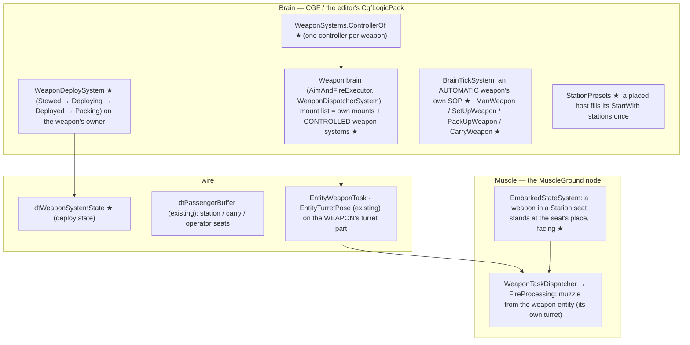
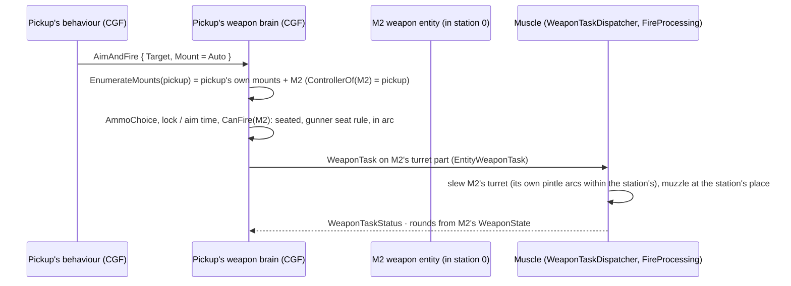
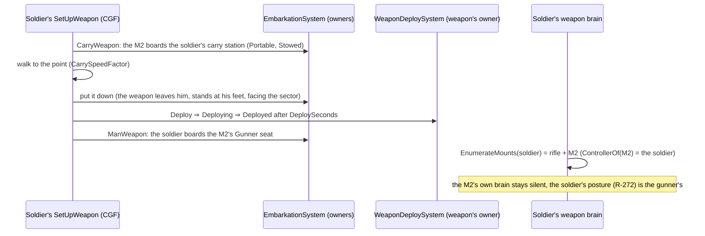
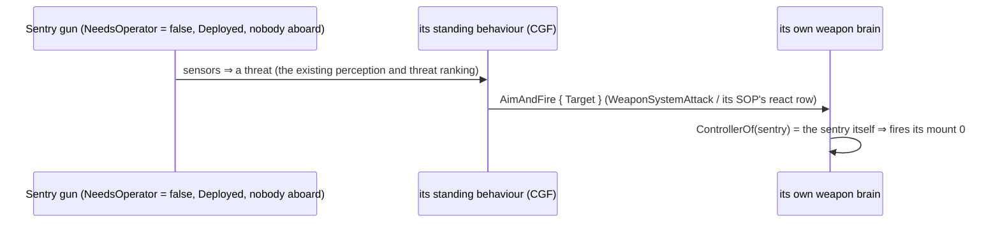

<!--STATUS
state: LIVE
updated: 2026-10-14
build-state: READY-TO-BUILD — 🔒 user, 2026-10-14: W-A…W-H approved ("Automatic turret is required" · "the host's gunner seat operates the weapon" · "Sounds good" · "Ok write it") (R-2016)
current-answer: §2 who runs it, §3 classes, §4 sequences, §5 the TKB, §6 rules, §7 decisions, §8 slices and rails — §1 is the measured ground.
stale-below: nothing.
known-rot: none.
known-conflict: DESIGN_Vehicle_Exposure_Cycle.md §6 builds the technicals (104 HMG, 105 ATGM) as a pickup TYPE whose pintle is its own turret mount; here they become presets (a pickup host + a weapon system in its station) — §6 stays true until slice WS-4 lands.
related-designs:
  - docs/DESIGN_Weapon_Layers.md — OWNS the three weapon layers (R-261), the turret task (R-267) and the weapon posture (R-272); this file only widens WHICH mounts a unit's weapon brain fires (the controlled weapon systems) and keeps the one firing path
  - docs/DESIGN_Entity_Interactions.md — OWNS embarkation, seats, roles, the person carrier (§7, R-2009); this file adds the Station seat role and the weapon carry, so mounting / carrying / manning are all boarding
  - docs/designs/vehicle-tactics/DESIGN_Vehicle_Exposure_Cycle.md — §6 the technicals (M9, D-K) become presets here
  - docs/designs/vehicle-tactics/DESIGN_Missiles_And_Ammo.md — OWNS the rounds, loadouts and guidance the weapon systems fire (6008, 6013–6015, 6019 unchanged)
  - docs/designs/vehicle-tactics/DESIGN_Urban_Armour_Tactics.md — M9 / D-K (the gunner is vehicle-level) — kept: the host fires its stations
  - docs/designs/air-attack/DESIGN_Air_Operations.md — the DoorGunOrbit profile fires the door stations of the doors-off UH-60 (404)
  - docs/DESIGN_Map_3D_Mode.md — §6m draws seated riders; here it draws a weapon stowed / deployed and a gunner at his weapon
  - docs/DESIGN_Orders_Params_Entity_Classes.md — OWNS the class table and order resolution (R-278); this file adds the WeaponSystem class (Kind 1, Domain 1, Category 50)
  - docs/DESIGN_Entity_Control.md — possession of the gunner seat (a player firing a pickup's HMG) is a later item here
  - docs/blueprints/batches/HANDOFF_Behaviors_To_Backend_Weapon_Systems.md · HANDOFF_Behaviors_To_Ui_Weapon_Systems.md — the dispatches of WS-1…WS-4 and WS-5
-->

# Weapon systems — weapons you can place, mount, carry, deploy and man

🔒 **User, `2026-10-14`:** *"those missile systems can be placeable also on the ground anywhere independently, being an entity themselves
… the weapon would need to be deployable (aiming state = shown in deployed ready to fire, at ease = transport position, pickable, can be
carried as passenger maybe?) … a heavy machine gun … mounted on the Toyota pickup or stationary on tripod. Minigun can be mounted on a
helicopter at the side door mount, or on soldier or stationary."* · on the leans: *"Automatic turret is required. This is no different
from a tank or something, Entity having a weapon."* · *"the host's gunner seat operates the weapon"* · W-A / W-D explained → *"Sounds
good"* · *"Ok write it"*.

## 1. What exists — measured `2026-10-14`

| fact | code | design |
|---|---|---|
| a weapon is DATA on its carrier's type: `Combat.WeaponSuite` mounts; mount 0's state on the carrier, mounts 1…N derived child parts (`WeaponMountInfo` + `PartMetadata`, CGF only, rebuilt from the TKB, never saved) | `CombatTkbTranslator.cs:86-130` | Weapon Layers W-9 / W-11 |
| the weapon brain's mount list = the unit + its own mount children | `WeaponMountQuery.cs:23-68` | Utility Demo §12 W1–W3 |
| a turret is a part child on every node (`2000 + index`) with `TurretPose`; the task lives on it | `TurretParts.cs`, `TurretSuiteDto.cs` | R-267, Map 3-D M23–M26 |
| the technicals 104 / 105 are pickup TYPES whose pintle is a turret mount; the gunner is not a person | `BdcTkbCatalog` | Exposure Cycle §6, D-K |
| the person posture At ease · Ready · Aimed is weapon state written by the weapon brain, replicated | W-13 §5h | R-272 (backend) |
| a seat has a role (Passenger · Driver · Gunner · Commander), exposure, and (ui) a place, facing and pose | `CarrierDefDto.cs`, `InteractionComponents.cs:98-104` | R-2009, Map 3-D §6m |
| a passenger is put at the carrier's REFERENCE POINT (a person carrier: behind him); the seat's place is drawn only | `EmbarkedStateSystem.cs:115-121` | §6m ("read only by the 3-D map") |
| a person carries only a man who is down | `Embarkation.cs:107-111` | R-2009 C3 |
| land DIS categories used: 1–10, 81; Category 50 is free on land (only the FPV drone uses 50, in the AIR domain) | `EntityClassTable.cs:120-137`, `BdcTkbCatalog.cs:480` | R-278 |

### INVENTORY — the queries run

| query | total | the set |
|---|---|---|
| `search_graph .*(WeaponMount\|Mount\|Turret\|PartMetadata\|Emplace\|Deploy\|Stow\|Tripod\|Gunner\|Inventory\|Loadout).*` (Class) | 42 (≈ 14 relevant) | `WeaponMountDto`, `WeaponMountInfo`, `WeaponMountQuery`, `SimCombatDef.WeaponMount`, `TurretDto`, `TurretSuiteDto`, `TurretParts`, `TurretPose`, `TurretSlew`, `TurretTkbTranslator`, `TurretWeaponProfile`, `EntityTurretPose` (+ translators), `PartMetadata`, `AmmoLoadout`, `SensorMount` — **no emplacement, deploy, tripod or weapon-entity class** |
| corpus sweep (`docs/`, `.dev/`): crew-served, emplacement, tripod, static weapon, deploy / stow, pick-up weapon, door gun, minigun, inventory | 0 designs | weapons are type data everywhere; `PassengersMayFire` (Entity Interactions :444) is an unbuilt lean |

## 2. Who runs it

*What the picture shows that prose hid: nothing new crosses the wire for FIRING — the weapon entity's turret part carries the existing
task and pose, so the Muscle aims and fires a weapon system exactly as it fires a tank's turret. The new state on the wire is only the
deploy state. All ★ systems sit in packs that already tick each frame (`CgfLogicPack`'s weapon dispatcher and brain tick; the Muscle's
interactions and combat modules).*

## 3. Classes

```mermaid
classDiagram
  direction LR
  class WeaponSystemDto {
    <<★ TKB "Gen.WeaponSystem", on a weapon-system type>>
    NeedsOperator : bool  «false = automatic»
    Portable : None | OneMan | TwoMan
    CarrySpeedFactor
    FireWhileCarried : bool
    DeploySeconds · PackSeconds
    MountKinds : Ground | Pintle | Door | Carried (flags)
  }
  class SeatDto {
    <<existing TKB, grows>>
    Role +Station ★
    +Accepts : MountKinds ★
    +OperatedBy : seat index, −1 = the host ★
    +NeedsGunner : bool ★
    +Traverse/Elevation limits (optional) ★
    +StartWith : weapon type id ★
    X Y Z · FacingDegrees · Pose «existing»
  }
  class SeatRole { <<existing enum, grows>> Passenger · Driver · Gunner · Commander · +Station ★ }
  class WeaponSystemState { <<★ component on the weapon, owner-written, dtWeaponSystemState>> Deploy : Stowed | Deploying | Deployed | Packing ; Until }
  class WeaponSystems {
    <<★ static, Fdp.Toolkits Combat>>
    +IsWeaponSystem(world, e)
    +ControllerOf(world, weapon) Entity
    +CanFire(world, weapon) bool
    +Controlled(world, unit, Span) int
  }
  class WeaponMountQuery { <<existing, grows>> EnumerateMounts = own mounts + WeaponSystems.Controlled ★ }
  class Embarkation { <<existing rules, grows>> +a weapon into a Station seat (Accepts) ★ · +a portable weapon onto a soldier's carry station ★ }
  class EmbarkedStateSystem { <<existing, grows>> a Station passenger at the seat's place and facing ★ }
  class WeaponDeploySystem { <<★ on the weapon's owner>> Deploying → Deployed after DeploySeconds ; Packing → Stowed }
  class StationPresets { <<★>> Fill(world, host): StartWith → create the weapon, seat it, mark the host filled }
  class WeaponSystemNodes { <<★ Hrot.AI.Behaviors>> ManWeapon · SetUpWeapon · PackUpWeapon · CarryWeapon }
  class AimAndFireExecutor { <<existing>> unchanged — fires whatever EnumerateMounts returns, on the mount's own turret part }
  class TurretParts { <<existing>> a weapon system's turret part = TurretParts.Find(weapon, 0) }
  WeaponSystemDto ..> WeaponSystemState : DeploySeconds
  SeatDto ..> SeatRole
  WeaponSystems ..> WeaponSystemDto
  WeaponSystems ..> WeaponSystemState
  WeaponSystems ..> SeatDto : OperatedBy, NeedsGunner
  WeaponMountQuery ..> WeaponSystems
  AimAndFireExecutor ..> WeaponMountQuery
  AimAndFireExecutor ..> TurretParts
  Embarkation ..> SeatDto : Station, Accepts
  EmbarkedStateSystem ..> SeatDto : place, facing
  WeaponDeploySystem ..> WeaponSystemState
  StationPresets ..> Embarkation
  WeaponSystemNodes ..> Embarkation
  WeaponSystemNodes ..> WeaponSystemState
```

*What the picture shows that prose hid: there is ONE new static deciding WHO fires a weapon system (`WeaponSystems.ControllerOf`) and
ONE line widening the mount list; everything else is the existing boarding and the existing weapon brain. A weapon system is an
ordinary entity with a type, a turret part, a mount 0 and seats — "no different from a tank" (user).*

## 4. Sequences

### 4a. The pickup's HMG fires (the host controls its station)

### 4b. A soldier sets up a tripod HMG and mans it

### 4c. An automatic turret fights on its own

## 5. The TKB

| descriptor | on | what |
|---|---|---|
| ★ **`Gen.WeaponSystem`** (`WeaponSystemDto`) | a weapon-system type | `NeedsOperator` · `Portable` · `CarrySpeedFactor` · `FireWhileCarried` · `DeploySeconds` / `PackSeconds` · `MountKinds` |
| `Combat.WeaponSuite` (existing) | the weapon type | its gun = mount 0 (round, ammo, loadout) |
| `Combat.Turrets` (existing) | the weapon type | the tripod's / pintle's own traverse, elevation, slew |
| `Gen.Carrier` (existing) | the weapon type | one `Gunner` seat (+ a `Passenger` seat as the loader for a two-man weapon) — manning on the ground |
| `Body.Geometry`, visual, DIS, faction, combat health / armour (existing) | the weapon type | placed, seen, hit, destroyed |
| sensor + `WithBehavior` (existing) | an AUTOMATIC weapon type | it sees and fights like a tank |
| `Gen.Carrier` `SeatDto` grows ★ | a HOST type | role `Station` · `Accepts` · `OperatedBy` · `NeedsGunner` · optional arc limits · `StartWith` (place / facing reuse `X Y Z`, `FacingDegrees`) |
| `Gen.Carrier` on a soldier (person carrier) grows | a soldier type | one more seat: `Station` accepting `Carried` — the carry slot |
| ★ class **`WeaponSystem`** | the class table | Kind 1 · Domain 1 · **Category 50** (HROT; free on land); subcategories HMG · Minigun · Atgm · Launcher · Sentry |

**Data (catalogue entries, nothing else new):** M2 HMG · DShK · M134 minigun · Javelin · NLAW · LAW · Kornet (tripod) · TOW (tripod) · a sentry
gun / remote weapon station (automatic) · a bare Toyota pickup (driver, gunner, one bed station `OperatedBy` the gunner) · the doors-off
UH-60 (404) gains a left and a right door station, each operated by a door-gunner seat · presets: **104** = pickup + M2 in its station,
**105** = pickup + Kornet, **2006** = soldier carrying a Javelin, **2007** = soldier carrying an NLAW. Unchanged: `WeaponMountDto`, the munitions,
the tank, the Bradley, the rifles. ⚠ Seats per type stay ≤ 8 (the wire).

## 6. Rules

| rule | why |
|---|---|
| **two lifecycles, one firing path (W-A):** built-in mounts stay type data (tank gun, coax, rifle, RPG, the drone warhead); separable weapons are weapon-system entities. Both reach the weapon brain as mounts | W-A: identical for firing; an entity per rifle would multiply entities and wire for nothing |
| **one controller (W-D):** `ControllerOf(weapon)` = the HOST when the weapon sits in a host's `Station` (the host's gunner seat operates it, W-H) · the CARRIER when carried and `FireWhileCarried` · the man in its `Gunner` seat when manned on the ground · ITSELF when `NeedsOperator = false` and nobody operates it · nobody otherwise | W-D: two brains on one turret would fight; the rule is the only change the weapon brain needs |
| **`CanFire`** = a controller exists, the weapon is `Deployed` (a station weapon counts as deployed; a `FireWhileCarried` weapon fires stowed), its `NeedsGunner` station's gunner seat is occupied when the host declares it, and the target is in the arc (`TurretSlew.InArc` over the weapon's turret ∩ the station's limits) | one gate the weapon brain reads |
| the weapon's own brain runs only while it controls itself (automatic, unmanned); otherwise its SOP holds | W-D |
| ammo is the WEAPON's (`WeaponState` / `AmmoLoadout` on the weapon entity): a dropped HMG keeps its belt | separable means its state goes with it |
| mounting / carrying / manning are boarding (`Embarkation`): a weapon into a `Station` whose `Accepts` fits its `MountKinds`; a portable weapon onto a soldier's carry station (the person-carrier rule widened from "a man who is down" to "or a portable weapon system"); a soldier into a weapon's `Gunner` seat | W-B: one implementation of seats, places, poses, exposure |
| a weapon in a `Station` stands at the seat's place and facing (EmbarkedStateSystem, sim — not only drawn) | the muzzle and the arc must be where the station is (§1: today a passenger stands at the reference point) |
| deploy state (W-C): `Stowed` (transport, can be carried, does not fire unless `FireWhileCarried`) → `Deploying` (`DeploySeconds`) → `Deployed` → `Packing` → `Stowed`; written by its owner, replicated (`dtWeaponSystemState`, R-136). A station weapon is placed Deployed | the drawing and the gate both read it; At ease / Ready / Aimed stays the gunner's (R-272) |
| a placed host fills its `StartWith` stations ONCE (`StationPresets`, on the creating node, R-138); the host is then marked filled (saved), so a load never refills a station the user emptied | presets keep 104 / 105 / 2006 / 2007 scenarios working |
| a weapon system cannot drive: `Move` to a `WeaponSystem` is refused; it moves by being carried or by its host | it has no locomotion |

## 7. Decisions — 🔒 APPROVED `2026-10-14` (R-2016)

| id | decision | rejected |
|---|---|---|
| **W-A** | two lifecycles (built-in mounts as type data; separable weapon systems as entities), one firing path | every weapon an entity · one type per combination |
| **W-B** | mounting, carrying, manning are all boarding (Station seat · carry station · Gunner seat) | a separate mounting system |
| **W-C** | Stowed / Deploying / Deployed / Packing is weapon state, replicated; At ease / Ready / Aimed stays the gunner's (R-272) | merging deploy into the posture |
| **W-D** | ONE controller per weapon (`ControllerOf`); the weapon brain's mount list = own mounts + controlled weapon systems | a brain on the weapon competing with its host's |
| **W-E** | 🔒 automatic turrets are REQUIRED: `NeedsOperator = false` ⇒ the weapon fights on its own (own sensors, SOP, weapon brain) like a tank | (the earlier lean "a ground weapon fires only when manned" — overruled by the user) |
| **W-F** | NLAW, LAW, Javelin become weapon systems; 2006 / 2007 become presets; the RPG and rifles stay built-in | both forms for one launcher |
| **W-G** | a soldier carries one weapon system (a carry station beside the casualty seat); a two-man weapon needs both men to move it | an inventory system |
| **W-H** | 🔒 the HOST's gunner seat operates its station weapon (no passenger-of-a-passenger) | a soldier sitting on the weapon itself while it is mounted |

## 8. Slices and rails — in the features' own suites

| # | lane | slice | rails |
|---|---|---|---|
| **WS-1** | backend | `Gen.WeaponSystem`, `SeatRole.Station` + the seat fields, the class `WeaponSystem` (1.1.*.50), `WeaponSystemState` + `dtWeaponSystemState`, `WeaponDeploySystem` | TKB round-trip rails (`NedTkbBuilder…`), `CarrierTkbTranslatorTests` (station seats), the descriptor's translator rails, `WeaponDeploySystemTests` |
| **WS-2** | backend | `Embarkation`: station boarding by `Accepts`, the widened person-carrier rule, the carry station; `EmbarkedStateSystem` puts a station weapon at its seat | `EmbarkationTests` / `EmbarkedStateSystemTests`: an HMG into a pickup's station stands at the station; a Javelin carried; a non-portable weapon refused |
| **WS-3** | backend | `WeaponSystems.ControllerOf` / `CanFire` / `Controlled`; `WeaponMountQuery.EnumerateMounts` + controlled weapons; the turret path on the weapon's own turret part; the muzzle from the weapon entity | `WeaponMountTests` (the host lists its station weapon; a manned tripod's soldier lists it; an automatic unmanned one lists itself) · `AimAndFireExecutorTests.WS_ThePickupFiresItsStationHmg_OnTheHmgsTurret` · `WS_AnAutomaticTurret_FiresOnItsOwn_AManualOneDoesNot` |
| **WS-4** | backend | the catalogue: weapon types, the bare pickup, the UH-60 door stations, `StationPresets`, presets 104 / 105 / 2006 / 2007 | `UrbanCombatCatalogRails` / `NedTkbBuilderCombatTests`; the existing technical rails (`M9_TheTechnicals_…`, `V8_AnHmg_…`) stay green through the presets |
| **WS-5** | ui | the stowed / deployed drawings, a gunner at his weapon, placing a weapon into a host station in the editor, Add Entity entries | frame rails under Xvfb, editor rails |
| **WS-6** | behaviors | `ManWeapon`, `SetUpWeapon`, `PackUpWeapon`, `CarryWeapon`; `WeaponSystemAttack` / `WeaponSystemHold`; an automatic weapon's SOP; the demo **`ua-weapon-systems`** (a squad sets up an HMG; a technical fights; a sentry gun covers a gate) | `WeaponSystemNodesTests`, `TacticalIntentResolutionSystemTests.WS_*`, the demo's live rail |

WS-1 → WS-2 → WS-3 → WS-4 on backend (WS-1/WS-2 can go together); WS-5 after WS-1; WS-6 after WS-3.
