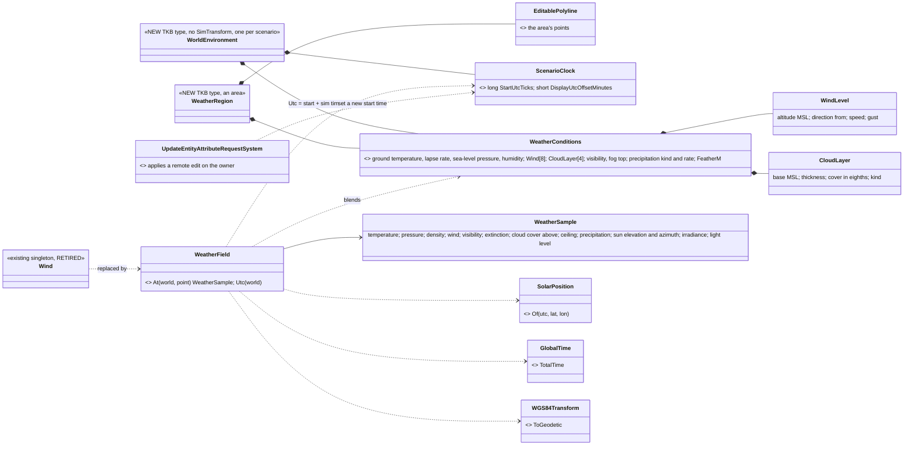
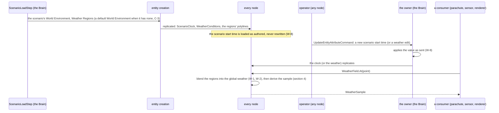
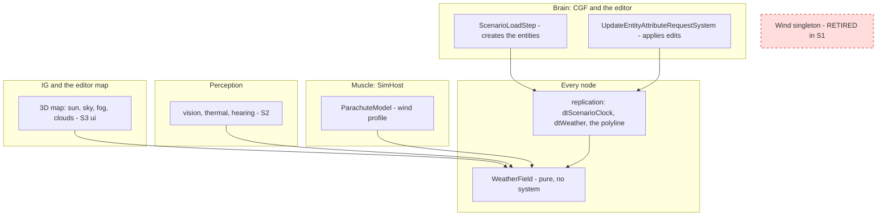
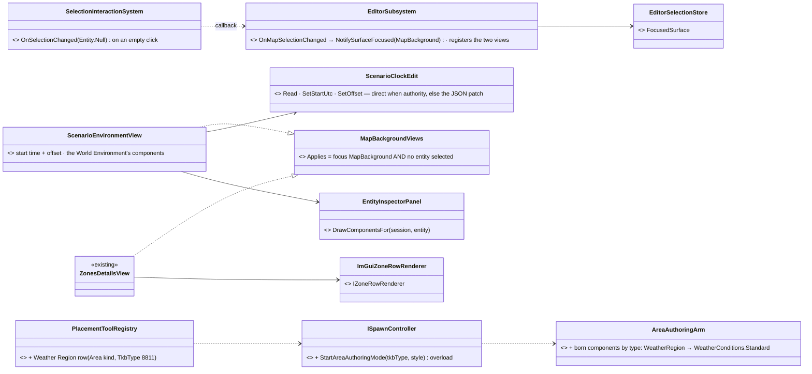
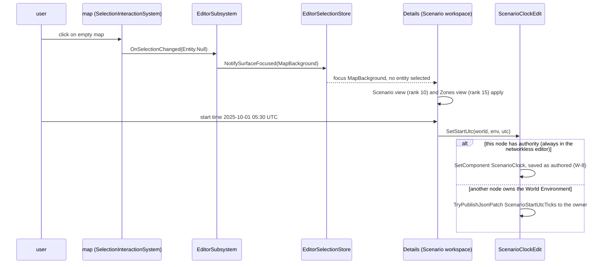
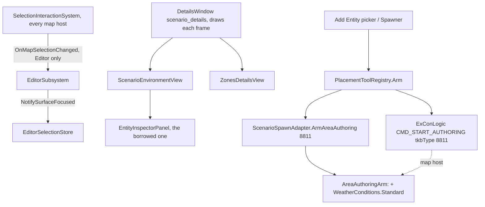
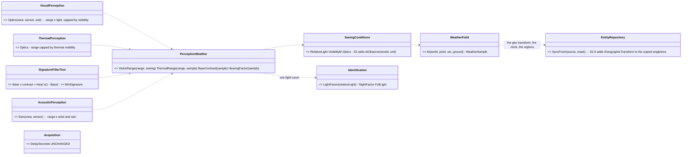
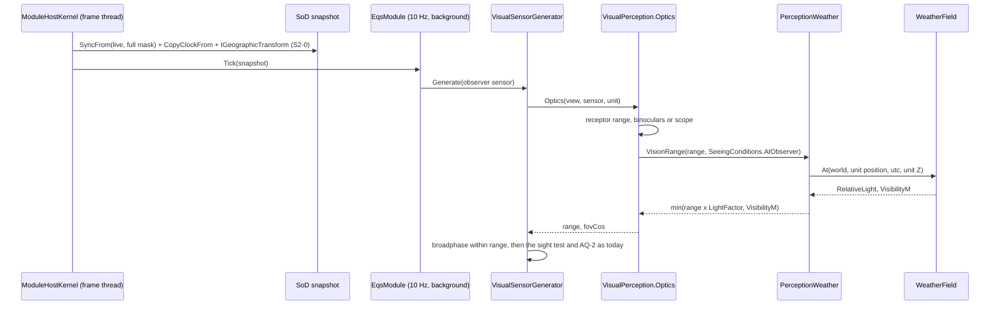
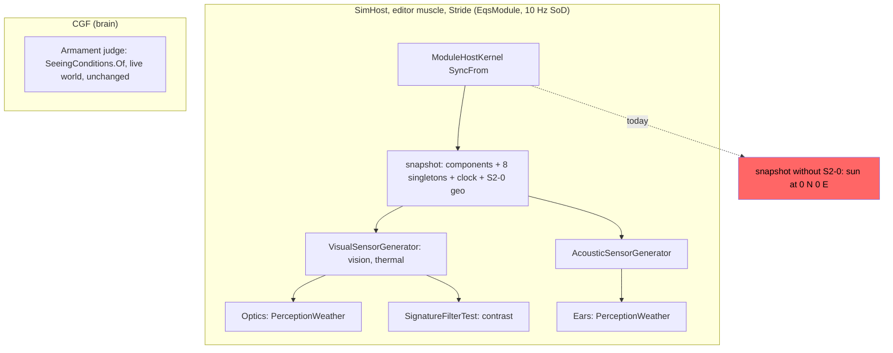

<!--STATUS
state: LIVE
updated: 2026-10-16
build-state: BUILDING — S1-0 and S1 BUILT 2026-10-16 (§6.1, §6.2; S1's editor UI handed to ui). ⭐ S2 DESIGNED and APPROVED 2026-10-19 (§8, R-3017) — READY-TO-BUILD. S3–S4 not started. READY-TO-BUILD was approved by 🔒 user, 2026-10-16: W-1, W-2, the clock (C-1…C-4), humidity and precipitation approved ("approved, write the weather design with W-1 W-2 too, humidity and precipitation of course yes, no day rate"); ruling R-3012. Programme CE-3216.
current-answer: §1 the model · §2 the diagrams · §3 decisions · §4 the derived quantities · §5 slices and rails · §6 AS BUILT (what the code does, slice by slice) · §8 S2 perception design (leans, awaiting the user). §0 is the measured ground.
stale-below: nothing.
known-rot: §3 C-1 and C-2 (the save rewriting the clock to "UTC at save", the owner re-anchoring a target UTC) — SUPERSEDED the same day by the user's W-8: the clock is an AUTHORED scenario start time, saved as is, and a runtime change sets a new start time.
known-conflict: docs/designs/cgf-1/CGF-1-DESIGN.md (~line 1113) — the Orchestrator writes a "global weather descriptor" to Orchestrator.json and publishes it on OrchestratorContextTopic. Never built (the save arm was retired, CE-278); SUPERSEDED by §1 here — weather is scenario ENTITIES, not orchestrator context.
related-designs:
  - docs/DESIGN_Sensors_And_Doctrine.md — §5.7 AQ-2: the acquisition dwell S2 leaves unchanged (§8.3 S2-1)
  - docs/DESIGN_Civilians_And_Crowd_Control.md — §7.8 A-4 (`SeeingConditions`, the light curve): the one curve S2 reuses
  - docs/designs/tkb-1/DESIGN.md — the "should every entity have a SimTransform?" analysis (2026-09-13): a positionless entity is safe as long as it carries NO SimTransform; this file builds the first one
  - docs/designs/airborne/DESIGN_Airborne_Insertion.md — §7d D-13 (how the scenario's wind reaches every node): SUPERSEDED by this file — the World Environment entity replicates; the parachute model reads WeatherField's wind profile
  - docs/DESIGN_Terrain_Zones_And_Assets.md — §2.1: a zone is its OWN type (8804), not a flag on the tactical area — the precedent for the Weather Region type
  - docs/DESIGN_Thermal_And_Acoustic_Sensing.md — row F ("weather / night attenuation — not asked"): S2 here gives thermal and hearing the weather
  - docs/DESIGN_Map_3D_Mode.md — the lit shader + fog: S3 (ui) draws the sun, the sky, fog and cloud layers from WeatherField
  - docs/DESIGN_Visual_Effects.md — W3's fixed breeze for smoke: S3 drifts it on the real wind
  - docs/designs/audio/DESIGN_FPS_Audio.md — the ambient beds by time of day and the wind bed: S4
  - docs/DESIGN_Geo_Origin.md — the geographic transform (latitude / longitude of a local point) the sun position needs
-->

# Weather and time of day — regional weather, one global environment, a sun

**What it does:** the scenario states the weather — globally, and in regions that blend smoothly into it — and the date and time.
Every node derives, at any point and moment, the air temperature and pressure, the wind at any height, visibility, cloud, the sun's
position and the light level. Sensors, motion models, rendering and audio read that one answer.

🔒 **User, `2026-10-16`:** *"Wind as well as another properties of the weather is by nature regional, and defaulting to a "global"
weather where no region is explicitly defined. weather blends between regions (the closer to the region cetroid the stroger that region
applies the region setting) so the transition from global weather into regional one is smooth."* · *"daytime clock could be a special
entity (singleton, global, replicated) definig what UTC time there is relative to simulation clock. so current day time = currentSimTime
+ Offstet. This entity needs to be saved to scenario and needs to be changeable at runtime and replicated to other nodes."* ·
*"approved, write the weather design with W-1 W-2 too, humidity and precipitation of course yes, no day rate"* · *"does it make sense to
combine them into one single entity which has weather component and scenario time component?"* — ⭐ yes (§3 W-0). · *"scenario clock must be
editable independently (details panel of the scenario which shows when empty map place is clicked - same as now), never filled automatically
from current wall clock utc time at time of saving the scenario. Runtime change just sets new value of this "scenario start  time"."* (§3 W-8)

## 0. INVENTORY — what exists (measured `2026-10-16`, codebase-memory CLI + grep)

| query | result |
|---|---|
| `search_graph` `.*Weather.*` · `.*Fog.*` · `.*Cloud.*` · `.*Temperature.*\|.*Pressure.*` · `.*TimeOfDay.*\|.*Sun[A-Z].*` (Class) | **0** production types |
| grep `Weather\|TimeOfDay\|SunElevation\|FogDensity\|CloudLayer\|AirTemperature\|struct Wind` over `FDP Hrot Stride` | ONE: `Fdp.Toolkit.Motion.Wind` (`Descent.cs:81`) — a world SINGLETON, one 2-D velocity, no altitude, no region |
| readers of `Wind` | `DescentModels.cs:313` (the parachute) · `AirborneDrillBehaviors.cs:406` (the release point) |
| grep `Night\|LightLevel\|Illumination\|Daylight` | **0** — no light level anywhere; Thermal and Acoustic Sensing row F: *"weather / night attenuation — not asked"* |
| area entities | `TacGraphic_Area` 8803 and `TerrainZone` 8804 (`TkbEntityTypes.cs:68-76`): an `EditablePolyline` + a `SimTransform`; authored by `AreaAuthoringArm`, drawn by `TacticalAreaGizmo` |
| positionless replicated entities | ⛔ **none** — the nearest, `Door` (8805), carries a `SimTransform` (`TerrainObjectRequests.cs:61`) |
| runtime edit of a remote entity | `UpdateEntityAttributeCommand` → DDS → the OWNER's `UpdateEntityAttributeRequestSystem` applies the patch |
| a load's clock | an exercise load JUMPS the clock to its saved sim time (`OrchestratorCore.cs:100`, `time.SnapTo(… TotalTime = simTimeSeconds)`); ⛔ a plain scenario load at sim time 0 — not measured |
| latitude / longitude of a local point | `WGS84Transform.ToGeodetic` (every node holds its geographic transform) |

## 1. The model — ⭐ weather is DATA, everything derived is a PURE FUNCTION

| | kind | carries |
|---|---|---|
| **World Environment** *(new type)* | an entity with **no `SimTransform`**, one per scenario | `ScenarioClock` + `WeatherConditions` (the GLOBAL weather) |
| **Weather Region** *(new type)* | an AREA entity (`EditablePolyline` + `SimTransform` at its centroid) | `WeatherConditions` (a regional weather) |
| `WeatherField` | a pure function on every node | blends the regions into the global weather at a point (§3 W-1/W-2) and derives §4's quantities from the result, the point's height and the clock |

⇒ ⭐ **no weather STATE at runtime**: the only replicated values are what was authored (and what an operator changes). Every node gets
the same answer from the same replicated entities and the cluster's synced sim time — a replay or a rewind reproduces it by construction.

## 2. The diagrams

*What the picture shows that prose hid:* **one component type for the global and the regional weather** — so the blend has one input
type, an editor has one inspector, and the global weather is just the region that is everywhere. The clock and the weather share an
ENTITY but not a component: each replicates as its own descriptor, so time and weather stay separate data.

*What it shows:* nothing is pushed per frame — a consumer ASKS, and the answer is computed from replicated data. The only writes are the
load and an operator's edit, both through paths that already exist (entity creation, the attribute request).

*What it shows that prose could not:* **there is no WeatherSystem to schedule** — so there is no host on which the weather "never ticks"
(the failure mode a scheduled system has on hosts that do not compose it). Each consumer calls the pure function on whatever node it
runs on; the only per-node requirement is that the entities replicate there, which every role already does. The retired `Wind`
singleton is drawn dead: S1 moves its two readers onto `WeatherField`.

## 3. Decisions — ✅ APPROVED `2026-10-16` (R-3012)

| # | decision | rejected — one line each |
|---|---|---|
| **W-0** | ⭐ the clock and the GLOBAL weather are two components on ONE positionless **World Environment** entity; a region carries only `WeatherConditions` | two singleton entities — two creations, two uniqueness rules, two rails for one "the scenario's environment" |
| **W-1** | ⭐ a region's weight at a point: `t = |p − c| / |b − c|` along the ray from the centroid `c` through `p` to the polygon's boundary `b`; `w = smoothstep(1 − t)` — 1 at the centroid, 0 at the edge; an optional per-region `FeatherM` carries the fade past the edge | a circle round the centroid — ignores the shape (a long valley region bleeds sideways) · a hard edge — not smooth |
| **W-2** | ⭐ overlapping regions ADD; the global weather fills what is left to 1 (`g = max(0, 1 − Σw)`); past 1 the regions normalise among themselves. Scalars blend linearly; WIND blends as a vector, never as an angle; a CATEGORY (cloud kind, precipitation kind) takes the strongest contributor | averaging directions (350° and 10° would make 180°) |
| **W-3** | wind levels and cloud bases in metres above sea level (aviation practice); fog top above ground; below the lowest wind level the wind falls off logarithmically to the ground | mixing references per field |
| **W-4** | the clock: `UTC = scenario start time + sim time` — pause, time acceleration, rewind and replay follow the cluster clock for free; ⛔ **no day rate** (user) | a free-running wall clock — diverges on pause, replay and rewind |
| ~~**C-1**~~ | ⛔ SUPERSEDED by W-8 — ~~the save carries UTC at the moment of saving and the load re-anchors~~ | — |
| ~~**C-2**~~ | ⛔ SUPERSEDED by W-8 — ~~a runtime change carries a target UTC and the owner re-anchors~~ | — |
| **W-8** | ⭐ the clock's value IS the **scenario start time**: authored in the scenario's Details view — ⚠ 📐 measured `2026-10-16`: that view does NOT exist yet. The empty-map context was designed and half-built for terrain zones (Terrain Zones E3/U5, BP-542: `SelectionOrigin.MapBackground` + `ZonesDetailsView`), but nothing registers the view in `EditorSubsystem.ScenarioDetails` and nothing raises map-background focus on an empty-map click (CE-3217) — so the Scenario view (start time, global weather, the header) goes beside the Zones view on that context, a ui item of S1-0; saved exactly as authored — ⛔ never filled from the wall clock or rewritten at save; a runtime change sets a new start time, applied as sent. ⇒ an exercise load that resumes sim time T shows start + T (a continuation), an authored scenario at sim 0 shows its start | rewriting the clock at save (C-1) — the scenario would drift every time it is saved · a target-UTC request (C-2) — not what the operator edits |
| **C-3** | exactly one World Environment: a scenario with none gets a DEFAULT one at load — ⭐ a FIXED built-in start time and the built-in weather, ⛔ never the wall clock (W-8) — so it is always there to change, and is saved next time; a second is ignored with a warning (the first kept) | creating it only on the first edit — nothing to edit in the editor's inspector before then |
| **C-4** | ⭐ the FIRST rail of S1: a positionless entity created on one node, edited at runtime, read on another — nothing has ever replicated an entity with no `SimTransform` | building the weather first and finding the gap at the end |
| **W-5** | the existing `Wind` singleton is RETIRED: the parachute model and the airborne drills read `WeatherField` (a real wind PROFILE at their height) | two ways to read wind (ruling 9) |
| **W-6** | the entities are owned by their creator (the Brain that loads the scenario) — one descriptor each, the Brain group | the CGF-1 orchestrator topic — a second channel for one thing |
| **W-7** | humidity and precipitation are data now (user) — consumers in S2/S4 | — |

## 4. The derived quantities (`WeatherField.At`) — the physics, simple and honest

| quantity | rule | why this rule |
|---|---|---|
| UTC | `StartUtcTicks + GlobalTime.TotalTime` | W-4, W-8 |
| sun elevation, azimuth | the NOAA solar-position algorithm from UTC and the point's latitude / longitude (`ToGeodetic`) | the standard; no time zone needed |
| irradiance at the ground | `1361 · sin(elevation) · τ` (clear-sky transmittance τ ≈ 0.75) × cloud factor `1 − 0.75·(octas/8)^3.4` (Kasten–Czeplak) | the cloud cut is the published fit |
| ground air temperature | the authored DAILY MEAN + a closed-form diurnal swing: amplitude ±6 K clear … ±2 K overcast (scaled by the cloud factor), the peak ~2–3 h after solar noon, a cooler clear night; no integrated state | deterministic, replay-safe, every node equal |
| temperature at height h | ground − lapse rate × h (default 6.5 K/km — the ICAO standard atmosphere) | ISA |
| pressure at h | the barometric formula from the sea-level pressure and the local temperature | ISA |
| air density | `p / (R_specific · T)` | for later aircraft performance and drag |
| wind at h | interpolate the levels; below the lowest, a log profile to zero at the ground; gust as stated | the surface boundary layer |
| visibility, extinction | authored visibility V (m); extinction `σ = 3.912 / V` (Koschmieder); inside a fog layer below its top, else the clear-air value | one number for vision, thermal and the renderer's fog |
| light level | from the sun's elevation: day > 0° · civil twilight to −6° · nautical to −12° · astronomical to −18° · night; dimmed by cloud | the twilight bands are the standard ones |
| thermal crossover | falls out of the temperature model: target–background contrast near zero around dawn and dusk | a real, tactically important effect |

## 5. Slices and rails *(each red-proved; each green before the next)*

| slice | lane | builds | ★ acceptance |
|---|---|---|---|
| **S1-0** | backend + ui | ⭐ C-4 first: the World Environment type with `ScenarioClock` only — created on CGF, edited at runtime, read on SimHost | two-node rail: the clock arrives, an edit replicates, UTC agrees on both nodes within one frame; ⭐ ui: the scenario start time in the scenario's Details view (W-8) |
| **S1** | backend | `WeatherConditions` + `dtWeather`, the Weather Region type, `WeatherField` (§4), W-8 save/load as authored, C-3 default, the editor's inspector for both, the area tool's "weather region" kind, W-5 (the parachute and the drills on the wind profile, `Wind` retired) | rails: a region's weight is 1 at its centroid, 0 at its edge and smooth between; two overlapping regions and the global fill; wind blends as a vector across north; the start time saved and loaded exactly as authored, and a runtime edit replicated; the parachute drifts on the wind at its height |
| **S2** | backend | perception: vision range by visibility and light level (night), thermal contrast from the temperature model (crossover), hearing by wind | rails in the sensors' suites |
| **S3** | ui | the 3D map: sun direction and sky colour, fog from the extinction, cloud layers; smoke drifts on the wind | frame rails + screenshots · ✅ ui as-built in [Map 3-D §6aa](../../DESIGN_Map_3D_Mode.md): sky, sun, fog `2026-10-16/19` · precipitation PR-1 and smoke on the wind PR-2 `2026-10-21` · the `CloudDeck` drawn as layers §6aa.CL `2026-10-22` |
| **S4** | backend + ui | air density for aircraft and long-range ballistics; wind drift on rounds; ambient audio from wind and time of day | — |

## 6. As built

### 6.1 S1-0 — the positionless World Environment and its clock ✅ BUILT `2026-10-16` (CE-3216)

| piece | where | note |
|---|---|---|
| `ScenarioClock` (394) `{ StartUtcTicks, DisplayUtcOffsetMinutes }` · `ScenarioClock.DefaultStartUtc` = **2025-06-21 06:00 UTC** (C-3, fixed) · `ScenarioTime.TryClock / Utc` | `FDP/Toolkits/Fdp.Toolkits/Weather/ScenarioClock.cs` | default data policy ⇒ the scenario serializer saves it as authored (W-8) with no new code; `Utc(world)` falls back to the C-3 default when no World Environment has arrived |
| TKB type **`WorldEnvironment` = 8810**, a bare template (no `SimTransform`) | `TkbEntityTypes.cs`, `BdcTkbCatalog.cs` | the door's pattern: its state arrives with the request on the creator and on its descriptor elsewhere |
| `dtScenarioClock` = 138, `EntityScenarioClock` (Reliable, TransientLocal, KeepLast 1) | `AllDescriptors.cs`, `SimDescriptors.cs` | Brain group (`HrotOwnershipGroups`, `NedOwnershipGroupBinding`) — the creating Brain owns it (W-6) |
| `EntityScenarioClockEgressTranslator` / `…IngressTranslator` | `Hrot.Network.NED/Replication/Map/EntityScenarioClockTranslators.cs` | the `WeaponSystemState` shape (send on change; a wiped world DELETES every instance it wrote — `CE-4007`, [Cluster Load Phase](../../DESIGN_Cluster_Load_Phase.md), added at the `coordinator` merge; hold a sample until its entity is known; the recorded owner drops its own); in `SharedTranslatorPack` and `EntityStatesIngressPack` (a pure IG sees the time too) |
| the runtime edit: attributes **`ScenarioStartUtcTicks`** (20, Int64) and **`ScenarioUtcOffsetMinutes`** (21, Int32) | `AttributeVocabulary`, `AttributeCompilerFactory.Build`, `ScenarioClockAttributeInstaller` | ⭐ no new message: `UpdateEntityAttributeCommand` → the owner's `UpdateEntityAttributeRequestSystem` applies it AS SENT (W-8); the egress declares `TargetComponentIds = {ScenarioClock}` |
| C-3 / W-8 in `ScenarioLoadStep.Commit` | `Hrot.Core/Services/LoadPhase/ScenarioLoadStep.cs` | a scenario with none ⇒ `WorldEnvironmentRequest` (after the doors, so their ids are unchanged); a second in the file is ignored with a warning; also for a NEW scenario; only after a `PrepareAsync` (an aborted round enqueues nothing) |

**Rails:** `SplitAuthoritySpawnTests.CE3216_ThePositionlessWorldEnvironment_CarriesItsClock_AndAnEditFromANonOwnerReachesEveryNode`
(IT-SA-5, domain 35: created on CGF through the request path, no `SimTransform` on either node, UTC = start + sim time on both, an edit
SENT BY SimHost applied by CGF and replicated back — red-proved by dropping the clock egress and by a no-op JSON route) ·
`ScenarioLoadStepTests.CE3216_C3_*` / `CE3216_W8_*` (the default at the fixed start; a saved start loads as authored; a second ignored) ·
`TheFourRoutingTablesAgreeTests` / `TheDescriptorMapIsWiredTests` (the two attributes in every routing table, `dtScenarioClock` in the
Brain group).

⚠ **Measured on the way:** the positionless entity needed **nothing** special in the creation, ghost and promotion paths — the request
path, `EntityMaster` and the TKB derivation all work without a `SimTransform` (confirms docs/designs/tkb-1/DESIGN.md 2026-09-13).

### 6.2 S1 — the weather, the regions, `WeatherField`; `Wind` retired ✅ BUILT `2026-10-16` (CE-3216)

| piece | where | note |
|---|---|---|
| `WeatherConditions` (395): daily-mean ground temperature, lapse rate, sea-level pressure, humidity; **8 wind levels** (MSL m, from °, speed, gust) and **4 cloud layers** (base MSL, thickness, octas, kind) as fixed buffers; visibility, fog top + fog visibility, precipitation kind + rate, `FeatherM` | `FDP/Toolkits/Fdp.Toolkits/Weather/WeatherConditions.cs` | fixed buffers save as JSON arrays (the auto-serializer's fixed-buffer support) ⇒ saved as authored; `Standard` (the C-3 built-in) and `SteadyWind(v)` |
| ⚠ **the built-in weather is CALM** | same | deviation from "the built-in weather" left open in C-3: the retired `Wind` singleton's contract was *absent ⇒ calm*, so every scenario that states no weather (and every test world) behaves exactly as before. 📌 Found by `DescentModelsTests.B2_TheBank_*`, which reddened when the default had a breeze |
| TKB **`WeatherRegion` = 8811**, a bare area template; the default World Environment request now carries `WeatherConditions.Standard` too | `TkbEntityTypes.cs`, `BdcTkbCatalog.cs`, `ScenarioLoadStep` | |
| `dtWeather` = 139, `EntityWeather` (flat fields, the `dtPartDamage` shape), egress/ingress like the clock's, Brain group | `SimDescriptors.cs`, `EntityWeatherTranslators.cs`, `HrotOwnershipGroups`, `NedOwnershipGroupBinding` | |
| ⭐ **`IAreaOutline`** (Fdp.Toolkits) implemented by `EditablePolyline` (Hrot.Core) | `Fdp.Toolkits/Terrain/IAreaOutline.cs` | the seam that lets toolkit code read a region's outline without referencing Hrot: `WeatherField` reads the managed component under `GlobalComponentIds.EditablePolyline` as `IAreaOutline` (`EntityRepository.GetManagedComponentByTypeId`). ⛔ Rejected: moving `EditablePolyline` down (a Hrot namespace in FDP) and a host-registered delegate (a silent default on any host that forgets it) |
| `WeatherField` — `RegionWeight` (W-1: the ray from the centroid to the boundary, `smoothstep(1 − t)`, the feather extends the boundary), `Contributors` (W-2: regions add, the global fills `max(0, 1 − Σw)`, past 1 normalised; ≤ 16), `WindAt`, `At` (§4) | `Fdp.Toolkits/Weather/WeatherField.cs` | ⚠ the region's CENTROID is the polygon's area centroid, not its `SimTransform` (the authoring tools put the origin where the operator clicked first); allocation-free per call apart from the query |
| `SolarPosition.Of` (NOAA spreadsheet formulas, no refraction) | `Fdp.Toolkits/Weather/SolarPosition.cs` | |
| ⚠ **the wind's surface fall-off applies BELOW the lowest level only**; a lowest level at or below the ground means the author's wind reaches the ground | `WeatherField.WindOf` | ⇒ a 10 m level over a 500 m hill does not slow a man 2 m above the hill; author a level above the ground where the surface matters |
| **W-5**: `ParachuteModel.Autonomous` reads `WeatherField.WindAt(world, his position)`; the airborne release point reads it at the carrier's place, half way to the ground; `struct Wind` deleted, id 393 RESERVED | `DescentModels.cs`, `AirborneDrillBehaviors.cs` (behaviors' file — cross-lane), `Descent.cs`, `GlobalComponentIds.cs` | |

**Moved to the ui lane** (deviation from §5's S1 row — editor UI is theirs): the area tool's "Weather Region" kind, the inspectors and the
Scenario Details view → [HANDOFF_Backend_To_Ui_Weather_And_Scenario_Time.md](../../blueprints/batches/HANDOFF_Backend_To_Ui_Weather_And_Scenario_Time.md)
(with CE-3217). ⚠ **Not built:** a runtime WEATHER edit from a non-owning node has no attribute path yet (only the clock has one) — the
editor owns the World Environment in edit mode and writes the component directly; a runtime weather change from another host is a
follow-up (the attribute vocabulary or `UpdateEntityDescriptorRequestSystem`).

**Rails:** `WeatherFieldTests` (Fdp.Toolkits — W-1 weights and smoothness, feather, W-2 wind across north, W-3 profile, the NOAA sun
against the almanac, light bands, §4 temperature / pressure / density / irradiance / fog, W-4 UTC) · `WeatherRegionBlendTests`
(Hrot.Core — regions add, the global fills, an overlap normalises, the wind across two regions, an area without weather is no region) ·
`DescentModelsTests.CE3216_ARoundCanopy_DriftsOnTheWindAtItsHeight` (+ the three wind rails ported off the singleton) · IT-SA-5 now also
carries the global weather to SimHost on `dtWeather`.

### 6.3 Clouds — aviation cover, cover above a point, the deck ✅ BUILT `2026-10-16` (🔒 user: *"do we support cloud types in multiple altitude levels? can we specify overcast and similar?"* → *"yes please"*)

| | |
|---|---|
| **layers** | up to 4 per weather (global or regional), each its own base (m MSL), thickness, cover and kind (stratus · cumulus · stratocumulus · cirrus · cumulonimbus) — unchanged from §6.2 |
| **aviation cover** | `CloudCover` { Clear · Few · Scattered · Broken · Overcast } = the METAR bands (SKC 0 · FEW 1–2 · SCT 3–4 · BKN 5–7 · OVC 8 octas); `SetCloud(i, base, thickness, CloudCover.Overcast, kind)` stores the band's upper value (FEW 2, SCT 4, BKN 7, OVC 8 — conservative for the light and the ceiling); octas stay the stored value. A ceiling is the lowest BKN / OVC base |
| **cover above the point** (§4 "cloud cover above") | `WeatherSample.CloudOctasAbove` = the layers whose TOP is above the point (inside a cloud counts), overlapping at random. ⭐ The irradiance and the light read it: an aircraft above an overcast deck has the clear-sky sun; the ground under it a quarter of it. `CloudOctas` (every layer, seen from the ground) still drives the day–night temperature swing. ⛔ SUPERSEDES §6.2's "irradiance from the total cover" |
| **the deck** | `WeatherSample.Clouds` (`CloudDeck`) = the STRONGEST contributing weather's layers as authored (W-2: a deck is a category; the cover numbers are blended) — what S3's renderer draws |

**Rails:** `WeatherFieldTests.Clouds_*` (the bands; shade below, inside, not above a deck; the deck in the sample) ·
`WeatherRegionBlendTests.Clouds_TheDeckIsTheStrongerWeathers_TheCoverIsBlended`.

## 7. The editor half — the scenario's start time and weather in Details; the Weather Region tool (ui, `CE-1161`) — ✅ BUILT `2026-10-16` (§7.4)

📨 [HANDOFF_Backend_To_Ui_Weather_And_Scenario_Time](../../blueprints/batches/HANDOFF_Backend_To_Ui_Weather_And_Scenario_Time.md) U1–U4
(+ [CE-3217](../../blueprints/Blueprint_Issues_Tracker.md)). The ui lane designs and builds it; the engine half is §6.

### 7.1 INVENTORY (measured `2026-10-16`, grep + reads; the codebase-memory graph indexed this session)

| the design rests on | code — how it IS | design basis |
|---|---|---|
| the map-background context exists but nobody raises it or registers its view | `SelectionOrigin.MapBackground` (`SelectionOrigin.cs:64`), `ZonesDetailsViewDescriptor.Applies` (`ZonesDetailsView.cs:135`); no `IZoneRowRenderer` implementation; `EditorSubsystem` registers Components / Mission / AI / … only (`:3433`) | Terrain Zones E3/U5 |
| an empty map click — 2-D and 3-D — already reaches the host as `OnSelectionChanged(Entity.Null)`; the editor does not listen | `SelectionInteractionSystem.cs:263, :301`; `MapInteractionContext.OnMapSelectionChanged` (`:156`), set by the IG only | UXI-11 S-4 |
| the focus latch is a LEVEL and stays put; entity views key on `ctx.Entities` | `EditorSelectionStore.NotifySurfaceFocused` (`:216`); `DetailsViewPredicates.ExactlyOneEntity` | the Details panel's routing (L6) |
| the inspector draws every component of ANY entity, fixed buffers included | `EntityInspectorPanel.DrawComponentsFor(session, entity)` (used by `ScenarioComponentsViewDescriptor`); `ReflectionEditDocumentBuilder` `FixedBuffer` arm (`:155`) | §6 L6.3 |
| ⚠ `EntityAttributeChangeRequests.TryPublishJsonPatch` only PUBLISHES; the networkless editor has no consumer | `OfflineNetworkFactory.CreateSimHostAttributeUpdateSystems` returns empty (`:47`); `UpdateEntityAttributeRequestSystem` only via `NedNetworkFactory` (`:164`) | ⛔ the handoff's "applies directly on the owner" does not hold offline |
| the owner writes directly — the established rule | `MapCameraLayer.cs:190` (`HasAuthority`, CE-1047) | CE-1047 |
| an area is born as any TKB type through ONE arm; the zone does it for 8804 | `ScenarioSpawnAdapter.ArmAreaAuthoring(long)` (`:322`), `AreaAuthoringArm` builds the `SpawnEntityCommand` (`:133`); `ExConLogic.StartZoneAuthoringMode` sends `tkbType` | Terrain Zones §2.1 (TkbType is THE discriminator) |

### 7.2 Diagrams

*What the picture shows that prose hid:* nothing new edits the weather — the Scenario view hands the World Environment to the inspector
the Components view already uses; the only new logic is the clock edit and one "born with" table on the area arm.

*Caption:* the Details panel exists only in the Editor, so the map-background focus is wired there alone; the Weather Region tool goes through
the shared registry and arm, so every host that draws areas draws weather regions.

### 7.3 Decisions — leans (frame from the handoff; ui details)

| # | decision | lean |
|---|---|---|
| **E-1** | when do the map-background views show? | focus MapBackground AND no entity selected — the latch is a level, so an entity click must win without a second focus value |
| **E-2** | how does the start time get written? | ⭐ directly when this node has authority over the World Environment, else the JSON patch to its owner (the measured gap above). ⛔ Never the wall clock (W-8) |
| **E-3** | the global weather editor | ⭐ the existing inspector on the World Environment (`DrawComponentsFor`) — U4 needs nothing new: fixed buffers already edit. A friendlier form waits for a user ask |
| **E-4** | the Weather Region tool | ⭐ an `Area`-kind registry row with its TKB type; an overload `StartAreaAuthoringMode(long tkbType, string style = "")` (0 = the tactical area) — one arm, one parameter; ⛔ not a method per kind. ~~an optional `tkbType` on the existing method~~ SUPERSEDED in the build: Moq setups call `StartAreaAuthoringMode(It.IsAny<string>())`, and an expression tree cannot omit an optional argument |
| **E-5** | born components | ⭐ `AreaAuthoringArm` adds what a type must be born with (a Weather Region: `WeatherConditions.Standard`) — the one place every host's area commit passes |

**Rejected — one line each:** *raising MapBackground on every frame with no selection* — the Zones view would replace the AI views the user
was reading · *a dedicated weather form now* — duplicates the inspector · *a `StartWeatherRegionAuthoringMode`* — a method per kind on an
interface with eight implementers · *adding WeatherConditions in the spawn system* — every type rule would leak into the generic spawner.

### 7.4 As built `2026-10-16` (`CE-1161`; demo `CE-1159`)

| piece | where |
|---|---|
| the shared predicate "map background AND no entity" | `DetailsViewPredicates.MapBackgroundWithNothingSelected`; `ZonesDetailsViewDescriptor.Applies` now uses it |
| the empty-click focus | `EditorSubsystem.OnMapSelectionChanged` → `MapInteractionContext.OnMapSelectionChanged` (the Editor only — the one host with a Details panel) |
| the Scenario view (rank 10) and the Zones view (rank 15, `ImGuiZoneRowRenderer`; Load = the map's own `GlobalActionIds.LoadZone` action) | `Hrot.Editor/Scenario/ScenarioEnvironmentView.cs`; registered beside the Components view |
| the clock edit (direct when authority, else the JSON patch) | `Hrot.Presentation/Weather/ScenarioClockEdit.cs` |
| the Weather Region tool | `PlacementToolRegistry` row (Area, 8811) → `ISpawnController.StartAreaAuthoringMode(long, string)` (`ScenarioSpawnAdapter` arms with the pending type; `ExConLogic` sends it in `CMD_START_AUTHORING`, its zone arm now calls the same method) → `AreaAuthoringArm.BornWith` adds `WeatherConditions.Standard` |
| the demo | `scenarios/ua-weather-regions` — basic-desert, 19:05 UTC (dusk at the terrain's Berlin origin, display +120), a fog bank at x 140–360 and an overcast region at x 290–510 overlapping in the middle, an IFV and a rifleman west of both |

**Rails:** `ScenarioClockEditTests` ×3 · `AreaAuthoringArmTests.CE1161_*` · `EntityTypeCatalogTests.CE1017_Arm_AGraphic_*` (+ Weather
Region) · `TheZonesViewIsOfferedOnTheMapBackgroundTests.CE1161_*` · `TheScenarioEnvironmentViewTests` ×4 (the production catalogue, the
predicate, the typed start time, the empty click) · `WeatherRegionsDemoTests.CE1159_*` (the file through the PRODUCTION serializer:
both regions outlined, dusk, clear / fog / blended). Each red-proved.
⚠ **Not built:** a friendlier weather form (E-3: the inspector edits it today); the 3-D frame screenshots inside each region (the demo
is ready for them; left for the user's live look).

## 8. S2 — weather and night in PERCEPTION *(backend, `CE-3216`; designed `2026-10-19`; ✅ APPROVED `2026-10-19` (R-3017) — build-state: READY-TO-BUILD)*

✅ **RULED `2026-10-19` (R-3017)** — every lean in §8.3 as written. 🔒 User: *"The visual and hearing ranges accepted."* · *"Thermal and nihht vision leans accepted."*

### 8.1 INVENTORY *(codebase-memory CLI `search_graph` + grep, one corpus sweep over `docs/` and `.dev/`; ⚠ `check_index_coverage` is not available through the CLI)*

| what | where | ⭐ what it means for S2 |
|---|---|---|
| vision's range and FOV — **one** place | `VisualPerception.Optics` (`Perception/Sensors/VisualPerception.cs:60`), already scaled by binoculars / a scope (CE-3234, CE-3254) | ⭐ the seam for light and visibility; Civilians `:3680` names it the one place |
| thermal's range | `ThermalPerception.Optics` (`ThermalPerception.cs:41`), passed to the shared `VisualSensorGenerator` | the same seam, its own record |
| thermal's filter | `SignatureFilterTest`: `ThermalState.Signature = Base + Heat × (1 − Base)` ≥ the sensor's `MinSignature` (`ThermalState.cs:30`) | ⭐ crossover acts on the BASE term; there is no background term today (Thermal design row E/F) |
| hearing's range | `AcousticPerception.Ears` (`AcousticPerception.cs`): heard within BOTH the listener's range and the source's audible range | ⭐ the seam for wind and rain; no attenuation formula exists (Thermal design `:538`) |
| acquisition dwell (BR-7, AQ-2) | `Acquisition.DelaySeconds(range, exposure, observer)` (`Acquisition.cs:65`) | no light term; S2 leaves it alone (S2-1 below) |
| the precedent | `SeeingConditions.Of` + `Identification.LightFactor` (`Combat/Armament.cs:48-80`, CE-3229 A-4): light factor 0.1 at night → 1 at `RelativeLight` ≥ 0.3, capped by the visibility at the man; ClearDay with no World Environment | ⭐ the one built judgement that reads light; S2 reuses it, never a second curve |
| the weather | `WeatherField.At(world, point, utc, ground)` → `WeatherSample` { `RelativeLight`, `Light`, `VisibilityM`, `ExtinctionPerM`, `Wind`, `WindGustMps`, `TemperatureC`, `GroundTemperatureC`, `PrecipitationMmPerHour`, … } | the pure function (R-3012); no new state |
| 🔴 **the snapshot** | the EQS module runs `SlowBackground(10)` on a SoD snapshot with the FULL component mask (`ModuleHostKernel.cs:348`, `EqsModule` declares none) ⇒ `ScenarioClock`, `WeatherConditions`, `EditablePolyline` (SnapshotViaClone) and `GlobalTime` (CE-3267) ARE there; ⛔ but `SyncFrom` copies a fixed singleton list (`EntityRepository.Sync.cs:116-123`) WITHOUT `IGeographicTransform` (id 75) | ⛔⛔ `WeatherField.At` then puts the sun at lat 0 / lon 0 (`WeatherField.cs:278-280`): at the default start (06:00 UTC, C-3) that is SUNRISE on the equator — every scenario would see in twilight. ⇒ **S2-0** |
| where the scenarios stand | every terrain's origin is Berlin 52.52 N 13.405 E (`Recipes/Terrain/*/terrain.json:3`); the default start is 2025-06-21 06:00 UTC (`ScenarioClock.cs:31`) ⇒ ~07:00 local solar time, the sun ~25° up | ⭐ no shipped scenario starts dark: S2 moves no baseline unless a scenario authors night or fog |
| night devices | none: `HeldItemKind` is None · Weapon · Throwable · Phone · Binoculars; no NVG / intensifier descriptor; "night sight" only named in AW-15 | ⇒ S2-2 |

Design records read — each applies or not: **R-3012** (weather derived on every node, never stored) — applies, S2 adds no state ·
**Weather §4** (Koschmieder; light bands; crossover "falls out of the temperature model") — applies, gives the inputs, not the
perception formula · **Civilians §7.8 A-4** (`SeeingConditions`) — applies, the curve S2 reuses · **Sensors AQ-2** — read, S2 does not
change it (S2-1) · **AQ82** ("lighting, thermal signatures — tests inside a sensing template") — applies: S2 changes no sensor FORM ·
**AQ94 §116** (the visibility at a man's own floor) — applies to where the sample is taken · **Map 3D WS-2** (the darkest night shown
as a dusk) — ⛔ display only; perception must not copy that floor · **Thermal & Acoustic row F** ("weather / night — not asked") — the
gap S2 fills · `.dev/_DONE/demos-1` `EnvironmentStateComponent` — ⛔ superseded by R-3012.

### 8.2 Diagrams

*What the picture shows that prose hid:* every modality goes through ONE new static helper that reads the ONE existing curve
(`Identification.LightFactor`) — S2 adds no second light curve and no new component; and `Acquisition` is deliberately untouched.

*What the picture shows that prose hid:* the weather is sampled ONCE per sensor per solver tick, at the OBSERVER, on the background
snapshot — so the geo transform has to be in that snapshot first (S2-0), or the sun is computed for 0° N 0° E.

*What the picture shows that prose hid:* the perception sensors run on the muscle hosts' background snapshot, while the CE-3229 judge
runs on the brain's live world — two readers of one curve on two kinds of world; the red box is what a snapshot gives today.

### 8.3 Decisions — ✅ approved as leaned (R-3017)

| # | decision | ⭐ lean | rejected — one line each |
|---|---|---|---|
| **S2-0** | the snapshot's sun | `SyncFrom` copies `IGeographicTransform` (singleton 75, read-only) with the other eight; rail: the sun on a snapshot equals the sun on the live world | compute light on the frame thread into a new singleton — new state, against R-3012 · leave it — the twilight-at-sunrise bug above |
| **S2-1** | how light and fog shorten SIGHT | **range**: `min(range × LightFactor(RelativeLight), VisibilityM)` in `VisualPerception.Optics`, after the binoculars / scope; the AQ-2 dwell unchanged | a night multiplier on the dwell too — two knobs for one effect · Johnson criteria per sensor — no optics model exists (A-4's own rejected column) |
| **S2-1n** | ⏳ **the night number for DETECTION** | ⭐ its own floor `DetectNightFactor = 0.25` on A-4's curve shape (1 at `RelativeLight` ≥ 0.3): a 150 m soldier receptor sees a man at ~38 m on a moonless night, a 300 m one at 75 m. ⚠ A-4's 0.1 is for IDENTIFYING an item (rifle vs stick); seeing that a man is there carries further | reuse 0.1 — a soldier would detect a standing man at 15 m at night · no night effect — night operations mean nothing |
| **S2-1w** | where the weather is sampled | ONCE per sensor per tick at the OBSERVER (his own Z as the ground, AQ94 §116) — light is uniform over a sensor's few hundred metres; fog is the observer's local fog | per candidate — N samples per sensor per tick, and the target's fog is between them only in part |
| **S2-2** | night devices (NVG, thermal sights) | ⛔ NOT in S2: a man with an NVG / night sight is a TKB descriptor + a held/worn item — a later slice with its own design (it raises S2-1n's floor for its wearer). Thermal sensors already ignore light (S2-3) | add a soldier-wide "has NVG" flag now — an undesigned equipment model by the back door |
| **S2-3** | thermal | light: none. Fog: range capped by `VisibilityM × ThermalFogFactor (2.0)` — LWIR sees through haze better than the eye, still not through thick fog. **Crossover**: the BASE signature (a passive object's contrast with its background) × `c = clamp(|GroundTemperatureC − dailyMean| / swing, 0.2, 1)`; the HEAT term (engines, firing, a body) unchanged | crossover on the whole signature — a running engine or a man would vanish at dawn · a full radiometric model — no data for it |
| **S2-4** | hearing | the listener's range × `HearingFactor = 1 / (1 + wind/8 m/s) × 1 / (1 + rain/10 mm/h)` (floor 0.35): 4 m/s ⇒ ×0.67, 10 m/s ⇒ ×0.44, heavy rain 10 mm/h ⇒ ×0.5 — masking only | upwind/downwind propagation — needs the source's bearing per pair; it belongs with the dB model (World Query WQ-E) · rain ignored — W-7 made it data for S2/S4 |
| **S2-5** | a world with no World Environment | every factor 1 (`SeeingConditions.ClearDay`) — unit tests and old worlds unchanged | — |

### 8.4 Rails *(each red-proved; in the sensors' own suites)*

| rail | suite |
|---|---|
| S2-0: a snapshot's `WeatherField.At` sun elevation equals the live world's (and differs from lat 0 / lon 0) | `Fdp.ModuleHost.Tests` `SnapshotClockTests` (the CE-3267 class) |
| S2-1: the same observer at noon, at night, in 50 m fog: range = receptor · receptor × 0.25 · 50 m; binoculars still ×2 before the cap | `Fdp.Toolkits.Tests` visual perception |
| S2-3: a cold vehicle's base signature passes at noon and fails at crossover; a hot engine passes both; fog caps thermal at 2 × visibility | thermal perception |
| S2-4: a shot heard at 380 m in calm is not heard in 10 m/s wind | acoustic perception |
| S2-5: no World Environment ⇒ every range as today | each of the above |

### 8.5 AS BUILT `2026-10-19` (`CE-3216` S2, R-3017)

| as built | deviation, and why |
|---|---|
| `PerceptionWeather` (`Perception/Sensors/PerceptionWeather.cs`): `TrySample(view, unit)` → `WeatherField.At` once per sensor; `VisionRange`, `ThermalRange`, `BaseContrast`, `HearingFactor`; the constants of §8.3 | ⚠ **sampled at EYE/EAR height** (`SenseHeightM` = 1.7 m above the man's own Z, still his own Z as the ground) — 📐 the wind's log profile is ZERO at the ground (W-3), so a sample at his feet never masked his hearing (the trap `CE-3258` met for a cloud lying on the ground). ⇒ S2-4's "wind" is the wind at his ears: a 10 m/s wind at the 10 m level is ~7 m/s there (× 0.53) |
| `Identification.LightFactor(relativeLight, nightFactor)` — the one curve, two floors (A-4's 0.1, detection's 0.25) | — |
| `WeatherSample.DiurnalPhase` (−1…1, appended): the diurnal swing's phase; `BaseContrast = clamp(|phase|, 0.2, 1)` | the sample carried no mean or swing — the phase IS the crossover signal, so no second field |
| S2-0: `EntityRepository.SyncFrom` borrows `IGeographicTransform` (75) with the other singletons | — |
| seams: `VisualPerception.Optics` (after binoculars / scope), `ThermalPerception.Optics`, `SignatureFilterTest.ExecuteBatch` (`Base × contrast + Heat × (1 − Base)`), `AcousticSensorGenerator.Generate` (the listener's range × the factor) | ⚠ hearing's factor sits in the GENERATOR, not `AcousticPerception.Ears`: `Ears` takes no unit, and the generator is its one production caller |

Rails (`Fdp.Toolkits.Tests` `PerceptionWeatherTests`): sight at noon / night / in fog / with no clock · thermal ignores the night,
fog caps it at 2×, the crossover filters a cold hull and passes a running engine · a shot heard in calm, lost in a strong wind and in
heavy rain · the approved numbers. `Fdp.ModuleHost.Tests` `SnapshotClockTests.CE3216_ASnapshot_BorrowsTheGeoTransform` (S2-0).
