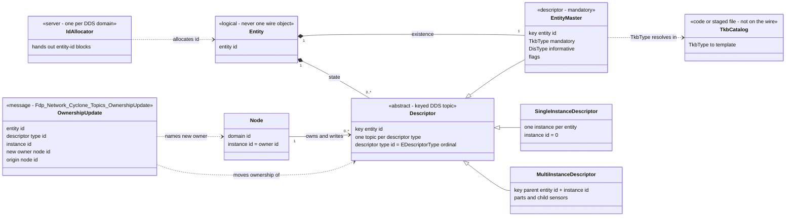
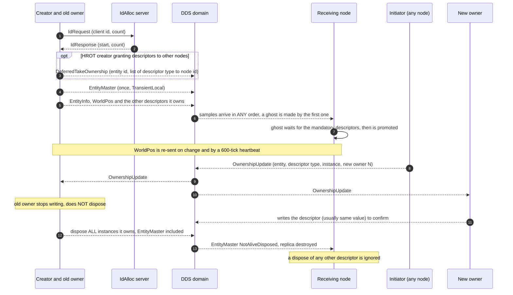
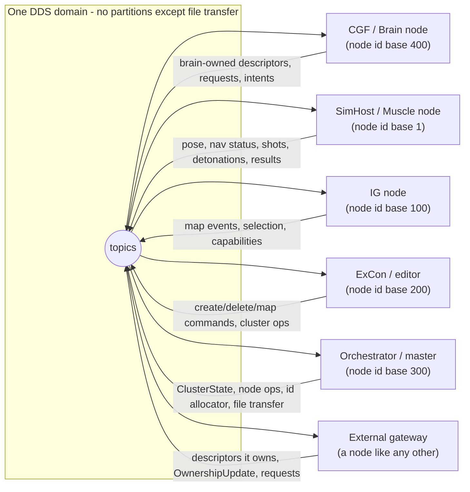

<!--STATUS
state: LIVE
updated: 2026-11-16 (drift pass: the minefield descriptors + ContactBreach in §Inventory, every EDescriptorType ordinal in §Descriptor ordinals, the path request's layer-mask bits incl. the mover's SIDE in bits 14…18 (R-5047) in §Concepts 16, SUMO traffic's own protocol in §SUMO traffic, counts recounted, GizmoMap type names; kept current by scripts/protocol-doc-check.py) · 2026-11-10 (CE-4396: the local frame is UTM, protocol 2 — GeoReference Frame 1 / 2 + the zone override; the tangent plane retired) · 2026-11-01 (CE-4200: entity ids are int32 on the wire — the id-width rows below; before: 2026-10-28 gateway re-check: GeoReference field names/units, ids int64 in the gateway table, the sender-identity layout, derived names in §11 and the related-designs; library 1.2.20)
current-answer: the whole document; §Inventory is generated-checked by scripts/ned-wire-inventory.py --check; every production [DdsTopic] type (Hrot/, FDP/ incl. the vendored SumoSharp and GizmoMap) and every EDescriptorType ordinal must be NAMED here — scripts/protocol-doc-check.py exits 1 otherwise (the drift check that keeps this document current); §Concepts 15 states the one topic-name rule
stale-below: nothing
known-rot: (1) ../projects/Hrot/Network/Hrot.Network.NED.md is dated 2026-05-23 — its "Key Wire Types" table covers 30 of the 144 wire types here; its EDescriptorType listing stops at 94 (the enum now has 102 entries, AllDescriptors.cs:6 — §Descriptor ordinals here); it still lists AreaQueryRequestBatch / AreaQueryResponseBatch and Messages/AreaQueryMessages.cs, RETIRED 2026-10-01 (AllDescriptors.cs:42, file absent); its TacticalIntentRequest row says "[DdsTopic] managed" but the type carries no [DdsTopic] (topic bound by a translator constant). (2) [fixed 2026-10-27 by AQ107 D: `WorldPos.Time` is now `WorldPos.SimTime`, a double of sim seconds]. (3) The doc comment on OwnershipUpdate.DescrTypeId says "1=EntityState, 2=WeaponState" (Fdp.Network.Cyclone/Topics/OwnershipUpdate.cs) but the ordinals are EDescriptorType (dtWorldPos = 2, AllDescriptors.cs:6).
known-conflict: BDC_NED_SST_Descriptor_Rules.md (the authoritative spec) and the code differ in the places listed in §Code versus the spec; neither side has been reconciled by a ruling. (Topic names have no conflict left: every name is derived from the C# type, no exceptions — §Concepts 15.)
related-designs:
  - ../designs/IG/DRAFT_Unreal_Image_Generator.md — an Unreal client as an outside IG node on this wire (option B, a draft, CE-4651)
  - ../blueprints/Architect_Question_107_NED_Wire_Frame_And_Names.md — OWNS the wire change — one frame (local metres + GeoReference), names from types, WorldPos as a quaternion pose (R-4092); all of A–I is BUILT (2026-10-28) and this reference describes the result
  - BDC_NED_SST_Descriptor_Rules.md — OWNS the authoritative descriptor/ownership rules this reference summarises
  - ../projects/Hrot/Network/Hrot.Network.NED.md — the NED project's architecture overview (code structure, translators)
  - ../DESIGN_Entity_Genesis_End_To_End.md — OWNS the stage sequence of entity creation across nodes (ghost, promotion, takeover)
  - ../DESIGN_Ownership_Groups_And_Grants.md — OWNS which role writes which descriptor group, and the node-departure reclaim
  - ../DESIGN_Entity_Ownership_Transfer.md — OWNS how a node initiates an OwnershipUpdate
  - ../blueprints/Architect_Question_79_One_Ownership_Truth.md — OWNS the ownership decisions (push-only, R-166 external nodes use the OwnershipUpdate topic — the ruling's "SST_OwnershipUpdate" is now the derived `Fdp_Network_Cyclone_Topics_OwnershipUpdate`)
  - ../DESIGN_Deterministic_Network_Ids.md — OWNS the entity-id allocator semantics (world-boundary reset to 1000)
  - ../DESIGN_Dead_Reckoning.md — OWNS the WorldPos sim-time stamp and the dead-reckoning rules
  - ../DESIGN_Geo_Origin.md — OWNS where the local-metres to lat/lon origin comes from (the terrain)
  - ../designs/mgmt-1/DESIGN.md — OWNS cluster orchestration and §8.10 entity lifecycle during replay
  - ../DESIGN_Replay_Time_Axis_And_Review.md — OWNS the replay session layer (ReplaySession topic, axis, review)
  - ../DESIGN_Cross_Node_Construction_Barrier.md — OWNS the reliable-init barrier (WaitForAcks, EntityLifecycleStatus)
  - ../designs/dds-to-ecs/DESIGN.md — OWNS the rule that DDS types are DTOs behind translators
  - ../designs/bugs-2/BUG2-DESIGN.md — OWNS the sender-identity requirement (EnableSenderTracking) on every participant
  - ../RUNBOOK_Cluster_Debugging_Over_Http.md — OWNS the ddsmonitor wire-capture recipe (§5a)
  - ../blueprints/Architect_Question_93_Sumo_Traffic_Node.md — OWNS the SUMO traffic node, whose vehicles are NOT NED entities (§SUMO traffic here summarises its wire)
  - ../designs/minefields/DESIGN_Minefields.md — OWNS the minefield descriptors (dtMinefield … dtMineClearing, 191–195) and the side carried in the path request's layer mask (R-5047)
  - ../DESIGN_Vehicle_Breaching.md — OWNS ContactBreach (§7.16) and the blade-cut / tree / ground damage records
  - ../designs/navig-2/Navigation_Design_v2_0.md — OWNS the navmesh layers a path request's layer mask selects (§8.2/§8.3)
-->

# NED on the wire — the DDS protocol of HROT

**What this is.** A living reference for anyone who must speak HROT's DDS protocol from outside (first reader: the DIS/HLA gateway
SimNetGateway). It states **concepts, rules and full C# type names** — never the members of a structure (they change; read the C# type
or the build-generated IDL, see Concepts §15). Every rule carries a `file:line` and/or a doc § citation; what could not be
determined says so.

**Reading order.** Diagrams (3) → Concepts and rules → Inventory (all 144 wire types) → Descriptor ordinals → SUMO traffic (a separate protocol) → For a protocol gateway → Code versus the spec.

**The one-paragraph model.** An entity is *nothing but* a set of keyed DDS instances ("descriptors"), one topic per descriptor type,
all sharing the entity id. `EntityMaster` alive = the entity exists. Each descriptor has its own owner (the node that writes it);
ownership moves with a small `OwnershipUpdate` message, never by dispose. Everything that is not state — commands, requests, shots,
detonations, cluster control — is a *message* on its own topic. Time is cluster-synchronised simulation time; every position on the wire is
**local ENU metres** (X east, Y north, Z up, at the terrain origin — the ECS frame; AQ107 B), orientation a quaternion.

## Diagrams

### 1. Concept model



*What the picture shows that prose could not:* the master is **a descriptor like the others** (same keying) but the only one whose
life is the entity's life; ownership belongs to `Node → Descriptor`, never to `Entity`; and the id allocator and the TKB catalog sit
**outside** the wire model (a gateway must reach both some other way).

### 2. An entity's life on the wire



*What the picture shows that prose could not:* **order is not a protocol** (DDS orders samples only per writer, so receivers tolerate
any arrival order), the id allocation is a *prerequisite round-trip*, ownership change is a message plus a confirming write while
**delete is a dispose of the master** — and a crash is absent from this picture on purpose: it produces no message at all (§Instance lifecycle).

### 3. Who talks to whom



*What the picture shows that prose could not:* there is **no broker and no per-pair channel** — every node reads every topic it cares
about and writes the descriptors it owns; "who may write what" is a convention enforced by the writers (§Ownership), so a gateway
joins as one more node (needing a node id and a sender identity, §Transport).

## Concepts and rules

Citation key: `path:line` = code in this repo (a path without a leading `Hrot/` or `FDP/` is relative to `Hrot/Network/Hrot.Network.NED/`); `§` = a document section. "Spec" = [BDC_NED_SST_Descriptor_Rules.md](BDC_NED_SST_Descriptor_Rules.md).

### 1. Transport

| Rule | Evidence |
|---|---|
| DDS stack is **CycloneDDS** through the **CycloneDDS.NET** bindings (`DdsParticipant`, `DdsReader<T>`, `DdsWriter<T>`); one participant per node. ⭐ **The package version is ONE MSBuild property, `CycloneDdsNetVersion`** (`Directory.Build.props`; shipped value **`1.2.20`** from nuget.org since `2026-10-28`; a local build is tried with `-p:CycloneDdsNetVersion=<v>` and its `.nupkg` in the gitignored `nugets/` feed). ⛔ **The derived topic names below need the library's 1.2 line** (`DdsTopicName`, applied by `DdsWriter` / `DdsReader` when no name is passed): on `0.3.x` a name-less `[DdsTopic]` opens a null topic — never go back below 1.2 | `Hrot/Engine/Hrot.Core/HrotEnvironment.cs:76`; `Directory.Build.props:17`; library `src/CycloneDDS.Schema/DdsTopicName.cs`, `DdsWriter.cs:97`, `DdsReader.cs:152` (CycloneDDS.NET 1.2.20) |
| **One DDS domain per deployment**, chosen by configuration (`DdsDomainId`; shipped default 0, code default 42 when absent). Tests use other ids | `Hrot/Subsystems/Hrot.SimHost/config.json:2`, `Hrot/Subsystems/Hrot.SimHost/NodeConfiguration.cs:54` |
| **No partitions on entity or message topics.** The only partition use: file-transfer chunks travel in a per-transfer partition | `Hrot/Network/Hrot.Network.NED/Transfer/DdsFileTransferProvider.cs:151,180` (searched: `grep -rniE partition Hrot/Network FDP/Network`) |
| A node's **identity** = `(AppDomainId = DDS domain id, AppInstanceId = node id)`, attached to every writer by `EnableSenderTracking`, which must be called **before** writers exist. Receivers resolve the writer of each sample to a node id from it. A writer without it is anonymous (owner −1) | `Hrot/Runner/Hrot.ClusterRunner/Program.cs:286-291`, `Hrot/Subsystems/Hrot.SimHost/SimHostApp.cs:360`, `Hrot/Subsystems/Hrot.IG/IgApplication.cs:714`, `Hrot/Subsystems/Hrot.CGF/CgfSubsystem.cs:650`; reader side `Hrot/Network/Hrot.Network.NED/Replication/Map/Ingress/EntityMasterIngressTranslator.cs:84-91,252`; §[BUG2-DESIGN](../designs/bugs-2/BUG2-DESIGN.md) 1.2 |
| How the identity travels on the wire: the library's own topic **`__FcdcSenderIdentity`** (type `CycloneDDS.Runtime.Tracking.SenderIdentity`, appendable, Reliable + TransientLocal, one instance per participant): key `ParticipantGuid` (`DdsGuid`, the participant's 16-byte DDS GUID), then `AppDomainId` (int), `AppInstanceId` (int — HROT puts the **node id** here), `ComputerName`, `ProcessName`, `ProcessId`, `ComputerIP`. A non-.NET gateway publishes this sample for its participant (or uses CycloneDDS.NET with sender tracking on) | CycloneDDS.NET 1.2.20 `src/CycloneDDS.Runtime/Tracking/SenderIdentity.cs:13-59`, `SenderRegistry.cs:41-48`; `ddsmonitor` decodes it ([RUNBOOK §5a](../RUNBOOK_Cluster_Debugging_Over_Http.md)) |
| **Node ids**: assigned per subsystem as `base + offset` (SimHost 1, IG 100, ExCon 200, Orchestrator 300, CGF 400, CI 500, Traffic 800, other 600), or **granted by the master** on request (`NodeIdRequest` → `NodeIdGrant`, keyed by computer hash + process id) | `Hrot/Runner/Hrot.ClusterRunner/Program.cs:800-816`; `Hrot/Network/Hrot.Network.NED/Factory/NodeIdBroker.cs:25` |
| Transport tuning (CycloneDDS XML, interface selection, discovery) | **not determinable from sources** — `CYCLONEDDS_URI` appears only in docs (`FDP/Docs/projects/relationships/DDS-Integration.md:435`); searched `grep -rln "CYCLONEDDS_URI\|cyclonedds.xml"` |

### 2. Entity = a set of descriptors

| Rule | Evidence |
|---|---|
| An entity is composed of descriptors and nothing else; each descriptor type has its own topic; which descriptors an entity type needs is a convention among apps | Spec L20-32; code mirrors it: `Hrot/Network/Hrot.Network.NED/GenericDescriptors.cs` header comment (L24-40) |
| Each descriptor type has a stable integer **ordinal** (`EDescriptorType`, 102 entries, never reused — retired: 93, 94, 121 removed from the enum, 134 still declared but reserved; every ordinal and its wire type: §Descriptor ordinals). It is the "descriptor type id" of `OwnershipUpdate`, `DeferredTakeOwnership`, `UpdateEntityDescriptorRequest` | `Hrot/Network/Hrot.Network.NED/AllDescriptors.cs:6,42` |
| ⛔ **Retired topics** *(R-3067 / AQ109 X3 + X4, 2026-10-30 — a WIRE-CONTRACT REMOVAL: a peer on an older build publishes topics nobody reads)*: the derived names `Hrot_NED_Messages_MapCommandRequest`, `Hrot_NED_Messages_ContextActionsUpdate`, `Hrot_NED_Messages_ContextMenuRequest`, `Hrot_NED_Descriptors_MapInteractionConfig` (X3) and `Hrot_NED_Messages_MapCommandAck`, `Hrot_NED_Messages_ContextActionInvoked`, `Hrot_NED_Messages_MapClickEvent`, `Hrot_NED_Messages_SelectionChangedEvent`, `Hrot_NED_Messages_DragEvent`, `Hrot_NED_Descriptors_MapConfigStatus`, `Hrot_NED_Descriptors_IGCapabilitiesAnnounce` (X4) are **reserved — never reuse them for a different type** (⚠ `Hrot_IG_Gizmos_IGCapabilitiesAnnounce`, the gizmo one, is live); the `CommandType` enum (`CMD_SET_VIEW`=0 … `CMD_DRAW_PERSONAL_ROUTE`=8) stays defined so its values are never renumbered | `Hrot/Network/Hrot.Network.NED/MapMessages.cs` tombstone comment; `docs/blueprints/Architect_Question_109_Retire_ExCon.md` §6.3, §6.4 |
| In code every descriptor is reached through an `IDescriptorTranslator` (carries `TopicName` + `DescriptorOrdinal`); DDS structs are DTOs, never the ECS components | graph: `search_graph Interface ".*Descriptor.*"` → `FDP/Engine/Fdp.Core/Abstractions/IDescriptorTranslator.cs:82`; §[dds-to-ecs](../designs/dds-to-ecs/DESIGN.md) 1 |
| Which descriptors a **replica** needs before it accepts an entity is *derived at runtime* from the TKB template (`MandatoryComponentResolver`), not listed anywhere; an unknown `TkbType` skips the gate entirely | `FDP/Toolkits/Fdp.Toolkits/Replication/Systems/GhostPromotionSystem.cs:225-296`. The per-type set: **not determinable from sources** as a static list |

### 3. EntityMaster

| Rule | Evidence |
|---|---|
| Mandatory for every entity; alive = entity exists. Carries entity id, `TkbType` (**mandatory**), `DisType` (7-field SISO-REF-010 decomposition, informative, all zeros = invalid), `Flags`, and the id of the creation request that made it | `GenericDescriptors.cs:97-122`; Spec L30,L115 |
| **No owner field** — the owner of the master is the *writer of the sample* (sender identity) | `GenericDescriptors.cs` (IMPORTANT NOTE under EntityMaster); `EntityMasterIngressTranslator.cs:84-91,252` |
| Published **exactly once** per entity by its owner; `TransientLocal` keeps it for late joiners | `Hrot/Network/Hrot.Network.NED/Replication/Map/Egress/EntityMasterEgressTranslator.cs:80-83,103-120` |
| Flag bits: `WaitForAcks` (reliable-init: receivers must report readiness), `Lightweight` (a replicated round: created Active on first sample, no ghost, no lifecycle; destroyed when the master is disposed) | `GenericDescriptors.cs:16-27`; `EntityMasterIngressTranslator.cs:220-232`; §[Cross-Node Barrier](../DESIGN_Cross_Node_Construction_Barrier.md) |
| **Name and force/side are NOT in the master** — they live in `EntityInfo` (name, `eForceIdentifier` UNKNOWN/FRIENDLY/OPPOSING/NEUTRAL = 0..3, commander id, tactical designation) | `GenericDescriptors.cs:133-139,169-200` |

### 4. Keys, instances and descriptor instance ids

| Rule | Evidence |
|---|---|
| A descriptor topic is **keyed by the entity id** (106 of the 144 wire types are keyed; the 38 unkeyed are messages or singletons — recounted 2026-11-16) | `scripts/ned-wire-inventory.py` (a type is keyed when a member carries `[DdsKey]`) |
| Spec says `KeepLast 1` so `read_instance` returns one sample; HROT state topics are `Reliable + TransientLocal + KeepLast(1)` (kind `S`) | Spec L59; §QoS kinds below |
| **Multi-instance descriptors** are keyed by *(parent entity id + part/child instance id)*: turret pose and weapon task/status (part id = 2000 + turret index), the four EQS-family topics (child sensor index = `PartMetadata.InstanceId`) | `SimDescriptors.cs` comments at `EntityTurretPose`; `FDP/Toolkits/Fdp.Toolkits/Spatial/Eqs/EqsDdsTopics.cs:23-40` |
| Other composite keys: `MapEntitySymbol` (entity + map group), `SensorTrackState` (observer + target), `DescriptorOptimisticLock` (entity + descriptor type) | inventory §A, §F |
| For ownership a *(descriptor type, instance)* pair is packed as `(type << 32) OR instance` | `FDP/Toolkits/Fdp.Toolkits/Replication/Extensions/OwnershipExtensions.cs:16-28` |
| ✅ **Entity ids are `int32` everywhere — CE-4200** (user `2026-11-01`; BUILT `2026-11-01`: engine and wire together, the gateways change) · every `EntityId` key and every field that names an entity (`EntityInfo.CommanderId`, the passenger / no-fire / target fields, the animation `Target`s, `ParentNetworkId`, …) is an `int`, in all wire types; `0` = invalid; the id allocator's `IdRequest` / `IdResponse` `Start` / `Count` (and `IdStatus.HighestIdAllocated`) are `uint`, and an allocator REFUSES LOUDLY (`InvalidOperationException` naming the id) rather than issue an id above `int.MaxValue`. ⭐ ~~ONE exception: `EqsResultEntry.EntityId` stays `long` (the wire payload AND the in-process result)~~ ⭐ **CE-4208** (`2026-11-02`, R-134): every DDS type is DECLARED in a network assembly — the EQS, danger-area, world-survey and IG-capabilities types moved from `Fdp.Toolkits` / `Hrot.IG` into `Hrot.Network.NED` with their namespaces (so their DERIVED topic names are unchanged — no wire change); `IGCapabilitiesAnnounce.SupportedTargets` is the wire enum `PipelineTargetWire` (numerically identical to the engine's `PipelineTarget`); guarded by `StrictNetworkSeparationTests.CE4208_*`. ⛔ SUPERSEDED by **CE-4207** (`2026-11-02`): `EqsResultEntry` is WIRE-ONLY with an `int` network id; the engine's twin `EqsResult` (a packed local entity) rides the internal `EqsResultUpdateEvent`; `EqsResultIngressTranslator.MapToLocal` is the one converter. ⚠ **Node ids stay `int32`** (`AppInstanceId`, `NodeId`, the owner ids of `OwnershipUpdate`); a receiver built before CE-4200 reads an `EntityId` key at the wrong width (no backward compatibility). ⭐ **CE-4209** (`2026-11-02`): measured over every value type with an `EntityId` field in the NED / Cyclone / animation assemblies — all 32-bit; `MultiInstanceLayout<T>` therefore has no 64-bit branch and its static ctor throws (`InvalidOperationException`, wrapped in a `TypeInitializationException`) naming a multi-instance type whose entity key is 64-bit (`MultiInstanceLayoutTests.A64BitEntityKey_FailsLoudlyAtFirstUse_NamingTheType`). ⛔ **HISTORY (SUPERSEDED):** AQ107 E / R-4093 (2026-10-27) had widened every entity id to `int64` ("keep mixed — a gateway must know per topic"); before it 19 older descriptor types carried `int32` | `scripts/ned-wire-inventory.py --verbose` key members (every entity key is `int`); `Replication/Map/Egress/GeoSpatialEgressTranslator.cs` writes `netId.Value` with no cast; rails `EntityMasterTranslatorTests.CE4200_AnEntityIdNearInt32Max_SurvivesEgressDdsAndIngress` and `CE4200_AnIdAboveInt32_IsRefusedAtTheAllocator` |

### 5. How entity ids are allocated

| Rule | Evidence |
|---|---|
| Ids come from a **central DDS id-allocator server** (blocks of ids): client writes `IdRequest` (alloc / reset / status), server answers `IdResponse` keyed by client id and publishes `IdStatus` (highest id) — topic names in §Inventory E | `FDP/Network/Fdp.Network.Cyclone/Topics/IdAllocTopics.cs:20-60`; `FDP/Network/Fdp.Network.Cyclone/Services/DdsIdAllocatorServer.cs:13-100`; client `FDP/Network/Fdp.Network.Cyclone/Services/DdsIdAllocator.cs:22` |
| The server is hosted by the **orchestrator** (`CreateIdAllocatorServer`) | `Factory/NedNetworkFactory.cs:336`; `Factory/HostedIdAllocatorServer.cs:17`; `FDP/Network/Fdp.Network.Cyclone/Services/DdsIdAllocatorServer.cs:107-111` |
| **One allocator per DDS domain.** The topics carry no drill/session id | `FDP/Network/Fdp.Network.Cyclone/Topics/IdAllocTopics.cs` (no such member). *Differs from the spec's "multi-drill capable"* — see §Code versus the spec |
| At a **world boundary** the master resets the counter to **1000** and broadcasts `Resp_Reset`: entity ids **repeat across worlds/runs**, they are not globally unique over time | `FDP/Network/Fdp.Network.Cyclone/Services/DdsIdAllocatorServer.cs:119-136`; §[Deterministic Network Ids](../DESIGN_Deterministic_Network_Ids.md) 11 |
| `Req_Reset` sets the counter to the request's start value (empty client id = global reset + broadcast); the counter starts at 1 | `FDP/Network/Fdp.Network.Cyclone/Services/DdsIdAllocatorServer.cs:26,90-100` |

### 6. Instance lifecycle: creation, dispose, crash

| Rule | Evidence |
|---|---|
| Creation order on the wire is **not a protocol**: a receiver makes a *ghost* from the first sample of any descriptor, promotes it when the master and the mandatory descriptors are present; a ghost with no master after **3600 frames (60 s at 60 Hz)** is destroyed. HROT's own creator sends `DeferredTakeOwnership` first, then the master, then `WorldPos`/`EntityInfo` as "the guaranteed baseline" | `FDP/Toolkits/Fdp.Toolkits/Replication/Systems/GhostTimeoutSystem.cs:20`; §[Entity Genesis](../DESIGN_Entity_Genesis_End_To_End.md) 1.2. Spec L182-185 says "EntityMaster last, preferably" |
| **Delete = the owner disposes every descriptor instance it wrote** (`DisposeAll` over all translators), master included; also on a world wipe (owned entities only) | `FDP/Network/Fdp.Network.Cyclone/Systems/CycloneNetworkCleanupSystem.cs:210`; world wipe `:68-75` |
| A **receiver acts only on the EntityMaster dispose** (→ `DestroyEntityCommand`); every other descriptor's not-alive sample is skipped. A delete from a node that is not the entity's *known* primary owner is ignored | `EntityMasterIngressTranslator.cs:115-121,161-190`; e.g. `Replication/Map/EntityWeatherTranslators.cs:155` |
| **Crash of a partial owner**: HROT does *not* react to a descriptor dispose. Every node watches `NodeHeartbeat` / `NodeCapabilities` instances; when a node's instance goes not-alive each node *computes locally* that its descriptors return to the master's owner. **No message is sent** | `Hrot/Network/Hrot.Network.NED/Routing/ClusterCapabilityIngestSystem.cs:31,82-100`; `FDP/Toolkits/Fdp.Toolkits/Replication/Systems/PartialOwnerReclaimSystem.cs:39`; §[Ownership Groups](../DESIGN_Ownership_Groups_And_Grants.md) 5.3. *Differs from the spec's dispose-based rule* |
| **Every descriptor topic sets `[DdsQos(AutodisposeUnregisteredInstances = false)]`** *(CE-4079 ②, CycloneDDS.NET 1.2.20)*: a writer that **unregisters** an instance only releases its own claim on it — readers see `NotAliveNoWriters` once no writer is left, never `NotAliveDisposed`; only an explicit **dispose** deletes. Message topics keep the library default (closing a writer disposes what it sent). The creator of an entity that granted a descriptor at creation unregisters its instance once the grantee has confirmed, so the grantee is the **sole writer** and its writer going away reads `NotAliveNoWriters` | `FDP/Network/Fdp.Network.Cyclone/Systems/CycloneNetworkCleanupSystem.cs` (`ReleaseHandedOver`); `IDescriptorTranslator.ReleaseInstance`; §[Ownership Groups](../DESIGN_Ownership_Groups_And_Grants.md) 5.3 "As built: the giver lets go"; rail `Hrot.Network.NED.Tests/TheDescriptorTopicsDoNotAutodisposeTests.cs` |
| Reliable-init: a creator may hold the entity *Constructing* until peers publish `EntityLifecycleStatus` (key = entity + node) | `FDP/Network/Fdp.Network.Cyclone/Topics/EntityLifecycleStatusDescriptor.cs:24`; §[Barrier](../DESIGN_Cross_Node_Construction_Barrier.md) |

### 7. Ownership

| Rule | Evidence |
|---|---|
| Ownership is **per descriptor** (and per instance); the owner is the node that writes it; **only the owner publishes** — enforced by the *writer* (a send gate on the node's own claim), not by DDS | Spec L129-137; `FDP/Network/Fdp.Network.Cyclone/Systems/CycloneEgressSystem.cs:19`; §[Q79](../blueprints/Architect_Question_79_One_Ownership_Truth.md) 0.7 (push-only) |
| **Default owners** are *role groups*: Brain group (mission, navigation intent, health, sensor/EQS config, brain intent, most state descriptors), MuscleGround group (`WorldPos`, `NavigationStatus`, turret pose, hit marks, descent), Perception group (EQS results); the **creator** keeps `EntityMaster`, `EntityInfo`, map descriptors | §[Ownership Groups](../DESIGN_Ownership_Groups_And_Grants.md) 2 |
| **Handoff**: any node sends `OwnershipUpdate` (topic `Fdp_Network_Cyclone_Topics_OwnershipUpdate`, no key, `Reliable·Volatile·KeepAll`); the old owner stops writing **without dispose**; the new owner writes the descriptor to confirm. *(HROT's creator additionally **unregisters** a descriptor it granted at creation once the grantee confirmed — §6, auto-dispose row; a general `OwnershipUpdate` transfer does not, there is no confirmation signal)*. **External nodes use this very message** (no bridge, no mapping) | `FDP/Network/Fdp.Network.Cyclone/Topics/OwnershipUpdate.cs:10`; `Replication/Map/OwnershipUpdateTranslator.cs:41,120`; R-166 in [RULINGS](../blueprints/RULINGS.md); §[Ownership Transfer](../DESIGN_Entity_Ownership_Transfer.md) |
| The owner ids in `OwnershipUpdate` and in `DeferredTakeOwnership` are **node ids** = `AppInstanceId` of the sender identity (a single `int32`), the same value the receivers record as `PrimaryOwnerId` | `OwnershipUpdateTranslator.cs:80-90`; `EntityMasterIngressTranslator.cs:252` |
| The receiver of an `OwnershipUpdate` drops its own echo (`OriginNodeId == local`) | `OwnershipUpdateTranslator.cs:120` |
| **Grants at creation**: `DeferredTakeOwnership` (keyed by entity; list of *(descriptor type id → node id)*) arrives *before* the master; the target claims after promotion. HROT-specific — not in the spec | `Hrot/Network/Hrot.Network.NED/Messages/DeferredTakeOwnership.cs:39-75`; `Systems/DeferredTakeoverSystem.cs:44` |
| Changing a descriptor you do **not** own: send `UpdateEntityDescriptorRequest` (entity, descriptor type, part id, expected version, payload union) → `UpdateEntityDescriptorAck`; versions live in `DescriptorOptimisticLock` | `GenericMessages.cs:218-250`; `GenericDescriptors.cs:206` |
| One-shot actions on an entity you do not own travel to its owner as a typed request (`EntityInteractionRequest`); there is **no reply** — the result reappears as the target's own state | `Hrot/Network/Hrot.Network.NED/InteractionMessages.cs:265` |

### 8. QoS kinds (what each means for a late joiner)

The attribute `[DdsQos]` also carries `AutodisposeUnregisteredInstances` *(library 1.2.20; default `true`)*: **`false` on every descriptor topic**, default on messages (§6). The codes below describe Reliability, Durability and History only. The inventory's QoS column uses these codes:

| Code | Reliability · Durability · History | A late joiner... | Used for |
|---|---|---|---|
| `S` | Reliable · TransientLocal · KeepLast(1) | **gets the latest value of every instance** | state descriptors, singleton cluster state |
| `SL` | BestEffort · TransientLocal · KeepLast(1) | gets the latest retained value; loss repaired by next change or heartbeat | `WorldPos`, turret pose, hit marks, manual drive, node heartbeat |
| `SN` | Reliable · TransientLocal · KeepLast(N>1) | gets the last N (N = 64 or 100) | `SysOpStatus`, library demo master |
| `SA` | Reliable · TransientLocal · KeepAll | gets everything retained | `DescriptorOptimisticLock` |
| `Q` | Reliable · Volatile · KeepAll | **gets nothing**; no sample of a burst is lost | requests, acks, shots, detonations, commands |
| `QN` | Reliable · Volatile · KeepLast(N) | gets nothing; bounded burst | `MissileWarning`, `ContactBreach` |
| `L` | BestEffort · Volatile · KeepLast(N) | gets nothing; cosmetic or high rate | `NearMiss`, `MeleeStrike`, `RoundImpact`, `AudioTargetDetected`, `SensorTargets`, library demo state |
| `B` | Reliable · Volatile · history not stated | gets nothing | raycast and path batches |
| `D` | **no `[DdsQos]` (or history only)** — library default; measured effect: *a reader keeps ONE sample*, so two events in one take overwrite each other | gets the library default | 9 types; the fire-pipeline events were moved off it for exactly that loss (`FireInteractionMessages.cs:27-29`) |

Counts over the 144 types (recounted 2026-11-16 with `ned-wire-inventory.py`'s QoS classifier): S 87 · Q 28 · D 9 · L 6 · SL 5 · B 4 · SN 2 · QN 2 · SA 1. The exact default of `D` is **not determinable from sources** (library 1.2.20); the "one sample" effect is the measured statement in `Hrot/Network/Hrot.Network.NED/FireInteractionMessages.cs:27-29` (CE-3095).

### 9. Descriptors versus messages

| Rule | Evidence |
|---|---|
| **Descriptor** = keyed state, retained (`S*`), has an owner, moves by `OwnershipUpdate`, deleted by dispose. **Message** = event, request, ack or command, volatile (`Q*`, `L`, `B`), has no owner, is never disposed. Inventory kind: 88 descriptors, 56 messages *(recounted from the Kind column 2026-11-16; was 67 / 58 at CE-4079)* | inventory column "Kind" (rule: keyed ∧ TransientLocal ⇒ descriptor, with four manual exceptions listed in §Not determinable #10) |
| Messages carry the originating node id (`SourceNodeId`) so every node drops its own sample when it reads the topic back | `FireInteractionMessages.cs` (WeaponFire, RoundImpact, MunitionDetonation, EntityHitDamage) |
| A request is answered by an ack keyed by a **request id** (GUID or uint) — `CreateEntityRequest` → `CreateUpdateDeleteEntityAck`; `MissionControlRequest` → `MissionControlAck`; `ClusterOpRequest` → `SysOpStatus`; `WeaponFireRequest` → `WeaponFire` (carries the id and a refusal code) | `GenericMessages.cs:158-320`; `Hrot/Network/Hrot.Network.Orchestration/Orchestration/OrchestrationMessages.cs:191-215` |

### 10. Time and session control

| Rule | Evidence |
|---|---|
| **Simulation time is cluster-synchronised.** Each position sample carries the sender's *sim time* (not wall time) in `WorldPos.SimTime`: **sim seconds as a `double`** *(AQ107 D, 2026-10-27; before it: `DateTime` ticks plus one, 0 = "unspecified" — gone, sim time 0.0 is a legitimate stamp)* | `Hrot/Network/Hrot.Network.NED/SimDescriptors.cs` (`WorldPos`); `Replication/Map/Egress/GeoSpatialEgressTranslator.cs` (`WorldPosCodec.Encode(…, simNowSeconds, …)`) |
| Clock sync: slave sends `TimeSyncRequest` (keyed by client node id), master answers `TimeSyncResponse` with the four NTP timestamps; PLL-synchronised virtual wall clock | `FDP/Toolkits/Fdp.Toolkits/Time/Messages/TimeMessages.cs:202-235` |
| **Pause / resume / step / time scale** are operator requests: `ClusterOpRequest` with op `PauseTime`(10) / `ResumeTime`(11) / `StepTime`(14) / `SetTimeScale`(15); the master executes them by switching time mode at a wall-clock barrier (`SwitchTimeModeEvent`: continuous ↔ deterministic, with sim-time snapshot and scale) and, in deterministic mode, by lock-step `FrameOrder` / `FrameAck` | `Hrot/Network/Hrot.Network.NED/ExCon/NedTimeControlGateway.cs:24-60`; `Hrot/Subsystems/Hrot.Orchestrator/ClusterMaster.cs:429`; `OrchestrationMessages.cs:29-72`; `TimeMessages.cs:8-160` |
| **Cluster state machine** is the retained singleton `ClusterState` (`S`): Idle · Loading/Operating/Unloading × {Edit, Preview, Live, Replay, Review} · Degraded; carries exercise id, **session id**, replay axis. Transitions are requested by `ClusterOpRequest` op `TransitionState` (JSON payload with the target state) and driven by `NodeOpCommand` / `NodeOpStatus` per node | `OrchestrationMessages.cs:5-22,121-140`; payload type `Hrot/Network/Hrot.Network.Orchestration/NodeOpMasterTranslator.cs:125`. The JSON payload schema per operation: **not determinable from sources** as one document (see the senders, e.g. `Hrot/Runner/Hrot.ClusterRunner/Testing/OrchestratorActionHandlers.cs:140`) |
| Liveness: `NodeHeartbeat` (BestEffort retained) every node (carries the unique `NodeName`, CE-3354 ②; empty from an older sender; and `LocalRecordings` — the exercise recordings in the node's own staging, `"exerciseGuid:bytes"` each, CE-4330 ③ fact ③); static roles/features in `NodeCapabilities`; a node whose session id differs from the master's drops to Idle | `OrchestrationMessages.cs:339-380` |
| **The frame origin is the retained, keyless `GeoReference`** (`S`): the geodetic origin of the local ENU frame, published by the **cluster master only** (never a CGF) — see §11 *(AQ107 C, R-4094)* | `OrchestrationMessages.cs` (`GeoReference`); `Hrot/Subsystems/Hrot.Orchestrator/ClusterMaster.GeoReference.cs` |
| Scenario time of day: `EntityScenarioClock` on the world-environment entity (UTC ticks at sim time 0 + display offset); weather `EntityWeather` | `SimDescriptors.cs:140-170` |

### 11. Coordinate frames and units

| Rule | Evidence |
|---|---|
| **Every position on the wire is LOCAL ENU metres** — X east, Y north (grid north since protocol 2, CE-4396), Z up, relative to the one origin, as `Vec3d` (double): `WorldPos.Position`, `Waypoint.Position` (map routes), `MapVisualOverlay.Points` (**absolute**, not offsets), `NavigationIntent.FinalDestination`, the three `BatchOrigin` anchors (the `RelativeVector3` offsets stay relative to them), `MapClickEvent.Position`, `DragEvent.CurrentPosition`. `GeoPoint` (lat/lon/alt) is **no longer a wire type** *(AQ107 B, R-4092, 2026-10-27)*. The JSON / binary **attribute route is local too** *(CE-4073, 2026-10-27)*: `Position.X` / `Position.Y` / `Position.Z` (`AttributeIds.PositionX/Y/Z` = 14/15/16, local ENU metres, a plain copy per axis into `SimTransform.Position`, registered on every host); ids 10–12 (`GeoLat/GeoLon/GeoAlt`) are retired and never reused, and the `GeoPosition.*` JSON paths are gone. The protocol-neutral ExCon/IG DTOs (`MapClickEventDto`, `CreateEntityCommand`, route waypoints, the move-update JSON `x/y/z`) carry the same local metres — `NeutralGeoBoundary` is deleted, so the NED network path has **zero** geodetic conversions. Lat/lon survives only where a person reads it (status-bar readouts) and in the `GeoReference` gateway origin | `Hrot/Network/Hrot.Network.NED/SimDescriptors.cs` (`WorldPos`, `NavigationIntent`, `*Batch`); `MapDescriptors.cs`; `MapMessages.cs`; `Replication/Map/Utils/EnuWire.cs` |
| **Orientation** = a **quaternion**, sent as its vector part `OrientationXyz` (`OrientationQuat`: x, y, z — the bytes of a `Vec3f`, a type of its own only for display) with **w implied**: `w = +sqrt(max(0, 1 − |v|²))`; the sender negates `q` when `w < 0`, so an **all-zero struct is the identity**, never NaN. The rotation is the ECS `SimTransform.Rotation` — body axes expressed in the local ENU frame (so a nose straight up or down round-trips; CE-4068) *(AQ107 D)*. No Euler angles on the wire. ⭐ `ddsmonitor` nevertheless DISPLAYS it as `HPR [045.0, 3.2, -1.0] deg, Quat [0.010, 0.030, 0.380, 0.924]` (compass heading, pitch nose-up, roll right-wing-down, then x, y, z and the implied w — `OrientationDisplay`, hand-written `ToString` / `GetFormatTokens` on `OrientationQuat`); it is a quaternion on the wire and in the JSON capture (`{"X","Y","Z"}`) | `FDP/Toolkits/Fdp.Toolkits/Replication/Components/QuaternionWireCodec.cs`; `Replication/Map/Utils/WorldPosCodec.cs` |
| **Velocity** is a Cartesian vector in the local ENU frame: `Velocity` (`Vec3f`, **m/s**) = `SimVelocity.Linear` as is; `AngularVelocity` (`Vec3f`, **rad/s**) = `SimVelocity.Angular` as is, about the local ENU axes (X east, Y north, Z up) — only vehicles fill it today (`CarKinematicsSystem.cs:720`), people and aircraft send 0 *(AQ107 D, §5a)* | `Replication/Map/Utils/WorldPosCodec.cs`; `GeoSpatialEgressTranslator.cs` |
| **Acceleration is not on the wire** — it was always published as zero and was dropped with the `WorldPos` reshape *(AQ107 D; appendable later)* | `SimDescriptors.cs` (`WorldPos`) |
| **Events and commands carry LOCAL metres too** ("world metres": X east, Y north, Z up, relative to the node's geo origin) — now the same frame as every state position: aim point, shot origin and velocity, hit point (field comments say "world metres" / "world-space"). The other event positions (near miss, round impact, missile warning, EQS points, `FireInteractionEvent` X/Y) do not state their frame — presumably the same local frame, **not determinable from the comments** | `FireInteractionMessages.cs` (field comments); `FDP/Toolkits/Fdp.Toolkits/Geographic/Transforms/WGS84Transform.cs:8` |
| The local frame is **UTM grid metres minus a local offset** *(CE-4396, R-4197, protocol 2 — the ENU tangent plane of protocol 1 is retired)*: `local = (E − E0, N − N0, h − H0)`, X grid east, Y **grid** north, Z up, exact over the whole terrain (`UtmTransform.cs`; the maths is the shared `Utm.cs`, Snyder §8). **The frame is a function of the published origin**: zone = the origin's longitude band, hemisphere = its latitude's sign, `(E0, N0)` = the origin projected into that zone, `H0` = its altitude — unless the optional zone override says another zone (a terrain near a zone edge that keeps one zone). **The origin is published**: the retained, keyless `Hrot.NED.Descriptors.Orchestration.GeoReference` (topic `Hrot_NED_Descriptors_Orchestration_GeoReference` — derived, §Concepts 15; Reliable + TransientLocal + KeepLast 1 — a late joiner gets the newest). Fields: `OriginLatitudeDeg` / `OriginLongitudeDeg` (degrees) and `OriginAltitudeM` (metres above the **WGS84 ellipsoid**), `Frame` (`byte`; **1 = UTM**, **2 = none** — a terrain with no origin: local-only, the origin fields are 0 and mean nothing; 0, the protocol-1 tangent plane, never appears), `UtmZoneOverride` (`int`; **0 = none**, else the UTM zone to use instead of the origin's own) and `UtmSouthOverride` (`bool`; the hemisphere of that override zone), `TerrainName`, `Generation` (`int`; **+1 whenever a different origin is published**, the first publish is 1; republishing the same origin keeps it) and `ProtocolVersion` (`int`; the NED wire version, `NedWire.ProtocolVersion` = **2**) *(AQ107 C, R-4094)* | `OrchestrationMessages.cs` (`GeoReference`); `Orchestration/NedWire.cs`; `ClusterOpMasterTranslator.cs` (the writer); `docs/blueprints/Architect_Question_107_NED_Wire_Frame_And_Names.md` §3, §4 C |
| **Who publishes it, and from where.** One writer — the **cluster master** (`ClusterMaster`, the orchestrator; 🔒 user: *"there could be multiple CGF nodes and only one needs to publish the georeference, so it must be the orchestrator"*). **At a load** (a world-boundary load, when its round succeeds): the loaded terrain's declared `origin`, read from the terrain's own `terrain.json` through the one `TerrainCatalog` the nodes use (the NAS `terrain/` root, then the shipped terrains); a terrain that declares none ⇒ `Frame` = **2** (none; R-229 "no default place"), and a terrain that declares an exact `frame.utm` in another zone than its origin's natural one publishes that zone as the override. **At a replay entry:** the origin stored in the **recording's metadata** (the origin that run actually used, with the optional zone override `GeoOriginRecord.UtmZoneOverride` / `UtmSouthOverride`; `Frame` = 2 when the recording carries none). ⚠ Not republished for a branch into live from a replay (the world continues), for a review (same run), or for a late joiner's catch-up. ⚠ An in-session terrain change that is not a cluster load (the editor's terrain picker) does not republish. Nothing in HROT reads it — every node holds the terrain | `Hrot/Subsystems/Hrot.Orchestrator/ClusterMaster.GeoReference.cs`; `ReplayConsensusAggregator.cs`; `TerrainCatalog.ReadDefinition`; `RecordingMetadata.GeoOrigin`; §[Geo Origin](../DESIGN_Geo_Origin.md) 2 |
| **Units — ONE rule: SI on the wire** *(AQ107 I, R-4093)*. Distances **metres**, durations **seconds**, speeds **m/s**, angles **radians**, angular rates **rad/s**, temperature **kelvin**, pressure **pascal**, ratios and shares a **0…1 fraction**. **The one exception: `GeoReference.OriginLatitudeDeg` / `OriginLongitudeDeg` are DEGREES** (geodetic coordinates; the name says so). Not quantities, so not converted: integer enumerations, counters, ids, tick counts, and integer epoch timestamps (`OwnershipUpdate.Timestamp`, `SubsystemStatusAnnounce.Timestamp`: Unix milliseconds; `*Ticks`: 100-ns ticks). Time-stamped samples use **sim time** (`WorldPos.SimTime`, seconds). ⚠ The ECS components behind some descriptors keep another unit (compass degrees, °C, hPa, mm/h, a percent byte, minutes) — **the translator converts at the boundary** through `WireUnits`, so the wire is SI whatever the ECS holds. Converted by I (was → now): `EntityEngagementArea.LeftBearing/RightBearing/WatchBearing` degrees → **rad** (compass: 0 = north, clockwise; not normalised) · `EntityWeather` wind `W0From…W7From` degrees → **rad**, `GroundTemperature` °C → **K**, `LapseRate` K/km → **K/m**, `SeaLevelPressure` hPa → **Pa**, `PrecipitationRate` mm/h → **m/s** · `EntityWeaponAmmo.Heat0…Heat3` byte percent → **float 0…1** · `EntityScenarioClock.DisplayUtcOffsetSeconds` `short` minutes → **`int` seconds** · `SensorConfig.FovRad` and `DdsTrackedTarget.BearingRad` degrees → **rad** · *(`NodeHeartbeat.CpuUsage` was converted to a 0…1 fraction by I, then REMOVED by CE-4075: nothing measured it, it was always 0)*. Already SI before I: `EntityTurretPose` (`Azimuth`, `Elevation`, `AzimuthRate`, `ElevationRate`: rad, rad/s), `EntityLookState.HeadYaw`, `EntityManualDrive.Yaw`, `DangerAreaWire.AngleRad`, `WorldPos`. ⚠ Not converted (not typed wire fields): the JSON payload strings — the engagement-area directive JSON (`EngagementAreaDirectiveJson`, bearings in degrees) and the attribute route (CE-4073) | `Hrot/Network/Hrot.Network.Orchestration/Orchestration/WireUnits.cs`; `SimDescriptors.cs`; `Replication/Map/EntityWeatherTranslators.cs`, `EntityEngagementAreaTranslators.cs`, `EntityWeaponAmmoTranslators.cs`, `EntityScenarioClockTranslators.cs`; `SimHost/PerceptionTranslators.cs` |
| **Dead reckoning is receiver-side and implicit**: position projected linearly from the sample's pose + velocity × (sim-now − sample stamp); no algorithm id or parameter set on the wire. Owner re-sends `WorldPos` on change (1 cm / quaternion-dot 0.9999 (~0.5°) / 5 cm·s⁻¹ thresholds) and **every 600 ticks (10 s at 60 Hz)** as a heartbeat | `FDP/Toolkits/Fdp.Toolkits/Replication/ReplicatedMotion.cs:20`; `GeoSpatialEgressTranslator.cs:125-131`; §[Dead Reckoning](../DESIGN_Dead_Reckoning.md) |

### 12. Entity typing: TKB type ids and DIS types

| Rule | Evidence |
|---|---|
| `TkbType` = integer (`int64`) id of a **template in the Template Knowledge Base**; **mandatory**. It decides what a receiver builds (components, mandatory descriptors) | `GenericDescriptors.cs:97-122`; `FDP/Toolkits/Fdp.Toolkits/Replication/Systems/GhostPromotionSystem.cs:225` |
| The **catalog is not on the wire.** It is code-registered at node start (`NedTkbCatalog`, `UrbanCombatTkbCatalog`, civilian/munition/effect/sound/voice/map-camera/area-effect catalogs) and, when present, replaced by a **staged TKB file** synced to all nodes | `Hrot/Engine/Hrot.Core/HrotEnvironment.cs:38-58`; `Hrot/Engine/Hrot.Core/MapDefinitions/Tkb/NedTkbCatalog.cs:10`; `Hrot/Engine/Hrot.Core/Tkb/*Catalog.cs`; interface `FDP/Engine/Fdp.Core/Abstractions/ITkbDatabase.cs:10`. The file format/location: **not determinable from sources** here (the R-4018 "NAS master copy" is only referenced in `HrotEnvironment.cs:38`) |
| `DisType` is the DIS enumeration (kind.domain.country.category.subcategory.specific.extra) and is **optional per template** (`TkbTemplate.DisType`); the master publishes whatever the template/cold metadata holds (zeros when unset) | `FDP/Engine/Fdp.Core/Abstractions/TkbTemplate.cs:158`; `EntityMasterEgressTranslator.cs:87-110` |
| Munition/effect/sound types in events are **also TKB ids** (`MunitionType`, `AmmoGuid`) | `FireInteractionMessages.cs` |

### 13. Force / side

`EntityInfo.ForceIdentifier` (`eForceIdentifier`: UNKNOWN 0, FRIENDLY 1, OPPOSING 2, NEUTRAL 3) is the only side marker on an entity; the EQS family carries a faction bitmask instead (`FactionFilter`). No DIS-style "force id" on the master. `GenericDescriptors.cs:133-139`, `FDP/Toolkits/Fdp.Toolkits/Spatial/Eqs/EqsDdsTopics.cs:39`.

### 14. Recording and replay — what changes on the wire

| Rule | Evidence |
|---|---|
| **Recordings are ECS flight-recorder frames, not DDS captures** (the in-flight `.dds` capture was withdrawn). Replay therefore re-creates the *same topics* from the restored world: authoritative nodes republish; other nodes see ordinary samples | §[mgmt-1](../designs/mgmt-1/DESIGN.md) 8.10 and status block (R-3041) |
| Cluster state shows `LoadingReplay` / `OperatingReplay` / Review states, and the retained `ReplaySession` topic carries the replay's zero, length, time axis, marks | `OrchestrationMessages.cs:5-22,147-155`; §[Replay Time Axis](../DESIGN_Replay_Time_Axis_And_Review.md) |
| **After a backward seek, entities that did not survive are retracted by a dispose sweep** of the owning node, and unowned nodes purge their ghosts (inference, not measured: sim-time stamps on `WorldPos` also go backwards) | `CycloneNetworkCleanupSystem.cs:68-100,161`; §[mgmt-1](../designs/mgmt-1/DESIGN.md) 8.10 |
| Late joiners during replay still get retained state (`S`) from the republishing owners | inferred from `S` QoS; no separate evidence |

### 15. Schema and type names (for an external DDS client)

| Rule | Evidence |
|---|---|
| Types are generated to **IDL at build** into `<project>/obj/<cfg>/<tfm>/CycloneDdsGenerated/*.idl`, one file per `[DdsIdlFile("…")]` name (`hrot-generic-desc`, `hrot-sim-desc`, `hrot-map-desc`, `hrot-orchestration`, `hrot-anim-msgs`, …); **not committed** | `Hrot/Network/Hrot.Network.NED/obj/Debug/net8.0/CycloneDdsGenerated/hrot-generic-desc.idl` (build output) |
| The DDS **type name** is the C# namespace as IDL modules + type name (`Hrot::NED::Descriptors::EntityMaster`); extensibility is **`@appendable`**: new fields are only ever **appended** (marked "APPENDED" in comments), so an older reader keeps working | same generated IDL; R-169 in RULINGS |
| ⭐ **One rule, no exceptions: the topic name is CycloneDDS.NET's derived name of the C# type** *(AQ107 A, R-4092/R-4093)* — `CycloneDDS.Schema.DdsTopicName.Of<T>()`: **the namespace, the containing types and the type name, each part joined with `_`**. `Hrot.NED.Descriptors.WorldPos` is the topic `Hrot_NED_Descriptors_WorldPos`; a nested `A.B.Outer.Inner` is `A_B_Outer_Inner`. So the **Full name** column of §Inventory *is* the topic: replace every `.` (and the `+` of a nested type) with `_`. No `[DdsTopic]`, reader, writer, translator or helper in HROT writes a name (a bare `[DdsTopic]` is the only form; `DdsWriterAdapter` / `DdsCommandClient` take none), and no type has a name that differs from its own — `scripts/ned-wire-inventory.py --check` FAILS on an explicit name anywhere in HROT-owned code (the one place it does not look: vendored SumoSharp, R-4046). The same rule is used by the library's runtime, its code generator and DdsMonitor. An external client gets the name from the type's IDL name: for a top-level type, the DDS *type* name with `::` replaced by `_`. ⚠ A namespace or type rename is therefore a **wire break**. The one pair of spellings the rule cannot tell apart (`A.B` + `C` vs `A` + `B_C`) is rejected by `--check` and by the NED test `TheTopicNamesAreDerivedFromTypesTests` (no explicit name · all derived names unique · a name-less pair exchanges a sample on a private domain) | `Hrot/Network/Hrot.Network.NED.Tests/TheTopicNamesAreDerivedFromTypesTests.cs`; `scripts/ned-wire-inventory.py`; library `src/CycloneDDS.Schema/DdsTopicName.cs`; [AQ107](../blueprints/Architect_Question_107_NED_Wire_Frame_And_Names.md) item A |
| Some types are `[DdsManaged]` (strings, sequences, unions): variable length; a few payloads are **JSON text** (`ClusterOpRequest.PayloadJson`, EQS/survey results, attribute patches) | inventory; `GenericMessages.cs`, `OrchestrationMessages.cs` |

### 16. The path request's navigation layer mask — layers, modifiers and the mover's SIDE

Each request inside `Hrot.NED.Descriptors.PathRequestBatch` (the `Hrot.NED.Descriptors.DdsPathRequest` element) carries a 32-bit **navmesh layer
mask** (an `int` on the wire). It is **not only a layer selector**: spare bits carry *modifiers* that change how the solver prices the route. ⚠ An
outside client that sends a path request, or reads one, must treat the mask by these bits — never as a plain layer enum, and never compare it for
equality with a layer value.

| Bits | Meaning | Evidence |
|---|---|---|
| 0…3 | the navmesh **layer(s)**: Infantry 1, Vehicle 2, Naval 4, Air 8 (one per baked mover kind). A mask of **0 = all layers** (the solver reads it as every bit set) | `FDP/Toolkits/Fdp.Toolkits/Navigation/NavLayerMask.cs:10-20`; `…/Navigation/Systems/PathfindingSolverSystem.cs:211`; §[Navigation v2](../designs/navig-2/Navigation_Design_v2_0.md) 8.2/8.3 |
| 8 | **tracked** modifier: woods priced, not closed (CE-4369) | `…/Navigation/NavLayerSelection.cs` (`TrackedModifier`) |
| 9…12 | the mover type's **forest factor** in fifteenths (1…15; 0 = not authored, the class rule) — the woods cost is 15 / value (CE-4621) | `NavLayerSelection.cs` (`WoodsFactorShift`, `WoodsFactorMask`) |
| 13 | **jump** modifier: the route may use off-mesh jump links (an animal that jumps; CE-4623) | `NavLayerSelection.cs` (`JumpModifier`) |
| **14…18** | ⭐ **the mover's SIDE + 1** (5 bits, mask `0x1F << 14`); **0 = no side** (no minefield knowledge applied). The solver prices the route by that side's minefield knowledge (minefields MR-4, KR-9, lane decision **R-5047**: the side rides the mask's spare bits, not the request's pad byte) | `NavLayerSelection.cs` (`SideShift` = 14, `SideMask`, `SideBits`, `SidePlus1Of`); §[Minefields](../designs/minefields/DESIGN_Minefields.md) MR-4; R-5047 / R-4278 in [RULINGS](../blueprints/RULINGS.md) |
| 4…7, 19…31 | not assigned (measured 2026-11-16) — send 0 | `NavLayerMask.cs`, `NavLayerSelection.cs` |

⚠⚠ **The side value is the ECS `ForceId` + 1, NOT the wire `eForceIdentifier`** (§13): `Fdp.Core.ForceId` numbers **Neutral 0, Friend 1, Hostile 2**
(`FDP/Engine/Fdp.Core/Components/ForceId.cs`), so the side bits read **1 = neutral, 2 = friendly, 3 = hostile**, whereas `EntityInfo.ForceIdentifier` on the
wire is UNKNOWN 0, FRIENDLY 1, OPPOSING 2, NEUTRAL 3 (`Utils/ForceIdMapping.cs` converts between them). A force outside 0…30 encodes as 0. **Who sets it:**
every HROT request site builds the mask through the one rule `NavLayerSelection.For` (`PathRequests`, `NavigationIntentBridgeSystem`, the EQS context,
`CarKinematicsSystem`), which ORs in the side bits of the mover's `EntityInfo` force **unless the mask already carries side bits** (an explicit
side wins). `NavigationIntent.LayerMask` (the brain's explicit mask, 0 = the entity's own) is that rule's input, so a client writing a
`NavigationIntent` may leave the side bits 0. An external solver that does not model minefields may ignore bits 14…18; it must still not treat them as layers.

## Inventory

All **144** production wire types carry a bare `[DdsTopic]` — the topic name of each is DERIVED from its full name (§Concepts 15), so there is no topic column. Full names are
**reflection style** (`Namespace.Type`; a nested type would print `Namespace.Outer+Nested` — none exists today). Kind and QoS legend
are in §Concepts 8 and 9; "Keyed" names the key *concept* only. Roots scanned: `Hrot/`, `FDP/`, `Stride/`; excluded roots: see
§Excluded roots. Family counts are informational; `--check` compares the full names only (and fails on an explicit topic name anywhere in HROT-owned code).

### A. Entity descriptors (keyed state of an entity) — 71

| Full name | Kind | Keyed | QoS | Assembly | Role |
|---|---|---|---|---|---|
| `Hrot.NED.Descriptors.DescriptorOptimisticLock` | descriptor | yes: entity id + descriptor type | SA | Hrot.Network.NED | Version sidecar for optimistic descriptor updates |
| `Hrot.NED.Descriptors.EntityAmbience` | descriptor | yes: entity id | S | Hrot.Network.NED | One ambience layer (CE-11034, R-11014): `Kind` — a dotted NAME from the one list (`battle.distant`, `alarm.airraid`; never a sample; a renderer plays its nearest known ancestor), `Intensity` 0…1, `Radius` m (a positioned layer; the position is the entity's own `WorldPos`, none = heard everywhere), `Until` sim time s (0 = until removed). The instance is DISPOSED when the layer ends. 📄 designs/audio/DESIGN_Ambience.md |
| `Hrot.NED.Descriptors.EntityAreaEffectCloud` | descriptor | yes: entity id | S | Hrot.Network.NED | Gas or smoke cloud description (+ who threw it and who threw it first: `CreatorNetworkId`, `OriginalCreatorNetworkId`, CE-4155) |
| `Hrot.NED.Descriptors.EntityCombatProficiency` | descriptor | yes: entity id | S | Hrot.Network.NED | Soldier's combat proficiency values |
| `Hrot.NED.Descriptors.EntityCustody` | descriptor | yes: entity id | S | Hrot.Network.NED | Person detained, restrained or searched |
| `Hrot.NED.Descriptors.EntityDamage` | descriptor | yes: entity id | S | Hrot.Network.NED | Current and max health of the entity, and `StateSince` — the sim time (s) its derived injury state (ok / wounded / incapacitated / dead) last changed: a dead body's time of death (CE-4661, appended); and `Destruction` — how a vehicle was destroyed, a byte: 0 none · 1 knocked out · 2 burnt out · 3 catastrophic (the turret thrown) (CE-4670 VA-S1, appended) |
| `Hrot.NED.Descriptors.EntityBuildingDamage` | descriptor | yes: entity id | S | Hrot.Network.NED | A damaged building's wall breaches and collapse (CE-4391, UTM §8.2 B-11): the terrain building it stands for (its key) and each breach — panel, rectangle, kind; Reliable + TransientLocal + KeepLast 1, so a late joiner gets every damaged building |
| `Hrot.NED.Descriptors.EntityDemeanour` | descriptor | yes: entity id | S | Hrot.Network.NED | Civilian mode, fear and anger |
| `Hrot.NED.Descriptors.EntityDescent` | descriptor | yes: entity id | S | Hrot.Network.NED | Body on a rope or under a canopy |
| `Hrot.NED.Descriptors.EntityDoorState` | descriptor | yes: entity id | S | Hrot.Network.NED | Live state of a terrain door |
| `Hrot.NED.Descriptors.EntityEffectState` | descriptor | yes: entity id | S | Hrot.Network.NED | Stored non-lethal effects of a person |
| `Hrot.NED.Descriptors.EntityEngagementArea` | descriptor | yes: entity id | S | Hrot.Network.NED | Sector assigned to a man or commander |
| `Hrot.NED.Descriptors.EntityExerciseResult` | descriptor | yes: entity id | S | Hrot.Network.NED | The exercise's end: phase, reason and each side's outcome (rules S2, dt 172; on the World Environment) |
| `Hrot.NED.Descriptors.EntityGesture` | descriptor | yes: entity id | S | Hrot.Network.NED | Arm gesture or idle mood of a person |
| `Hrot.NED.Descriptors.EntityHitMarks` | descriptor | yes: entity id | SL | Hrot.Network.NED | Where rounds struck a body (ring) |
| `Hrot.NED.Descriptors.EntityHostileAct` | descriptor | yes: entity id | S | Hrot.Network.NED | A man's hostile act and its kind |
| `Hrot.NED.Descriptors.EntityInfo` | descriptor | yes: entity id | S | Hrot.Network.NED | Name, force/side, commander, tactical role |
| `Hrot.NED.Descriptors.EntityLean` | descriptor | yes: entity id | S | Hrot.Network.NED | Person leaning round a corner |
| `Hrot.NED.Descriptors.EntityLookState` | descriptor | yes: entity id | S | Hrot.Network.NED | Wanted look direction and head turn |
| `Hrot.NED.Descriptors.EntityManualDrive` | descriptor | yes: entity id | SL | Hrot.Network.NED | Operator motion axes for a manually driven body |
| `Hrot.NED.Descriptors.EntityMaster` | descriptor | yes: entity id | S | Hrot.Network.NED | Entity existence, TKB type, DIS type, flags |
| `Hrot.NED.Descriptors.EntityObjectiveStatus` | descriptor | yes: entity id | S | Hrot.Network.NED | An objective's / measure's / trigger's state, progress and score (rules S1, dt 171) |
| `Hrot.NED.Descriptors.EntityObstacleShape` | descriptor | yes: entity id | S | Hrot.Network.NED | Static obstacle box, applied before promotion |
| `Hrot.NED.Descriptors.EntityStableGuid` | descriptor | yes: entity id | S | Hrot.Network.NED | Entity's stable scenario key (`dtEntityGuid` 157, CE-4153); no ownership group, published once by the creator; also rides a forwarded `CreateEntityRequest` |
| `Hrot.NED.Descriptors.EntityMacroInstance` | descriptor | yes: entity id | S | Hrot.Network.NED | A macro instance: macro path + args JSON (`dtMacroInstance` 158, macros S3a ③); no ownership group, published by the creator on change; not a `CreateEntityRequest` union arm |
| `Hrot.NED.Descriptors.EntityMacroExpansionStatus` | descriptor | yes: entity id | S | Hrot.Network.NED | A macro instance's expansion state (None/Expanding/Done/Failed) + reason (`dtMacroExpansionStatus` 159); no group, published on change |
| `Hrot.NED.Descriptors.EntityMacroOrigin` | descriptor | yes: entity id | S | Hrot.Network.NED | An expanded entity's instance (network id) + macro-local key (`dtMacroOrigin` 170; 160–169 is Traffic's block); no group, published once |
| `Hrot.NED.Descriptors.EntityRefKey` | descriptor | yes: entity id | S | Hrot.Network.NED | An entity's authored name (`RefKey`, the `@Key` of references; `dtRefKey` 182); no group, published by the creator for every keyed entity, applied to the ghost (add or set) — a runtime-inserted entity's key resolves on every node |
| `Hrot.NED.Descriptors.EntityOperatorUseStatus` | descriptor | yes: entity id | S | Hrot.Network.NED | Verdict on the operator's last use press |
| `Hrot.NED.Descriptors.EntityPartDamage` | descriptor | yes: entity id | S | Hrot.Network.NED | Damage level per body part |
| `Hrot.NED.Descriptors.EntityPassengers` | descriptor | yes: entity id | S | Hrot.Network.NED | Passenger list of a vehicle |
| `Hrot.NED.Descriptors.EntityPossessedBy` | descriptor | yes: entity id | S | Hrot.Network.NED | Which operator station holds the unit |
| `Hrot.NED.Descriptors.EntityRuleLeaves` | descriptor | yes: entity id | S | Hrot.Network.NED | A trigger's `when` leaves (≤ 8: label, 0/1, measured number) for the rules view (rules V-3, dt 174); sampled ≤ 2 Hz by the owner ONLY while node feature `ui.rules-live-values` is on; the last sample stays when it goes off |
| `Hrot.NED.Descriptors.EntityScenarioClock` | descriptor | yes: entity id | S | Hrot.Network.NED | Scenario start time and display UTC offset |
| `Hrot.NED.Descriptors.EntitySpawnLevel` | descriptor | yes: entity id | S | Hrot.Network.NED | Birth level and whether position owner applied it |
| `Hrot.NED.Descriptors.EntityTrafficDemand` | descriptor | yes: entity id | S | Hrot.Network.NED | Scenario traffic settings |
| `Hrot.NED.Descriptors.EntityTurretPose` | descriptor | yes: parent entity id + part instance id | SL | Hrot.Network.NED | Turret part pose, per part instance |
| `Hrot.NED.Descriptors.EntityUnderFire` | descriptor | yes: entity id | S | Hrot.Network.NED | When the man was last hit or nearly missed |
| `Hrot.NED.Descriptors.EntityGroundDamage` | descriptor | yes: entity id | S | Hrot.Network.NED | Ground damage (craters, ruts) (`dtGroundDamage`; row added at CE-4623 — it was missing) |
| `Hrot.NED.Descriptors.EntityTreeDamage` | descriptor | yes: entity id | S | Hrot.Network.NED | Felled / broken trees (`dtTreeDamage`; row added at CE-4623 — it was missing) |
| `Hrot.NED.Descriptors.EntityRadarEmission` | descriptor | yes: entity id | S | Hrot.Network.NED | A radar's emission (`dtRadarEmission`, CE-4617; row added at CE-4623 — it was missing) |
| `Hrot.NED.Descriptors.EntityAggregateUnit` | descriptor | yes: entity id | S | Hrot.Network.NED | A stochastic unit's state (`dtAggregateUnit` 220, CE-8001 — exp/agg-backend) |
| `Hrot.NED.Descriptors.EntityUnitSlotTable` | descriptor | yes: entity id | S | Hrot.Network.NED | A stochastic unit's slot table, the slots in use (`dtUnitSlotTable` 221, CE-8001) |
| `Hrot.NED.Descriptors.EntityUnitHoldings` | descriptor | yes: entity id | S | Hrot.Network.NED | A stochastic unit's holdings (`dtUnitHoldings` 222, CE-8001) |
| `Hrot.NED.Descriptors.EntityBladeCut` | descriptor | yes: entity id | S | Hrot.Network.NED | A bulldozer's blade-cut marker (`dtBladeCut`, CE-4601; row added at CE-4623 — it was missing and the protocol rail was red) |
| `Hrot.NED.Descriptors.EntityAnimalState` | descriptor | yes: entity id | S | Hrot.Network.NED | An animal's mode, fear band, species and flags (`dtAnimalState`, CE-4623) |
| `Hrot.NED.Descriptors.EntityFlockState` | descriptor | yes: entity id | S | Hrot.Network.NED | A bird flock's birds left, seed and flying / landed / perched (`dtFlockState`, CE-4623) |
| `Hrot.NED.Descriptors.EntityFormationController` | descriptor | yes: entity id | S | Hrot.Network.NED | A formation leader's controller — a road convoy's lead is a `Column` with a spacing (`dtFormationController`, CE-9007) |
| `Hrot.NED.Descriptors.EntityFormationFollower` | descriptor | yes: entity id | S | Hrot.Network.NED | A follower's slot under an EXPLICIT leader (a road column's rank); `LeaderId 0` = it left (`dtFormationFollower`, CE-9007). Commander-led slots are not sent |
| `Hrot.NED.Descriptors.EntityUtterance` | descriptor | yes: entity id | S | Hrot.Network.NED | What a person says now |
| `Hrot.NED.Descriptors.EntityWeaponAmmo` | descriptor | yes: entity id | S | Hrot.Network.NED | Ammunition, breech and, per mount, the LAST BURST (`BurstRounds`, `BurstStartedAt`, `LastShotAt`, `HeatAtLastShot`, `CoolPerSecond`) — a barrel's heat at any instant is computed from it (CE-4659); `Heat0…3` are retired (always 0) |
| `Hrot.NED.Descriptors.EntityWeaponPosture` | descriptor | yes: entity id | S | Hrot.Network.NED | Weapon posture: at ease, ready, aimed |
| `Hrot.NED.Descriptors.EntityWeaponSystemState` | descriptor | yes: entity id | S | Hrot.Network.NED | Weapon system deploy state |
| `Hrot.NED.Descriptors.EntityWeaponTask` | descriptor | yes: parent entity id + part instance id | S | Hrot.Network.NED | Standing order to one turret (Brain to Muscle) |
| `Hrot.NED.Descriptors.EntityWeaponTaskStatus` | descriptor | yes: parent entity id + part instance id | S | Hrot.Network.NED | Muscle's report on a turret order |
| `Hrot.NED.Descriptors.EntityWeather` | descriptor | yes: entity id | S | Hrot.Network.NED | Authored weather, global or regional |
| `Hrot.NED.Descriptors.GroundClampingOverride` | descriptor | yes: entity id | S | Hrot.Network.NED | Per-entity ground clamping override for the IG |
| `Hrot.NED.Descriptors.EntityMinefield` | descriptor | yes: entity id | S | Hrot.Network.NED | An authored minefield's parameters and lanes (the outline is the field's editable polyline; TKB 8830; `dtMinefield` 191, CE-4624). No ownership group: the entity's creator keeps it. `[DdsManaged]` (the lane list) |
| `Hrot.NED.Descriptors.EntityMinefieldStrikes` | descriptor | yes: entity id | S | Hrot.Network.NED | One field's ground truth: its struck / cleared mines as lattice (row, col) entries (`dtMinefieldStrikes` 192). Written by the node that DECIDED the strikes (no group — the record entity's creator), applied on every node. `[DdsManaged]` |
| `Hrot.NED.Descriptors.EntityMinefieldKnowledge` | descriptor | yes: entity id | S | Hrot.Network.NED | One side's knowledge of one field: a 2-bit cell grid (unknown / suspected / known-clear / known-mined; TKB 7206; `dtMinefieldKnowledge` 193). The deciding node → every node (no group); receivers union records as a lattice maximum. `[DdsManaged]` |
| `Hrot.NED.Descriptors.EntityMinefieldLanes` | descriptor | yes: entity id | S | Hrot.Network.NED | The lanes a node CLEARED through one field — segment, width, the clearing side (TKB 7208; `dtMinefieldLanes` 194, CE-4624 MS-T4). The clearing node → every node (no group). `[DdsManaged]` |
| `Hrot.NED.Descriptors.EntityMineClearing` | descriptor | yes: entity id | S | Hrot.Network.NED | A mine clearer's tool marker — its plough / flail / line charge is working (`dtMineClearing` 195; the `EntityBladeCut` pattern): the brain's, read by the Muscle that clears. ⚠ Meant as the Brain group's (type and component comments), but measured 2026-11-16: `Hrot/Engine/Hrot.Core/HrotOwnershipGroups.cs` sets no Brain bit for `MineClearing` (BladeCut's is at :57), so today the creator's remainder owns it |
| `Hrot.NED.Descriptors.EntityRamOrder` | descriptor | yes: entity id | S | Hrot.Network.NED | A hull's RAM order (CE-4622 K-2): the target it drives at, active or switched off — Brain group → the node that moves it; read by the mover's avoidance and the breach gate |
| `Hrot.NED.Descriptors.EntityAirCombatSteer` | descriptor | yes: entity id | S | Hrot.Network.NED | A fighter's air-combat ORDER — the manoeuvre, the target and the arena (network ids), throttle, the GCAS floor, the g the pilot will pull, his lapse (`dtAirCombatSteer` 216, CE-10000, AC-2): the Brain group's, read every frame by the motion node's `FixedWingModel.Fight` while `NavigationIntent.Mode` = `NAV_AIR_COMBAT` (8) |
| `Hrot.NED.Descriptors.EntityFighterPilotState` | descriptor | yes: entity id | S | Hrot.Network.NED | A fighter's REPORT from its motion node — g, throttle, GCAS (active, count, lowest height), the LIVE threat (inbound rounds, the nearest's bearing, seeker, closure, time to impact), the last-ditch time, rounds defeated, speed (`dtFighterPilotState` 217, CE-10000, AC-2 / AC-9a): the Muscle group's; sent on a change of its rounded values |
| `Hrot.NED.Descriptors.EntityAirArena` | descriptor | yes: entity id | S | Hrot.Network.NED | The air-combat ARENA — centre, radius, floor, ceiling, the show's shot cap, the stalemate clock and the last hit (`dtAirArena` 218, CE-10000, AC-10): its creator's Brain |
| `Hrot.NED.Descriptors.EntityHeatSource` | descriptor | yes: entity id | S | Hrot.Network.NED | An engine's or a body's heat DECISION and its times — `State` 1 Off · 2 Idle · 3 Running · 4 Dead · 5 Standing · 6 Moving, `Since`, `MotionSince` (s; −∞ = never) — the node that moves it → every node, sent on a change; heat is computed from it (`dtHeatSource` 240, CE-4657) |
| `Hrot.NED.Descriptors.EntityFireState` | descriptor | yes: entity id | S | Hrot.Network.NED | The fire spots on a burning holder (≤ 8: position in the holder's frame, radius, `Since`, `Seconds` it burns, intensity 0…1) — its Health owner → every node; a spot is out at `Since + Seconds` (`dtFireState` 241, CE-4657 / CE-4660) |
| `Hrot.NED.Descriptors.EntityGroundHeatMarks` | descriptor | yes: entity id | S | Hrot.Network.NED | One ground cell's warm vehicle STANDS (where an engine idled: place, heading, hull, the time it stood and left, engine seconds, power class) — the node that moves the vehicles → every node (`dtGroundHeatMarks` 242, CE-4664) |
| `Hrot.NED.Descriptors.EntityVehicleOpenings` | descriptor | yes: entity id | S | Hrot.Network.NED | A vehicle's hatches / doors / ramps, in its type's opening order (≤ 8): `State` 0 Closed · 1 Opening · 2 Open · 3 Closing + `Since` (s) + `CrewExposed` (1 = a crewman's head is out — appended, VA-4) — the boarding arbiter (the passenger list's owner) → every node, on change; the animation's progress is computed from `Since` and the type's open seconds (`dtVehicleOpenings` 243, CE-4670 VA-S2) |
| `Hrot.NED.Descriptors.EntityVehicleLights` | descriptor | yes: entity id | S | Hrot.Network.NED | A vehicle's or aircraft's lights: `OnMask` (bit i = the type's light group i), `Discipline` 0 Normal · 1 Convoy · 2 Blackout · 3 Off, `Since`, a searchlight's `SearchAz` / `SearchEl` (rad) — its Brain group (the light rule) → every node, on change; brake lights are derived, never sent (`dtVehicleLights` 244, CE-4670 VA-S3) |
| `Hrot.NED.Descriptors.EntityWindowDamage` | descriptor | yes: entity id | S | Hrot.Network.NED | A building's damaged window panes, on its damage entity: the terrain-object `Key`, and per window `DdsWindow` (panel, opening, hits 1 · 2 · 3 = broken, two cracks u / v 0..255) — the node that decided them → every node; a late joiner gets them all (`dtWindowDamage` 245, CE-5033 — terrain lane; row added by backend `2026-11-19`) |
| `Hrot.NED.Descriptors.WorldPos` | descriptor | yes: entity id | SL | Hrot.Network.NED | Local-ENU pose: position, quaternion, velocity, angular velocity, sim time (AQ107 D) |

### B. Interactions and events (fire, impact, damage, interaction) — 13

| Full name | Kind | Keyed | QoS | Assembly | Role |
|---|---|---|---|---|---|
| `Hrot.NED.Descriptors.AudioTargetDetected` | message | no | L | Hrot.Network.NED | Sound contact heard by a listener |
| `Hrot.NED.Messages.EntityHitDamage` | message | no | Q | Hrot.Network.NED | Computed damage applied to a struck entity (+ `SourceEntityId` the last thrower, `OriginalSourceEntityId` the first when a round was thrown back, CE-4155) |
| `Hrot.NED.Messages.EntityManDowned` | message | no | Q | Hrot.Network.NED | A man taken out of the fight by a hit (the `ManDownedEvent` of the node that applies his Health → every other node; CE-3364 D5, dt 175; the `EntityHitDamage` event shape) |
| `Hrot.NED.Messages.EntityInteractionRequest` | message | no | Q | Hrot.Network.NED | Actor asks the target's owner to apply an interaction (kinds 1–16; 15 `OpeningRequest` a crewman's head out / in, 16 `LightsRequest` a light switch — CE-4670) |
| `Hrot.NED.Messages.FireInteractionEvent` | message | no | D | Hrot.Network.NED | Shooter-to-target line for the IG (2-D) |
| `Hrot.NED.Messages.MeleeStrike` | message | no | L | Hrot.Network.NED | A blow was struck (cosmetic) |
| `Hrot.NED.Messages.MissileWarning` | message | no | QN | Hrot.Network.NED | A guided missile was launched at an aircraft |
| `Hrot.NED.Messages.MunitionDetonation` | message | no | Q | Hrot.Network.NED | A round detonated at a point or entity |
| `Hrot.NED.Messages.NearMiss` | message | no | L | Hrot.Network.NED | A round passed close to a unit |
| `Hrot.NED.Messages.RoundImpact` | message | no | L | Hrot.Network.NED | A round marked a world surface (cosmetic) |
| `Hrot.NED.Messages.WeaponFire` | message | no | Q | Hrot.Network.NED | A shot was fired (or refused) |
| `Hrot.NED.Messages.ContactBreach` | message | no | QN | Hrot.Network.NED | A vehicle's contact with a barrier — broke it, bumped it open, too strong, or pushing (with the push's progress) — published by the node that decided it (the hull's muscle) to every node for the driver's HUD cue, the dust and the crash on a station that is not the muscle; a push at most 5 times a second per hull; carries the writing node, every node drops its own (`dtContactBreach` 187, CE-5001, §[Vehicle Breaching](../DESIGN_Vehicle_Breaching.md) 7.16) |
| `Hrot.NED.Messages.WeaponFireRequest` | message | no | Q | Hrot.Network.NED | Brain asks Muscle to fire a weapon (+ `OriginalShooterEntityId` of a thrown-back round, CE-4155) |

### C. Mission, AI, perception and navigation — 19

| Full name | Kind | Keyed | QoS | Assembly | Role |
|---|---|---|---|---|---|
| `Hrot.NED.Descriptors.EntityMission` | descriptor | yes: entity id | S | Hrot.Network.NED | Active mission plan of an entity |
| `Hrot.NED.Descriptors.NavigationIntent` | descriptor | yes: entity id | S | Hrot.Network.NED | Brain's navigation command (CQRS command side). `Mode` (`ENavigationMode`): NONE 0 · DIRECT_POINT 1 · FOLLOW_ROUTE 2 · JOIN_FORMATION 3 · ROAD_GRAPH 4 · PATH_TO_POINT 5 · MANUAL 6 · TRAFFIC 7 · ⭐ AIR_COMBAT 8 (CE-10000, AC-2 — the motion node flies the `EntityAirCombatSteer`; both sides map it, RV-6) |
| `Hrot.NED.Descriptors.NavigationStatus` | descriptor | yes: entity id | S | Hrot.Network.NED | Muscle's navigation feedback (CQRS status side) |
| `Hrot.NED.Descriptors.PathRequestBatch` | message | yes: source node id | B | Hrot.Network.NED | Batched path requests to the navigation solver; each request's layer mask also carries modifier bits and the mover's SIDE (§Concepts 16) |
| `Hrot.NED.Descriptors.PathResponseBatch` | message | yes: target node id | B | Hrot.Network.NED | Batched path answers |
| `Hrot.NED.Descriptors.PlacementRequestBatchWire` | message | yes: source node id | Q | Hrot.Network.NED | Placement query (slots: key, point, layer, radius; MaxShift) to the navigation solver (`dtPlacementRequestBatch` 180, macros S3a item 5) |
| `Hrot.NED.Descriptors.PlacementResponseBatchWire` | message | yes: target node id | Q | Hrot.Network.NED | The solver's per-slot placement answers (Exact / Shifted / Failed, point, reason) (`dtPlacementResponseBatch` 181) |
| `Hrot.NED.Descriptors.RaycastRequestBatch` | message | yes: source node id | B | Hrot.Network.NED | Batched raycast requests to the navigation solver |
| `Hrot.NED.Descriptors.RaycastResponseBatch` | message | yes: target node id | B | Hrot.Network.NED | Batched raycast answers |
| `Hrot.NED.Descriptors.SensorConfig` | descriptor | yes: entity id | S | Hrot.Network.NED | Sensor configuration of an observer entity |
| `Hrot.NED.Descriptors.SensorTargets` | descriptor | yes: observer entity id | L | Hrot.Network.NED | Per-observer snapshot of detected targets |
| `Hrot.NED.Descriptors.SensorTrackState` | descriptor | yes: observer entity id + target entity id | S | Hrot.Network.NED | Contact detected or lost, per observer and target |
| `Hrot.NED.Messages.BehaviorFaultReport` | message | no | D | Hrot.Network.NED | A behaviour faulted; operator notification |
| `Hrot.NED.Messages.EntityBrainIntent` | descriptor | yes: entity id | S | Hrot.Network.NED | Unit's AI task, SOP and ROE |
| `Hrot.NED.Messages.MissionControlAck` | message | no | Q | Hrot.Network.NED | Reply to a mission control request |
| `Hrot.NED.Messages.MissionControlRequest` | message | no | Q | Hrot.Network.NED | Command to start, stop or change a mission |
| `Hrot.NED.Messages.PlayerMessage` | message | no | D | Hrot.Network.NED | A text a scenario trigger sends to players — subtitle + log (rules S2, dt 173; the SquadReport event shape) |
| `Hrot.NED.Messages.SquadReport` | message | no | D | Hrot.Network.NED | Report up the chain of command |
| `Hrot.NED.Messages.TacticalIntentRequest` | message | no | D | Hrot.Network.NED | Commander brain to subordinate brain intent |

### D. Entity lifecycle, ownership and change requests — 10

| Full name | Kind | Keyed | QoS | Assembly | Role |
|---|---|---|---|---|---|
| `Fdp.Network.Cyclone.Topics.EntityLifecycleStatusDescriptor` | descriptor | yes: entity id + node id | S | Fdp.Network.Cyclone | Per-node readiness for reliable-init construction barrier |
| `Fdp.Network.Cyclone.Topics.OwnershipUpdate` | message | no | Q | Fdp.Network.Cyclone | Per-descriptor ownership handoff (the spec's OwnershipUpdate) |
| `Hrot.NED.Messages.CreateEntityRequest` | message | no | Q | Hrot.Network.NED | Ask the creator node to create an entity |
| `Hrot.NED.Messages.EntityEditOutcome` | message | no | Q | Hrot.Network.NED | The owner's outcome of a remote edit that asked for one: applied / pending / refused, with the reason (CE-2380, `DESIGN_Remote_Edit_Outcome.md`) |
| `Hrot.NED.Messages.DeferredTakeOwnership` | message | yes: entity id | Q | Hrot.Network.NED | Pre-genesis grant table: who will own which descriptor |
| `Hrot.NED.Messages.DeleteEntityRequest` | message | no | Q | Hrot.Network.NED | Ask the owner to delete an entity |
| `Hrot.NED.Messages.EntityAttributeSchema` | descriptor | yes: node id | S | Hrot.Network.NED | JSON schema of attributes a node accepts |
| `Hrot.NED.Messages.UpdateEntityAttributeRequest` | message | no | Q | Hrot.Network.NED | JSON or binary attribute patch for an owned entity |
| `Hrot.NED.Messages.UpdateEntityDescriptorAck` | message | no | Q | Hrot.Network.NED | Result of a descriptor update request |
| `Hrot.NED.Messages.UpdateEntityDescriptorRequest` | message | no | Q | Hrot.Network.NED | Ask the owner to change a descriptor it owns |

### E. Id allocation and node identity — 5

| Full name | Kind | Keyed | QoS | Assembly | Role |
|---|---|---|---|---|---|
| `Fdp.Network.Cyclone.Topics.IdRequest` | message | yes: client id | Q | Fdp.Network.Cyclone | Entity-id block request to the allocator server |
| `Fdp.Network.Cyclone.Topics.IdResponse` | message | yes: client id | Q | Fdp.Network.Cyclone | Allocator's granted id block, reset broadcast |
| `Fdp.Network.Cyclone.Topics.IdStatus` | message | no | S | Fdp.Network.Cyclone | Highest entity id allocated so far |
| `Hrot.NED.Descriptors.Orchestration.NodeIdGrant` | message | yes: computer hash + process id | S | Hrot.Network.Orchestration | Master's node-id grant or refusal |
| `Hrot.NED.Descriptors.Orchestration.NodeIdRequest` | message | yes: computer hash + process id | S | Hrot.Network.Orchestration | Process asks the master for a node id (with its kind, `SubsystemName`, and the id it held last time as `PreferredId`: the master grants inside the kind's range, CE-4331 ⑥) |

### F. Map, gizmo and operator UI — 3

| Full name | Kind | Keyed | QoS | Assembly | Role |
|---|---|---|---|---|---|
| `Hrot.NED.Descriptors.MapEntitySymbol` | descriptor | yes: entity id + map group id | S | Hrot.Network.NED | Per-map-group symbol override for an entity |
| `Hrot.NED.Descriptors.MapRoute` | descriptor | yes: entity id | S | Hrot.Network.NED | Waypoint route of an entity |
| `Hrot.NED.Descriptors.MapVisualOverlay` | descriptor | yes: entity id | S | Hrot.Network.NED | Tactical graphic overlay attached to an entity |

### G. Time, session and cluster orchestration — 23

| Full name | Kind | Keyed | QoS | Assembly | Role |
|---|---|---|---|---|---|
| `Fdp.Toolkit.Time.Messages.FrameAckDescriptor` | message | no | D | Fdp.Toolkits | Lock-step: node acknowledges a frame |
| `Fdp.Toolkit.Time.Messages.FrameOrderDescriptor` | message | no | D | Fdp.Toolkits | Lock-step: master orders the next frame |
| `Fdp.Toolkit.Time.Messages.SwitchTimeModeWireDto` | message | no | S | Fdp.Toolkits | Switch continuous / deterministic time at a barrier |
| `Fdp.Toolkit.Time.Messages.TimeSyncRequest` | message | yes: client node id | D | Fdp.Toolkits | Slave starts the NTP-style clock handshake |
| `Fdp.Toolkit.Time.Messages.TimeSyncResponse` | message | yes: client node id | D | Fdp.Toolkits | Master's reply with four timestamps |
| `Hrot.DDS.DataModel.Runner.SubsystemStatusAnnounce` | descriptor | yes: node id | S | Hrot.Network.NED | Subsystem presence for the waiting-room protocol |
| `Hrot.NED.Descriptors.Orchestration.AssetInventoryTopic` | descriptor | yes: node id | S | Hrot.Network.Orchestration | Scenario and exercise asset lists (every 5 s) |
| `Hrot.NED.Descriptors.Orchestration.ClusterOpRequest` | message | no | Q | Hrot.Network.Orchestration | Operator request: state change, pause, step, save ... |
| `Hrot.NED.Descriptors.Orchestration.ClusterOpStatus` | message | no | SN | Hrot.Network.Orchestration | Result of a cluster operation (SysOpStatus) |
| `Hrot.NED.Descriptors.Orchestration.ClusterStateTopic` | message | no | S | Hrot.Network.Orchestration | Cluster state machine state and session id |
| `Hrot.NED.Descriptors.Orchestration.FileAck` | message | yes: transfer id + node id + file index | Q | Hrot.Network.Orchestration | Target's transfer progress or verdict |
| `Hrot.NED.Descriptors.Orchestration.FileChunk` | message | yes: transfer id | Q | Hrot.Network.Orchestration | 64 KB file piece in the transfer's partition |
| `Hrot.NED.Descriptors.Orchestration.FileNeed` | message | yes: transfer id + node id | Q | Hrot.Network.Orchestration | Target lists the files it lacks |
| `Hrot.NED.Descriptors.Orchestration.FileOffer` | message | yes: transfer id | Q | Hrot.Network.Orchestration | Master offers a file transfer to targets |
| `Hrot.NED.Descriptors.Orchestration.GeoReference` | message | no | S | Hrot.Network.Orchestration | Origin and kind of the local frame — UTM or none (retained; published by the cluster master; protocol 2) |
| `Hrot.NED.Descriptors.Orchestration.NodeCapabilitiesTopic` | descriptor | yes: node id | S | Hrot.Network.Orchestration | Static capability and role tokens of a node |
| `Hrot.NED.Descriptors.Orchestration.NodeHeartbeat` | descriptor | yes: node id | SL | Hrot.Network.Orchestration | Node liveness and cluster state telemetry |
| `Hrot.NED.Descriptors.Orchestration.NodeOpCommand` | message | yes: target node id | Q | Hrot.Network.Orchestration | Master's per-node operation command |
| `Hrot.NED.Descriptors.Orchestration.NodeOpStatus` | message | no | Q | Hrot.Network.Orchestration | Node's reply to a node operation |
| `Hrot.NED.Descriptors.Orchestration.OrchestratorContextTopic` | message | no | S | Hrot.Network.Orchestration | Exercise, scenario and required nodes context |
| `Hrot.NED.Descriptors.Orchestration.ReplaySessionTopic` | message | no | S | Hrot.Network.Orchestration | Replay session layer: zero, length, axis, marks |
| `Hrot.NED.Descriptors.Orchestration.StorageJobsTopic` | descriptor | yes: node id (0 = master) | S | Hrot.Network.Orchestration | The master's storage job list (archive / import / discard / delete) with state and numbers |
| `Hrot.NED.Descriptors.Orchestration.ExerciseNotesTopic` | descriptor | yes: node id (0 = master) | S | Hrot.Network.Orchestration | The master's notes of the exercise on show (CE-4325, E7): the exercise id and the whole note list; changed through the `EditExerciseNote` cluster op (28) |

### H. EQS (environment-query sensors) — 4

| Full name | Kind | Keyed | QoS | Assembly | Role |
|---|---|---|---|---|---|
| `Fdp.Toolkit.Perception.Survey.Topics.WorldSurveyResultTopic` | descriptor | yes: parent entity id + child instance id | S | Fdp.Toolkits | World-survey sensor answer (JSON payload) |
| `Fdp.Toolkit.Spatial.Eqs.Topics.EqsResultTopic` | descriptor | yes: parent entity id + child instance id | S | Fdp.Toolkits | Ranked EQS results back to the brain |
| `Fdp.Toolkit.Spatial.Eqs.Topics.EqsSensorConfigTopic` | descriptor | yes: parent entity id + child instance id | S | Fdp.Toolkits | Brain's EQS sensor parameters, per child sensor |
| `Fdp.Toolkit.Squad.DangerArea.Topics.DangerAreaResultTopic` | descriptor | yes: parent entity id + child instance id | S | Fdp.Toolkits | Danger-area sensor answer |

### I. Animation — 4

| Full name | Kind | Keyed | QoS | Assembly | Role |
|---|---|---|---|---|---|
| `Hrot.Animation.Replication.DdsLookAtChannelIntent` | descriptor | yes: entity id | S | Hrot.Animation.Replication | Look-at channel intent, Brain to Muscle |
| `Hrot.Animation.Replication.DdsLookAtChannelStatus` | descriptor | yes: entity id | S | Hrot.Animation.Replication | Look-at channel status, Muscle to Brain |
| `Hrot.Animation.Replication.DdsStanceIntent` | descriptor | yes: entity id | S | Hrot.Animation.Replication | Wanted stance, Brain to Muscle |
| `Hrot.Animation.Replication.DdsStanceStatus` | descriptor | yes: entity id | S | Hrot.Animation.Replication | Current stance and transition, Muscle to Brain; ⭐ CE-11014 (2026-11-20): + `TransitionStartedAt` (double, sim s), `FromStance` (byte), `TransitionSeconds` (float) — the body's transition start, origin and applied duration, so any reader computes its progress (`StanceTiming.ProgressAt`) |

### J. Other (FDP library demo topics) — 2

> The former BDC stack's four `BDC_*` types left with it — **removed 2026-10-28, R-4095** (NED is the one network implementation).

| Full name | Kind | Keyed | QoS | Assembly | Role |
|---|---|---|---|---|---|
| `Fdp.Network.Cyclone.Topics.EntityMasterTopic` | descriptor | yes: entity id | SN | Fdp.Network.Cyclone | FDP library demo master; no HROT production use |
| `Fdp.Network.Cyclone.Topics.EntityStateTopic` | descriptor | yes: entity id | L | Fdp.Network.Cyclone | FDP library demo state; no HROT production use |

### K. Gameplay — Player Join — 4

> Owned by `Hrot.Gameplay` (`GameplayWire`, lazy readers/writers); switchable with the `gameplay.deploy-server` feature. 📄 [`DESIGN_Player_Join.md`](../DESIGN_Player_Join.md) §9–§11.

| Full name | Kind | Keyed | QoS | Assembly | Role |
|---|---|---|---|---|---|
| `Hrot.Gameplay.DeployOfferTopic` | descriptor | yes: unit net id | S | Hrot.Gameplay | Player Join: what a Player may take — placed units, roles (count / max, kits) and spawn areas; written by the elected deploy server (`DESIGN_Player_Join.md` §9–§11) |
| `Hrot.Gameplay.DeployRequestTopic` | message | no | Q | Hrot.Gameplay | Player Join: a Player asks to take a unit or role (side, unit, kit, area) or to observe |
| `Hrot.Gameplay.DeployStatusTopic` | descriptor | yes: station node id | S | Hrot.Gameplay | Player Join: the server's answer to a station's request — accepted with the unit, or refused with the reason |
| `Hrot.Gameplay.PlayerSlotTopic` | descriptor | yes: station node id | S | Hrot.Gameplay | Player Join: each station's slot — Choosing / TakingControl / Playing / Dead, its unit and respawn time |


## Descriptor ordinals

Every `Hrot.NED.Descriptors.EDescriptorType` value (`Hrot/Network/Hrot.Network.NED/AllDescriptors.cs`; 102 entries, 2026-11-16) and the wire type it names.
The ordinal is the "descriptor type id" of `OwnershipUpdate`, `DeferredTakeOwnership` and `UpdateEntityDescriptorRequest` (§Concepts 2) and the
discriminator of `Hrot.NED.Descriptors.EntityDescriptorUnion` (the creation request's payload). A wire type in §Inventory with no row here
(orchestration, time, id allocation, Player Join, …) is never named by an ownership message. Rules: an ordinal is **never reused** — 93 / 94
(the AreaQuery pair, retired 2026-10-01) and 121 (the door command) are removed from the enum; 134 stays declared but reserved. **Blocks:**
100–119 animation · 160–169 traffic · 171–179 rules · 220–239 reserved for the experimental aggregate lanes (R-4276, not declared yet). A new
ordinal is "measured free on every lane" first (the enum's comments). `scripts/protocol-doc-check.py` fails when an ordinal is missing here
or its number differs.

| Ordinal | `EDescriptorType` | Wire type (full name, §Inventory) | Note |
|---|---|---|---|
| 0 | `dtEntityMaster` | `Hrot.NED.Descriptors.EntityMaster` | the master (§3) |
| 1 | `dtEntityInfo` | `Hrot.NED.Descriptors.EntityInfo` |  |
| 2 | `dtWorldPos` | `Hrot.NED.Descriptors.WorldPos` |  |
| 3 | `dtMapVisualOverlay` | `Hrot.NED.Descriptors.MapVisualOverlay` |  |
| 4 | `dtMapRoute` | `Hrot.NED.Descriptors.MapRoute` |  |
| 30 | `dtEntityDamage` | `Hrot.NED.Descriptors.EntityDamage` |  |
| 40 | `dtMapEntitySymbol` | `Hrot.NED.Descriptors.MapEntitySymbol` |  |
| 51 | `dtEntityMission` | `Hrot.NED.Descriptors.EntityMission` |  |
| 52 | `dtNavigationIntent` | `Hrot.NED.Descriptors.NavigationIntent` |  |
| 53 | `dtNavigationStatus` | `Hrot.NED.Descriptors.NavigationStatus` |  |
| 54 | `dtDeferredTakeOwnership` | `Hrot.NED.Messages.DeferredTakeOwnership` |  |
| 55 | `dtOwnershipUpdate` | `Fdp.Network.Cyclone.Topics.OwnershipUpdate` | the ownership message's own ordinal |
| 60 | `dtSensorConfig` | `Hrot.NED.Descriptors.SensorConfig` |  |
| 61 | `dtRaycastRequestBatch` | `Hrot.NED.Descriptors.RaycastRequestBatch` |  |
| 62 | `dtSensorTrackState` | `Hrot.NED.Descriptors.SensorTrackState` |  |
| 63 | `dtRaycastResponseBatch` | `Hrot.NED.Descriptors.RaycastResponseBatch` |  |
| 64 | `dtPathRequestBatch` | `Hrot.NED.Descriptors.PathRequestBatch` |  |
| 65 | `dtPathResponseBatch` | `Hrot.NED.Descriptors.PathResponseBatch` |  |
| 66 | `dtGroundClampingOverride` | `Hrot.NED.Descriptors.GroundClampingOverride` |  |
| 80 | `dtWeaponFireRequest` | `Hrot.NED.Messages.WeaponFireRequest` |  |
| 81 | `dtWeaponFire` | `Hrot.NED.Messages.WeaponFire` |  |
| 82 | `dtMunitionDetonation` | `Hrot.NED.Messages.MunitionDetonation` |  |
| 83 | `dtEntityHitDamage` | `Hrot.NED.Messages.EntityHitDamage` |  |
| 84 | `dtAudioTargetDetected` | `Hrot.NED.Descriptors.AudioTargetDetected` |  |
| 85 | `dtNearMiss` | `Hrot.NED.Messages.NearMiss` |  |
| 90 | `dtMissionControlRequest` | `Hrot.NED.Messages.MissionControlRequest` |  |
| 91 | `dtMissionControlAck` | `Hrot.NED.Messages.MissionControlAck` |  |
| 92 | `dtTacticalIntentRequest` | `Hrot.NED.Messages.TacticalIntentRequest` |  |
| 95 | `dtEqsSensorConfig` | `Fdp.Toolkit.Spatial.Eqs.Topics.EqsSensorConfigTopic` |  |
| 96 | `dtEqsResult` | `Fdp.Toolkit.Spatial.Eqs.Topics.EqsResultTopic` | ⚠ shared: `WorldSurveyResultTopic` and `DangerAreaResultTopic` translators use 96 too (the EQS result family, §Inventory H) |
| 97 | `dtBehaviorFault` | `Hrot.NED.Messages.BehaviorFaultReport` |  |
| 98 | `dtBrainIntent` | `Hrot.NED.Messages.EntityBrainIntent` |  |
| 100 | `dtAnimationChannelIntent` | — | declared, **not on the wire** — DD-2 §2.2 animation channel DTO, not `[DdsTopic]` yet (CE-3010) |
| 101 | `dtAnimationChannelStatus` | — | declared, **not on the wire** (as 100) |
| 102 | `dtLookAtChannelIntent` | `Hrot.Animation.Replication.DdsLookAtChannelIntent` |  |
| 103 | `dtLookAtChannelStatus` | `Hrot.Animation.Replication.DdsLookAtChannelStatus` |  |
| 104 | `dtStanceIntent` | `Hrot.Animation.Replication.DdsStanceIntent` |  |
| 105 | `dtStanceStatus` | `Hrot.Animation.Replication.DdsStanceStatus` |  |
| 106 | `dtAnimationMontageQueue` | — | declared, **not on the wire** — DD-2 §4 montage queue (as 100) |
| 107 | `dtAnimationMontageQueueState` | — | declared, **not on the wire** (as 106) |
| 120 | `dtDoorState` | `Hrot.NED.Descriptors.EntityDoorState` |  |
| 122 | `dtInteractionRequest` | `Hrot.NED.Messages.EntityInteractionRequest` |  |
| 123 | `dtObstacleShape` | `Hrot.NED.Descriptors.EntityObstacleShape` |  |
| 124 | `dtTurretPose` | `Hrot.NED.Descriptors.EntityTurretPose` |  |
| 125 | `dtWeaponTask` | `Hrot.NED.Descriptors.EntityWeaponTask` |  |
| 126 | `dtWeaponTaskStatus` | `Hrot.NED.Descriptors.EntityWeaponTaskStatus` |  |
| 127 | `dtWeaponPosture` | `Hrot.NED.Descriptors.EntityWeaponPosture` |  |
| 128 | `dtManualDrive` | `Hrot.NED.Descriptors.EntityManualDrive` |  |
| 129 | `dtPossessedBy` | `Hrot.NED.Descriptors.EntityPossessedBy` |  |
| 130 | `dtWeaponAmmo` | `Hrot.NED.Descriptors.EntityWeaponAmmo` |  |
| 131 | `dtPassengerBuffer` | `Hrot.NED.Descriptors.EntityPassengers` | the name says buffer, the topic is the passenger list |
| 132 | `dtWeaponSystemState` | `Hrot.NED.Descriptors.EntityWeaponSystemState` |  |
| 133 | `dtMissileWarning` | `Hrot.NED.Messages.MissileWarning` |  |
| 134 | `dtDispenseCountermeasure` | — | ⛔ RESERVED, retired (BS-1-DESIGN §5.4c: a release is an ordinary `WeaponFireRequest`); no topic — never reuse |
| 135 | `dtPartDamage` | `Hrot.NED.Descriptors.EntityPartDamage` |  |
| 136 | `dtHitMarks` | `Hrot.NED.Descriptors.EntityHitMarks` |  |
| 137 | `dtDescent` | `Hrot.NED.Descriptors.EntityDescent` |  |
| 138 | `dtScenarioClock` | `Hrot.NED.Descriptors.EntityScenarioClock` |  |
| 139 | `dtWeather` | `Hrot.NED.Descriptors.EntityWeather` |  |
| 140 | `dtRoundImpact` | `Hrot.NED.Messages.RoundImpact` |  |
| 141 | `dtOperatorUseStatus` | `Hrot.NED.Descriptors.EntityOperatorUseStatus` |  |
| 142 | `dtEffectState` | `Hrot.NED.Descriptors.EntityEffectState` |  |
| 143 | `dtGesture` | `Hrot.NED.Descriptors.EntityGesture` |  |
| 144 | `dtAreaEffectCloud` | `Hrot.NED.Descriptors.EntityAreaEffectCloud` |  |
| 145 | `dtHostileAct` | `Hrot.NED.Descriptors.EntityHostileAct` |  |
| 146 | `dtSquadReport` | `Hrot.NED.Messages.SquadReport` |  |
| 147 | `dtLookState` | `Hrot.NED.Descriptors.EntityLookState` |  |
| 148 | `dtCustody` | `Hrot.NED.Descriptors.EntityCustody` |  |
| 149 | `dtLean` | `Hrot.NED.Descriptors.EntityLean` |  |
| 150 | `dtCombatProficiency` | `Hrot.NED.Descriptors.EntityCombatProficiency` |  |
| 151 | `dtEngagementArea` | `Hrot.NED.Descriptors.EntityEngagementArea` |  |
| 152 | `dtUtterance` | `Hrot.NED.Descriptors.EntityUtterance` |  |
| 153 | `dtDemeanour` | `Hrot.NED.Descriptors.EntityDemeanour` |  |
| 154 | `dtMeleeStrike` | `Hrot.NED.Messages.MeleeStrike` |  |
| 155 | `dtSpawnLevel` | `Hrot.NED.Descriptors.EntitySpawnLevel` |  |
| 156 | `dtUnderFire` | `Hrot.NED.Descriptors.EntityUnderFire` |  |
| 157 | `dtEntityGuid` | `Hrot.NED.Descriptors.EntityStableGuid` | no ownership group; also a `CreateEntityRequest` union arm |
| 158 | `dtMacroInstance` | `Hrot.NED.Descriptors.EntityMacroInstance` |  |
| 159 | `dtMacroExpansionStatus` | `Hrot.NED.Descriptors.EntityMacroExpansionStatus` |  |
| 160 | `dtTrafficDemand` | `Hrot.NED.Descriptors.EntityTrafficDemand` | 160–169 is Traffic's block (AQ93 §12 N4) |
| 170 | `dtMacroOrigin` | `Hrot.NED.Descriptors.EntityMacroOrigin` |  |
| 171 | `dtObjectiveStatus` | `Hrot.NED.Descriptors.EntityObjectiveStatus` | 171–179 is the rules block |
| 172 | `dtExerciseResult` | `Hrot.NED.Descriptors.EntityExerciseResult` |  |
| 173 | `dtPlayerMessage` | `Hrot.NED.Messages.PlayerMessage` |  |
| 174 | `dtRuleLeaves` | `Hrot.NED.Descriptors.EntityRuleLeaves` |  |
| 175 | `dtManDowned` | `Hrot.NED.Messages.EntityManDowned` |  |
| 180 | `dtPlacementRequestBatch` | `Hrot.NED.Descriptors.PlacementRequestBatchWire` |  |
| 181 | `dtPlacementResponseBatch` | `Hrot.NED.Descriptors.PlacementResponseBatchWire` |  |
| 182 | `dtRefKey` | `Hrot.NED.Descriptors.EntityRefKey` |  |
| 183 | `dtBuildingDamage` | `Hrot.NED.Descriptors.EntityBuildingDamage` |  |
| 184 | `dtGroundDamage` | `Hrot.NED.Descriptors.EntityGroundDamage` |  |
| 185 | `dtTreeDamage` | `Hrot.NED.Descriptors.EntityTreeDamage` |  |
| 186 | `dtBladeCut` | `Hrot.NED.Descriptors.EntityBladeCut` |  |
| 187 | `dtContactBreach` | `Hrot.NED.Messages.ContactBreach` | a one-shot event, not a descriptor |
| 188 | `dtRadarEmission` | `Hrot.NED.Descriptors.EntityRadarEmission` |  |
| 189 | `dtAnimalState` | `Hrot.NED.Descriptors.EntityAnimalState` |  |
| 190 | `dtFlockState` | `Hrot.NED.Descriptors.EntityFlockState` |  |
| 191 | `dtMinefield` | `Hrot.NED.Descriptors.EntityMinefield` |  |
| 192 | `dtMinefieldStrikes` | `Hrot.NED.Descriptors.EntityMinefieldStrikes` |  |
| 193 | `dtMinefieldKnowledge` | `Hrot.NED.Descriptors.EntityMinefieldKnowledge` |  |
| 194 | `dtMinefieldLanes` | `Hrot.NED.Descriptors.EntityMinefieldLanes` |  |
| 195 | `dtMineClearing` | `Hrot.NED.Descriptors.EntityMineClearing` |  |
| 196 | `dtRamOrder` | `Hrot.NED.Descriptors.EntityRamOrder` |  |
| 198 | `dtFormationController` | `Hrot.NED.Descriptors.EntityFormationController` |  |
| 199 | `dtFormationFollower` | `Hrot.NED.Descriptors.EntityFormationFollower` |  |
| 216 | `dtAirCombatSteer` | `Hrot.NED.Descriptors.EntityAirCombatSteer` |  |
| 217 | `dtFighterPilotState` | `Hrot.NED.Descriptors.EntityFighterPilotState` |  |
| 218 | `dtAirArena` | `Hrot.NED.Descriptors.EntityAirArena` |  |
| 240 | `dtHeatSource` | `Hrot.NED.Descriptors.EntityHeatSource` |  |
| 241 | `dtFireState` | `Hrot.NED.Descriptors.EntityFireState` |  |
| 242 | `dtGroundHeatMarks` | `Hrot.NED.Descriptors.EntityGroundHeatMarks` |  |
| 243 | `dtVehicleOpenings` | `Hrot.NED.Descriptors.EntityVehicleOpenings` |  |
| 244 | `dtVehicleLights` | `Hrot.NED.Descriptors.EntityVehicleLights` |  |
| 245 | `dtWindowDamage` | `Hrot.NED.Descriptors.EntityWindowDamage` |  |
| 246 | `dtAmbience` | `Hrot.NED.Descriptors.EntityAmbience` |  |

## SUMO traffic — a separate protocol on the same domain

**What it is.** SUMO's vehicles, pedestrians and traffic lights are **not NED entities**: no `EntityMaster`, no descriptor, no ownership message.
They travel on **SumoSharp's own topics** (`sumo/*`), published by the traffic node(s) (role `Traffic`, node id base 800, §Concepts 1) through the
vendored SumoSharp replication library (`FDP/ExtDeps/SumoSharp`, read-only, R-4046 — the one place explicit topic names remain). They share the
cluster's DDS domain and participant, so every sample carries the traffic node's sender identity. The design and every ruling: §[AQ93](../blueprints/Architect_Question_93_Sumo_Traffic_Node.md) 0 (D-wire, R-4020), 9 (how SUMO and HROT entities treat each other), 12 (the networked node).

**Existing description.** SumoSharp ships a partial one — [`Sim.Replication.Dds/README.md`](../../FDP/ExtDeps/SumoSharp/src/Sim.Replication.Dds/README.md)
(the vehicle topics, the blob codec, several publishers) and [`Sim.Replication/README.md`](../../FDP/ExtDeps/SumoSharp/src/Sim.Replication/README.md)
(the data model and the four logical channels). ⚠ It does not cover the pedestrian, command and status topics, and its *"always pass an explicit
topic-name string"* is superseded — since HROT's change H11 every name sits on its type (`[DdsTopic("sumo/…")]`, `DdsTopicNames.cs` header). The
upstream designs it cites (`SUMOSHARP-DEADRECKONING.md`, `PEDESTRIAN-DDS-TRANSPORT-DESIGN.md`, `HROT-INTEGRATION-DESIGN.md`) are **not vendored**
(searched `FDP/ExtDeps/SumoSharp` for every `*.md`). The table below is measured from `FDP/ExtDeps/SumoSharp/src/Sim.Replication.Dds/*.cs`.

| Topic (explicit name) | Type (`Sim.Replication.Dds.…`) | Key (concept) | QoS | Carries · who · when |
|---|---|---|---|---|
| `sumo/vehicles` | `DdsWireFrame` | kind + chunk + source | BestEffort · Volatile · KeepLast(64) | an opaque `FrameCodec` blob of lane-arc dead-reckoning records, one per car (lane, distance along it, lateral offset, speed, acceleration, upcoming lanes), ≤ 64 KiB a chunk. Per SUMO step, only the cars whose prediction error passed **0.3 m along / 0.2 m lateral**, plus a **3 s heartbeat** (`DrErrorPublishPolicy`, `Sim.Host/ReplicationPublisher.cs:31`) |
| `sumo/vehicles-structured` | `DdsVehicleBatch` | chunk | BestEffort · Volatile · KeepLast(64) | the same records as typed columns (≤ 256 a sample) — **defined, not published by HROT** (its sink writes only the blob, `DdsReplicationSink.cs`) |
| `sumo/lifecycle` | `DdsVehicleLifecycle` | car index + source | Reliable · TransientLocal · KeepLast(1) | spawn / despawn of a car with its fixed dimensions, SUMO type, **name** (= its HROT network id, below), TKB type (0 = SUMO's default car) and colour — a late joiner gets the current fleet |
| `sumo/geometry` | `DdsNetworkGeometry` | chunk + source | Reliable · TransientLocal · KeepLast(1) | the net's lane polylines (`GeometryCodec`), chunked with a total count, **published once** per session (`LiveCitySim.cs:2104`). HROT's own nodes do not need it — they read the `.net.xml` that rides the terrain (R-4021) |
| `sumo/tl` | `DdsTlState` | chunk + source | BestEffort · Volatile · KeepLast(1) | every controlled lane's signal state (`TlCodec`), **at most once per sim second** (`ReplicationPublisher.cs:195-215`) |
| `sumo/ped-crowd` | `DdsPedCrowdFrame` | kind + chunk + source | BestEffort · Volatile · KeepLast(1) | free-moving pedestrians (position, velocity, radius; no heading) as a `FrameCodec` blob, sent past **0.1 m / 0.5 m/s** error or a **3 s heartbeat** (`Sim.Pedestrians/Lod/PedPublishScheduler.cs:70-72`) |
| `sumo/ped-patharc` | `DdsPedLeg` | ped index + source | Reliable · TransientLocal · KeepLast(16) | a pedestrian's current leg along a path arc, **once per leg** |
| `sumo/ped-activity` | `DdsPedActivityLeg` | ped index + source | Reliable · TransientLocal · KeepLast(16) | a pedestrian's activity timeline (`ActivityTimelineWire`, `Sim.Pedestrians`) |
| `sumo/ped-lifecycle` | `DdsPedLifecycle` | ped index + source | Reliable · TransientLocal · KeepLast(16) | spawn / despawn / dead-reckoning model switch, with the pedestrian's name |
| `sumo/commands` | `DdsViewerCommand` | writer id | Reliable · TransientLocal · KeepLast(256) | SumoSharp's own viewer → publisher commands (pause, speed, inject an obstacle) — **not used by HROT** (no reference outside SumoSharp; AQ93 §14.1) |
| `sumo/status` | `DdsViewerStatus` | publisher id | Reliable · TransientLocal · KeepLast(1) | the publisher's engine state for SumoSharp's viewer — **not published by HROT** |

| Rule | Evidence |
|---|---|
| **Several traffic nodes on one domain**: every car / pedestrian / light / geometry sample carries a **`Source` key = the publishing node's id** (H8, R-4055), so two nodes' car #5 are distinct instances. The owner of a car is the **sender** of its samples (`AppInstanceId`), falling back to the source | `DdsTopics.cs` (`Source`); `Hrot/Engine/Hrot.Traffic/TrafficSession.cs:13-14,72-73`; `TrafficModules.cs:204-225`; §AQ93 12 N5 |
| **One id space with NED**: a car's or pedestrian's SUMO id is a network id from the cluster's id allocator (§Concepts 5), allocated when SUMO spawns it (N2), so every node names it alike — but nothing is published for it on NED | `TrafficSession.cs:63-66`; `TrafficPack.cs:82`; §AQ93 12 N2 |
| **Reconstruction is receiver-side dead reckoning on cluster sim time**: lifecycle (who exists, sizes) + motion samples + lane geometry → pose = SumoSharp's lane-curve extrapolation (`DrExtrapolation`, `PoseResolver.Resolve`) at sim-now; pedestrians through `PedRemoteReconstructor.TryGetRenderPose`. A source silent for 5 s (on a clock that holds while paused) is dropped with its cars | `Sim.Replication/DrExtrapolation.cs`; `Sim.Core/PoseResolver.cs:73`; `Sim.Pedestrians/Lod/PedRemoteReconstructor.cs`; `DdsMultiSourceSubscriber.cs`; `TrafficModules.cs:95`; §AQ93 12.5 (CE-4021) |
| **Coordinates are SUMO NET metres, not the NED local frame.** HROT places them by `SumoNetPlacement`: a UTM-georeferenced net in the frame's own zone is a pure translation (net − `netOffset` − (E0, N0)), another zone goes through geodetic; a net with no projection is placed by the terrain's anchor (net − anchor from `terrain.json`). Heights are SUMO's own | `Hrot/Engine/Hrot.Traffic/SumoNetPlacement.cs:8-18`; §Concepts 11 (the frame) |
| **Where SUMO meets NED.** Each HROT node makes a *local* combat replica of a SUMO car or pedestrian only within 300 m of an HROT entity (R-4043) — never published. A hit on one is the ordinary `EntityHitDamage`; a shot or panicked pedestrian / car leaves SUMO and **becomes an NED entity** (created by CGF with the same id). **TrafficHandover:** an HROT vehicle given `NavigationIntent` mode Traffic is driven by a SUMO *shadow* car named **`hrot:<networkId>`** spawned by the serving traffic node; the vehicle stays an NED entity (its owner follows the shadow and publishes `WorldPos` as usual) | §AQ93 9.1–9.3, 14.2 (G1–G6); `Hrot/Engine/Hrot.Traffic/TrafficShadowFollowSystem.cs:10-25` |

**How an external image generator (e.g. an Unreal client) gets the traffic.** ① Join the cluster's domain and subscribe to `sumo/lifecycle`,
`sumo/vehicles`, `sumo/tl` and, for pedestrians, the four `sumo/ped-*` topics (all retained ones arrive at once for a late joiner). ② Get the lane
geometry from `sumo/geometry` (retained) or the terrain's `.net.xml`. ③ Dead-reckon each car along its lane at the cluster's sim time, then place
it in the NED local frame by the `SumoNetPlacement` rule and, if needed, to lat/lon through `GeoReference` (§Concepts 11). ④ **Skip cars whose
name starts with `hrot:`** — they are HROT vehicles already on NED; drawing both doubles them (AQ93 G6). ⑤ Draw a converted pedestrian or car
from NED once SUMO despawns it. The least work: reference SumoSharp's `Sim.Replication` + `Sim.Replication.Dds` assemblies (C#, CycloneDDS.NET) —
`DdsMultiSourceSubscriber` / `DdsMultiSourcePedSubscriber` decode and demultiplex, `PoseResolver` resolves poses; a non-.NET client re-implements
the `FrameCodec` / `GeometryCodec` / `TlCodec` decoders and the `DrExtrapolation` curve from those sources.

## Excluded roots

`scripts/ned-wire-inventory.py` skips these roots — **excluded from §Inventory, still real on the wire in some deployments**:

| Root | Why excluded | What is there |
|---|---|---|
| any `*.Tests` / `Tests` project | test doubles and rails, not product protocol | 4 types (`ned-wire-inventory.py --all` lists them) |
| `FDP/Examples/**` | demo programs | 8 types (`Fdp.Examples.DDS` 5, `Fdp.Examples.DER` 3); derived names, no explicit name |
| `docs/blueprints/experiments/**` | experiments, not built into the product; outside the three scanned roots | 4 bare `[DdsTopic]` types in one file (found by grep, not by the script); names derived like the rest |
| `FDP/ExtDeps/GizmoMap` | an in-tree library that HROT edits in place (no sync script, no upstream pin — unlike SumoSharp), so its topic types follow the same rule: bare `[DdsTopic]`, derived names (types `GizmoMap.Network.GizmoInteractionBatch`, `GizmoMap.Network.DebugPrimitivesBatch`, `GizmoMap.Network.GizmoUiState`, `GizmoMap.Network.StringInternEntry` ⇒ topics `GizmoMap_Network_GizmoInteractionBatch`, …); **its topics ride the same domain**. A second `EntityAttributeSchema` type that used to live here (the same wire shape as `Hrot.NED.Messages.EntityAttributeSchema`, nothing wrote or read it) was deleted by AQ107 A | 4 types |
| `FDP/ExtDeps/SumoSharp` | vendored SUMO traffic bridge; **SUMO vehicles are not NED entities** — they travel on `sumo/*` topics (the protocol: §SUMO traffic) — ⛔ **the one place explicit names remain: vendored, read-only (R-4046), so AQ107 A leaves them** (`sumo/vehicles`, `sumo/vehicles-structured`, `sumo/lifecycle`, `sumo/geometry`, `sumo/tl`, `sumo/commands`, `sumo/status`, `sumo/ped-patharc`, `sumo/ped-lifecycle`, `sumo/ped-crowd`, `sumo/ped-activity`) | 11 types; §[Q93](../blueprints/Architect_Question_93_Sumo_Traffic_Node.md) |
| `bin/`, `obj/` | build output | — |

## For a protocol gateway (DIS/HLA)

### What a gateway must do to be a NED node

0. **Read `GeoReference` first** (retained — a late joiner gets it at once) and refuse the wire when `ProtocolVersion` is not one you know. It fixes the local frame: build the UTM frame **by the rule** — `Frame` = 1 (refuse anything else; `Frame` = 2 means the wire has no place on the Earth, so a gateway must not convert), `lat, lon, alt` = `OriginLatitudeDeg`, `OriginLongitudeDeg` (**degrees** — the one non-SI field on the wire) and `OriginAltitudeM` (metres above the WGS84 ellipsoid); zone = `UtmZoneOverride` when non-zero (hemisphere `UtmSouthOverride`), else `floor((lon + 180) / 6) + 1` with the hemisphere from the sign of `lat`; `(E0, N0)` = `UTM(lat, lon)` in that zone (transverse Mercator on WGS84, k0 = 0.9996, false easting 500 000 m, false northing 10 000 000 m in the south — the standard Snyder / USGS PP 1395 §8 formulas), `H0` = `alt`. Then **`E = E0 + x`, `N = N0 + y`, `h = H0 + z`** and `lat, lon = UTM⁻¹(E, N)` — exact within the zone (and well past its band: the frame never jumps at a zone edge). ⚠ Local X / Y are **grid** east / north: a TRUE-north heading differs from a local heading by the grid convergence γ at the point (`true = local + γ`, γ ≈ Δλ·sin φ from the zone's central meridian; HROT's own conversions apply it only at the true-north gateways — the debug API's geo conversions, the Player's geodetic ghost), so a gateway rotates velocities and orientations by γ, not by the tangent-plane matrix of protocol 1. ✅ Checked by `UE_e_ThePublishedSample_RebuildsTheNodesFrame_AndConvertsAPointTheSame` (`ClusterMasterFanOutTests`): the frame rebuilt from the published sample converts local points to the same lat / lon as the node's transform, including a zone-override terrain. A new sample with a higher **`Generation`** means a new origin: re-base every entity from it. Time of day: `EntityScenarioClock` start + `WorldPos.SimTime`.
0a. **Subscribe by the derived topic names** (§Concepts 15: the type's full name, dots → `_`, e.g. `Hrot_NED_Descriptors_WorldPos`) with the **same type definitions** as HROT — reference HROT's type assemblies through CycloneDDS.NET 1.2.20, or generate from the IDL its code generator emits. ⚠ A HROT namespace or type rename is a wire break, and nodes built before and after one do not talk.
1. Pick or request a **node id** (`NodeIdRequest` → `NodeIdGrant`, or a fixed id outside the ranges above) and **enable sender identity** with `(domain id, node id)` — otherwise HROT cannot tell who owns what.
2. Get **entity ids** from the allocator (`IdRequest` / `IdResponse` / `IdStatus`, a string client id); ids restart at 1000 after a world reset.
3. To *introduce* an entity: publish `EntityMaster` (with a `TkbType` that exists in the receivers' TKB — otherwise the replica skips its mandatory-descriptor gate), `EntityInfo` and `WorldPos`, then whatever else it owns; **keep re-sending `WorldPos`** (HROT does every 10 s). To *ask HROT* to create one instead: `CreateEntityRequest` → `CreateUpdateDeleteEntityAck`.
4. To *remove* an entity: dispose its `EntityMaster` (and its other instances). Never dispose a descriptor to hand it over — send `OwnershipUpdate`.
5. Never write a descriptor you do not own; to change someone else's: `UpdateEntityDescriptorRequest` / `UpdateEntityAttributeRequest`.

### Concept mapping: DIS PDU families and RPR FOM classes ↔ HROT topics

| DIS / RPR concept | HROT counterpart (full type names) | Gap or caution |
|---|---|---|
| Entity State PDU / `BaseEntity.PhysicalEntity` | `Hrot.NED.Descriptors.EntityMaster` + `EntityInfo` + `WorldPos` (+ `EntityDamage`, `EntityPartDamage`, `EntityTurretPose`) | no single message; assemble from 3+ topics keyed by entity id |
| Entity ID (site, application, entity) | HROT entity id (`int32`, CE-4200) + owner node id (`AppInstanceId`) | **not carried**; the gateway maps an id range |
| Entity Type (kind.domain.country.category.subcategory.specific.extra) | `EntityMaster.DisType` (optional) + `TkbType` (mandatory) | `DisType` may be zeros; the TKB↔DIS table is **not on the wire** |
| Marking | `EntityInfo.Name` (free string) | DIS marking is 11 characters |
| Force ID | `EntityInfo.ForceIdentifier` | values 0..3 (UNKNOWN, FRIENDLY, OPPOSING, NEUTRAL); the numbering coincides with the DIS Force ID values Other, Friendly, Opposing, Neutral (SISO-REF-010, from general knowledge — not checked in this repo) |
| Location (ECEF metres) | `WorldPos.Position`: **local ENU metres** (`Vec3d`) | convert through the UTM frame the retained `GeoReference` gives (step 0 below; AQ107 C, protocol 2): `E = E0 + x`, `N = N0 + y`, `h = H0 + z`, then UTM⁻¹ and geodetic → ECEF |
| Orientation (psi, theta, phi, geocentric radians) | `WorldPos.OrientationXyz` (`OrientationQuat`): quaternion vector part, **local ENU**, w implied | convert: rebuild `q`, rotate by `R(origin)`, then to DIS Euler; **GAP**: not geocentric, not Euler |
| Linear velocity (ECEF m/s) | `WorldPos.Velocity`: m/s, **local ENU** vector; `AngularVelocity` rad/s about the ENU axes | convert: rotate by `R(origin)` |
| Linear acceleration | **not on the wire** (dropped with AQ107 D; it was always zero) | **GAP** (never real) |
| Dead-reckoning algorithm + parameters | none; receiver-side linear projection from sim-time stamp | **GAP**: pick DIS algorithm FPW (position + velocity) yourself |
| Entity appearance, damage state | `EntityDamage` (current / max health, floats, `StateSince`, `Destruction`), `EntityPartDamage`, `EntityEffectState`, `EntityHeatSource`, `EntityFireState` | ⭐ the thresholds and bits are **fixed** — see *Appearance and thermal mapping* below (TD-11, CE-4663) |
| Articulated parts | `EntityTurretPose` (per turret part, azimuth/elevation) | other parts: none |
| Fire PDU | `Hrot.NED.Messages.WeaponFire` (the fact) ← `WeaponFireRequest` (the order) | positions in **local metres**; munition = TKB id; event id = `RequestId` (32-bit), no GUID |
| Detonation PDU | `Hrot.NED.Messages.MunitionDetonation` (+ `EntityHitDamage` for the damage result) | no result enum: hit entity 0 = ground impact; detonation location local metres |
| Collision PDU | **none** — searched `search_graph Class ".*Collision.*"` (only editor/test/example hits) and `grep -rn Collision Hrot/Network/Hrot.Network.NED` | **GAP** |
| Start/Resume, Stop/Freeze (Simulation Management) | `ClusterOpRequest` ops `ResumeTime` / `PauseTime` / `StepTime` / `SetTimeScale`; state in `ClusterState` | no "Stop" of the whole exercise: that is a `TransitionState` to an Unloading state |
| Create Entity / Remove Entity PDU, Acknowledge | `CreateEntityRequest` / `DeleteEntityRequest` → `CreateUpdateDeleteEntityAck` | ack carries a request GUID; creation is "ask the creator node", not a command to a federate |
| Action Request (set data) | `UpdateEntityDescriptorRequest` / `UpdateEntityAttributeRequest` | JSON paths for attributes (schema published as `EntityAttributeSchema`) |
| Transfer Control / HLA ownership management | `Fdp.Network.Cyclone.Topics.OwnershipUpdate` per descriptor | richer than DIS: per-descriptor, per-instance |
| Emissions, designator, radio/signal, IFF, electromagnetic | **none** — searched `grep -rniE "\biff\b\|emission\|radio\|transponder" Hrot/Network FDP/Network` (only substring hits inside "Mission"); `search_graph` name regex hits were unrelated ("Diff") | **GAP** |
| HLA object class / attribute | entity (EntityMaster) / descriptor | attribute ownership ≈ descriptor ownership |
| HLA interaction | any **message** topic (§Inventory kind = message) | |
| HLA federation save/restore, time management | `ClusterOpRequest` ops `TakeCheckpoint` / `RestoreCheckpoint` / pause / step; cluster sim time | no HLA time-advance (LBTS) semantics: HROT is a lock-step or continuous cluster clock |

**What HROT carries that DIS does not:** per-descriptor ownership, mission and AI commands (`EntityMission`, `NavigationIntent`, `EntityBrainIntent`), sensor/EQS pipelines, TKB ids, sim-time stamps, cluster orchestration and file transfer.
**What DIS needs that NED does not carry:** ECEF/geocentric frames, DR parameters, entity-id triple, marking length rules, appearance bits, emissions/IFF/radio, collision, DIS timestamps.

### Appearance and thermal mapping (TD-11, CE-4663)

⭐ Fixed by the thermal drivers design ([DESIGN_Thermal_Drivers.md](../designs/thermal/DESIGN_Thermal_Drivers.md) TD-11, approved R-4293): what a DIS / HLA gateway puts in a
platform's or a lifeform's appearance, from topics every node already has. Nothing is precomputed on the wire (*"no precalculated percentages"*, CE-196): the
gateway derives each value at send time from the drivers and `now` = the entity's latest sim time. ⚠ The DIS appearance bit positions are from general knowledge of
SISO-REF-010 (the Entity Appearance record), **not checked in this repo** — confirm them against the gateway's own enumeration library.

| DIS appearance (platform / lifeform) | from | rule |
|---|---|---|
| **Damage** (platform; 0 none · 1 slight · 2 moderate · 3 destroyed) | `EntityDamage` | `lost = 1 − Current / Max` (Max ≤ 0 ⇒ none): **< 0.25 ⇒ 0 none · < 0.50 ⇒ 1 slight · < 1.00 ⇒ 2 moderate · Current ≤ 0 ⇒ 3 destroyed** |
| **Health** (lifeform; 0 no injury · 1 slight · 2 moderate · 3 fatal) | `EntityDamage` | the same thresholds; fatal = `Current ≤ 0`, dead since `StateSince` (an image generator cools the body from it). ⚠ HROT's own injury states (wounded / incapacitated, `Injury.StateOf`) use the TYPE's thresholds, which are not on the wire — the gateway uses the fixed ones above |
| **Power plant on** (platform) | `EntityHeatSource.State` | 2 Idle or 3 Running ⇒ on; 1 Off, 4 Dead ⇒ off; a body's states (5, 6) and none (0) ⇒ the bit is not set |
| **Flaming** (platform) | `EntityFireState` | any spot with `Since ≤ now < Since + Seconds` |
| **Smoking** (platform) | `EntityFireState` | while flaming ⇒ smoking (black, the "engine and hull" value); ⏳ smoke after the fire is out is not modelled |
| engine / body heat for an IR image generator | `EntityHeatSource` + the type's thermal data | the closed-form calculator `ThermalDriversOps.Signature` (`FDP/Toolkits/Fdp.Toolkits/Perception/Signatures/ThermalDriversOps.Signature.cs`) — the generator solves its own physics from the same drivers |
| a barrel's heat | `EntityWeaponAmmo` (per mount, the last burst) | `BarrelHeat.At(HeatAtLastShot, LastShotAt, CoolPerSecond, now)` — linear cooling from the last shot |
| **Hatch / ramp / door** (platform; hatch closed · popped · open, ramp up / down) | `EntityVehicleOpenings` + the type's openings (TKB / class template: kind, open seconds, socket) | progress `p = Progress(State, Since, OpenSeconds, now)` (0 closed … 1 open): a `Hatch` p = 0 ⇒ closed, 0 < p < 1 ⇒ popped, 1 ⇒ open; a `Ramp` p ≥ 0.5 ⇒ down; doors have no DIS bit (a direct reader maps the opening id → its model) — VA-11, CE-4670 |
| **Lights** (head, tail, brake, blackout, interior, landing, nav, anti-collision, searchlight) | `EntityVehicleLights` + the type's light groups (kind per bit) | each group's kind → its DIS light bit when its `OnMask` bit is set; `Discipline` Blackout ⇒ the blackout bit; brake = derived from deceleration (not sent) — VA-11, CE-4670 |
| ⭐ **Damage — the KILL KIND** (platform) *(VA-S6, CE-4670, `2026-11-19`)* | `EntityDamage.Destruction` (0 None · 1 KnockedOut · 2 BurntOut · 3 Catastrophic) | every kill ⇒ Damage **3 destroyed**; BurntOut ⇒ also **Flaming** while `EntityFireState` burns and **Smoking** for the type's smoulder seconds after (`VehicleLook.Smoking`); Catastrophic ⇒ destroyed + flaming — ⛔ DIS has NO turret-blown-off bit: a direct reader draws it from `VehicleLook.TurretThrown` |
| ⭐ **Hatch, a crewman exposed** (platform) *(VA-S6)* | `EntityVehicleOpenings` (`DdsOpening.CrewExposed`, appended) | the hatch field's person-visible states: progress 0 ⇒ **1 closed** · 0 < p < 1 ⇒ **2 popped**, with `CrewExposed` **3 popped, person visible** · p = 1 ⇒ **4 open**, with `CrewExposed` **5 open, person visible** (the primary hatch = the type's first `Hatch` opening) |
| ⭐ **Brake lights** *(VA-S6)* | none on the wire (velocity only, `WorldPos`) | the gateway keeps ONE `Hrot.Look.Vehicles.BrakeLights` tracker and asks `VehicleLook.Lights(world, v, now, tracker)` — the brake bit lit at ≥ 0.8 m/s² deceleration, held 0.5 s, Normal discipline only |
| ⭐ **Rotor / engine speed** *(VA-S4)* | `EntityHeatSource` (state, `Since`, `MotionSince`) + the type's spin-up / spin-down seconds | no DIS appearance field; `VehicleLook.RotorSpeed(now)` 0..1 for a rotor's / propeller's animation and `EngineLevel` for its sound — every node computes the same |
| warm ground where a vehicle stood | `EntityGroundHeatMarks` | ⛔ no DIS appearance field — an image generator's own input |

#### Detonation result — our effect category → the DIS Detonation PDU *(VA-S6 / LK-7, CE-4670, `2026-11-19`)*

⭐ Every `EffectSpec` (`Hrot.Look.Effects.EffectRules`, design §7a) carries the munition's DIS entity type (→ the PDU's **munition type**, as is) and our
category **Kind × SizeClass (Small · Medium · Large · Huge) × Surface (Ground · Water · Building · Vehicle · Person · Air)** (→ the PDU's **detonation
result**, by this table). 📐 The codes are SISO-REF-010's *Detonation Result* enumeration, pinned `2026-11-19` from two independent implementations that
agree 0–33 — KDIS `EnumDetonationResult.h` and OpenDIS-7 `DetonationResult` (NPS); ⚠ not read from the SISO document itself.

| our category (an `Explosion` / impact) | Small | Medium | Large · Huge |
|---|---|---|---|
| Surface **Ground** | 11 Dirt blast, small | 12 Dirt blast, medium | 13 Dirt blast, large |
| Surface **Water** | 14 Water blast, small | 15 Water blast, medium | 16 Water blast, large |
| Surface **Building** | 18 Building hit, small | 19 Building hit, medium | 20 Building hit, large |
| Surface **Vehicle**, an explosive round | 7 HE hit, small | 8 HE hit, medium | 9 HE hit, large |
| Surface **Vehicle**, a KINETIC round (no explosive — APFSDS, bullets) | 10 Armor-piercing hit | 10 | 10 |
| Surface **Person** | 1 Entity impact | 1 | 1 |
| Surface **Air** (a burst with nothing under it — an air-burst fuze, a flak round) | 25 Air burst | 25 | 25 |

| other cases | code |
|---|---|
| a burst on an aircraft (Surface Vehicle, the target airborne) | 17 Air hit |
| a SMOKE / tear-gas round's burst (`Kind` Smoke — the cloud is its own entity, `EntityAreaEffectCloud`) | 5 Detonation (the munition type says smoke) |
| a mine-clearing line charge | 21 Mine-clearing line charge |
| a round that did not burst | 6 None or no detonation (dud) — ⏳ HROT models no duds today |
| anything else | 0 Other |


### SimNetGateway simplified model → real HROT types

Source: `SimNetGateway.Protocol.Ned/NedMessages.cs` and DD-001 §9, Appendix A (`/home/user/pjanec/simnetgateway/docs/design/DD-001-Gateway-Engine-PoC.md`).

| Gateway message | Real HROT type(s) | Mismatch to handle |
|---|---|---|
| `NedEntityMaster(Id, Name, TkbType, Force)` | `Hrot.NED.Descriptors.EntityMaster` (id, `TkbType`) **+** `Hrot.NED.Descriptors.EntityInfo` (name, force) | Name and Force are in **EntityInfo**; `TkbType` is `int64`; entity ids are `int32` on every topic since CE-4200 (§Concepts 4; gateway `ulong` — map, and never send an id above `int.MaxValue`; AQ107 E's `int64` is superseded); the master also holds `DisType`, flags, request id |
| `NedGeoSpatial(Id, lat, lon, alt, heading, pitch, roll, speed)` | `Hrot.NED.Descriptors.WorldPos` | **no lat/lon, no Euler** (AQ107 B/D): local-ENU `Position` (m), quaternion `OrientationXyz`, ENU `Velocity` (m/s, a vector — speed = its length) and `AngularVelocity` (rad/s), `SimTime` (sim seconds); no acceleration; the gateway converts with the origin (the retained `GeoReference`, step 0 below); sender must re-send every ≤ 10 s |
| `NedEntityDamage(Id, Level 0..3)` | `Hrot.NED.Descriptors.EntityDamage` (current, max health floats); event `Hrot.NED.Messages.EntityHitDamage` (HP lost) | **no discrete level**; derive from current/max by the thresholds in *Appearance and thermal mapping* below (CE-4663) |
| `NedWeaponStatus(Id, SelectedMunitionTkb, Ammo, Member)` | `Hrot.NED.Descriptors.EntityWeaponAmmo` (per mount ammo + loaded round type), `EntityWeaponPosture`, `EntityWeaponSystemState` | **no "selected munition" field**; ammo is per mount (up to 4); no formation `Member` index |
| `NedEntityDisposed(Id)` | **a dispose of the `EntityMaster` instance** (+ its other descriptors by the owner) | not a message: read `InstanceState`, check the disposer is the owner |
| `NedWeaponFire(FireId, Shooter, Target, MunitionTkb, lat/lon/alt, Quantity, …)` | `Hrot.NED.Messages.WeaponFire` (and `WeaponFireRequest`) | position is **local metres** + velocity; `FireId` GUID ↔ `RequestId` uint32; `MunitionTkb` ↔ `AmmoGuid` (TKB id, `int64`); target 0 = none/point; formation members: none |
| `NedDetonation(DetonationId, Target, MunitionTkb, lat/lon/alt, Result, TargetDamage, …)` | `Hrot.NED.Messages.MunitionDetonation` + `EntityHitDamage` | local metres; no result enum (hit entity 0 = terrain); damage arrives as a *separate* message, HP not level; no id |
| `NedSimControl(Load / LoadDebrief / Start / Pause / Resume / Unload, scenario)` | `Hrot.NED.Descriptors.Orchestration.ClusterOpRequest` (`TransitionState` toward Loading/Operating/Unloading Live or Replay states; `PauseTime`, `ResumeTime`) observed through `ClusterStateTopic` | **approximate** — state machine is richer (Edit, Preview, Review); scenario id travels in `OrchestratorContextTopic`; the exact `TransitionState` payload per gateway kind was **not verified** |
| `NedFormation(Id, Name, TkbType, Force, Members[])` | **no real equivalent**: members are separate entities; the unit hierarchy is `EntityInfo` (commander id, tactical designation) | a composite "unit" has no single descriptor; vehicle occupants: `EntityPassengers` |
| `NedFireAmmunition(FireId, MunitionTkb, Quantity)` | **no real equivalent** (quantity and munition ride on `WeaponFire`) | the gateway's split-fire shape does not exist on the wire |
| `NedDamageNotification(Id, Member, Old, New)` | **no real equivalent** (outbound notification) | derive from `EntityDamage` changes |
| `NedIffStatus(Id, Mode)` | **no real equivalent** | see the IFF search above |

## Code versus the spec

Spec = [BDC_NED_SST_Descriptor_Rules.md](BDC_NED_SST_Descriptor_Rules.md). Where code differs, this document describes the **code**.

| # | Spec says | Code does | Where |
|---|---|---|---|
| 1 | `EntityId` is `long` in every descriptor (L40-57) | **`int32`** in every descriptor and event since CE-4200 (2026-11-01) — ~~`int64` since AQ107 E (R-4093, 2026-10-27)~~ *(superseded)*; ~~mixed: `int32` on 19 descriptor types~~ *(superseded)* | `GenericDescriptors.cs:97`, `SimDescriptors.cs:17`, `FDP/Network/Fdp.Network.Cyclone/Topics/OwnershipUpdate.cs` (int) |
| 2 | `EntityMaster.DisType` is a `uint64` (L122) | a 7-field **struct** `DisTypeStruct` | `GenericDescriptors.cs:53,97-122`. Also: `StaticType` (spec L111) does not exist |
| 3 | `OwnershipUpdate.NewOwner` is a `NodeId { Domain, Node }` (L150-172) | a single **`int32` node id**, plus `OriginNodeId` and `Timestamp` fields not in the spec | `FDP/Network/Fdp.Network.Cyclone/Topics/OwnershipUpdate.cs:10-55`; R-166 states "same thing as the spec's" without reconciling the shape |
| 4 | Ownership is "the most recent writer" (L135) | owner of the **master** is the sample's *writer identity* (needs sender tracking); other descriptors' owners follow `OwnershipUpdate` / grants (`FDP/Toolkits/Fdp.Toolkits/Replication/Systems/OwnershipIngressSystem.cs:13`) | `EntityMasterIngressTranslator.cs:84-91,252` |
| 5 | A non-master dispose by a partial owner returns ownership to the master's owner, detected by the master's owner (L80) | **node departure** (heartbeat / capabilities not-alive) triggers a *local recomputation* on every node; no dispose-based path | `ClusterCapabilityIngestSystem.cs:82-100`; `PartialOwnerReclaimSystem.cs:39`; Q79 §0.11 superseded wording |
| 6 | Entity ids are allocated by a DDS server that is **multi-drill capable** (L100) | one allocator **per DDS domain**; topics carry no drill id; counter reset to 1000 at world boundaries | `FDP/Network/Fdp.Network.Cyclone/Topics/IdAllocTopics.cs:20-60`, `…/Services/DdsIdAllocatorServer.cs:26,119` |
| 7 | Multi-instance descriptor: `EntityId` then `InstanceId` as the second field (L49-57) | same shape but the first key is named `ParentNetworkId` and the second `PartId` / `LocalChildIndex` | `FDP/Toolkits/Fdp.Toolkits/Spatial/Eqs/EqsDdsTopics.cs:23-40`, `SimDescriptors.cs` (turret) |
| 8 | Update acknowledged by an ack with **descriptor type** and result (L237) | `UpdateEntityDescriptorAck` carries request id, entity id, error code (no descriptor type) | `GenericMessages.cs:243-250` |
| 9 | Create: publish descriptors, EntityMaster **last**; delete: unpublish EntityMaster **first** (L182-188) | HROT's owner publishes the master as soon as its translator sees the entity (before `WorldPos`/`EntityInfo`), and on delete disposes **all** instances; receivers tolerate any order | `EntityMasterEgressTranslator.cs:80-120`; `FDP/Network/Fdp.Network.Cyclone/Systems/CycloneNetworkCleanupSystem.cs:210` |
| 10 | Descriptor topics "KeepLast 1" (L59) | true for the state topics (`S`, `SL`); exception: `DescriptorOptimisticLock` is `KeepAll` | inventory QoS column; `GenericDescriptors.cs:206` |

## Not determinable and unverified

Searches named where a claim says "not found". Each item is a claim I **could not verify** or a statement the sources do not make:

| # | Item | Searches run |
|---|---|---|
| 1 | Wire layout of the sender identity (`__FcdcSenderIdentity`) | `strings CycloneDDS.Runtime.dll`; `grep -rn "SenderIdentity" Hrot FDP` |
| 2 | The exact default QoS of types with no `[DdsQos]` (kind `D`) | `grep -rniE "default QoS\|no \[DdsQos\]" docs .dev`; library is a NuGet binary |
| 3 | The per-`TkbType` mandatory-descriptor set (derived at runtime) | `GhostPromotionSystem.cs:225-296`; `MandatoryComponentResolver` not enumerated |
| 4 | Behaviour for an unknown `TkbType` beyond "gate skipped, blueprint defaults not injected" | read `GhostPromotionSystem.cs:218-296`; downstream `LifecycleModule.BeginConstruction` not traced |
| 5 | The staged TKB file format and location | `grep -rn "KnowledgeBase\|TkbFile\|tkb.json" --include=*.cs Hrot/Runner Hrot/Network/Hrot.Network.Orchestration` (no hit) |
| 6 | The JSON payload of `ClusterOpRequest` per operation, and the exact sequence of ops a `NedSimControl` maps to | `grep -rn "ClusterOpType.TransitionState" Hrot FDP` (senders found, schema not read in full) |
| 7 | CycloneDDS network configuration | `grep -rln "CYCLONEDDS_URI\|cyclonedds.xml"` — docs only |
| 9 | Coverage of the code graph for absence claims | `scripts/cbm.sh check_index_coverage` is not available through the CLI (CLAUDE.md); absence claims are grep + `search_graph` only |
| 10 | The *kind* column (descriptor / message) is assigned by a rule (keyed ∧ TransientLocal ⇒ descriptor) with four overrides (`EntityStateTopic`, `SensorTargets` forced to descriptor; `NodeIdRequest`, `NodeIdGrant` forced to message) | judgement, not from sources |
| 11 | Descriptor role text in the inventory is paraphrased from comments at the type; ownership group per descriptor was taken from the Ownership Groups design (live `2026-10-14`), not re-measured | — |

Queries behind the inventory (coverage): `grep -rn "\[DdsTopic" --include=*.cs Hrot FDP Stride` (since AQ107 A every hit is a bare `[DdsTopic]`; `python3 scripts/ned-wire-inventory.py --check` fails on a production type with an explicit name);
`scripts/cbm.sh search_code {"pattern":"DdsTopic(","file_pattern":"*.cs","limit":1000}` (141 results, `has_more: true` — it also matches docs/tests/ExtDeps);
`scripts/cbm.sh search_graph {"name_pattern":".*Descriptor.*","label":"Class","limit":200}` (90 total, 82 returned, paginated incompletely — used only as a sanity check) and `{"label":"Interface"}` (1: `IDescriptorTranslator`); a `DdsReader<T>` / `DdsWriter<T>` generic-argument sweep found the three translator-bound types (now `[DdsTopic]`, AQ107 A).

## Keeping this current

**Update this document when** a `[DdsTopic]` type is added, removed, renamed or moved to another namespace (that changes its topic name); a **key** or **QoS** changes; a descriptor ordinal is allocated or retired; ownership, id-allocation, time or lifecycle behaviour changes; or a new concept enters the wire (a new coordinate frame, a new session mechanism).

```bash
python3 scripts/ned-wire-inventory.py            # sorted table: full name, derived topic, keyed, file:line
python3 scripts/ned-wire-inventory.py --verbose  # + QoS text, [DdsManaged], key members
python3 scripts/ned-wire-inventory.py --check    # exit 1 if code and §Inventory disagree (missing / stale / duplicate rows), or any HROT-owned [DdsTopic] has an explicit name, or two derived names collide
python3 scripts/ned-wire-inventory.py --skeleton # draft rows for the types the doc lacks
python3 scripts/protocol-doc-check.py           # exit 1 if a production [DdsTopic] type (SumoSharp / GizmoMap included) or an EDescriptorType ordinal is not NAMED here, or an ordinal row has the wrong number
MERMAID_PREFIX=/tmp/mm node scripts/mermaid-check.mjs docs/reference/NED_DDS_Protocol.md
```

`--check` compares **full names only** (first backticked cell of each §Inventory row) and enforces the naming rule on the code. It does not check key, QoS or role text: when
`--verbose` shows a changed key or QoS for a type, edit its row by hand. `--skeleton` prints a draft row (role = TODO) for every type the doc lacks. Add the doc and the script to the owning design's
`related-designs` when a new wire-owning design appears.
