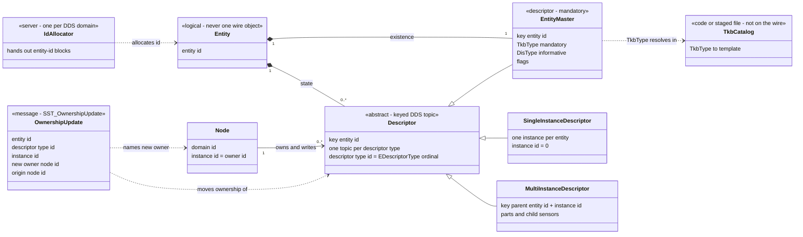
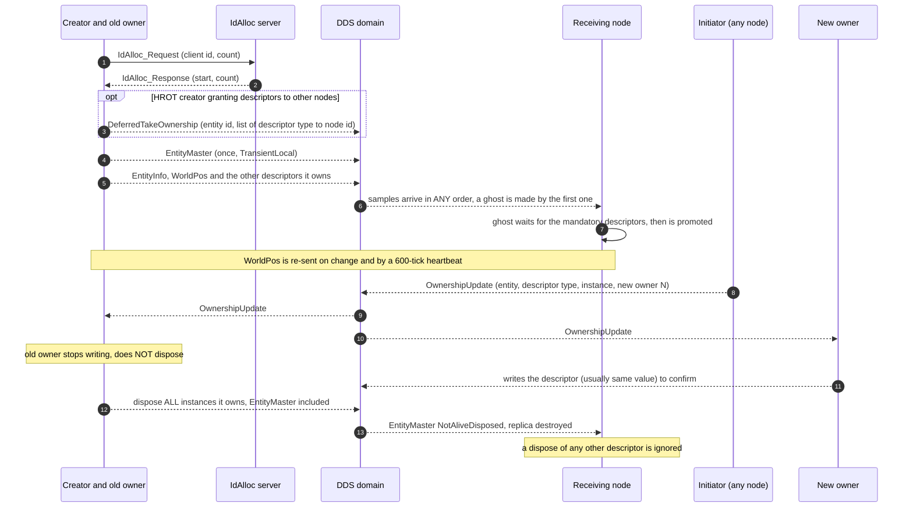
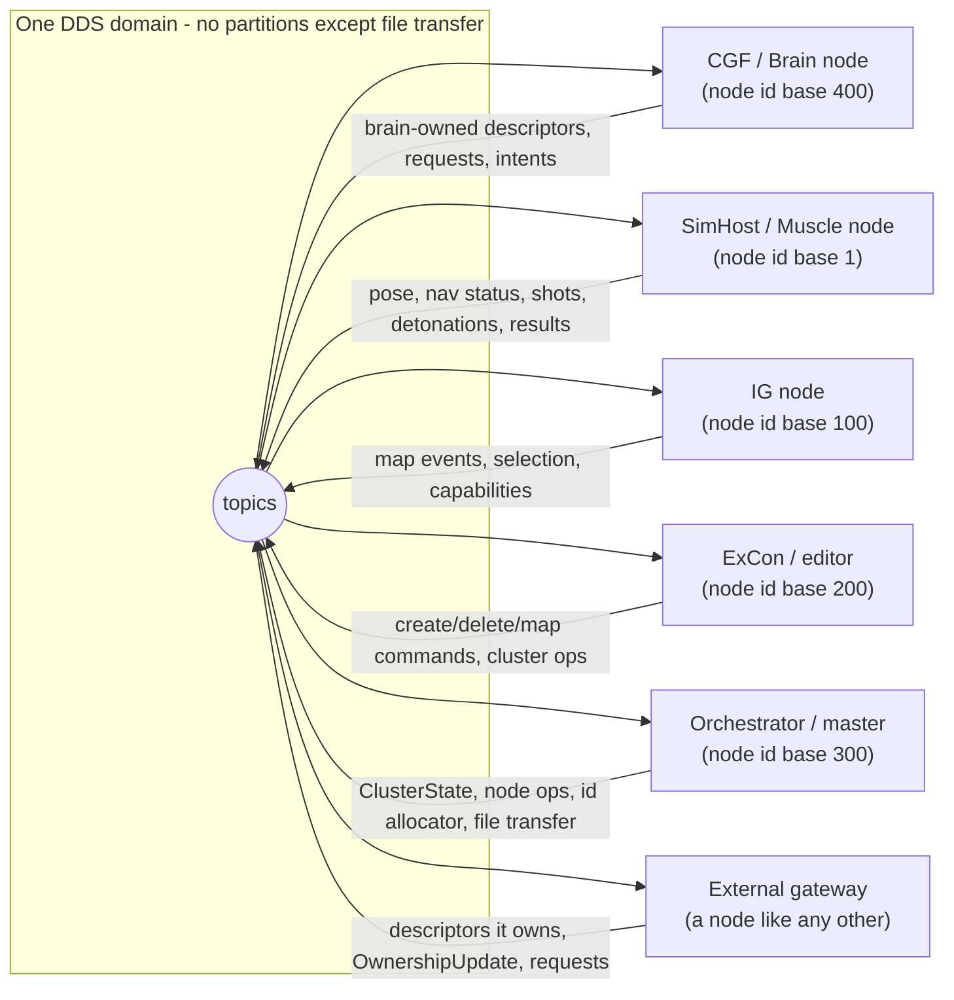

<!--STATUS
state: LIVE
updated: 2026-10-27
current-answer: the whole document; §Inventory is generated-checked by scripts/ned-wire-inventory.py --check
stale-below: nothing
known-rot: (1) ../projects/Hrot/Network/Hrot.Network.NED.md is dated 2026-05-23 — its "Key Wire Types" table covers 30 of the 128 wire types here; its EDescriptorType listing stops at 94 (the enum now has 77 entries, AllDescriptors.cs:6); it still lists AreaQueryRequestBatch / AreaQueryResponseBatch and Messages/AreaQueryMessages.cs, RETIRED 2026-10-01 (AllDescriptors.cs:42, file absent); its TacticalIntentRequest row says "[DdsTopic] managed" but the type carries no [DdsTopic] (topic bound by a translator constant). (2) The field comment on WorldPos.Time says "exercise FILETIME" (SimDescriptors.cs:21) but the value is SIMULATION seconds (SimStampCodec.cs:51). (3) The doc comment on OwnershipUpdate.DescrTypeId says "1=EntityState, 2=WeaponState" (Fdp.Network.Cyclone/Topics/OwnershipUpdate.cs) but the ordinals are EDescriptorType (dtWorldPos = 2, AllDescriptors.cs:6).
known-conflict: BDC_NED_SST_Descriptor_Rules.md (the authoritative spec) and the code differ in the places listed in §Code versus the spec; neither side has been reconciled by a ruling. Two C# types share the topic name "IGCapabilitiesAnnounce" (see §Inventory F).
related-designs:
  - BDC_NED_SST_Descriptor_Rules.md — OWNS the authoritative descriptor/ownership rules this reference summarises
  - ../projects/Hrot/Network/Hrot.Network.NED.md — the NED project's architecture overview (code structure, translators)
  - ../DESIGN_Entity_Genesis_End_To_End.md — OWNS the stage sequence of entity creation across nodes (ghost, promotion, takeover)
  - ../DESIGN_Ownership_Groups_And_Grants.md — OWNS which role writes which descriptor group, and the node-departure reclaim
  - ../DESIGN_Entity_Ownership_Transfer.md — OWNS how a node initiates an OwnershipUpdate
  - ../blueprints/Architect_Question_79_One_Ownership_Truth.md — OWNS the ownership decisions (push-only, R-166 external nodes use SST_OwnershipUpdate)
  - ../DESIGN_Deterministic_Network_Ids.md — OWNS the entity-id allocator semantics (world-boundary reset to 1000)
  - ../DESIGN_Dead_Reckoning.md — OWNS the WorldPos sim-time stamp and the dead-reckoning rules
  - ../DESIGN_Geo_Origin.md — OWNS where the local-metres to lat/lon origin comes from (the terrain)
  - ../designs/mgmt-1/DESIGN.md — OWNS cluster orchestration and §8.10 entity lifecycle during replay
  - ../DESIGN_Replay_Time_Axis_And_Review.md — OWNS the replay session layer (ReplaySession topic, axis, review)
  - ../DESIGN_Cross_Node_Construction_Barrier.md — OWNS the reliable-init barrier (WaitForAcks, EntityLifecycleStatus)
  - ../designs/dds-to-ecs/DESIGN.md — OWNS the rule that DDS types are DTOs behind translators
  - ../designs/bugs-2/BUG2-DESIGN.md — OWNS the sender-identity requirement (EnableSenderTracking) on every participant
  - ../RUNBOOK_Cluster_Debugging_Over_Http.md — OWNS the ddsmonitor wire-capture recipe (§5a)
  - ../blueprints/Architect_Question_93_Sumo_Traffic_Node.md — OWNS the SUMO traffic node, whose vehicles are NOT NED entities
-->

# NED on the wire — the DDS protocol of HROT

**What this is.** A living reference for anyone who must speak HROT's DDS protocol from outside (first reader: the DIS/HLA gateway
SimNetGateway). It states **concepts, rules and full C# type names** — never the members of a structure (they change; read the C# type
or the build-generated IDL, see Concepts §15). Every rule carries a `file:line` and/or a doc § citation; what could not be
determined says so.

**Reading order.** Diagrams (3) → Concepts and rules → Inventory (all 128 wire types) → For a protocol gateway → Code versus the spec.

**The one-paragraph model.** An entity is *nothing but* a set of keyed DDS instances ("descriptors"), one topic per descriptor type,
all sharing the entity id. `EntityMaster` alive = the entity exists. Each descriptor has its own owner (the node that writes it);
ownership moves with a small `OwnershipUpdate` message, never by dispose. Everything that is not state — commands, requests, shots,
detonations, cluster control — is a *message* on its own topic. Time is cluster-synchronised simulation time; positions on the wire are
geodetic WGS84.

## Diagrams

### 1. Concept model



*What the picture shows that prose could not:* the master is **a descriptor like the others** (same keying) but the only one whose
life is the entity's life; ownership belongs to `Node → Descriptor`, never to `Entity`; and the id allocator and the TKB catalog sit
**outside** the wire model (a gateway must reach both some other way).

### 2. An entity's life on the wire



*What the picture shows that prose could not:* **order is not a protocol** (DDS orders samples only per writer, so receivers tolerate
any arrival order), the id allocation is a *prerequisite round-trip*, ownership change is a message plus a confirming write while
**delete is a dispose of the master** — and a crash is absent from this picture on purpose: it produces no message at all (§Instance lifecycle).

### 3. Who talks to whom



*What the picture shows that prose could not:* there is **no broker and no per-pair channel** — every node reads every topic it cares
about and writes the descriptors it owns; "who may write what" is a convention enforced by the writers (§Ownership), so a gateway
joins as one more node (needing a node id and a sender identity, §Transport).

## Concepts and rules

Citation key: `path:line` = code in this repo (a path without a leading `Hrot/` or `FDP/` is relative to `Hrot/Network/Hrot.Network.NED/`); `§` = a document section. "Spec" = [BDC_NED_SST_Descriptor_Rules.md](BDC_NED_SST_Descriptor_Rules.md).

### 1. Transport

| Rule | Evidence |
|---|---|
| DDS stack is **CycloneDDS** through the **CycloneDDS.NET 0.3.2** bindings (`DdsParticipant`, `DdsReader<T>`, `DdsWriter<T>`); one participant per node | `Hrot/Engine/Hrot.Core/HrotEnvironment.cs:76`; package `cyclonedds.net/0.3.2` |
| **One DDS domain per deployment**, chosen by configuration (`DdsDomainId`; shipped default 0, code default 42 when absent). Tests use other ids | `Hrot/Subsystems/Hrot.SimHost/config.json:2`, `Hrot/Subsystems/Hrot.SimHost/NodeConfiguration.cs:54` |
| **No partitions on entity or message topics.** The only partition use: file-transfer chunks travel in a per-transfer partition | `Hrot/Network/Hrot.Network.NED/Transfer/DdsFileTransferProvider.cs:151,180` (searched: `grep -rniE partition Hrot/Network FDP/Network`) |
| A node's **identity** = `(AppDomainId = DDS domain id, AppInstanceId = node id)`, attached to every writer by `EnableSenderTracking`, which must be called **before** writers exist. Receivers resolve the writer of each sample to a node id from it. A writer without it is anonymous (owner −1) | `Hrot/Runner/Hrot.ClusterRunner/Program.cs:286-291`, `Hrot/Subsystems/Hrot.SimHost/SimHostApp.cs:360`, `Hrot/Subsystems/Hrot.IG/IgApplication.cs:714`, `Hrot/Subsystems/Hrot.CGF/CgfSubsystem.cs:650`; reader side `Hrot/Network/Hrot.Network.NED/Replication/Map/Ingress/EntityMasterIngressTranslator.cs:84-91,252`; §[BUG2-DESIGN](../designs/bugs-2/BUG2-DESIGN.md) 1.2 |
| How the identity travels on the wire: an internal topic named `__FcdcSenderIdentity` exists inside `CycloneDDS.Runtime.dll` 0.3.2 (found with `strings`); its layout is **not documented in this repo** | **not determinable from sources** (library internal). `ddsmonitor` shows it: [RUNBOOK §5a](../RUNBOOK_Cluster_Debugging_Over_Http.md) |
| **Node ids**: assigned per subsystem as `base + offset` (SimHost 1, IG 100, ExCon 200, Orchestrator 300, CGF 400, CI 500, Traffic 800, other 600), or **granted by the master** on request (`NodeIdRequest` → `NodeIdGrant`, keyed by computer hash + process id) | `Hrot/Runner/Hrot.ClusterRunner/Program.cs:800-816`; `Hrot/Network/Hrot.Network.NED/Factory/NodeIdBroker.cs:25` |
| Transport tuning (CycloneDDS XML, interface selection, discovery) | **not determinable from sources** — `CYCLONEDDS_URI` appears only in docs (`FDP/Docs/projects/relationships/DDS-Integration.md:435`); searched `grep -rln "CYCLONEDDS_URI\|cyclonedds.xml"` |

### 2. Entity = a set of descriptors

| Rule | Evidence |
|---|---|
| An entity is composed of descriptors and nothing else; each descriptor type has its own topic; which descriptors an entity type needs is a convention among apps | Spec L20-32; code mirrors it: `Hrot/Network/Hrot.Network.NED/GenericDescriptors.cs` header comment (L24-40) |
| Each descriptor type has a stable integer **ordinal** (`EDescriptorType`, 77 entries, never reused — retired: 93, 94, 121, 134). It is the "descriptor type id" of `OwnershipUpdate`, `DeferredTakeOwnership`, `UpdateEntityDescriptorRequest` | `Hrot/Network/Hrot.Network.NED/AllDescriptors.cs:6,42` |
| In code every descriptor is reached through an `IDescriptorTranslator` (carries `TopicName` + `DescriptorOrdinal`); DDS structs are DTOs, never the ECS components | graph: `search_graph Interface ".*Descriptor.*"` → `FDP/Engine/Fdp.Core/Abstractions/IDescriptorTranslator.cs:82`; §[dds-to-ecs](../designs/dds-to-ecs/DESIGN.md) 1 |
| Which descriptors a **replica** needs before it accepts an entity is *derived at runtime* from the TKB template (`MandatoryComponentResolver`), not listed anywhere; an unknown `TkbType` skips the gate entirely | `FDP/Toolkits/Fdp.Toolkits/Replication/Systems/GhostPromotionSystem.cs:225-296`. The per-type set: **not determinable from sources** as a static list |

### 3. EntityMaster

| Rule | Evidence |
|---|---|
| Mandatory for every entity; alive = entity exists. Carries entity id, `TkbType` (**mandatory**), `DisType` (7-field SISO-REF-010 decomposition, informative, all zeros = invalid), `Flags`, and the id of the creation request that made it | `GenericDescriptors.cs:97-122`; Spec L30,L115 |
| **No owner field** — the owner of the master is the *writer of the sample* (sender identity) | `GenericDescriptors.cs` (IMPORTANT NOTE under EntityMaster); `EntityMasterIngressTranslator.cs:84-91,252` |
| Published **exactly once** per entity by its owner; `TransientLocal` keeps it for late joiners | `Hrot/Network/Hrot.Network.NED/Replication/Map/Egress/EntityMasterEgressTranslator.cs:80-83,103-120` |
| Flag bits: `WaitForAcks` (reliable-init: receivers must report readiness), `Lightweight` (a replicated round: created Active on first sample, no ghost, no lifecycle; destroyed when the master is disposed) | `GenericDescriptors.cs:16-27`; `EntityMasterIngressTranslator.cs:220-232`; §[Cross-Node Barrier](../DESIGN_Cross_Node_Construction_Barrier.md) |
| **Name and force/side are NOT in the master** — they live in `EntityInfo` (name, `eForceIdentifier` UNKNOWN/FRIENDLY/OPPOSING/NEUTRAL = 0..3, commander id, tactical designation) | `GenericDescriptors.cs:133-139,169-200` |

### 4. Keys, instances and descriptor instance ids

| Rule | Evidence |
|---|---|
| A descriptor topic is **keyed by the entity id** (85 of the 128 wire types are keyed; the 43 unkeyed are messages or singletons) | `scripts/ned-wire-inventory.py` (a type is keyed when a member carries `[DdsKey]`) |
| Spec says `KeepLast 1` so `read_instance` returns one sample; HROT state topics are `Reliable + TransientLocal + KeepLast(1)` (kind `S`) | Spec L59; §QoS kinds below |
| **Multi-instance descriptors** are keyed by *(parent entity id + part/child instance id)*: turret pose and weapon task/status (part id = 2000 + turret index), the four EQS-family topics (child sensor index = `PartMetadata.InstanceId`) | `SimDescriptors.cs` comments at `EntityTurretPose`; `FDP/Toolkits/Fdp.Toolkits/Spatial/Eqs/EqsDdsTopics.cs:23-40` |
| Other composite keys: `MapEntitySymbol` (entity + map group), `SensorTrackState` (observer + target), `DescriptorOptimisticLock` (entity + descriptor type) | inventory §A, §F |
| For ownership a *(descriptor type, instance)* pair is packed as `(type << 32) OR instance` | `FDP/Toolkits/Fdp.Toolkits/Replication/Extensions/OwnershipExtensions.cs:16-28` |
| **Entity-id width is mixed**: `int32` on the older descriptors (`EntityMaster`, `EntityInfo`, `WorldPos`, `EntityDamage`, `NavigationIntent`, `NavigationStatus`, map descriptors, …: 19 types) and `int64` on later descriptors and on events (33 types); `0` = invalid. The id space is the same, so values < 2^31 are interchangeable | `scripts/ned-wire-inventory.py --verbose` key members; `Replication/Map/Egress/GeoSpatialEgressTranslator.cs:226` casts `(int)netId.Value` |

### 5. How entity ids are allocated

| Rule | Evidence |
|---|---|
| Ids come from a **central DDS id-allocator server** (blocks of ids): client writes `IdAlloc_Request` (alloc / reset / status), server answers `IdAlloc_Response` keyed by client id and publishes `IdAlloc_Status` (highest id) | `FDP/Network/Fdp.Network.Cyclone/Topics/IdAllocTopics.cs:20-60`; `FDP/Network/Fdp.Network.Cyclone/Services/DdsIdAllocatorServer.cs:13-100`; client `FDP/Network/Fdp.Network.Cyclone/Services/DdsIdAllocator.cs:22` |
| The server is hosted by the **orchestrator** (`CreateIdAllocatorServer`) | `Factory/NedNetworkFactory.cs:336`; `Factory/HostedIdAllocatorServer.cs:17`; `FDP/Network/Fdp.Network.Cyclone/Services/DdsIdAllocatorServer.cs:107-111` |
| **One allocator per DDS domain.** The topics carry no drill/session id | `FDP/Network/Fdp.Network.Cyclone/Topics/IdAllocTopics.cs` (no such member). *Differs from the spec's "multi-drill capable"* — see §Code versus the spec |
| At a **world boundary** the master resets the counter to **1000** and broadcasts `Resp_Reset`: entity ids **repeat across worlds/runs**, they are not globally unique over time | `FDP/Network/Fdp.Network.Cyclone/Services/DdsIdAllocatorServer.cs:119-136`; §[Deterministic Network Ids](../DESIGN_Deterministic_Network_Ids.md) 11 |
| `Req_Reset` sets the counter to the request's start value (empty client id = global reset + broadcast); the counter starts at 1 | `FDP/Network/Fdp.Network.Cyclone/Services/DdsIdAllocatorServer.cs:26,90-100` |

### 6. Instance lifecycle: creation, dispose, crash

| Rule | Evidence |
|---|---|
| Creation order on the wire is **not a protocol**: a receiver makes a *ghost* from the first sample of any descriptor, promotes it when the master and the mandatory descriptors are present; a ghost with no master after **3600 frames (60 s at 60 Hz)** is destroyed. HROT's own creator sends `DeferredTakeOwnership` first, then the master, then `WorldPos`/`EntityInfo` as "the guaranteed baseline" | `FDP/Toolkits/Fdp.Toolkits/Replication/Systems/GhostTimeoutSystem.cs:20`; §[Entity Genesis](../DESIGN_Entity_Genesis_End_To_End.md) 1.2. Spec L182-185 says "EntityMaster last, preferably" |
| **Delete = the owner disposes every descriptor instance it wrote** (`DisposeAll` over all translators), master included; also on a world wipe (owned entities only) | `FDP/Network/Fdp.Network.Cyclone/Systems/CycloneNetworkCleanupSystem.cs:210`; world wipe `:68-75` |
| A **receiver acts only on the EntityMaster dispose** (→ `DestroyEntityCommand`); every other descriptor's not-alive sample is skipped. A delete from a node that is not the entity's *known* primary owner is ignored | `EntityMasterIngressTranslator.cs:115-121,161-190`; e.g. `Replication/Map/EntityWeatherTranslators.cs:155` |
| **Crash of a partial owner**: HROT does *not* react to a descriptor dispose. Every node watches `NodeHeartbeat` / `NodeCapabilities` instances; when a node's instance goes not-alive each node *computes locally* that its descriptors return to the master's owner. **No message is sent** | `Hrot/Network/Hrot.Network.NED/Routing/ClusterCapabilityIngestSystem.cs:31,82-100`; `FDP/Toolkits/Fdp.Toolkits/Replication/Systems/PartialOwnerReclaimSystem.cs:39`; §[Ownership Groups](../DESIGN_Ownership_Groups_And_Grants.md) 5.3. *Differs from the spec's dispose-based rule* |
| Writer auto-dispose on unregister is **on** (library default) and not configurable through `[DdsQos]` (only reliability, durability, history are exposed) | §[Ownership Groups](../DESIGN_Ownership_Groups_And_Grants.md) 5.3 (CE-3000 ②) |
| Reliable-init: a creator may hold the entity *Constructing* until peers publish `EntityLifecycleStatus` (key = entity + node) | `FDP/Network/Fdp.Network.Cyclone/Topics/EntityLifecycleStatusDescriptor.cs:24`; §[Barrier](../DESIGN_Cross_Node_Construction_Barrier.md) |

### 7. Ownership

| Rule | Evidence |
|---|---|
| Ownership is **per descriptor** (and per instance); the owner is the node that writes it; **only the owner publishes** — enforced by the *writer* (a send gate on the node's own claim), not by DDS | Spec L129-137; `FDP/Network/Fdp.Network.Cyclone/Systems/CycloneEgressSystem.cs:19`; §[Q79](../blueprints/Architect_Question_79_One_Ownership_Truth.md) 0.7 (push-only) |
| **Default owners** are *role groups*: Brain group (mission, navigation intent, health, sensor/EQS config, brain intent, most state descriptors), MuscleGround group (`WorldPos`, `NavigationStatus`, turret pose, hit marks, descent), Perception group (EQS results); the **creator** keeps `EntityMaster`, `EntityInfo`, map descriptors | §[Ownership Groups](../DESIGN_Ownership_Groups_And_Grants.md) 2 |
| **Handoff**: any node sends `OwnershipUpdate` (topic `SST_OwnershipUpdate`, no key, `Reliable·Volatile·KeepAll`); the old owner stops writing **without dispose**; the new owner writes the descriptor to confirm. **External nodes use this very message** (no bridge, no mapping) | `FDP/Network/Fdp.Network.Cyclone/Topics/OwnershipUpdate.cs:10`; `Replication/Map/OwnershipUpdateTranslator.cs:41,120`; R-166 in [RULINGS](../blueprints/RULINGS.md); §[Ownership Transfer](../DESIGN_Entity_Ownership_Transfer.md) |
| The owner ids in `OwnershipUpdate` and in `DeferredTakeOwnership` are **node ids** = `AppInstanceId` of the sender identity (a single `int32`), the same value the receivers record as `PrimaryOwnerId` | `OwnershipUpdateTranslator.cs:80-90`; `EntityMasterIngressTranslator.cs:252` |
| The receiver of an `OwnershipUpdate` drops its own echo (`OriginNodeId == local`) | `OwnershipUpdateTranslator.cs:120` |
| **Grants at creation**: `DeferredTakeOwnership` (keyed by entity; list of *(descriptor type id → node id)*) arrives *before* the master; the target claims after promotion. HROT-specific — not in the spec | `Hrot/Network/Hrot.Network.NED/Messages/DeferredTakeOwnership.cs:39-75`; `Systems/DeferredTakeoverSystem.cs:44` |
| Changing a descriptor you do **not** own: send `UpdateEntityDescriptorRequest` (entity, descriptor type, part id, expected version, payload union) → `UpdateEntityDescriptorAck`; versions live in `DescriptorOptimisticLock` | `GenericMessages.cs:218-250`; `GenericDescriptors.cs:206` |
| One-shot actions on an entity you do not own travel to its owner as a typed request (`EntityInteractionRequest`); there is **no reply** — the result reappears as the target's own state | `Hrot/Network/Hrot.Network.NED/InteractionMessages.cs:265` |

### 8. QoS kinds (what each means for a late joiner)

The attribute `[DdsQos]` exposes only Reliability, Durability and History. The inventory's QoS column uses these codes:

| Code | Reliability · Durability · History | A late joiner... | Used for |
|---|---|---|---|
| `S` | Reliable · TransientLocal · KeepLast(1) | **gets the latest value of every instance** | state descriptors, singleton cluster state |
| `SL` | BestEffort · TransientLocal · KeepLast(1) | gets the latest retained value; loss repaired by next change or heartbeat | `WorldPos`, turret pose, hit marks, manual drive, node heartbeat |
| `SN` | Reliable · TransientLocal · KeepLast(N>1) | gets the last N (N = 64 or 100) | `SysOpStatus`, library demo master |
| `SA` | Reliable · TransientLocal · KeepAll | gets everything retained | `DescriptorOptimisticLock` |
| `Q` | Reliable · Volatile · KeepAll | **gets nothing**; no sample of a burst is lost | requests, acks, shots, detonations, commands |
| `QN` | Reliable · Volatile · KeepLast(N) | gets nothing; bounded burst | `MissileWarning` |
| `L` | BestEffort · Volatile · KeepLast(N) | gets nothing; cosmetic or high rate | `NearMiss`, `MeleeStrike`, `RoundImpact`, `AudioTargetDetected`, `SensorTargets`, library demo state |
| `B` | Reliable · Volatile · history not stated | gets nothing | raycast and path batches |
| `D` | **no `[DdsQos]` (or history only)** — library default; measured effect: *a reader keeps ONE sample*, so two events in one take overwrite each other | gets the library default | 9 types; the fire-pipeline events were moved off it for exactly that loss (`FireInteractionMessages.cs:27-29`) |

Counts over the 128 types: S 66 · Q 33 · D 9 · SL 6 · L 6 · B 4 · SN 2 · SA 1 · QN 1. The exact default of `D` is **not determinable from sources** (library 0.3.2); the "one sample" effect is the measured statement in `Hrot/Network/Hrot.Network.NED/FireInteractionMessages.cs:27-29` (CE-3095).

### 9. Descriptors versus messages

| Rule | Evidence |
|---|---|
| **Descriptor** = keyed state, retained (`S*`), has an owner, moves by `OwnershipUpdate`, deleted by dispose. **Message** = event, request, ack or command, volatile (`Q*`, `L`, `B`), has no owner, is never disposed. Inventory kind: 69 descriptors, 59 messages | inventory column "Kind" (rule: keyed ∧ TransientLocal ⇒ descriptor, with four manual exceptions listed in §Not determinable #10) |
| Messages carry the originating node id (`SourceNodeId`) so every node drops its own sample when it reads the topic back | `FireInteractionMessages.cs` (WeaponFire, RoundImpact, MunitionDetonation, EntityHitDamage) |
| A request is answered by an ack keyed by a **request id** (GUID or uint) — `CreateEntityRequest` → `CreateUpdateDeleteEntityAck`; `MissionControlRequest` → `MissionControlAck`; `ClusterOpRequest` → `SysOpStatus`; `WeaponFireRequest` → `WeaponFire` (carries the id and a refusal code) | `GenericMessages.cs:158-320`; `Hrot/Network/Hrot.Network.Orchestration/Orchestration/OrchestrationMessages.cs:191-215` |

### 10. Time and session control

| Rule | Evidence |
|---|---|
| **Simulation time is cluster-synchronised.** Each position sample carries the sender's *sim time* (not wall time) in `WorldPos.Time`: sim seconds as `DateTime` ticks (100 ns) **plus one tick** (0 ticks = "unspecified") | `FDP/Toolkits/Fdp.Toolkits/Replication/Components/SimStampCodec.cs:51`; `GeoSpatialEgressTranslator.cs:101,234` |
| Clock sync: slave sends `TimeSyncRequest` (keyed by client node id), master answers `TimeSyncResponse` with the four NTP timestamps; PLL-synchronised virtual wall clock | `FDP/Toolkits/Fdp.Toolkits/Time/Messages/TimeMessages.cs:202-235` |
| **Pause / resume / step / time scale** are operator requests: `ClusterOpRequest` with op `PauseTime`(10) / `ResumeTime`(11) / `StepTime`(14) / `SetTimeScale`(15); the master executes them by switching time mode at a wall-clock barrier (`SwitchTimeModeEvent`: continuous ↔ deterministic, with sim-time snapshot and scale) and, in deterministic mode, by lock-step `FrameOrder` / `FrameAck` | `Hrot/Network/Hrot.Network.NED/ExCon/NedTimeControlGateway.cs:24-60`; `Hrot/Subsystems/Hrot.Orchestrator/ClusterMaster.cs:429`; `OrchestrationMessages.cs:29-72`; `TimeMessages.cs:8-160` |
| **Cluster state machine** is the retained singleton `ClusterState` (`S`): Idle · Loading/Operating/Unloading × {Edit, Preview, Live, Replay, Review} · Degraded; carries exercise id, **session id**, replay axis. Transitions are requested by `ClusterOpRequest` op `TransitionState` (JSON payload with the target state) and driven by `NodeOpCommand` / `NodeOpStatus` per node | `OrchestrationMessages.cs:5-22,121-140`; payload type `Hrot/Network/Hrot.Network.Orchestration/NodeOpMasterTranslator.cs:125`. The JSON payload schema per operation: **not determinable from sources** as one document (see the senders, e.g. `Hrot/Runner/Hrot.ClusterRunner/Testing/OrchestratorActionHandlers.cs:140`) |
| Liveness: `NodeHeartbeat` (BestEffort retained) every node; static roles/features in `NodeCapabilities`; a node whose session id differs from the master's drops to Idle | `OrchestrationMessages.cs:339-380` |
| Scenario time of day: `EntityScenarioClock` on the world-environment entity (UTC ticks at sim time 0 + display offset); weather `EntityWeather` | `SimDescriptors.cs:140-170` |

### 11. Coordinate frames and units

| Rule | Evidence |
|---|---|
| **State positions are geodetic WGS84**: latitude/longitude in **degrees**, altitude in **metres above the WGS84 ellipsoid** (`GeoPoint`) | `Hrot/Network/Hrot.Network.NED/Common.cs:19-31`; `SimDescriptors.cs:11-26` |
| **Orientation** = Euler angles in **degrees** relative to the **local East-North-Up tangent frame** (not geocentric): heading compass 0 = North, 90 = East, clockwise; pitch nose-up positive; roll right-wing-down positive | `FDP/Toolkits/Fdp.Toolkits/Geographic/Systems/SimTransformBridgeSystem.cs:18-55` |
| **Velocity** is not a Cartesian vector: *azimuth (deg, = heading convention), elevation (deg), length (m/s)*; angular velocity in deg/s | `GeoSpatialEgressTranslator.cs:212-225,269-284` |
| **Acceleration is always published with zero length** (azimuth = heading only) | `GeoSpatialEgressTranslator.cs:213` |
| **Events and many commands carry LOCAL metres** ("world metres": X east, Y north, Z up, relative to the node's geo origin), not geodetic: aim point, shot origin and velocity, hit point (field comments say "world metres" / "world-space"). The other event positions (near miss, round impact, missile warning, EQS points, `FireInteractionEvent` X/Y) do not state their frame — presumably the same local frame, **not determinable from the comments** | `FireInteractionMessages.cs` (field comments); `FDP/Toolkits/Fdp.Toolkits/Geographic/Transforms/WGS84Transform.cs:8` |
| The local frame is a **flat ENU tangent plane at one origin**, accurate "< 100 km from origin"; the **origin comes from the loaded terrain** (no default). **No `[DdsTopic]` type carries the origin** — a gateway must learn it out of band | `WGS84Transform.cs:8-9`; §[Geo Origin](../DESIGN_Geo_Origin.md) 2. Searched `grep -rniE "originlat\|geoorigin\|OriginLongitude" Hrot/Network FDP/Network` (no hit) and the descriptor/message files |
| Time-stamped samples use **sim time**; durations in seconds (`float`), angles degrees, distances metres, speeds m/s | field comments throughout `SimDescriptors.cs`, `FireInteractionMessages.cs` |
| **Dead reckoning is receiver-side and implicit**: position projected linearly from the sample's pose + velocity × (sim-now − sample stamp); no algorithm id or parameter set on the wire. Owner re-sends `WorldPos` on change (1 cm / 0.5° / 5 cm·s⁻¹ thresholds) and **every 600 ticks (10 s at 60 Hz)** as a heartbeat | `FDP/Toolkits/Fdp.Toolkits/Replication/ReplicatedMotion.cs:20`; `GeoSpatialEgressTranslator.cs:125-131`; §[Dead Reckoning](../DESIGN_Dead_Reckoning.md) |

### 12. Entity typing: TKB type ids and DIS types

| Rule | Evidence |
|---|---|
| `TkbType` = integer (`int64`) id of a **template in the Template Knowledge Base**; **mandatory**. It decides what a receiver builds (components, mandatory descriptors) | `GenericDescriptors.cs:97-122`; `FDP/Toolkits/Fdp.Toolkits/Replication/Systems/GhostPromotionSystem.cs:225` |
| The **catalog is not on the wire.** It is code-registered at node start (`NedTkbCatalog`, `UrbanCombatTkbCatalog`, civilian/munition/effect/sound/voice/map-camera/area-effect catalogs) and, when present, replaced by a **staged TKB file** synced to all nodes | `Hrot/Engine/Hrot.Core/HrotEnvironment.cs:38-58`; `Hrot/Engine/Hrot.Core/MapDefinitions/Tkb/BdcTkbCatalog.cs:10`; `Hrot/Engine/Hrot.Core/Tkb/*Catalog.cs`; interface `FDP/Engine/Fdp.Core/Abstractions/ITkbDatabase.cs:10`. The file format/location: **not determinable from sources** here (the R-4018 "NAS master copy" is only referenced in `HrotEnvironment.cs:38`) |
| `DisType` is the DIS enumeration (kind.domain.country.category.subcategory.specific.extra) and is **optional per template** (`TkbTemplate.DisType`); the master publishes whatever the template/cold metadata holds (zeros when unset) | `FDP/Engine/Fdp.Core/Abstractions/TkbTemplate.cs:158`; `EntityMasterEgressTranslator.cs:87-110` |
| Munition/effect/sound types in events are **also TKB ids** (`MunitionType`, `AmmoGuid`) | `FireInteractionMessages.cs` |

### 13. Force / side

`EntityInfo.ForceIdentifier` (`eForceIdentifier`: UNKNOWN 0, FRIENDLY 1, OPPOSING 2, NEUTRAL 3) is the only side marker on an entity; the EQS family carries a faction bitmask instead (`FactionFilter`). No DIS-style "force id" on the master. `GenericDescriptors.cs:133-139`, `FDP/Toolkits/Fdp.Toolkits/Spatial/Eqs/EqsDdsTopics.cs:39`.

### 14. Recording and replay — what changes on the wire

| Rule | Evidence |
|---|---|
| **Recordings are ECS flight-recorder frames, not DDS captures** (the in-flight `.dds` capture was withdrawn). Replay therefore re-creates the *same topics* from the restored world: authoritative nodes republish; other nodes see ordinary samples | §[mgmt-1](../designs/mgmt-1/DESIGN.md) 8.10 and status block (R-3041) |
| Cluster state shows `LoadingReplay` / `OperatingReplay` / Review states, and the retained `ReplaySession` topic carries the replay's zero, length, time axis, marks | `OrchestrationMessages.cs:5-22,147-155`; §[Replay Time Axis](../DESIGN_Replay_Time_Axis_And_Review.md) |
| **After a backward seek, entities that did not survive are retracted by a dispose sweep** of the owning node, and unowned nodes purge their ghosts (inference, not measured: sim-time stamps on `WorldPos` also go backwards) | `CycloneNetworkCleanupSystem.cs:68-100,161`; §[mgmt-1](../designs/mgmt-1/DESIGN.md) 8.10 |
| Late joiners during replay still get retained state (`S`) from the republishing owners | inferred from `S` QoS; no separate evidence |

### 15. Schema and type names (for an external DDS client)

| Rule | Evidence |
|---|---|
| Types are generated to **IDL at build** into `<project>/obj/<cfg>/<tfm>/CycloneDdsGenerated/*.idl`, one file per `[DdsIdlFile("…")]` name (`hrot-generic-desc`, `hrot-sim-desc`, `hrot-map-desc`, `hrot-orchestration`, `hrot-anim-msgs`, …); **not committed** | `Hrot/Network/Hrot.Network.NED/obj/Debug/net8.0/CycloneDdsGenerated/hrot-generic-desc.idl` (build output) |
| The DDS **type name** is the C# namespace as IDL modules + type name (`Hrot::NED::Descriptors::EntityMaster`); extensibility is **`@appendable`**: new fields are only ever **appended** (marked "APPENDED" in comments), so an older reader keeps working | same generated IDL; R-169 in RULINGS |
| The **topic name** is the `[DdsTopic("…")]` string — and a **writer may override it** by name (`DdsWriterAdapter`); three types are bound to a topic only by a translator constant (marked † in the inventory) | `Hrot/Engine/Hrot.Core/Dds/DdsWriterAdapter.cs:31`; translators `BehaviorFaultTranslators.cs:28`, `SquadReportTranslators.cs:24`, `SimHost/TacticalIntentIngressTranslator.cs:27` |
| Some types are `[DdsManaged]` (strings, sequences, unions): variable length; a few payloads are **JSON text** (`ClusterOpRequest.PayloadJson`, EQS/survey results, attribute patches) | inventory; `GenericMessages.cs`, `OrchestrationMessages.cs` |
| The BDC stack uses the same layout under a **`BDC_` topic prefix** (4 types) | `Hrot/Network/Hrot.Network.BDC/BdcEntityMessages.cs:10,29`; inventory §J |

## Inventory

All **128** production wire types: **125** carry `[DdsTopic]`, **3** are bound to a topic by a translator constant (†). Full names are
**reflection style** (`Namespace.Type`; a nested type would print `Namespace.Outer+Nested` — none exists today). Kind and QoS legend
are in §Concepts 8 and 9; "Keyed" names the key *concept* only. Roots scanned: `Hrot/`, `FDP/`, `Stride/`; excluded roots: see
§Excluded roots. Family counts are informational; `--check` compares the full names only.

### A. Entity descriptors (keyed state of an entity) — 37

| Full name | Topic | Kind | Keyed | QoS | Assembly | Role |
|---|---|---|---|---|---|---|
| `Hrot.NED.Descriptors.DescriptorOptimisticLock` | `DescriptorOptimisticLock` | descriptor | yes: entity id + descriptor type | SA | Hrot.Network.NED | Version sidecar for optimistic descriptor updates |
| `Hrot.NED.Descriptors.EntityAreaEffectCloud` | `EntityAreaEffectCloud` | descriptor | yes: entity id | S | Hrot.Network.NED | Gas or smoke cloud description |
| `Hrot.NED.Descriptors.EntityCombatProficiency` | `EntityCombatProficiency` | descriptor | yes: entity id | S | Hrot.Network.NED | Soldier's combat proficiency values |
| `Hrot.NED.Descriptors.EntityCustody` | `EntityCustody` | descriptor | yes: entity id | S | Hrot.Network.NED | Person detained, restrained or searched |
| `Hrot.NED.Descriptors.EntityDamage` | `EntityDamage` | descriptor | yes: entity id | S | Hrot.Network.NED | Current and max health of the entity |
| `Hrot.NED.Descriptors.EntityDemeanour` | `EntityDemeanour` | descriptor | yes: entity id | S | Hrot.Network.NED | Civilian mode, fear and anger |
| `Hrot.NED.Descriptors.EntityDescent` | `EntityDescent` | descriptor | yes: entity id | S | Hrot.Network.NED | Body on a rope or under a canopy |
| `Hrot.NED.Descriptors.EntityDoorState` | `EntityDoorState` | descriptor | yes: entity id | S | Hrot.Network.NED | Live state of a terrain door |
| `Hrot.NED.Descriptors.EntityEffectState` | `EntityEffectState` | descriptor | yes: entity id | S | Hrot.Network.NED | Stored non-lethal effects of a person |
| `Hrot.NED.Descriptors.EntityEngagementArea` | `EntityEngagementArea` | descriptor | yes: entity id | S | Hrot.Network.NED | Sector assigned to a man or commander |
| `Hrot.NED.Descriptors.EntityGesture` | `EntityGesture` | descriptor | yes: entity id | S | Hrot.Network.NED | Arm gesture or idle mood of a person |
| `Hrot.NED.Descriptors.EntityHitMarks` | `EntityHitMarks` | descriptor | yes: entity id | SL | Hrot.Network.NED | Where rounds struck a body (ring) |
| `Hrot.NED.Descriptors.EntityHostileAct` | `EntityHostileAct` | descriptor | yes: entity id | S | Hrot.Network.NED | A man's hostile act and its kind |
| `Hrot.NED.Descriptors.EntityInfo` | `EntityInfo` | descriptor | yes: entity id | S | Hrot.Network.NED | Name, force/side, commander, tactical role |
| `Hrot.NED.Descriptors.EntityLean` | `EntityLean` | descriptor | yes: entity id | S | Hrot.Network.NED | Person leaning round a corner |
| `Hrot.NED.Descriptors.EntityLookState` | `EntityLookState` | descriptor | yes: entity id | S | Hrot.Network.NED | Wanted look direction and head turn |
| `Hrot.NED.Descriptors.EntityManualDrive` | `EntityManualDrive` | descriptor | yes: entity id | SL | Hrot.Network.NED | Operator motion axes for a manually driven body |
| `Hrot.NED.Descriptors.EntityMaster` | `EntityMaster` | descriptor | yes: entity id | S | Hrot.Network.NED | Entity existence, TKB type, DIS type, flags |
| `Hrot.NED.Descriptors.EntityObstacleShape` | `EntityObstacleShape` | descriptor | yes: entity id | S | Hrot.Network.NED | Static obstacle box, applied before promotion |
| `Hrot.NED.Descriptors.EntityOperatorUseStatus` | `EntityOperatorUseStatus` | descriptor | yes: entity id | S | Hrot.Network.NED | Verdict on the operator's last use press |
| `Hrot.NED.Descriptors.EntityPartDamage` | `EntityPartDamage` | descriptor | yes: entity id | S | Hrot.Network.NED | Damage level per body part |
| `Hrot.NED.Descriptors.EntityPassengers` | `EntityPassengers` | descriptor | yes: entity id | S | Hrot.Network.NED | Passenger list of a vehicle |
| `Hrot.NED.Descriptors.EntityPossessedBy` | `EntityPossessedBy` | descriptor | yes: entity id | S | Hrot.Network.NED | Which operator station holds the unit |
| `Hrot.NED.Descriptors.EntityScenarioClock` | `EntityScenarioClock` | descriptor | yes: entity id | S | Hrot.Network.NED | Scenario start time and display UTC offset |
| `Hrot.NED.Descriptors.EntitySpawnLevel` | `EntitySpawnLevel` | descriptor | yes: entity id | S | Hrot.Network.NED | Birth level and whether position owner applied it |
| `Hrot.NED.Descriptors.EntityTrafficDemand` | `EntityTrafficDemand` | descriptor | yes: entity id | S | Hrot.Network.NED | Scenario traffic settings |
| `Hrot.NED.Descriptors.EntityTurretPose` | `EntityTurretPose` | descriptor | yes: parent entity id + part instance id | SL | Hrot.Network.NED | Turret part pose, per part instance |
| `Hrot.NED.Descriptors.EntityUnderFire` | `EntityUnderFire` | descriptor | yes: entity id | S | Hrot.Network.NED | When the man was last hit or nearly missed |
| `Hrot.NED.Descriptors.EntityUtterance` | `EntityUtterance` | descriptor | yes: entity id | S | Hrot.Network.NED | What a person says now |
| `Hrot.NED.Descriptors.EntityWeaponAmmo` | `EntityWeaponAmmo` | descriptor | yes: entity id | S | Hrot.Network.NED | Ammunition, breech and heat per weapon mount |
| `Hrot.NED.Descriptors.EntityWeaponPosture` | `EntityWeaponPosture` | descriptor | yes: entity id | S | Hrot.Network.NED | Weapon posture: at ease, ready, aimed |
| `Hrot.NED.Descriptors.EntityWeaponSystemState` | `EntityWeaponSystemState` | descriptor | yes: entity id | S | Hrot.Network.NED | Weapon system deploy state |
| `Hrot.NED.Descriptors.EntityWeaponTask` | `EntityWeaponTask` | descriptor | yes: parent entity id + part instance id | S | Hrot.Network.NED | Standing order to one turret (Brain to Muscle) |
| `Hrot.NED.Descriptors.EntityWeaponTaskStatus` | `EntityWeaponTaskStatus` | descriptor | yes: parent entity id + part instance id | S | Hrot.Network.NED | Muscle's report on a turret order |
| `Hrot.NED.Descriptors.EntityWeather` | `EntityWeather` | descriptor | yes: entity id | S | Hrot.Network.NED | Authored weather, global or regional |
| `Hrot.NED.Descriptors.GroundClampingOverride` | `GroundClampingOverride` | descriptor | yes: entity id | S | Hrot.Network.NED | Per-entity ground clamping override for the IG |
| `Hrot.NED.Descriptors.WorldPos` | `WorldPos` | descriptor | yes: entity id | SL | Hrot.Network.NED | Geodetic pose, velocity, sim-time stamp |

### B. Interactions and events (fire, impact, damage, interaction) — 11

| Full name | Topic | Kind | Keyed | QoS | Assembly | Role |
|---|---|---|---|---|---|---|
| `Hrot.NED.Descriptors.AudioTargetDetected` | `AudioTargetDetected` | message | no | L | Hrot.Network.NED | Sound contact heard by a listener |
| `Hrot.NED.Messages.EntityHitDamage` | `EntityHitDamage` | message | no | Q | Hrot.Network.NED | Computed damage applied to a struck entity |
| `Hrot.NED.Messages.EntityInteractionRequest` | `EntityInteractionRequest` | message | no | Q | Hrot.Network.NED | Actor asks the target's owner to apply an interaction |
| `Hrot.NED.Messages.FireInteractionEvent` | `FireInteractionEvent` | message | no | D | Hrot.Network.NED | Shooter-to-target line for the IG (2-D) |
| `Hrot.NED.Messages.MeleeStrike` | `MeleeStrike` | message | no | L | Hrot.Network.NED | A blow was struck (cosmetic) |
| `Hrot.NED.Messages.MissileWarning` | `MissileWarning` | message | no | QN | Hrot.Network.NED | A guided missile was launched at an aircraft |
| `Hrot.NED.Messages.MunitionDetonation` | `MunitionDetonation` | message | no | Q | Hrot.Network.NED | A round detonated at a point or entity |
| `Hrot.NED.Messages.NearMiss` | `NearMiss` | message | no | L | Hrot.Network.NED | A round passed close to a unit |
| `Hrot.NED.Messages.RoundImpact` | `RoundImpact` | message | no | L | Hrot.Network.NED | A round marked a world surface (cosmetic) |
| `Hrot.NED.Messages.WeaponFire` | `WeaponFire` | message | no | Q | Hrot.Network.NED | A shot was fired (or refused) |
| `Hrot.NED.Messages.WeaponFireRequest` | `WeaponFireRequest` | message | no | Q | Hrot.Network.NED | Brain asks Muscle to fire a weapon |

### C. Mission, AI, perception and navigation — 16

| Full name | Topic | Kind | Keyed | QoS | Assembly | Role |
|---|---|---|---|---|---|---|
| `Hrot.NED.Descriptors.EntityMission` | `EntityMission` | descriptor | yes: entity id | S | Hrot.Network.NED | Active mission plan of an entity |
| `Hrot.NED.Descriptors.NavigationIntent` | `NavigationIntent` | descriptor | yes: entity id | S | Hrot.Network.NED | Brain's navigation command (CQRS command side) |
| `Hrot.NED.Descriptors.NavigationStatus` | `NavigationStatus` | descriptor | yes: entity id | S | Hrot.Network.NED | Muscle's navigation feedback (CQRS status side) |
| `Hrot.NED.Descriptors.PathRequestBatch` | `PathRequestBatch` | message | yes: source node id | B | Hrot.Network.NED | Batched path requests to the navigation solver |
| `Hrot.NED.Descriptors.PathResponseBatch` | `PathResponseBatch` | message | yes: target node id | B | Hrot.Network.NED | Batched path answers |
| `Hrot.NED.Descriptors.RaycastRequestBatch` | `RaycastRequestBatch` | message | yes: source node id | B | Hrot.Network.NED | Batched raycast requests to the navigation solver |
| `Hrot.NED.Descriptors.RaycastResponseBatch` | `RaycastResponseBatch` | message | yes: target node id | B | Hrot.Network.NED | Batched raycast answers |
| `Hrot.NED.Descriptors.SensorConfig` | `SensorConfig` | descriptor | yes: entity id | S | Hrot.Network.NED | Sensor configuration of an observer entity |
| `Hrot.NED.Descriptors.SensorTargets` | `SensorTargets` | descriptor | yes: observer entity id | L | Hrot.Network.NED | Per-observer snapshot of detected targets |
| `Hrot.NED.Descriptors.SensorTrackState` | `SensorTrackState` | descriptor | yes: observer entity id + target entity id | S | Hrot.Network.NED | Contact detected or lost, per observer and target |
| `Hrot.NED.Messages.BehaviorFaultReport` | `BehaviorFault` † | message | no | D | Hrot.Network.NED | A behaviour faulted; operator notification |
| `Hrot.NED.Messages.EntityBrainIntent` | `EntityBrainIntent` | descriptor | yes: entity id | S | Hrot.Network.NED | Unit's AI task, SOP and ROE |
| `Hrot.NED.Messages.MissionControlAck` | `MissionControlAck` | message | no | Q | Hrot.Network.NED | Reply to a mission control request |
| `Hrot.NED.Messages.MissionControlRequest` | `MissionControlRequest` | message | no | Q | Hrot.Network.NED | Command to start, stop or change a mission |
| `Hrot.NED.Messages.SquadReport` | `SquadReport` † | message | no | D | Hrot.Network.NED | Report up the chain of command |
| `Hrot.NED.Messages.TacticalIntentRequest` | `TacticalIntentRequest` † | message | no | D | Hrot.Network.NED | Commander brain to subordinate brain intent |

### D. Entity lifecycle, ownership and change requests — 10

| Full name | Topic | Kind | Keyed | QoS | Assembly | Role |
|---|---|---|---|---|---|---|
| `Fdp.Network.Cyclone.Topics.EntityLifecycleStatusDescriptor` | `EntityLifecycleStatus` | descriptor | yes: entity id + node id | S | Fdp.Network.Cyclone | Per-node readiness for reliable-init construction barrier |
| `Fdp.Network.Cyclone.Topics.OwnershipUpdate` | `SST_OwnershipUpdate` | message | no | Q | Fdp.Network.Cyclone | Per-descriptor ownership handoff (the spec's OwnershipUpdate) |
| `Hrot.NED.Messages.CreateEntityRequest` | `CreateEntityRequest` | message | no | Q | Hrot.Network.NED | Ask the creator node to create an entity |
| `Hrot.NED.Messages.CreateUpdateDeleteEntityAck` | `CreateUpdateDeleteEntityAck` | message | no | Q | Hrot.Network.NED | Unified ack for create, update and delete requests |
| `Hrot.NED.Messages.DeferredTakeOwnership` | `DeferredTakeOwnership` | message | yes: entity id | Q | Hrot.Network.NED | Pre-genesis grant table: who will own which descriptor |
| `Hrot.NED.Messages.DeleteEntityRequest` | `DeleteEntityRequest` | message | no | Q | Hrot.Network.NED | Ask the owner to delete an entity |
| `Hrot.NED.Messages.EntityAttributeSchema` | `EntityAttributeSchema` | descriptor | yes: node id | S | Hrot.Network.NED | JSON schema of attributes a node accepts |
| `Hrot.NED.Messages.UpdateEntityAttributeRequest` | `UpdateEntityAttributeRequest` | message | no | Q | Hrot.Network.NED | JSON or binary attribute patch for an owned entity |
| `Hrot.NED.Messages.UpdateEntityDescriptorAck` | `UpdateEntityDescriptorAck` | message | no | Q | Hrot.Network.NED | Result of a descriptor update request |
| `Hrot.NED.Messages.UpdateEntityDescriptorRequest` | `UpdateEntityDescriptorRequest` | message | no | Q | Hrot.Network.NED | Ask the owner to change a descriptor it owns |

### E. Id allocation and node identity — 5

| Full name | Topic | Kind | Keyed | QoS | Assembly | Role |
|---|---|---|---|---|---|---|
| `Fdp.Network.Cyclone.Topics.IdRequest` | `IdAlloc_Request` | message | yes: client id | Q | Fdp.Network.Cyclone | Entity-id block request to the allocator server |
| `Fdp.Network.Cyclone.Topics.IdResponse` | `IdAlloc_Response` | message | yes: client id | Q | Fdp.Network.Cyclone | Allocator's granted id block, reset broadcast |
| `Fdp.Network.Cyclone.Topics.IdStatus` | `IdAlloc_Status` | message | no | S | Fdp.Network.Cyclone | Highest entity id allocated so far |
| `Hrot.NED.Descriptors.Orchestration.NodeIdGrant` | `NodeIdGrant` | message | yes: computer hash + process id | S | Hrot.Network.Orchestration | Master's node-id grant or refusal |
| `Hrot.NED.Descriptors.Orchestration.NodeIdRequest` | `NodeIdRequest` | message | yes: computer hash + process id | S | Hrot.Network.Orchestration | Process asks the master for a node id |

### F. Map, gizmo and operator UI — 15

| Full name | Topic | Kind | Keyed | QoS | Assembly | Role |
|---|---|---|---|---|---|---|
| `Hrot.IG.Gizmos.IGCapabilitiesAnnounce` | `IGCapabilitiesAnnounce` | descriptor | yes: node id | S | Hrot.IG | Same topic name, different type (dormant, not registered) |
| `Hrot.NED.Descriptors.IGCapabilitiesAnnounce` | `IGCapabilitiesAnnounce` | descriptor | yes: map id | S | Hrot.Network.NED | IG announces layer tree and config schemas (map keyed) |
| `Hrot.NED.Descriptors.MapConfigStatus` | `MapConfigStatus` | descriptor | yes: map id | S | Hrot.Network.NED | Full map configuration state reported by an IG |
| `Hrot.NED.Descriptors.MapEntitySymbol` | `MapEntitySymbol` | descriptor | yes: entity id + map group id | S | Hrot.Network.NED | Per-map-group symbol override for an entity |
| `Hrot.NED.Descriptors.MapInteractionConfig` | `MapInteractionConfig` | descriptor | yes: map group id + map id | S | Hrot.Network.NED | Map layers and tools configuration, ExCon to IG |
| `Hrot.NED.Descriptors.MapRoute` | `MapRoute` | descriptor | yes: entity id | S | Hrot.Network.NED | Waypoint route of an entity |
| `Hrot.NED.Descriptors.MapVisualOverlay` | `MapVisualOverlay` | descriptor | yes: entity id | S | Hrot.Network.NED | Tactical graphic overlay attached to an entity |
| `Hrot.NED.Messages.ContextActionInvoked` | `ContextActionInvoked` | message | no | Q | Hrot.Network.NED | User picked a context-menu action |
| `Hrot.NED.Messages.ContextActionsUpdate` | `ContextActionsUpdate` | message | no | Q | Hrot.Network.NED | Pushed context-menu definition for a selection |
| `Hrot.NED.Messages.ContextMenuRequest` | `ContextMenuRequest` | message | no | Q | Hrot.Network.NED | IG asks ExCon for a missing context menu |
| `Hrot.NED.Messages.DragEvent` | `DragEvent` | message | no | Q | Hrot.Network.NED | Drag gesture on the map |
| `Hrot.NED.Messages.MapClickEvent` | `MapClickEvent` | message | no | Q | Hrot.Network.NED | Click on the map with the hit stack |
| `Hrot.NED.Messages.MapCommandAck` | `MapCommandAck` | message | no | Q | Hrot.Network.NED | IG's answer to a map command |
| `Hrot.NED.Messages.MapCommandRequest` | `MapCommandRequest` | message | no | Q | Hrot.Network.NED | Imperative command from ExCon to one IG |
| `Hrot.NED.Messages.SelectionChangedEvent` | `SelectionChangedEvent` | message | no | D | Hrot.Network.NED | Selection set changed (IG is authoritative) |

### G. Time, session and cluster orchestration — 20

| Full name | Topic | Kind | Keyed | QoS | Assembly | Role |
|---|---|---|---|---|---|---|
| `Fdp.Toolkit.Time.Messages.FrameAckDescriptor` | `FrameAck` | message | no | D | Fdp.Toolkits | Lock-step: node acknowledges a frame |
| `Fdp.Toolkit.Time.Messages.FrameOrderDescriptor` | `FrameOrder` | message | no | D | Fdp.Toolkits | Lock-step: master orders the next frame |
| `Fdp.Toolkit.Time.Messages.SwitchTimeModeWireDto` | `SwitchTimeModeEvent` | message | no | S | Fdp.Toolkits | Switch continuous / deterministic time at a barrier |
| `Fdp.Toolkit.Time.Messages.TimeSyncRequest` | `TimeSyncRequest` | message | yes: client node id | D | Fdp.Toolkits | Slave starts the NTP-style clock handshake |
| `Fdp.Toolkit.Time.Messages.TimeSyncResponse` | `TimeSyncResponse` | message | yes: client node id | D | Fdp.Toolkits | Master's reply with four timestamps |
| `Hrot.DDS.DataModel.Runner.SubsystemStatusAnnounce` | `SubsystemStatusAnnounce` | descriptor | yes: node id | S | Hrot.Network.NED | Subsystem presence for the waiting-room protocol |
| `Hrot.NED.Descriptors.Orchestration.AssetInventoryTopic` | `AssetInventory` | descriptor | yes: node id | S | Hrot.Network.Orchestration | Scenario and exercise asset lists (every 5 s) |
| `Hrot.NED.Descriptors.Orchestration.ClusterOpRequest` | `ClusterOpRequest` | message | no | Q | Hrot.Network.Orchestration | Operator request: state change, pause, step, save ... |
| `Hrot.NED.Descriptors.Orchestration.ClusterOpStatus` | `SysOpStatus` | message | no | SN | Hrot.Network.Orchestration | Result of a cluster operation (SysOpStatus) |
| `Hrot.NED.Descriptors.Orchestration.ClusterStateTopic` | `ClusterState` | message | no | S | Hrot.Network.Orchestration | Cluster state machine state and session id |
| `Hrot.NED.Descriptors.Orchestration.FileAck` | `FileAck` | message | yes: transfer id + node id + file index | Q | Hrot.Network.Orchestration | Target's transfer progress or verdict |
| `Hrot.NED.Descriptors.Orchestration.FileChunk` | `FileChunk` | message | yes: transfer id | Q | Hrot.Network.Orchestration | 64 KB file piece in the transfer's partition |
| `Hrot.NED.Descriptors.Orchestration.FileNeed` | `FileNeed` | message | yes: transfer id + node id | Q | Hrot.Network.Orchestration | Target lists the files it lacks |
| `Hrot.NED.Descriptors.Orchestration.FileOffer` | `FileOffer` | message | yes: transfer id | Q | Hrot.Network.Orchestration | Master offers a file transfer to targets |
| `Hrot.NED.Descriptors.Orchestration.NodeCapabilitiesTopic` | `NodeCapabilities` | descriptor | yes: node id | S | Hrot.Network.Orchestration | Static capability and role tokens of a node |
| `Hrot.NED.Descriptors.Orchestration.NodeHeartbeat` | `NodeHeartbeat` | descriptor | yes: node id | SL | Hrot.Network.Orchestration | Node liveness and cluster state telemetry |
| `Hrot.NED.Descriptors.Orchestration.NodeOpCommand` | `NodeOpCommand` | message | yes: target node id | Q | Hrot.Network.Orchestration | Master's per-node operation command |
| `Hrot.NED.Descriptors.Orchestration.NodeOpStatus` | `NodeOpStatus` | message | no | Q | Hrot.Network.Orchestration | Node's reply to a node operation |
| `Hrot.NED.Descriptors.Orchestration.OrchestratorContextTopic` | `OrchestratorContext` | message | no | S | Hrot.Network.Orchestration | Exercise, scenario and required nodes context |
| `Hrot.NED.Descriptors.Orchestration.ReplaySessionTopic` | `ReplaySession` | message | no | S | Hrot.Network.Orchestration | Replay session layer: zero, length, axis, marks |

### H. EQS (environment-query sensors) — 4

| Full name | Topic | Kind | Keyed | QoS | Assembly | Role |
|---|---|---|---|---|---|---|
| `Fdp.Toolkit.Perception.Survey.Topics.WorldSurveyResultTopic` | `WorldSurveyResult` | descriptor | yes: parent entity id + child instance id | S | Fdp.Toolkits | World-survey sensor answer (JSON payload) |
| `Fdp.Toolkit.Spatial.Eqs.Topics.EqsResultTopic` | `EqsResult` | descriptor | yes: parent entity id + child instance id | S | Fdp.Toolkits | Ranked EQS results back to the brain |
| `Fdp.Toolkit.Spatial.Eqs.Topics.EqsSensorConfigTopic` | `EqsSensorConfig` | descriptor | yes: parent entity id + child instance id | S | Fdp.Toolkits | Brain's EQS sensor parameters, per child sensor |
| `Fdp.Toolkit.Squad.DangerArea.Topics.DangerAreaResultTopic` | `DangerAreaResult` | descriptor | yes: parent entity id + child instance id | S | Fdp.Toolkits | Danger-area sensor answer |

### I. Animation — 4

| Full name | Topic | Kind | Keyed | QoS | Assembly | Role |
|---|---|---|---|---|---|---|
| `Hrot.Animation.Replication.DdsLookAtChannelIntent` | `hrot/anim/intent/LookAtChannel` | descriptor | yes: entity id | S | Hrot.Animation.Replication | Look-at channel intent, Brain to Muscle |
| `Hrot.Animation.Replication.DdsLookAtChannelStatus` | `hrot/anim/status/LookAtChannel` | descriptor | yes: entity id | S | Hrot.Animation.Replication | Look-at channel status, Muscle to Brain |
| `Hrot.Animation.Replication.DdsStanceIntent` | `hrot/anim/StanceIntent` | descriptor | yes: entity id | S | Hrot.Animation.Replication | Wanted stance, Brain to Muscle |
| `Hrot.Animation.Replication.DdsStanceStatus` | `hrot/anim/StanceStatus` | descriptor | yes: entity id | S | Hrot.Animation.Replication | Current stance and transition, Muscle to Brain |

### J. Other (alternative BDC stack, library demo topics, status) — 6

| Full name | Topic | Kind | Keyed | QoS | Assembly | Role |
|---|---|---|---|---|---|---|
| `Fdp.Network.Cyclone.Topics.EntityMasterTopic` | `SST_EntityMaster` | descriptor | yes: entity id | SN | Fdp.Network.Cyclone | FDP library demo master; no HROT production use |
| `Fdp.Network.Cyclone.Topics.EntityStateTopic` | `SST_EntityState` | descriptor | yes: entity id | L | Fdp.Network.Cyclone | FDP library demo state; no HROT production use |
| `Hrot.BDC.Messages.BdcEntityMaster` | `BDC_EntityMaster` | descriptor | yes: entity id | S | Hrot.Network.BDC | BDC stack: entity existence (BDC_ prefix) |
| `Hrot.BDC.Messages.BdcMissionControlAck` | `BDC_MissionControlAck` | message | no | Q | Hrot.Network.BDC | BDC stack: mission control ack |
| `Hrot.BDC.Messages.BdcMissionControlRequest` | `BDC_MissionControlRequest` | message | no | Q | Hrot.Network.BDC | BDC stack: mission control request |
| `Hrot.BDC.Messages.BdcWorldPos` | `BDC_WorldPos` | descriptor | yes: entity id | SL | Hrot.Network.BDC | BDC stack: pose and velocity |


## Excluded roots

`scripts/ned-wire-inventory.py` skips these roots — **excluded from §Inventory, still real on the wire in some deployments**:

| Root | Why excluded | What is there |
|---|---|---|
| any `*.Tests` / `Tests` project | test doubles and rails, not product protocol | 4 types (`ned-wire-inventory.py --all` lists them) |
| `FDP/Examples/**` | demo programs | 8 types (`Fdp.Examples.DDS` 5, `Fdp.Examples.DER` 3) |
| `docs/blueprints/experiments/**` | experiments, not built into the product; outside the three scanned roots | 1 file with `[DdsTopic("FileBlob")]` (found by grep, not by the script) |
| `FDP/ExtDeps/GizmoMap` | vendored third-party library (not HROT-owned); **but its topics ride the same domain**: `GizmoInteractionBatch`, `DebugPrimitivesBatch`, `GizmoUiState`, `StringInternEntry`, and a second **`EntityAttributeSchema`** type — the same topic name as `Hrot.NED.Messages.EntityAttributeSchema` | 5 types |
| `FDP/ExtDeps/SumoSharp` | vendored SUMO traffic bridge; **SUMO vehicles are not NED entities** — they travel on `sumo/*` topics (`sumo/vehicles`, `sumo/vehicles-structured`, `sumo/lifecycle`, `sumo/geometry`, `sumo/tl`, `sumo/commands`, `sumo/status`, `sumo/ped-patharc`, `sumo/ped-lifecycle`, `sumo/ped-crowd`, `sumo/ped-activity`) | 11 types; §[Q93](../blueprints/Architect_Question_93_Sumo_Traffic_Node.md) |
| `bin/`, `obj/` | build output | — |

## For a protocol gateway (DIS/HLA)

### What a gateway must do to be a NED node

1. Pick or request a **node id** (`NodeIdRequest` → `NodeIdGrant`, or a fixed id outside the ranges above) and **enable sender identity** with `(domain id, node id)` — otherwise HROT cannot tell who owns what.
2. Get **entity ids** from the allocator (`IdAlloc_*`, a string client id); ids restart at 1000 after a world reset.
3. To *introduce* an entity: publish `EntityMaster` (with a `TkbType` that exists in the receivers' TKB — otherwise the replica skips its mandatory-descriptor gate), `EntityInfo` and `WorldPos`, then whatever else it owns; **keep re-sending `WorldPos`** (HROT does every 10 s). To *ask HROT* to create one instead: `CreateEntityRequest` → `CreateUpdateDeleteEntityAck`.
4. To *remove* an entity: dispose its `EntityMaster` (and its other instances). Never dispose a descriptor to hand it over — send `OwnershipUpdate`.
5. Never write a descriptor you do not own; to change someone else's: `UpdateEntityDescriptorRequest` / `UpdateEntityAttributeRequest`.

### Concept mapping: DIS PDU families and RPR FOM classes ↔ HROT topics

| DIS / RPR concept | HROT counterpart (full type names) | Gap or caution |
|---|---|---|
| Entity State PDU / `BaseEntity.PhysicalEntity` | `Hrot.NED.Descriptors.EntityMaster` + `EntityInfo` + `WorldPos` (+ `EntityDamage`, `EntityPartDamage`, `EntityTurretPose`) | no single message; assemble from 3+ topics keyed by entity id |
| Entity ID (site, application, entity) | HROT entity id (`int32`/`int64`) + owner node id (`AppInstanceId`) | **not carried**; the gateway maps an id range |
| Entity Type (kind.domain.country.category.subcategory.specific.extra) | `EntityMaster.DisType` (optional) + `TkbType` (mandatory) | `DisType` may be zeros; the TKB↔DIS table is **not on the wire** |
| Marking | `EntityInfo.Name` (free string) | DIS marking is 11 characters |
| Force ID | `EntityInfo.ForceIdentifier` | values 0..3 (UNKNOWN, FRIENDLY, OPPOSING, NEUTRAL); the numbering coincides with the DIS Force ID values Other, Friendly, Opposing, Neutral (SISO-REF-010, from general knowledge — not checked in this repo) |
| Location (ECEF metres) | `WorldPos` position: lat/lon deg, alt m above ellipsoid | **ECEF is a GAP** — convert; the node's lat/lon comes from a flat ENU plane at the terrain origin (≈ valid < 100 km) |
| Orientation (psi, theta, phi, geocentric radians) | `WorldPos` heading/pitch/roll **degrees, local ENU** | **GAP**: not geocentric, degrees, compass heading |
| Linear velocity (ECEF m/s) | `WorldPos` velocity as azimuth/elevation/length | convert; angular velocity deg/s available |
| Linear acceleration | `WorldPos` acceleration — **always zero length** | **GAP** (never real) |
| Dead-reckoning algorithm + parameters | none; receiver-side linear projection from sim-time stamp | **GAP**: pick DIS algorithm FPW (position + velocity) yourself |
| Entity appearance, damage state | `EntityDamage` (current / max health, floats), `EntityPartDamage`, `EntityEffectState` | thresholds to DIS's 4 damage states are **not defined** by HROT |
| Articulated parts | `EntityTurretPose` (per turret part, azimuth/elevation) | other parts: none |
| Fire PDU | `Hrot.NED.Messages.WeaponFire` (the fact) ← `WeaponFireRequest` (the order) | positions in **local metres**; munition = TKB id; event id = `RequestId` (32-bit), no GUID |
| Detonation PDU | `Hrot.NED.Messages.MunitionDetonation` (+ `EntityHitDamage` for the damage result) | no result enum: hit entity 0 = ground impact; detonation location local metres |
| Collision PDU | **none** — searched `search_graph Class ".*Collision.*"` (only editor/test/example hits) and `grep -rn Collision Hrot/Network/Hrot.Network.NED` | **GAP** |
| Start/Resume, Stop/Freeze (Simulation Management) | `ClusterOpRequest` ops `ResumeTime` / `PauseTime` / `StepTime` / `SetTimeScale`; state in `ClusterState` | no "Stop" of the whole exercise: that is a `TransitionState` to an Unloading state |
| Create Entity / Remove Entity PDU, Acknowledge | `CreateEntityRequest` / `DeleteEntityRequest` → `CreateUpdateDeleteEntityAck` | ack carries a request GUID; creation is "ask the creator node", not a command to a federate |
| Action Request (set data) | `UpdateEntityDescriptorRequest` / `UpdateEntityAttributeRequest` | JSON paths for attributes (schema published as `EntityAttributeSchema`) |
| Transfer Control / HLA ownership management | `Fdp.Network.Cyclone.Topics.OwnershipUpdate` per descriptor | richer than DIS: per-descriptor, per-instance |
| Emissions, designator, radio/signal, IFF, electromagnetic | **none** — searched `grep -rniE "\biff\b\|emission\|radio\|transponder" Hrot/Network FDP/Network` (only substring hits inside "Mission"); `search_graph` name regex hits were unrelated ("Diff") | **GAP** |
| HLA object class / attribute | entity (EntityMaster) / descriptor | attribute ownership ≈ descriptor ownership |
| HLA interaction | any **message** topic (§Inventory kind = message) | |
| HLA federation save/restore, time management | `ClusterOpRequest` ops `TakeCheckpoint` / `RestoreCheckpoint` / pause / step; cluster sim time | no HLA time-advance (LBTS) semantics: HROT is a lock-step or continuous cluster clock |

**What HROT carries that DIS does not:** per-descriptor ownership, mission and AI commands (`EntityMission`, `NavigationIntent`, `EntityBrainIntent`), sensor/EQS pipelines, TKB ids, sim-time stamps, cluster orchestration and file transfer.
**What DIS needs that NED does not carry:** ECEF/geocentric frames, DR parameters, entity-id triple, marking length rules, appearance bits, emissions/IFF/radio, collision, DIS timestamps.

### SimNetGateway simplified model → real HROT types

Source: `SimNetGateway.Protocol.Ned/NedMessages.cs` and DD-001 §9, Appendix A (`/home/user/pjanec/simnetgateway/docs/design/DD-001-Gateway-Engine-PoC.md`).

| Gateway message | Real HROT type(s) | Mismatch to handle |
|---|---|---|
| `NedEntityMaster(Id, Name, TkbType, Force)` | `Hrot.NED.Descriptors.EntityMaster` (id, `TkbType`) **+** `Hrot.NED.Descriptors.EntityInfo` (name, force) | Name and Force are in **EntityInfo**; `TkbType` is `int64`; ids are `int32` on these topics (gateway `ulong`); the master also holds `DisType`, flags, request id |
| `NedGeoSpatial(Id, lat, lon, alt, heading, pitch, roll, speed)` | `Hrot.NED.Descriptors.WorldPos` | speed = velocity *length* with azimuth/elevation; heading compass-North, ENU Euler; has sim-time stamp, angular velocity; acceleration always zero; sender must re-send every ≤ 10 s |
| `NedEntityDamage(Id, Level 0..3)` | `Hrot.NED.Descriptors.EntityDamage` (current, max health floats); event `Hrot.NED.Messages.EntityHitDamage` (HP lost) | **no discrete level**; derive from current/max — the thresholds are the gateway's decision |
| `NedWeaponStatus(Id, SelectedMunitionTkb, Ammo, Member)` | `Hrot.NED.Descriptors.EntityWeaponAmmo` (per mount ammo + loaded round type), `EntityWeaponPosture`, `EntityWeaponSystemState` | **no "selected munition" field**; ammo is per mount (up to 4); no formation `Member` index |
| `NedEntityDisposed(Id)` | **a dispose of the `EntityMaster` instance** (+ its other descriptors by the owner) | not a message: read `InstanceState`, check the disposer is the owner |
| `NedWeaponFire(FireId, Shooter, Target, MunitionTkb, lat/lon/alt, Quantity, …)` | `Hrot.NED.Messages.WeaponFire` (and `WeaponFireRequest`) | position is **local metres** + velocity; `FireId` GUID ↔ `RequestId` uint32; `MunitionTkb` ↔ `AmmoGuid` (TKB id, `int64`); target 0 = none/point; formation members: none |
| `NedDetonation(DetonationId, Target, MunitionTkb, lat/lon/alt, Result, TargetDamage, …)` | `Hrot.NED.Messages.MunitionDetonation` + `EntityHitDamage` | local metres; no result enum (hit entity 0 = terrain); damage arrives as a *separate* message, HP not level; no id |
| `NedSimControl(Load / LoadDebrief / Start / Pause / Resume / Unload, scenario)` | `Hrot.NED.Descriptors.Orchestration.ClusterOpRequest` (`TransitionState` toward Loading/Operating/Unloading Live or Replay states; `PauseTime`, `ResumeTime`) observed through `ClusterStateTopic` | **approximate** — state machine is richer (Edit, Preview, Review); scenario id travels in `OrchestratorContextTopic`; the exact `TransitionState` payload per gateway kind was **not verified** |
| `NedFormation(Id, Name, TkbType, Force, Members[])` | **no real equivalent**: members are separate entities; the unit hierarchy is `EntityInfo` (commander id, tactical designation) | a composite "unit" has no single descriptor; vehicle occupants: `EntityPassengers` |
| `NedFireAmmunition(FireId, MunitionTkb, Quantity)` | **no real equivalent** (quantity and munition ride on `WeaponFire`) | the gateway's split-fire shape does not exist on the wire |
| `NedDamageNotification(Id, Member, Old, New)` | **no real equivalent** (outbound notification) | derive from `EntityDamage` changes |
| `NedIffStatus(Id, Mode)` | **no real equivalent** | see the IFF search above |

## Code versus the spec

Spec = [BDC_NED_SST_Descriptor_Rules.md](BDC_NED_SST_Descriptor_Rules.md). Where code differs, this document describes the **code**.

| # | Spec says | Code does | Where |
|---|---|---|---|
| 1 | `EntityId` is `long` in every descriptor (L40-57) | **mixed**: `int32` on 19 descriptor types (`EntityMaster`, `WorldPos`, …), `int64` on 33 | `GenericDescriptors.cs:97`, `SimDescriptors.cs:17`, `FDP/Network/Fdp.Network.Cyclone/Topics/OwnershipUpdate.cs` (long) |
| 2 | `EntityMaster.DisType` is a `uint64` (L122) | a 7-field **struct** `DisTypeStruct` | `GenericDescriptors.cs:53,97-122`. Also: `StaticType` (spec L111) does not exist |
| 3 | `OwnershipUpdate.NewOwner` is a `NodeId { Domain, Node }` (L150-172) | a single **`int32` node id**, plus `OriginNodeId` and `Timestamp` fields not in the spec | `FDP/Network/Fdp.Network.Cyclone/Topics/OwnershipUpdate.cs:10-55`; R-166 states "same thing as the spec's" without reconciling the shape |
| 4 | Ownership is "the most recent writer" (L135) | owner of the **master** is the sample's *writer identity* (needs sender tracking); other descriptors' owners follow `OwnershipUpdate` / grants (`FDP/Toolkits/Fdp.Toolkits/Replication/Systems/OwnershipIngressSystem.cs:13`) | `EntityMasterIngressTranslator.cs:84-91,252` |
| 5 | A non-master dispose by a partial owner returns ownership to the master's owner, detected by the master's owner (L80) | **node departure** (heartbeat / capabilities not-alive) triggers a *local recomputation* on every node; no dispose-based path | `ClusterCapabilityIngestSystem.cs:82-100`; `PartialOwnerReclaimSystem.cs:39`; Q79 §0.11 superseded wording |
| 6 | Entity ids are allocated by a DDS server that is **multi-drill capable** (L100) | one allocator **per DDS domain**; topics carry no drill id; counter reset to 1000 at world boundaries | `FDP/Network/Fdp.Network.Cyclone/Topics/IdAllocTopics.cs:20-60`, `…/Services/DdsIdAllocatorServer.cs:26,119` |
| 7 | Multi-instance descriptor: `EntityId` then `InstanceId` as the second field (L49-57) | same shape but the first key is named `ParentNetworkId` and the second `PartId` / `LocalChildIndex` | `FDP/Toolkits/Fdp.Toolkits/Spatial/Eqs/EqsDdsTopics.cs:23-40`, `SimDescriptors.cs` (turret) |
| 8 | Update acknowledged by an ack with **descriptor type** and result (L237) | `UpdateEntityDescriptorAck` carries request id, entity id, error code (no descriptor type) | `GenericMessages.cs:243-250` |
| 9 | Create: publish descriptors, EntityMaster **last**; delete: unpublish EntityMaster **first** (L182-188) | HROT's owner publishes the master as soon as its translator sees the entity (before `WorldPos`/`EntityInfo`), and on delete disposes **all** instances; receivers tolerate any order | `EntityMasterEgressTranslator.cs:80-120`; `FDP/Network/Fdp.Network.Cyclone/Systems/CycloneNetworkCleanupSystem.cs:210` |
| 10 | Descriptor topics "KeepLast 1" (L59) | true for the state topics (`S`, `SL`); exception: `DescriptorOptimisticLock` is `KeepAll` | inventory QoS column; `GenericDescriptors.cs:206` |

## Not determinable and unverified

Searches named where a claim says "not found". Each item is a claim I **could not verify** or a statement the sources do not make:

| # | Item | Searches run |
|---|---|---|
| 1 | Wire layout of the sender identity (`__FcdcSenderIdentity`) | `strings CycloneDDS.Runtime.dll`; `grep -rn "SenderIdentity" Hrot FDP` |
| 2 | The exact default QoS of types with no `[DdsQos]` (kind `D`) | `grep -rniE "default QoS\|no \[DdsQos\]" docs .dev`; library is a NuGet binary |
| 3 | The per-`TkbType` mandatory-descriptor set (derived at runtime) | `GhostPromotionSystem.cs:225-296`; `MandatoryComponentResolver` not enumerated |
| 4 | Behaviour for an unknown `TkbType` beyond "gate skipped, blueprint defaults not injected" | read `GhostPromotionSystem.cs:218-296`; downstream `LifecycleModule.BeginConstruction` not traced |
| 5 | The staged TKB file format and location | `grep -rn "KnowledgeBase\|TkbFile\|tkb.json" --include=*.cs Hrot/Runner Hrot/Network/Hrot.Network.Orchestration` (no hit) |
| 6 | The JSON payload of `ClusterOpRequest` per operation, and the exact sequence of ops a `NedSimControl` maps to | `grep -rn "ClusterOpType.TransitionState" Hrot FDP` (senders found, schema not read in full) |
| 7 | CycloneDDS network configuration | `grep -rln "CYCLONEDDS_URI\|cyclonedds.xml"` — docs only |
| 8 | Whether the `Hrot.IG.Gizmos.IGCapabilitiesAnnounce` variant is ever instantiated | `grep -rn "IGCapabilitiesPublisherSystem" Hrot` — its publisher system is registered nowhere in production code; the NED variant is what the IG actually writes (`Hrot/Subsystems/Hrot.IG/IgApplication.cs:1060` → `Replication`-side `IG/NedIgNetworkAdapter.cs:128`) |
| 9 | Coverage of the code graph for absence claims | `scripts/cbm.sh check_index_coverage` is not available through the CLI (CLAUDE.md); absence claims are grep + `search_graph` only |
| 10 | The *kind* column (descriptor / message) is assigned by a rule (keyed ∧ TransientLocal ⇒ descriptor) with four overrides (`EntityStateTopic`, `SensorTargets` forced to descriptor; `NodeIdRequest`, `NodeIdGrant` forced to message) | judgement, not from sources |
| 11 | Descriptor role text in the inventory is paraphrased from comments at the type; ownership group per descriptor was taken from the Ownership Groups design (live `2026-10-14`), not re-measured | — |

Queries behind the inventory (coverage): `grep -rn "\[DdsTopic" --include=*.cs Hrot FDP Stride` (125 production, equal to the script's count as a multiset of topic names);
`scripts/cbm.sh search_code {"pattern":"DdsTopic(","file_pattern":"*.cs","limit":1000}` (141 results, `has_more: true` — it also matches docs/tests/ExtDeps);
`scripts/cbm.sh search_graph {"name_pattern":".*Descriptor.*","label":"Class","limit":200}` (90 total, 82 returned, paginated incompletely — used only as a sanity check) and `{"label":"Interface"}` (1: `IDescriptorTranslator`); a `DdsReader<T>` / `DdsWriter<T>` generic-argument sweep found the three translator-bound types (†).

## Keeping this current

**Update this document when** a `[DdsTopic]` type is added, removed or renamed; a topic name, **key** or **QoS** changes; a descriptor ordinal is allocated or retired; ownership, id-allocation, time or lifecycle behaviour changes; or a new concept enters the wire (a new coordinate frame, a new session mechanism).

```bash
python3 scripts/ned-wire-inventory.py            # sorted table: full name, topic, keyed, file:line
python3 scripts/ned-wire-inventory.py --verbose  # + QoS text, [DdsManaged], key members
python3 scripts/ned-wire-inventory.py --check    # exit 1 if code and §Inventory disagree (missing / stale / duplicate rows)
python3 scripts/ned-wire-inventory.py --skeleton # draft rows for the types the doc lacks
MERMAID_PREFIX=/tmp/mm node scripts/mermaid-check.mjs docs/reference/NED_DDS_Protocol.md
```

`--check` compares **full names only** (first backticked cell of each §Inventory row). It does not check topic, key, QoS or role text: when
`--verbose` shows a changed key or QoS for a type, edit its row by hand. `--skeleton` prints a draft row (role = TODO) for every type the doc lacks. Add the doc and the script to the owning design's
`related-designs` when a new wire-owning design appears.
